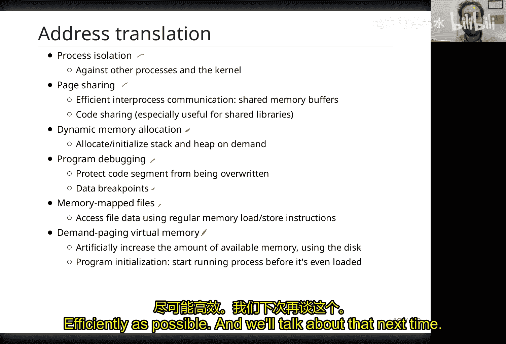

# 026：地址转换（第三部分）

在本节课中，我们将继续探讨虚拟内存实现中的地址转换问题。我们将回顾分段机制，并深入讨论分页机制，特别是如何解决线性页表过大的问题，以及如何通过多级页表和转换后备缓冲器（TLB）来优化性能。

## 分段机制回顾

上一节我们介绍了内存分段机制。其核心思想是，每个进程都认为自己拥有一个从地址0开始的连续内存布局（代码段、数据段、堆、栈等）。然而，实际上，这些段被分散地放置在物理内存的不同位置。

当进程发出一个虚拟地址时，处理器会通过一个**段表**来动态地将该地址转换为物理地址。段表记录了每个段在物理内存中的起始位置（基址）和大小（界限）。转换过程如下：

1.  确定虚拟地址属于哪个段（例如，代码段）。
2.  从段表中获取该段的基址和界限。
3.  检查虚拟地址偏移量是否在界限内。
4.  通过公式 **物理地址 = 段基址 + 虚拟地址偏移量** 计算出物理地址。

分段机制的优势在于支持段共享和保护，并且允许段（如栈）动态增长。但其主要缺点是可能导致**外部碎片**，因为每个段必须在物理内存中连续存放，并且段表的条目数量有限，限制了可用的段数。

## 分页机制及其挑战

为了克服分段的局限性，我们引入了分页机制。其核心思想是将虚拟和物理内存都划分为固定大小的块（页和页框），并通过一个**页表**来建立虚拟页到物理页框的映射。

这种方法非常灵活，因为一个段（如代码段）可以由多个不连续的虚拟页组成，这些页可以映射到物理内存中任意可用的页框上，从而避免了外部碎片。

然而，简单的线性页表存在一个严重问题：**它可能非常庞大**。以一个典型的32位系统为例，假设页大小为4KB：

*   虚拟地址被分为20位的页号和12位的页内偏移。
*   这意味着页表需要 2^20（约100万）个条目。
*   如果每个条目占4字节，那么一个进程的页表就需要4MB内存。
*   对于64位系统，问题会更加严重，线性页表的大小将变得完全不切实际。

显然，我们需要更高效的方法来组织页表映射信息。

## 优化页表：观察与思路

一个关键的观察是：**大多数进程只使用了其虚拟地址空间的一小部分**。例如，一个简单的“Hello World”程序，其代码、数据、堆栈等段只占用了整个64位地址空间中几个微小的区域，其余绝大部分地址空间都是未使用的。

因此，我们不需要为所有可能的虚拟页都创建页表条目。我们只需要为那些实际被使用的页保留映射信息。基于这个观察，有两种主要的优化策略。

### 策略一：段页式存储管理

段页式结合了分段和分页的思想。以下是其工作原理：

1.  首先，像分段一样，识别出进程地址空间中的各个逻辑段（代码、数据、堆、栈）。
2.  每个段在段表中有一个条目。
3.  然后，将每个段内部进一步划分为固定大小的页。
4.  为每个段维护一个独立的页表，负责该段内虚拟页到物理页框的映射。

当处理器发出虚拟地址时：
*   先通过段表确定该地址属于哪个段。如果地址落在未使用的区域，则直接触发段错误。
*   如果地址属于有效段，则再利用该段对应的页表进行地址转换。

这种方法可以快速丢弃大片的未使用地址空间。但其缺点仍然是受限于段表的条目数量。

### 策略二：多级页表

多级页表是更流行的解决方案。其核心思想是**将页表本身也进行分页**，形成树状结构。以两级页表为例：

1.  第一级页表（页目录）将整个虚拟地址空间划分为大的区块（例如4MB）。
2.  每个一级条目指向一个第二级页表。
3.  第二级页表才管理该4MB区块内的具体4KB页。

其优势在于：
*   如果一个大区块（如4MB）完全未被使用，那么在第一级页表中，对应的条目可以标记为“无效”。这样，我们就不需要为该区域分配任何第二级页表，从而节省了大量空间。
*   只为实际使用的内存区域分配细粒度的页表。

现代64位系统通常使用更多级（如4级或5级）的页表来管理巨大的地址空间。

## 转换后备缓冲器（TLB）

多级页表带来了一个新的问题：每次内存访问现在可能需要多次访问内存来遍历页表（即“页表漫步”），这会造成巨大的性能开销。

为了解决这个问题，我们利用了程序的**局部性原理**：进程在短时间内倾向于反复访问相同的代码和数据页。因此，我们可以缓存最近使用过的地址转换结果。

**转换后备缓冲器（TLB）** 就是这样一个专用于缓存地址转换的高速缓存。它位于CPU内部，访问速度极快。

地址转换过程现在变为：
1.  CPU发出虚拟地址。
2.  首先查询TLB。如果TLB中缓存了该虚拟页号对应的物理页框号（即**TLB命中**），则立即合成物理地址，访问内存。
3.  如果TLB中没有该转换（即**TLB未命中**），则必须进行页表漫步来查找正确的映射。找到后，除了完成本次内存访问，还会将这个新的转换条目载入TLB，以备后续使用。

由于局部性，TLB命中率通常很高，使得绝大多数内存访问都能避免昂贵的页表漫步。

### TLB管理细节

TLB像普通缓存一样，可以是全相联或组相联的。现代CPU通常具有多级TLB（如L1 TLB和L2 TLB），L1 TLB可能只有几十到几百个条目，但因其高命中率而非常有效。

当发生TLB未命中时，有两种处理方式：
*   **硬件处理**：CPU的硬件逻辑自动执行页表漫步并填充TLB。这种方式速度快，但要求页表格式固定，且增加了CPU硬件的复杂性。
*   **软件处理**：TLB未命中会触发一个异常，CPU切换到操作系统内核。由内核中的软件例程执行页表漫步，并将转换结果手动加载到TLB中，然后恢复被中断的进程。这种方式硬件简单且灵活，但速度较慢。

### TLB的特殊问题

**问题一：进程切换**
每个进程都有自己的虚拟地址空间，相同的虚拟地址在不同进程中映射到不同的物理地址。因此，当从一个进程切换到另一个进程时，TLB中缓存的旧进程的转换条目就失效了。

解决方案是为每个TLB条目增加一个**进程ID（PID）标签**。这样，TLB在查找匹配时，不仅要比较虚拟页号，还要比较PID。从而，不同进程的转换条目可以共存于TLB中，进程切换时无需清空整个TLB。

**问题二：一致性**
操作系统可能修改页表（例如，更改某个页的访问权限）。此时，TLB中缓存的旧转换条目就与内存中的页表内容不一致了。

解决方案包括：
*   **TLB刷新**：当OS修改某个页的映射或权限后，可以指令CPU从TLB中**使该特定条目无效**。
*   **多核TLB同步**：在多处理器系统中，一个CPU修改了页表，需要通知其他所有CPU，让它们各自刷新自己TLB中的相关条目。这通常通过处理器间中断（IPI）来实现。

## 虚拟内存与地址转换的优势总结

本节课我们一起学习了地址转换的高级机制。通过分页和多级页表，我们能够高效地管理巨大的虚拟地址空间，而TLB则极大地缓解了页表漫步带来的性能损失。综合来看，虚拟内存和地址转换提供了以下关键优势：

*   **进程隔离**：每个进程拥有独立的地址空间，无法干扰其他进程或内核。
*   **内存共享**：通过将不同进程的虚拟页映射到相同的物理页框，可以实现内存页的共享。
*   **高效的内存分配**：可以动态地分配和释放页来扩展或收缩堆、栈等区域。
*   **内存保护**：可以设置页的读、写、执行权限，防止代码被意外修改，或用于实现调试断点。
*   **内存映射文件**：可以将文件直接映射到进程地址空间，像访问内存一样访问文件内容。

在下一讲中，我们将探讨**请求调页**，这是虚拟内存系统的核心，它允许程序使用的内存总量超过物理内存容量，并通过在内存和磁盘之间交换页来实现。