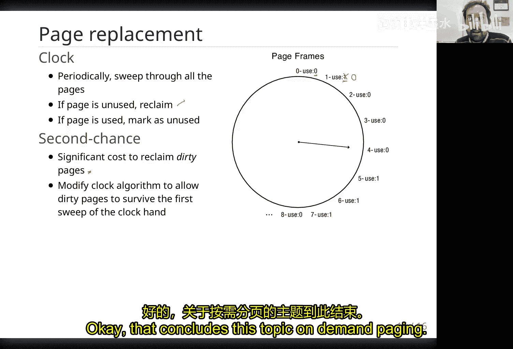

# 027：请求分页 📄

在本节课中，我们将学习操作系统中的一项关键技术——请求分页。这项技术允许进程在运行时，不必将其全部代码和数据一次性加载到物理内存中，从而更高效地利用内存资源。

上一节我们介绍了地址转换机制，它允许进程的虚拟地址空间被灵活地映射到物理内存的非连续页帧上。然而，我们之前仍假设进程运行所需的全部内存都必须驻留在物理内存中。本节中，我们将探讨如何通过请求分页技术，进一步优化内存使用。

## 请求分页的基本原理

请求分页的核心思想是：仅当进程真正需要访问某个页面时，才将其从磁盘加载到物理内存中。这基于进程访问内存时表现出的**局部性原理**。

进程通常会表现出两种局部性：
*   **时间局部性**：如果一个内存项被访问，那么它在不久的将来很可能再次被访问。
*   **空间局部性**：如果一个内存项被访问，那么其附近的内存项在不久的将来也很可能被访问。

因此，进程在任意时刻实际活跃使用的内存（称为**工作集**）通常只占其总虚拟地址空间的一小部分。请求分页正是利用了这一点。

## 请求分页的工作流程

以下是请求分页处理一次页面访问的基本步骤：

1.  **触发页错误**：当进程试图访问一个尚未加载到物理内存的页面（称为**非驻留页**）时，会发生页错误。
2.  **内核介入**：CPU陷入内核态，操作系统接管处理。
3.  **验证访问合法性**：内核检查该虚拟地址是否属于进程的合法段（如代码段、数据段）。如果不是，则引发段错误；如果是合法访问但页面不在内存，则继续。
4.  **定位数据**：内核在磁盘上（对于代码和初始数据在可执行文件中，对于堆栈等动态数据在交换空间）找到所需页面的数据。
5.  **分配页帧**：内核在物理内存中寻找一个空闲页帧来存放即将加载的数据。如果内存已满，则需要执行**页面置换算法**选择一个“牺牲”页帧，将其内容换出。
6.  **加载数据**：将所需页面的数据从磁盘读入分配的物理页帧。
7.  **更新页表**：修改进程的页表，建立该虚拟页面到新物理页帧的映射关系。
8.  **恢复进程**：内核让引发页错误的指令重新执行。这次，由于页表中已存在有效映射，内存访问将成功完成。

整个过程可能涉及多次TLB未命中和页表遍历，但由于页错误相对罕见（得益于局部性），其开销是可接受的。

## 页面置换算法

当物理内存已满，需要为新页面腾出空间时，操作系统必须决定将哪个现有页面换出。以下是几种常见的页面置换算法：

### 先进先出 (FIFO)

FIFO算法选择在内存中驻留时间最长的页面进行置换。

**优点**：实现简单。
**缺点**：性能可能很差，因为它可能换出频繁使用的页面。此外，它可能表现出**Belady异常**，即增加可用页帧数反而可能导致更多的页错误。

### 最优置换 (OPT/MIN)

OPT算法是一种理论上的最优算法，它选择在未来最长时间内不会被访问的页面进行置换。

**公式表示**： 选择满足 `max(未来再次访问的时间距离)` 的页面进行置换。

**优点**：提供了页错误数量的下界，用于衡量其他算法的优劣。
**缺点**：无法在实际中实现，因为它需要预知未来的页面访问序列。

### 最近最少使用 (LRU)

LRU算法选择在过去最长时间内没有被访问的页面进行置换。它是对OPT算法的一种近似。

**优点**：通常比FIFO性能更好，更符合程序的访问模式。
**缺点**：精确实现LRU的硬件开销较大。

#### 时钟算法 (近似LRU)

由于精确LRU实现复杂，实践中常用**时钟算法**进行近似。它利用页表项中的**访问位**来实现。

**算法描述**：
1.  将所有页帧组织成一个环形链表（类似时钟面）。
2.  有一个“指针”指向某个页帧。
3.  当需要置换页面时，检查指针指向的页帧：
    *   如果其访问位为0，则选择该页帧进行置换。
    *   如果其访问位为1，则将其访问位置0，然后将指针移动到下一个页帧，重复此过程。

#### 二次机会算法

这是对时钟算法的改进，同时考虑了**访问位**和**修改位**。被修改过的页面（脏页）换出成本更高，因为它需要写回磁盘。

**算法描述**：
在时钟算法的基础上，优先选择`(访问位=0， 修改位=0)`的干净页面进行置换。对于脏页，即使其访问位为0，也给予一次“第二次机会”，仅将其访问位置0而不立即换出，留待下一轮扫描。

## 修改位与访问位

硬件（通常通过TLB和页表）会协助操作系统跟踪页面的使用情况：

*   **修改位**：当页面被写入（修改）时，该位被置1。这表明页面内容与磁盘副本不一致，在换出前必须写回磁盘。
*   **访问位**：当页面被读取或写入（任何访问）时，该位被置1。操作系统可以定期清零此位，以判断页面在最近一段时间内是否被访问过，这对实现时钟等算法至关重要。

## 总结

本节课中，我们一起学习了请求分页技术。我们了解到，通过仅加载进程工作集所需的页面，可以极大地提高内存利用率和系统并发能力。当所需页面不在内存时，会触发页错误，由操作系统负责从磁盘加载。当物理内存不足时，需要使用页面置换算法（如FIFO、LRU及其近似实现时钟算法）来决定换出哪个页面。硬件提供的修改位和访问位为这些算法提供了关键支持。请求分页成功地为进程创造了一个比实际物理内存大得多的虚拟地址空间的假象。