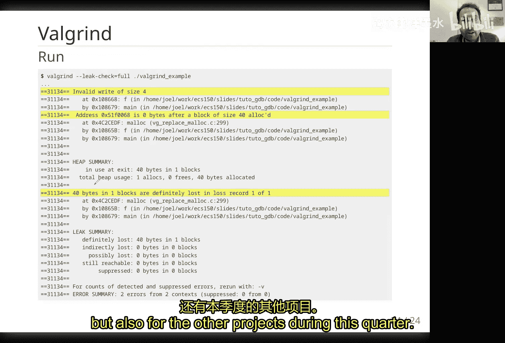

# 029：调试 🐛


在本节课中，我们将学习如何使用调试工具，特别是GDB，来诊断和修复程序中的错误。我们将从GDB的基础知识开始，逐步介绍如何设置断点、检查程序状态、跟踪执行流程，以及如何使用Valgrind检测内存问题。课程内容旨在简单明了，帮助初学者快速上手。

---

## 什么是GDB？🔍

GDB是GNU项目的一部分，由Richard Stallman于1983年在MIT发起。该项目旨在开发一个完全自由、可修改和可重新分发的完整软件栈，包括操作系统内核、应用程序和各种工具。GDB作为其中的调试器，支持多种语言，如C、C++、Go等，允许开发者检查程序的执行流程和数据状态。

---

## 如何使用GDB？🚀

要使用GDB，首先需要确保程序在编译时启用了调试支持。通常，我们使用GCC编译程序，并通过指定`-g`选项来启用调试信息。例如：

```bash
gcc -g -o my_program my_program.c
```

需要注意的是，在调试时应避免同时使用优化选项（如`-O2`），因为这可能会使调试过程变得复杂。为了在调试和发布版本之间切换，可以在Makefile中设置条件编译。例如：

```makefile
ifeq ($(D),1)
    CFLAGS = -g
else
    CFLAGS = -O2
endif
```

通过命令行输入`make D=1`可以编译调试版本，而直接输入`make`则编译优化版本。

---

## 启动GDB 🖥️

启动GDB有两种方式：
1. 直接运行`gdb`，然后在GDB提示符下使用`file`命令加载程序。
2. 运行`gdb`并直接指定程序名称作为参数，例如：
   ```bash
   gdb my_program
   ```

在GDB中，可以使用`run`命令运行程序。如果程序需要命令行参数，可以在`run`后指定，例如：
```bash
run arg1 arg2
```

如果对GDB命令不熟悉，可以使用`help`命令查看帮助信息。例如，输入`help breakpoints`可以查看与断点相关的命令。

---

## 调试场景分析 🧩

程序运行时可能遇到三种场景：
1. 程序运行正常，没有错误。
2. 程序崩溃（如段错误），这是相对容易调试的情况。
3. 程序运行但结果不正确，这是较难调试的情况。

接下来，我们将通过具体示例分析这些场景。

---

## 示例一：段错误分析 💥

以下是一个简单的程序，调用`strlen`函数计算字符串长度，但传入了一个空指针：

```c
#include <stdio.h>
#include <string.h>

int full_len(char *s) {
    return strlen(s);
}

int main() {
    char *str = NULL;
    printf("Length: %d\n", full_len(str));
    return 0;
}
```

运行该程序会导致段错误。使用GDB调试时，首先运行程序：
```bash
gdb my_program
run
```

当程序崩溃时，可以使用`backtrace`（或`bt`）命令查看函数调用链：
```bash
bt
```

输出可能如下：
```
#0  strlen () at ...
#1  full_len (s=0x0) at ...
#2  main () at ...
```

从输出中可以看出，`full_len`函数接收了一个空指针，导致`strlen`函数崩溃。修复方法是在`full_len`函数中添加断言，确保指针不为空：

```c
#include <assert.h>

int full_len(char *s) {
    assert(s != NULL);
    return strlen(s);
}
```

这样，当传入空指针时，程序会触发断言失败，而不是段错误，从而更容易定位问题。

---

## 示例二：数组越界访问 📊

以下程序尝试访问数组的非法索引：

```c
#include <stdio.h>

int main() {
    unsigned int i;
    int tab[10];
    for (i = 9; i >= 0; i--) {
        tab[i] = i;
    }
    return 0;
}
```

由于`i`是无符号整数，当`i`减到0后再减1会变为最大值（约40亿），导致数组越界访问。使用GDB调试时，可以在程序崩溃后打印`i`的值：

```bash
print i
```

输出可能显示`i`的值为一个非常大的数，从而揭示问题所在。修复方法是将`i`改为有符号整数：

```c
int i;
```

---

## 示例三：行为错误调试 🔄

以下程序尝试将字符串中的所有字符转换为大写，但最后一个字符未转换：

```c
#include <stdio.h>
#include <ctype.h>

int main() {
    char str[] = "Hello World";
    for (int i = 0; str[i] != '\0'; i++) {
        str[i] = toupper(str[i]);
    }
    printf("%s\n", str);
    return 0;
}
```

程序运行后输出`HELLO WORLd`，最后一个字符仍为小写。这类错误不会导致程序崩溃，但结果不正确。使用GDB调试时，可以设置断点逐步执行程序，检查变量状态。

---

## 设置断点 🛑

GDB允许通过以下方式设置断点：
1. 按行号设置断点：
   ```bash
   break file.c:10
   ```
2. 按函数名设置断点：
   ```bash
   break main
   ```
3. 按条件设置断点：
   ```bash
   break file.c:13 if i == 5
   ```

断点设置后，可以使用以下命令控制程序执行：
- `continue`：继续执行直到下一个断点。
- `step`：单步执行，进入函数内部。
- `next`：单步执行，但不进入函数内部。

---

## 检查变量状态 📝

在GDB中，可以使用`print`命令检查变量值。例如：
```bash
print i
```

如果变量是指针，可以解引用查看其指向的值：
```bash
print *ptr
```

还可以指定输出格式，例如以十六进制显示整数：
```bash
print/x i
```

---

## 使用观察点 👀

观察点用于在变量值发生变化时中断程序执行。例如，设置观察点监视变量`i`：
```bash
watch i
```

当`i`的值发生变化时，GDB会中断并显示旧值和新值。

---

## 其他有用命令 🛠️

- `finish`：执行完当前函数后中断。
- `until`：执行完当前循环后中断。
- `info breakpoints`：显示所有断点信息。
- `delete breakpoints`：删除断点。

---

## 使用Valgrind检测内存问题 🧠

Valgrind是一个强大的内存检测工具，可以检测内存泄漏和非法内存访问。以下是一个存在内存问题的示例程序：

```c
#include <stdlib.h>

void func() {
    int *arr = malloc(10 * sizeof(int));
    arr[10] = 42; // 非法访问
    // 内存泄漏：未释放分配的内存
}

int main() {
    func();
    return 0;
}
```

使用Valgrind检测内存问题：
```bash
valgrind --leak-check=full ./my_program
```

Valgrind会报告非法内存访问和内存泄漏的详细信息，帮助定位问题。

---

## 总结 📚



本节课我们一起学习了如何使用GDB和Valgrind调试程序。通过设置断点、检查变量状态、跟踪执行流程以及检测内存问题，我们可以更有效地诊断和修复程序中的错误。希望这些工具和技巧能帮助你在未来的项目中更轻松地应对调试挑战。