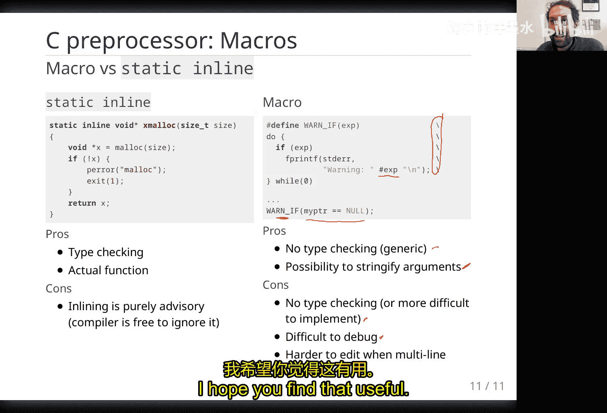

# 031：C语言中的宏 🧩


在本节课中，我们将要学习C语言中一个非常强大但需要谨慎使用的特性：宏。我们将探讨宏的基本概念、常见用法、潜在陷阱以及如何安全有效地使用它们。

## 概述

宏是C语言预处理器提供的一种文本替换机制。它允许程序员定义一些名称，这些名称在编译前会被替换为指定的代码或值。宏可以用于定义常量、创建代码片段，甚至模拟函数行为。然而，由于其本质是文本替换，使用不当可能导致难以察觉的错误。

## 宏与枚举：定义常量

在C语言中，我们经常需要定义一些常量。宏和枚举是两种常见的方法。

### 使用宏定义常量

宏可以用来将一个名称与一个值关联起来。在代码中使用这个名称，预处理器会在编译前将其严格替换为对应的文本。这本质上是一种搜索和替换操作。

以下是一个使用宏定义线程状态的例子：
```c
#define ST_RUNNING 0
#define ST_READY 1
#define ST_BLOCKED 2
```
在P2线程库中，这种方法非常适合用来确定线程控制块中线程的状态。

### 使用枚举定义常量

然而，当值从0开始并依次递增时，使用枚举可能比使用一堆宏定义更可取。

以下是使用枚举的相同例子：
```c
enum thread_state {
    ST_RUNNING,
    ST_READY,
    ST_BLOCKED
};
```
使用枚举有几个优点：
1.  **自动编号**：默认情况下，枚举的第一个值为0，后续值会自动递增。你无需手动指定，编译器会为你处理。
2.  **编译器检查**：如果你在一个`switch`语句中使用了枚举类型的变量，编译器会检查你的`switch`是否覆盖了该枚举的所有可能值。如果使用宏，编译器则无法进行这种检查。
3.  **调试友好**：使用GDB等调试器时，枚举的名称对调试器是有意义的。如果使用宏，你只能看到数值（如0，1，2），需要自己对照源代码查找对应的状态。

枚举的一个潜在缺点是，在C语言中，当你声明一个枚举类型的变量时，编译器会自行选择底层类型（可能是`char`、`int`或`short int`等），你无法控制。C++提供了指定底层类型的能力，但C语言没有。

### 如何选择

*   **当值是连续的**时，通常首选枚举。
*   **当值是任意的、非连续的**时，宏是更合适的选择。例如，定义寄存器地址或特定频率值：
    ```c
    #define HERTZ 100
    #define REG_STATUS 0x1F
    ```

## 宏的代码替换功能与陷阱

宏另一个极其流行的用法是进行代码替换。

### 基本示例与第一个陷阱

假设你的代码中需要多次将变量乘以2，你可以定义一个宏来复用代码：
```c
#define TWICE(x) 2 * x
```
当你调用`TWICE(a)`时，它会被展开为`2 * a`。

然而，这种简单的替换存在陷阱。考虑以下代码：
```c
c = TWICE(a + 1) * 3;
```
你的本意是计算`(a + 1) * 2 * 3`。但预处理器会进行严格的文本替换，将其展开为：
```c
c = 2 * a + 1 * 3;
```
由于乘法运算符`*`的优先级高于加法运算符`+`，实际计算的是`(2 * a) + (1 * 3)`，这并非你的本意。

**解决方法**：始终将宏本身及其所有参数用括号括起来。
```c
#define TWICE(x) (2 * (x))
```
现在，`TWICE(a + 1) * 3`会被正确展开为`(2 * (a + 1)) * 3`。

### 第二个陷阱：多语句宏与分号

有时我们希望一个宏能执行多个操作。例如，在内存分配失败时打印错误信息并退出程序。

一个初版的宏可能如下：
```c
#define DIE_PRINT(x) printf(“%s failed\n”, x); exit(1);
```
如果我们在`if`语句中使用它：
```c
if (a == NULL)
    DIE_PRINT(“malloc”);
```
预处理器展开后，代码变为：
```c
if (a == NULL)
    printf(“%s failed\n”, “malloc”); exit(1);
;
```
这会导致问题：由于`if`后没有花括号，只有`printf`属于`if`的条件体，`exit(1)`和后面的空语句`;`总是会被执行。

**尝试改进**：在宏定义中加入花括号。
```c
#define DIE_PRINT(x) { printf(“%s failed\n”, x); exit(1); }
```
这有所改善，但调用宏时末尾的分号`;`会显得多余且奇怪，因为它并不结束任何语句，还可能引发其他语法上的混淆。

**最佳解决方案**：使用`do { … } while(0)`结构。
```c
#define DIE_PRINT(x) \
    do { \
        printf(“%s failed\n”, x); \
        exit(1); \
    } while (0)
```
这个结构创建了一个只执行一次的循环。`while(0)`保证循环不会重复，而整个`do…while`语句需要一个分号`;`来结束，这正好与我们调用宏时习惯性添加的分号匹配。这是一种在C代码库中广泛使用的可靠模式。

### 第三个陷阱：参数多次求值

一个非常常见的宏是求两个值的最大值：
```c
#define MAX(x, y) ((x) > (y) ? (x) : (y))
```
这个宏使用了括号，避免了优先级问题。但它仍有缺陷：参数`x`或`y`可能会被求值两次。

考虑以下调用：
```c
d = MAX(++a, b);
```
如果`a`原本是最大的，本意是`a`先自增1，然后与`b`比较，并将自增后的值赋给`d`。但宏展开后是：
```c
d = ((++a) > (b) ? (++a) : (b));
```
如果`++a > b`为真，那么`++a`会被执行两次，`d`最终得到的是`a`自增两次后的值。

**解决方案**：使用复合语句和`typeof`关键字（GCC扩展，广泛支持）来创建只求值一次的临时变量。
```c
#define MAX(x, y) ({ \
    typeof(x) _x = (x); \
    typeof(y) _y = (y); \
    _x > _y ? _x : _y; \
})
```
这个宏的原理是：
1.  `({ ... })`是一个返回最后一个表达式值的语句表达式。
2.  `typeof(x)`获取参数`x`的类型，并以此声明临时变量`_x`和`_y`。这使得宏可以处理任意类型。
3.  参数`x`和`y`只被求值一次，结果存入临时变量。
4.  比较和返回值操作在临时变量上进行，安全无误。

## 让宏返回值

我们可以利用语句表达式`({ ... })`让宏返回一个值。这在创建一些复杂的、类似函数的宏时非常有用。

一个简单的例子：
```c
int b = ({
    int local = 5;
    printf(“Inside macro\n”);
    local * 2; // 这个值会被返回并赋值给b
});
```
在这个复合语句块中，最后一个语句`local * 2;`的值（注意没有分号）将作为整个表达式的结果返回。

### 应用示例：安全的分配宏

我们可以创建一个“安全”的内存分配宏，它在分配失败时自动报错并退出。
```c
#define XMALLOC(size) ({ \
    void *_ptr = malloc(size); \
    if (_ptr == NULL) { \
        fprintf(stderr, “malloc failed for size %zu\n”, (size_t)(size)); \
        exit(1); \
    } \
    _ptr; \
})
```
在代码中，你可以这样使用：`int *arr = XMALLOC(10 * sizeof(int));`。如果分配成功，`arr`获得指针；如果失败，程序会打印错误并退出。

## 宏 vs. 静态内联函数

对于`XMALLOC`这种功能，更现代和安全的做法是使用**静态内联函数**：
```c
static inline void *xmalloc(size_t size) {
    void *ptr = malloc(size);
    if (ptr == NULL) {
        fprintf(stderr, “malloc failed for size %zu\n”, size);
        exit(1);
    }
    return ptr;
}
```

### 两者对比

| 特性 | 宏 | 静态内联函数 |
| :--- | :--- | :--- |
| **本质** | 预处理器文本替换 | 真正的函数 |
| **类型检查** | 无。参数和返回值类型是泛化的。 | 有。编译器会检查参数和返回值类型。 |
| **调试** | 较困难。展开后的代码融入调用处。 | 较容易。通常有函数符号。 |
| **灵活性** | 高。可以使用`#`（字符串化）、`##`（连接）等运算符，实现元编程。 | 低。遵循标准函数语法。 |
| **代码长度** | 可能增加。每次调用都展开完整代码。 | 由编译器决定是否内联展开。 |
| **适用场景** | 简单的代码复用、泛型操作、需要字符串化等特殊功能时。 | 行为类似函数、逻辑较复杂、需要类型安全时。 |

**一个宏的特殊能力示例：字符串化**
```c
#define WARN_IF(expr) \
    do { \
        if (expr) \
            fprintf(stderr, “Warning: “ #expr “\n”); \
    } while (0)
```
调用`WARN_IF(ptr == NULL)`时，`#expr`会将参数`ptr == NULL`转换成字符串`”ptr == NULL”`，从而生成有意义的警告信息。这是函数无法直接做到的。

## 总结

本节课中我们一起深入探讨了C语言中的宏。
*   我们学习了使用**宏和枚举定义常量**的适用场景与优劣。
*   我们详细分析了使用宏进行**代码替换时常见的三个陷阱**：运算符优先级问题、多语句宏的分号问题、参数多次求值问题，并掌握了各自的解决方案（使用括号、`do…while(0)`结构、利用`({})`和`typeof`创建临时变量）。
*   我们了解了如何利用**语句表达式**让宏返回值，并实现了类似函数的功能。
*   最后，我们对比了**宏与静态内联函数**，理解了它们各自的优缺点和适用场合。



宏是C语言中一把强大的双刃剑。它提供了无与伦比的灵活性和代码生成能力，但也因其文本替换的本质而暗藏风险。作为程序员，我们的目标是理解其原理，遵循最佳实践，在合适的场景下安全地利用它的力量，而在追求安全性和可维护性时，优先考虑使用函数（包括内联函数）。