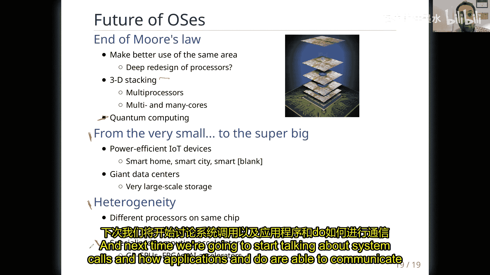

# 【全集 附课件】加州大学戴维斯分校 操作系统与系统编程 中英字幕 1080P p01 Lecture 1 - 操作系统简介 -BV1jXr5BBEKa_p1-

Hi， everybody。So today for this first lecture， we're going to try to start defining what an operating system actually is。

嗯。Once upon a time， it actually wasn't really big deal to try to define what an OS was because it was pretty much like whatever piece of software was included with a computer when you would buy it at the store so I don't know back in like the early 90s。

 you would buy an IBM PC with Windows 3。1 and the OS was pretty much whatever was installed on the computer when you would boot it for the first time and then you would install other applications。

Interestingly enough， the definition of an OS like B became important at the end of the 90s when Microsoft was faced with antitrust charges from the US Department of Justice in '98 because they started including too much in their OS claiming that it was part of the OS and it was preventing competition。

So specifically it was about internet Explorer。😊，Like Microsoft was requiring Internet Explorer because they were claiming that it was part of DOOS and that like you absolutely needed it。

 except that other web browser vendors such as nextscape or Op wanted to also promote their own web browsers and they had very little market shares because Windows was like getting everything with Internet Explorer。

And ultimately it was defined， well Internet Explorer is a web browser it has like there's no way it's required it's not an essential part of the OS。

 it's just a regular application。So that's when it kind of became important。

And so let's start with kind of a good definition， I guess。

 and for now we're going to explore and later we're going to see that it's a little bit more complicated than that。

 but at least let's start from there。😊，嗯。😊，A new。Is。Software， that's a layer of software。

That sits between the application and the computer， the hardware。And that layer of software。

 the OS is pretty much in charge。Of managing the computers resources for the application and for the users。

 the human beings using those applications。And。So that's pretty much a good definition。

 I understand that might be a little vague for now， but like we're going to explore in this course。

 what exactly it means， like what is this layer of software and what are those resources that are supposed to be managed。

For now， let's start with the first。Let's start like focusing on the first part。

 what is this computer， like what is the computer resources that need to be managed so that we're showing on the same part。

At the same page。so as you know， a computer can have many different forms， right。

 you have typical desktop computers。You have servers such as like you know internet servers。

 so that's the kind of computers that would be piled on top of one another in those like big cabinets as part of big data centers。

Then you also have very small computers， such as computers you can find in Internet of things。

 for example。And you even have nowadays like computers， pretty powerful powerful ones in cars。

 like for self driving cars， for example， you have like pretty intense computers in the cars。

What matters here to understand is that regardless of the type of computer， whether it's a desktop。

 a server or whatever， like a computer always has。Pretty much like the same basic structure。

If you really like narrow it down to the most essential components that you can find in a computer。

 that's what you find。You have a CPU， obviously， you have memory。And then you have a few devices。

 so you have an inter controller so that different devices can interrupt the processor when they have some like notifications to make。

You have a timer to keep track of time。You have a way to interact with the user through a certain interface。

 and that means at least like being able to send some bys out of the computer and receive some bytes so that you can communicate。

And optionally， but most of the time you have persistent storage。

 so way for the computer to write some data that will not be lost when the computer is turned turned off and then will still be available when it's turned on again later。

And。And that's pretty much it like that's really the bare minimum if you want to have a functional computer。

And that basic structure you can find again， in more realistic representation， so for example。

 let's take a typical chipet that you would find in a desktop computer or in a laptop computer and you have all of those components。

You have the CPU， which probably here like includes also the inter controller and the timer。

You have the memory， you have like the Per storage could be a hard drive that's connected through the SaA interface and you have a way to communicate with the user。

 for example， via like the HDMI display and then you can receive keystrokes from the keyboard via say like USB or something like that。

 so you have this structure it's always like that。Let's take another example here with。

Something that is called an embedded system， so that's typically the kind of chips you would find in a smartphone。

 something that runs like a Android or something like that and again you can find that there's a CPU。

You can find memory。You can find various device controllers here to have access to persistent storage。

 so either SDIO if you want to be connected to an SD card or a satA if you're connected to an SSD or to hard drive or a simple UO if you want to send bytes on a wire and receive bytes on a wire and so on。

 but again， exact same like structure， you always find those components regardless of how the actual computing system is complex on that。

嗯。So let's zoom actually a little bit more on those different hardware components and let's start with the first one。

 the most important one， the processor。So what's a processor， It's pretty simple。

 it's a piece of hardware， it's a component that is pretty much in charge of reading instructions from the memory of the computer and executing them。

Right。Those instructions or the list of instructions that a processor can understand and execute is called the instruction set and so usually like one type of processor will be compatible with one kind of instruction set。

And so you have processors that are compatible with。X 86， 32 bit x X 36。64 bit x 86 or like arm。

64 bit and so on。嗯。Instructions， they usually belong in three different categories。

 you have instructions that can access the memory either to like write data or to read data you have instructions that can operate some perform some operations like arithmetical operations or logical operations to compute some values and you have instructions that can like affect the control flow。

 so that's how you realize like loops or if conditions and so on。

And finally the processor contains a set of registers。

 so that's how the processor can fetch data from the memory and then perform some operation on that data and store the results somewhere before putting it back into the memory。

 those registers they're here for that， they're kind of like a temporary small memory so that the processor can work on values very fast。

嗯。So that's for the general purpose registers， we also have the program counter。

 so that's a specific kind of register that contains the address of where we're at currently in the program that's being executed。

And finally， we have something called the status register that contains the current configuration of the processor we'll have the opportunity to talk about that a little later in the quarter。

嗯。So that's for the processor。Now we have the memory。De memoryry。Is a massive array of bites。

Where everybody bite has an address。And that's how the processor can access the memory。

 Like the processor gives an address to the memory saying like， okay。

 I want to read what the value these bytes at address X is。

 And then the memory like can send the data back。 or the processor can write any data at any byte in the memory。

 That's pretty much all there is。Now this memory is kind of organized in a computer in different layers。

 so we mentioned the CPU registers， those are values that the CPU can access directly via CPU instructions。

Then we have the main memory， that's the massive array that I'm talking here about。

And all of the main memory is accessible， like is addressable。

 accessible from the CPU by providing a certain address。 We can access any bytes in the memory。😊。

Then we have something that sits right in the middle or closer to the CPU。

 which is called the CPU cache。The CPU cache is not addressable。

 The CPU cannot directly access something that's in the cache because the CPU has no idea that a certain piece of data is in the cache。

 The CPU is only knows about the memory and only issues addresses that are relevant for the memory。

Then it turns out that if this piece of data is in the cache。

Then the cash wallet I kind of steal the request and answer it faster than the memory would。

But from the CPU's point of view， the cache is completely transparent。 It's not visible。

And further down， this。Hierarchy of layers。 We have the second level storage。

 So here we're really talking about like having a hard drive an SSD to contain a persistent data。

That data is not directly addressable， it's not as easy as the processor just giving an address and receiving the data back。

 you have to like configure some sort of device controller to have the second level storage like give you the data that you're looking for。

 but' actually we're going to spend like quite a few amount of time talking about that。

In a few weeks， so we'll get back to that。嗯O。And so CPU memory， and next we have devices， Io devices。

 input output devices。What's important to know about I devices is that they' are usually made of two different parts。

The first part is called a controller。That's what you have on the same chip as the processor。

 Like that's what the processor actually sees。 That's that's the piece of the the device that the processor can really like interact with because the controller will expose different registers。

And access them and the CPU will be able to access them directly。

And then on the other side of this controller， which is kind of like the interface of the device for the CPU。

 you have the actual Io device， which is performing what the device is supposed to be doing。 So。

 for example， if the device is a Wifi interface。The actual i device would be the wfi antenna。

 like the thing that really sends whatever like I don't know how wfi works exactly， but send like。

Waaves of frequencies out in the world to another computer。

So the CPU would only see the controller and would only be able to interact with the register and then through some electrical signal。

 the controller will really like instruct the device like， okay。

 send this network packet out in the air like to this IP address also。嗯。😊。

The processor usually there are two ways for a processor to interact with the device controller。

There's a way that's called memory map access。 So when a device controller is mapped in memory is memory mapped。

 it means that the CPU can access this device controller in exactly the same way as the CPU accesses memory。

It did a certain address on the bus。And instead of going to memory。

 it goes to the device controller directly。That's the majority of computers work using these kind of access nowadays。

And kind of back in the day， there was another way of accessing。

Devices which was called pot mapped access and so here the CPU would actually have a certain way of accessing memory and another way to access devices and that would usually mean that like the CPU would need to use different instructions。

To access devices， then it uses to access memory so they were like kind of on two different buses。

 whereas with memory map access， both memory and devices are on the same bus like they share the same bus。

Anyway。Okay。And so last but not least we have those different components like CPU memory and I devices and we need a way to have them like talk to one another so we need something in the middle which we call an interconnect which is also known as a bus or a network there are different names and so the goal of the interconnect is that the CPU can talk to the memory by sending some information on the interconnect or between the CPU and the devices and so on。

嗯。There are different kinds of interconnects or buses， usually we separate them into two categories。

 There's often a bus between the CPU and the memory and usually that's a bus that needs to be like super。

 super fast。And then we have buses between the CPU and devices and that bus doesn't need to be as fast and as you can see like throughout the past what four years。

 there have been like multiple different buses， like bus protocols。And the。

 the bandwidth has increased quite a bit。Okay。So now now that。

 now that we have a pretty good understanding or we're clear on what the hardware is。

 like what exactly。The Os needs to be sharing。 Like。

 what are those resources that the Os needs to be sharing。

 Let's go back to this Os and further complete its definition。

And we're going to do that through two different aspects。

We're going to talk about the roles that NOS is supposed to fulfill in that sharing of that management of the computers resources。

 and we have three roles that NOS needs to provide。

And then we're going to talk about the design principles so that the idea of like。

 if I stop making my own OS tomorrow， like what should I be thinking about in terms of design principles？

So let's start with the first one。 Let's start with the rules。So， there are three roles。

The first role that theOS needs to provide to fulfill is the idea that those computer resources need to be shared between different applications。

And we need to manage this sharing in different aspects。

 the first one is that like we need to allocate the resources， So for example。

 like allocate the CPU among the different applications or allocate the memory among the different applications。

So what does it mean means that like if an application is currently using the CPU。At some point。

 it needs to lose the CPU so that the CPU can be given to another application and so if I have say like three applications on my system running concurrently。

 the CPU must be shared between those three applications so that they each have access to some time on the CPU a little bit so that they can execute。

And same for the memory， like all applications will need to have access to the memory to put their instructions there to put their data and we need to share the memory space like the number of gigabytes of memory we need to distribute that space in between the different applications so that they can run so that's pretty much the role of the。

Now， actually， speaking of memory and CPU， we also need to be careful that when an application is running。

 it cannot tamper with the other application in the system。

 So we need to make sure that every application is fairly well isolated from the other applications。

 right。So that if you have a bug in one application or something like that。

 like it's not going to disrupt the other applications。

At the same time and that's make things like kind of difficult。

 and will obviously like talk a lot about that in future lectures， but。

Even though we need this strong isolation between applications。

 we also want them to cooperate like we need applications to communicate。

 that's how the computer works。And so so that' that's where it becomes strictly for the US to like really make sure that every application is perfectly isolated。

 but at the same time if two applications want to discuss。

 they should be able to and in a pretty safe and efficient way。So let's take an example。

 like if you write a web page， you know， like the back end of a web service。

And your web service uses a database， what it is very likely that your web service will be an application running on your computer and your database will be another application and you need them to communicate。

Even though if your web service fails。Ha a bug or something like that。

 You don't want the application that's running the database to also fail because that would be catastrophic。

 Well， that's kind of up to the US to guarantee that。

Another aspect is the one that's called an in illusionist。So here is the idea that。

The computer resources that need to be shared， so CPU memory and I devices。

 they are physical components and they tend to be like fairly complicated and you probably don't want applications to have to deal with that complexity。

Let's take an example if I want to write very simple like printfHo world。

I probably don't need to know everything about the CPU。

 I don't need to know how much memory I have on the computer。

 I don't need to know how many CPUs I have in the computer or there are specificity like there are models or brands or anything I just want to write my two lines of code and I want it to work。

And so that's kind of up to the US to virtualize， as we say。

 like those resources and present an abstract of those resources。

 abstractions that are much more simpler to handle for applications。So typically like， hey。

 I just want to printf， deal with the complexity that is involved with like actually printing whatever message I want to send to the screen。

Another aspect is that the hardware sometimes is prone to failure。So let's take like a wfi interface。

 for example， it's very likely with wfi that packets are being sent in the air and they don't reach a destination because I don't know like there's a wall in between。

You and the other computer or something like that。And so。

It happens very often that like packets are gonna to be lost。 And so they need to be present。

 So someone needs to be in charge to know like， oh。

 I've sent like five network packets on the Wifi and four of them reach the destination。

 but not the last one。 And I need to send it again until it works。From the application point of view。

 you don't want to be aware of that， you just want to be sending your data and and it should be up to the US to like take care of all of those details so that's part of that role as well。

And finally， the last role is the role of a glue。 So the idea here is that like。

Most applications on a computer。Will kind of do the same things like they will all want to print something to the to the screen。

 They will all want to access the same files on the file system and and so on。

 And so the idea here is that like the O should try to provide。

As much common services as possible to applications so that applications don't have to know about the hardware。

 they don't have to like reinvent the wheels the will they have directly access to some sort of like you know API that makes the programming of the computer a lot easier via certain like abstractions so so that's the idea。

So that's for the role。Now let's imagine again like okay tomorrow I want to start writing my own CPU。

 I know that my own CPU yes， also my own OS， so I know that my OS needs be needs to be in charge of managing the computer resources。

 I know that it needs to embody role of a referee to make sure that those resources are well shared。

That it needs to play the role of an illusionist， that it needs to like hide the complexity of the hardware and present like simpler abstractions。

And it needs to provide common services。Now， how should this OSB design。

 like what kind of main principles should I keep in mind when I actually like program my OS？

So there are different like metrics。The first one and maybe the most important one is。Reliability。

Which is the ability for the US to perform consistently according to the specifications。

In other words。If the US is meant to do a certain thing。

 it should do it well according to what is described。In the specification。And at that level。

 at the level of the noises。Every tiny mistake can really add up over time and cause catastrophic outcomes。

 So let me give you a couple of examples here。 Like imagine that。

YouSo you have a timer in the computer that interrupts the CPU pretty frequently and that's how the OS keeps track of time by having those notifications and because we know exactly the period of time in between those notifications we're able to count seconds and minutes and so on and we have a good way of like knowing what time it is at very。

 very precise scale。Now imagine that like in OS， we have like a tiny bug in this timing management and so we only handle we handle 99。

9% of those timer interrupt properly， 99。9 that's pretty good on paper， right？

Except that if you look at now an entire day of only handling 99。

9% and not 100% at the end of the day， we have lost a minute and a half that are not cared for。

A minute and a half in computer worlds that can be like accumulated every day。

 thatss that's pretty bad。Or if the US leaks one memory page every time that an application finishes。

 then your OS will crash within like half of a day。So you see。

 like the fact that the US has to be reliable is extremely， extremely important。Especial because。

The US is the piece of software that runs on the computer from the moment that the computer is on up until it turns off。

 So it's really the piece of software that needs to be reliable， and we cannot。Restar it。

 if it crashes， we have to reboot the whole computer。

 which means that like all the applications that we are running， they have to stop。 I mean， it's。

 it's a massive disruption in the service。So that's really something that one has to be mindful of when designing a US。

Another design principle， which is very connected。To reliability availability。

 Here is the idea that like the is。Available， usable， most of the time ideally， like all the time。

 So it， it's kind of funny to see how the two correlates。

 like reliability and availability by trying to。Have examples of so， so for example。

 if you have a system。That crashes all the time and loses everything。

 Like you were working on a document and the computer crashes and。

 and you've just lost all of your work。 It means that the computer is both unreliable and unavailable。

Now， if you have a system that crashes all the time， but never loses anything。

Like you are in the middle of doing something and the information is properly stored as you type something or whatever。

Then it means that the computer is reliable。But unavailable because it keeps crashing and you have to keep reboing it。

And maybe worse， like the worst example， in my opinion is。systemystem that would never crash。

 You can always use it， but it keeps losing stuff。 That would be a pretty unreliable system。

 but that's available。 So you see how they are connected。Okay。

 another principle is a principle of security。😊，So。😊。

There are actually like two aspects of that there。Actual security and privacy。 theyre very connected。

 but they are not the same。Security is about like preventing an attacker。

 kind of like an outside attacker to enter a system that they' are not allowed to be in in the first place。

 so they have to like beat the security mechanisms that are protecting the system。Now。

 privacy is a little different。 Privacy is the idea that like a system will have some data and that data should be only accessible by users of the system that are authorized to access the data。

 but it's not really like a question of like an external attacker like trying to compromise the the machine。

 It's more like。How the data。That the system has， how is it accessible through the different users of that system？

嗯。And that kind of leads us to the idea of enforcement or security I guess mechanisms and policies。

 and I think that's what makes the difference between security and privacy and we need both obviously so。

Let me give you an example here。With let's say like a prison， right， So a prison， you need both。

Security mechanisms。So that dudes are going to be like building very high walls that people cannot climb。

Or having doors that are very heavy， like steel doors that you cannot open。 They're very。

 very strong。So those would be the security mechanisms。

Now the policies would be to determine who can get in and who can get out。

 so it's more like a mental decision of deciding like okay。

 now among like the I don't know the gods and the prisoners and all of that like who can be where in the prison and who can exit or leave and come back and so。

 that's question of policy has nothing to do with with those mechanisms。

 the mechanism can only enforce what the policy decides to do。嗯O。Another principle is a portability。

So。We mentioned earlier that as much as possible， application should not care about the hardware。

 like what kind of graphica do I have is there like an SSD or hard drive。

 is the network like via wfi or via Ethernet， stuff like that an application should not have to care about that like application should just be able to read files regardless of whether it's an SSD or a hard drive should be able to communicate on the internet。

 regardless of how we are connected to the internet and so on。

So the US has to make sure that it provides。Easy abstractstructions for applications to use so that applications are protected。

Against the heterogeneity of the different devices and of the system， like of the hardware system。

So that's one aspect。The OS itself。Must be portable。

In the sense that like writing an OS takes a lot of time， a lot of energy， a lot of money。

 and you don't want to write an OS from scratch and then when a new processor comes out。

 you need to write another OS from scratch as much as possible you want to write one OS and then you want to make sure that the same OS will run on I don't know。

 like an iPhone and an Android phone and a laptop and whatever。

Because a lot of the code can be shared。And everything should not be like rewritten from scratch all the time。

So。😊，So that's one aspect and that's usually imp potability is usually like something that's a little tricky because when people start writing a OS from scratch。

 it's kind of difficult to have that in mind and many people make the mistake of writing a OS only for one kind of processor。

And it's a work that is done kind of like later on to make sure that， oh， okay。

 maybe we want to see out another processor， so we have to kind of really work the code base a lot to make sure that now it can work on both and so on。

The last aspect is more like immediate。 Like， it's something not like pot that comes over time。

 Like performance is something you want to like， you want to have right away because like it's right away visible。

 right。So there are different metrics here， too。 you have the idea of overhead。

The overhead is determined by what the OS adds。In comparison to if applications had the CPU and the entire system to themselves。

诶就。If applications could run directly on the system without being like disturbed by the US， like。

 how much would that take and then。If applications are never like running on top of the OS。

 it adds a little bit of time because now the OS is involved and it's going to take a little bit of memory to run and it's going to take like a little bit of CPU time to do things。

And that's the overhead。And obviously， you want the overhead to be as small as possible。To leave。

The biggest amount of resources directly to applications。Then you have the idea of fairness。

 So we said the OS， the goal of the OS is to share the computers resources among different applications。

You want this sharing and this distribution of resources to be as fair as possible in the sense that like。

You want to make sure that all applications have access to the resources that they need in order to do their job。

Be mindful here that like fairness doesn't mean equality right like it's not necessary that like applications absolutely need to have the exact same time on the CPU or need to have the exact same amount of memory there are also systems where for example。

 like an application might have a higher priority than another application in that sense like it will be normal if the one that has a higher priority gets a bigger chunk of time on the CPU or a bigger check of memory。

 but overall it has to be fair。Then we have the idea of latency。So latency is how does an like， how。

 how long does an operation take to complete。So for example。

 like if I move the mouse on the computer， how long does it take for the cursor to move on the screen。

 that would be the latency。Another aspect that's somewhat connected to latency is throughput。

 So here it's how many operations。Can be done。Within a certain amount of time。

And what's interesting is that it's often in kind of opposite force with latency。

 and there's an interesting example with that with cause。 So for example。

 like if you take a truck on the highway， a truck has a great throughput can carry a lot of stuff。

 on the highway， but it's pretty slow。So the latency is not very good。 On the other hand。

 if you want to improve the latency， Well， you buy a fair gonna get super fast。

 You can get from point A to point B in no time。 However， the throughput。Is terrible。

 You can only have another passenger and have a suitcase。 And that's pretty much it。

So you see here there's kind of like this contradiction between latency and throughput most of the time。

And the last indicator of performance is predictability。

So here is how consistent is the performance over time。

And sometimes it's more important predictability， like good predictability is more important than average performance。

So， for example，嗯。Like going back to， you know， moving the mouse and have the cursor move on the screen。

And。😊，It's great to have good performance on that like that as soon as you move the mouse。

 like the cursor is responsive， but it would be kind of bad if like every minute， for example。

 you have kind of a lag where you move the mouse and all of a sudden like the cursor is stuck for like a second and then it starts moving again。

 you know， so like overall like the average performance is great。😊。

But sometimes you have like some sort of lag。Whereas you could have a nos that says like， okay。

 we're not going to have like great average performance or like we're not going to。

But we're going have great predictability。 So， for example。

 like every time you you you move your mouse， that's going be like a tiny， tiny delay。

 like a couple of， I don't know， like a dozen of milliseconds。

But we can predict we can have this delay be super consistent。

 it's always going to be like that so you're always going to have this delay but not more than that。

And so here you have like a good predictability in and sometimes it's better to have that than good average performance。

O。And。One thing that's。Important， so we've just talked about OSs in kind of a conceptual way here。

 what they are， what they do， how they should be designed。

 like what are those computer resources that they're sharing and so on and so now one thing to kind of finish this overview is to kind of look at the past and understand like okay how have if OS evolved over time and then like in which directions they're going like what challenges they' are facing。

There we can see the evolution of Os and computing system in like three big phases going back from the mid50s until now。

So， let's say。The first phase， so from the mid50s to the mid60s is when computers were insanely expensive。

 I did some research and a computer back then like an IBM computer kind of actually like the one that is in the picture。

 the 1790s so。I mean， it's basically like this massive computer in the basement。

The cost of that thing was $3 million in like 55s money。

 which now would be the equivalent of $20 million。 so really， really expensive。嗯。On。

 on the other hand， humans were super cheap。 So you could have this like massive computer that was super expensive。

 but you could hire like。20 people working on it and dealing with the hardware and so on。And。

At the time， it was those computers were like pretty simple。

So the way it would work is that programmers， they would provide punch cardss。

The computer would read the punch card that would be kind of like the way of inputting commands in the computer。

Then the computer would run whatever the punch cardss wanted the computer to do。

And then the computer would print the result of the the execution on on paper。

 like that that's how you would read the result like there was no screen so you would read the actual output of the program。

In on， on paper。So it was pretty slow and that's why it required a lot of like human intervention。

Then it got a tiny bit faster with what was called batch systems where you would essentially have three computers kind of like in a pipeline。

 a first small computer would rid the punch cardss。

 which was a slow process and put them on the tape。

Then the fast computer would read the programs from the tapes， which was。Pretty fast。

 Then execute the program and put the output on another tape， which was fast。

And then a human being would take that output tape。

 put it in the third computer and print the result from the tape onto paper。

 so it was like this like three step operation。And so it was called batch system because you could pretty much like do the three in a pipeline and have like each phase be busy with one job at a time。

🤧Yeah。Now in terms of software and Os。😊，There wasn't really like an OS at the time wasn't really like a thing what we called the OS was more like just a library of functions that people needed in their applications all the time so think of say like you have a library where you have printf or like string copy or string compare like all of those functions that like pretty much everybody needs when they write a program that's pretty much what the OSs。

TheOS was and the main reason for that is that like there was nothing to share here because applications when they would run on the computer。

 they had access to everything。The computers could not run multiple applications at the same time。

 so we didn't need a nos to manage the computer's resources and to manage the sharing of those resources。

诶，所以啊。Then from the mid 60s to 1990s。Computer starting to be cheaper in part because of integrated circuits。

 like the ability of putting a bunch of transistors onto the same chip that's really what started driving the coast down。

At the time computers， like especially like late 60s and so on。

 like there were still like pretty big computers that we would often call menframes。

 so you see like the sizes decreased， but it's still pretty big it's still like this massive cabinet。

嗯。IBM was dominating the market of those computers at the time， and it was cheaper than before。

 still pretty expensive， so for that computer， for example， it would cost like about $5。

000 a month to rent it or $250，000 to actually buy the computer。嗯。But it's， I mean。

 much better than multiple million dollars before。And in terms of software。

 now we actually had real OSs because we could run multiple applications on those computers。

 so we needed this layer of software that could manage the sharing of the computer among the different applications。

And so two Os that were kind of like emblematic of the time。

One was from EBM and was running on their own system。 And in that one。

 So it had the ability of running multiple applications and it started having memory protection so that。

Applications could not tamper with one another， so there's this idea of isolation。

And other OS that's pretty emblematic of that time as well is called Maltics。

 so actually what's funny is that so Maltics was a common effort between the MIT General Electric Bell lab。

 so it was kind of a collaborative project。And what's funny is that。😊。

This OS Mals never had any commercial success。But it。Introduced a ton of features。

That have heavily influenced how computers are designed and how Os are designed up until today。

So for example， like it introduced dynamic linking， which we'll talk about in a few lectures。

 it introduced like security to maintain like security between applications。

 it introduced like file systems and all of those things that now like we have in OSs。

 they are coming from what Maltics has invented。嗯。Then kind of like in parallel of that was also at the beginning of personal computers。

 so computers that were like pretty small had directly。

 you see like a screen and a keyboard like directly a user interface and that people could have on the desk。

嗯。And it's also at the same time that UniX was invented as actually kind of a reimplementation of Maltics for those personal computers and so that's Ken Thompson and Dens Ritchie。

 who develop UniX on the PDP 11 for the first time。

 and also invented the C language to actually program this new OS。嗯。😊。

Because the UniX operating system was the source code was distributed with the computers when you would buy your UniX computer。

 you had access to the source code。They started to have different variants because people start modifying that source code in the way that they wanted。

And so for example， like you had the whole BSD branch from the University of Berkeley on one end。

 and then on the other hand you had a variant called System5 that was from AT&T developing their own version of Linux and so on。

And at some point it was kind of a mess because as an application developer like if you were to write an application for Uni then it wouldn't work on BSD and it wouldn't work on system5 and it was kind of an issue and so that's where at the beginning of the 80s you had this。

Spation called Pos that meant to unify those different unique systems so that as an application developer。

 you could pretty much like only write your application once and it would work everywhere。嗯。

Okay and so that was for the second big phase， and so the last phase。

 the one we're kind of still in really is the one where computers now are super， super cheap。

 they've become like really really cheap in part because of the mo lower like we can decrease the cost of computers。

 we can put more transistors into the same surface so we can get a lot more performance。

And so on and now computers are everywhere and it's kind of interesting to see that progression really over time in terms of numbers。

And you see that， like。The cost of processing of memory of this storage has decreased6 to 7 orders of magnitude over the span of like 15。

20 years。 So it's pretty amazing。And so finally， what is the future of OS is。

 we have pretty much like three big challenge ahead of us， if not already kind of like right now。

The first one is that。Even if it's been announced like many times for the past 15 years。

 it seems like we're finally reaching the end of Moore's law。

 meaning that like we cannot go smaller in terms of number of transistors we can put in the same chip so there are different ways we can circumvent that issue。

 the first is that like maybe now that we're I don't know able to put like。

20 billion transistors into the same shape。 Maybe we can change the architecture of the processor。

 like we can。Redesign how those 20 millions of transistors are。

Architectured so that it's more efficient， for example。

Another ID which already exists is called 3D stacking so and that's what the picture shows here。

 The idea here is that like well， okay you can put 20 billion transistors on one chip well let's put 20 billion on one chip and 20 billion on another chip and instead of having those two chips separately in the computer let's actually have the chips like one at top of the other and have connections in between and now I have pretty much like 40 billion transistors。

On almost the same chip except that like it's not the same that just like put one on top of the other So that's one big technique today。

 the only issue I mean the band issue is issue of heat dissipation because it generates a lot of heat and you if you have chips like being stopped upon one another then it's even more heat to deal with。

嗯。Another。Aspect is to。Actually， just reinvent how computer like works and how computing works with。

 for example like。Quantum computing。So that's another branch。The second challenge。

Is that computers are going in very different directions so for example。

 like computers can go towards being very small and very like power efficient so the whole like IoT thing and on the other hand。

 computers they're also becoming massive like we're building massive data centers。

 like massive systems that need to deal with like petabytes of storage of storage and so on so and theOS。

 it's pretty much the same ways that needs to deal with like those two different scenarios so it's a big challenge to write software that will work on both。

嗯。And one other big challenge is that computers are becoming more and more what we call heterogeneous in the sense that like on the same computing system。

 you can have different processors like different kinds of processors。

 so for example for phones you can have processors that are like pretty big and powerful。

 but they take a lot of power so those processors would only wake up if you stop playing a game on your phone and you have to have a lot of processing power。

And on the same computer， you have tiny processors that are not very powerful。

 extremely power efficient。 So here if you。Turn on your phone， you know， just to see what time it is。

Those that like little processor could wake up and just show the time very quickly and not take a lot of energy and all of that would be part of the same system。

And same with like other kind of devices， like or other kind of processing。Chipps。

 so accelerators like GP GPPUs and artificial intelligence accelerator and all of that that are now more and more like a part of the computer systems and that the OS needs to learn how to deal with。

Okay， so that's pretty much it for today and next time we're going to start talking about system calls and how applications and the OS are able to communicate with one another。

