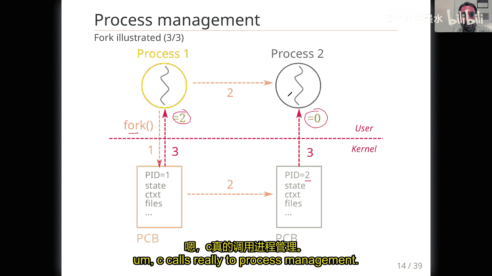

# 【全集 附课件】加州大学戴维斯分校 操作系统与系统编程 中英字幕 1080P p02 Lecture 2 - 系统调用part1 -BV1jXr5BBEKa_p2-

Yeah。

Hi， everybody。So today we're going to start talking about system calls。

Which are the interface between applications。And the operating system。

And before we start defining more what cisco or system calls。Let's directly jump into an example。

So here's a program in C。Let me quickly try to explain。

So as you can see it receives arguments from the command line and it expects to get at least two arguments。

Every C program always gets one argument， which is the name of the program itself。

And then the second argument might be optional， except that here we're expecting that there will be a second argument。

Which is the name of a file。Then as you can see， we declared a buffer of four characters in the stack。

 and so we're kind of resetting that buffer while like putting zeros in all of the bytes。

Then we are opening a file。Which name is given by this command line argument that we're expecting。

If the opening of the file fails， we report that to the user and we exit with failure error code。

If we were able to open this file successfully， then we read bytes out of it and so we read four bytes。

Inside of this buffer array that we created in the stack。And then we're done with the file。

 that's it we've read the first four bytes of the file。

And essentially the goal of this program is that it's。A detector of executables of executable files。

And it turns out that executable files， at least on Uni system， we can recognize them in two ways。

If they're actual binary， they're usually of type F。

 that's a standard file format for binary executables。And in that case。

The first4 byte of the file should have or should like match a certain signature that we can check here and that tells us like okay。

 this file is of type L so it's a binary executable。The file can also be a simple script。

 like say a shell script， in that case the file should the first line of the file should start with the sign pound and exclamation point and that tells us okay。

 that's a script。Otherwise。Seems like file is not unexecutable。Anyway， goal is not necessarily。

 I mean that's that's a fun example that's very like related to system programming and system in general。

 but like point is not really to understand what this program does。诶。The we， we'll。

 we'll get to that Like the， the， the goal is more to like explain the different functions。

 but let's。Let's see how it works still。Quickly here。

 whenever you see a piece of code in a slide and you see that at the bottom right here there's a name。

 so like exec underscore detector。c。That means that you can find the file on Canvas。

 I will have uploaded it in the corresponding directory。And you can download it。

 you can compile it and you can like try it that hope so every time you see a snippet of code like that with some name in the bottom right。

 it means that there's a file somewhere on canvas that you can download and I obviously strongly encourage you to download all of the example files that I upload and that you try them out。

 you modify them， you Google whatever line doesn't make sense to you and so on that should really help you make progress here。

Okay， so。So I have this program， so let's imagine I compile it。

 so I take the C code and I run the compiler， the C compiler on it。

 and that gives me an execut role that I can run。And。Let's imagine that I run it。

 So first I run it and I don't give any argument。I would then fall into this if condition and that would just exit and so that's pretty much why I run it without any argument and it doesn't print anything it just like returnss and I'm back to the prompt。

Now let's imagine that I run it， but。The that I the final name that I give the path is to a file that actually doesn't exist。

That would make this if condition be taken and that's where I would try to print an error and exit with a failure code。

And that's pretty much how this line gets printed， this is the result of the P open that tells me。

 hey， the file that you gave me cannot open it because there are no files there。And。Okay。

 here's a first fun example。I run my program and as the argument。

 I give the actual binary of the program and kind of give itself and because here it was the executable comes from compiling the C program that's actually an E binary executable。

And the program here is able to detect it。Here is another example， so here I'm running it。

 but I give us an document the source code， the dot C。

 and so obviously none of those if or else will match and because because it's not an executable。

 it's just a source code in C and so it prints not anexecutable。

And now here's an interesting example。Let's imagine that I run my executable detector on the Firefox。

 That's the web browser that I use。 So like slash binan slice Firefox。 that's where it's available。

And kind of surprisingly， it tells me like， oh。That's a script， that's a shell script。

 which is weird because Firefox is definitely not a shell script。

 otherwise it would be massive shell script。😊，So let's actually like look at it。😊。

So I use CA here to print what this slash bin slash5 files contain and it is actually a shell script。

But it's a shell script that contained only one line。Which is the execution of。

And here I have a path to another file。 So this shell script is just a wrapper that executes something else。

 and this something else。Is in fact， the binary executable that is Firefox。

 which is now like less surprising， but you see like there are two steps。Okay， so。As I was saying。

That's kind of a fun example， but that's not really like the point of this whole demonstration。

 The part of this demonstration is that。I'm writing a program here that does something that might be considered as useful or not。

But what's important is that as I'm running this program， I'm calling some functions。

That I have not written myself， right？So for example， I'm calling Meet， I'm calling open。

 I'm calling peer exit read close printf and so on I' have not like we go back to the code oops not here。

呃。I don't have the code for those。 They're not here。

 All that I wrote was those few lines and I was able to compile it into an executable。

So what does that mean， like where do those functions come from？They come from。

The C standard library right the C standard library。

 I have access to it via Eders right so at the very top of my program here I have some dash include and I can include some headers。

Those headers， they define multiple things。They define function prototypes。

 so that's how I'm able to say， hey， you know what， I want to use Meet。

And I know that the prototype for the MEet function is in string。th。

 so I know I need to include string。h in my list of inputs。And that will tell the compiler like， hey。

 I'm using this method function and I don't have the code for it but it does exist and here's the prototype that's kind of a promise and the compiler will be like okay let's go。

 I can deal with that。Then headers can define global variables sometimes it can define some type definitions or some macros。

 so for example， here like in open， I tell open that I want to open the file in read only mode and I use this macro that I have not defined myself because it is already defined in one of those headers。

In the headers。There's not code typically， so there's not the code for MEet。

 the code for open or any of that they're just like prototypes。

 the actual code that's behind MEmet but behind open and so on。Is defined in a library of code。

 that's another file where the code is that's usually like already compiled。

And so the compiler will be in charge of understanding that like when I compile my program and I'm using those functions。

 the compiler will understand like oh okay， those functions are defined by the C library and so I know that all of that is connected and it's only upon the actual execution。

Of the program， like when I really run it in the terminal and I execute that all of that code will be kind of like linked together so that like my program here can really call MEet and the code for MEAT will be available then。

Well， actually， there are like different ways that this connection with libraries work and we'll get back to that in like next week or the week after anyway。

What matters for now is that。Of all the different functions， MEmet， open， peer， and so on。

 we can classify them in three categories。Category number one。嗯。We have functions。

That typically don't need any privileges to be able to complete their tasks。嗯。

I'm just going to list them and then we'll we'll get to explain the second category of function is functions that can now actually not do what they're supposed to by themselves by just executing code。

 they need at some point to call the OS like they need to perform some operation that like they are not authorized to do themselves and so they have to say hey OS like I need you to do that on my behalf。

And that's where the idea of CiscoL comes from， like system Co。

 is that in order for an application to eventually tell us the OSA。

 can you do this thing for me that like I'm not authorized to do。

 but you're authorized to do because you're the master of the computer。

 that's via a CisL that's going to be done。And finally。

 there's kind of a third slightly hybrid category。Where we have functions that。

Sometimes need to call the US via Cco to do some privileged operation and sometimes not depend。

 but I'm going to give you some examples。So let's actually start with the first one and actually before we start with the first one。

Pose the video for a second。Look at this program， like's just look at this sniet with all of those different functions that are provided with the the Ley and try already by yourself to see from your understanding or your opinion like in which category each of those functions fall into like take。

30 seconds and just like try to answer that and make a guess。Okay。

So the first category is the functions that do not require any specific privileges in order to write。

That's typically meset， meet， not a privileged operation。So。Mmets as a quick reminder。

 you give it a pointer typically the pointer onto an array。

 you say that you want every byte of this array to be set to a certain value so here we say like okay。

 I want to set everything to zero because I want to reset the entire array。

And then you give here typically because we want to reset the entire array we give the size。

 so here from pointer B we're going to reset to zero4 bytes in a row and that will reset the entire B array。

嗯。I do not need the program does not need any specific privileges to do that。

Bffer here is already declared， it's declared as in the stack， so it exists in the stack。

 The program already has access to its own stack， so there's there's nothing。

 There's no privileged operation to be performed。And。

And the proof of that is that if I were to write my own MEet function。

 it could be written in a few lines and it would look like that。

Like Manet is a function that receives three argument， a pointer。

AVue that you want to use to set every byte at in a certain count。

And it's pretty much like a fall loop that does， like。Coun times。

The resetting of this array with value C， that's pretty much all there is。

And as you can see in those few lines。There's nothing crazy。

 it's just like pure sea code that yeah doesn't require any specific privileges。

So that's for the first category。Let's look at the second category now。

The second one is the category of functions that always require the OS to take care of things because the function cannot provide the entire service by itself。

So that's typically。Open， read， write。Cs and saw。So why？Why do we need the OS to intervene here？Well。

 because typically when we go open to open a file， which name here is provided in RV1。

We need to know。Does the file exist？At this location。

So potentially we need to access like physically access a hard drive。

 or we need to physically access an SSD or an SD card， or we need to access the network。

Because it's possible that the file we're trying to access is， in fact， mounted over the network。

So it's possible that opening a file implies some physical access to a device。

Then if it turns out that the file exists， we need to make sure that we're allowed to access it。

Right because maybe the file belongs to another user， something like that， in which case， yes。

 this file exists， but we don't have access to it。And even if the fire exists and we have access to it。

 like say it belongs to us， it also has to match whichever mode we're trying to open it with。

So typically here we say， hey， I want to open the file in read only in read access only。

And maybe the file is protected against read access， it only allows right access。

 it's a little weird， but it's not impossible。And all of that。

Requires the OS to make those decisions or to determine whether it's possible or not。

 it wouldn't make sense for the application itself to do those checks because it it could I mean。

 it doesn't make sense that it would check itself。So that's up to the US to verify that and so open necessarily。

Needs the O to do that on its behalf。And then same with REid because REI will actually involve open like accessing the files content that's also located on a physical device。

 so they are like access to devices and so on， and that's not something that applications can do by themselves。

嗯。And so in that case， for those functions， we're going to have to call the US。

And the way to do that is via those specific calls called system calls or cis code。

So let's actually look at what it looks like， so it those are not real examples they are like。

 but still they're pretty close to reality。So let's take the example of the read function here。

 like when we call read。Read here is defined by the system library。

And so that's the code that could typically be provided in the system standard labor。

And as you can see， the rate function here is only a couple of lines long because it's directly a wrapper around one of those seascos。

 like a call directly to the OS。And this Cis is pretty much like， hey， OS， I need you to do a read。

And I'm giving you all of the information that you need in order to do that right so I'm giving you the file descriptor。

 the buffer and account， and like please， can you take care of this？

And if we actually like go down like what does this Cisco function that really this calling is？

We get to actually like。Hotcore assembly could。And so here you see it like it's it's not really C anymore like we're already going like pretty low at hardware level almost。

嗯。😊，And that's really like the execution of this CPU instruction that will make the actual call to the OS。

And。Now bear in mind two things quickly is that here I'm giving you a snippet of code that's specific to Linux if you were to compile and run this application and something else than Linux say on like Mac OS or Windows。

It's very likely that this read function would be implemented a little differently。

 it would still be doing a Cico， but it would probably be implemented differently。

And here the Cisco itself。It's completely different from one processor to another。

 so that's typically the code that you could see on a X86 64 bit processor。

 but if you look at the same the way to perform a Cis on an arm processor or like a meat processor or something like that。

 it could be quite different and actually that's where you see that system programming can be tricky because it depends on the hardware like on the machine。

O。So that was for the second category。And then the third and last category are the functions that only sometimes need to perform a Cico。

 but not always。And the perfect example for that is print。So how does it work？

When you call printf and you give a certain string。

If this string here is not doesn't end with the new line character。

Then Prif will actually not directly send it to the OS。

 it will internally buffer it for performance purposes。So when you call this printer line。Actually。

 nothing's going to get printed like this entire string will just be kept in a buffer and nothing's going to be printed。

And it's only when you get to a print have that contains a new line character that here the new line character acts as an indication that the internal buffer needs to be flushed。

And flashing essentially means like， okay， all of the buffer now needs to be transmitted to the so that it really gets printed on the screen device or whatever device you used to。

Prim characters。And the function that would perform the Cisco that actually transmit characters to the ken。

 that would be the right function。And there's an easy way to illustrate that via a quick example。

I through that。 So imagine。We have two scenarios， we have print F hello。

 and you see that this hello doesn't end with the new line character。And then sleep two。

 so we're sleeping for two seconds and then a print world and so here you see that we have a unit character。

And then we run pretty much the same example， except that instead of using printf。

 we call directly write the function right， the one that's merely or wrapper around the Ciscocal that transmit things to the kernel and we do the same experiment。

 we send hello， without new line， then slip for two second and then world new line。And。

If we run that in the terminal， so it's a little bit weird here in the slides， but let me explain。

That's pretty much what we would see。The way to second here that I added that myself to show you because otherwise it's impossible unless I would do the demo interactively but。

So what happens is that we run this print F right， which is that program and what we see is that like。

 oh， we're actually waiting for two seconds first。And then hellello world happens like he's printed all in one go。

And that means here that like the first print of hello was not sent to the screen right away。

 it was bufferized。And so what we started noticing is that the program is sleeping for two seconds and it's only when we get to this print world。

 which is now happened to the hello that had been buffered。

 this one contains a new line and so everything。Is printed all at once。Whereas here。

By calling right directly， which is not Bford， we have the helllo。

 which is being printed right away without wan。Then we have the sleep for two seconds and so we have the hello by itself being printed and we now notice that like we're going to wait for two seconds。

And finally， we get to the second right and the world happens。After two seconds。嗯。这样。Once again。

 as you see， there's a little name here， which means that it's a file you can download and try for yourself。

 so please do and really notice the difference in the terminal。

So let's now properly define what a Ci is now that we have like all of that background those examples。

嗯。So quickly to resume what we've shown is that from a user program so what you actually write。

 so here it's an example like directly using assembly code which would be the produce of the compilation。

From the user side or the program side， you have like typical function calls like you push arguments onto this stack and then you call a certain function and that function。

Is a function that's defined in the C library。And that function here reads will will do perform。

And so a Cco is also sort of a form of function call。

 but slightly different because now you're calling the kernel。

 but you're also pushing certain values。In some specific register。

 and then there's the call or the execution of this very specific fiscal instruction。

And this one is special because it like when the processor executes the physical instruction。

 it will actually stop executing the program altogether like the application。And now， jump。

Into the O。And it will start executing the OS。The US will need to determine like， okay， why。

 why am I being called and we'll see， oh okay， I'm being called far a Cisco。

 so let's find the function that knows how to deal with Cisco， the Cisco handler。

And I'm being called for Cisco that is actually the Cisco res。

So let's look at the table of all of the cis that I know how to respond to and find the one that knows how to do the read and that brings us to a function and that function will be able to do the actual read by say accessing the physical device and really like reading the。

Reading the data and transferring it into the buffer that the user gave us。

And once this function is finished and the buffer has been like populated with all of the data that we read。

 we can return。To the user application。At the。See the instruction that directly follows the Cisco。

And then the execution resumes， eventually the read function here returns。

And we are back to the user program and we just continue executing one instruction after the next。嗯。

😊，So， overall。Siscolls。我尔。😮，You can think of it as like the API of the operating system for applications。

 like that's how applications have access to privileged operations。That the operating system provide。

诶。There are。There can be many， many fiscalscals， so here like what you push in a certain register。

 there are numbers like there are numbers like number one， number two。

 number three and so on like in each number。Is a code that is associated to a certain operation。

 to a certain Cisco。Currently in modern OSs， such as for example， like Linux。

 you have about 300 of those Ciscolls like 300 privileged operations that an application has access to us like and as the OS to do on its behalf and it's the same on Windows and Mac there are also like several hundreds of Ciscolls so obviously we're not going to look at1 hundred0 of them。

 we're going to look at a selection of them like the most important for you to know。And。

The Ciscos we're going to look at are divided into main categories。

 we have Ciscos that deal with process management， so typically like applications。

We have Ciscos that deal with everything that touches files or directories， so how to open files。

 how to read from files and so on。We have ciscos that are related to pipes。

Ciscos that are related to signals and Cisco that are related to managing memory。

 so we're going to look at all of those categories a little bit and see a selection of Cisco for each of them。

And we're going to start with process management。So， so far。

I've talked mostly about applications because I had not introduced the word process。

So I've been kind of abusing application a bit too much。

So now let's throw a proper definition in there。A program。That's a file。

So a program is what you write in your code editor there， we call data program。

 a program can also be after compilation like the binary executable like the file is also a program even if it's compiled it's still very much like like correspond to what you wrote。

 so it is a program it's the recipe right it's a recipe in a recipe book it's the page that contains like all of the instructions。

Now， a process。Is when you run that program。So you have the program on your hard drive。

 it's a binary application and now you're like in your terminal and you're really saying like okay。

 I want to run this thing， you type the name and then you push enter like pushing enter will actually。

Instiate this program and make it run。To go back to the recipe analogy。

 like a process is when you really open the the the recipe book and you start making the recipe。

 that's a process like it's an instance of the recipe。And it's really important to。

Understand the difference between those two because it means that for example。

 for one program you can have multiple processes like for example。

 if I edit different files in different terminals using Vm for example。

 like Vm is only one program it's one binary executable， however。

 if I execute Vm in different terminals， then I'm creating different multiple processes of the same program like multiple instances of the same program。

So， on the user side。What I have running on my computer are。Processes。嗯。

Each process runs in its own what we call memory space。 It means that like。

 each process has the impression。Or we maintain the illusion that each process has the entire memory for itself。

That's how we provide good isolation because if a process has the impression that they have the entire memory。

 then they cannot see the memory of other processes and so there's no way for them to tamper with other processes we'll get back to that quite in detail。

嗯。Then， for every running process。The kernel DoOS maintains a data structure that we call a PCB。

A process control block。This PCB is pretty much the record of this process。

So here think of like the government having a record on each of its citizens right。

 they have probably like a number for each of the citizen。

 a number that's different like a passport number or like I don't know。

 a driver's license a number or some a social security number。

 a way of like identifying every citizen with an individual number。

And then they have a collection of information。So for PCBs， for processes。

 we know what the state of the process is， is the process currently running on the CP。

 in which case the state would be running。Is the process ready to run， but not currently running？

Maybe the process is blocked because it's currently performing some operation。

 its trying to write a file to read from a file。And the data is not yet available。

 and so the process is blocked temporarily。Or and so on it also contains like all of the files that the process is currently using and all of the files that are currently open。

 something like that。 So the PCB here is a collection of information per process。嗯。So。

 so that's what a process is。And so。What we have Oops are going to clear that。

We have a collection of Ciscos that are related to managing those processes。AndSo。

When I say Cisco here， in fact， what I'm presenting are functions。

That are provided by the C standard library。 But it turns out that those functions are usually just wrappers around actual system calls that the OS like knows how to handle。

So I'm going to say C scores， but you have to remember like they first functions and they like are triggering C scores。

And。So what do we have？We have Ciscos that are related to how we can create processes and how we can execute certain programs within those processes。

 that's fork and exec。We have Ciscos related to process terminationmination， so we have exit。

 how a process can terminate， and we have weight or weight PAD。

 how a process can wait on another process。And then we have Ccos that allow a process to kind of get its own identification。

 like understand okay， who am I again， so yeah that that's what we have。So today。

 let's just start looking at the。At the first function， fork。

So just to give you a little bit of context here。The way that process creation and execution work。

Works on unique systems because it would be different on other kind of systems。

It's very similar to how cell biology works， it's kind of fascinating。

 so if you remember your high school courses in terms of biology， you might remember distinct mites。

Where cells are able to you know split in two and so from one cell now you have two cells they are totally identical and the funny thing is that like then they're able to evolve in different directions right like especially with stem cells that can duplicate and make other cells and those cells can specialize into something else and some of them can I don't know become like fingernails or bones or like。

Skin cells and so on。So you have this， like。The application of a cell into into two and then the specialization of one cell into something else。

 And there's pretty much less the same idea。In Uni， when it comes to processes。

 I know it's a little bizarre， but let me explain。 So let's start with fork。 Fork is the cloning one。

So。The idea is that you have a process that's currently running。And if this process calls fork。

The process will be cloneed。Identically into another process and the operating system is going to do that。

Which means that like now you will have a clone。That will be exactly the same。

 have exactly the same open files， have the same memory， the same stack。

 everything pretty much exactly the same。And this fork will kind of resume the execution exactly at the same point as the parent as the original process。

So actually， let me give you an example of that with code and then I can give you some sort of like metaphor。

So imagine that's that's that's that's a program and that program like has see like a global variable that's。

Assigned a certain value has a variable in the stack that has another value and so on。

 and that process， when it runs， will start by printing something like hello。And then calls fork。

What's going to happen here is that so we had one process running that program。

When that process calls fork。This process will be duplicated into an identical other process and that other process will resume。

Add the fog。 it won't start back from the beginning。

 It will resume exactly where this fork function call has been called。

And so it will pretty much resume at that next line， the print have like， oh。

 my favorite number is blah blah。And so if we compile this and run it。

 that's what we see in the terminal。And so you see that hello world。Is printed only once。

By the original process。Prior to calling for。Once fork is being called。

 now we have two processes that are executing exactly the same program。

They have the same environment， like they have variables with the same name with the same values and so on。

 And so when they get to that line， they print pretty much exactly the same and they are sharing the same terminal。

 So their lines are kind of appearing at the same time。嗯。

So now imagine in terms of say like meta or imagine we have invented cloning， hopefully not。

 and I go to the cloning facility and that would be pretty much like， hey， so I want to cloth myself。

And contrary to what you would expect that like cloning yourself means that they， you know。

 detect themselves cells out of your body and they make like a baby， which is you， but like from。

You know， from scratch。They would essentially like。Copy me， exactly。

But me as as me with the same age with like the same memory with like the same shirt like the same clothes。

 the same keys in my pocket and I mean just like literally everything would be the same and if at the moment where I was being cloned say I was in the middle of a sentence。

Then when my clone wakes up。They finished that sentence as well as I finish the same sentence when I wake up。

 that' would pretty much be how like how this thing could compare。嗯。😊，So that's the idea of for。Now。

 as you can see， observe in this example。The original process calls fork gets cloned and then we have two processes continuing the execution of the same program。

And there's pretty much like no way to differentiate who is who right and going back to the metaphor with like me going to the cloning facility。

 it would be the same like imagine。I go to clone myself and I get clone except that like because the OS is doing that I'm actually like sleeping the whole time and so when I wake up I'm like in a bed and there's like my clone next to me and in fact I have no idea like am I the original or am I the clone I don't know and they don't know either？

And it's pretty measured the same with this example。

 like no one knows who is the original and who is the code。And actually， there's a way of knowing。

The fork function returns a value。And it returns a value that is different。

According to who does it return it to？嗯，So。To make things more clear。

Fork will return value the value of the child's PD。

 so here we in fact don't refer to those processes as original and say copy or cloned we say parent and child so the parent is the one that called fork in the first place to be cloned。

And the child is the clone of that parent。So the parent will receive the PD of the child as。

The return value from fork。And the child will return zero。

 and that's pretty much how they can tell which is which。If the fork for some reason doesn't succeed。

 you go to the cloning surgery facility and I don't know。

 they have some problem like the machine doesn't work or something like that and so you wake up and in fact you're still by yourself。

You would receive an error that tells you like oh the procedure like this't work it's the same here like so the process the parents or like the only process would receive minus one from for if the fo process actually has not succeeded。

So let's put that into practice into another example。

And so that's how you would be able in a program to distinguish。Which is the parent。

 which is the child and have them start executing different codes？So。As we said。

 fork returns the value， this value is a PD has a certain type PD underscore Scott T。

 that's something that's defined in one of the headers。And so after calling fork。

The process receives the PD and here by examining what value is the PD。

 the process can determine like， oh， am I the parent or am I the child？

The process is the if the PID is superior than zero。

So if the PAD is actually the value of something of the child in that case， that's the parent。

 if the PAD is zero here， it means that the process of executing those lines is the child。Otherwise。

 there was an error， the fog never succeeded， there's no cloning happening。

 and so it's still like the original process that's being executed。So， let's。😊，Compile and run this。

 and that's the kind of output we would notice we would observe。

So you see that we would run this thing and we would have a couple of lines that tell us like， oh。

 I'm the parent， I'm here now which would correspond to this printf。And then that print。

And then another couple of lines for the child。Where that print would that be printed and then this one again。

嗯。What's important here？Is that these outputs。Is not guaranteed。

From the moment that the parent is being cloned into a child。From the operating system point of view。

 there are now two processes， completely independent processes。

 even if they have like one wasponed by the other。There are two completely independent processes。

And that means that it's up to the US to schedule them。

 to run them on the CPU in whatever order it feels。So here it turns out that in that example。

 the parent came back from the thought first and executed the few lines of code that generated those prints and then。

Died。And then the child was resumed second and printed those fu liness。

But it could very well be the opposite we could have the child print its own message first and then the parent or it could even be all interleaved like we could have an output that says I'm the parent and then turns out that the parent process lost the CPU and then the child process was resumed so and the child process would print。

I'm the child， I'm here on now buy and then we would go back to the parent and the parent would print。

 I'm here on I buy and so I mean essentially like you can have different types of inter living。To。

Illustrate that a little bit more here's an example of how it works and we see here like how it's connected between user and kernel。

So。😊，We have a process that's running for now like say it comes directly from us like running the command in the terminal and it turns out that during the execution this process calls fork so fork is a ciscal。

 which means that we go in the kernel。And the kernel has now offered our task to duplicate that process。

And so that's what it would do like step number two， okay， process wants to be duplicated or cloned。

 let's do that so we're going to create a new PCB。And all of the values will be strictly identical to the first PCB。

 except for the PID， that's the only thing that differentiates them。

But and then the process itself is also exactly the same， so same code， same data。

 same stack like all of the memory that corresponds to the process is completely duplicated like copied exactly。

And then at that point， as I was saying， like now we have two processes that are completely independent。

And according to the scheduling。So whenever like the kernel， the OSsD decides like， okay。

 process one is going to resume on the CPU， or process two is going to resume on the CPU。

 they' are going to get executed。What matters is that when we finally return from the fork function。

In the case of the parent， we're going to return the PD of the child。 So here like PD2。

When the for function returns to the second process。

 the child the child will receive as a written of the function。Value 0。Okay。

 let's stop here for today and next time we will start talking about Eec and all of the other Cico related to process management。

