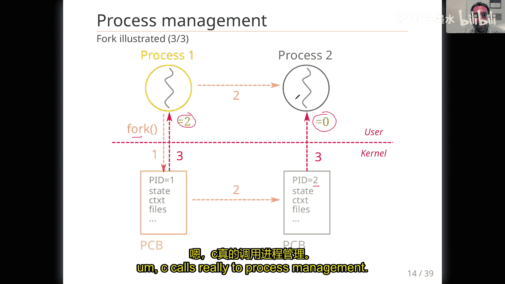

# 操作系统与系统编程：2：系统调用（第一部分）


在本节课中，我们将要学习系统调用。系统调用是应用程序与操作系统之间的接口。我们将通过具体的代码示例，了解什么是系统调用，它们如何工作，以及为什么应用程序需要它们。

## 概述：什么是系统调用？

在开始详细定义系统调用之前，让我们直接看一个例子。以下是一个C语言程序：

```c
// exec_detector.c
#include <stdio.h>
#include <string.h>
#include <fcntl.h>
#include <unistd.h>

int main(int argc, char *argv[]) {
    if (argc < 2) {
        return 1;
    }
    char buffer[4];
    memset(buffer, 0, sizeof(buffer));
    int fd = open(argv[1], O_RDONLY);
    if (fd < 0) {
        perror("open");
        return 1;
    }
    read(fd, buffer, sizeof(buffer));
    close(fd);
    if (buffer[0] == 0x7f && buffer[1] == 'E' && buffer[2] == 'L' && buffer[3] == 'F') {
        printf("ELF binary executable\n");
    } else if (buffer[0] == '#' && buffer[1] == '!') {
        printf("Script\n");
    } else {
        printf("Not an executable\n");
    }
    return 0;
}
```

这个程序接收命令行参数，并期望至少有一个参数（文件名）。它打开文件，读取前4个字节，并根据这些字节判断文件类型（ELF二进制可执行文件、脚本或非可执行文件）。

这个程序本身很简单，但关键在于它调用了许多我们并未亲自编写的函数，例如 `memset`、`open`、`read`、`close`、`printf` 和 `perror`。这些函数来自C标准库。

## C库函数的分类

上一节我们看到了一个调用了多个库函数的程序。这些库函数可以根据其是否需要操作系统协助来完成工作，分为三类。

以下是这三类函数的简要说明：

1.  **无需特权的函数**：这些函数可以完全在用户空间执行，不需要操作系统介入。例如 `memset`。
2.  **总是需要系统调用的函数**：这些函数的核心功能必须由操作系统执行，因为它们涉及特权操作或硬件访问。例如 `open`、`read`、`write`。
3.  **有时需要系统调用的函数**：这些函数的行为取决于具体情况，有时会缓冲数据，只在特定条件下触发系统调用。例如 `printf`。

### 第一类：无需特权的函数

以 `memset` 函数为例。它的功能是将一块内存区域设置为特定值。这个操作不涉及任何硬件访问或权限检查，完全可以在应用程序自己的内存空间内完成。

我们可以自己实现一个简单的 `memset`：

```c
void *my_memset(void *s, int c, size_t n) {
    unsigned char *p = s;
    for (size_t i = 0; i < n; i++) {
        p[i] = (unsigned char)c;
    }
    return s;
}
```

如你所见，这只是纯粹的C代码循环，不需要任何特殊权限。

### 第二类：总是需要系统调用的函数

现在，我们来看看第二类函数，例如 `open` 和 `read`。为什么它们需要操作系统？

当调用 `open(“file.txt”, O_RDONLY)` 时，程序需要：
*   检查文件是否存在（可能涉及访问硬盘、SSD或网络存储）。
*   检查当前进程是否有权限读取该文件。
*   根据文件类型和模式执行相应操作。

应用程序自身无法安全、可靠地执行这些检查，因为这需要访问受保护的系统资源和硬件。因此，`open` 函数必须请求操作系统代表它执行这些特权操作。这个请求机制就是**系统调用**。

在C标准库中，`read` 函数可能只是一个简单的包装器：

```c
ssize_t read(int fd, void *buf, size_t count) {
    return syscall(SYS_read, fd, buf, count);
}
```

而 `syscall` 函数内部会使用特定的CPU指令（例如 `syscall` 或 `int 0x80`）从用户模式切换到内核模式，让操作系统内核接管执行。这个指令和具体的参数传递方式（使用哪些寄存器）取决于处理器架构（如x86-64或ARM）和操作系统。

### 第三类：有时需要系统调用的函数

最后，我们看看像 `printf` 这样的函数。为了提高性能，`printf` 通常不会在每次调用时都立即将数据发送到屏幕。相反，它会将输出缓存在内存中。

考虑以下两个程序：

**程序A (使用 `printf` 缓冲):**
```c
#include <stdio.h>
#include <unistd.h>
int main() {
    printf(“Hello”);
    sleep(2);
    printf(“ World!\n”);
    return 0;
}
```

**程序B (使用 `write` 直接系统调用):**
```c
#include <unistd.h>
#include <string.h>
int main() {
    write(STDOUT_FILENO, “Hello”, 5);
    sleep(2);
    write(STDOUT_FILENO, “ World!\n”, 8);
    return 0;
}
```

运行程序A，你会先等待2秒，然后一次性看到“Hello World!”输出。这是因为第一个 `printf(“Hello”)` 没有换行符 `\n`，字符串被缓冲了。直到第二个包含 `\n` 的 `printf` 被调用，缓冲区才被“刷新”，所有数据通过系统调用 `write` 一次性发送到内核。

运行程序B，你会立即看到“Hello”，等待2秒后，再看到“ World!”。因为 `write` 函数直接触发系统调用，没有缓冲。

## 系统调用的定义与流程

基于前面的例子，我们现在可以正式定义系统调用。

系统调用是应用程序请求操作系统内核为其执行特权操作的编程接口。你可以把它看作操作系统的API。

其工作流程如下：
1.  **用户程序**：执行一个库函数调用（如 `read(fd, buf, count)`）。
2.  **C库包装器**：库函数（如 `read`）准备参数，并执行一个特殊的软中断指令（如 `syscall`）。
3.  **CPU切换模式**：CPU捕获该指令，从用户模式切换到内核模式，并跳转到内核中预设的系统调用处理程序。
4.  **内核执行**：内核根据系统调用号（例如，`read` 对应一个数字）查找对应的服务例程。该例程执行实际的底层操作（如从磁盘读取数据到内核缓冲区）。
5.  **返回结果**：操作完成后，内核将结果（如读取的字节数或错误码）放入指定寄存器或内存，并执行返回指令。
6.  **切换回用户模式**：CPU切换回用户模式，返回到库函数中系统调用指令之后的位置。
7.  **库函数返回**：库函数将内核返回的结果处理成标准形式，返回给用户程序。

现代操作系统（如Linux）有数百个系统调用，涵盖了进程管理、文件操作、网络通信、进程间通信、内存管理等多个方面。

## 进程与进程管理

在深入讨论具体的进程管理系统调用之前，我们需要明确两个核心概念：**程序** 和 **进程**。

*   **程序**：是一个静态的、存储在磁盘上的文件，包含执行特定任务的指令和数据。它就像一本菜谱。
*   **进程**：是程序的一次动态执行实例。它是“正在运行的程序”。当你在终端输入命令并回车时，就创建了一个进程。它就像你按照菜谱实际烹饪的过程。一个程序可以同时有多个进程实例（例如，打开多个文本编辑器窗口）。

操作系统为每个运行的进程维护一个称为 **进程控制块** 的数据结构。PCB就像是进程的“身份证”和“档案”，记录了进程的各种信息，例如：
*   **进程ID**：唯一的数字标识符。
*   **进程状态**：运行中、就绪、阻塞等。
*   **程序计数器**：下一条要执行的指令地址。
*   **寄存器值**：CPU寄存器的内容。
*   **内存管理信息**：如页表地址。
*   **打开文件列表**：进程当前打开的文件描述符。
*   **所有者、优先级等信息**。

接下来，我们将关注用于管理进程的系统调用。主要包括：
*   **创建与执行**：`fork`, `exec`
*   **终止与等待**：`exit`, `wait`/`waitpid`
*   **获取信息**：`getpid`, `getppid`

## `fork` 系统调用

`fork` 是Unix/Linux系统中创建新进程的主要方式。它的行为非常独特：**复制当前进程**。

调用 `fork` 后，操作系统会创建一个与当前进程几乎完全相同的副本，这个新进程称为**子进程**，原始进程称为**父进程**。子进程获得父进程内存空间、寄存器值、打开文件描述符等的独立拷贝。

一个关键点是，`fork` 在父进程和子进程中各返回一次，但返回值不同：
*   在**父进程**中，`fork` 返回新创建的子进程的**进程ID**。
*   在**子进程**中，`fork` 返回 **0**。
*   如果创建失败，则返回 **-1**。

这允许父进程和子进程在执行相同的代码后，根据返回值分道扬镳，执行不同的任务。

让我们看一个例子：

```c
#include <stdio.h>
#include <unistd.h>
#include <sys/types.h>

int main() {
    pid_t pid;
    printf(“Before fork\n”);
    pid = fork();
    if (pid > 0) {
        // 父进程执行这部分代码
        printf(“I am the parent process. My PID is %d, Child‘s PID is %d\n”, getpid(), pid);
    } else if (pid == 0) {
        // 子进程执行这部分代码
        printf(“I am the child process. My PID is %d\n”, getpid());
    } else {
        // fork失败
        perror(“fork”);
        return 1;
    }
    printf(“This line is printed by both parent and child (PID: %d)\n”, getpid());
    return 0;
}
```

可能的输出（顺序可能不同）：
```
Before fork
I am the parent process. My PID is 1234, Child‘s PID is 1235
This line is printed by both parent and child (PID: 1234)
I am the child process. My PID is 1235
This line is printed by both parent and child (PID: 1235)
```

**重要说明**：`fork()` 之后，父进程和子进程是**独立的**，它们的执行顺序由操作系统的调度器决定，因此输出中父进程和子进程的消息可能交错出现，每次运行的结果也可能不同。

## 总结



本节课中我们一起学习了系统调用的基础。我们了解到系统调用是应用程序与操作系统内核交互的桥梁，用于执行需要特权的操作。我们将C库函数分为三类，并重点理解了 `fork` 系统调用的工作机制——它通过复制当前进程来创建新的子进程，并且父子进程通过 `fork` 的返回值来区分彼此，从而可以执行不同的代码路径。在下一节课中，我们将继续学习 `exec` 系列系统调用以及其他进程管理相关的调用。