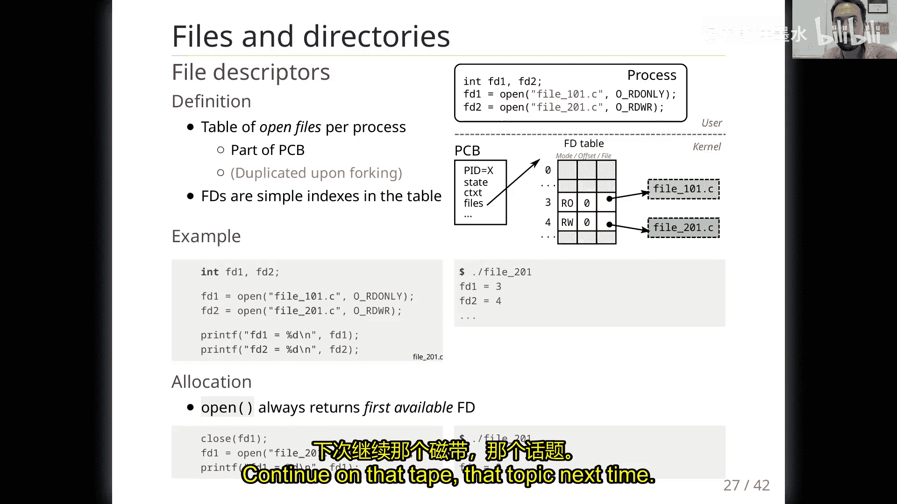

# 【全集 附课件】加州大学戴维斯分校 操作系统与系统编程 中英字幕 1080P p03 Lecture 3 - 系统调用part2 -BV1jXr5BBEKa_p3-

Hi everybody， so today we're going to continue talking about seacos like we did last time。

So quick recap of the last lecture。So I told you that many of the functions that you had access to when you program in C come from the C standard library。

And those functions can be categorized in three categories。

 the first category is functions that don't require any specific privileges， such as。

 for example meets that only deals with memory that we already have access to。

And there are two other categories of functions that either always or sometimes require the cooperation or the assistance of the OS in order to do operations that are privileged。

So we talked very simple about read or print。And in that case。

 the user programs are what you write will be calling a function that is defined by the Lipsy。

 but the Lipsy will eventually need to add the OS for our assistant and that will be done through what is called a system call or a Cisco that will really transfer the CPU to theOS to the kernel and the kernel will have to deal with it。

And then return back to the application。嗯。We are currently going through different categories of Cisco。

 obviously we're not going to have time to go through all of the Ciscos。

 there are hundreds of them sometime。So here we're going through a handful of categories and we started talking about C schoolss that are around process management。

And we started talking about that by defining what a process exactly is。

 and we said that a process is essentially an instance of a program， it's a program in execution。

The OS knows about processes because it maintains what is called the PCB process control block。

 which is kind of like the。Identification of the process from， from the。

Always point of view that tracks like all of the characteristics of all the running processes in the computer。

And we started by talking about。One of the most important process related functions， Cisco。

 which is fork。And fork is called by a process when it pretty much wants to clone itself like you have a process that's running。

 it's currently executing a program。If we encounter a fork。

 then this process is exactly duplicated and we have this relationship where the process becomes a parent and it clones into a child。

And the child starts or resumes its execution from right after the fork is being called。

And and the way for the program to kind of like know after the fog has been called like。

Which is which folkk returns different values whereas whether we're returning into the parent or in the child。

Okay， so let's go on from there。There's another function related to process management that is extremely extremely important that often goes along with forking and we'll see in a few slides how。

So this function is called exec。Here's the idea。Is that。

You have a process that is currently executing a program， so it's executing a bunch of statements。

And all of us sudden in this program calls。Exec。And so here， if the exactec call succeeds。

The process will stay the same process， but will start executing another program。

So imagine like your。In the middle of like making a recipe of like cooking a recipe。

 and all of a the recipe pretty much says like， okay。

 put everything that you have currently under counter through the trash。And start another recipe。

But I mean， keep like keep yourself in the kitchen and everything like but just start doing something else。

And that's pretty much what happens here， so here's an example。😊，Imagine， so I have this program。

And so this program would be running at first， like from the main function。

 so the process would be running this program would be printing something and so on。

Until it gets to this。Exec function call。And here， the exec。Will pretty much call another comment。

 So another executable that here is defined as slash bin slash Eco。And with giving some arguments。

And from the moment that like the process running this program will get to this exec if the exec succeeds。

Then we're no longer in that program and we've switched to a new program which is defined by slash bin slash Eco。

嗯。So a few things here to note。You see that in this program and I'm using exZ V。

 so exec in fact is a familiar function， there are like different variations so you have like XZ L。

 XZ V， X VP， Xec LP， XZec VPE， and so there are like six， I think six combinations total。

And they all like they're all pretty much doing the same thing。

 which is replacing the program that's currently being executed by another program。

 but they are like。Slide variations in the way that they understand the arguments and the way that you you can use that so for example。

 here here。Exact V。You need to give the full path to the executable that you want to run。

And then the list of arguments has to be given in a in an array of strings。

Which last cell must be known to to explain like how many arguments they are。嗯。

You could be using like other functions from the same family and in that case like the arguments would be slightly different so but everything is explained in the man page so you can look at that。

And。Oh in one quick detail as well here too。You can see that in the list of arguments that a。

Program receives。The first argument。So what will be afterwards。Received as R V。0。

Sorry for the writing style， it's very， very difficult to write on those things。😔，Ohoops。

So AGV0 here， I mean， what will be received as AGV0 is in fact， the name of the program itself。

That's a convention that's how it's supposed to be done and so the real kind of first argument that a program receives is always in AGV1。

 that's why。Okay， so now let's imagine that we。We compile this program and we run it into a process。

 what do we see in the terminal， we would see that。So what do you know to。

There should be at least one thing that gets pretty clear so we start from the main function。

 we do all of that， we get to the printf and we see that the printf is being printed。

And then we call X V， and ex V is essentially echo of ECS 150。Which we see happen here。

 So it seems to be working。And you see here that we had another print， this one is not being printed。

Why is that。What is that like？If the X， Z V succeeds。It should not return。

It's a function that never comes back。To go back to kind of like the the analogy that I was making last time with Fork。

 you know， like going to the cloning factory and like getting a colonial of yourself。

Here it would be as if you go to the。To the hospital。And you essentially say like hey you know what。

 like I'm kind of I want to be someone else like I want to be almost like reincarnated into Bradbe and they would say。

 okay， so you're going keep like you're going to keep the same Social security number so like your PCB essentially like doesn't change it's going to be like reset because like all of the files that you had open will be closed and all of that but otherwise you keep the same PID。

But're going to you're going to stop executing the program that you're executing right now and you're going to start executing another program from the beginning。

 like from the very first instruction of that program。And so when that happens。

You cannot come back to where you were before。 So from the moment that like in this program。

ExZ V is called saying like， hey， I want to run this command with those arguments， if X Z V succeeds。

 which it should then we actually like never come back here because this entire program will stop being executed and the process will now be executing being ECO ECS 150 entirely until completion and that's the end of it。

The only reason that this print would be executed is if Xag V actually fails and the system tells us like I'm not able to run this other thing that you're asking me。

 maybe because like actually， I don't know like the comment that you gave me is wrong and it doesn't exist or like I don't know。

 I don't have any more memory like there's some sort of like issue。

In which case you would be coming back and it means that the X Z V would have failed。

 that that's the idea。O。😊，And I'll show you in a couple of slides。

How far can those exact functions be can be used in a longer example？But let's go on for now。

So the next function I wanted to to show you is exit。

 which I'm sure you already know kind of how it works and what it's useful so exit can be called by a program to。

Finish its execution。 So the process here， executing the program that calls an exit。Wouldoods。Tinate。

So exit， that's something you can call directly in the code at any time in any function。

 which is particularly useful when you have errors like in one function。

 you try to open a file that doesn't exist。And there's no reason for the program to continue。

 you can just call exit and that will be the end of the process。嗯。😊，It can also be called implicitly。

 so for example， like at the end of the main function。

 usually you just return zero save like things have gone fine。But in fact。

 when you return from the main function。Do， you go back to some code that is already provided by the Li C and that code。

Will do exit。 We'll actually call the function exit， So one way or the other。Exit will be called。

Either directly by you or indirectly by the Ley。And you are able to return。numer value。So actually。

 why do we？Why are we able to retain value？That's something we can then analyze from whoever has called us。

 so for example。Here were say in the terminal， we're using the shell and we are telling the shell hey。

 run LS on the root directory， so it executed shows us all of the files in the root directory。

And then we can see what value has LS returned or exited with。

 and so we can have access to whether LS has lets say。

 executed exit1 or exit2 or exit zero or whatever value。And actually in the shell。

 to know that information， we can print whatever。Value is contained in a dollar question mark。

 And so here we see that Ls， when it was called on root and listed all of the files， it returns 0。

Now if we run LS and we give the path to a say a directory that doesn't exist。

 so LS actually fails at doing anything， and we can assume so that in the code because it cannot open this directory that we're asking。

 it will quit saying like exit and it will give a value that is different than zero。

 we can actually confirm that because then when we try to print what LS has returned as a return value。

 we we see that it returned to。So here it means that internally L when it was not able to access whatever we asked。

 probably internally， it called。Exit。With the value， too。

Or it returned to from the main function I mean， whatever。 but it existed with the value number two。

Now， you may ask， okay。It's great that programs or processes can exit with certain values。

 but why is that useful， it's useful for at least one very good reason is that when you write scripts like shell scripts。

 the fact that a process is able to say whether it succeeded by returning zero。

 or whether it did not succeed because it returns the value that's different than zero。

 it can help us write scripts and take different actions。

 whether or not a process kind of succeeded or failed， that's the big goal。And。In other words。

 it allows the process to kind of like indicate its status after execution。Okay。And oh yeah， so。Here。

When we asked a shell。To run Alice。On the root directory and LS returns zero and were able to from the shell like have access to that value。

 how does it work like how does the shell。How is it able to collect this written value？

And that's pretty much what the next function does， so the next function is called weight。

And actually it's also a family of functions you have weight and weight PID so weight is pretty much like the basic version where you don't have a lot of control and weight PD is the more advanced versions text like three arguments and you're able to like specify better granularity of what you're trying to do。

But essentially weight and weight PID。Elow is a parent to wait for its children and to collect their return values。

 And that's pretty much how the shell internally because the shell is programme like like any other applications on the on the computer。

 That's how the shell is able to。Collect the return value of whatever is running。嗯。😊。

So when you call weight so weight is the more basic one。

 it will make the parent actively wait like be blocked until any of its children finishes。

So if the parent has called fork multiple times and so has like multiple children。

 then calling weight will block the parent up until one of those children complete the execution like termes and return a value。

Weight PD takes three arguments and it allows the parent to wait for a specific child so if the parent spooned like I don't know five different children and so has。

Received like five different P I Ds for all of those children。

 The parent can wait specifically for one of those P IDs。

And it can also ask not to be blocked so for example， like the parent would be able to say， hey。

 I want to see if one of my children has died and get like the status of the termination。

 but if none of them have died have died then I don't want to be blocked like I still want to continue running and that's something that weight PID allows if you are using the right flags。

Okay。So here is an example。So imagine we are in a process。

Running those lines and so the program calls Fork。So we're going to have a parent and we're going to have a child。

The child will only pretty much say like， okay， hello。

 I'm here and we'll exit right away and we will make it exit with kind of a specific return value so that we can see how we can collect it on the other side。

And the parent， on the other hand， will wait for the child to essentially like execute and complete its execution。

And we'll ask。To be to receive the exit status。That's why we get in this int status variable。

And as long as the child is running， the parent will be blocked。

 we will not be able to execute any code and it's only upon the child like dying and exiting with a certain value that the weight function here will finally return and status will have been assigned the return value of the child。

And so here we're able to actually display whatever the child has exhibited with。So， let's try that。

And that's what we would see in the terminal， so we would see that the child was able to run。

 then the child exited。And that unblocked the parent。 and the parent was pretty much able to。

Collect this value 42 that the child that's transmitted back。诶。You'll notice one thing is that。

I used a macro here。 W exit status on this status variable。 Turn out that。This variable here。

 like int status actually receives more than。Just this return value。

It receives like some other informations as well， like kind of all packed into this integer。

And so you have a bunch of macros to extract which information about the。

De terminationmination you want to have access to。And so if what you're interested in is。

What number exactly the child returned upon termination。

 you have to use this macro to kind of extract this number， and that's how we are able to display it。

Now there's one thing that's interesting here to notice as well。You remember that with fork。

 I was telling you that。呃呃呃。The output order is not guaranteed right like if you have a parent and a child and after the thought process they both start printing stuff。

 there's no guarantee that like the parent will print something first and then the child or vice versa。

Here in that very example， the output。Has a guaranteed order。 We will always see this message， first。

And this message， second。The reason is that we're calling weight here or the parent is calling weight。

And that implies some。Like that implies some synchronization。In the sense that。

So let me clear that dial a bit bit。衣服。After the fork。The parents。Is executed first on the CPU。

Then the parent will right away go into the weight function， which will make a Ci。

And the US will say， oh， okay， so you're waiting for your child to terminate。

 but your child is still running， so you're going to be blocked and you're not going to be able to be scheduled again on the CPU。

Until your child is complete。So the parent here will wait no matter what。And then， the child later。

Would like be run on the CPU will be able to do its printf exit and the exit here would finally unblock the weight operation and allow the parent to proceed。

Now。If after the fog， it turns out that DOOS decides to schedule the child first。And not the parent。

Well， it would kind of be the same， so the child would run。Do the printf， do the exit and terminate。

And the US would keep。The value 42 around。Because the child would have not been what we call collected yet。

And then the parent would run。And the parent would call weight。And here。

 there would be nothing to actually wait because the event。

 which is the child dying has already happened。So the only thing that the parent would have to do via the OS。

 it's still a Cico， but is to collect this value far2 that was like being kept there。

So no matter what the scheduling order， the fact that we have this weight call that is a blocking call will ensure that the output is the same。

 it's guaranteed it's always going to be like that because we are implying like we are making the parent dependent on the child's execution。

啊改了这个 so。Now here is the example that I wanted to show you where we kind of put everything together。

 fork， exec， and weight。So you'll recognize some lines here， so here's a program where。Right away。

We fork， so we make a parent and the current process becomes。

 we make a child and the current process becomes the parent。The child。

Which is now a copy of the parent。They are both executing the same program。Well， with this。

 those like if and Elsie were making their child and the parent do different things。

And so here you see that the child will in fact， start executing another program。

By calling X Z V with a certain comment and some arguments which are， again， being echo E S 150。

If X Z V succeeds， then the child will not execute any of the remaining code because it will actually become equalco ES 150。

If this exag V didn't work， then we would catch the error by actually saying like， oh。

 there was an error calling X V and we would exit with an error code one。On the other side。

 the parent right after calling fork。We'll simply wait for the child。

 which is running the X V to terminate。And would print on the output。

 what was the status of the child？And that's pretty much it。When we execute works like expected。

 we have the child that how now has become the Eco command with a certain argument and printing the terminal and the parent has waited for this child to complete and just said that the child has succeeded。

 it returned zero。If you're at all familiar with the function that's called system。

We just pretty much reinvented what system does system is a common that allows a certain program to like run another program。

But and behind the scene， that's pretty much what's happening。

 it's like this triplelettter function fork to clone a new process。

Exec to make this new process actually kind of morph into another program。

 like to execute something else while the parent is waiting for the child to terminate by calling weight or weight P。

So here， obviously this program doesn't seem like very interesting because we're we're essentially running code to make a child that just does Eco 150。

But it's。It's a good start for what is actually your shell。A shell is the extension of that。

 except that。😊，Instead of having a command that you're running that's predetermined。

 you would leave the user enter what they want to execute。And instead of doing this。

Fork only once you would have a loop， you would do that for every single command that the user wants to execute。

And that prims。Gets us to that so that's not a real implementation that's more like the idea。

But the idea would be that for a shell。You have a Y loop that never ends up until the user like quits。

But essentially， you。The shell displays a prompt to tell the user like， okay。

 I'm ready to hear what you want to execute。The user provide a command。

 so that's them like typing in the terminal and pressing enter。

The shell gets this command and then right away we the shell forks to make a child。

 the child actually executes the command that the user wanted。

While the shell itself waits for this child process to end。And once we're done waiting。

 we go back to the beginning to displaying a prompt and executing the next comment that's pretty much what a shell。

I and that allows you to interact with the computer via the terminal。

So obviously that's a pretty naive implementation because then if you really want to write a real shell。

 you'd have to handle a bunch of extra features like background jobs。

 redirection and piping and so on， which actually is what you're going to have to do for project one。

 but that's like the core concept of a shell， pretty much this idea。Okay。

 and last thing that I wanted to mention in terms of process management are the P ID and parent PD so。

As you know， a process can call fork and forking means that that process will become a parent and they will be a child process。

So。You get it through the language， parent， child， and so on。

 there's the notion of a tree of processes， like kind of a family tree of processes， right？

So you have the parent at the top。 and when the parent。Forks that gives us children。

 And when those children fork。Then you have。Grandchildren and so on。

 But there's this kind of like hierarchy of parent and children。嗯。

One process can have only one parent， but one parent can have multiple children。In Uniix。

 the very first。Process， the one that's above everybody。

 like the grandparent of everybody has the PID number one because it's the very first process that's being created in the system and in Uni usually this process is called in it。

And encode code。For a process to know its own P， I D。

 it can call get P I D and to get the P I D of its parent， it can call get P， P I D。

So here's a very quick example to show you that。So we have this program that calls Fork to make a child。

And。We actually test the return from Fork and if it turns out that we are the parent。

 we wait for the child to finish。Those lines is just to impose some synchronization to make sure that the child will essentially execute and finish his execution before the parent。

So the two prints here that we're going to see first in the terminal will be from the child and then after the child is done and has terminated。

The weight function will return for the parent， and the parent will also execute the two prints。

So let's execute that in the terminal， and that's what we see。So as we said， the first two lines。

From the child。And the next two lines are from the pad。And so the child says， oh。

 my PD is that number， you see 82。And my parents BD is Brala， that number 81。

We can confirm that it's correct because when the parents finally do the prints as well。

Its own PID is the number 81， which corresponds to what the。

Parent PD was here so we clearly see the link。Now。For the parent process。

The parent process also has its own parrot。Which has a P I D with that number， 1624，74。

What is that number？Well， that number is the PD of the shell itself because。

This process was being run。From the shell。 So the shell， as I explained earlier， forked and exactec。

That process。And we can confirm that by printing the value dollar dollar in the shell。

 which is way of asking the shell， hey， what's your PID and here we see， oh yeah。

 that's the same PID as the processed parent PID。O。Let's move on。嗯。Okay。

 so here we've talked about Ciscos related to process management the next big category that we're going to talk about are Ciscos related to files and directories so before we get into those functions。

Let's talk a little bit about files and directories。In pretty much like any computing system。

 whether it's on Windows or Macs or Linux。Filees and directories are organized in a tree structure right。

 starts from kind of like the beginning of the file tree and then every directory is kind of a node。

And every file within a directory is a leaf， right？And。

The way that the system sees those files and directories are through this structures called that we call VFS for a virtual file system。

So this VFS notion is actually like more。Prevalent on Uni systems because in Uni systems。

 all of the files and directories are kind of seen through a unified VFS in the sense that like in Uni you only have one root directory and then everything is under that root directory。

Even if you plug an USB key that has some files on it。

 like the content of the USB key will be seen somewhere under that root directory。

 whereas in Windows， for example， if you plug in a USB key。

 that USB key will be assigned a letter like E column that's different from like C column。

 for example from like your hard drive。Fes and directories and so it's kind of independent。

But anyway。What matters is that。The system sees those files and directories via this virtual file system。

Diectctories are essentially list of file names they contain the files that are under the directories and files can have contents which are bytes。

 that's the data， right？嗯。Soy， we have a pretty long list of Cico that are related to files and directories。

We have plenty of functions that allow a process to interact with files， so opening a file。

 reading from a file， writing to a file and so on。Then we have a few system calls。

 I'll get to them which allow like a pretty fine management of what we call filescriptor。

 we're going to talk about that。Then we have some Ccos that allow us to get some information about files。

And finally， we have Ciscos that allow a certain program process to interact with directories。

So and I'll show you some examples。So let's start from the beginning and let's look at just basic file interactions。

We this example。So what do we have here？Here we just want to interact with the regular file reading from it。

 like a few bytes reading from the file。So as you may know， in C。

 when you want to interact with the file， you have to open it。To open it。

 you have to give the name of the file。And here， as you might see。

 we're pretty much we're actually opening。The same file。

 like we're opening the source code of of that program。Open will return a filescriptor。

 which is a number。 That's an integer。 We're going to talk more about that in a moment。

And from that file descriptor。We're going to now call different functions。 So see like read。

 then al Si， then read again。 And finally， after we're done， we're going to close it。

 So every time you see that we want to interact with the file， we refer to the file。

Through its file descriptor， which we have gotten from opening it in the first place。

So now what we're trying to do。We are trying to read the first two characters of the file。

Because we just opened it， we're going to start from the very beginning。So these first reads。

 we're trying to read one character out of the fight， we should be reading this pound sign。

 this like hash sign。And then in the second line here。

 we are reading the following character like the character that comes next。

Which should be this eye character。Here， it means that。The read function is actually sequential。

When we call read， we read a little bit of the file。And when we call read again， we start from。

Afterward we have already read and we continue reading， so you can imagine that as like a VHS tape。

When you start playing the magnetic tape， like kind of go like get sced。And if you hit pose。

 then the magnetic tape stops and if you hit play again。

 you start playing from exactly where you were。Read works exactly in the same way。

 You don't need to tell read。 Oh， I want to start reading from there。

 You start reading from where you left off the last time you call read。

Now there's a way to change that in the same way that with the VHS tape you would be able to go fast forward or rewind。

 you can do that via L AlI allows you to change what is called the file offset。

 like where you are in the file currently。And so here by calling ElI。And by saying， oh。

 I want to seek from the end。You're pretty much calling the putting the cursor of the file right at the end。

Of this file， cause that's the one we are trying to read。And then you say， oh。

 I want to go like two characters back from the end。

And then we're reading this character and displaying it， so let's execute this function。

And we confirmed that like we read the first character， which was the this pound sign， then I。

 and pretty much the last character， the fire which was the。

Closing curly brace from the main function。系 ok。Now let's doooom on this filescriptor。

 which is an integer that we get back from open。 What is this filescriptor。Well。

As you might remember。Part of the PCB is the list of files that are currently being opened by the process。

And that's how the system keeps track for every process like which files were being open。

The file deors are simply indexes。Indows。Tables， so let me show you an example here。So。

Let's take that code， for example。We have two file descriptors， they integers。

 and we call open twice on two different side files。

And you see here that were also opening them in different ways。

 so we are opening the first file in read only mode and the second file in read write mode。

And open will return numbers in F1 and F2， and we'll be able to actually print what FD1 and F2 are。

Internally， what happens when this process is running those lines is that the kernel will actually open those files that we're asking。

And well create entries。In the open file tables。And open will locate the first entry that's available。

And will essentially like attach the files that we're trying to open in those entries。So at first。

The first entry that is available is entry number3。 And so it's at this line。

That we're going to open file 101。c， which is the first one that we're trying to open here。

And the kernelnel also writes like， okay， this file we're opening it in readon and at the very beginning because we haven't read anything from it or written anything。

 the offset will be at zero will be pointing right at the beginning of the file。

And when we get to the second line， F2 equals open blah blah， same with what happened。

 like open will locate the first available entry entry number four。

And we'll link this entry with the file that is being open and we'll also set the mode and the offset。

And so。What is being returned by the kernel， via the open function in F1 and then in F2。

Are just the numbers， the numbers 3 and 4。Those numbers are the indices in that filescripted table and we can confirm that because when we run the program here and we print FD1 and FD2。

 we see that Fd1 is3， Fd2 is4。Those are the entry numbers。Now， what's important is that。

Imagine we run this。Imagine that now we close F D1。FD1 is as we said， entry number three。

 so it means that this entry would be completely reset and the link to that file would be broken like because the file would now be closed。

And then we open another file。Right。And we get a new filescriptor into FD1。If we print it。

We see that its。Fililescriptor number 3 again。 the reason is that open always returns the first variable filescriptor。

In that table。So when we hear like close F1， which was entry number three。

 this entry becomes available， and the next time we go open， then we can reuse that same entry。Okay。

 and we're going stop for today。Continue on that topic next time。

