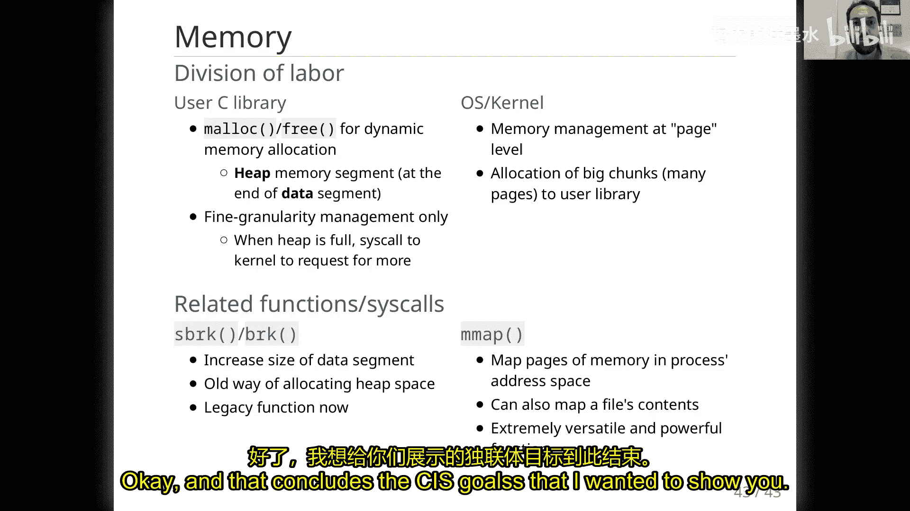

# 【全集 附课件】加州大学戴维斯分校 操作系统与系统编程 中英字幕 1080P p04 Lecture 4 - 系统调用part3 -BV1jXr5BBEKa_p4-

还。

Hi everybody， so today let's continue talking about Cicos。Untilil now。

 we talked about process management， including those three very important Ciscos， fork。

 Xec and weight， which， as you will see for Project one， are at the core of making shells。

And last time we also started talking about files and directories。

We saw the notion of a file descriptor。And how it was an integer value that， in fact。

Represented an index。In the in the table of open files that is appointed by the by the PCB for that current process。

So when a process opens the files and gets a file descriptor in return。

 that then will be used to interact with that file。

 that file descriptor is nothing else than the number of an entry in this open file that this open file table that points onto the actual file。

And that maintains the mode that the file is open with and the current offset so that as we read or right。

 we do those sequential operations， the upPS offset is updated accordingly。

So let's continue talking about。诶。5 receptors a bit。

As you see here in the examples that I gave when we open files and we get filescriptors。

I made them start at number 3 and number 4。That is not a mistake。

 The reason that we don't start from number 0， from entering number 0 is that。

Entries number 0 to2 are actually already occupied。

They're occupied because when a process starts running， even before you reach the main function。

The three first file descriptors are already kind of pre field with some default values。

And by default。Those three entries are pointing onto the terminal。And those three entries are。

Entry number zero equal is called the standard input。

That's pretty much the file script that is being used when you call scanNf or F getS or getline when you try to get input from the user。

Entry number one is called standard output。 That's where all of the prints go。And， finally。😊。

Entry number two is called standard error， so that's when you want to report an error that the program is facing back to the user and you want to print it into a different channel than the printf channel。

 which is more about like interaction with the user。And so technically in the program。😊。

You could read from file descriptor number 0， and that would be the equivalent of。

Accessing this entry or you could write to file description number one。

 and that would be the equivalent of accessing that entry and that would allow the process to like interact with the terminal。

And we can see that easily by say， writing this small program。That focuses on entry one and entry2。

 STD out and STD air。So you see here we have pretty much a total of like four different ways of doing the same thing。

 which is writing hello space。On to STD out this file descriptor number one。We can。

Coll write directly the Cis and use this macro， which is equivalent to one。

 or we can hard code number one directly that would work too。

If we want to do things a little bit more properly and use the bufferization of STD out。

 then we could use Fprint。诶。And so here， no actually it's not a question of bufferization。

 sorry I'm confusing with something else here F printf and printf allow you to do specific formatting。

 you know， like use person D if you want to print the symbols and stuff like that。

 that's the particular idea of printf overwrite。Here with right， you cannot say like hello person D。

 for example， the person D would not be replaced with anything because right cannot do。

What is called formatted printing， but anyway。诶。So yeah。

 so here you could use F printf and print a certain string onto STD out or last possibility。

 you could just use print F。Just indicate the string you want to print and that would beat。

And implicitly， printf would in fact， trigger a call to write on file descriptionscriptor number one。

So all four possibilities here are pretty much equivalent。Yeah。Now for STD air。

 we could pretty much do the same we can call right using the macro STD Air fileno which is equal to2。

 or we can use F print F and in that case we need to specify that we want to do a printf。

Onto output STD air。And as you see， the output。Gets us four as in three worlds。And。

Now what's nice is that and we'll talk about that a little bit more is that。

Having those standard input and outputs be managed the same as files allows us to do some pretty cool things。

So for example， it can allow us to connect those streams because at the end of the day。

 they are just like files， we can manipulate them in the same way as we might manipulateulate file。

And。We， for example。Can make them point onto something else than the terminal。So for example。

When we run the program， standard FDS， which is。The one that prints four helllos on STD out and three worlds onto STD air。

We can specify that， you know what， we want to redirect。STD out。

 that's what the single like superior sign does， we want to redirect STD out to slash dev slash no。

 which is now the way of saying like we don't want to print it。And what that would do。

 this syntax is that。Now， the filescriptor number one， which is which corresponds to STD out。

 would be rewired instead of the terminal， it would be rewired to。Slash dev。Slash no。

And in other words， it wouldn't be printed。So， that's one possibility。Or we can say， hey。

I want to redirect filescriptor number two to slash dev slash no。That would mean here。That。

Now it's the STDR。 It's the entry number  two。That would be directed to Dev Noll。

 so it wouldn't be printed。That link would be broken， it wouldn't go to the terminal。

And on the other hand， by using a pipe， we'll get back to that later， but by using a pipe。

Everything that goes to file descriptionscriptor number one， STD out would be in fact。

 not printed to the terminal， but sent to another process。

And we'd be able to like send everything that is printed to another process for further processing。

So here， for example， we could transmit everything to executable TR。

And TR would replace all of the letter H by letter Js， and so it would print like jello， jello。

 jello instead of hello， hello， hello hello。Another example here with that particular syntax。

 we can redirect both。S T D out and S T D air to say a file。

And so here you see that nothing gets printed because both entry one and entry2 would be connected to that file now and no longer to the terminal。

And it's only upon opening that file that we would see。What， in fact， was printed。And here actually。

 we can see that like because the four hells。I bring printed on STD out and STD out is bufferforized。

 it's not printed right away。We see that there is some interl between the printing of the hellloos and the printing of the world which are printed on STD air。

 this one is not bufferforized， it goes through like as soon as it's issued and that's why we have this interling。

O。So let's move on and let's start talking about pretty interesting Cisco called Dupe2。

Dpe2 allows you to open a file， get a file scripture， and then duplicate this file scripture。

To another file descriptor， so let me give you an example to kind of explain how that works。

So imagine we have this program。At first， we print something， print F hello number one。By default。

 if we're not messing up with the standard streams。

 that printf should go to the terminal and be printed to the terminal。Then we open a file。

 my file do dot txt。We open it in right on， so we only want to write to it。

In case the file doesn't yet exist， we want to create it。And if we're going to create it。

 we need to indicate what are the rights of the file and so here we choose typical like readwrite for the user and read read for the group and others。

 but anyway， it doesn't matter。What matters is when we call here dope2。

So we just called open on that file。Technically。The three first file descriptors are already used by STD in STD out and STD Air so we can assume that here the opener the file will return。

F is number three。 So that would be the value of F D， right。And so here with Do2。

 we're going to pretty much say like， hey， so we want to duplicate entry number three。

And put that to。S T D out。So STD out so far was connected to， say the terminal。We want to stop。

 we want to close that， we want STD out not to be connected to the terminal anymore。

 and instead it will receive whatever this FD is。Then we close F D because we don't need it anymore。

And what's interesting here now is when we get to the second print。That also tries to。

Print something to STD out。We're not going to sit it in the terminal anymore because STD out is no longer connected to the terminal instead it's connected to a file。

And so we can check that very easily by say， compiling the program and running it。

And so we see that the first hello is printed in terminal because here like STD out upon running that command here。

S TD out would be in the terminal。But as we execute this and right after executing the Ju2。

 STD out now will be connected to the file。It we won't see it in the terminal， this second printf。

It's only when opening and displaying what the file contains that we see where the printf in fact went。

 the second one。Let's look at it graphically so that you better understand so what happens exactly。

Add the dupe to。So add the Duke to。We were， we had just done the open， so we had this。

File scription number 3。Containing an entry that was initially to write only offset is at 0。

And that entry is pointing onto this my file that we just created。

And what the Duke2 does is that so so far。The entry number one。

 ST T D out was connected to the terminal。The dupe2。Brericks。That connection。

 it removes this connection。And instead。It connects S T D out to。The same file as enter number three。

 So and in fact， like this whole entry here， all of those values。Are duplicated。

To whatever entry is specified as the second argument of du 2 that's pretty much what happens and so that's why here now the entry that corresponds to STD out is exactly the same entry as entry number three。

The question that you may want to ask is。Why instead of using Dupe 2， can't we just say。

Close one to make it available。And then call open。Because as you know。

 open always opens the first available file descriptor。 So if we close one and then we call open。Um。

 we would pretty much almost be sure that entry one number one would be used and we'd be able to replace whatever was in there。

 right？So it would be possible to do that， it would probably work。

There are a couple reasons why using du2 is better the first is that with Dope2 we can take care of opening the files and setting up the file descriptionor in the way we want beforehand and only at the last minute we can call Duup2 and really duplicate whatever we have carefully prepared to the destination that we're really looking for so that's one reason。

Another reason is that it's possible that we would prepare a file descriptor FD。

 and then we would want to use Dupe to multiple times。So for example。

 like what if I want to not only replace STD out， but I also want to replace STD air and I want to make both of them。

Point on this my file dot Tx D。 Then it would be a lot easier to。Prepare my F D first。

 and then call dope 2。FDS TD out and FDS TD air， like kind of back to back。 And that would work。

 Where if I。Close them and then call open， I would need to do it multiple times。

And you'll see in project one， it's also very convenient that， for example， the parent。

Would be calling the open and prepare a certain filescriptor。

AndDpe2 would be called inside of the child and so that's why we need those like two kind of separate operation like preparing a filescriptor and then duplicating it using Dupe2 at the location that we're looking for。

Okay， let's continue。The next function that I wanted to quickly show you is start， so start。

You give the path to a certain file and you call Stat on it and Stat returns this object that is ofstruct stat that essentially contains a bunch of fields describing the file。

And so among those fields， you have， for example， what the mode of the file is or like its type。

 is it a directory， is it a regular file or is it something else。

 it also gives you the mode of the file。So if you have like read permission write permission。

 executable permission and so on， it gives you the size of the file。

 it gives you the last time it was accessed and so on。

 and so in fact this structure that you have a whole bunch of information。So for example。

 like if we compile this program and run it on different files that we give as an argument。

It tells us what kind of file we just gave and so here's an example with a regular file。

 here's an example with a directory and so on。嗯。😊，And so， the last。

Category of Ciscos that are related to files and directories that I going to mention here。诶。😊。

Offfer directory traversals。 So how to work with directories。

So there are kind of two categories we have get CW and CHD that allow you to manipulate what is called the current working directory。

And then we have three functions here， open De， closed de and read De that allows you to open a directory。

And go through the file names that a directory contains。

And so here is a full program that kind of shows you everything。The program has kind of two phases。

 phase one， phase two。In phase  one， we。Use get C WD to know where we are Currently where we are。

 And that would pretty much mean。Where this program when it was run and now it's running as a process。

 where was it to run like so because at some point you have to run this from a terminal。

And so in the terminal， you are somewhere like you've typed C slash home slash whatever， I mean。

 you're like somewhere in the virtual file system。And then you run a process， so that process。

 the location where you run that process is the current working directory。

And that's something you can get by calling get CW。Now the process can relocate itself。

 it can go to another directory， it can change this current working directory by calling CHD。

So here we're going to call CD on whatever the user gave us as the first command line argument。

And then we can call open De and read De in a loop to kind of scroll or to go through all of the file names that are contained now in the current directory。

So let me show you how that would work after compiling and when executing this program。So。

Let's assume I'm on a CSI computer and I'm in my own home director。 Like if I type PW UD。

 I'm at home。And now let's imagine that I run the executable D scan。

 which is the executable corresponding to that program。On the directory route。

So what would happen is that in phase one。I would locate where I am with get CW and you see that I would be able to detect that I was run from slash home slash my username。

And then with CD， I could relocate myself to whatever the user wanted me to go。

And then with open dear and then read De， I would essentially be able to go through all of the files and directories that are contained in。

The root director in slash。So that that's the idea。And that concludes this。Se about files and teries。

So the next category of Ciscos that we're going to talk about are about pipes。

 and it's pretty much one Csco。 So what what's a pipe I briefly mentioned it a moment ago。

 but we're now going get into the。Grey details。A pipe is what is called an inter processces communication channel。

 IPC。And it's a way of building complex command。Based on more simple comments。

And it works in the way that like。We're going to connect the output we're going to make a pipeline and that's where the name pipe comes from we're going to be able to connect the output of a running process so whatever comes onto this STD out we can connect that to the STD in so what goes in another process and we can do that multiple times and that's a great way of composing complex commands based on simpler one so for example。

Here is one that's pretty cool。And I'm sure it's happened to you because it happens to me sometimes。

Imagine you're in a directory。And in that directory， you are running out of space on your computer。

 and so you would like to know which are the files or subdirecties that are taking the most amount of space so that you can do some reorganization and cleaning up。

Well， here here's a composition of three different command that we pipe to one another。

And that pretty much gives us a ranking of the three files or directories that take the most amount of space on disk。

And so the way it works is that we start by using DU。Which gives us the size of each。

Subdirectories or files within the current directory， but it gives us like all of them。We pipe。

The output of D U。Into。The command thought and thought will put them in the right order。

 because D you just gave us all of the information in no particular order。

St here will sort those different subdirector so subdirecties and files。

 and it will organize them in reverse order by specifying dash R。So。

The subdirecty here that is the heaviest will be at the top of the list。

And then because I'm really only interested in the few subdirecties of files that are the biggest。

I don't want to have the whole list， I just want to have the three heaviest one。And so I can type。

The results of thought into head。And tell head to only print the first three lines。

And that's how I have this composition of three comments that eventually。Print in the terminal。

The three here sub directories that take the most， the biggest amount of space。

 like on my hard drive。So pretty coolhu。So how does it work exactly？😊，Well。

 you see that it's only a matter of。Connecting filescriptors。So let's say。Here I used process one。

 process two， process three， but it would pretty much be the same here as in this example。

So for D you。The STD out of D would be instead of being connected to the terminal。

 it would be connected to。A pipe。What is a pipe？It is a buffer。It's an array。

That is located in the kernelal， in the O。And it's an array of a fixed amount of memory。

 so typically like some kilobytes back in the day it was pretty small it was like4 kilobytes now on more modern machines it's about like 64 kilobytes and it can be increased if you configure your computer。

Differently， the size of a pipe can go up to like say a megabyte， but it's fairly small。

 but it's an array that lives inside of the kernel。And so。If process one here。

Has its STD out connected to a pipe， it means that every time we write to STD out instead of being printed to the terminal。

 it goes into that pipe like things are being written there。Now， this pipe。Is connected to。The S in。

Of the following process inside of this big pipeline。

And so every time that process too will read from its input。

 so we'll called scanF or getline or F getsS， it will in fact not read anything from the terminal。

 but it will read from the pipe。That is being populated by process one。And so。

And so here process two will write its STD out to a pipe and process3 will read from the pipe。

And eventually it's only process three， which。Wites its S T D out to the terminal。

So here in this example， the only executable that really prints into the terminal is head。

 that's the one that is at the end of the pipeline。

What's interesting is that this pipeline of command。Works with filescriptors。

In the same way as we open files in the same way as everything。

 it's completely transparent we use the same abstractions， that's what makes it so powerful。Now。

 one thing that we have to keep in mind here。That's interesting is that the synchronization of those three processes now kind of working together。

 the synchronization is completely implicit。What happens if process  one。

writes so much data on its SDD out that the pie becomes full。Well， nothing happened。

The thing is like， if the pipe is full， then the next time that process one wants to read to to write to it。

 it's going to be blocked because it can't。 So the system will stop executing process one because it cannot go further。

And it's only when process 2 reads。From the pipe here and start taking data out。

 which creates room for process one to make more that process one will now be unblocked and will be able to continue。

And so you see how you have like this implicit synchronization between processes as pipes are being filled or emptied。

O。So how do we use pipepe in actual programs。Well， there's a function called pipe。

This function takes an array of file descriptors， of two file descriptors。

So whenever you want to use pipe， you probably want to have an array of two filescriptors somewhere。

And that's what you give as an argument。And so pipe internally will create this array inside of the kernel。

And we'll create two kind of accessoriesors。One for the read access and one for the right access。

As entries in the open file tables。And will populate those two entries of FD with the correct numbers。

So here's an example。😊，Maybe let me show you that， okay。

So that's what happens like when we call pipe。The canal will create this structure， this array。

And we'll find two entries。In the file descripted tables。

 it doesn't have to be two consecutive entries like whichever are the first available。

So here like we haven't done anything like we haven't opened any files or anything。

 so the first two entries would be entry three and entry four。Entry number three。

 the first one would be the one that allows a read access。To the pipe， whereas the second entry。

 entry number4 would be the one that allows a right， oops sorry。A right access。To the pipe。

So that's what we have after calling pipe on F here。Now we should have Fd0， which is。

3 and F1 contains4。And so when we call right on Fd1， we're in fact calling right on。F the scriptor 4。

Which gets us here。And we're calling right on we're transmitting the。The string， hello。

So what will happen is that。The string hello would be written。Inside of the pipe here。

And in that line， when we read from F D 0， which is。3， number 3。

We're going to access the pipe through its reading access。

And so we're going to read whatever has been written。We wrote seven characters。

 so it's possible to read seven characters。And at the end。

 we can print them and so if we execute that， that's what we would see。Now， here。

It's just an example and it's an example that's like not super fun because like we're just talking to ourselves like we're creating a pipe and then we're putting stuff in it and pretty much like reading exactly the same。

What's fun with pipes is to talk to another process， so let's take an example of that。

So here is a more complete program。And chair， you see， we're using fork and exec again。

So what's the idea here？The idea is that we would be in a process。

And we would change this process to another process and also create a child process and pipe into that child process。

So let's try to illustrate that in the way that we've seen。So。So far。We're in a process。

Let's call it， like P。ThatAnd this process is executing this code。And so， on the other side。

We have the kennel。And we have the table of file scriptors。And we have multiple entries。

 so we have entry 0， entry1。Qu。😔，ree。😔，four。Very sorry for the。😔，Writing style it。

 I'm using this tablet。 It's very difficult。O。And so by default。

 assuming we haven't done like anything crazy。Entry 0。one。And two。They are all connected。To theみの。O。

Okay。真的。We are so this process is running and executing this program， calling the function pipeline。

 and we start executing code。First line here， we create a pipe。So that means we go in the  kernel。

 we create this pipe。Which is this circular buffer。And the secret buffer has。A read access。And。

A right axis。It's reason my double use。W牌。O。Right exit。And so。

The read access will be connected to an entry in the file descriptor array。

And the right access will be connected to another entry。Okay， that's where we are。No。

The process fors。Which means that we're going to duplicate everything， including that table。

So now we have another process。Also running some code， the exact same code here。So now we have。

 say P2。 that was P1。And for P2， we also have。In the PCB。We have。The file descriptor array。

With also entry one， a0，1，2。re， four。That is the exact duplicate。Of the parent。So，0。

1 and  two are connected to the terminal。3 is connected to。

The red access of the pipe and4 is connected to the right axis of the pipe Okay。

 so that's where were at。And because we check what fork returns。

 we are right away able to identify which is the parent and which is the child and have them execute。

Different pieces of code。 And you'll see that that that's when it becomes interesting。

 So let's start with the parent。The parent starts by closing Fd0。

What it means is that so Fd0 is connected to the right axis of the pipe。That's gonna be。Delet it。

Then， it will。So let me actually change the color so that we see it better。Then it calls。Dop2。

 and it says， okay， dope。Entry F D1 into ST D out。 What it means is that。S TD out now。

 instead of being connected to the terminal。Let me find another color， okay。

Instead of being connected to the terminal， it now will be requiredred to。The right entry。

Of the pipe。So that link。Here is broken。And then we do close of F1， because we don't need it anymore。

 So we break。That link。Oops。ま。Okay。And， finally。The parent calls exec。

And start executing another comment。 So in fact， like， we're going to stop executing that code。

 and we're gonna start executing。Another。Executable from the beginning。

 like another one from another main function and so。O。And so on the other side now。On the child side。

We start by closing FD1。So， that means。We are closing filescript number four。

We don't have any more access to the right access of the pipe。And instead。We call dope。

 oh so there's a mistake here it should be dope 2， sorry about that。And。

So we want to duplicate Fd0 entry number three。Into S the in。

So what it means is that SD in should no longer be connected to the terminal， but instead。

It will be connected to the right axis。The read access of the pipe。Then we call close Fd0。

 so we break that link。Actually， let me remove this one and then we call close Fd0。

 we break this one。And。Finally， we call exec， and we make the child。

Stop executing that code and execute something else， which was given here， you see as an argument。

What did we create here， we created a pipe。😮，Between process one and process 2。

 And we made that those connections。By could。Which is pretty much what a shell would be doing。

If you were to write to a shell that supports piping。

The only difference here with the shell is that if the shell itself。The parent calls exec。

 then you don't have a shell anymore because you lose the shell。If you wanted to have a shell。

You would need to fork twice。If you want to have a shell that is able to run process one piped into process two。

The shell must fork into process 1。And into process 2， and set up the pipe。It in between them。Okay。

 let's go。So， the next。Category of Ciscos that I wanted to talk to you about is related to signals。

So signals is also a form of IPC inter processces communication。

And it's a way for processes to be notified of some events。

So here are two examples of notifications that you might know because you've used them already。

 you have something called SGV。So SeGV is when you have a segmentation fault。

 like your program accesses a piece of memory that。Is not authorized and the program crashes。

As a matter of fact， before it crashes， the program is being notified that a segmentation fault error has happened and as I will show you。

 it would be possible for the program itself to catch this error and fix it and not necessarily like crash like it has an option of kind of fixing it。

Another example is when you run something in the terminal。

And you want to stop it until so you would press C C well control C in fact triggers the delivery also of a signal to the running process。

 which is called Sig int for interrupt。嗯。And there are actually like about 30 different signals like that that are all signals that either come from。

The process itself doing some actions and being notified because of their own action or being notified from external events。

So now what happens when。A process is being delivered a signal， like gets a notification。

Well the default action depends on the signal itself。There are some signals。

That when they are received， they terminate the process。 So that's what happens when you send signal。

 like when you press control C， you send the sign to the process。

 The default action is that the process is terminated。And。😊。

Some other signals such as so segmentation fault， for example。

 the process is terminated and there's what is called the code dump that's being generated so that you can debug your process。

There are some signals。That are just ignored。 Thats the default action。

 like you receive the signal and nothing happens。There are some signals。

 actually one of them six stop。That stops the process。 Like。

 the process is now blocked and stop running。Up until it receives another signal。

 which is for continue， which will resume the execution of the signal。

So those are the different default actions that are being performed when a process receives a signal。

Now what's interesting is that we can change that default action， that default behavior。

It's possible。To， for example， ignore a signal。So for example， like signalsinds。

 it's possible to just ignore it。Like the program can say like， hey， you know what。

 I don't want to be interrupted by Ss。So I'm just going to block them and so in that case。

 when you press control C to terminate the process， in fact。

 nothing is going to happen because the process just ignores them。So， it's possible。

Another possibility is to associate。What is called the signal handler。

To a certain signal so that when the process receives a signal。

 it actually starts executing a function。 It starts executing code in reaction to receiving that signal。

There are only two signals， six stop and six here。For which you cannot either ignore it or run your own function。

SQ will always dominate the process， and six up will always stop a process。

 There's nothing the process can do about it。So here are the few functions。

That are related to signals。 that are all ciscos。We have functions to send signals。

 so either for example， to yourself with rays or kill if you want to send signals to other processes。

You also have functions such as alarm or set timer that allows a certain process to set a timer and after the time that was specified has run。

 receive a signal to notified like okay， the time that you asked has passed likes here's a notification file。

And the notification would be received as a signal such as Sgalo。As I was telling you。

 you can change the default action when receiving a signal， you can simply like block them。

 ignore them。Or you can associate a certain action， like associate a signal handler。

And a process can also pose itself。Until it receives a signal。So here is actually。

An example of all of that。So here is a quick example that I wrote。Where？Here by those three lines。

 we can essentially ignore。Seeigig。 so from that moment after executing that code。

 if you type control C， nothing' is going to happen。

 It's just going to be ignored and it's not going to do anything。And here。

What we're doing is that we're associating。The signal s alarm to this ham angler。

 which is a function。That's running a pre。And so what's interesting now is that。

We're gonna set an alarm。Of5 seconds。 That's the default。A unit of time， seconds。

And then we're going to pause up until we receive the ci。And at the end， it's totally useless。

 but just for the example， we're going to kill ourselves by sending ourselves。

A sickel which cannot be ignored and which will cause the immediate termination of the process。

It's kind of a same way of doing exit， but that's pretty brutal。

And so here's what happens when we execute the code。😊。

So we would run all of that code on the print tab， the alarm and then the pose， and so we'd be there。

Here， what's in a yellow is actually me trying to press control C to terminate the process。

 except that the process is ignoring those signalsigs， so nothing happens。And five seconds later。

The sig alarm is being triggered because the alarm has gone off。And that's where。

The signaller is being executed and we see that line。And finally， when we raise the seat kill。

 actually the shell kind of tells us like， oh， something bad has happened。

 like your processes is being killed in a pretty brutal way。Okay， and so。Sorry。

 we're running a little bit late but。There's only one category。

 one slide that I wanted to show you related to memory management。So。And more specifically。

 malloc and free。 So you know that in C， when you want to allocate dynamic memory。

 you use malloc and when you want to free it， you use free。

And the idea is that these dynamic memory you can ask for a lot like it's dynamic。

 so you call Maoc with a certain number of bytes that you want to allocate and usually when it works well。

 you receive that number of bytes。The way it works is that maloccan free。

Only manage memory that the process already has access to。

 like that the OS is already given to the process。So that memory already belongs to the process and then is distributed by calling Maoc andfr。

But if you call Maoc and the process itself doesn't have enough memory to accommodate your malllo。

Then we need to go to the US。And the OS will allocate more memories。

 but the OS doesn't really know about the fine granularity of your own model and free in your program。

The only thing that the OSs does is。Give big chunks of memory to the malloc infrastructure And then it's up to the malloc infrastructure to give the to like respond to your own malllos。

 So there's this kind of like separation of tasks。嗯。Back in the day。

 in order to extend this malllo area to get more memory in the heap。

You would call SBRK or BK that was the ON that was kind of like push the limit of the he to make it bigger。

 or smaller。Nowadays to allocate more memory at like kind of a coarse grain level。

 you call MM MM is a very， very powerful function that essentially add the kernel to allocate more memory to the process and thats what that's the function that Maoc uses internally when it runs out of memory and it needs more for the kernel。

Okay， and that concludes the Cicos that I wanted to show you。

