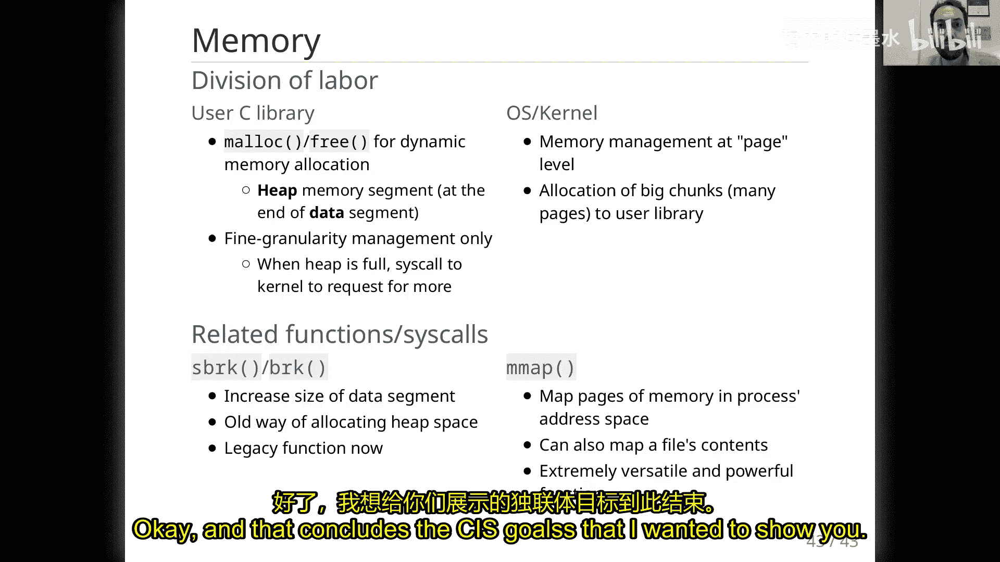

# 操作系统与系统编程：4：系统调用 Part 3


在本节课中，我们将继续学习系统调用，重点探讨文件描述符、管道、信号和内存管理相关的系统调用。我们将了解如何通过系统调用实现进程间通信、信号处理以及动态内存分配。

---

## 文件描述符与标准流

上一节我们介绍了文件描述符的概念，它是一个指向进程打开文件表中某个条目的整数索引。本节中，我们来看看文件描述符0、1、2的特殊用途。

当进程启动时，前三个文件描述符（0、1、2）已被预分配，它们默认指向终端，分别称为：
*   **标准输入 (stdin)**：文件描述符 `0`，用于从用户获取输入（如 `scanf`）。
*   **标准输出 (stdout)**：文件描述符 `1`，用于向用户输出信息（如 `printf`）。
*   **标准错误 (stderr)**：文件描述符 `2`，用于输出错误信息。

我们可以通过多种方式向标准输出写入数据，以下是几种等效的方法：

```c
write(STDOUT_FILENO, "hello ", 6); // 使用宏
write(1, "hello ", 6); // 直接使用文件描述符编号
fprintf(stdout, "hello "); // 使用格式化输出到 stdout
printf("hello "); // printf 默认输出到 stdout
```

同样，向标准错误写入数据可以这样做：

```c
write(STDERR_FILENO, "world", 5);
fprintf(stderr, "world");
```

由于标准输入/输出/错误被当作文件处理，我们可以重定向它们。例如，在 shell 中运行程序时：
*   `./program > /dev/null` 将标准输出重定向到空设备，不显示输出。
*   `./program 2> /dev/null` 将标准错误重定向到空设备。
*   `./program | tr ‘h’ ‘j’` 使用管道将标准输出作为另一个程序 `tr` 的输入。
*   `./program > output.txt 2>&1` 将标准输出和标准错误都重定向到同一个文件。

---

## `dup2` 系统调用

`dup2` 系统调用允许复制一个文件描述符到另一个文件描述符编号，这常用于重定向标准流。

其函数原型为：
```c
int dup2(int oldfd, int newfd);
```
`dup2` 会关闭 `newfd` 当前指向的文件（如果已打开），然后使其成为 `oldfd` 的一个副本，指向同一个文件。

以下是一个示例程序：

```c
printf(“hello number 1\n”); // 输出到终端（stdout）
int fd = open(“myfile.txt”, O_WRONLY | O_CREAT, 0644);
dup2(fd, STDOUT_FILENO); // 将 stdout 重定向到文件
close(fd);
printf(“hello number 2\n”); // 输出到文件，而非终端
```

运行此程序，第一条 `printf` 会显示在终端，而执行 `dup2` 后，第二条 `printf` 的内容会被写入文件 `myfile.txt`。

使用 `dup2` 而非先 `close(1)` 再 `open` 的原因在于：
1.  可以预先精心准备一个文件描述符，然后在最后时刻将其复制到目标位置。
2.  可以方便地将同一个文件描述符复制到多个目标（例如同时重定向 `stdout` 和 `stderr`）。
3.  在父子进程场景中（如项目一的 shell），父进程可以打开文件，子进程通过 `dup2` 进行重定向，操作分离更清晰。

---

## 文件信息与目录遍历

`stat` 系统调用用于获取文件的元数据信息。

其函数原型为：
```c
int stat(const char *pathname, struct stat *statbuf);
```
`struct stat` 结构体包含了文件的类型、权限、大小、最后访问时间等信息。

以下程序可以判断命令行参数指定文件的类型：

```c
struct stat sb;
if (stat(argv[1], &sb) == -1) { perror(“stat”); exit(1); }
// 判断文件类型
if (S_ISREG(sb.st_mode)) printf(“Regular file\n”);
else if (S_ISDIR(sb.st_mode)) printf(“Directory\n”);
// … 其他类型判断
```

对于目录操作，主要有以下几组系统调用：
*   **获取/更改当前工作目录**：`getcwd`, `chdir`
*   **读取目录内容**：`opendir`, `readdir`, `closedir`

以下程序演示了如何切换到用户指定的目录并列出其内容：

```c
char cwd[PATH_MAX];
getcwd(cwd, sizeof(cwd)); // 获取当前目录
printf(“Current dir: %s\n”, cwd);
chdir(argv[1]); // 切换到参数指定的目录
DIR *dir = opendir(“.”); // 打开当前目录
struct dirent *entry;
while ((entry = readdir(dir)) != NULL) { // 遍历目录项
    printf(“%s\n”, entry->d_name);
}
closedir(dir);
```

---

## 管道

管道是一种进程间通信机制，允许将一个进程的输出连接到另一个进程的输入，常用于组合简单的命令完成复杂任务。

例如，命令 `du | sort -r | head -n 3` 用于找出当前目录下占用空间最大的三个项目：
1.  `du` 列出各项目大小。
2.  `sort -r` 进行反向排序。
3.  `head -n 3` 取前三行。

在底层，管道是一个位于内核中的固定大小的缓冲区。当进程向已满的管道写入数据时会被阻塞，直到另一进程从管道中读取数据腾出空间。这种机制实现了进程间的隐式同步。

创建管道使用 `pipe` 系统调用：

```c
int pipe(int pipefd[2]);
```
调用成功后，`pipefd[0]` 用于从管道读取，`pipefd[1]` 用于向管道写入。

一个简单的自通信示例如下：

```c
int fd[2];
pipe(fd);
write(fd[1], “hello”, 6);
char buf[10];
read(fd[0], buf, 6);
printf(“%s\n”, buf); // 输出: hello
```

管道的强大之处在于连接不同进程。以下是一个创建父子进程并通过管道通信的框架：

```c
int fd[2];
pipe(fd);
pid_t pid = fork();
if (pid > 0) { // 父进程
    close(fd[0]); // 关闭读端
    dup2(fd[1], STDOUT_FILENO); // 将 stdout 重定向到管道写端
    close(fd[1]);
    execlp(“ls”, “ls”, NULL); // 执行命令，输出进入管道
} else if (pid == 0) { // 子进程
    close(fd[1]); // 关闭写端
    dup2(fd[0], STDIN_FILENO); // 将 stdin 重定向到管道读端
    close(fd[0]);
    execlp(“wc”, “wc”, “-l”, NULL); // 执行命令，从管道读取输入
}
```
这个例子模拟了 `ls | wc -l` 命令的功能。Shell 实现管道时，需要 `fork` 两次来创建两个子进程并设置它们之间的管道，而 Shell 自身进程得以保留。

---

## 信号

信号是另一种进程间通信机制，用于通知进程发生了某个事件。例如：
*   `SIGSEGV`：段错误信号。
*   `SIGINT`：中断信号（通常由 Ctrl+C 触发）。

进程收到信号后的默认行为包括：终止进程、忽略信号、停止进程等。但进程可以改变大多数信号的处理方式：
1.  **忽略信号**。
2.  **捕获信号**：为其注册一个信号处理函数。

与信号相关的主要系统调用有：
*   `kill`：向指定进程发送信号。
*   `raise`：向进程自身发送信号。
*   `alarm`：设置定时器，时间到后发送 `SIGALRM` 信号。
*   `signal` / `sigaction`：设置信号处理函数。
*   `pause`：挂起进程，直到收到一个信号。

需要注意的是，`SIGKILL` 和 `SIGSTOP` 信号不能被捕获或忽略。

以下程序演示了忽略 `SIGINT` 和捕获 `SIGALRM`：

```c
signal(SIGINT, SIG_IGN); // 忽略 Ctrl+C 中断信号
signal(SIGALRM, handler); // 为 SIGALRM 设置处理函数
alarm(5); // 设置 5 秒定时器
pause(); // 挂起等待信号
raise(SIGKILL); // 向自己发送 SIGKILL 信号终止进程
```

---

## 内存管理：`malloc` 与 `free`

在 C 语言中，`malloc` 和 `free` 用于管理堆内存的动态分配与释放。

其工作原理是：`malloc` 和 `free` 管理的是操作系统已经分配给进程的内存区域（堆）。当 `malloc` 需要更多内存而进程的堆空间不足时，它会通过系统调用向操作系统请求更大的内存块。

历史上，扩展堆大小使用 `brk` 或 `sbrk` 系统调用。现代实现中，更常用的是 `mmap` 系统调用，它功能更强大，可以请求操作系统为进程映射新的内存区域。`malloc` 的内部实现会在需要时使用这些系统调用来获取大块内存，然后自己进行细粒度的分配管理。

---



本节课中我们一起学习了系统调用的核心部分。我们探讨了文件描述符的重定向、目录的遍历操作，深入理解了管道作为进程间通信通道的原理与实现，介绍了信号机制如何用于事件通知和处理，最后了解了 `malloc`/`free` 与操作系统内存管理的关系。掌握这些系统调用是进行系统级编程和深入理解操作系统行为的基础。