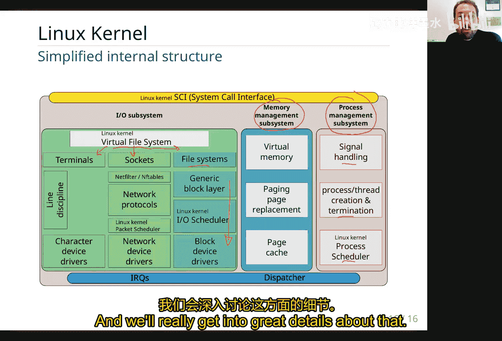

# 【全集 附课件】加州大学戴维斯分校 操作系统与系统编程 中英字幕 1080P p05 Lecture 5 - 操作系统结构 -BV1jXr5BBEKa_p5-

Hi， everybody。So today we're going to talk about the structure of Os。Or their software architecture。

So let's start from。A picture that you might have seen before that shows the different levels or the different layers of software that exist on a typical computing system。

So at the very top， you have applications。And that's what users。Are interacting with primarily。

Those applications they use typically libraries such as the C standup library。Then on the other side。

 so all of that runs into user mode as user processes and so on the other side you have the privileged part of the OS called the kernel。

 which is also architectured into at least usually like two software layers。

 something that we call the portable layer， and something that is the mash dependent layer。

And so at the bottom， all of that code runs onto the hardware。

Which is composed by the CPU and all of the devices and so on。

So today we're going to look at each of those layers and talk a little bit about them。

So let's start with the first one， the one that you probably know the best， the application layer。

So the application is typically what you write， so in C for example。

 that's like the main function that executes multiple statements that call multiple functions and so on so that's like the application is really what you write and that's also what you compile into executables。

嗯。Most of the time， if not always。When you write applications， you use。Libraries， so typically in C。

 you want to print something， you want to do some mathematical computation。

 you're going to have to use libraries because you're not going to reimplement printf yourself for example。

 so if you use printf you're going to have to include STDo if you use Maoc you probably want to include STD Lib if you do some math in your code you probably want to include math dot H and so on。

The those libraries and those headers， they only provide the API the of the library。

 So like the list of functions that the library provide。And you call them。

Exactly like regular functions as if you had written them in the first place， except that you did。

Now the code for those libraries they're actually like provided directly as objects。

 you don't have the C code of print， I mean you can find it。

 but usually it's not what you work with what you work with is a already compiled version of say print。

And that compiled version is directly installed in the computer in the form of an object。

 and it's up to the compiler to kind of make the connection between your code。

 say calling printf and the library that has the compiled code for print。

And and that's what Gcc does and so for example， like when you use the math library in your code by including math。

h and then by using some of the math functions。And so you want your code to be linked with the LibBM。

 say SO。Then you have to tell GCC， hey， I'm using the math library。

 so you have to make the link with that。It should actually be the same when you use the C standout library。

 when you use printf and all of that， you should technically tell also GCC like， hey。

 you need to link my code with the C library except that。Because。

Pretty much every application does that， the reason you don't have to specify like dash LCC。

 like link me to the C library is that it's implied， so you don't have to you never have to say it。

It's already done by default。But you could specify it on the command line if you wanted to。嗯。

There are two kind of options and I'll show you some kind of examples about that like so when you use the say like the C library Le see here。

You can pretty much ask the compiler to work in two different ways， you can tell the compiler hey。

 I want you to really like include the code for printf within my code inside of the same executable。

So that's option one， and that's what we call。Static compilation。

Or we have dynamic computation where you tell GCC like hey， I'm using the C library。

 but like don't put the code inside of mine， just write somewhere that we will need this library for this code to work and I'll'll show you some examples for that。

 but that means that when the application is finally like loaded and run as a process we like we will need to load as well。

 the leap C so that we in fact have the code for the application to fully work。

So actually let's zoom a little bit more on those like comps and I'll talk more about those libraries and static libraries and dynamic libraries。

呃。So that's what the compilation tool chain does， so you typically in a C project you start with one or more C files。

You call GCC GCC is in fact composed by multiple internal tools that are almost like independent from one another。

 we have CPP， which is the preprocesor C which is the actual compiler AS which is the asmbler and that gives us an object file which is already a binary file and the last stage is to combine all of the object files plus。

The libraries that you're potentially using。And the last face is the linker that kind of like puts everything together。

Into a final executable。So now what's interesting is that。So if we zoom on that part。

We start from a C file。The C file is given to CP P， the preprocesor。

What does is that CPP does is that it resolves all of the dash include like all of the header inclusions。

 it actually includes the file that you said should be included and it also resolves all of the pound define and like essentially all of the macros。

So that it gets a file that is self contained that really like has all of the code required for the computation。

And internally， it's not something that you see， but internally during the compilation。

 GCC outputs a file hour of CPP that's called dot I。And it's this dot I that is given to C。

 the actual compiler。So the dot I that's still C code。

 but that's an expanded version of your code that has where all of the headers have been included and so on。

 and this big file that is now like self contained is given to CC。And， C C。

Compes the sea code into assembly code。But a version of assembly code that is still human readable。

 so pretty much like the same type of assembly code as you have written in ECS 50， for example。

 in your assembly class。And that is a file that is in dot S。And finally， this dot S。

Is given to the asler A S。And the assembler now takes this human readable assembly code and transforms it into。

A binary file where now like the assembly instructions。

Have been transformed to their binary equivalent that the processor can understand。

And the output to that is the dot O， the object。And the sort of combination of all of the dot Os are processed by L D。

 the linker。And that is what gives the final executable。嗯。If you're curious。

 you can actually have access to those intermediary files when you run。Gcc。With the option save。Dash。

Tempts。So dash， save dash stamps。I might ask you that as a quiz question。

 but you should definitely try it yourself no matter what。

 like write just a printf hellowell like like two lines of code compile it with this saveTs and then you'll have access to the like Gcc will live in the same directory。

 the dot I and the dot S and so on and then open them with your code editor and look at what they look like and you'll see the different stages of computation iss pretty interesting。

Okay。So。At the end， we have this executable， which I called with the generic name A dot out so from there what happens if you want to actually like execute this executable and make it into a process。

So the executable itself。Only contains two things。It contains the code。

So the sequence of instructions of your program。And some data， which are in fact。

 the global variables。Those are the only two things that anexecutable contains and so when you run an executable and you make it into a process。

The data section and code section are loaded directly from what the executable contains。

The two other segments。Which are sex sections， which is， which are the stack and the heap。

 They are not provided by the executable。 Those segments of memory are created at runtime at the moment where we run the process。

And they will get they start by being completely empty。And they will be perulated。

As the process starts its execution like the he will stop increasing in size and containing data as the process itself calls Ma and put things in the he and the stack is the same like it will grow it starts from empty and it will grow as the process runs create some stack frames put local variables into it cause functions and so on。

 So those two they are only dynamic segments that are created that runtime they do not exist in the executable。

呃。Now you might wonder。If the executable here contains the code and the data。

 why do we separate them into two segments， Why not just having one segment that contains the code plus the data。

And another question that you may ask yourself is。Why do we have this structure where like the he is right next to the data and grows towards the top and the stack is put like right at the top towards like high memory addresses and grows towards the bottom。

And here the two answers to those questions。So the first question is that why do we separate the code and data into different sections or segments？

We'll talk more about that later when we talk about the actual memory。

 but for now the idea is that we separate them because we might want to treat them differently。

 we might want to give them different permission， for example， so the codes。Usually。

 there's no reason for the code to be modified by the application itself。

And so we might want to protect the code and make the code section only read only so that the application itself cannot change its own code at runtime。

And that prevents from the application to be， say like attacked from potential attackers who could take the control of the application and start making it do something else。

Whereas the data obviously because it contains variables needs to be ridable。

 so the data we would protect in readWrite， so that's one explanation of why we actually need to separate them to see them as two logical entities。

And for the question of the heap and the hack， the stocks are being like a farther apart and kind of growing。

Towards one another， the reason is that we are trying to maximize space。

If you have a room and you have， say like two entities that could grow and take over the room。

 the best way to maximize the space user is to put those two entities at each side of the room and this way they can grow in the center and it's only when they finally meet。

That it means that the broom is full。If we had， say， put the stack somewhere here。

At the beginning and had the stack also grow towards the top。

 then it means that the he would be only be able to grow up to here before being blocked by the stack。

 even if the stack is small and is not using all of that space and we would be wasting space here by having them like grow toward one another。

 we're sure that like if they ever meet。It means that we really have no memory left and so the memory was well used。

Okay， moving on。So。In a simple world。An executable could just be loaded in memory like we would load the code。

 load the data， create the he， create the stack， and then boom we can jump to the process starting from the first instruction in the code section and that's it and the application would be running。

Except that we said before like an application might need some libraries in order to run。

And that creates some complications。And so one technique that's being used。To。

Make sure that the job on the kernel because the kernel is the one who is supposed to be loading applications into the memory and run them as processes。

To make sure that the kernel would stay pretty simple。呃。

Engineers have invented a pretty smart way of dealing with that。

By using something that is called a loader。So here's the idea。Imagine we have an application。

 a dot out that uses say， the Liy。An A of out has been compiled as a dynamic application。

 and so it actually doesn't contain the code of the Ley。And it's something that we can check。

By using a tool called LDD on a certain executable。

 and LDD will tell us the list of libraries that a certain application is using the application itself is not containing the code。

 it's just saying like oh， in order to work， I need this library。

And so here we see that this at out needs the library lip C in order to function。嗯。

So we could not just load AOt out and then jump to it and make it trend because because it would not be enough。

 we need to load A dot out and we also need to load this Le see and we need to connect them and then we can run the process。

So we need to load the application and the libraries that it uses and then it can run。

The problem is that。It would be too much or too big of a job for the kernelnel to deal with those dependencies because it can get like pretty complicated if the computer has like different versions of libraries and that kind of stuff like it could be kind quite complicated。

So theken decided like， you know what， I don't want to deal with that complexity。

 I'm going to put the job onto someone else。And this someone else is a loer。

So here typically we see that this A dot out executable is also dependent on this LD dash Linux dash blah。

 blah。That is the loader。When you call exec。So eventually like if we were to run a dot out in the shell。

 it means that and now you should know the shell will fork itself and call exec on a dot out and exec is a Ciscal so eventually the kernel gets the order or the request like okay。

 run a dot out。Thekennel will open a dot out and will see， oh， a dot out。

Is actually dependent on a loader。So the channelkennel instead of loading a dot out will load this loader and the loader is a very simple program that's totally self containedtain that doesn't itself depend on other libraries。

 so it's extremely easy to load。And so， the， the。The can will actually load this loader。

Into the memory。And then as a user process， and then we'll jump to that loader。

And it will be up to the loader to load the application from a dot out and load all of the other libraries that are listed as dependencies。

And here it can be pretty complicated， that's fine because the loader is a user process。

 and so it puts all of the complexity inside of this application and not inside of the kernel so we avoid like big bugs that could be pretty bad to deal with。

So that's the idea。And。Let me give you a little bit more examples around those libraries and the difference between like static and dynamic libraries。

 so let's take a very， very simple example here， just one line of code with a main function where we essentially call printf which means that we need to have access to the Ley。

And we also use a math function by。Calling the cosine function。

Now the typical way that you would compile this application is by saying that。

 so you would use GCC to compile this main dotc file and then because you're using the math library and the math library is not include it by default。

 you have to actually specify it， ay well。Using this math library like make the connection。

And so GCC will do that， which is GCC will actually only compile that code。Inside of the a dot out。

And would only write down as dependencies the fact that in order for this application to work。

We will need to load the lip M for the math rubber， and the lipy。And in order to do that。

 we'll have to load the loader。And so by the time we run this program in the shell and so we call fork and Eec and whatnot。

The the same thing that I just explained in the previous slides will happen。

 meaning that the kernel will in fact only load the loader and the loader will be in charge of loading the actual executable here。

 loading the LibM， loading the Leey like。Connect everybody。 And finally。

 like the application can fully run and and do what it's supposed to and really do the printf and。

 and do the cosine and all of that。That's the dynamic way。

 and that's pretty much like the default way that things work nowadays。

Now there's another way which is called static。So here the only difference is that we would call Gcc still say。

 okay， I want you to compile this this code， the main doc。

But we want you to use the static version of the LibB M library。And so here， GCC， instead of saying。

 oh， we need the Lib M in order to work， it will actually go into this archive and really get the code。

 the code that corresponds to the cosine， and put it inside of the executable itself。

So now the executable doesn't need to depend on LibM because it took the code it needed from the LibM from this archive that contains all of the code and really like took it out and put it into the executable itself。

And as you can see， when we now run LDD on this executable。

 LibBM doesn't appear because we are no longer dependent on it。

 we already took the code from it that we needed。And it worked just as well。

 like here we run the code， it works， we have the code for the cosine and we're able to run it。And。😊。

There is one last way of dealing with libraries。Wwhichch is called dynamically loaded libraries so I'm sorry I know it's a lot of like dynamic stuff and like dynamic loading and dynamic loaded libraries and it might sound a little confusing because they all sound the same but they're actually different concepts so make sure you go back to the slides and you understand like which dynamic thing is which。

呃。So here the idea is kind of interesting。It's the application itself。

Which will open the libraries that it needs。By executing code。

So instead of just saying like instead of including math。

h and then using say like the cosine function directly， here it opens the library itself by code。

Say gets the symbol that corresponds to the cosine function and then runs the code。And well。

 so in order to do that， we need to use another library which is called DL。

 and this one also has a header and also has an API of function。

 and it's also a library that you need the application to kind of like connect to but now here you see that like the application is technically using the LibBM。

 the math library， but it doesn't appear as part of the dependencies。

Like the application is not saying like， oh， I need this thing to exist。

 I need this thing to be loaded upon my own loading。嗯。

Because it will be done at runtime by the application itself。

And that's actually like what applications do for plugins so plugins that the thing with plugins is that an application should work。

 even if some plugins are not installed and it's only when you install them that the application can say oh。

 I see that there is a plugin in that director like do you want me to load it and if you say yes then but the plugin is loaded dynamically。

And all of a sudden， your application gets some new features that it didn't have before。

The way it works is by being able to open pieces of code in a dynamic way by the application itself。

嗯。And if the library is not installed and is not found， then say DL open returns null。

 and it's an event that the application can deal with and that doesn't make it crash。

If we go back to the previous examples here， say like in the regular dynamic way here when you。

Compile and make the link with the math library if the math library is not accessible on the computer。

 then the application will not be able to be loaded。Okay， so moving on and back to the。

To the different layers。So we talked about the application layer。

 we talked about the libraries layer pretty extensively。

 now let's jump to the kernel side and talk about those two layers。

And let me start by giving a little example for you here。You cannot see， but in front of me。

 I have my laptop， which is a thinkpad， not doing any advertisement for them。

 but it's a great laptop。It runs Linux。嗯。咪。Phone here。 it's an Android phone。 And as you may know。

 Android also runs Linux。So what it means is that both my laptop and my phone。

 they are running the same kernel。And。嗯。Even though there are。

 there are pretty different pieces of hardware， right， like a laptop and a phone， like， I mean， okay。

 they have a screen and you can interact with them and they are like computers。

But they are radically different， right？What it means is that like in Linux。

 what it's interesting is that Linux is a massive piece of code。

But there's a separation between some pieces of code that have no reason to be different between my laptop and my phone。

 and then there are pieces of codes that have every reason to be different between my laptop and my phone because there are two very different devices。

And that's why we have those two different layers inside of the kernel。

So the portable OS layer is the layer of code that will pretty much not change between one device and another。

And that code， those species of code。They have to， it's， for example， like the virtual file system。

Like the way that my laptop sees the file is the same way that my phone sees the files that are on the phone。

The IPCs， so the fact that like one process can communicate to another process by say sending signals or doing pipes。

 that kind of stuff， it's exactly the same on a laptop and on a phone。

The fact that we can run multiple processes and we have to schedule them same works exactly the same between phone and laptop virtual memory like networking the way that sound is being processed and all of that it's exactly the same and so it would make no sense to have two different pieces of code。

 even if the devices are different。嗯。And so then， obviously。We have to acknowledge。

Devices are different。 They have different hardware。

 So there's also a lot of code that has to be like very specific。To the device。 So for example。

 like for my laptop， my laptop has a X 86 processor。

 so it needs specific code that can run on that processor。

 whereas my phone has an arm processor has like pretty much every phone on this planet。

And so we need to have code that know how to deal with arm processors。 So here we're really getting。

 and that's what this layer is about。 It's all of the code that has to match exactly what the hardware is。

 And so that means。The way that the computer needs to boot。

 the way that the computer needs to be initialized， all of the logic around like exceptions。

 all of the device drivers， obviously because device drivers have to match the actual devices that are on the hardware。

 the low level of the memory management and so on。And everything that's a processor related。嗯。And so。

They're actually names to all of those interfaces between layers。 So let's quickly look at them。

 So API I I'm sure。You've heard of it's actually。Name that's often kind of abused in many different situations。

The way that。I think， I mean， the way that applies the best in my opinion， as an API describes。

What a library has to offer to an application so you have an application you want to use say like the C library。

 the C library has an API which is say like the set of functions that the C library is offering that's its API and so applications use API is provided by libraries。

Andm。😊，The kernel has kind of its own API for processes。

 and that's the list of Cico that the kernel can perform on behalf of processes。There's no like。

There's no conventional name for that， like there's no standard name， but in the Linux world。

 it's often referred as the U API， the user API， and I think that's a pretty good name。

Then the separation， the interface between the portable layer in the kernel and the mash dependent layer is often called the HL hardware abstraction layer so here the idea is that like so the portable layer we just said would be the same between say my laptop and my phone。

But this portable layer。Many times need to call functions that is provided by the mesh dependent layer。

And those function will their implementation will be different whether it's a phone or a laptop。

 but the function have to have the same signature like the same prototype。

 it's just the implementation is different depending on the device and so there's a sort of API that the mesh independent layer provides to the portable layer and that's what it's called the HAL。

And finally there's also a sort of API between software and hardware and it's actually like two pieces or two partss something called IA you have surely heard that in your ECS 50 class or 1504b 1504 and 1504B the ISA is the list of instructions that the processor understands。

 so it's kind of like the dictionary of the processor and so the ISA will be different on X86 on arm and so on。

And finally。There's also another interface which is called the ABI application binary interface。

 And so here it's a way for the processor to tell the applications Okay。

 here's how you should define your stock frames。 Here is how arguments are passed when a function calls another function。

 and that's really like the convention at assembly level。嗯。ok。

So now that we understand how the different layers， typical layers are architectured。

Let's talk about kernel structure because as you will see。

 the kernel is not always this superposition of those two layers， it can have other structure。

So actually， the first type of structure is the one that we just presented and it's called monolithic kernel。

The idea of a monothic kernel is that the kernel will be made of obviously like a lot of code and it's all compiled together into one single executable。

嗯。And that's pretty much it like that's what's loaded in the memory and that's this piece of code that responds to all of the system calls from the user processes。

 from the application that's typically what Linux is or former Uni is or like BSD system and all of that。

嗯。😊，Being monolithic doesn't necessarily mean that it's all static， it's possible， for example。

 in Linux to have dynamic modules so that you can only load a tiny kernel into the memory and then add functionalities as the computer is running if you like need a driver that wasn't yet loaded。

When a new module is loaded， it's loaded like kind of within the kernel itself and connections are made and it's pretty much as if the code had been there the whole time。

嗯。The big pro of this approach is performance。Because you have all of these kernel codes in pretty much like one executable when one function calls another function。

 it's just like application， it's just like a jump to another location in memory。

 instructions are being executed， returns to the color and so on。

So the performance is great because there's no overhead。However， it also means that if a function。

Fils then it's the entire kernel that fails exactly like when you write an application if one of your function is buggy and does like a segmentation fault。

 then it's the entire application that crashes so it's the same here so it it's kind of vulnerable to a failure because because any failure will bring the entire system down。

Another kind of radically different type of structure it's called micro kernelnal。

So what is the idea here， The idea is that。The kernel parts， the kernel executable。

 will only contain what's the minimum necessary。And the minimum necessary here are。IPcs。

So a way for applications to communicate， so say like piping and like shared memory and and signals and that kind of stuff。

The scheduler oh sorry。So that the micro kernelnel can。

Schedule the different applications and pretty much like the memory management。

 those are the main like three blocks that that need to be implemented at kernel level。

The rest of the stuff。 So say like file system， device。Drivers。Like， I don't know， networking。

And all of that。Does't need to be part of the kennel。

It can run as kind of external services outside of the kernel and actually like at application level。

 their user processes。Big reason to do that is that， well， let。

 let's get to the pros and cons right away。 The big reason is that。

If now one of those services has a failure， so for example。

 like if one of the device drivers is buggy。And it fails and it。

 I don't know it does like a segmentation photo， or something like that。😊。

The whole computer doesn't go down because the kernel is still working and because the service that just crashed is in fact。

 a user application， it can just be restarted。So。By exporting the， those services at user level。

 it provides a great fault isolation。😊，And in terms of cons now， because like it's not all great。

 the problem is that now when say an application wants to open a file。

The application will call the open Cisco get into the microconnel， the microconnel will say， oh。

 that's actually something for the file system service。

So the microconnel will forward the request to the FS service。

 the FS service will take care of it and create say like a filescriptor and whatnot。

 then return back to the kernelnel and the microconnel back to the application。

And now you see that like we need to cross the boundary between user andkennel。

Four times and have some like a passing of messages in between a different user processes。

 And that takes some time。Whereas。With the monothic journal。Because everything is implemented。

 all of the services are implemented at kernel level， the application can do the Cico。

 the kernel processes。And we return。 and so we have only two switches between user and channel。

 which is obviously a lot faster。嗯。So this micro kernelnel structure that was actually like implemented one of the first times by this。

Very popular academic OS called Min， which in fact was an inspiration to Linuxs Dvald when he created Linux。

Another pretty popular kernel that uses a micro kernelnel structure is called Mac。

 and that was an inspiration for the kernel that they use on Mac OSOS nowadays。

And one very popular like current implementation of N OSOS that uses a microcon infrastructure is called microconal structure。

It's called Al4 and you might have never heard that name， but。

It turns out that Al4 is extremely popular， for example it runs in all of the Quallcomm wireless chips。

 so to do like wfi and that kind of stuff and Qlcomm as of like 2013 or something like thats even like a long time ago had sold like a billion。

5 of those chips， so which means that there's actually a lot of Al4 instances that run like in laptops and in phones and and it's not something that it's not like a part of the software that you have to interact with as a user it's like hidden like pretty deep in the machine but still is there and it runs on many。

 many devices。And。There's a last structure that's actually pretty interesting because it takes kind of like the both the best of mono kernel and the best of micro kernel and try to kind of bring their advantages together and it's called an hybrid kernel。

And so here the idea is that like。嗯。All of the services that we trust and also for which we really want to have high performance。

Are part of the kernel itself， so here we're taking from the mono kernel trying to like get the best performance possible。

And all of the services that we don't trust。All run as user processes。 So if they fail。

 if they're buggy and they fail， they're not going to put the entire system to to a halt。

 And that's that's pretty much what Windows and Macs use nowadays so that。

When you have a computer and you download like third party device drivers， for example。

 which have not been like really validated by anyone。

 the fact that they would run as user processes will not make your computer crash。

 that's kind of the idea。So。诶。And one last picture here to terminate so here it's zoom on the Linux kernel。

 monolythtic kernel and the way that it like it's composed of different components and you can already recognize a lot of what we've been studying so far so for example。

 like the whole pod that deals with process management and we talked about like signal handling and process creation and termination via you know forking and executing and exit we're going to talk a little bit about process schedulers soon。

And。We're going to talk also about the memory management towards the end of the quarter。

 Here's like the virtual system interface that I was， I was telling you about。 So here it's。

 it's this layer of code that receives all of the interaction with the。

Vtro file system and that dispatches what the user is trying to do like towards the different like subsystems and so you have the actual like file system that's composed of all of those different layers that's also something that we're going to talk in the second part of the quarter。

Has like all of the network management that unfortunately we won't have time to talk about and then the actual like devices themselves so like the terminals and so on。

So yeah， that concludes this lecture and next time we're going to start talking about the kernel abstraction。

 like really diving in into what is the kernel， what happens when a Ci is being made by an application and all of that and we'll really get into great details about that。

