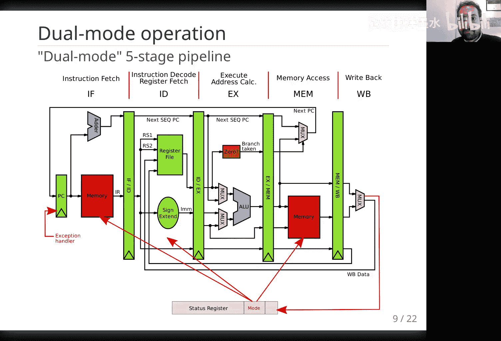

# 【全集 附课件】加州大学戴维斯分校 操作系统与系统编程 中英字幕 1080P p06 Lecture 6 - 内核抽象part1 -BV1jXr5BBEKa_p6-

Hi， everybody。So so far we've talked about Ciscos， so you know this API between processes。

 applications and the kernel。And how processes can ask the kernelel， the OS。

 to perform some period operations on their behalf。

We have also talked about all of the different layers of softwares of software， so the applications。

 the libraries and inside of the kernel， like the different layers as well， like the portable layer。

 the mash independent layer we've also seen that kernels can be structured in different ways between mono thick kernel。

 micro kernelnel， hybrid kernel and so on。Today we're going to start zooming a little bit more onto this kernel interface。

 like what do we have between processes and the kernel and how does it actually work and is implemented in hardware。

So let's start with something we've kind of seen already back to like this definition of what is a process。

So if seen a process is a program in execution or a process is the instance of a program。

 what does that mean exactly， it means that。From your point of view as a programmer。

 you develop some source code， that's what you work on in your code editor。

 then you compile it and you get an executable。Those two things， the source code and the executable。

 there are files， right that are somewhere on your disk。Both of them， regardless。

 that's what we call a program because so far， it's just a sequence of instructions。

So it's like writing a recipe in a recipe book。But you're not making it yet。Now。

 when say in the terminal， you would actually say， hey， I want to run this executable。

 that's when you instantiate this program and now it becomes the process because it's really like live。

 it's being executed by the processor， it's loaded in memory and so on。

So that's when it becomes a process。From the executable。We get the text， which are the sequence。

 which is the sequence of instructions。And the data。

 which is represents like all of the initialized global variables。

Those two things that we find inexecurable that they're loaded in memory。

Upon the execution of the process。The other two segments of memory that we need for a process to be able to execute are the hip for all of the dynamic memory allocation and the stack for all of the local variables and all of the function calling mechanisms。

And those， the stack and the he remember they are not coming from the executable。

 they are created at runtime by the kernel when loading and running the process for the first time。诶。

And so then what would happen is that the soap after loading。

The different segment that in instruction creating the he and the stack。

 the kernel would finally like make the stack pointer in this in the processor point。

 say at the beginning of the stack， given thats say like the stack grows。呃。Downwards。And then， the。

Program counter the PC would be set to the first instruction in the code segment。

And now the processor would finally start really executing that process and executing the different instructions and so on。

Andm。You'll notice here that。The kernel of the US is also a sort of process。

It's also something that has some instructions， has some global variables。

 has a he so that it can allocate memory dynamically。

 and also has a stack because most likely the kernel of theOS is written in C language and you have functions calling other functions having local variables and so on。

 and so you need a stack to make that happen。So in every way。

 a kernel is very much like an application in the way that you already know it。And。

One quick thing to pay attention to is that， so let me write it here。There is not between programs。

And processes。There is not a one to one。Mtting。In some ways。

 processes are kind of like bigger than programs。Because in a process， as you can see。

 you have a stack， you have a he as the process gets running it will use some of the registers of the processor and so on。

 whereas a program is only a sequence of instruction and a list of initialized global viable so in some ways it's less and with the analogy of like cooking and making a recipe is the same like if you open a recipe book and you have a list of ingredients and it tells you what to do and then you start making it like the making it becomes bigger than the recipe。

嗯。Processes are also bigger than programs because you can have multiple processes。

Of the same program。So for example， like on your laptop， like you， I don't know。

 you run like Chrome multiple times and you have like different windows of Chrome。

 you have different processes。Of the same program， like all executing the same recipe。That。

Get a little complicated dissemantic， but programs can also in some ways be bigger than processes because in a program。

 if you have an instruction that says fork， then from the same program。

 you can spoon multiple processes。So anyway， it's a little abstract。

 but it's important to understand the relationship between processes and programs。Okay， there's more。

嗯。😊，Let's now talk about something that's pretty important， which is protection。

So imagine in a scenario where in the memory you have multiple processes or like the OS kernel that are loaded at the same time。

And the idea is that like if you have multiple processes loaded at the same time。

 then the CPU has always something to do， which is which is good。

 you want to maximize the CPU usage so the CPU can execute a little bit of that process and then a little bit of this other process can run the kernel from time to time to make sure that everything is fine and so on。

The problem is that if you only have those different processes including the kernel loaded at the same time like things can go wrong right so if you have a C program here that's loaded and that's buggy for some reason。

 let's imagine it's your shell， the shell that you're writing for P1 and it's totally full of bugs。

Well， if you have no protection whatsoever， it means that if one of your instructions are buggy and say access is some memory that doesn't belong。

To the process itself and say changes a value in the data segment of the kernelnel。

 it could make the kernel crash。嗯。😊，It could also do the same like change I don't know some like stack value in this defense software and make it crash that would be bad news it could also。

Say if you have another bug in the instruction and you start like being in a wide loop。

And never like give back the CPU and so your buggy program would keep the CPU forever and your computer would be totally stuck。

嗯。And worse， so that obviously in case is the process is buggy， that's annoying， but okay。

 well you can still fix it， but say now it's a process that's coming from a program that you done downloaded of the internet。

And it's not buggy， but it's like intentionally malicious。

 like it's actually trying to crush your computer like as much as possible。All in all。

 it means that we probably want to have some sort of system that puts some boundaries like some limit。

 right that like your buggy see program will stay within its own bounds。

And cannot go on each side that would be not a load and this way we would make sure that the program stays within its lane and cannot crush the OS。

 crush the other processes and so on。So we need to revisit a little bit what our understanding of a process is。

 and we need to include this notion of boundaries of limits of protection， so how do we do that？

So let's go back to our definition of a process， process is a programming execution。

 and let's add something that's pretty important， which is that when a process is running。

 it's running with limited rights， okay？So what does it mean。

 it means that essentially we want to put some sort of like box right around a process。

So within that box， process is free to do whatever it wants。

But it has this like pretty strong box so that like the process cannot go on the other side and ta with another process or cannot go on that side and start taming with the kernel。

That mostly means that we need to protect the memory that a process has access to。

It also means that a process can， for example， like access the hard drive directly or cannot do some privileged operations。

呃。And so like typically with the example of the hard drive it would mean like okay what files on the file system a processes access to that kind of stuff and that would be based on who owns this process so for example like the kernel would no okay this process belongs to a certain user via a certain user ID or the process belongs to a certain group by tracking the group ID and according to those values it gives some rights to the process to access like this that file on the file system and not some other file。

So that's kind of the idea。The thing here is that we also， and that's when it becomes tricky。

We still want to be efficient。In the sense that like， okay。

 we want to put this box around the process to limit its right。 But at the same time。

 if the box is too strong。Then most likely we're going to lose a lot in terms of flexibility。

 in terms of functionality， in terms of performance and all of that。

And we don't want that because we want the computer to be as fast as possible。

 we have this amazing hardware， we want processes to make full advantage to take full advantage of this hardware。

So we don't want to lose functionality， we want processes to still use the hardware at the maximum possible。

And we also have to make sure that this box， even though it's pretty secure。

 it doesn't prevent from like processes。Talking to one another or communicating in some ways and also processes communicating with the kernel to ask for operations。

So how do we do that， like how do we technically implement this flexible protection？

There are two ways。The first way， which is， say a little naive， but would work very well。Is to。

 in fact， not allow applications。 So processes to run directly on the hardware。Right， so typically。

 I don't know if you want， you're probably a little too young for that but。

Project yourself in like 15 years， you have kids and they want to have。

 they want to use your car and you're a little stressed that they're will crash your car solution number one。

 you don't let them drive， you drive。So you don't let them use the hardware。

 the the only thing that they can do is be a passenger in your car that's that's kind of like this model。

And so， you act。As an interpreter， by being the one driving the car。And it's， it's pretty much。

It's the the。Model in what we call interpreted languages such as jascript or Python and so on。

 And what it means is that like the application will still sort of being charged by giving the directions。

 but every single direction which in the computer instruction will be。

Kind of vet and executed or emulated by the interpreter。

 So here it means that like say back to the analogy。

 like your kid would be sitting in the passenger car and giving you direction。

 but when if ever they give you a direction to like， hey， do a you turn on the highway， you're like。

 no， no， I'm not going to do that。So ultimately， this interpreter has the ability to make sure that the application cannot do anything that's not authorized otherwise。

Pro stopped here， and would be terminated。The issue with this model is that。

Because the application cannot directly run on the hardware and everything that the application does has to be emulated by the interpreter。

 it's pretty slow， as you can imagine。嗯。So， that's the main issue。Another approach。

W whichch and that's what we're going to talk about more in the next slides。Is this one。 Well， here。

 the idea would be， okay， the application should be able to run directly on the hardware because that's how。

We're going to be really fast。There's no one translating anything in between the application and the hardware and the application can just run at native speed。

However。How do we prevent the application from doing things that are not authorized from like crushing the car。

 essentially。And for that， what we're going to talk about and realize is that we need the help from the hardware。

So， essentially， like。If you're not yourself driving the car and vetting like the directions from your kids。

And you want to just give the car to your kids。Ideally you want the car to like have some self protection so that like if your kid tries to do a u turn on the highway。

 the car itself would be like I'm not doing that because you're a kid and I know that's not okay。

So how do we implement that？Technically。Well， the concept behind it。

 this adaptation of the hardware to running unprivileged application Naly。

 is called dual mode operation。So here the idea is that the hardware。Support directly。

Different execution modes that are more or less privileged。嗯。😊。

Internally it doesn't have to be like super complicated or at least like the representation of it。

 typically you can imagine that as a bit in the processor that can either be zero or one if it's zero then the processor runs in say what we call like kernel mode and it means that the processor here executes。

All of the instructions has no protection。W which means that so can mode is obviously like the mode where the kennel would execute and the kenal is trusted。

 knows exactly what to do if the kenal wants to do you on the highway， that's what we're going to do。

And。😊，But when the processor runs in user mode and say it means that these bits in the one of the status registers would be say like one。

Now， the processor knows like， okay， now' I'm executing not privileged codes。

So I'm not going to do everything that the application says like certain things like as long as the application does things that like make it stay on its lane that's fine。

 but if you ever the application stop doing things that are dangerous like I'm just going to refuse doing that and I'm going to stop。

嗯。😊，In most， so that's a concept， the this dual mode operation in most。Real processors。

 there are often more than two levels。So for example on MIPS processors you have two bits which means four different modes except that only three out of the four are used or defined so you have the kernel something that's called the kernel mode then the supervisor mode and then the user mode and the story actually behind it is kind of funny because。

Back in the day we're talking like probably like 30， 40 years ago， so MIPS was a big。

 I mean still kind of is a big CPU manufacturer。And they were working on this deal with a deck。

 which was a computer manufacturer so that deck would use MIPS processors in their computer。

And so De had their own OS called VMS。And they were considering using MIPS processors for that。

Except that they needed， I mean， in the way their OSs was made， they needed those three levels。

Colonnel， supervisor and user， don't ask me why I don't know。

 but they needed those three different levels of privilege。

And so MIPS went at work and transformed their processor， which up until then only had two modes。

 kernel all and user， and changed like a bunch of stuff in their processor to accommodate for those three modes。

And then。Deec said like， oh， you know what， like never mind。

 we're gonna use this other brand of CPUs。 And so at the end of the day。

 Mips kind of like kept this new specification with the three different execution modes。

 And that probably went like largely unused。 So yeah， anyway。On X 86。

 you have also four levels of privileges that are called protection rings and that's that's how this。

Illustration is coming from so you have kind of like the kernel mode at the center， which is ring0。

 and then you have ring one。Ring2。And ring 3。The intent was that the kernel of the operating system would be running in that ring zero processes would be running in ring three。

 so the ring with the least amount of privileges。And then ring one and two could be used by say device drivers so they are like they have some period edges。

 but not as much as the kernel itself， so that was the idea at least in practice ring one and two are never used they are not used by Linux they are not used by Windows in most OSs。

 the kernel runs entirely into ringing zero and user processes running R3 and the two authors are just not used。

Anyway。But the idea is that like conceptually the processor can run in two different modes。

 kernel mode， user mode， one of them has full privileges on the hardware。

 can access any memory location， can access to any devices， I mean。

 essentially like can do anything it wants。And then you have the user mode where here。

 like the hardware will make sure that all of the code running in user modes。

Stays within the bounds that are defined by the。呃So so yeah。嗯。

This dual mode operation now has to be supported by hardware。 So you have this， like bits。

In a status register。Telling the processor， like， okay。

 you're running in a user mode or internal kernel mode。 But that's not it。

 Like it has to be a little bit more than that。 You have to actually have full hardware report。

 So how does it work。There are four aspects to this hardware report。

The first aspect is that of all the instructions that a processor can execute。Some of them。

 some of those instructions might be kind of dangerous。

You wouldn't want to let user processes have access to those instructions。

So let me give you one of them， we'll zoom a little bit more on each of the categories。

 but I'll still like explain tiny bit right now。There is say on most processors。

 there is often an instruction that puts the processor to sleep。

And that's when say like there's nothing to execute on the processor。

 like there are no applications and so it doesn't make sense for the processor to just like continue running because there's nothing to run。

And so in that case， there's an actual instruction that the processor understand that tells the processor go to sleep。

 but go to like physical sleep， like reduce the voltage and stop using power essentially like kind of turn yourself off and that's how on laptops on smartphones。

We can have pretty efficient。Like energy efficient devices is that like we're able to put processors to sleep when they have nothing to do。

And so the processor goes to sleep and then gets wakingn up later if it receives say like an interrupt from the timer or an internim from an I device。

 and now there's like something to do， there's like an event to process and maybe some like user processes to schedule and to execute and so on。

That instruction that puts the processor to sleep， you can hopefully understand like that should not be an instruction that user processes have access to can execute because otherwise it could be catastrophic if in your own program you're like processor go to sleep except like the computer is loaded with application has like a bunch of things to do and it would be a considerable waste of time to put the CPU to sleep only for it to like be woken up again like a few moments later because like there's actually a lot to be doing。

So this instruction that puts the CPU to sleep。That should be a privileged instruction。

 only something that the kernel， the trusted layer of software on the computer can execute。

And there are others will talk a little bit more about others。

Then we have the notion of memory protection thats we brushed on already。

 so essentially when a user process is executing it should only have access to the segment of memory that belongs to it so the code。

 the data， the he and the stack and that's it like the process should not have access to any other memory than those four segments。

And for that too， we need some hardware support， like we need to make sure that when the process is executing on the CPU。

 it doesn't have access to anything else。Another aspect are a timer interrupts。

So here the idea is that。When a process is running on the CPU， it controls the CPU。

And it's very possible that say the process could be buggy or maybe just like have a lot of computation to do and would kind of。

Hg on the CPU for a very long time and even for say like an infinite loop。And in that case。

 if the CPU is caught like executing a process kind of like forever。

 that would make the machine not usable anymore。So the kernel needs a way to。

 even if a process is running on the CPU and is not like releasing the control of the CPU willingly。

The kernel needs a way to kind of like take the control back onto the CPU and that's what kernel ins are going to help doing。

And finally， if we have two modes of executions。On the CPU kernel mode for the kernel user mode for processes。

 we need a way to switch between those two modes to switch between kernel mode where everything is possible where the code has no restriction to user mode where processes have a ton of restriction。

We need a way to switch between the two modes。In a way that's safe and efficient。

 so we're going to talk about that and I'm going to show you like some real details of implementations here。

诶。Before we zoom a little bit more onto those four different aspects。

 let me show you how this dual mode operation is implemented in a typical five stage processor pipeline。

So。For those who have taken 1504 B already， that's probably a picture that you've seen and that you understand。

 if you have not taken 1504B don't be afraid it's not a picture that I really expect you to fully understand。

 but let me very quickly explain how the thing works because I think that that's interesting to understand how this。

Dual mode operation is implemented on top of this very， very typical five stage pipeline。

So the idea is that the processor in the pipeline processor。

The processor executes instructions kind of like how cars are being built on an assembly line so you know like you start from the beginning and there's no car and then as it kind of like goes along the workers are like putting the components of the car and at the end of the assembly line you have a full call that's pretty much what happens in a pipeline processor。

And it works by stages and you have five of them in the first phase stage。

 you get the instruction that needs to be executed。So that means that the value PC。

 which is an address is sent to the memory。To fetch the instruction that the processor will execute next。

 And so this instruction。Is put in a temporary register。 And that takes， like one clock cycle。

Then in the next clock cycle， this instruction that we fetched is decoded。Like we're trying to see。

 okay， what is this instruction is it say like I don't know an ad between two registers。

 subtraction between two register ex a I don't know a。

A load word of a like in memory or a write store into the memory and so on。

 so we're trying to decode what the instruction is。If the instruction is using some registers。

 then we need to read them from the register file and so on。

Then in the next stage we execute so for example， like if the instruction was an ad between two registers。

 that's when the two registers are say like fed to the ALU and the operation is actually performed。嗯。

😊，If the instruction was a load word， so like reading a word out of the memory。In that stage。

 we would be computing at which address in the memory were supposed to be reading that word from。

 for example。Then in the next stage， and that stage would be pretty much be only relevant for memory instructions。

 otherwise for all sort like all of the other instructions。

 we would just like go through that stage and nothing would happen。But in that stage。

If the instruction is a memory instruction， that's where we go to the memory and we actually perform the instruction。

 so if it's a load word， we read something from the memory if it's a store word we store something in the memory and so on。

And finally， the last stage， which is called a right back， is the stage where if。

The instruction was producing a result。The result is put back。Into the register file。

 in the destination register。 So that's kind of the idea。Okay。That's typical five stage pipeline。Now。

If we try to think in terms of the implementation of this dual model operation。

 how do I transform this pipeline so that like。The same pipeline。

 the same hardware can make the distinction between。

 are we executing kernel code or are we executing user mode code like process code。

And it's actually not that complicated in some ways。

So somewhere in the processor in what is called the status register with kind of like track what the status of the processor is at a certain moment。

 well have this mode bit， so say if it's zero， it means we're in kernel mode， if it's one。

 we're in user mode。And this bit is known in the different stages so that we can either restrict the execution or not。

And it starts from the first stage the instruction fetch。

So here the mode will make sure thats the program calendar。Has to belong if we're in user mode， the。

Program counter has to belong to one of the memory segments that are allowed。

So that's how we here make sure that instructions executed by a user process。

Come from the code segment of that user process and the user process is not access to anything else than its own code segment。

Then here in that stage， in the decocode stage， we would make sure that the instruction that has just been fetched from memory。

Is a legal instruction。 It something that a user process has the authorization of performing。

So for example， here， if the user process contains an instruction that is a privilege。

 such as the instruction that puts the CPU to sleep。

We would the processor would catch it here because it would be like oh weird like this user process is trying to execute this instruction that puts me to sleep。

 that seems wrong， I'm not going to do that。Then here again， like for all of the memory instructions。

We have to make sure that they access memory that they have they own。

So that's another stage where here like the mood would directly tell the processor， okay。

 make sure that everything that this process is accessing belongs to it， otherwise that's an error。

And， finally。This mode has to be changed sometimes to like switch from one mode to the next。

 So the right back must have a way to change this mode。And， finally。

If at any of those stages where the mode is relevant。

 where say like a user process is trying to do something that it shouldn't。

 that it doesn't have theauorization of doing，Then the process， sir。

 has to stop executing this process and has to stop executing the kernel to report what just went wrong。

And so here it can disrupt this pipeline execution by starting to execute the exception handler。

 which is a piece of code that belongs to the kernel so that the  kernel can take over the processor as soon as there is an error。

嗯。And and we're going to stop here for today， and next time we're going to zoom on those four different aspects。

 the privileged instructions， the memory protection， timer interrupts and mood switch。

