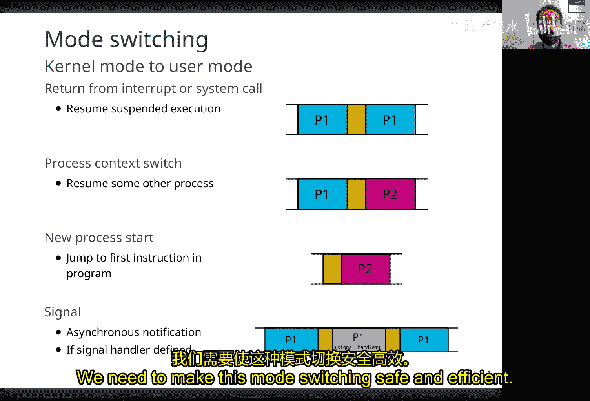

# 【全集 附课件】加州大学戴维斯分校 操作系统与系统编程 中英字幕 1080P p07 Lecture 7 - 内核抽象part2 -BV1jXr5BBEKa_p7-

Hi， everybody。So today let's resume on the topic of kernel abstractstruction。

So quick recap from last time we kind of redefined。

The concept of a process to integrate the idea that we need protected execution。

W whichhich essentially meant that we wanted to have those processes kind of like within boxes to prevent。

A process to temperm with other processes or to temperm with the canal itself。诶。Water maintaining。

Good performance like good efficiency in terms of execution speed and also flexibility to still allow processes to collaborate。

 to cooperate， and processes to collaborate with the kernel or to ask the kernel for services。

And so the idea here to make that happen is that， well。

 we'd still like those processes to be able to run on the hardware directly。

And not without like any like without having any software be in between。

 which would be kind of an interpreted execution， as we discussed last time。

Being able to do that requires some assistance from the hardware itself。And more specifically。

 it requires the hardware to kind of understand that there are two modes of execution。

There's a mode of execution called user mode where when the software executes on the processor inside of user mode。

 then it has limited privileges。And then there's another mode called kernelnal mode where when the software runs in kernel mode on the processor。

 then it pretty much has access to everything and is not restricted at all。

And that has to be implemented by the processor and if the processor has this ability of providing those two different modes。

 then it makes it possible to run processes directly on the hardware and make sure that they run within that box that provides like good protection for the system。

Now we saw last time and that's going to be the focus of today that the hardware in order to support those two modes needs to provide four different items。

First of all， it needs to define a set of a few privileged instructions。

 it needs to discriminate between instructions that are totally fine to be executed by processes。

And instructions that have to be reserved for the kernel only and that processes can not have access to。

Then it needs to provide memory protection so that processes can not go beyond the bounds of what memory they have access to or that belongs to them。

We need timer interrupts to make sure that the kernel can take over the processor like every so often so that a process can hold onto the processor as long as it wants。

And finally， we need a way to switch between user mode and kernel mode in a way that is safe and efficient。

So today let's zoom on each of those things， starting with the first one privileged instructions。

 so what does it mean？So as you remember， as you know。

 a processor can execute many different instructions like that's kind of its vocabulary。

 that's the language that it speaks。Which is called the ISA instruction set architectureure。

And within this ISA。It's important to make a distinction between all of the instructions that are totally safe for user processes to use。

And instructions that are reserved should be reserved for the colonel only。And if ever， a process。

Tries to make the processor run one of those instructions， one of those privileged instructions。

 then the processor should pretty much refuse and raise an exception to ask the kernel like， okay。

 what are we doing now？So here is an example that you can find on Canva。

 you can even like try it on your own computer。And。😊。

So that's an example that would be only for X86 computers。There's this instruction。

 assembly instruction on X86 processor that's called CLI。Which stands for clear interrupt flag。

And it's an instruction that pretty much like deactivate the hardware interrupts。

 so which means that if the processor is executing some code。

And the hardware interrupts are deactivated。 Then the processor can not be interrupted anymore。

 not by the the timer， not by any of the I devices and so on， which pretty much means that。

If a user process was able to do that， then it could stem the processor for as long as it wants。

Which obviously would be bad and that's we would what we're kind of trying to test like okay。

 if we're able to execute this CI instruction。Then we can enter an infinite loop。

And pretty much like the computer would be stuck and the processor would be executing this infinite loop forever。

嗯。And as we can。Oberve here。 like fortunately， it's caught because CI is a privileged instruction on X 86 processors。

 and so。This process trying to execute it will cause an exception that is then caught by the kernel。

 and the kernel， by default kind of like terminates the process。

 So the process is not able to make the processor execute this instruction。Weirdly enough。

 don't ask me why I don't know， but those kind of like illegal use of privileged instructions。

On Linux computers， they are reported as segmentation fault， which is a little weird。

 but that's just like a software choice here。And。And。So that was an example。

 there are others if a process was say trying to change the mood of the processor。

 like change it to kernelno mode to kind of grant all of the rights on the computer。

 it wouldn't work or if it was trying to modify its own memory protection to be able to access other parts of memory that doesn't belong to it wouldn't work。

 if it was trying to flush or invalidate some of the processor caches or the processor TLBs and so on。

 like I mean， essentially all of those operations that are reserved or should be reserved to only the kernel those are protected operations。

嗯。😊，And let me give you an example here of MIPS processor。Okay， here's the mouse。啊。

So the manual for the the MIPS 32 processor is divided in three volumes and volume 2 is the manual that list。

All of the。Instructions alphabetically。And so you have like pretty much。

 so that's the the dictionary of the processor， like all of the instructions that it understands。

And here you have a set of tables that will list everything that the processor understands by category。

 so you can see here like all of the instructions that are related to arithmetic operations。

 so like adding registers to one another， adding a register to an immediate to an immediate value and so on like the division and and all of that。

And so as you go， as you scroll down， you see like， okay， now those are like control instructions。

 like instructions that allow a piece of code to branch or to jam to other locations。

And so on and so and here like you have load and store so like essentially memory instructions so all of those instructions here as i'm scrolling down they regular instructions that can be either executed by the user code or by the kernel because they they they're just like regular instructions。

And as we scroll down here， soon enough will arrive。To this table the one of the last one。

 and so here in this table， it specifies， okay， those instructions。Are the ones that are privileged。

And as you can see， there aren't many of them， it's about like I think 10 or 15 of them。

 and you can see like yeah， there are instructions that will kind of modify the processor。

 so like perform cash operations here like that's the equivalent of this CLI on X86 processors except that for mid processor。

 it's like DI dis interrupts。诶。And you have like instructions really to like TLB management。

 you have the weight instruction， which I somewhat like mentioned in the last lecture。

 you know like this instruction that。Is able to tell the processor to go to sleep to like kind of power itself off to save power when there's nothing else to do in the MIPS lingo or the MIPS instructions it's called weight here and that's not an instruction that user processes are able to execute。

So that kind of like gives you an idea of what we're talking about here。Okay。

 let's go back here okay。嗯。So that's the first aspect， like privilege instructions。Now。

 let's look at the second aspect， memory protection。So what does that mean？嗯。We want。

Processes to only have access to the memory that the kernel has allowed them to access。

 and essentially， that will be the memory containing the code， the data。

 the he and the stack for that process。And so the idea here is that like we need the hardware to make sure that a process will stay within those bounds of memory and if ever it tries to go outside of those bounds。

 the processor， the hardware should capture should catch it。

And raise an exception if that's the case so that the kernel can deal with it and probably like just kill the process。

So that's actually a topic that we're going to talk a lot more towards the end of the quarter。

 so here I'm just going to kind of present briefly two ideas。

 one that's very naive and ones that's more advanced and I'm not going to give a lot of details but just to get your mind ready and we will'll talk more about that like in a few weeks。

So the kind of like basic idea is that， okay if。The memory is of a process。

Is like all in one kind of like block in memory。Then to make sure that when the process is running on the CPU and is sending addresses。

 physical addresses to the memory to access memory。

 either to fetch instructions that need to be executed by that process，Or to access data。

 to store data or to load data。We're going to check essentially like the hardware will check。

That all of those physical addresses that are issued by the CPU on behalf of the process when executing it will stay between a base and a bound。

And so for that， we just need a little bit of hardware logic。

That will be initialized by the kernelel。Prior to running the process that will say， okay。

 here's the base。 So here's like a value， a memory address that represents the base。

Here is the bound。And every time that the process issues。

A physical address who are going to pretty much like test that this address is between the base and the bound。

And if it's not， so if the process is trying to go like outside。Of its own segment。

 then we're going to raise an exception。 the kernel will be able to take over the CPU and willll be able to like deal with it。

So that's pretty much the idea and that's also an existing implementation of memory protection that is unfortunately very。

Not very efficient at all and not very flexible。Again。

 like we'll talk more about that towards the end of the quarter but like I can already give you some reasons here it's very unflexible because here if you can only give one segment of memory to a process then it makes things complicated because like it's difficult to expand the stack it's difficult to expand the he if the process need more of either one it's very difficult or most impossible to make processes share memory if they each have only one block of memory that they can access then how can you say hey you know what like this slice of memory will be accessible by two processes it's also difficult to run multiple processes of the same program like。

Because processes here are using physical addresses and so there can only be one block per process。

 and it can also cause memory fragmentation as processes are created and then are terminated。

 it might create like holes here of memory that is unused and that are kind of like hard to reuse or to like reallocate afterwards。

Current way of doing memory protection that is a lot more efficient and again that we will like study later is' called Vi memory。

And very quickly， the idea of virtual memory is that instead of having processes。

Run directly in the physical address space。You make them run in what is called the virtual address space。

 So essentially you make them run with the illusion that they have access to all of the memory。

For themselves。And in fact， which gives you a lot of flexibility because it's not true。But in fact。

 when they issue virtual addresses， we're going to have a translation of those virtual addresses into physical addresses and that translation is going to be done at runtime。

And this step。Of。Like giving the illusion to the process that like things are infinite and thereby by themselves and in fact。

 like translating everything that they do at runtime gives the system a lot of flexibility to now put the actual data in the physical memory。

At the locations that are very that can be very convenient。And so here it means that like。

For example， the same virtual address in two different processes can refer to different physical addresses。

 which means that now like instantating multiple processes of the same program is pretty easy or the same virtual address or different virtual addresses in two different processes can refer to the same physical address。

 which now means that like processes can share the same memory very easily。

Long story Short gives us a lot of flexibility， makes everything easier。

 and we'll come back to it in a lot more detail in a few weeks。The third aspect are timer interrupts。

 So to fully understand why we need timer interrupts。

 let's kind of go back to the beginning to like what happens when you press the button。

 like the power button on your computer。So when you press the button your computer on your computer and the computer like。

Boots like like powers powers itself on and you have like electricity like coming in and the whole thing like stops booting。

First of all。The computer boots in kernel mode。That's the only way， I mean。

 you have to be able to trust whatever will be executed by the computer first that's a given。

If the first thing that the computer boots is something that cannot be trusted。

 then how do you go back to something that's trusted， it's impossible。So by default， computer boots。

In a privilege mode， in kernel mode and starts executing what is called like the boot code or on typical computers。

 we call it like the BOS。And that will be like the first piece of code that's being executed。

The bioos now will run fairly a little bit， and its job is to kind of select which operating system will be will will be will run on the computer。

诶。And that can be configured， obviously。 But like， say， okay， the buy has decided， you know。

 I'm gonna。Lo Linux。So it finds where the image of Linux is like the executable and it will load it into the memory。

And after it does that it will detect okay， where is where is the entry point to that executable like where is I'm going to。

Lie a little bit here。 But like， where is the the main function of the。Of the kernelnel。

 it doesn't work exactly like that， but like the intent， like where is the first instruction？

And the bootlerer will then just like jump to that first instruction and now the kernel is booting。

So cannel boots。Starts running， starts executing instruction and has to do a bunch of things and that's pretty much what you see if you use Linux for example。

 like you might see like a bunch of lines appearing like and it's all the initialization of the entire computer。

 like initialization of the devices of the virtual memory of like a ton of stuff that allow finally after the kernel has initialized everything to say okay now we're already to run the first process。

And if you remember， the first process in Unix is typically called in it。

 so we have to load in it and to start executing it。

And so after we we the kernel loads in it in memory。

 like loads the in it executable and is about to jump to it or like jumps to it。That's when。

The processor will change its mode to user mode。The program counter of the processor will be set to the first instruction of this user process。

 and now we're going to be in user mode executing。The instruction of the in process。

And so going back to the example from last time which you know。

 with like the idea that like you would have a car and you like。Give the key to your children。

 which might be a bad example because you're probably all too young to have kids。

But let's say it's not your kids let's say it's your best friend， you know。

 like so you just buy a new car and you give the kids to your best friend and your I mean it's your best friend but you don't trust them like so much to like drive your car because they might crash it。

And so the thing is like from the moment that you give the carcass to them and you see them leave with your car。

 you're kind of like， oh， I'm screwed。I wrote it back， you know。

 like how can I make this whole thing stop except that you're here and the car is over there and someone else is driving it。

Well， it's kind of the same here， like once the kernel has done doing the initialization and has like kind of given the keys of the processor to the first。

User process in it。That's it。 The Then the kernel is not running on the processor anymore。

 The processor belongs to。In it。Because in it is using it。Except that here。

The kernelnel is a little smart because it says like， okay。

 I need a way to to stop having in it run on the processor。So that I can like take over。

 So here it's a little bit like if you had a way to all of a sudden， make the car。

 like stop being driven by your best friend and， and you're back in control and you're back at the wheel and you can control like。

 okay， everything fine and， and my friend does not like crash the car in a ditch。 Like， okay。

 I can maybe like give the car back to them and， and I'll check back later。

And that's pretty much the idea of timer interrupts， like timer interrupts。They're away。

 So that's an actual device that runs and that counts time。 And every so often it sends an interrupt。

 which is。An electrical pulse on a wire that is received by the processor and the processor stops executing whatever it was executing and stop executing the kernel。

That's that's really just the idea and that allows the kernelnel to take over the processor and to kind of decide。

 okay， what I'm going to do next。And so what what it can do next is just like okay。

 I'm just going to re give the processor to the same process that was executing there before。

 like that's fine or you know what like the process that was executing there before has run for too long I'm going to give it to another process so you try to like give the process to all of the processes in the system to like make it fair to share the CPU resource and so on。

嗯。The timer in is also another function， it allows the system to keep a good track of time。

So often like computers have some sort of component， hardware component that counts the time。

 like knows what time of the day it is and what day it is and so on， like a sort of calendar。

But that component is not very precise， it just counts like seconds。

 whereas a computer needs to have a precision of time that's like way below seconds。

 it needs to really like track the time in terms of like milliseconds and even like macroseconds or nanoseconds。

And having those timer interrupts that are like extremely frequent。Allows the system。

 like allows thekennel to have a notion of time that is extremely precise。

So what's going to happen is that like every so often here。

The timer interrupt will issue what is called a tick， and that tick will interrupt the processor。

 The processor will execute the kernel for a Y。So that theken can decide like I don't know what's happening。

 like can check various things and then can reive the processor to。

A process up until the next stick where the the kernel like regains the control of the processor and so。

And so it's guaranteed that if a process is not cooperating， like is' trying to。

Keep the processor for itself in an infinite loop， it's not going to be possible because like the kernel can always take over the processor and make decisions。

Lapse of time in between two ticks is often called a Giffy。And。😊，On Linux computer， the ss of time。

 the Gy is often in so it's it's a value that's counted in in Hertz because like it's。

Number of ticks per second。And so typically on desktop computers。

 the the frequency of ticks would be。250 Hz。Which means that the time of a Gphy in between two ticks would be about like 4 milliseconds。

So you have to imagine that like。As I'm speaking， like my laptop is running Linux right now。

 like every4 milliseconds。There is a timer interrupt and the kernel is able to take over the processor for a little bit。

 make decision， like schedule different processes and so on like every 4 milliseconds。On。

High performance computer like computer that really like servers and that kind of stuff that really need like a lot of reactivity。

 a default value is that like the frequency of ticks will be  a00 hertz。

Which means that now the kernel will take over the processor every one millisecond。

 so it really gives like a good amount of reactactivity。One last thing。In this picture。

 I represented the kernel in yellow here and you see that it's like it's kind of wide。

The amount of processor that the kernel is taking compared to the amount of processor that a process is taking。

Obviously that's not true because otherwise it would mean that the kernel has a huge overhead because it's taking a lot of the processor power。

 like a lot of the processor resources。In practice。

A kernel designer would want this yellow part here to be as small as possible。

And maximize the time that processes have within that Gy to execute。 That would be the whole goal。

 But here I wanted to you to see something。 So that's why I made it like that that big。Okay。

The last aspect here and we're going to go slow because like there are two aspects to it it's the mode switching so it's the idea that like okay。

If the processor has two execution modes， user mode and color mode。

 we need to understand like how do we switch from one to the other？

And the two aspects that we're going to talk about are photos。

 the first aspect is try to understand why do we switch。

 why do we switch from user mode to kernel mode， like which what makes us switch from one to the other。

And what makes a switch from Knomo to userum， so we really understand like the different scenarios of switching in the first place。

And after we do that， we're going to talk now like about the details of switching。

 what does it exactly mean like what kind of hardware do we need in order to switch and so on。

So let's start talking about the reasons first。Why do we switch from user mode to can mode。

So if the processor is in user mode， executing a process。

Why would all of a sudden we would switch to executing the can？There are three possible reasons。

 only three。The first reason is that we have an exception。

 That's something we've talked about already。So an exception is， for example， like the processor。

 as we mentioned in a previous example， like tries to execute an instruction that is a privileged instruction。

Did I say the processor， the process is trying to make the processor execute the privilege instruction which is not authorized that causes an exception。

It could also be like a process trying to access memory that doesn't belong to it or is invalid。

So here is actually one example， like here I make a pointer。

 the pointer points to the20 to a null address which will definitely fail and then we try to access this address in order to put a value that's going to fail。

And that will trigger an exception like that will trigger the kernel to take over the processor and make a decision here because that that was an error。

And。So exceptions are triggered because the program that's executing inside of the process is behaving in a way that's not okay and that triggers an exception。

嗯。Those exceptions can be intentional or unintentional that's kind of hard to say you can imagine here that like if you're writing that code maybe it's just a mistake like you didn't know that the pointer would be no and I don't know like your your。

C skills are real shaky and you still donors fully understand pointers。

 you didn't mean to have your applications crash like that's actually super annoying。

 so it's definitely unintentional。Now it could be that like I don't know。

 you're a hacker and you're trying to like write a process that will like actually like。

Compromise the kernel or whatnot。 And so you could be making exceptions in a very like intentional way of trying to like compromise the computer。

No windows。What's important， though， is that like those events are cold。Synchronous events。

So what does that mean， synchronous event？It means that the exception itself。Will always come from。

The processor executing an instruction that causes an exception。So an exception is always related。

To something that the processor was doing。At the moment of the exception。On behalf of the process。

And you'll see why it's important to make that distinction。Now。

 the second reason why we would switch from user mode to Can mode or。Interrups， hardware interrupts。

 So here， as we discussed， they are triggered by I devices， such as the timer， for example。

 timer sends sticks。It could be by other I devices so for example。

 like if thekennel had started an operation with the hard drive。

 like reading some sectors out of the hard drive and the hard drive is now done with the operation with the hard drive would send an interrupt to the processor to tell theken。

 hey， I'm done with the operation you asked me。And so here the sort of procedure would be that say。

The processor was executing some instructions of a certain process。And at some point。

 executing instruction and gets this。Physical interact， like this pulse on a wire。

The processor will finish the execution of the current instruction and after the end of executing this instruction will jump。

We'll switch into cannon mode。To have the kernel execute some instructions here。

 to deal with the interrupt。 And so the kernel will run what is called often like an interrupt service routine an ISR。

 which is pretty much I mean， it's gonna to execute some code to deal with the interrupt and to acknowledge it。

And。And then once it's done， most likely it's going to just like return to the process that was just executing and it will return to executing the next instruction of the process。

呃。So quick word about this interrupt mechanism， like as you know and it's kind of unrelated to the lecture at hand here。

 but it's a better alternative to polling， you know what polling is it's the idea that like when the kernel would say ask like the hard drive to perform an opar。

Poulllling would mean that the colonel has to check。

When the hard drive is done doing the operation and would need to check like by itself by like prompting the hard drive。

 like， are you done， now， are you done now， now， are you done now and so on。 that would be poll。

And as you know， or can imagine， like polling is extremely inefficient because it takes a lot of CPU resources to just check whether or not an I operation is done。

Whereas here with interrupts， you're pretty much saying like， okay， hard drive， do this operation。

 And when you're done， you tell me。And so the whole time where the hard drive in is doing this operation。

 the processor can entirely be dedicated to doing some other stuff。

Because the hard drive will take the initiative to tell the kernel， okay， now I'm done。Anyway。

 digression closed。Now going back to the idea of synchronous events。

 so here for exception we said the synchronous event because they are directly related to what the processor was doing at the time of the exception。

In termss are different， they are as synchronous event。

They have nothing to do with whatever instruction the processor was executing at the time。

 like the processor is just doing its job like executing instructions from processes。

And at the moment that there is an interrupt coming from an I device， the timer， the hard drive。

 like any sort of I device has nothing to do with what the processor was doing at the time。

 that's why we call them asynchronous。And the last one。

 the last event that makes the processor switch from user mode to kernel mode is our system system goals。

 goals。So here you know that we've studied demo already already is the idea that the user process can ask the kernel for some assistance to perform privileged operations on its behalf。

And it's pretty much a functional， but that。Calls the kernel。 and so as a function call。

 you put some arguments inside of registers。And instead of jumping to another function。

 because here you want to jump into the kernel， you have this very specific instruction Cisco that will actually trigger the switch to the kernel。

 the kernel will look at the registers here and they use like oh okay。

 there a Cisco it seems like this processes wants me to to。

sortrt of execute the Red Ci colon its behalf like that's that's what I'm going to do。

And so here it's definitely intentional because like the process is really executing this。

OfOf asking the processor to execute the Cisco instruction。

 like that's pretty what it does and it's a synchronous event because it's the execution of the Cisco that will trigger the switch。

嗯。所以呀。Be careful last thing on this slide， be careful that sometimes there's kind of a terminology chaos that exists so here I mentioned like exceptions。

 interrupts and system goals。You might read in some books or in some like， I don't know。

 manuals of processors， like， I don't know， like various sources that sometimes。

Exceptions kind of encompass all three of those like interrupts are also considered as exceptions and system code are also considered as exceptions and exceptions in that case are often called like faults。

 for example， but some other time in some other books you might read that it's interrupts thats kind of encompass both exceptions。

 hardware interrupts and system code， I mean， so anyway， it's a little bit of chaotic。

I think that language is pretty good and should be the one that， I mean。

 it's the one that's the most popular， but when you read something or when you talk to someone like make sure that you have the same understanding of what an exception is。

 what an interrupt is and what a system goal is。So we've talked here about the switch between user mode to kernel mode。

 three reasons now we're going to quickly mention the four reasons why from kernel mode。

 we would be switching back to user mode。The first reason is that。

Say process one was running and either an interrupt。

Happened that switched to colonnel and the colon executed for a little bit。

 And were pretty much like jumping back into the same process。我 maybe。Process one here。

Perform a cisco。 the can was called。Did the Cisco like perform the operation and then were back into the same like well just resuming the same process。

So that's one reason。Another reason might be that kind of like for the same reason in the first place。

 like so P1 was executing something happened like either an interrupt an exception， a Cisco。

 something。The kennel took over and the kennel decided for some reason， you know what。

 like P1 has run enough or maybe P1 as as for Cico that will take time to be served。

 So what I'm going to do is that I'm going。Context switch to another process。

 I'm gonna give the CPU to another process for execution。

 And so now the process will the process will be given to process process 2 and process 2 will run。

The third reason is that the canal decide。I'm gonna run this new process， for the first time。

So P2 didn't exist in the system before， so we're not really like resuming it because it wasn't executing in the first place。

It's a new process that Sal like has just been created by forking and executing or whatnot like。

 and we are running it for the first time。So that would be a reason to transition from kernel mode to user mode。

Now， quickly， one thing that's very interesting with that particular case。

Is the fact that the kernel is extremely lazy might be something that I will say a lot from now on。

And thekennel doesn't want to have to deal。With the idea that like。It can resume。

The execution of a process in the sense that a process was running， it got suspended。

 and later on it gets resumed here。That's a way for the kennel to give back。The processor， too。

 a suspended process， to resume it。Except that here。

 we also have the case where like P2 is running for the first time。

So it's not really like resuming it， it's running it for the first time。Except that for the kernel。

 in terms of code， it would make things complicated to kind of have an if condition like， oh。

If this process is running for the first time， then we're going to do this sequence of instruction compared to oh。

 this running this process was running before， so we are in fact just resuming it。

 so we're going to do this sequence of instructions that are like slightly different。

And the current is like， wait a minute， I don't want to have this if condition and those two different use cases。

I want to only have one。I want to pretty much only be able to resume processes。

But the question is like， how do you resume a process that's never run before。Right。

And that's why it gets interesting。When the colonel runs the process for the first time。

It will kind of take a past for that process。So that when comes the time to like put it on the processor for the first time。

 it can actually resume it。From this fake past。In such a way that this resume operation will。

 in fact。Make the process start from the beginning and， and start executing。诶。

It might sound a little vague and bizarre for now， but like that's actually something that you will see in the Saon project and so just keep that in mind and youll understand once you have to do it yourself。

Okay。And the fourth and last reason that we would switch from Can mode to user mode is to execute a signal handler。

So signal， remember there are notifications that processes can receive。嗯。

They're often called software interrupts， but you have to be careful that like they are not actual interrupts。

In the sense that they do not interrupt the execution of a process。

If a process is running on the processor and receives a signal。

Then it won't get interrupted in the same way that there's a timer interrupt that arises and the processor like stops executing the process and we jump into account here。

When the signal is raised。The processor is not interrupted。 The process will continue executing。

Up until we have either an exception， a Cisco or a。An an actual interrupt。

And it's only once we in thekennel that the kernelnel can say like， oh， wait a minute。

 I have a notification for process  one。 I process  one has received a signal。

 so I have a notification。And so instead of resuming process one。

 I'm going to run the signal handler that process one might have defined。

And so here we have the signal handle run fairly a bit。

 then we're back into the kernel and we can resume the regular execution of process one。Obviously。

 that that example is if process one had。Dfined a signal handler in the first place if process one didn't define a signal handler。

 then the default action would happen， which would be either like you know the process being terminated or start or like something like that。

Okay， that's that's it for today and next time we're going to dive into the actual details of this。

Moode switching， like what are the different pieces of hardware support we need to make this mode switching safe and efficient。

