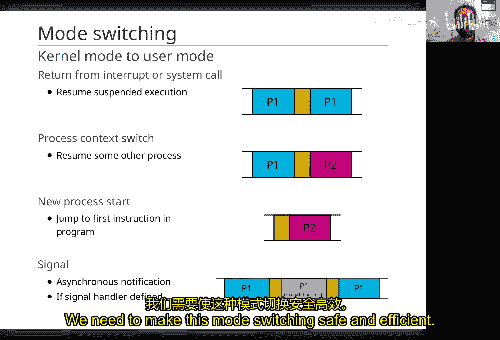

# 操作系统与系统编程：7：内核抽象（第二部分）


## 概述
在本节课中，我们将继续学习内核抽象，重点探讨硬件如何支持用户模式与内核模式的隔离。我们将详细讲解特权指令、内存保护、定时器中断以及模式切换这四大核心硬件支持机制。

上一节我们重新定义了进程的概念，强调了受保护执行的重要性。本节中，我们来看看实现这种保护的具体硬件机制。

## 特权指令
处理器能够执行多种指令，这构成了它的指令集架构。在指令集中，必须区分用户进程可以安全使用的指令和仅保留给内核使用的指令。后者被称为特权指令。如果用户进程试图让处理器执行特权指令，处理器会拒绝并引发异常，通知内核处理。

以下是特权指令的一个例子：
```assembly
CLI ; 清除中断标志（X86指令）
```
这条指令会禁用硬件中断。如果用户进程能执行它，就可以让处理器无限期地运行，这是不被允许的。在X86处理器上，`CLI`是一条特权指令，用户进程尝试执行它会导致异常，内核通常会终止该进程。

其他特权指令的例子包括：尝试改变处理器模式（切换到内核模式）、修改自身内存保护设置以访问不属于它的内存、刷新处理器缓存或TLB等。本质上，所有应仅由内核执行的操作都是受保护的操作。

在MIPS 32处理器的指令手册中，有一个专门的表格列出了所有特权指令，数量大约在10到15条左右，例如禁用中断的`DI`指令、TLB管理指令以及让处理器进入低功耗状态的`WAIT`指令。

## 内存保护
我们希望进程只能访问内核允许其访问的内存，即包含该进程代码、数据、堆和栈的内存。硬件需要确保进程停留在这些内存边界内。如果进程试图越界访问，硬件应捕获此行为并引发异常，以便内核处理（通常是终止该进程）。

内存保护是一个深入的话题，我们将在课程后期详细讨论。这里先简要介绍两种思路：一种简单但低效，另一种更先进高效。

**基础思路（基址-界限寄存器）**
如果进程的内存是连续的一块，硬件可以通过检查每个由进程发出的物理内存地址是否位于一个基址和一个界限之间来实现保护。这需要一些硬件逻辑，由内核在运行进程前初始化基址和界限寄存器的值。每次进程访问内存时，硬件都会进行越界检查。这种方法效率不高且不灵活，例如难以扩展堆栈、难以让进程共享内存、容易导致内存碎片化。

**现代方法（虚拟内存）**
当前更高效的内存保护方式是虚拟内存。其核心思想是让进程运行在虚拟地址空间中，给它们一种可以访问全部内存的假象。实际上，进程发出的虚拟地址会在运行时通过硬件（MMU）翻译成物理地址。这种翻译机制提供了极大的灵活性：不同进程中相同的虚拟地址可以映射到不同的物理地址（便于运行同一程序的多个实例），而不同进程中的不同虚拟地址也可以映射到相同的物理地址（便于进程间共享内存）。虚拟内存是我们将在几周后深入探讨的重点。

## 定时器中断
要理解为什么需要定时器中断，让我们回顾一下计算机启动的过程。计算机启动时处于内核模式，执行BIOS代码，然后加载并启动操作系统内核。内核完成初始化后，会创建第一个用户进程（在Unix中是`init`）并将处理器切换到用户模式来执行它。

此时，内核就像把处理器的“钥匙”交给了用户进程。为了确保内核能重新夺回控制权，防止一个进程独占处理器，就需要定时器中断。定时器是一个硬件设备，会定期发送一个中断信号（电脉冲）给处理器。处理器收到后，会暂停当前执行的用户进程，切换到内核模式，让内核得以运行。

内核可以利用这个机会进行调度决策，例如继续让当前进程运行，或者切换到另一个进程以实现公平的CPU时间共享。此外，频繁的定时器中断（称为“滴答”）也帮助系统维持高精度的时间计数。

两次滴答之间的时间间隔常被称为一个“时间片”或“节拍”。在Linux桌面系统上，滴答频率通常是250Hz，即每4毫秒发生一次中断。在高性能服务器上，频率可能达到1000Hz，即每1毫秒一次，以提供更好的响应性。需要注意的是，内核处理中断的代码（图中黄色部分）应尽可能高效短小，以最大化用户进程的运行时间。

## 模式切换
既然处理器有两种执行模式，我们需要理解如何在它们之间安全、高效地切换。首先探讨切换的原因，然后讨论切换的具体细节。

**从用户模式切换到内核模式的原因**
有三种情况会导致从用户模式切换到内核模式：
1.  **异常**：由进程执行中的错误或非法操作引发，是同步事件。例如：
    *   执行特权指令（如之前的`CLI`例子）。
    *   访问非法内存地址（如下面的代码试图解引用空指针）。
    ```c
    int *p = NULL;
    *p = 5; // 这将触发异常
    ```
2.  **硬件中断**：由I/O设备（如定时器、磁盘）异步触发，与处理器当前执行的指令无关。例如，磁盘完成读写操作后发送中断通知内核。中断机制比轮询高效得多，它允许处理器在I/O操作进行时执行其他任务。
3.  **系统调用**：进程主动通过执行特殊的指令（如`syscall`）请求内核服务，是同步且有意为之的事件。

**术语注意**：不同资料可能对异常、中断和系统调用的归类有所不同，阅读时需注意上下文定义。

**从内核模式切换回用户模式的原因**
有四种情况内核会切换回用户模式：
1.  **恢复原进程**：在处理完异常、中断或系统调用后，内核决定让被中断的同一个进程继续执行。
2.  **切换到另一进程**：内核决定进行上下文切换，将处理器分配给另一个就绪的进程。
3.  **启动新进程**：内核首次运行一个新创建的进程。
4.  **执行信号处理程序**：如果进程收到了信号并且定义了处理程序，内核会在返回用户模式时先执行该信号处理程序，然后再恢复进程的正常执行。

关于“启动新进程”有一个巧妙的设计：内核希望用同一套“恢复进程”的代码逻辑来处理“恢复已运行进程”和“启动新进程”两种情况。为此，内核会为新进程精心构造一个“假的”过去执行状态（上下文），使得“恢复”操作实际上能让进程从起点开始执行。这体现了内核设计的简洁性。



## 总结
本节课我们一起学习了实现内核抽象的四大硬件支持机制。我们了解了特权指令如何限制用户进程的权限，内存保护（特别是虚拟内存的概念）如何隔离进程地址空间，定时器中断如何确保内核能定期接管处理器以实现调度和系统维护，最后我们分析了在用户模式和内核模式之间切换的各种原因。下一节课，我们将深入探讨模式切换的具体硬件实现细节。