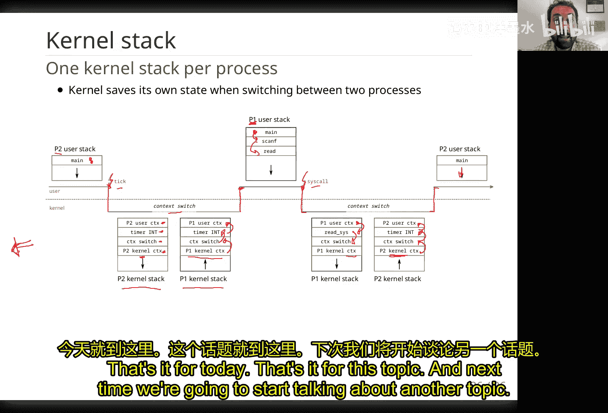

# 【全集 附课件】加州大学戴维斯分校 操作系统与系统编程 中英字幕 1080P p08 Lecture 8 - 内核抽象part3 -BV1jXr5BBEKa_p8-

H， everybody。So today we're going to talk about the third and last part of the kernel abstraction and more specifically the details around mode switching。

So quick recap from last time。We saw that there were different reasons of why we would switch the mode of the processor between user mode and kernel mode。

So。If the processor was in user mode， there are three reasons why it would switch token mode and start executing the  kernel。

Either because the program caused an exception by its own behavior。

That's a synchronous event because it's directly caused by the processor doing something that is not okay。

 that's a fault and that triggers the kernel to be executed。It can be because of an interrupt。

 so that would be an I device signaling the processor and therefore the kernel that I don't know。

 they have finished a certain task or the timer is kicking in and is issuing a tick and in that case that causes the processor to stop executing the user process and to jump into the kernel。

Those are asynchronous events because theyre not related at all to what the processor was doing at the moment of the interact。

And finally， we have system calls。So here， system calls are， as you know。

 totally intentional requests from processes essentially asking the colon to do something on their behalf。

 like to perform some sort of privileged operation on their behalf。

And those are synchronous events because Ciscos are actual instructions that will trigger the switch to the can mode on demand。

Now we also saw there were four reasons to switch now from kernel mode to user mode。

 we saw that it could be because the kernel was triggered because of an interrupt or system call and were simply like resuming the process that had been interrupted。

It could be because the kernel is switching to another process。

 so the processor was executing process one。Then something happened。

 So either an exception and interrupt our system call， but the kernel was summoned。

 And here it decided， you know what I'm going to。Give back the processor， but to another process。

It could be because we're。Starting a process for the first time。And finally。

 it could be because a signal was received by a certain process。

 that process had defined a signal handler， and so the kernel jumps to that signal handler to execute the code of the signal handler。

So now that we understand， well， the different reasons why we would switch between user mode and Can mode。

 now let's see how， let's really like look at the details of how do we switch in a way that is as safe and efficient as possible。

Why is it even a question here？Well， that's mostly because we have to understand that。

The kernel is the piece of code that manages the computer。

And it is extremely important that this kernelel。Could't be corrupted if processes have an easy way of corrupting the can。

Then they're not really late， we can guarantee that they are not going to step outside of the sendbox。

So it's extremely important， especially because processes and kernel are sharing the same CPU。

 it's extremely important to ensure that even when they're sharing the same resource when processes are executing their sendboxed。

 when the kernel is executing， it has access to everything and it can make all of the decisions。

And that means we need to like really protect as hard as possible。As secure as possible。

 this entry door to theken。And。If you remember， it's also important that。

When the kernel executes on the processor， it's kind of stealing processor cycles away from processes。

And that is called the overhead and we want this overhead to be as small as possible so that the kernel doesn't have much of an impact on the machine and the user feels like the applications are reactive and so on。

To make that happen， this safe and efficient switching we need。Three things， three requirements。

Requirement number one， and we're going to zoom on all of them in the next slides。

Requirement number one， we need notomic transfer of control。

Meaning that like we need to be able to switch from user mode to Can mode。

In a way that's atomic that happens all at once。And same for when we switch from Canoma to user mode。

So again we need what is called an exception vector。

 so here we need a way to restrict the number of ways or like the number of entry points into the ca。

And finally， we need a transparent， restorable execution when processes are interrupted。

 so for example， because they they do a Cisco or there's like a timer interact happening。

And they stop their education and the kernel takes over the processor。

 we need to ensure that when the same process that had been interrupted comes back to the processor。

It has the impression that it， in fact， never left， you know。

 so it must be completely transparent for all processes。

This whole idea that they can be interrupted for a while and lose the processor for them it's like doesn't exist and we're going to see how to make that happen。

So let's start with the first one， the atomic transfer of control。

Let's imagine that like a process is running on the processor。It's executing instructions。

 it's like doing memory accesses， it's accessing like its own CPU registers。

 like doing computation and so on。From the moment。That something happens。

 So an interrupt an exception， a system called like something that triggers a switch from user mode to can modes。

The processor will need to stop executing this process and start executing the kernel。The thing is。

 like。That switch requires many things to happen。😡，We need to change the mode of the CPU。

 we need to change the program counter because now the CPU should execute instructions from the kernel instead of the user process。

 we need to change the stack， we need to change the memory protection and so on like there are multiple things that all of us don't need to change。

To go back to the analogy with the car that you would let your kid or your best friend borrow and all of that。

Same thing happened with like when you change drivers of a car。

 you like so someone is at the wheel and you decide okay， let's change driver。

 there are multiple steps it doesn't happen just all at once that like you were at the wheel and all of us me or not。

You have to like stop the car， put the car into like park position。

 park gear whatever it's called you need to open the doors， remove your seatbel。

 get out of the car and so on and the other person who wants to drive needs to do kind of like the same actions in the opposite。

Or， like open the door， stepping， put on their seat belt and so on， like。Said the。

 the rear view mirror and all of that。Is the same here， right。

 like when we switch from running user code to kernel code。

There are multiple things that need to change。The thing that's important is that we cannot allow the processor to be interrupted。

While doing those few steps during the switch， like the switch itself must happen as if it was one big logical step。

 you know。And。If you remember your computer architecture class。

 you might remember that there's a clock in the processor， which is called like cycles。

What we're saying here doesn't mean that everything needs to happen within one cycle。

 so it's not atomic in that sense。This entire switch can happen over like multiple cycles。

 It's not the issue here。 The issue is that from the moment that the switch is initiated。

Up until the moment that like， okay， now we've switched and say we were running user code and now we're running kernel code。

This entire switching period has not been interrupted。 it's like one unbreakable step。嗯。

So what needs to happen when we need to change from user mode to kernel mode？Well。

 one of the first type is that we need to save the reason of why we' we are switching so are we switching because of an interrupt are we switching because of an exception if it's an exception。

 which exception are we switching。Because of。Like is it because we are the user process like try to execute a privileged instruction or is it because the process tried to break out of it of its memory protection like there are is it because the process did some computation that overflowed。

 there are like various like exceptions causess and we need to say that or is it because the process initiated a Cisco。

We need to save that cause so that when the process the kernel starts running， it can actually。

Understand， okay， why have， why am I here， Like， why have have I been called， Like。

 what am I supposed to deal with。Then we need to save the。

Or the processor needs to save the program counter。So the process was currently running。

 so executing different instructions at different addresses and at some point at the moment of the switch the processor。

Had just finished executing a certain instruction belonging to the process。

 We need to remember which was this instruction so that when we restore the process。

 we can pretty much like resume exactly at that point。

Then if the processor is going to execute the kernel。

 we need to change the program calendar to point at that entry point and we'll see a little bit more in the next slide about that。

Then the processor needs to change its internal mode from user mode to kernel mode to like flip the bit or something like that。

That usually as a kind of consequence to change the memory protection。And finally。

The processor automatically disables the interrupts。The reason is that lake。

If the cause for switching from user mode to Can mode wasn't interrupt in the first place。

And as soon as we like switch， there's another interrupt say coming from another device。

We would kind of have a loop because like the the the kernel would like be itself interrupted and we bring on the kernel again。

 and that wouldn't work well。 So the best is to。When we get an interrupt and processor switches to Can mode。

 we just disable the interrupts。The kernel runs processes， whatever it's going on。

 like either if it's an interrupter or a Ci or an exception deals with it and we only restore the interrupts when we go back to user mode and so the kernel whenever it runs。

 it runs with the interrupts be totally disabled。That being said， it's not always true。

 there are like modern kernels such as Linux and Windows and Macs。

 I'm sure like they allow sometimes the kernel to be interruptible itself and in that case we talk about reenttrant kernels。

But。Finally now， you can just assume that in the basic case， whenever the canal is running。

 it cannot be interrupted。Okay。So that's for user mode to can switch。Now。

 obviously we have the opposite imagine we're in kernel and we're switching back to a process of say like we're resuming the process that had just been interrupted。

Then we need to have the like during this transition。

We need to change the processor so that it resumes executing the process。

And that pretty much means restoring the program counter at the same value that we had it had been interrupted over there。

The processor needs to change the mode from kernel mode to user mode。

 which will in turn like update the memory protection and kind of restore the memory protection of the process。

And finally， restore the interrupts so that whenever the process is running， we can receive。

Interrupt again。So that's kind of the idea here， atomic transfer of control。

So the second aspect is called exception vector。It's the idea that if we're going to switch from the user process to the kennel。

Where do we enter the candle， Like， what is the entry point。

And we have to keep in mind that if we want to make this switching as safe as possible。

Then it's important。Not to give too many entry points to the kernel。

 because the more entry points we give。Are more entry points we need to secure。

You can kind of think of that as with an analogy with， I don't know。

 like a secure building right like if you have a building and you want to secure its entrance。

You probably only want to have one door because this way you can really check。

Who's coming in like through that door and who's coming out and there's only one location where people can come in and come out。

If you have a building that you want to secure and you have doors like all over the place。

 you have like 20 doors to secure， then most likely you're increasing by a lot the amount of vulnerability that are possible。

So it's the same here for the  kernelnel， the idea is that like you don't want to provide too many entry points to the  kernel for processes。

And ideally， you want to provide just a few so that you can really make sure that theyre super secured。

So what does it mean， those entry points， there are essentially functions that contain code that you would start executing upon entering the kernel。

嗯。And so often what we refer to as exception vector。Is a table。

That that's where the word vector comes from it's a table here of a function pointers。

 so you have a function called like handle int that would handle interrupts a function handle Cs for Ciscos or handle like say orI for reserved instructions。

 those would be like the kernel of exceptions where when a process is trying to execute a privileged instruction。

 that would be the function inside of the kernel that would know how to deal with it。

And so you essentially like fill out this vector with those function pointers。

Now there are two ways that this exception vector can be used and it kind of depends on the processor itself or the configuration of the processor。

We have some processors。Such as， for example， like MEPS processors that are software managed。

What it means is that the processor only has a single entry point into the kernel。

 so no matter what happens， no matter whether it was an exception caused by the process directly or a CisL or an interrupt。

 no matter what the processor always jumps to the same address。And from that。

 like to the same address of code， kernel code。 and then it's up to the code itself。

 it's up to the software to determine like， okay， what was the code。

Of triggering like the execution of the canal。And then how do we deal with that？嗯。

And so here's an example of what that code could look like and that's a real example because that's a code that I've written for the Linux kernel。

So every time for exception interrupt Ci， the kernel would jump or the processor would jump to that label and start executing those lines。

And those lines would be that we would try to understand the cause。Of like， why we're here。

And we would read the code from the from a system register。

And that loop us back to what I was saying in the previous slide that opened a switch from user to channel。

 the processor saves the code of the jump。That's typically here， O， sorry， that's typically。

What we're doing here by reading a system register that gives us the cause of what are we doing here？

Then that's obviously very specific to MIPS， but like we extract a certain code。

 a certain like numerical code， so for example， like if the code is zero。

 then we know that we're going to have to handle interrupts if the code is eight。

 we're going to have to handle system calls if it's 10 it means that there was the execution of a reserve instruction being tried and so on。

And then we can， based on that code， locate the right handler。

 like the right function that knows how to deal with that with that code and jump to it and jump to like executing that function。

So that's the idea。Now， there are other processors such as say， like X 86。

Where this entire procedure would be done directly by the hardware。

 So instead of having a single entry point and then needing some code to understand the code and drum to the right handler。

The processor would be able to do that directly， like the processor would have a system register that directly contains the address。

Of the exception， the exception vector。 So like the table of function pointers。

Pointing on two different functions。 And the processor would be able to directly。

From the cause of the jump itself， like go directly to the right function immediately without having a software like decoding the cause。

嗯。Okay。And so the last one， the last aspect of mood switching is about transparent， rest execution。

So as I was saying before。Processes， when they are interrupted， because again。

 of an exception an interrupt are a， they should not know。That they were interrupted。

And the way to do that is to save what we call their context。

And what we mean by by contact it's pretty much all of the processor registers。

So you can think of processor registers are kind of like a desk。

Onto which you put like pieces of paper。 So let's say like you're working on a project。

 and so you like you have your desk that's full of papers related to the project that you're working on。

If now you were to say， hey oh， you know what， like I should stop working on that project and work onto something else。

A good idea to be able to resume working on that project later and kind of like find the same environment would be to take all of the pieces of paper。

That you have on your desk， like put them into a neat pile that you can put on your bookshelf。

And then you can use your desk to do something else and later when you want to work again on that project。

 you go back to your bookshelf， you take your neat pile and you put back all of the piece of papers exactly in the same way that they were when you stopped working on that project and you can raise you。

That's pretty much the same idea here。So what happens is that like we would save all of the registers。

 like all of the processor registers and not the system registers because those belong to the kernel anyway。

 but the general purpose registers， like all of the registers that the process are using or is using。

And we like save them somewhere on the stack， that's kind of the equivalent of saving them on a bookshelf。

And after saving all of the registers， now the。Klonnel can really like start processing whatever it's been called to process。

 so for example， like an interrupt。And after the kernel is done processing that interrupt and can resume the execution of the process that had just been interrupted。

What it does is simply that it restores。All of the processor registers that had been saved previously。

 so essentially like we go back to the bookshelf and we restore exactly everything exactly like it was。

And by the time that we finally can。Resume the execution of the process for the process itself。

 it will have been completely transparent because from one moment。

 it was on the processor working and executing instructions and having a certain like set of values in the processor registers。

Then it's getting interrupted。But it doesn't really know about it and when it restarts the execution。

 well all of the processor registers， they have the same value as before and the process can just resume exactly at the instruction where it' left off。

And yeah， it never knew that it was interrupted。首先是第二点。

When the software does that like saves all of the registers and then can code the kernel to actually like process the interrupt and restore everything later。

 that's what we call that again like it's software managed。

Now there are some processors that also are able to kind of do that automatically。

 like save the context of a running process in an hardware matter。

 and that' is the case again on like big and more than processor such as X86。And。

The thing is like in practice it's usually not used because it's in hardware and it's extremely not flexible typical OSs like Linux or Windows they usually just do the software managed approach because doing that in software gives them a lot of flexibility to save like a certain set of registers and not like all of them or more registers than the hardware would do in the first place。

 so it's just like more flexibility to do it in software and so it's not a feature that's used very often。

Okay。And。Now let's look at something and that will be like the last part of this lecture。um。

I'm going to spoil the fan a little bit and just tell you what it is。诶。The kernel， when it runs。

 it has its own stack。So what does it mean？Let's take this example。Imagine you have a user process。

 starts executing from the main function。And so this user process has a stack that contains stack frames and so when a function calls another function。

 the stack like kind of increases and the stack is used to hold some values of registers and passing registers when a function or passing values when a function is called and declaring the local variables and all of that。

When this process is in the main function， then we have a stack frame for the main function。

 then imagine this main function at some point calls scanf because it wants to read some input by the user。

So the main function would like put some arguments in the stack for ScNF。

 then would jump to scanF and so ScNF would have its own stack frame。Now， Scanf， you know。

 tries to read from SDD in from like the keyboard or like from the input。

So it's very likely that inside of scananNf， you have an actual call to read on file Descriptor zero。

So that's another function， so another stack frame in the user stack。

And this re is pretty much just a wrapper around the Cisco because the reading operation is a privileged operation and should be done by the can。

And so we can imagine that inside of the read function， there's an actual like Ciscal instruction。

That will trigger a switch from user to kernel。And so。At the moment。

Of like the execution of the Cisco by the processor。Working on behalf of this user process。

Here's the situation。The PC， the program counter， would be pointing directly at the fiscal instruction。

The register S， the stack pointer， would be pointing exactly at the bottom of the stack。

 assuming that the stack is growing downwards。And this user process would be using probably like all of the。

Processor registers， like all of the general purpose processor registers。

And the processor would be obviously in user mode。 So that's kind of like we're taking a snapshot。

 and that's where we're at， okay。At that moment， at the moment of the execution of the Cisco。

 then we have this like atomic transfer of control happening and the processor will like stop doing that and well jump to the kernel。

系。And so that that's， that's what happened。 So it jumped to the kernel。 So now， like the PC。

Would be pointing onto the first instruction， like the first entry point in the can。

And SP originally would be pointing at the very top of the kernel stack because the kernel stack at that point would be completely empty。

And so what the kernel would do， as we talked about earlier with the transparent and restorable execution。

 is that it would start by saving。All the processor registers and the PC and the S to make sure that it like remembers how to restore the process once the kernel is done doing what it's doing。

So。And it would be。Saving that context onto the kernel stack。 So here。

 like we save all of the CPU registers， the PC and the S。Once we are done with that。

 the kernel can finally jump to its own function。Which is likely to be a C function and say like the one that knows how to deal with system calls。

嗯。Then this one will analyze， okay， what system call is being like requested。And we see like， oh。

 it's a read system goal。 So oh， okay， I have a function for that read si。

 So I'm going to jump to it。 And finally， we're somewhere in there like really dealing with the read system goal。

And so as as we like the kernel called like douceces and then reads。

 it creates tag frame like in the same way as processes。嗯。

And so at some point we're like somewhere in there like dealing with the RE system call。

 so the PC of the processor is pointing there， the SP is pointing oops it should be pointing there like at the bottom of the stack and the register file here now contains registers values that belong to the kernel and the processor is running in kernel mode。

So that's kind of the idea of what happens。After the switch， like from like a stock point of view。

 from like processor processor running on the processor to kernelll is running on the processor。

Now quickly， like。Why， why do we need a kernel stack like a specific kernel stack instead of using that space？

That's left in the user stack because we could also imagine that like at the time of the Cisco。

 when we jump into the kernel。This whole like save all operation could be done here。

 we could save the context right below this read function。

 and then we could just use the same stack to do all of that。And。

By the time that like this dos function is done and the read function is done and so on and we restore all essentially would be back like all of that will have kind of like not disappeared。

 but the。嗯。The stock pointer would be back to being here。

And the application could just like resume from there。Well， there are two issues with that。

The first is that。When。The， the， the process makes the cisco。

And the stock pointer is supposedly pointing at the bottom of the user's stack。

It's actually not guaranteed。Like the stock pointer。

Is a register that's totally under the user process control。So the user process could very well。

Set the stock pointer to a wrong value and then do a Cisco。 And so the kernel would start running。

Assuming like， oh， I'm just going to reuse the stock pointer of the process because there might be just like space in the process stack。

 but in fact， the stock pointer would be completely wrong and that would potentially like crush the kernel。

Another reason is that if the  kernelnel， let's assume like the stack partner is fine and we have enough space in there for the  kernelnel like to put its own stuff。

The thing is like by the time we go back to the process。If the process looks beyond。

Its stock pointer， it will see data。That the colonel has left there。

And data that might be sensitive data， which would be an issue。

So those are the two reasons why the kernelnel has its own stack instead of reusing what might be available in the user stack。

It's because there's no guarantee that the user tag is even valid and also because the kernel should not put its own data in a piece of memory that is accessible to processes。

 it would be。It would be too much of a risk to leak important data。

So here we're zooming only on like what happens from one process to the kernel。Now。

 let's look at a bigger picture of how does it work when we have multiple processes。嗯。

This picture is a little scary because it's big， but I'm going to try to do my best to explain it well。

So。We're starting this explanation from kind of like an arbitrary starting point。

 you have to imagine that like were on a computer and。

Processes have been running and were like kind of like。Stopping at one point and looking at， okay。

 what's happening from then on。跟手。Let's imagine that。

At the moment that we're looking at this computer， at this computing system。

We have a process called P2 that is running and that is inside of its main function doing some things okay。

And so the processor is in user mode executing P2。And all of a sudden。

 we have a tick from the timer device。So that's an interrupt。

That triggers a switch from user mode to kernel mode。

We jump into thekennel the kennel the timing is like okay what am I doing here oh I'm here because of an interrupt but first I need to save all of the registers on on the stack on theken stack that corresponds to P2 so here P2 as it was running here。

Is entirely saved on the stack， like all of the processor registers。After we do that。

 the ken can jump to the function。That knows how to deal with timer interrupt traps。

Now let's imagine that inside of that function， the timer interrupt function， we realize like， hey。

 you know what， like P2 has running off like it's been running for for a while。

Let's give the CPU to another process。So we select another process。

 select P1 that was running previously。And had been suspended。

 And we decide we're going to switch from P2 to P1。So， we call the function。Cont switch。

 And we're saying， okay， P 2 is currently running。 We want P want to be running instead。

 So do the switch。And so what happens here is that the switch will be that the。Context。

 the current context。 So all of the processor registers。Of the current execution that's happening。

 which is when the kernelel is running on behalf of P2。Is saved into Pi's kernels stack。

And kind of at the same time， like within the same step。We restore。The context of P1。

Out of P1s kernel stack。That's what the context switch is。And we have to imagine that when P1。

P1 was in the same situation as P2， but like somewhere like before in the past。

So P1 also had called this contact switch function and had been the one who was like removed out of the CPU so like saved all of the registers and so now we're like restoring all of that registers。

And so the kernel now will come back to the context switch function that had switch P1 out of the processor in the first place。

This context which has had been called probably by a timer in so we were going back to that function now we're like were returning from one function to the previous one。

And finally， we can。Restore the context of P1， but as a process as a user process。And by doing that。

The processor makes a switch back into user mode。And now we are back at just executing process P1。

So now like let's assume that P1 at the time that it had been like suspended before。

Was in the main function。Now P1 resumes its execution。And cause Scf。

Scanness goes read and read triggers。Asissco。So that triggers a switch to the kennel。In the kernel。

 we save the context of process P1 onto the kernel stack so that we can restore it later。

We jam to the Cisco handler that knows how to deal with RE Ciscos。And here in the Ris call， we see。

 oh， in fact， the user wants to read from the keyboard or something like that。

Except that like there's nothing to read right now because no one has type anything on the keyboard。

As we wait until there's data that's typed on the keyboard， there's no reason to go back to P1。

 So we're just going to put it on the side on the bookshelf。

 and instead we're going to run P2 again because P2 had been like。Switch out。Because of a timer tick。

 but otherwise it's ready to run again。So this red C function would call again。

 like contact switch and the contact switch would。Kind of She the context of P1。In the cannel。

 and instead， would。Resstore whatever we had stored here。

And so now we are back and we can return from the context switch， return。From the timer interrupt。

Restore the user context of P2。And were back at executing P2。

 exactly from where it had been interrupted like。A little bit before。This picture。

I would agree it's pretty difficult to understand。Conceptually it's weird and it's bizarre and and as a student it gave me a lot of pose to understand that kind of like those context switches and I think it must have taken me like a few years to like really fully understand。

Everything that is behind this picture， so don't worry if it's like still kind of vague and all of that。

You'll probably have a much better understanding of that process after you work on P2 on Project 2 because project2 will be about context switching and you'll get a better understanding of what does it mean to save a context and restore another one。

 but anyway so。Just be aware that like if you struggle with that picture。

 that's totally normal and hopefully like the more you work on it and the better it it will go。Okay。

That's it for today， that's it for this topic， and next time we're going to start talking about another topic。

