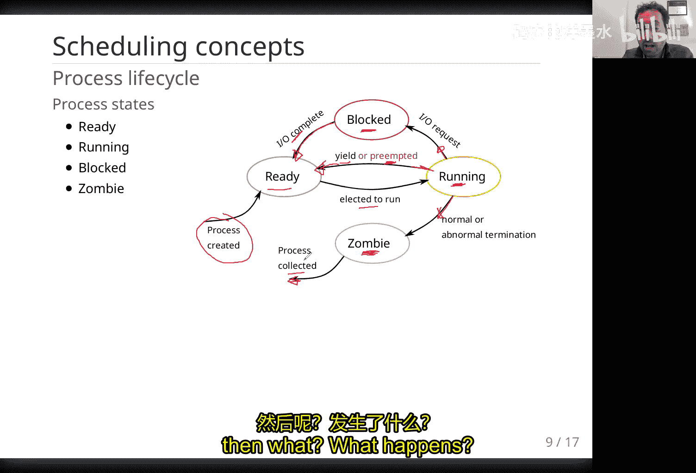
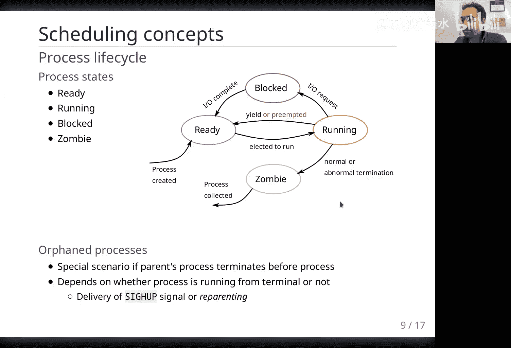

# 【全集 附课件】加州大学戴维斯分校 操作系统与系统编程 中英字幕 1080P p09 Lecture 9 - 进程调度part1 -BV1jXr5BBEKa_p9-

Hi， everybody。So today we're going to start a new topic。

We're going to talk a little bit more about processes。

And we're going to talk about scheduling them on the CPU。

So first a little bit more about processes and let me remind you of this definition that we've started to see a few times。

 so a process is an instance of a program， it's a program execution with running with limited execution privileges。

嗯。And as we have started to understand， processes is a really nice abstraction that the OS has to run applications because it offers a set of interesting features。

 it has these protection here kind of like as a sendbox and we saw in the previous lectures。

 how that sendbox was implemented through having the dual mode operation of the processor having like a memory protection and a set of privileged instructions and all of that。

So that processes are protected from one another， we saw that this dual mode like having a user and kernel mode on the processor allowed to protect the process of the kernel from processes。

We also saw that when processes wanted to interact with the kernel to actually perform some privilege operations。

 we had this API。Wwhich we actually usually call like U API which is the API of all of the Ciscos that the kernel provides and so on and so we see it like this abstraction works pretty well。

Now， one other thing that I wanted to mention is that this abstraction can actually like be kind of summarized by three aspects。

That I think are interesting to dive a little bit more into。We have the notion of address space。

We have the notion of environment and the notion of execution flow and those three aspects are really important into characterizing what a process is and how it works。

So let's start with the first one， the address base， and let's start with a quick example here。

So here's a program doesn't do like anything useful。

 but as you'll see it really like highlights what does it mean。

For processes to have their own memory address base。So， let's see。We have this program。

 we're going to look at it line by line and we're going to actually try to understand in terms of memory。

 what does it mean？So now you know that。Even before。Starting to run this program。

 The kernel upon loading this program as a process， will create。4 memory segments， right？

 So in the memory for this。New process。So that's gonna be the address space。发。For this process。

 for the instantiation of this program。And so in this address space that's private to the process。

 we're going to have the stack， as you remember。Growing down。We're going to have the heap。Growing up。

We're gonna have。The data。And the code。O。So now， what does it mean。The code here will literally。

Contain the assembly instructions。From that program， after that program was compiled into a binary。

 like the code will contain exactly the binary assembly instructions。

The data will contain the global variables。Here we have one global variable。Int I equals1。

So I here will be， it will be part of the executable。

And the data segment will be populated with that content upon loading the program。

Right before the program actually like starts running， like the process starts running on the CPU。

 we already have this variable I equals one in the data segment。And at the very beginning。

 before we enter the main function， the he would pretty much be empty and the stack would also pretty much be empty。

And now we start the execution， so what do we have？We have a lookco variable J， which means that J。

 so let me change the color so that we can see something so。Well actually。Let's。Rightr that。

Next to it， so that it doesn't。Bothather us。So the stock would be here and the he is over there。

 okay。嗯。Okay， so J here would be in the stack。We have like maximum some space for J and j originally is equal to 10。

And that's a new kind of sell in the stack that keeps now like growing downwards。Now， next line。

The next line is a little tricky。We have int。Poiner k。Equals。Some marloing off the size of net。

The size of an int that depends on the computer because an int is not necessarily like always 32 bits。

It can be 16 bits on some computers。But we're going to assume that we're on a regular like 32 bit processor in is 32 bit。

 so here what we're monoloing is actually fo bytes。So upon running this malllo。

It means that we are allocating。4 bys。In the heap。And now， that part。Po of K equals to thismalac。

Really means that。K is a local variable。That's in the stack。 It's not in the heap。 it's in the stack。

But this viable okay。Receiveize as value。The address。offff。The mallloed space。

 So the space that we mallloing is， in fact， in the heap。

And K is a local variable that contains the address of that space。

 that that's what happens when we have that line。嗯。

And that's pretty much it for the different variables。

 So here like you see like my goal was to show you like how variables can be either part of the stack or part of the data segment or part of the stack and how like the he space can be used。

Now， let's see。😊，To do do so。We get to that first statement。We dereference k。

 which means that like we get to K and we actually jump at its address。And we write for。

So what it means is that we would write for in that space。That was allocated in the heap。And now。

To make things a spicy， we fork。 So what does that mean in terms of address space。As you remember。

 and it's written on the slide， every process has its own address space and when a process for。

 the address space is pretty much entirely duplicated。What it means in practice is that。Well， now。

Going to。Make another address space。That has exactly the same structure。

So this one would be for the child。That is being a。Falked out of the parent。 And obviously， this one。

Would be the parent， because that's the original process that's being cloned。

And so the child also has the stack with j equals 10。

 like everything is being duplicated exactly the same。K would also contain an address。

That points on2。A certain。Space in the hipap。So， that's the heap。

And then we also have the data segment with I equals1。And exactly same the same code。

So at the moment of the for。That's what the OSs does like inside of theken。

 the fork is a Ciscalken talks over and copies out this entire address space。Into another one。

And that's where we land。So now if you remember like so if fork， then we do that。

 which in other terms means that like that's the piece of code that the parent。

Will execute because in that case， For would return a value that's different than zero because the parent receives the PD of the child。

And that else here would be code executed by the child。

 and so you see they are going to manipulate their variables in different way。诶 so let's see how。

Starting to make a rainbow out of this slide。 So what is the parent doing？

Parent is doing I equals I plus 1。Parent is running in this address space。

 So when the parent modifies I， it modifies its own I。 And so I equal I plus one。 That would be。2。

 like I equals 2。When the parent does that。You see that。 Nothing happens here。

In the child's address space because that they're completely separate。

 they are not the same process anymore。 they each are in their own space and they don't see each other anymore。

And then we go on， parent decides to remove one from J， so J was 10。Now， J is gonna be9。And， finally。

We add or we multiply k or like what's behind k because K is just an address， we multiply it by one。

So。In other words， like we we're not doing anything that stays value for。

And then the parent is done executing that block。 And so when we get to the printing。

 the parent in the terminal would print like。I equals 2。J equals 9。And K， well， I should。

 there should be a little star here， but like。K equals4。

I'll come back to the to the rest afterwards Okay， now let's look at the child so now the child say would be scheduled on the processor and would start executing its own block of code and so the child would say okay I equals I plus the two。

And so here again， what's really important is that now the child is running in its own address space。

 doesn't see anything from the parent and is only modifying its own variable。

So here I would be i+ 2 so3， and that would be only effective in the child's address space。

J equals j minus2， so that would be8。And now k times two with os， I forgot to like。

Iize here the word in the stack。 So when it was first like forked， it would have been four。

And so times2 now would become8。And so when the child finally to get to it like running the print Fline。

 it would print I equals what is it three？J equals 8。And what's behind K would be eight as well。Now。

 you see that。I'm also printing here。The addresses of those variables， like the addresses of J。

 the address of K and the address of I， and it's a little hard to illustrate in that picture here。

But。There would be the same addresses for parent and from child。

We'll come back to that in a few weeks when we start talking about virtual memory。

 but the idea is that because every process is running in its own virtual address space。

Then it's possible for processes to see their variables at the same address like so here the parents will see J at the same address as the child will see its own J。

 but because those addresses are completely virtual， in fact。

 the variables themselves in the physical memory in the Dra memory。

 they would be located at different physical addresses。But we'll go back to that。嗯。

So let me clear that out。And just so you can see it's a program that's available on Canva so please download it and compile it and try it out for yourself。

 but if you were to run it it would confirm what we've just seen and as you can see here so the addresses are a little complicated。

I run those on my 64 bit CPU， so that's why the address is earlier long， but as you can see。I hear。

Has the same address for both processes， J has the same address for both processes and same for K here。

Although。They。For parent and child， the values are different。

 like the actual variables are completely different。Okay。Let move on。

So that's the first aspect of processes， address space。

 processes of completely different address spaces， when a process forks into another process。

 the child process gets an entirely different address space that is initialized with the same value as the parent initially。

 but then it evolves into its own thing。The second aspect is the environment。

 so the environment what I mean by that is like everything that characterize a specific process and that means like it's the process ID the user ID like who is the user that is running that process and so the process will belong to that user because every process is necessarily like spooned from another one via fork apart from the first process of the computer in it but。

Apart from this very specific case here， every process has a link to its parent。

 a process is associated to a list of memory segments， the code， the stack。

 the data and the he it has its own like the table or filescriptors to。

Show the different like open files。 It's in a working directory and so on。 So every， essentially。

 like， it's all of the information that are contained in the PCB maintained by the kernel and that describe the environment that a process is currently running into。

呃。And the last aspect now is the execution flow。嗯。What I mean by that is that when a process is running。

 it's executing a certain program， it's executing code right like statements in assembly language。嗯。

But it's executing them in sequential order。So to kind of like simplify that。

 it means that when a process starts running and still starts running like whatever statement you have defined in your main function。

Things will go in order like statement  one will be executed，10 statement 2，3， and so on。

 and so it follows a logic， right， it goes in order。If you have a Y loop or an if statement。

 there are ways to like slightly to say jump back to a previous statement and reexecute a block of statements or with if then else statements。

 then you can decide， oh， I'm going to execute that block of code or the other block of code and so on。

 but still， even if you can jump around， the logic is still that you're doing things sequential。

The process will not like be executing statement one and then statement five and then two and then four and then three。

 like it doesn't go out of order like that。嗯。So that's why I try to like illustrate with this picture。

 is that like。From the moment that the process starts running on the CPU， it runs statements。

In like order， In sequential order。Now， there's kind of a hiccup to that like a special case with signals。

 That's really the only time where， potentially。The sequence of execution was perfectly sequential。

And then at some point we go back to the kernel， the kernel detects like， oh。

 there's a signal pending from that process。 So instead of resuming the process where it's left off。

We're going to quickly execute the signal handler if there was a signal handler being defined before like resuming the process where it left off。

But still。In some ways。The signal handler would be executed also completely in order before coming back to the kennel。

 and the kennel would resume the process where it left off。 So overall。

 like things are kind of always sequential。O。So that was like the part that I wanted to stress around like processes to like really enforce some of the concepts around them。

Now let's jump to the real topic of the day， which is scheduling。So what is schedulechedul inquiry？

Processes can make progress， execute their instructions only if they can run on the processor。

 otherwise they're not making progress。To make things simple。

 we're just going to talk about single processor systems because otherwise it gets a little complicated。

If you have only one processor in your computer， then it means that only one process can be running at a certain time。

嗯。Processes can kind of be in two states。Processes can be ready。

Which means that whenever the processor is available。

One process in the ridicule can be dispatched to the processor and actually run。Potentially。

 until completion。All processes。😮，If they're waiting for some sort of I O。

 like they're waiting for the user to type on the keyboard to like supply a certain line。

 or they waiting to receive。A packet from the network like or they're want to receive some access from the hard drive。

 they are blocked like you cannot put them on the processor because they're actually waiting for something else before they can continue making progress。

So they are blocked， they would be in the block queue and they would become ready again only when the I that they're waiting for is completed。

And so scheduling。😊，It's pretty much the logic that goes behind like， okay。

Which process should we give the processor to so that this process can make progress。

 That's the whole point of scheduling。And so here we're going to talk about some classical algorithms or classic algorithms for scheduling。

But before we do that， I think we need to talk a little bit more about some of the scheduling concepts so that you understand all of the vocabulary and all of the constraints and some of the behaviors that processes tend to exhibit。

And one of those， one of that behavior。Is the idea that often processes have run in two phases or have different phases that belong in two categories。

Processsses， when they run。They tend to have。Two types of operations that they are doing。

And those operations are called either CPU bursts。Or are you bursts。So what does it mean。A CPU burst。

Is when a process。Will be running on the CPU and executing a lot of instructions。

And that pretty much means that like。The process。Doesn't need to interact with any IO devices。

So won't be blocked by that。Because it's only running code processing data that the process has in memory。

And so yeah， it doesn't need to be waiting for anything。

 it can just like crunch the data and run a lot of code。And do computation。

Those would be called CPU bursts。And now there are also other faces。

Of the execution of a process where now the process is actually trying to interact with kind of like the outside world by say。

 opening a file， for example， on the hard drive and reading from it。

Here there are very few instructions。😡，To be performed on the CPU in order to do that what's going to take a lot of time is actually wait for the I device to answer the request。

 So it's going to take like I don't know100 or 1000 cycles。

Of CPU instructions to tell the hard drive， hey， I want to open that file and I need that data。

 can you find it and put it in memory somewhere。And so that's pretty much like the only thing that the CPU has to do via executing instructions。

And then we're going to have to wait a bunch of time for the hard drive to actually like do its job。

 like locate the data and put it in the memory at the address that was requested。嗯。And so here。

We talk about IO bursts， like when the program or the process is like interacting with I devices。

 theyre IO bursts。And pretty much all programs have this succession of IO burstts followed by CPU bursts。

 followed by IO burstrst and so on。 like it's always an interaction like a back and forth between accessing ios doing computation on the CPU。

Now， obviously。There are programs that are more geared towards having a lot of CPU bursts or a lot of IO bursts or a mixed of both。

And in that case， we talk about， so， for example， a process that would do a lot of CPU bursts。

 like pretty much almost no IO but just a lot of executing instructions working on the data that it's already in memory。

Those processes we would call them CPU bound。Ca they are bound by the CPU。 like， for example。

 if the CPU was faster and could executing the instructions faster。

 then the process would execute faster。 So the kind of bottleneck for those processes are the CPU。

And typically those would be processes like running scientific calculations on that kind of of things。

 like running a lot of like really tricky mathematical instructions onto data so there's no I device access just like pure computation。

Now on the other hand of the spectrum， we have processes that would almost not use the CPU very much。

 but they're always with interacting with I devices。

And so here the bottleneck would be whether the I devices are fast or not。So here a good example。

 I think， is， say you download a files with bitT。Btert， pretty much is about。

Waiting packets from the network， so you're always waiting for the network to deliver packets。

And then the process gets those packets and write them in a file on disk， which is another IO access。

 and it's pretty much dislike back and forth between network and then disk。

And what the process is doing in terms of computation of like really like working on the data is almost nothing。

 it's just a question of like moving data from one IO to the other。And finally， you have。

Processes that do a little bit of both kind of like in equal measure。 So I thought of a compiler。

 for example。I think that's a good example of that a compiler has to interact with a lot of files because if you say compile a big program that has like many files in the source code。

The compiler has to like read all of those files， get that into memory so there's a lot of like IO Accesses and once those files are in memory it also needs to work a lot like to translate the statements into assembly instructions performing some different levels of optimization and all of that so there is some like CPU computation involved into optimizing the code so here like we have both kind of workloads。

Done by the same process。Okay。嗯。So。Now we get to really like the the。What is the goal of scheduling。

 The goal of scheduling is to do what we call multitasking and multitasking means。

If we're only going to have one processor。And on this processor。

Are running potentially multiple processes， multiple application。

We want to make sure that the processor is always busy executing something。

And because we know that like when a process is doing an IO burst is waiting for an IO。

 then this process has like should not stay on the processor because it's just waiting for something to come back。

And so we need to give the CPU to maximize the utilization of it。

 like we need to give the CPU the processor to another process to have like processes really share this CPU resource。

And that's pretty much what the scheduling is like it's how do we do that like and what kind of strategy？

If you can give the CPU resource to only one out of say， I don't know。

 50 processes that would be in the system at a single time。

 how do you decide which one should get the CPU next and those are like the different scheduling policies that we're going to talk about？

There are two types of system。When it comes to scheduling and to like how processes share the processor。

We have systems that are set to be cooperative。Cooperativeative systems means that， like。Processes。

 when they are running a CPU burst， they cannot be interrupted。

 They can keep the processor for as long as their CPU burst lasts。 So here's an example。

 Like imagine you have this follow loop where you like the process is is crunching a lot of data。

Cannot be interrupted during doing all of that。It can only give the processor to another process。

If it yields。Willingfully， so if it really see here like it calls a function that will actually be a cisco telling the kernel like。

 hey， I'm done with my CPU burst， if ever you wanted to give the processor to someone else。

 you could if if there are like other processes that would like to use the CPU。

 otherwise just give it back to me and I'll continue doing my thing。呃 or。

If the process actually makes an I burst， so puts itself in the situation and we're like。

 okay I need something from an I device， it might take a long time so I will be blocked and that will trigger like the processor to be given to another process。

So that's called cooperative model and it was a model that was very popular in early OSs。

 so you probably don't remember but Microsoft DoOS what existed before Windows was completely cooperative which also meant that if a process didn't want to release the processor。

 then your computer was pretty much stuck like you could try to type things nothing would happen。

 it would just look totally stuck， and it was also the model on what they called the classic MacOS so pretty much like all of the MacOS versions prior to MacOS 10 which is the kind of current family that MacOS has had for the past probably like 15 years。

这呀。The other model， which is now like pretty much standard in all pretty much almost like all Os。

 is called preemptive。Preemptive here means that like。

Even if a process is doing a CPU burst that might or might not take a long time。

 it can actually be suspended forcefully and that we've talked about is by the use of hardware timer。

So we have this external device， a timer that counts cycles。

 and the kernel can essentially configure the timer to say， hey， in， I don't know， a million cycles。

Send an interrupt to the processor， which will。Stop the process that's running on the processor and allow the kennel to take over and now thekennel can decide。

 you know what process you've run for enough time， I'm going to give the CPU to someone else and you'll get back to it later。

And so by doing that by being preemptive， we have a better guarantee that the CPU resource will be better shared between the different。

Processes嗯。And obviously， processes could also just block on when they do I burstrst。

 which would also trigger the scheduling of other processes。And okay。So that brings us to a very。

 very important picture here that you should probably know by heart at some point。

 which is the life cycle of a process and the different states that a process can be into。

When a process is created， so from the moon essentially that we call fork。

A process starts by being ready， it can be scheduled on the CPU and start running， right？

And so it's going to be ready up until it's actually elected to run by the scheduler。

And now it will be running。 So running means like。It is this process that's now on the processor。

Executing instructions。Now， when the。Processes running on the processor， three things can happen。

The first is that the process can either。Yield as we saw in the previous slide by calling a specific Ci code that says like。

 hey you know what， like I've run enough， I yield my time。

Or on a preemptive system can be preempted by a timer interrupt。And in that case。

 the colon can decide in what it run for enough time。Let's put you back。In the ready states。

 And later you'll be elected to run again and you can go back to the to being on the。

 on the on the CPU。 So that's one， one possibility。When the process is running。

 another possibility is that this process would start an IO burst by performing an IO request。

And this I request would take a lot of time， and so in the meantime， the process would be blocked。

So it's not running， we kind of put it somewhere and it's blocked and it cannot be back to running on the CPU because like the process has to wait for a certain result to come back。

And it's only when this IO request is complete。That the process can be put back into the ready state and eventually can find its way back to the processor。

And execute more instructions。Third， and last thing that can happen when a process is running。

 is that。It can exit， right， it can call exit and actually like terminate or it could receive a signal and terminate。

When it terminates， it actually doesn't disappear right away。

It kind of goes through this transient state called zombie。呃，为。As you know。

It's the job now that you're like working on the shell。It's the job of the shell。2。Wait。

For the children that it creates。And it's actually always true。

 Like parents always have to wait for their children to terminate。

In order to collect their exit status。And so what's happening is that like when a process dies。

 it goes to this zombie state。Wwhich is a way for the kernel to say like， ay。

 I'm going to keep this process around because like it needs to be collected by the parent。

 I need to be able to provide the parent with the exit status。

And it's only after the parent has called weight on the child and the exit status has been collected。

 then the process can actually like。Ffully disappear from the system。

 the OS would like just destroy every data structure that it was maintaining for this process and even like the PID now could be recycled and given to a new process。

 but it's not up until that time the process kind of still exist as a zombie。And。😊，Okay， there's a。

Interesting。Scenario here that can happen is if。What happens if the parent。Dies before the child。

Right。If we're saying that a process must be collected by its parent。

 but the parent termes before the child， then what happens？

let me actually like show you a quick demo because I think it's it' it's interesting。Let's see so。

And。Let me run。Oops。Let me clear that。诶 lets ok。Well， I'm just opening like a random P D FF file。

So I'm in the fire browser right now and I'm opening。A P D F I， okay。Let me put that on the side。

And this one on the other side。 So here I have the fire browser。

 and I clicked on the Pdf and that opened this Pf file。Now you probably won't be surprised but。

If we close the fire browser。Nothing extraordinaryarily happened， right？

 I still have my P Df on the other side， that's。I mean， I don't know。It's probably pretty normal。

Now let me show you something else。Now， let's do the same。 but using a terminal。

Let's run the same P DF you were， which is o， in my case。And let me open exactly the same。呃呃呃PDF。

So which was it R322。And。Okay， volume 2， okay。So Premier is the same scenario， right？

I opened first I opened this PDF from my fire browser， closed the fire browser。

 nothing happened now I just opened the same PDF viewer but from the command line from the terminal from the shell。

And now I'm going to close this window and see what happens。What。没有异议。O。So， I close the window。

Why is not going。がってみて。maybe I need to run it in the background。Let me close that。It seems like it's。

It's kind of a failed demo。Okay， let's try again。Okay， I'm running this thing。In the background。Okay。

 now closing the terminal。Okay， it worked。So what did you say。You saw it， like。

We ran this P viewer from the terminal， then I closed the terminal window。

 and less than a second later， the Pf viewer disappeared as well。It' it's a little weird， right？Now。

 what happens is that。If the parent， in that case， like the shell that had sped this。PDF viewer。Dies。

Before the child。It actually depends on whether all of those processes came from the terminal or not。

If the processes， so here like the shell and the PDF viewer， were running from a terminal。Then。

 closing the terminal。And that's because of like old historical reasons。

Those processes will receive a specific signal called SigH。And help stands for。Hang up。

And it pretty much means like， oh， the terminal has been closed， so the line is being like hung up。

And all of the processes that had been run through this terminal received this SH signal to tell them like。

 hey， the terminal that that you were like coming from has disappeared and so you're receiving this hangup signal。

And so what happens typically is that here the PDF viewer receives this S signal。

Doesn't have any like signal handler to deal with it。

And so the default action is to actually kill the Pds， the Pf viewer。 That's why you see。

Disappear all of a sudden。Now。In the case， in the other case where we run the P Df viewer via the file browser。

 The file browser is not a terminal。When we close the P browser。The Pf viewer。

 which was a child of the fire browser， is repared。

And it will so the fire with the parent of the PDF viewer， fibro dies。

 the PDF viewer is now an oftenphan。And it will be adopted by another process。And in UniX。

 the reparenting。呃呃。Process or the reparenting procedure will be that it's。The process with the PID1。

 which is in it that will essentially like adopt all of the often processes。

And one of the tasks that in it has to provide is that it has to constantly wait for all of its children to die。

So in other words， like a process could not potentially like stay in zombie forever if it's being repared to in it。

 then in it will necessarily collect that process。Okay， that's it for today。

 And next time we're going talk about the different scheduling strategies。

