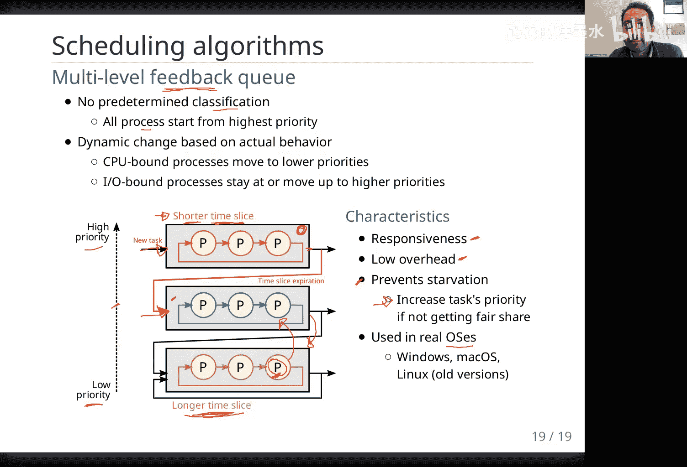

# 【全集 附课件】加州大学戴维斯分校 操作系统与系统编程 中英字幕 1080P p10 Lecture 10 - 进程调度part2 -BV1jXr5BBEKa_p10-

Hi， everybody。So today we're going to talk about the second and last part of process scheduling。

So quick recap from last time。So last time we defined again even better than before what a process was and its different characteristics。

We talked about the fact that a process has its own address base。

Meaning that it has its own segment of code， its own stack， its own he， and its own data segment。

And we saw this example where we could have a process that initialized some data。

 then fors and we see that the child inhers all of those values。But after the fog， when now。

 both parent and child。Modifying their own variables。Things are completely airtight between them。

 there's no more exchanges， they have sets two sets of address space that are completely distinct。诶。

We talked about the environment， the ID that like a process has an environment， it has a PID。

 it has a list of open files， it belongs to a certain user and all of that so here it's like the description of a process and it's usually what is represented by the PCB。

 the process control block， which is an OS data structure。And finally， we said that。

In terms of execution flow， a process as only one execution flow like one single sequential execution stream。

 so at any point during the lifetime of a process were always just executing one statement at a time in a sequential matter。

And we started talking about scheduling and that's going to be what we keep talking about today。

 so scheduling very quickly the idea is that。We have。Processors， at least one processor。

 sometimes multiple processors， and we need to share those processor resources among the different processes in the system。

And to fully understand how things work， we need to understand that processes。

Essentially work in two phases right they have sometimes processes will do CPU bursts。

 so that's when they will say like run a follow loop or they will like do some computation on the processor like the entire time that the process will run this followup in the example。

It will be on the processor and if this buffer is like very long。

 then the process will need to stay on the processor executing instructions for a long time。

 that's a CPU burst。And on the other hand， when the process is now trying to access the outside world。

 like access a file or receive some sort of information through the network or read something that the user would type on the keyboard。

 that's an Io burst。And it means that essentially the process will be blocked。

 cannot run up until it receives info the information that it's asking for。

It's important to understand those two different types of bursts like those two different ways that processes like run。

First of all， because it allows to understand that。

Processes can be of three kinds can be of they can be CPU bound if they do a lot of CPU burst。

 like the majority of the time they're doing CPU burst， then they' are CPU bound。

If most of the time they're interacting with the outside world， then they're iobound。

And if they do a little bit of both， they're a mixed bound。Now， in terms of scheduling。

 why does it matter， why it matters because we have two models of scheduling strategies。

 the first model is called cooperative。Incorpo scheduling processes will give up the processor resource when they are running。

 only if they do an IO access in which case they would be blocked and that would prompt thekennel to take over and then theken could give the processor resource to another process。

Or if they willingly share the processor resource themselves by calling a yield Cisco that also goes back to the canol and the can can give the processor to someone else。

But in a cooperative model， if。A process is stuck in a really long loop， in a really long CPU burst。

 then it can stay on the processor and the process resource is not being shared。嗯。

In a preemptive model that the kernel will use this hardware timer feature to essentially regain the processor resource every once in a while and make sure that even if a process is stuck in a very long CPU burst。

 the processor resource will still be shared。嗯。And so finally。

 last time we saw the life cycle of process through the different states that a process can have throughout its execution。

And there are four of those states。We have ready。So a process is ready when it's ready to run。

 it's not running yet， but it's ready to run， ready to be elected by theken to like get control of the processor and actually like execute instructions。

When it's doing that， when a process is actually on the processor executing instructions。

 then it's in the state running。When a process is stuck on an IO like has done an IO access and the result is not there yet。

 then it's blocked。And it will go back to ready once the IO access is complete。And finally。

 the last state is zombie， so zombie is a kind of a transient state。

It's when a process has like completed it。But has not been yet collected by its plant， so the time。

 if any where a process exits。And the parent calls weight or weight PID this entire time that can last for as long as necessary。

 the process is kept in the system because it needs to be collected as a zombie process。

And it's only after being collected by its parent that the process fully disappears from the system。

 all of the resources that it had are completely freed， the kernel。

 like essentially like removes everything that it knew about this process， even the PD。

 the PD can be reused for another process and so on。Okay， so。

Let's continue on that and let's really talk about scheduling and the different scheduling strategies and algorithms。

And to understand the difference between algorithms。

 we're going to need to go through a little bit of vocabulary here， so what do we have？

Heres an example， it's a timeline of the occupation of a CPU by different tasks so they can be processes think of that as processes I'm using task because task is more。

嗯。Like generic。So what do we have， we have three tasks here in the system， T1， T2 and T3。

They arrive at some point like they are being created and and then they get to run on the CPU kind of like successively so here like we have T1 that runs then T2。

 then T3， T2 again， T3， T2。And sometimes so here like Ti2 would be running and at this point here we could imagine that Ti2 makes a say like I don't know a read。

Cisco and so T2 here will stop running on the CPU， but will still be what will be blocked。

For the duration of the read Cisco， which really needs to do the IO access up until it completes and then Ti2 can run again later and use the result。

Okay， so here are some different words that are important here。The first word is the submission time。

It's also known。You can see that in books or online， as the arrival。Time。

The submission time or arrival time is the time that the task or process is created。

 like the time that it actually like appears for the first time in the system。So for example。

 like that would be the time where a process calls fork and actually creates a new process。

So that's the submission time。TheAnother time here that I haven't shown。

 but that's interesting here is and that's the opposite of the arrival time or submission time is the exit time。

So as you can imagine， the exit time is when the process or the task actually completes its execution and exits the system。

Now the time that's in between the time that or the duration between the submission time。

 like the time that the task is created up until the task finishes。It's called the turnout time。

That's a pretty important word that we're going to keep using in the next few slides turnout time。诶。

What else。The response time， it's a little weird because I've read like different definitions in different books or online。

 so I've read there are essentially two definitions。That are possible。

Sometimes the response time and that's pretty much the way that we're going to use it in the following slides。

Is the time between。When a task， or process is submitted when it arrives。

And the time that it starts actually running on the CPU。That would be the response time。

Another popular。Explanation for this term， the response time is the time between。

When the task is created。And when。We can see an actual response from it。

So it doesn't mean that it like starts executing。But it's like after it's executed for a little bit and you can kind of get an interaction with the process。

So for example， like if you I don't know you run a process that has a GuUI you that has some visual aspect and you can start interacting with it so obviously like that would be after the process has really like start executing a bunch of instructions but it's really the moment that you're like。

 oh， it's there， I can start interacting with it。So those are two acceptable definitions of what the response time is。

First。That it it's when it first gets to the CPU and the second one is when it starts like being able to interact with the user。

嗯。And the last one， the last term that I wanted to introduce here is something called the waiting time so this one is a little weird let me clear that。

The wedding time is the time that is spent by the task or the process in the Redicule so here here's an example。

 so the say T2 here is created。Then it starts running。Here is doing a na you。

So technically it's still kind of running， it's not running like per se on the processor。

 but it's not like it's ready to run again， it's blocked， it's waiting。However， here。

 at the end of this IO here， we could technically， if the processor was available。

 we could schedule T2。To be running again as soon as like as here。

 because that's when the Io is done and so Ti2 would be ready to run like immediately。Except that。

 in fact。At this time。T 3 is running and is on the CPU。 So we cannot give the CPU to someone else。

 And so T 2 will have to wait。Can of a long time before it can。Run again， even if it's ready to run。

 that's what we call the waiting time。 And so the waiting time is the sum of all of those times that have been spent waiting in the ridicule。

Okay。So now that we get the vocabulary， let's actually start talking about。

Like actual scheduling algorithms。The first one is probably the easiest one and the most intuitive one。

 it's called5O first in first out and actually it's also I mean it's called it's known on the different names。

 it's also called F FS first come first serve。Is the same idea as when you get to the DMV or you get to the grocery store it's pretty much like whoever arrives first gets to go first。

So here's an example， we say we have like three tasks， ABC。

 they pretty much like arrive at the same time， but say like you know。

 A arrive first B arrive second and C third， pretty much around the same time。诶。

They would be executed in this exact order， like A first B second C third。

And if we want to calculate now the turnout time， so the time that it takes for each of those tasks between the moment they are submitted and the moment they are completed。

We can do so。 So for a， it arrives at。Time 0。And it finishes at time 10 because that's the length of the execution。

For B， it arrives at 0 and it finishes at time 20。Andpha C arrives at 0 finishes at time 30。

 so if we want to compute the average turnout time。It's 10 plus 20 plus 30 divided by three。

 average time。 turnout time is 20。So so far， all is great。Now。What if。

A arrives a little sooner than B And C。And has a length。 That's pretty big。Well， that can happen。

So imagine now that so ABC， they pretty much arrive at the same time。

 but A arriveds like a little bit before。And is super long。Well， in that case with five0。

A will run entirely， and then B And C will photo。And so what we can see now。

 when we compute the average turnout time。It's pretty bad。So for a， the turnout is 100。

 or rather 0 finishes at 100， but now for B and C。It's pretty bad here。It seems like。Oh yeah。

 I made a mistake in the Did I make a mistake。 Yeah， I made a mistake in the1out time here。

 So that should be 1，10。And 120， right， because B arrives at0 and finishes at 1。

10 and C starts at 0 and finishes at 120， right。So the， the average should be 1，10。Okay， anyway。

What matters here is that like？The average turnout time is now pretty bad and the reason is that like A was scheduled first。

 even though it's really long， whereas like B and C are really short and are scheduled afterwards。

 I think we all know that at the grocery store if someone is right in front of us in the in the line and have has like two car full of food whereas like we only have a bottle of shampoo and we're kind of like well。

 it would be a lot faster if I could like go in front of that person。

Quickly pay for my thing with take two seconds， and then they can take like half an hour for their groceries。

嗯。And that problem is actually known as the convoy effect。So how can we avoid the convoy effect？Well。

 one technique would be for the clerk， for the person at the cash register to actually like understand like。

 oh。I have the choice right now between two customers。

One customer with like two cars full of food and one customer with a bottle of shampoo。

 So maybe I'm going to start with the shampoo guy and then switch to the big car person。嗯。😊。

And that's pretty much the idea behind the second strategy。

 which is called shortest job first or S JF。So same situation， ABC。

 they all arrive about at the same time。But a is pretty long and so here the system would say hey。

 you know what， like a is longer， so what I'm going to do is that I'm going to schedule B and C first and then I'll get to a。

And as you can see now， the turnout time is a lot better。

 the average has been like divided by more than two。The problem with that strategy， I mean。

Is that this strategy is optimal？It always gives the best scheduling strategy and it always gives the best average turnout time。

The issue is that it's kind of a theoretical scheduling algorithm because it's impossible in advance for the system to know how long task will take so even unless like the user would know what the length of a task and could like supply the system with that information。

Or unless the system can have some sort of like a prediction system in place that's based on past behavior for the same kind of task。

 it's very difficult to implement。It's also not perfect this one。It's not perfect， because now。

If B and C， which are still like small tasks。Arrive。Actually， like after a。

 not like about at the same time， but like actually after a。

We are back to having the convoy effect in the sense that like A will have already started by the time that like B and C。

Are submitted。And so A will like run the entire time and B and C will be scheduled afterwards and so in terms of average turnout time。

 not that great。So how can we。De with that， like how can we solve that problem？So far， we've assumed。

That the model was for the scheduling to be cooperative for those tasks to be cooperative。

 so A would be like running the entire time。What we can do is be preemptive。

 And so just change that as a prevent preemptive SJf， which is also known as。S， R T F。

 shortest remaining time first。And so here the idea is pretty much the same except that you allow the system to preempt running tasks so here。

When a is submitted first and it's pretty long， then it's going to run。But then at time 10。

 when B and C are submitted here。The system can actually realize like， oh， you know what。

 like B and C。Are pretty short tasks。Whereas for a。A has already run for like 10。

 so we have like 90 remaining for for a。 So instead what we're going to do is schedule B and C quickly and then we'll go back to a and complete a。

And。Going preemptive， as you can see， really improves the average turnout time for this scenario。

The big issue with that strategy is that we can have what is called starvation。

 we can be in a situation where a task is pretty much like denied the access to the processor。

So let's give this example。If a starts running and then gets interrupted by B and C。

 which are shorter， What if at that point and later。

 we keep having like new small tasks being creating the same。At the same time。

Then a with its 90 remaining will never be scheduled again because it keeps being interrupted by T dialX more than it。

And so A will always be denied the processor resource and that would be starvation for a because a is ready to run has still work to do。

 but is unable to get to the processor resource because it's not it doesn't hide the it doesn't have the highest priority。

 it keeps being interrupted by shorter tasks。嗯。O。Those algorithms that have presented so far。

 they all privilege the turnout time， right， That's the only thing that we've that we've kind of considered so far。

 How long does it take on average from the submission of a task to its completion。And optim for that。

Was great in old systems that were not very interactive。

 that were just like running a bunch of processes that were like mostly computation oriented。

And for which like programmers， developers had a pretty good notion of how long they would take and so the schedulers could be like properly configured。

Now， in more modern systems which are a lot more interactive。

 the turnout time is actually not necessarily like the most important thing to optimize for。

In those systems， what's really important is to optimize most of the time for response time if you're using your laptop your computer and you're using applications。

 you don't necessarily care which one ends or complete as fast as possible what you want is to be able to have a good reactivity that when you。

Start browsing the the internet like the page feels like pretty responsive。

 even though you have like a massive， I don't know。

 compilation that's happening in the background and whatnot。Also because tasks are interactive。

There's no way for the system to know for how long they are running。U。

 I don't know if you start like running a video， there's no way for the system to know like， oh。

 is it a video that's going to last for one second or is it the last Caesey movie that's going to last for three hours？

So。So the system doesn't know that， so we need to kind of like breathing our algorithms a little bit to take that into account。

So actually， let's bring back our SJF quickly。With a very simple scenario。

 three task ABC all submitted at the same time and all of like fairly short length。

Um what's going to happen here is that like A will be scheduled first， B， second， and C， third。

So now time is great， like it's as good as it can be a submitted at zero and completed at 10。

 so super quickly B submitted a zero completed at 20 C completed submitted at zero completed at 30 averages 20。

However。The response time is pretty bad。They're all submitted at zero。

 And so the response for a is great。 It's 0。But the response time for B。Is 10。

And the response time for C is 20。So I don't know， imagine like C is the notification for the email that you just received and turns out that you would get this notification like 20 seconds later would not be super convenient。

 you would expect it to get it a lot earlier。So how can we？Improve。The response time for all tasks。

Well， the most classic algorithms for that is called run robin。The idea is that you're going to say。

 okay， we have the processor resource and we want to share it as fairly as possible to all of the tasks in the system So what we're going to do is that we're going to set a fixed time。

That each process is allowed to have on the processor before it gets preempted and the processor can go to someone else。

That time that we give to each process is called the time slice and so each process is only allowed to run for a certain like for the duration of the time slice。

 and then no matter what even if it's in the middle of a big CPU burst。

It loses the CPU and it gets the CPU back later。And so for that。

 obviously we need to use the timer interrupt to send those interrupts like at the end of every time slices so that the kernel can take over and can schedule the next task。

So same scenario again， ABC all submitted at the same time and all of length 10。Except that now。

 so we have configured the time slice to be 2。5 and so a will run for 2。

5 and then we'll lose the CPU。B will run for 2。5。 Well lose the CPU， then C。

 and then back to a and so on。In terms of response time， it's awesome， it's great。

 we've really like improved things， right？😊，A study that zero has a response time of 0 because it starts right away。

 B starts at 0。Gets executed only after 2。5。 And C gets executed only after 5。 So on average。

 the response time is 2。5 when it was 10 before。 So we've like improved the response time by 4。

 which is， which is pretty good。Now as you can see and that's why it's tricky is that like the response time'm in the turnout time they' are often contradictory forces like if you optimize for one you lose on the other and that's what we see here we had an turnout time of 20 with the regular SGF now it it's 27。

 half which is kind of bad and it's because like。Those three tasks pretty much like studied at the same time。

 and they pretty much end at the same time。嗯。One very interesting characteristic is that we cannot have starvation with Ron Robbin。

Processes run kind of in the cycle one after the other they each have a guaranteed time slice if a here was of length 100。

 it wouldn't matter it would still be scheduled every so often in between B and C， right？

So that's nice。The time slice has to be chosen wisely if the time slice is too long。

 then you affect the response time。But if it's too short if you're like， oh。

 you know what like I want to improve the response time even more。

 So what I'm gonna to do is do like super tiny time slices so that everybody gets scheduled like super often the thing is that every time that a process loses the CPU and you go back to the kernel and the kernel need to switch to another process and so on it takes some CPU cycle because you need to like save all of the context on the stack and all of that and we're talking about like thousands of CPU cycles so you can't have a time slice that that's so small that then all of this context switching ends up like representing a pretty high ratio of the time on the CPU。

And as we mentioned here， the characteristic of this front robin is that it affects the turnout time。

Now we get to an interesting question is that， okay， so we have those first strategies， you know。

 like FiIO and SJF that are pretty good for batch processes like processes that are not really interactive。

 that are mostly CPU bound and for which we would actually want to optimize for turnout time。

And on the other hand， we have this rum rubbbin， which is really good for interactive processes because the。

Response time is pretty fast。And that's good。How can we kind of get the both the best of both worlds。

 Well， maybe we can。Kind of recognize like in the system which processes are of which kind and schedule them in different ways。

And that's pretty much what the next scheduling strategy is about， it's called multilel Q scheduling。

So the ideas to recognize processes are not the same。Some processes are batch processes。

Very little interaction with the user， they're just like using the CPU a lot。

 and we want to finish them as fast as possible。Then we have interactive processes。

 we don't know how long they are running， they have a lot of interaction with the user。

 they're often like Ibound and so on。And then we could even have another category like system processes。

 those we know we have to run them as fast as possible because they are pretty important。

 but they are very short processes， just like they are doing tasks that are super important but they are very short。

So。😊，If we recognize that those processes are completely different and have different characteristics and we expect them to be scheduled differently。

 well then we can， we put them in different categories and then we rank those categories so the system processes will have a very high priority like every time we have a new system process in the system。

 we need to schedule it like ASAP。Whereas when we have batch processes， theyre pretty low priority。

Because they matter less。And then in which category。

 because all of those processes they expect like either to be optimized for turnout time or to be optimized for response time。

 we can schedule them using a different strategy。RightSo for system processes， for example like。

They will be scheduled as soon as they， so first come first serve here would be perfect now for interactive processes。

Wrong rubbin would be good because it would make sure that like all of them， they get a slice of of。

 of CPU。Regularly and we could like have a good amount of responsiveness。And finally。

 for batch processes， because we want to improve or optimize for the turnout time using something like SJf would be good。

嗯。One issue here is the fact that we could also have starvation here。If we have。

 say like a lot of interactive process and some like system processes and they have a higher priority。

 then batch processes they could struggle get to get to the CPU because they would always be beatenten by the other one。

And。There are other issues as well， like the classification itself might be difficult。

How the kernel can detect or this process is a batch process。

 or this process is an interactive process。 It's very difficult to make that kind of， of a decision。

Ideally， we those categories here， they should not be completely airtight。

 it would be possible for a process to migrate from one category。

To the other so that like at some point maybe the process is more interactive and so needs a better scheduling and some point it becomes a batch process and it doesn't matter as much that it gets a good response time。

And。That's what's behind the next and last strategy that I wanted to show you。

 which is called multi level feedback queue。 So here， like the feedback part is really important。

 The idea that we not。Doing a classification that's predetermined。 right， There's no like， oh。

 this one is a bad。 This one is an interactive。All the processes。They start when they are created。

In the highest priority group， because we at first， like we don't know how they're going to behave。

And then two things can happen。The first is that。They start at the highest priority。

And it turns out that the process is， in fact， i bound。

Which means that when it runs within its time slice。

 it actually never finishes the time slice because it always like has such a tiny CPU burst。

That it goes directly into doing some IO operation， which blocks the process。

If the process behaves like that， then it will stay inside of the high priority category because every time that it runs。

 it runs only for just a fraction of time and then it blocks for a long time。

 so that's fine to like give a lot of priority to that process。Now。

If the process turns out to be CPU bound to actually like need a lot of CPU。

 and so every time that it runs on the processor， it runs for the entire time slice and potentially it would need more。

Then the process would be sent to the next category， like a category that has less priority。

And if it keeps doing that， if the process is really a CPU bound process。

 then it keeps going kind of like down the ladder to having a low priority。

Because it's not interactive and so it doesn't need to be like have it doesn't need a great response time however。

 and here that's where it's interesting。So processes that need to be very interactive and have a good response time。

 they also have a shorter time slice。Whereas。As processes go down the ladder and lose in priority because they' are not interactive。

 They don't need a good response time， but they need the CPU for longer in order to make good progress。

 And so they're going to run less often。 But when they run。

 they're going to run for a longer time slice。 So here like that's where it gets really interesting。

 it's like。The flexibility and really like adapting the scheduling to what the process actually is。

And so， overall。It gives a really good responsiveness for interactive processes。

 we keep a low overhead here like when we have a longer time slice。

 it means that like we're decreasing the amount of like context switches between different processes。

嗯。There is a strategy to avoid starvation so as we can see here like if a process needs a lot of CPU。

 then it's going to go down in the list in the ranking of priority and what could happen is that like say a process would end up in the last category but then the system like is running a lot of processes and it turns out like this one is really not getting a lot of CPU because there are like too many other processes that have a higher priority that are running。

Well， a quick fix to that is that like， if the system detects that a process has not been run in a long time。

 we can artificially。Put it back into a higher category。So that it gets a better priority。

 runs again。And then it can like fall down to another category。

 but at least like we are checking the system a little bit to make sure that like everybody's running。

And that's actually that kind of。Of scheduling algorithm or approach that's used in real OSs such as Windows。

 Mac OS or Linux。Okay， well that concludes our lecture about process scheduling next time we're going to talk about concurrency and threads。

