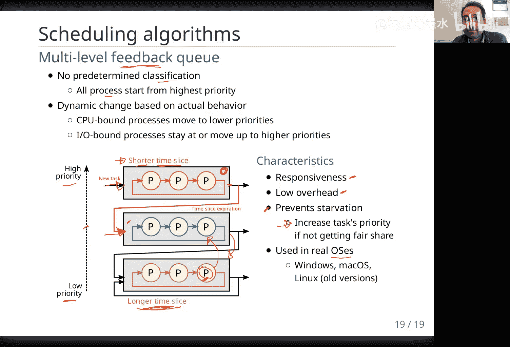

# 操作系统与系统编程：10：进程调度（第二部分）

在本节课中，我们将继续学习进程调度，深入探讨不同的调度策略与算法。我们将从回顾进程的基本概念和调度原理开始，然后介绍一系列调度算法，分析它们的优缺点及适用场景。

## 进程与调度回顾

上一节我们定义了进程及其特性。一个进程拥有独立的地址空间，包括代码段、栈、堆和数据段。进程之间在创建后，其内存空间是相互隔离的。

进程还拥有一个执行环境，由进程控制块（PCB）描述，其中包含进程ID（PID）、打开的文件列表、所属用户等信息。

在调度方面，进程的执行可分为两种阶段：**CPU密集型**阶段（CPU burst）和**I/O密集型**阶段（I/O burst）。CPU密集型进程主要进行计算，而I/O密集型进程则频繁与外部设备交互。

调度模型有两种：**协作式调度**和**抢占式调度**。协作式调度依赖进程主动让出CPU，而抢占式调度则通过硬件定时器中断强制收回CPU控制权，以实现更公平的资源共享。

进程在其生命周期中会经历四种状态：**就绪**、**运行**、**阻塞**和**僵尸**。僵尸状态是一个临时状态，表示进程已结束但尚未被其父进程回收。

## 调度相关术语

在深入讨论算法前，我们需要明确几个关键术语。以下是这些术语的定义：

*   **提交时间/到达时间**：进程被创建并进入系统的时间。
*   **退出时间**：进程完成执行并退出系统的时间。
*   **周转时间**：从进程提交到进程完成所经历的总时间。公式为：`周转时间 = 完成时间 - 到达时间`。
*   **响应时间**：通常指从进程提交到它首次在CPU上开始运行所经历的时间。另一种定义是到用户能与进程开始交互的时间。
*   **等待时间**：进程在就绪队列中等待被调度执行的总时间。

## 调度算法

接下来，我们逐一分析几种经典的调度算法。

### 先来先服务

先来先服务（FIFO/FCFS）是最简单直观的算法，类似于排队，先到的进程先执行。

以下是该算法的一个示例场景：

*   假设有三个进程A、B、C几乎同时到达（到达时间≈0），其执行时长分别为10、10、10。
*   调度顺序为A -> B -> C。
*   计算平均周转时间：(10 + 20 + 30) / 3 = 20。

然而，FIFO算法存在**护航效应**问题。如果一个长进程先到达，即使后面有短进程，短进程也必须等待长进程完全执行完毕，导致平均周转时间变差。

### 最短作业优先

为了克服护航效应，提出了最短作业优先（SJF）算法。该算法优先调度预计执行时间最短的进程。

以下是该算法的一个示例场景：

*   假设进程A、B、C几乎同时到达，执行时长分别为100、10、10。
*   SJF会优先调度B和C，最后调度A。
*   这显著改善了平均周转时间。

SJF在理论上能提供最优的平均周转时间。但它存在两个主要问题：
1.  **不可预知性**：操作系统很难预先准确知道进程的执行时间。
2.  **非抢占导致的护航效应**：如果一个长进程已经开始执行，即使有更短的进程到达，也无法中断当前进程。

### 最短剩余时间优先

最短剩余时间优先（SRTF）是SJF的抢占式版本。系统会优先调度剩余执行时间最短的进程。

以下是该算法的一个示例场景：

*   长进程A先开始执行。
*   当短进程B和C到达时，系统比较发现B和C的剩余时间（10）比A的剩余时间（90）短。
*   于是系统抢占A，先调度B和C执行，然后再继续执行A。
*   这进一步优化了平均周转时间。

但SRTF可能导致**饥饿**现象。如果一个长进程不断被新到达的短进程抢占，它可能永远无法获得足够的CPU时间来完成。

### 时间片轮转

以上算法主要优化周转时间，适用于批处理系统。对于交互式系统，**响应时间**更为关键。时间片轮转（RR）算法为此设计。

RR算法为每个进程分配一个固定的**时间片**。进程每次只能运行一个时间片，然后被强制抢占，CPU交给就绪队列中的下一个进程。

以下是该算法的一个示例场景：

*   假设时间片长度为2.5，三个进程A、B、C同时到达，执行时长均为10。
*   调度顺序为：A(2.5) -> B(2.5) -> C(2.5) -> A(2.5) -> ... 如此循环。
*   平均响应时间大幅改善，因为每个进程都能很快获得首次执行机会。

然而，RR算法通常会**增加平均周转时间**，因为进程需要被多次切换才能完成。时间片长度的选择至关重要：太短会导致过多的上下文切换开销；太长则会损害响应性。RR算法的一个优点是**不会导致饥饿**。

### 多级队列调度

现代系统需要同时处理交互式和批处理进程。多级队列调度（MLQ）尝试结合不同算法的优点。

其核心思想是将进程分类（如系统进程、交互进程、批处理进程），并为不同队列分配不同的优先级和调度算法。

以下是该算法的一个示例配置：

*   **最高优先级队列（系统进程）**：使用FCFS，确保紧急任务立即执行。
*   **中优先级队列（交互进程）**：使用RR，保证良好的响应性。
*   **低优先级队列（批处理进程）**：使用SJF，优化周转时间。

MLQ的主要挑战在于如何准确分类进程，以及低优先级队列中的进程可能面临**饥饿**风险。

### 多级反馈队列

多级反馈队列（MLFQ）是对MLQ的改进，它通过**反馈机制**动态调整进程的优先级，而无需预先分类。

其工作流程如下：

1.  所有新进程进入最高优先级队列。
2.  如果一个进程在时间片用完前就主动阻塞（如进行I/O操作），说明它是交互式的，则其**优先级保持不变**。
3.  如果一个进程用完了整个时间片，说明它可能是CPU密集型的，则其**优先级降低**，进入下一级队列。
4.  低优先级队列通常被分配**更长的时间片**，以减少上下文切换开销，让CPU密集型任务能更连续地运行。
5.  为了防止饥饿，系统可以定期将长时间未得到执行的进程**提升回较高优先级队列**。

MLFQ综合了响应性和吞吐量的优点，并能自适应进程行为的变化。它是许多现代操作系统（如Windows、Linux、macOS）所采用调度策略的基础。

## 总结

本节课我们一起深入学习了进程调度的第二部分。我们首先回顾了进程状态和调度模型，然后系统性地介绍了从FIFO、SJF、SRTF到RR、MLQ，最终到MLFQ的一系列调度算法。

每种算法都有其设计目标和权衡：FIFO简单但有护航效应；SJF优化周转时间但难以实现且可能导致饥饿；RR优化响应时间但增加周转时间；MLQ和MLFQ则尝试通过分类和反馈机制来兼顾不同类型进程的需求，其中MLFQ以其动态适应性成为现代操作系统的实践标准。理解这些算法的原理和折衷，是掌握操作系统资源管理核心思想的关键。