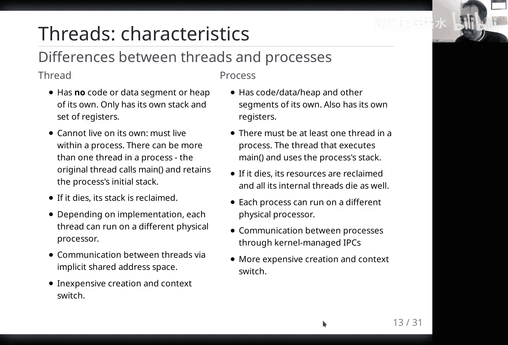

# 【全集 附课件】加州大学戴维斯分校 操作系统与系统编程 中英字幕 1080P p11 Lecture 11 - 并发与线程part1 -BV1jXr5BBEKa_p11-

Hi everybody， so today we're going to start talking about a new topic that's very much in line with the previous topic about processes and process scheduling we're going to talk about concurrency and threads。

So concurrency is something we kind of touched already upon when talking about multitasking。

Concurrency is the idea。That a task or processes can be run independently。In an overlapping manner。

 which means that within the same lapse of time， we can essentially like execute a little bit of a certain task。

 then a little bit of the other one， a little bit of the first one and so on。诶。And。

Concurrency comes directly in opposition to。Sequential， so sequential is。

You have to execute an entire first task first， and then。A second task can be executed entirely。

 as well。Concurrency means that you're not being sequentialed and you allow some overlapping in the execution of the task so。

If I can give you like an analogy， a cooking analogy， imagine you're cooking a three course dinner。

Cooking it in a sequential manner would mean that you're first doing the appetizer。

 then you're doing the main dish and then you're doing the the the dessert like and so you're pending like I don't know。

 like an entire afternoon in your kitchen。And you are taking care taking care of like every single like dish completely separately from beginning to end that would be。

That you' are doing it sequentially。Now if you're doing it concurrently it means that oh you're going to start to do a little bit of the appetizer and then you're going to start doing a little bit of the main dish and a little bit of the dessert and then a little bit of the main dish again and the appetizer and then the dessert and so essentially like you spend like five minutes on each and then you swap to the other one and you kind of like make progress on all like three courses up until they are done。

嗯。Concurrency， and we're gonna talk about it。Should not be confused with parallelism。

 Paraism is only a type of concurrency。 Concurrency only means that you have multiple tasks to do and you're making progress on all of them like a little bit at a time。

Paraism means that like you would actually be doing things at the same time。

So like in your kitchen for example， with one hand doing the appetizers and the other hand working on the main dish。

 that would be working in parallel， but I mean that would be kind of complicated for cooking but anyway we're going to come back to parallelism in a couple slides。

嗯。Just make sure that you don't confuse concurrency with parallelism Concurrency is only the I that you can。

Like execute multiple tasks a little bit at the same time。Like a little bit like one after the other。

So how does that apply to processes？Well， processes can so processes are programs that are being executed on the computer。

 those programs can be rather complex。And so for example。

 like you can have a program that in fact is composed of like kind of three phases， say。

And it's getting like fairly complex。An idea of using concurrency is that you would separate each of those three phases that this process is doing into three independent process so that like each process only takes care of kind of one single task。

And because they have to like cooperate on like solving the whatever problem that they're trying to solve。

They would be communicating between one another via IPCs via files or via pipes via via signals like via all of those methods that we've talked about before。

And actually， you know already about process concurrency because that's pretty much how GCC works。

When you run GCC。If you remember， youre running， in fact。

 four tools that are completely separate programs。 so they transform into。So sorry。

 for completely different programs that in turn turn into four different processes， you have CPP。

 the preprocessor CC， which is the compiler， ASS， which is the asmbler and LD， which is the linker。

By default， when you run GCC on your source code。Those three four tools will be run kind of in actually in a sequential matter。

 like CC CPP will be run and will output a file， then that file will be given as an input to C and so on and so and they will be executed completely sequentially。

Now there is this option that you can give to a GCC dash pipe where now GCC will actually run all four processes concurrently it will like create all four processes。

Put pipes in between them， and run them。All all at once and then while it's up to the scheduler to like schedule a little bit of CPP。

 a little bit of CC， a little bit of AS and so on， but so now you have like four processes in the system who work together concurrently talking to one another via IPC which is in that case a pipe。

And。这样。嗯。We have different types of concurrency of making processes kind of use the CPU in overlapping manner。

So let's go back to just like the sequential execution and remember that when a process。Excuts。

 it executes in phases。We have CPU bursts， that's when the process is really using the CPU to run some computation。

An IO burst when the process is accessing the IO and is not using the CPU at all。

 it's just like waiting for the IO to do whatever task it was asked to do。

In a purely sequential execution。T1 would be running entirely。

 both like by doing CPU burst on the CPU and by waiting on some IOos， and then T2 would be the same。

So now if we want to run T1 and T2 concurrently， there are several ways that we can do that and that we can take advantage of the hardware。

The first is CPU virtualization， so that's pretty much what I already showed。

 it's the idea that like the CPU doesn't have to execute T1 entirely and then T2 entirely it can execute a little bit of T1 and then a little bit of T2。

 and then a little bit of T1 again a little bit of T2， a little bit of T1。

 T2 and then theyre all done。The。Prose。Actually， let's start with the con of that technique like the。

嗯。We can see that， leg。This kind of concurrency CPU virtualization。

Doesn't really like improve the performance that much。

If you look in terms of like timing between sequential execution and CPU virtualization。

 we're not going faster right we're still taking exactly the same amount of time to execute those two tasks however what we're improving is the interactivity or like the reactivityivity of the computer because now T1 by being able to execute every so often and T2 being able to execute every so often it will give the user a better impression that like everything is kind of like moving together instead of really noticing like this program is running first and then this other one and you can really see that like the processor is not doing anything else in the meantime。

The second type of concurrency， which now becomes more interesting。

Is to take advantage of the Ioburst。 There's no reason that the CPU would be stuck on a certain process。

 on a certain task if this process is stuck on an IO。

 So we pretty much like take advantage of that to schedule another another process， another task。

Whenever one is doing a NIO， so here the CPU would execute the CPU burst for T1 and whenever T1 starts doing a NIO。

 then the CPU can switch to T2 and execute the CPU burst of T2。

And now you see that by taking advantage by putting those IOaces kind of like in the background and very quickly。

 like giving the CPU resource to another task that needs it to do a CPU burst。

 we are now actually starting to reduce the time that it takes to execute processes。And so finally。

 the last type of concurrency， and it's only a type of concurrency。Is parallelism。

Paralyism assumes that you have multiple CPUs， otherwise you can do things in parallel。

I can work with my two hands in parallel because I have two hands if I have only one hand， I can not。

Use that in parallel。嗯。😊，So here the idea is that now if you have two CPUs。

 then each CPU can execute。A different task。 And as at a certain moment in time。

Things are really being executed in parallel， like T1 now would be executed in parallel simultaneously with T2。

 That's what parallelism means。But so really keep in mind that like concurrency is not parallelism。

 parallelism is only a specific case of concurrency。 Otherwise。

 concurrency is still the idea that task are being executed in kind of overlapping manner。And。Okay。

 so speaking of parallelism， it brings the notion of speed up here。

 and I'd like to say a few words about that。So what is the speedup， let's take a real life example。

 imagine I start my company。And my company is like， I don't know， sellinging products on the food。

And I'm lucky I have like one employee who's doing all of the sales on the phone and the other employee is generating a million dollar in revenue。

I would。Expect that， well， if I want to increase my revenue to say $2 million instead of one。

 I could simply hire another sales employee who would be working the phone。And that would just like。

Double my revenue。That would be an ideal speed up。 I double my number of employee。

 and I have an ideal speed up of two， which means that the amount of revenue is also double。

That's simple example。Now， obviously， as you can imagine。

 things are not always don't always work that great。

So these a speed up like you have a certain of amount of resources。That work at the certain speed。

 you double it and you get double speed。That's called ideal or linear。 So that's the idea。 So here。

 like， if you have， say one CPU， you work at speed 1， If you have8 CPUs， then you work at speed 8。

 like your speed is multiplied by 8。嗯。😊，More often， though， the speed up will be sublineier。

 which means that like， say you have 8 CPUus， but in fact。

Your speed up is say like a little bit less than6。 So you're increasing your number of resources。

 but it doesn't translate into a direct like linear increase of speed or efficiency。Why is that well。

 that's because like the more resources you have probably the more overhead you're going to have like the more coordination。

 So let's take an example again with the sales employee。

 So if you have one employee that makes a million in revenue and you hire another one you could expect to have 2 million now imagine you have $20 employees。

That' say bring $20 million dollars。Can you really expect that if you hire 40。

 you're going to make $40 million dollars？Probably not， because when you start having 40 employees。

 some of those employees will need to be managers to manage the other ones。 And when you hire like。

If you have 40 sales employees。Probably you don't have like that many clients out there that you can reach and still like get more and more revenue。

 like probably the amount of client is reduced per sales employee。So anyway。

 you have like all of those coordination overhead and bottleneck that make it so that like even when you increase the number of resources。

 it's difficult to keep up with like doubling every time the efficiency。Sometimes。

 though and that's quite interesting， it's pretty rare。

 but you can have a speed up that is said to be super linear。

Where here say you increase your number of resources to select like 5。 and in fact。

 you have a speed up。Of7。So you start adding resources， and， in fact。

 you become more efficient than just like the linear ratio。 How can that happen。Well。

 for example here is just like one example。Back to the analogy of cooking in your kitchen。

 imagine you're in your kitchen with a friend。So working in parallel and you're both cook baking a cake。

 like you're baking a certain cake and they're baking another kind of cake。

What will surely happen is that you're going to share some resources because for example。

 like you both need flour。If you were by yourself in your kitchen and you needed some flour。

 you would need to go to the cupboard， get the flour and bring it back to the counter that would take time。

 Now， if you and your friend are baking your cake。Only one of you probably will need to go to the cupboard。

Get the flower and bring it back to the counter。 And the other one。

When they get to the moment of the recipe where they need flour， Well。

 it's already there on the counter。 They don't need to go to the cupboard， So they are saving time。

Same for the oven。One of you will get to the moment of the recipe where it says prehi the oven to 350。

The other one will also get to a moment in their recipe where it says prehe the oven to that temperature and they tend their ahead and it's actually the oven is already hot。

 so that's that much time saved。So here， like the super linear。It's pretty rare in like computing。

 but it can happen because when you have tasks kind of maybe like working on the same data。

There will be some side effect because like task number one will access the data and now the data will be say in the run memory or in the processor of cache。

And then when we switch to the other task， the other task will maybe try to access the same data and instead of paying the price。

 the full price to say get it on disk， for example。

 it's already there in the cache or in the main memory and we're saving time。But again。

 it's pretty rare， but it can happen。Okay， so end of this little digression。

 let's go back to our processes and to concurrency of processes。

The problem with process concurrency is that processes are pretty heavy。

It's heavy for the OS to fork like when you have a process that creates another process。

 you need to fork and that's a Cisco you go to the kennel and the  kernelnel needs to like duplicate everything。

 it needs to make a new PCB， it needs to make a new environment， a new address space。

 you need to copy like all of the memory of the first process to another segment of memory for the new process like it takes some time and some resources to create new processes out of other processes。

Once the processes are running， it's also kind of slow to switch from one process to another one。

 like when they're sharing the same processor because they're all working their own address base they're not sharing anything so everything that one process had in their in the in the processor cache cannot be shared with the other process or like all of the memory that they're using is not shared with the other。

Process， so it makes things complicated。And if those processes need to cooperate on the same problem to solve the same problem。

 it's difficult for them to communicate they have to use IPC。

 so they have to use either like files like one will write to a file and the other one will read from the same file or they need to use pipes like Gcc with the dash pipe option and but no matter what the。

The technique is when they use that kind of IPCs， it's always ciscos and that takes a lot of time to perform。

So process concurrency can work like in the example of GCC that is fine。

 I mean it's been done for years， but like it is pretty， it can be a little slow。

And that now brings us to the idea of threads what are threads threads is the idea that like oh maybe we we can achieve concurrency not by having multiple processes but by staying within one process so here's the big idea here。

That would be process concurrency。You have a problem to solve that You can。

Separate into like three sub problems。And you make a process out of them。

 and then you have them communicate by IPC， which is a real slow。But maybe instead。

 instead of having like three different processes， you could stay within one process。

And have the three sub problems being solved concurrently within the same process。

That's the idea of threading。 And so here the benefit is that like you would stay within the same address space。

 you would stay within the same environment。 It's just that you would have different execution flows。

Within the same process， that is the big idea of threading。So。😡，How it does it concretely work。

 kind of， here's an example。You have a process。Start with like a main function。

 And so at the beginning， like this main process just executes。

Statements in the sequential order that we have seen so far。 like here。

 it's pretty much the same model。Now， the big idea is that this main function。

That is in execution flow。Can create。Other threads within the same process。 And so it says， okay。

 I want to create thread A。 And so now we have another function within the same process。

 thread A that also has a set of sequential statements。

Now the big thing with threads is that within the same process now。

 we have one thread of execution that's still executing the main function with all of the statements in order。

 and we have another thread of execution， executing whatever is in this function， also in order。

And they are two， they are independent。Thread of execution in the sense that。

The processor will be executing main， then main creates thread A。

 and there's an actual contact switch。On the kernel side， exactly the same as like processes。

 And now we have thread A run for a little bit。And then we switch again and say we could later like execute the main function a little bit more and then the thread A function。

 and they are now running concurrently a little bit of the main function。

 a little bit of the thread A function。And if we create yet another thread threadb。

 then threadB will also be running concurrently with thread A and the main function。

 and also like a few statements at a time and so on。And。😊，And those threads。

They are completely independent in terms of scheduling。

 they will be scheduled concurrently doing a little bit of work at a time。呃。

I think nowadays like threadh is really the the word to express that， but if you read like old books。

 you might see sometimes that they were called like lightweight processes or more generically like tasks。

It depends just know that like there are there' is another vocab。

 but for the most part threads is it's pretty much。The term that people use now。Okay。诶。

What is the rational behind this like thread model，s it's actually like pretty。straightforward。

The idea behind threads and why it was inventing in the first place。Is that we human being。

 we tend to think like fairly linearly， right，'s， it's pretty much far to like， really think in in。

 in parallel。Our own thoughts are usually like one after the other like I don't know when you cook a recipe you you followed the recipe and it's like oh step number one do this step number two do this step number three do that so we're pretty used to having that thought process of like a certain order into doing a certain task to go like from solving a problem entirely。

But we can also handle the idea that like。Things around us are concurrent。

Like say if I work on a project with a team， it's not too difficult to understand like， well。

 I'm going to be in charge of that feature。And so on my own， when I work on that feature。

 my work will be like fairly linear， but I can understand that at the same time。

 one of my colleagues will be working on another feature， like concurrently to mine。

 and they will also work in a way that's like fairly linear。

So we have this notion of understanding that like things can be concurrent。

 but locally they are still be done in a linear way and that's why like programming with threads doesn't。

It's not like a stretch of mine。 It's something that we can like handle like fairly well。And。Now。

 threading can also have a lot of nice advantages。 So， for example， like。

 it can help applications be a lot more reactive than they would be otherwise when they are just mono threaded。

 So， for example， like imagine that you have an application that has a goI with like buttons and stuff。

 And so。If the application was mono threadreaded， it could happen that you start a big operation that the application needs to do and so for example。

 like you are trying to encode a video， something that takes a little bit of time and if the application is monothreaded。

 then it means that like when you push start to start the encoding。

 then the application will not be responsive for the entire duration of the encoding。

And it feels a little frustrating when an application is not responsive。

 like you've clicked on the button and then you're like for half an hour。

 like everything is kind of gray。And the application is like not responding because it's like super busy running this piece of computation。

With threading， it would be possible to。Actually， run the encoding into another thread。

 So that thread is busy doing like a lot of computation。 and it's fine if it's not responsive。

 but you still have the main thread。In chart of the GuUI and being able to answer like when you click the button。

 when you like move the window and all of that， that's something that multi thread can bring。

If you have a computer with multiple processors， then having an application that's multithreaded can be a lot faster because threads can work on different processors。

 and so the application can actually like really achieve true priorism and be a lot faster。

And finally， and we're going to be talking about that a lot in the。

In this presentation and actually like that will also be something that we talk about in the next。

topic and in the following topic， it's something we're going to talk about for a little bit is the sharing。

So with processes， when you do concurrency with processes。

 we said like it's pretty slow because you have to use IPCs and IPCs are slow。Here。

 because threads are running within the same process， they have access to the same memory。

 they are all part of the same address space， so all the memory that they have is automatically seen by the other threads and that makes the sharing of data a lot easier between threads which can be a lot more efficient。

 a lot faster can also cause a lot of issues and we're going to talk about that but for the most part it's also like it's really efficient much more than with processes。

😊，Okay嗯。So here are a few examples of like actual。Applications that can be made into multithreaded application so let's take one let's take like a web server The goal of a web server is to answer web requests so essentially like you get a request from the network you try to understand what the request is about probably if you want to answer it means that you have to return some data so you need to get that data that corresponds to what the request is asking。

Most likely this data might be on disk somewhere in like some database。

Then you need to create a response based on the data that you read out of the database and you need to send the data back to whoever was doing the request。

And so。So。Getting the request will take some CPU time， like reading from disk。

 will take some CPU time and some latency from the disk itself like from the access to the I device。

 then creating the answer， sending the response and waiting for the network to like actually carry the answers。

If your application is mono threaded， then it means that say so you have this big like Y loop that handles requests like one after the other。

 things have to be done sequentially， you process request one entirely。And only once you're done。

 you can process request to。Now， how can we use multi threading to make this application run faster。

 Well， you could create threads。That could handle multiple requests， concurrently。

So here you could so create， say like n threads。And they are all running the same wide loop。

 essentially。 So locally， they are linear and they can only each process one request at a time。

 However， because you have multiple threads。They can handle requests in a concurrent way。

So for example。Now you can have request one showing up。And so on the CPU。

 you take care of the first few phases， but as for request one， you experience the disk like latency。

 then another thread can be scheduled on the CPU and can start handling another request request too and so here we're using CPU virtualization and IO concurrency to essentially have those multiple threads within the same process like handle multiple requests at a time。

 which can be a lot faster。So that's a way of using threads。So now here's another example。嗯。

For this one， as you will notice like we have to assume a multi processor system and at least like a dual processor system。

So imagine we're trying to， it's purely computation。

 we have three arrays and we are trying to compute the content of an array based on the input from two other arrays。

And so we're running this follow up like kind of line by line。On a mono CPU system。

 that's what we would have， right， like the process would be running only on one CPU and running pretty much like all of the iterations of that loop。

Processing one line of the array at a time。So actually。

 like maybe post the video here and try by yourself to see how you could use multi threading to change the way that this matrix is being computed so that we can use the second。

Processor efficiently and reduce overall the length of this computation。

So here what we can notice is that。When we are呃。Doing one iteration of that loop。

 were working only on one cell of the array， like the cell that's characterized by index I。

And we're also only accessing index I of the other two input arrays。Which means that。In essence。

 every cell of the array is completely independent， right， We could very well compute。A1。Before4 a 0。

There's no typical order。And so what it means is that like CPU1 and CPU2 could be working on different cells。

At the same time。So let's try to capture that and one way that we can go faster is that we could create a thread。

That only works on a chunk of the array between say like index P and index M。

 So it's only running like the loop but partially。And then we create one thread to work on half of the array。

And another thread that's running on the other half。And so if we have two processors。

Both halves are being processed in parallel， and hopefully we can reduce the length of the competition by2。

嗯。So， and here， that's why we have to assume。That we have a dual processor system。

 because if we were to run that code。On a monoprocessor system。

We could not go faster than with the monoth process because we still need to do half of the array first and the other half of the array second and that wouldn't get any faster。

 whereas if we have two CPUUs， they can really like work right next to one another。

What's important to notice here as well is that。That kind of computation would not be possible if we were to use process concurrency at all。

 because we are trying to compute what all of the values that are in an array。

With multi threadreading here， this array because it's a global variable and it belongs to the process's address base。

It's a it's an nar that's accessible by all of the threads of this process if we have different processes that are created by forking。

 they could not be working on the same array because they are not sharing the same address。

So let's go on。Let's talk a little bit more about the different characteristics of threads。

 starting with the first one， the execution context。What happens here is that like。

Threads are different execution flows inside of the same process。But so when a thread。

Runs on a certain CPU。 It owns this CPU。 It can really run on the CPU。

 It has access to all of the registers of the CPU and so on。 And for each of the threads。

 it's the same。Because threads。Are running their own functions and they have their own like CPU values and whatnot。

 it means that they have their own stack。嗯。But because they are part of the same address space。

 those stocks are not protected。 so technically like it would be possible for one thread to tam with the stack of another thread。

 there's no， I mean， it shouldn't happen that would be a bug， obviously。

 but like there's no actual protection that prevents that from happening。嗯。😊。

And the same as like when we discuss like what happens when a process is being preempted。

 what is the same for threats， threats or execution flow， when they are preempted。

 we have to save all of the processor registers to a certain state so that like the next thread that gets schedule and the processor can use their own set of registers。

In terms of environment， though， because all of the threads belong to the same process。

 they all share the same environment， and I try to come up with an example here that shows that。

 so for example。Imagine at first we're in the main function， so we only have one thread of execution。

And in this thread of execution， in the main function。

 STD out is changed to point onto something else like onto a pipe or onto a file or like whatever。

When a thread is created within the same process。And that thread now starts running whenever it will use STD out。

 so for example， by printf by using printf。This thread has exactly the same file descriptors has the main function。

 They are both threads of the same process。 They share exactly the same file descriptors。

 So if one thread modifies the file descriptors， it affects the other thread as well。And same。

 for example， with the current working directory， if one thread changes the current working directory for the entire process。

 then the other thread will be affected as well。So pretty much like everything that all of the information that the PCB contains are shared among all threads of the same process。

And so， finally。One of the most interesting characteristic of threads is that。

Because they are running in the same address space， they are sharing the same address space。

 they are sharing a lot of the same variables， and especially the global variables and the he。

 not the local variables because the local variables are part of the stack and each thread as its own stack。

But so here is an example here where we have like two global variabless。

 so let's draw the memory quickly for that。So that's the address base for the process。

We have the stack。Here growing down， we have the heap。Growing up。And we have the data segment。

Sell like right here and the code segment at the bottom。 So the code segment here。

 that would contain the assembly instructions corresponding to that code。Now。

 the data segment would have。Those two variables， global。And pointer a。

When the main function starts because at the very beginning， we only have the main function。

 we have only one thread of the execution， here's what the main function does。

It initializes global to42。 so global would be equal to 42。In the data segment。

And then it calls Maoc and creates or allocates the size of an nin soap。

 say like four bys into the hip。 So the hip。Will be allocated，4 B。And a， the pointer。

 which is a global variable here， will be initialized with the address of those fo bytes。

 So here a will be equal to the address。O。This piece of memory in the hip that was just allocated。

And now let's imagine that like and so in the stack here， main doesn't have any local viable。

 but like。The stack here would belong to the main function。 So there would be。

A main stack frame here for the main。Now when we create a thread that will run this function here。

We actually create another stack for that frame that's for that thread。 That's different。

 So here is the stack for say like。Thread。Number one。

And that thread here that gets created and that's running this function。

Get its own stack and has its own local variables。 So， for example， it has a local variable for arc。

 the the parameter that it receives and here it receives the value 23 for arc。

And then it declares another lo of viable v。And as you can see， the thread can access。

A global variable。 So from the data segment。Or end its own。Local viable org。

 So that would make like 23 plus 42。Which should be 65。And then the same thread can access。

A can like modify a。OrA being like a global variable in the stack pointing on something onto the he。

 it's possible for the thread to have access of all of that like of a the pointer in the data section and of whatever is in the hip and put the value of R in the hip so here like write 65。

Now it's possible to create another thread that will have。It's own stock， as well。

Like a little bit further down。 So this one grows down and this one grows down as well。

 And so this one is for thread， too。And so this one will also have its own ag here。

 local variable as as a parameter， which is now 42 and so for this thread var will be 42 and 42。

 which is。84， and then will modify also whatever is in the hip here， too。84。And so on。

What you need to remember here， like at the really point that's important is that threads have access to everything that the data contains and everything that the hip contains。

Okay， let's move on。So you remember， and I just mentioned it that like。

Back when we were talking about processes。The kernel maintains a data structure。

 the PCB for every running process in the system。Now that we understand that within the process。

 we can in fact， have multiple threads that can be scheduled by the kernel in completely independent manner。

It means that this PCB is not enough， we need to have another data structure。

And so here the PCB now is actually split into two parts。

The PCB will contain all of the environment that is related to the entire process。

And then because one process can have multiple threads of execution， we have another。

Type of data structure called TCB threat control block and that TCB contains specifically information for every running threads of the process related to its execution so essentially like the stock pointer the PC。

 the state of the thread， whether it's blocked or running or。

Ready and so on and the registers for when like the thread loses the CPU and we want to save the state。

 we need to have like the space to save that and so on。嗯，是呀。And。😊。

And so last slide to kind of like sum it up like the differences between threads and process。

 so I'll let you。Peacefully read that slide on your own。 but here just in brief。

Threads are only about execution。Threads do not exist without a process。

 like they are only a part of processes。Concurrency using threads is fairly easy。

 because the communication。Is easier。 Ths can share the same global variables。

 can share the same memory pointers， have access to the same hip and so on。

 So the communication is really made a lot easier。And they're lightweight， they're easy to create。

 they're easy to destroy， they're easy to switch from one to the next because we only need to switch the execution context and not the entire like address space and so on。

Now， processes， there is super set。Of threads， because processes are， in fact， one or more threads。

 plus and address space， plus an environment。 So they are really like something that's， in fact。

 bigger than threads。It's also possible to do concurrency with processes。

 but the communication is a little more cumbersome because you have to use IPCs such as like pipes。

 messages， signals， files， and so on， which are kind of slow communication channels。

And last processes are a little bit more difficult to create because it。嗯。

Cuses a lot of duplication and use of resources， and it might be slower to switch from one to the next because they are not sharing anything in the system。

So that's it for today and next time we're going to keep talking about threads and we're going to talk about the different models of implementation of threads。

