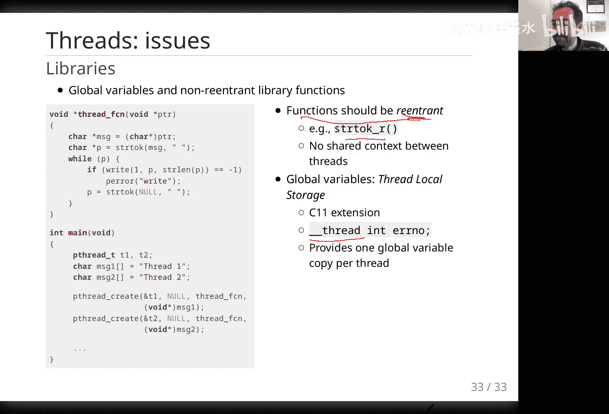

# 【全集 附课件】加州大学戴维斯分校 操作系统与系统编程 中英字幕 1080P p12 Lecture 12 - 并发与线程part2 -BV1jXr5BBEKa_p12-

So today we're going to continue the topic we started last time about concurrency and threats。

So quick recap here。So we introduced the concept of concurrency。

 which is the composition of independently executing tasks。

It's directly in opposition to sequential execution where say a task would need to be completely executed before another task can execute concurrency only means that we allow task to kind of like。

Work one after the other for for a little bit。 so they can like。

 make progress within the same period of time。 That's what concurrency is。

Not to be confused with parallelism， so parallelism is only one type of concurrency。

 and it only can apply when you have multiple CPUs and so task can really be。

Executing simultaneously。Concurrency doesn't necessarily mean that task are executing at the same time。

 It just means that they can make progress within the same a period of time。嗯。

And so that brought us to this conversation between processes and threads so we can do concurrency with processes by say forking a lot of processes and have them say work on different aspects of the same problem or different phases of the same problem so if you remember like GCC can do that if you run GCC with the option dash pipe then GCC will run all the fall process。

 the preprocessor compiler assembler and linker concurrently and we'll have them communicate by using pipes。

Which works very well in that case， however， sometimes。

Achieving concurrency with processes only can be a little cumbersome because there's a slow context switch between processes and also processes have a harder time to communicate because they use to they need to use regular IPCs such as pipes or signals or messages and those communication channels tend to be like fairly slow。

嗯。Now here the idea and that's the idea of threads is that maybe we can achieve concurrency。

 not by having multiple processes by just keeping one process。

 but by having multiple threads of execution within the same process and so here we remove a lot of the complexity because now it means that。

All of those threads of execution can run inside of the same address space。

 which makes the communication between thread a lot easier。

 the contact switch between threads can be a lot faster as well and a lot more efficient and if we have a computer with multiple CPUs we can achieve parallelism within like one single process which can be extremely interesting。

Okay， so let's move on in this lecture here we're mostly going to talk about the implementation of threats so now that we have a fair understanding of the concept。

How do we in fact implement it， how do we make it happen？So let's start by looking at a typical API。

So as I've shown you in like previous examples， threads will be used so you would。

Still always enter a process by starting by the main function。

 so a process at the very beginning usually only has one thread of execution until it creates more by calling some sort of thread create function and that's what will spur multiple threads within the same process。

So we have this。APpiI that a process can interact with to create threads， destroy threads， and so on。

And。Obviously， this API varies according to who provides the implementation。

 but the concepts are pretty much like always the same。

And it revolves around those like four basic function， essentially like creating a thread。

And so to create a thread， we would give a function that is the entry point of that thread。

 that's the kind of like the main function of the thread。

And this function typically is defined as receiving a pointer as as an input this way it's very generic。

 you can give like a pointer to a data structure that can contain like whatever field you need to transmit to the。

To the thread。诶诶。Oh， and。I guess， that's。Okay， that's not what I meant here。

 The written value would usually said be like an integer or also like。An null pointer。

Not to no pointer， just like a pointer so that the threat can also return whatever value。

And so here with thread create， we could give an argument。

 so when say like the main function calls thread create to create a thread。

 it gives the function that the thread should be executing first and an optional argument。Then。

 in the same way that。Between processes， when a process fors。

 it can wait for its children to complete。Threads over the same possibility if the main function creates a thread。

 it can also wait for it， which is called here join by providing the thread ID。

 which is something that would be returned by thread create and it can collect the exit value of that thread so whatever like the thread function had returned。

And then once a thread is executing it can also perform some actions， so for example。

 it can decide to yield so its let's say it's executing on the CPU at the moment and it says like okay I'm done executing like you can yield to the next thread。

Or thread can also exit， like terminate its execution and return an exit value。

 which will be received by the join of like whoever is joining that thread。So anyway。

 that's a pretty typical API here。Now， the real question of this lecture is how do we implement that API？

And there are two models that exist currently。One moral is called kernel level threads。

And the other one user level threads and we're going to zoom on those two in the next few slides。

 so let's start by the first one kernel level threads， what is it？Canunnal level threats means that。

The OS knows about the threads inside of a process。

 which is pretty much kind of like the model that I've implied so far。 So imagine you have a process。

 this process has has three threads of execution inside of it。

 then the kernel knows about those three threads of execution。Better than that。

 it's probably the kernel that like created them so when this process called thread create to create a new thread。

 then it was in fact a Cisco that ask the kernel like hey create a new thread within that process and so on so the kernel manages threads pretty much entirely through Ciscos。

嗯。And it's also the channel that performs the context switching between the different threads by using like the TCB and and all of that。

 which is what we have talked about last time。And so it's called the one to one model because for one user thread here。

 like inside of process， we have kind of one representation in the kernel。

So let me show you more examples of that。So first let's actually like look at the typical example of just regular processes that are not multithreaded。

 which is what we have seen up until now for the most part。

 so imagine you have process one and process two process one as only one thread of execution which pretty much like is the main function like where enter the program and start executing that process。

has a stack has some code， some data， the he and so on。

 so if you have another process it's going to be the same and on the kernel side the kernel has pretty much like a PCB for each of those running processes and also kernel stack associated to each process。

So so far so good。 now， how do we extend that model to accommodate for multi thread processes。

Well here the kernel knows about it and it's like we talked about， we have the notion of TCB。

So now if process one actually has two threads inside of it。

 so two sequences of instructions that are independently executed。

 then it means that we have two stack。One for each thread of execution， However。

 the rest remains completely shared， like the same code， same data， global variables， same he。

 and on the kernel side， because the kernel knows about those threads。

 it has one PCB for the entire process to describe the environment the and the。Memory address base。

 but it has two TCBs to keep track of those like execution environment and so two kernel stacks。

 one per thread of execution。And that would be the same for process two if process two happens to be a multith program as well。

So， that's the idea。And。And in terms of。Contact switch。

 It's pretty much what I've already presented in the last deck of slides for the lecture about processes。

But let's go over it again very quickly。 So imagine you have a certain thread within a process that's currently running。

 let's call it like T。Now imagine that thread TA stops executing for some reason there is a switch back to Ken mode so that can be far because thread A performed the Cis or is interrupted by the hardware timer or whatever like all。

Possible three reasons that a thread would like stop executing and switch to Can normaloma。

Now imagine that in kernel mode for some reason we did。

 you know what thread A has like running off or it's blocked on an IO so let's switch to another thread which in that case would be thread B So what happened is that the kernel would save。

The context onto the kernel stack that corresponds to thread A and kind of within the same breath。

 it would restore the context that that corresponds to thread B out of thread Bs kernel stack。

And so it still be in the kernel， but now like on behalf of Thb。

 and eventually the kernel would be able to return to user mode executing threadhB。

So it's pretty much like the same thing I had previously explained。Okay。

 now let's show you do the other model， which is not something that we have talked about before。

 which is the many to one model。Or the user level threads here the idea is that the kernel doesn't know about the threads。

 so there would be a certain process running the kernel would know about that process。

 but the kernel would assume that this process only has one thread of execution。

And it would be up to the process if it wants to and most likely using a certain library that could organize some sort of multi threading。

 but that pretty much means that like the programmer needs to use a threading library that will be able to provide that service。

 so it's the library would be able to provide the creation of threads the description the。

Destruction of threads。The switch between the different threads and so on without any kernelnal involvement。

And that's actually like the， the， the， the the。Goal of Project two is about creating that thread one example of a user level thread library that performs that service。

So now let's compare it to the one2 one model here。

Let's take the example of a process that would be multi threadreaded but at user level so without the involvement of the kernel。

 so on the kernel side the kernel would be like okay， I have process one。

 I have a PCB for process one， but I'm not aware that like this process has any like has multithreading so I only have one kernel stack for that process。

And it's within the process itself through the thread library that the user the process would be running as well。

 that we would have the notion that in fact we have multiple TCBs because we have like multiple threads of execution inside of the process and multiple stacks and so on。

 but all of that management here， all of that。Bookkeeping and so on would be entirely under the control of code that is part of the process itself。

So now let's see how it could work in terms of contact switching。

So you see that everything is done at library level by user code Can is not involved in that。

And so here the I。 So would be in a certain thread。 thread A at some point， thread A would jump。

Into some library code and that jump could be either intentional because the said the thread would be calling a certain function like thread yield。

Or it it could be kind of forced by having the thread be say like interrupted， so for example。

 like you could set up an alarm and then receive a alarm a signal and that would force the thread to be interrupted and force a certain signal handler to be called and so the library could kind of take over a running thread。

But no matter what we switch into some library code。Here， let's say the library decides， oh。

 thread A， you've run off， I'm going to schedule another thread B。

Then we also have this contact switching procedure。

Where the code itself has to save all of the context that's currently on the CPU。

 so all of the CPU registers save them into some data structure and restore from another data structure that's associated to TreadB。

 the context of TB， so all of the CPU registers back when Treadb was running on the CPU and that resume Treadb where it was stopped。

And so eventually we're able to like resume thread B and have threadB resume for a bit up until we switch back to thread A and so on。

Now what one thing that's very important here is that like。From the kernel's perspective。

 there's only one process。 The kernel doesn't know about those different threads and and this like internal context switching。

 The kernel only sees one process。And the thing is that。If one thread。Running inside of this process。

Does an actual like IO access calling a certain Cico and this I access blocks。

 so say like reading from a file or something like that。

Because the  kernel doesn't have any knowledge that this process is multi threaded。

 the  kernel will just put the entire process。In， as in blocked in the block state。

 and that process will not be run up until the I O is is， is completed。嗯。Whereas before。

 if the kernel has the knowledge that a process is， in fact。Composed by multiple threads。

 it would only stop scheduling the thread that doesn't allowO access。

 but would still continue scheduling the other threads。

So that's one massive kind of drawback of user level threads。

And actually like if we try to list the different pros and cons between kernel level threads and user level threads。

Here they are。 So as I was actually just saying， like with kernel level threads so threads that the kernel knows about。

呃呃。Blocking system calls only block the threads that that does them， not everybody else。嗯。

Because thekennel can on a multi CPU machine， can distribute the different threads on different CPUs。

 it's possible to achieve parallelism。嗯。And so on。 I'll talk about signals， like in， in a few slides。

However， the the big drawback is that like because the kernel is in charge of all of that management。

 it means that we need to switch to the kernel every so often to perform all of those operations and it can be a little heavy。

Now， on the other hand， with user level threads， threads that the kernel knows nothing about that are directly implemented by library code inside of the running process。

It's pretty fast to do many of the operations because you don't need to switch back to the kernel。

 there's no like mode switching and all of that it's just like calling functions it's very very。

 very fast。嗯。It's also possible because like all of the scheduling now is under the control of the library code。

 it's possible to totally customize the scheduler and implement the scheduler that is I don't know。

 completely different than what the kernel would implement。

 which in some cases can be very interesting。And。The big drawback here。

 which I talked about is that now if one thread performs a blocking Cis。

 it blocks the entire process because the kernel doesn't have any knowledge that other threads could be scheduled in the meantime。

And in some ways。The fact that the scheduler can be customized。

Can also be a drawback because the scheduler might be lower quality than what the kernel can provide。

U I would really encourage you to like read this article because it actually like quite well highlight the difference between user level threads and kernel level threads。

And that explains why， say in Java you can only create like a few thousand threads whereas in go you can create millions of gorouting and I can kind of spoil the article a little bit for you before you read it。

 but essentially that's because Java threads are implemented using kernel level threads so like kind of heavy threads and there are limitations to that whereas in go goroouts are created at user level so there's no limitation we can create millions of it because the responsibilities fully under user code。

That's the bottom line of the article。Okay。Another way to look at those different。

Implementation is is at follow。 So it's more like a summary of the different techniques that have that have shown so far。

So the first one， the most simple one， the one that we have assumed that you have assumed up until taking that class and up until like watching this video is pretty much like processes only have a single thread which is you know the main function and there's always only one sequence of execution at a time。

 there's a traditional application model there's a one to one mapping with the kernel which means like the kernel knows about processes and there's a directly directlying between like say a PCB and the process and so on。

Now， as we have talked about， there's another model， which is。

Having processes that are multi threaded， but without the involvement of the kernel。

 So everything is managed at。User level through some library。

And the kernel doesn't know anything about that。 So for the kernel， it's still like oh。

 there's one process running with pretty much like one main function， whereas in fact， no。Internally。

 there are things that are more complicated。Now the next model is the model world。

 the kernel now is involved in the creation of threads。

 and so the kernel is the one maintaining that different TCBs has different kernels stacks for all of the threads of the execution and so on。

And finally， something that I've not presented so far， the kernel itself。

Can have threads of execution so that that don't correspond to any processes like is the kernel itself that runs kind of like some background tasks in the same way that it runs processes except that those tasks that directly belong to the kernel and so for example that can be the idle thread so the thread that the kernel would run when there's nothing else to do and this other thread would usually like put the machine to sleep for a little bit to save power it can be the migration thread。

 so a thread that kind of runs in the background and tries to move processes around if you have multicp machine。

 it will like migrate the different processes from one CPU to another when it makes sense to do so something called the O。

Reaper out of memory Reapper。 that's a thread， a can of thread that runs in the background and tries to solve memory issues。

 So when a。An application calls MAO and there's not enough memory to return。

 it's kind of up to this OOM reaper to find memory where it can and potentially like kill other processes to create memory or to reclaim memory and so on。

嗯。So yeah， so even the kernel itself can be multi threaded and usually we would call those。

In kernel threads or kernel threads， not to be confused， though， with kernel level threads。

 which are really threads that are part of user processes。

 I know that the vocabulary here is a little confusing， but it's。

 it's actually pretty important to differentiate there。

 So kernel level threads versus kernel threads。 They are not the same thing。Okay。

 and so one more kind of flavor here。Which we have briefly talked about when we talked about scheduling。

 it's the idea that threats can be cooperative。Meaning that。

They not they are not forcely interrupted， they run until they yield。

To another thread and they do that by say， like calling a yield function。

And that's a model that's totally valid， I mean certainly like thread library especially at user level they would not be preemptive。

 there would be no mechanism in place to grab the control back from a thread like if a thread runs the infinite loop then there the end of it there's no way to come back from that I mean usually it would be a bug it wouldn't be intentional but there would be no mechanism to prevent that from happening。

And in project two， up until the last phase， the library that you have to implement will be cooperative。

Now another the other model is preemptive so here there is some guarantee like some mechanism in place to make sure that threads can be interrupted forcefully and be forced to preempt to yield the CPU to other threads so typically like。

Colonnal level threads would， for the most part， be have a preemptive implementation because the kernel itself is usually preemptive and knows how to implement that kind of behavior。

But that wouldn't necessarily be true for user level threads because it's much more difficult at user level to implement any sort of preemptiveness。

嗯。😊，The big problem with being preemptive。Is that the scheduling。

Falls totally out of control of the programmer。 So when you write a multi threaded program。

And you won't be in charge of the scheduling because the scheduling is preemptive。

 it's up to the system and your threads can be interrupted whenever and you have no control whether like thread A will run before thread B or at the same time or in parallel and so on。

 it makes things for the programmer a lot more difficult to handle。

And that's actually a topic that we're going to talk about next week。On next time。嗯。O嗯。

Most common are the， the most popular implementation or not implementation。

 because it's not an implementation， but the most popular interface API are threads。

Is Pos threads so PAsss that's a standard by IE and P thread is a specific sort of volume of Possic that defines multi threading API for multi threading programming。

Now， keep in mind that like it's only an interface like P thread politics only defines a set of functions with some arguments and so on。

 It's not an implementation just as like that's how。That's。

 that's the functions that the program should be able to have access to。

And what's great is that Pos P threads are implemented on Linux。 They' are implemented on Mac S。

 They' are implemented on Windows。 And so as a developer， you can write a program that uses the Pos。

P thread interface and be kind of guaranteed that your program will be able to run on different operating systems exactly in the same way it's portable。

But the implementation of Pthread can be done at user level or at kernel level。嗯，OK。And so， the last。

Part of this presentation I wanted to talk about is about some issues， not all of the issues。

 but a selection of issues around threading that I thought were interesting。So here's the first one。

 what happens when you。Mix， multi threading and forking。嗯。So here's an example。

Of a multi threadreaded program， so you would start from the main function so at first like the process would start running。

 the process would be a single threaded would start executing the main function， blah， blah。

 and then would create a thread saying okay， I want to run a new thread that runs that function。

And kind of immediately， the main thread here joins this new thread meaning like it waits until it reaches completion。

And then it would print done。And so that thread would now be running concurrently。

And here there's an interesting part it would fork and then finally print a message。

Now what's interesting is that when we run that program。

We see that like the fog seems to be working kind of because we end up having。Thread 1 printed twice。

 which means that like by forking this thread was properly duplicated。 However。

 there's only one message that says done。Which doesn't really make sense。If that's the first process。

 let's call it P1。And P1 runs the main thread here， as we enter。

And this main thread creates another thread that runs this function。

This second thread is the one printing the message thread one。

And when it's done and we go back to the main thread， this one should be printing done。Now。

 when thread one here， for， in all logic， we should be spurning another process P2 that also has。

Two threads。Which means that technically there should be another message done that's printed。

In practice， it's not the case。 What happens for some reason is that。If this thread here calls fork。

Then it's only this thread that is being duplicated in the new process。

 so that new process actually would only be running that function as its main thread。

 and it would not be running the main function as the main thread。呃。

Don't ask me why I don't know if there's a why it's just like the the typical implementation that we have。

More generally。You would probably not unless you know exactly what you're doing here。

 but like usually you would want to try to avoid mixing forking and multi threadreading because it can lead to surprising results like here。

Okay， next one is。Sharing。So here's another one， which is pretty easy。

 So again like we start we have。We have a process here that's running the main function。

Main creates two other threads。 So now it'd have like three threads。

 total running in the same process。Main here is pretty useless it just like wait until those two threads are done running。

Now what's interesting is that those two threads they're going to be running the same function concurrently。

And that function。Will modify。え shared variable。Which we define here global variable a。So FYI in C。

 when you declare a global variable like that in a and you don't give any initial value by default。

A A's value will be0。Be careful， though， that only applies to global variables。

 doesn't apply to local viable。If you declare a local variable and you don't initialize it。

 then you don't know what's going to be in it and it's very likely that it's going to contain some garbage value。

Global variables， they are not part of the stack， they are part of the data section。

 they are instantiateated upon loading the program into the memory when the process is run and they are initialized to zero if they didn't have a value that is a guarantee。

Anyway。So that's what we're trying to do。 And so at the end。After those two threads have run。

 and so technically， we should expect that like the first one brought the value of a from 0 to1。

 and then the second thread from one to 2。The main function would print the value of a。

 which should be2。Now， the thing is that it even if it's very rare that it could happen。

 it could happen that you run this program。And you get a equals one。Which is weird。

And I'm not going to yet tell you why I'm just telling it and it can happen and the why we're going to see in the next。

Lc in the next topic and that's what will。呃呃呃。Kind of define the discussion that when we start doing multi threading programming。

 we need synchronization。Otherwise， it doesn't work。

 threat can be accessing the same data without some sort of synchronization。

 otherwise things where things happen anyway。We'll get to that。Okay， another one。Around signals。

So here's another program that's slightly more complicated， but tag along。

 so again like we start a process from the main function。And at first year。

 we associate a certain signal handler。Two sfolds。So whenever we're going to have a setfold in that running process。

That function will be called executed by the kernel。

And then we create a thread that runs this function。 And pretty much right away， we actually。Tgger。

A segmentation fault by de referencing a nu pointer。And。

The point of this example is that is to kind of show。That's。呃呃呃呃 signals。

Can identify which thread has done a certain thing。 So typically here。When this thread。

Does this take fault？And that triggers so that triggers an exception we go to the kernel。

 the kernel sees like oh， this running thread， try to dereference a null pointer which is an invalid memory access。

 that's a sfold， but also this process has defined a signal handler for sfolds。

 so I'm going to call it。It will call the signal handler。Giving the context。

Of the thread that actually did the sexfold。 So there's a direct association between like a。

The signal handler here in the case of the sfold and the actual thread of execution that triggered the sfold。

It is not always true， though， So， for example。For a signal like Sd。

 when you type C C on the keyboard because you want to interrupt the running process。

If the process is multi threadreaded， which thread should receive the signal。

 like which context here should be given to a potential signal handler。

And so here it's kind of a lottery like you can't you don't。

 there's no guarantee it's pretty much like the kernelel will send it to the first thread that doesn't block them。

That's， that's the rule。And okay。And last example here， a little bit more complicated。So。😊，Again。

 we have a certain program that starts from the main function， blah， blah。

 and it creates two threads。And to those two threads， it gives us an argument to different messages。

 So the first one is message 1， which is thread space 1。And to the other thread。

 it gives another message thread too。 So now we have this， like。

We have this process that runs the main thread that runs T1 and T 2。

And T1 here has received a certain message， and T 2 has received another message。

Now there are two things that are problematic in that code。The first is that those two threads。

They will run concurrently。Which means。Either they' are going to make a little bit of progress。

 like each one after the other in a sequence that we don't know about。

 or they even might run in parallel。If we have multiple CPUs。but they both call。

 they both use the function Star， which you might have used in P1 depending on your passing strategy。

Now if you've paid attention to Star T。When you call Star T。

 you give the message that you want to tokenize。For the first time。

 and you give the kind of like token that you want to identify or not the token， but like the。

The limiter that you want to use to separate the different tokens。But the thing is like。

 once you've called Star T for the first time on the message that you want to document。

When you continue calling Stark to now like go through the different tokens inside of your string。

You don't give the message again。 You just give no。 and that's because Starto internally。

Has a certain state that it maintains via global variables。

And so the first time that you call Sttk internally。

 Sttk will like set a certain global variable to a value。

 it's a global variable that like you don't about， it's hidden for you。But it's still there。

And then when you continue callingSttk， Sttk will know what message or what string you're trying to tokenize because it's kept this state inside of that global viable。

Now the problem here is that like threads of a certain process。

 they share all of their global variables。So if one thread callsSt on a certain message。

And then expects that it can cause Teton again without saying anything because the state would be kept from one call to another。

 but you have multiple threads running concurrently， it doesn't work。

Every thread when calling Stirk will override the state of the other thread and they will be in conflict。

So that's problem number one。Problem number two。Is here。When a thread calls right。That's a Cisco。

It might fail。For some reason。If it fails thescal， then the global viablearrowno。

Will be set to a certain value that explains why say right failed。

And that allows the programmer to say， call P。To， in fact， display。

The value of an and give some feedback to the user of what， like， what is the exact reason。

Of like why the previous fiscal goal failed。The issue now is that if you have multiple threads again。

 running concurrently。This global viable error would be shared between the different threads。

And so if you have， say， thread run run。Executs this like if statement。And right fails。

But right after executing this statement and before executing the PR， this thread is interrupted。

 loses the CPU。 And now the other thread runs and also calls say right that also fails。

 but for a different0， then an would be。Overri with another value。Because there's only one Er。

And so when we go back to executing the other thread， the previous one。

And the previous one finally gets to execute the P。

 it runs P on a value of nnu that is not the one that's corresponding to its own error from B4。

So those， you see that multi multi thread comes with like a lot of issues。

 So in in those two cases that I just mentioned。It means that when you write multi thread program。

 you have to make sure that you use functions that are set to be reenttrantrant。

Which is a weird word to say that like they can be used by different threads concurrently and that essentially means that those functions they cannot have an internal state。

嗯呃。Because they cannot share information between the different concurrent threads and so typically in the case of Star here。

 there's another function called Star or for reentrant and this one provides an ability for threads to call it completely independently from one another。

So that's something you need to pay attention to when you write C code that is meant to be multi threadreaded is that you have to use functions that are reenttrant or multi threadreaded safe。

And。And for the annual issue here， the the。Issue was that an is a global viable。

 it's shared between all of the threads， which doesn't work because every thread should essentially have its own copy of an。

And so for that， there's another form of global variables that was introduced kind of recently。

 it's become an extension in C11。And it's a keyword， a qualifiers。

That a qualifier that you can prefix some global variables with so typically an by underscore underscore thread and that specific qualifier with will mean that like okay it's a global variable so you can use it like a global variable in terms of scope and so on。

 but every single running thread within the same process will in fact have its own copy of it and won't see the copy of all the threads。

And that prevents the type of issues that I described earlier。Okay。

 and so that's it for today and next time we're going to talk about synchronization issues between threats。

