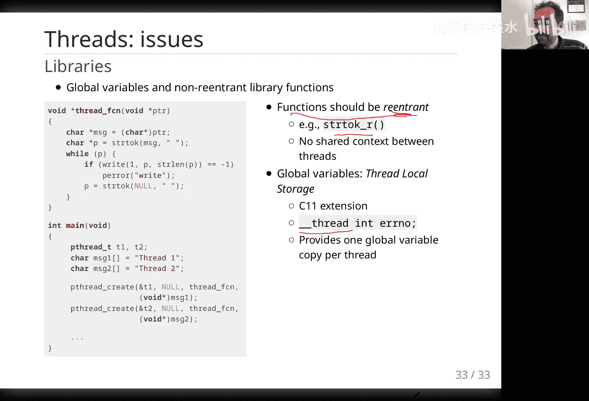

# 操作系统与系统编程：12：并发与线程（第二部分）🚀


在本节课中，我们将继续学习并发与线程的主题。我们将深入探讨线程的实现模型，比较内核级线程与用户级线程的优缺点，并了解在多线程编程中可能遇到的一些典型问题。

上一节我们介绍了并发与线程的基本概念，本节中我们来看看线程是如何具体实现的。

## 线程的实现模型

线程的实现主要有两种模型：内核级线程和用户级线程。理解这两种模型的区别对于掌握多线程编程至关重要。

### 内核级线程（一对一模型）

内核级线程意味着操作系统内核知晓并管理进程内部的线程。当进程调用类似 `thread_create` 的函数时，实际上是通过系统调用请求内核创建一个新的线程。内核会为每个线程维护一个线程控制块（TCB）和一个内核栈。

**核心概念**：在这种模型中，用户线程与内核线程是一一对应的关系。

以下是内核级线程工作方式的关键点：
*   **内核管理**：线程的创建、销毁、调度和上下文切换都由内核负责。
*   **独立调度**：如果某个线程因I/O操作而阻塞，内核可以调度同一进程内的其他线程继续执行。
*   **支持并行**：在多CPU系统上，内核可以将同一进程的不同线程分配到不同的CPU上同时执行，实现真正的并行。
*   **开销较大**：线程的每次操作（如创建、切换）都需要陷入内核态，带来一定的性能开销。

### 用户级线程（多对一模型）

用户级线程完全由运行在用户空间的线程库（如我们项目二中要实现的库）管理，操作系统内核对此一无所知。内核只知道有一个进程在运行，并为其维护一个进程控制块（PCB）。

**核心概念**：多个用户线程映射到同一个内核线程（即进程）。

以下是用户级线程工作方式的关键点：
*   **用户空间管理**：线程的创建、调度和上下文切换全部在用户空间由库代码完成，无需陷入内核，速度极快。
*   **可定制调度器**：线程库可以实现完全自定义的调度策略。
*   **阻塞影响全体**：如果任何一个用户线程执行了阻塞式系统调用（如读文件），由于内核不知道其他线程的存在，它会将整个进程阻塞，导致所有线程都无法执行。
*   **难以实现并行**：因为内核只看到一个“进程”，所以无法将用户线程分配到多个CPU上并行执行。

## 两种模型的对比与总结

为了更清晰地理解，让我们总结一下内核级线程与用户级线程的优缺点。

内核级线程的优点包括阻塞系统调用只影响单个线程、支持并行执行以及由内核提供高质量的调度。其主要缺点是线程操作需要内核介入，开销相对较大。

用户级线程的优点在于线程操作在用户空间完成，极其快速，并且允许完全自定义调度策略。其致命缺点是单个线程的阻塞会阻塞整个进程，且通常无法利用多核实现并行。

一个生动的例子是Java线程与Go语言的Goroutine。Java线程通常对应内核级线程，创建数量有限（几千个）。而Go的Goroutine是用户级线程，由Go运行时管理，因此可以轻松创建数百万个。

## 多线程编程中的问题

在编写多线程程序时，即使理解了线程模型，也会遇到一些棘手的问题。以下是几个典型的例子。

### 问题一：混合使用 `fork` 与多线程

当一个多线程进程调用 `fork()` 时，新创建的子进程通常只包含调用 `fork()` 的那个线程的副本，而不是复制整个进程的所有线程。这可能导致子进程的状态与预期不符，例如某些全局初始化工作可能尚未完成。因此，除非有特殊需求，通常应避免在多线程程序中调用 `fork`。

### 问题二：共享数据的竞争

考虑两个线程并发执行，对同一个全局变量进行递增操作：
```c
int a = 0;
void *thread_func(void *arg) {
    a++; // 这行代码可能引发问题
    return NULL;
}
```
理论上，两个线程执行后 `a` 的值应为2。但由于两个线程可能同时读取旧的 `a` 值，分别加1后写回，最终结果可能是1。这就是**数据竞争**，它引出了下一讲的核心主题——**同步**。没有适当的同步机制，多线程访问共享数据的结果是不可预测的。

### 问题三：信号处理

在多线程环境中，信号的传递变得复杂。有些信号（如由非法内存访问触发的 `SIGSEGV`）可以明确关联到引发它的特定线程。但有些信号（如用户按Ctrl+C产生的 `SIGINT`）目标是整个进程，内核会随机选择一个不阻塞该信号的线程来传递，这给编程带来了不确定性。

### 问题四：线程安全与可重入函数

许多传统的C库函数不是“线程安全”的，因为它们内部使用静态变量或全局变量来维护状态。例如 `strtok` 函数，它在首次调用时设置一个内部指针，后续调用依赖此指针。如果多个线程并发使用 `strtok`，它们会互相干扰这个内部状态。

**解决方案**：
1.  使用可重入版本函数，如 `strtok_r`，它要求调用者显式地传入状态指针。
2.  使用线程局部存储。通过 `_Thread_local` 关键字（C11标准）声明全局变量，可以让每个线程拥有该变量的独立副本，从而避免共享导致的冲突。例如，每个线程都可以有自己的 `errno` 副本。

**核心概念**：编写多线程程序时，必须确保使用的函数是**线程安全**的，或者通过同步机制保护对非线程安全函数的调用。



本节课中我们一起学习了线程的两种主要实现模型——内核级线程和用户级线程，并分析了它们各自的优缺点。我们还探讨了在多线程编程实践中可能遇到的几个典型问题，包括`fork`的语义、数据竞争、信号处理以及线程安全函数的重要性。理解这些内容是进行正确、高效多线程编程的基础。下一讲，我们将深入探讨解决数据竞争问题的关键：**线程同步**。