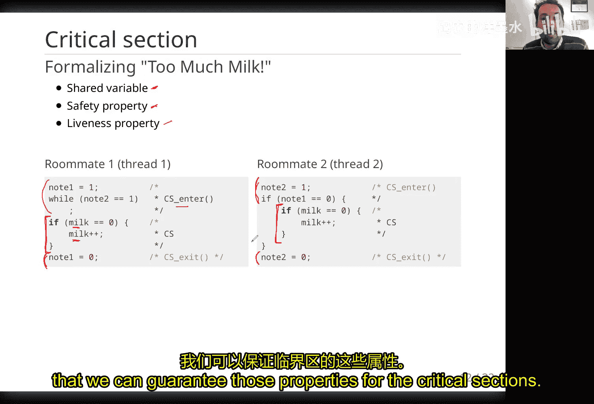

# 【全集 附课件】加州大学戴维斯分校 操作系统与系统编程 中英字幕 1080P p13 Lecture 13 - 进程同步part1 -BV1jXr5BBEKa_p13-

Hi， everybody。So in our previous topic， we started talking about threads and concurrency。

In this new topic， we're going to start talking about some of the issues that it can cause。

And some of the solutions that we can utilize to mitigate those issues。

And all of that is about synchronization。So let's do a quick recap on threads。

Threreads are threads of execution inside the same process。 So they， when they run， they each have。

Control of the CPU。 So they have their own CPU registers。

 They have their private stack so they can like execute the code that they want and and call functions and whatnot。

 But they all share the same address space， the same global variables and so on。

Now when we talk about sharing。There are two types of sharing。One type of sharing。

Which is actually like not really sharing， but it's independent sharing。

In the sense that even though threads would be sharing the same data。

 they are not modifying the same data。 So here is an example with sort of like matrix multiplication。

Imagine we are trying to compute the。ACertain matrix A for every line based on the value of like other mates on the same lines。

To make things faster， especially if were in a multiprocessor environment。

 we could create say two threads， the first one working on the first half of the metrics and another thread working on the second half of the metrics。

Here that'd be great， like those matrices they' are declared as global viable。

 so both threads have access to them。But they will run their follow loop and access indices that are at completely separate locations。

 they are not at all in conflict。So if it was only that would'd be good except that on in some other cases。

 it's it's not the case。 So let's let's。See an example of here。

So here we will talk about cooperative sharing， like those threads would be cooperating together on the same areas。

 like on the same locations of the shared data and that's what will make things more complicated。

So same example here， we're still trying to compute matrix a。Except that here， each thread will。

Opererate on the entire matrix。But do say like half of the operation that needs to be performed each。

And soBut both of them at some point， they will access here like they will try to write into the same memory location。

So to really understand why that would be an issue。

Let's actually like look at the much simpler example。

And it's an example that I sort of presented in the previous lecture。

 but now let's really look at it and the type of issues that could come from it so imagine we have this global variable X initially equal initialized to zero。

And we create two threads， thread A and thread B。And those two threads。

 one of them is trying to increment x by1 and the other one x by 2。

If we compile this code and we run it。That's what we get。Most of the time， which is。

Pretty much like what we would expect this program to produce， right， If we start from x equals 0。

 one of them does plus one， the other one does plus 2。 We get a final value of  three。

 Everything is fine。Now， what can be surprising is that and it would be extremely rare but possible。

 and that's what is a big issue。Is that we could also see an output like this。

That the end result would be 2， or even that the end result would be one。And now， you're asking。How。

Which would be a good question， how is that possible that we start from x equals0。

 one of them does plus1， the other one does plus two， and we get a final result of either two or one。

Well， the answer and I'll go back to this slide in just a second， but the main answer。

Comes from the scheduling。With threads。We now have two threads。

 independent threads of execution within the same process， working on the same data。

In a way that we cannot control。So our two threads， A and B might be running completely sequentially。

 like A might be running entirely and then B entirely。

Which would hear like the sequentialal execution is actually like a lot simpler because it offers certain guarantees。

 but it's not always the case， it's also very possible that A runs for a little bit and then B for a little bit and then A again for a little bit and so on。

Or even worse。A B might be running on two different CPUs。Actually， at the same time。

Like they would be executing executions at the same time。So let's go back to the oops。

To the previous slide and see now with that in mind that the scheduling might be indetaministic。

 how can we get to those values， So the thing that we have to understand here that's very important is that when you write that type of statement in C。

It is not an atomic statement。That statement will be translated into different assembly instructions。

 So for example， right， let's call it thread A TA。That segment， that's。

Statement here in C might be translated in assembly into something like that。

 so that would be MIPS assembly， but it doesn't matter。

It would start by say loading X from memory into a register， say like I don't know， register8。

And we would be loading from the memory or where X is located。Then， we have。

An instruction that actually does。The plus one。 So said I can add I。

 So where the result goes back into the same register。

So register 8 plus  one goes back into register 8。 and finally， a starward。Of register 8。

Back to where X is actually located。In memory。And thread B。Would have like， almost the same code。

On its own。Could be using the same register。Except that here， the add I。Would be with。Plus 2。

And stwar。O。Now the thing with scheduling is that it would be possible。That， for example。

 thread A startss running and thread A only has time。To execute up until here。So， for thread A。

When thread A loses the CPU and we save the state。The dollar8 would be equal to zero because that's what the value of x was。

And then here we get， say， like a timer interrupt and thread loses the CPU。

And now T B starts running。And it also runs up until， say， right here。

It has time to do the load word and the addI。 so for threadB。

 when threadb loses the CPU at this point， Do8 would be so here threadb would be reading from X in memory which is still0 it hasn't been modified and then it adds2 to it so for threadb at the moment where it loses the CPU。

 its own Do register8 is equal to2。Now we schedule thread A again。

And so thread A now continues its execution。 adds $12 8。 So now it's。

1 and stores one back to the memory location of x。 So imagine like here we have the memory。

And we have。X here， which is a value in the memory。 So originally， it was 0。

And once we hit the stward of thread A here with what a as third A has computed。We get one。

Thread A eventually like finishes and we done with it。And so later on。

 thekennel reschedules thread beat。Threadby， when it resumes。

Is resume with whatever state it was in and so for threadB， Do8。

 which came from reading X in memory and adding two is now to and so threadB was just gone。

And will store in memory its own register8 to the address of x。 And so here。

The X was had been set at value 1 by thread A， and now it will be。Return is value， too。

And now thread B finishes and we done。And I just showed you how that。Use case could happen。

Essentially， they are both doing the work at the same time。

Except that since those statements that you see as kind of atomic are actually not atomic。

 there are sequence of instructions that can be interrupted at any time。There are certain scheduling。

 there are certain like sequences that lead to essentially like kind of having the wrong value being generated。

 so that's the big issue。So as I was saying。It mostly comes from the fact that threads are scheduled in a way that we cannot determine that we cannot for the most part control when we write a multi threaded program。

 we have no idea where whether the third execution will be sequential or interleaved or concurrent or even parallel。

There are other issues。It's also possible that instructions themselves。😮，Might be reordered。By say。

 the compiler。It's very important for the compiler when it translates C statements into assembly code that it optimizes the code。

 otherwise the code would be super slow， and so for that the compiler needs to assume that the variables cannot change out of the blue if not by the code that's being executed。

So the compiler will also allow itself to move things around if it doesn't see that there is any dependency and the compiler has a very hard time seeing dependencies between threads so let's take an example here。

 it's a little bit of a stretch because probably it wouldn't like it wouldn't be an actual example where things could go wrong but imagine you have two threads one of them is supposed to do some sort of initialization and then set a boolean value to true once the initialization is done and the other thread waits until these initialization is done before starting to do computation so they're kind of trying to work together like one of them does the initialization and the other one does the computing。

Here， when we write that as programmers， we totally see that there's a strict dependency between those two lines for us it's like。

 oh， the initialization needs to go first and then the computation and we're going to use this boolean。

As kind of a communication variable。The compiler cannot detect that。 the compr is not that smart。

And so it's possible， unlikely but possible that the compiler will say。

 see those two statements here， like calling the init function and setting this Boolean value to true as two completely different things will not see that there is actually a proper order。

And so it would technically be possible for the comp to say， you know what。

 this initialization to true of this variable， I'm going to do it。

Before I'm going to reorder the instructions and have it done before。

Which would cause a lot of problem for us， because then the sequence is not respected。

And if it wasn't enough。The hardware itself， the CPU itself also does some instruction redering like as the CPU consumes instructions in the order that was generated by the compiler。

 there's no guarantee that the CPU will actually respect that order。

 the CPU internally depending on how it's built。Might also reor instructions and see， oh。

 you know what， like maybe I can do this following instructions instruction before doing this one because I feel it's going to be faster。

And finally， finally， to like really。Make a point that like those synchronization issues or concurrency issues are difficult to manage。

Certain operations are not atomic。 So if I。Go back to the previous example where we were modifying X。

 you know， And we had this sequence like， okay， load word and then adding。An immediate。

 and then stward。At least。Reading X。From memory into a register was done by a single assembly instruction。

 So at least like reading X out of memory was an atomic operation。

But it's not always true for all variables。If I have a 32 bit CPU and my variable is a 65 bit variable。

 then its I will not be able to even read the variable from memory in say like one logical step in using only one instruction it's going be two instruction because I'm going to need to load the upper part of the variable first like the first 32 bits of the variable and then the next 32 bits of the variable so even like reading from memory。

 my tech multiple steps。And if it takes multiple steps。

 it means that we can be interrupted in the middle of those steps， which again can create issues。

Those concurrency issues that I described here。They have a name， they have a proper name。

 they are named race conditions。The name race comes from the fact that the output。

Of program will depend on the order of the operation between the threats and essentially like whoever the result depends on a kind of race between threads like you can kind of see them as like racing against one another。

And whoever gets first kind of like wins， which we saw before。

 like we had thread A and thread B working on the same viable X。

And the value of x depended on the scheduling of each thread。

 so if thread A was scheduled before thread B， then actually like thread B's value kind of would win over thread A and so on。

So that's a race condition。Now， the big issue with race conditions is that theyre caused because of those interlings like thisde indeterministic scheduling between threats。

The problem is that when you write multithed programs like that， the number of possible interlavings。

 so like when instructions will be interrupted or like whether threads will actually run in parallel and so on。

 like the number of possible scenarios of the order of operation is huge， it's pretty extremely big。

Most of the time it's going to go fine， like most of the time， even if a thread is like。

 say interrupted in the middle of doing something and then another thread starts running。

 the chances that they're going to be like specifically in conflict on a certain viable is rather small。

But some interlavings are bad like we saw like if one thread reads X from memory and the other one does the same and now they have like kind of two local copies and they modify them and then they write them back to memory。

 like one of the thread will overwrite whatever the other thread that dawnt。

The issue is that like those bad interls。They might be extremely rare。

 They might happen like once every like million times that the program is run。

But it's still a pretty big issue because in some cases。It kills people。

There is this example of a cancer therapy machine that killed several people in the mid 80s because of a race condition。

There were two threads that were concurrent and the dosage of the cancer therapy device could be changed after checking that the value was correct。

 which would cause an overdose。So that's why you like raise conditions。

 they are very hard because like。They won't necessarily happen all the time。

 they're very like timing dependent， but when they do， they can cause catastrophic damages。

The solution to that。Synchronization and that's pretty much the topic of this lecture how do we prevent that well we need to really like acknowledge okay two threads are working on the same data。

We cannot trust that they will like not bother one another。 So we need to use proper synchronization。

 So like thread A will work on viable X entirely。And thread B won't have access to that viable in the meantime and then thread B will work on viable X like they need to be able to communicate and to synchrones with one another and that's that's what we're。

We're going to see solutions to make that happen。So let's take an example here to like get started in terms of like what kind of solutions can we have？

And let's take an example that you might know too well。Rommate example， buying milk。

So in this example， we have two roommates。And they both have this routine of like， you know。

 you come home after day of school and you just check in the fridge if there's milk because tomorrow morning when you get your breakfast。

 you really want to have milk with those cereals。And so what could happen is that roommate  one shows up at home。

 opens the fridge。 Oh， there's no milk。 Okay， well， no worries。 I'll go to the store。

 Then they go to the store。 takes a little bit of time。 They buy milk。Great。

 they go come home and they put the milk away。Except that in the meantime。Roommate， too。

 while they were like going to the store， also came back from school。And they also。

Thought to themselves。 Well， you know what。I need milk for tomorrow morning for my cereal。

 So let me look in the fridge。 Oh， there's no milk。 Well， okay， let's go to the store。

And you cannot like cross them on the road， but you don't see one another。

 So your roommate also buys me at the store， comes home， and now。You have two balls of milk。

Which is way too much。Like， actually， like you like me， but not that much。

 So if you have two bottles， like one is gonna go bad， that's， that was a bad decision。

 You also wasted a lot of time。 anyway， not great。The two properties that we would like to enforce in this concurrent example is the one of safety。

 meaning that at most one person buys milk at a time。This。Example here would be not safe。

Because we have two people buying milk， whereas the safety property says that at most one person should buy milk。

There's another property that we want out of this example， which is liveness。

 which means that if milk is needed， then at least someone should buy it。In that example。

 this example is live because we do have milk at the end if there was no milk in the fridge。Okay。

So let's continue on this example。 So we're going to do two things here。

 I'm going to translate this example into code， and we're going to start implementing simple solutions。

To prevent or to enforce those two correctness properties。

 safety and liveness and have them both at the same time。

So let's do that let's translate things into code and then start implementing some solution So that's the code essentially like we have the milk is a global viable。

And so when we have no milk， essentially the goal is to buy milk。So here。

 the first solution that we could kind of implement in real life is to have a note。

If you come home and you see that there's no milk， you leave a note on the fridge saying like I'm out buying milk so that if your roommate comes later after you。

 they will go， they will see that there is a note on the fridge and they will be like， oh， cool。

They are at the store buying milk。 I can go play video games in the meantime。

So that's pretty much what this example is trying to do like when roommate one comes。

 they check if there's a note on the fridge if there's if there is。Nothing to do。

 we just completely bypass this section of code。If there's no note。

 then they kind of take on the responsibility of doing the work so they open the fridge。

 they check if there' is milk or not， if there's no milk。

 then they leave a note for their roommate being like okay I'm taking care of it and they go buy milk once they're done they remove the note。

 there's milk in the fridge everybody's happy。So and roommate2 has pretty much the same behavior。

So maybe here like post the video for a couple of minutes and try to think。Is this example safe？

Meaning that。At least one like at most what bottle of milk will be bought at a time？And live。

 like at least one bottle will be bought。If needed。

And try to keep in mind that the whole problem like if there are race conditions here。

 it will come from the scheduling， so try to imagine like what if thread ones runs up until here and then loses the CPU and then threats to starts running and is I don't know like loses the CPU over there。

 try to think of the different lines where the the threat could lose the CPU and then the other threat can start running and see if you can identify is there sort of bad interlaving of execution that can lead to something that is not safe or not live。

Okay， so。The answer is that this example is not safe。Why is that？Well， if roommate 1 comes home。

And execute the first if condition here。There's no note。 And that's the case。 So the thread one。

 like enters。This block of code here。Except that it loses the CPU here。

 it gets the hardware timer interrupt and it loses the CPU。

And then threat2 starts running and also executes the same if condition here。

And there still there's no notes here。Oh no， I'm sorry。 I made a mistake。Let me。Okay。So。

 Fred Wang comes home。Checks， okay， there's no notes。Open the fridge。 There's no milk。And now。

 they are right here。They are writing between， they've executed the two if conditions。

And they are interrupted right before setting up a note。Now， thread two starts running。

Also runs the two if conditions。And at that point， there's no note。 There's no milk in the fridge。

 So they also。Enter here。And actually， they I think they can just like keep running。

Then when we go back to thread one， thread one resume its execution like right here。And also。

Bys milk and whatnot。And so here it's not safe because two bottles of milk could be bought if that interleaving happens。

Okay， so first solution didn't work， let's try to do another one。

Let's try a solution where we have two notes， not one， but two notes。So roommate one。

Right away when they come home。They right away even like before checking the fridge。

 they live or note being kind of like， I'm here。And then。They checked like， oh。

 is my roommate here as well？Cause if they're here， then my job is done。

If my roommate has not arrived yet， okay， then I take the responsibility of checking if milk is there and buying some if needed。

And then， I'm out。And threat2 does pretty much the same， but they have their own note。

 they start by saying， okay， I'm here。Are you there like the other roommates， If not， okay。

 I take care of buying milk。So again。Try to think of the different inter livingavings and where threats can be interrupted and try to see if there could be one bad inter living that would lead to a solution that's either not safe or not live。

Okay。So let's get to the answer。This example is safe。

 but it might not be live because there might be an inter living where milk is not bought at all。

So how can that happen， what it can happen if。Roommate  one starts running。Seets their own notes。

 And right after doing that， right here， they lose the CP。 they get interrupted， they lose the CP。

Then roommate2 starts running。And they said their own note。And then they are say。

 also interrupted right there。Now we are back into thread 1 and now thread1。

Gets to the if condition and says， oh， if not，2 is 0。Well， roommate 2 has just set up node2。

 so node2 is not 0。So threadh one says， oh， my roommate is taken care of it。

 so I'm just going to bypass this if here and not deal with the milk。

And but right before they remove their own note， they lose the CPU again。

And we're back to threat too。That 2 continues。Check the if condition if not one is0。

 that's not the case， not one is still at one and has not yet been reseted to zero。

So roommate2 also believes， oh， I don't have anything to do， my roommate is taking carry it。

And so they jump to the end。And now it doesn't matter they both continued their execution in whatever like a scheduling they want。

 but like no one has bought milk because they both thought the other one was taken care of it。

So it doesn't work， it's not live。Okay。Next solution， a little bit more complicated。

This time we're using， as you can see， asymmetric code。

You see like roommate  one here has code that is slightly different from roommate 2。

 So roommate  one will come home， Leave a note。 I'm here。And then they will wait。For their roommate。

 if their roommate had also come home， they're going to wait until their roommate is done doing whatever they were doing。

So that if their roommate had started their execution， but not finished their execution。😮。

It would wait to see， okay， what is my roommate doing， I'm gonna wait， and then I'll go on。

And so only once the roommate has finished their execution， they finally are like， okay。

 is there milk in the fridge， if not，ll go to the store and buy some。And their roommates。

 they have the same code as the previous example。 They set their own note。

 They check the first roommate note。If it's not there， they're done if or if it's not there。

 they take care of the milk， if it's there， then there'll be a roommate number ones problem。

I'm going to spot the fan for you， it is。Sell safe。

 meaning that at most one bottle of milk will be bought， and it's also live。

 meaning that if milk is needed， it will be bought。

Now the question the interesting question is why why is that so actually like look at the code take a second and try to convince yourself that this solution works。

 even if threads are like interrupted at a indeterministic location。

If they both get to execute like some instruction and so on， like why does it still work？Okay。

 so let's look at it together quickly。The bulk of why it works is in those two statements here。

Essentially， regardless of the scheduling here， we'll get to those two lines。

And we essentially have like four different scenarios。

So here we have the scenario of either note two。Is equal to one。Or if no two。Ey歌。出记录。

If not two is equal to one here。😡，Then thread one will just wait until not two is removed。

 which means that thread two will have run entirely。And once that happens。

 then thread one can safely check is there milk in the fridge， If no， I can buy some。

And it's guaranteed that it will execute this section。After threat2 has。Run entirely。If not2。

 at at this moment here， if not 2 is 0。It means two things。😡。

Either the second roommate has already executed entirely。And remove its own not。

In which case it's safe for roommate one to just continue and proceed and probably there will be already milk in the fridge and there will be nothing to do。

Or it means that thread too。😡，Has not yet started its execution。

Which means that it's safe for T1 to continue and proceed because it's already set its own notes and so roommate too。

 if it starts its execution later， will not take this if condition and there will be no race condition。

Let me clear that out a little bit。There's also two possibilities for threat2， whether note one。

Is one or note one。Is 0。So if not one is one when we get to this if condition。

It means that this thread has already started。And so it's either already buying milk。

Or it's waiting for us for threat2 to continue。So no matter what it's safe for thread2 to not take the if condition。

 just go to the end and let thread one deal with the milk。Now， if note one is zero at this location。

 then it also means exactly like in the opposite way that either thread one has entirely run already or it's not started yet。

In both cases， it's safe for T to enter that segment of code here because it knows that okay。

 I'm safe and by myself。Okay， so。What are the issues with this solution。

 I hope you see one right away if we are in person。

 I would ask everybody to raise their hand if they understood what I just explained for the past like three minutes。

It is way too over engineer。 It is extremely difficult for me to explain why this solution works。

I bet it's pretty difficult for you to understand why this solution works。

It's also not necessarily like scalable because of this asymmetry in the code， so here okay。

 we found a solution that works if you have two roommates。

What if you have three roommates or four roommates。

 how do you modify this code to accommodate for that since you have code that is not the same。

And also。It involves busy waiting here you see that threadh1 might be spending some time in the Y loop here not doing anything。

 but still like running on the CPU。Waiting for threat two to move forward。

And usually like we don't want to have why it looks like that on the CPU that are just like not doing anything。

So now we're going to in the rest of the presentation we're going to try to look at other solutions。

 there is one already but we're not going to get into great details about it。

 it's called Paterson's algorithm。And it's pretty much like how to make this example work using kind of like a node system as well。

That is。Sysymmetricsymmetric and scalable but it's rather complex it's an interesting algorithm that you should definitely check out that should be a link to probably the Wikipedia page but we're not going to get into this this one into details。

We're going to look at other solutions。But first， we should talk a little bit about some vocabulary before we get to some solutions。

The first term that I want to push your way is the notion of critical section。

A critical section is a piece of code in the context of like multithreading it's a piece of code that threads would be executing that is sensitive it's a piece of code that you want to somehow like protect because that's where threads start accessing shared variables so typically like the threads in the first example where they both modify x like one does x plus one and the other one does x plus two that would be the critical section that we're trying to protect。

In the example with the milk， that's like manipulating the milk。A viable。

 that's the critical section。And so we want to protect it by having kind of a way to enter this critical section and then a way to exit this critical section so that when a thread is executing the critical section。

 it has some guarantees。And those are the guarantees， there's a guarantee of safety。

 meaning that there can only be one thread in the critical section at a time。

There's a guarantee of liveness， meaning that if no threats are currently in the critical section and one of them wishes to enter the critical section。

It can， it should be able to。There's and there are two other less important properties which are bounded waiting。

 meaning that if a thread wishes to enter a critical section that another thread is already in。

 then that thread should be also sort of guaranteed that there will be a maximum amount of time before it can proceed。

And finally， the notion of failure atity， meaning that。

If a thread here being in a critical section dies for some reason， it shouldn't like temper。

The whole like execution， like other threads should be able to kind of proceed as well later on。

And the last piece of vocabulary that I wanted to push you away here is the notion of mutual exclusion。

 so mutual exclusion describes the fact that critical section should not be executed by more than one thread at a time。

And that's what mutual exclusion is about like we're trying to define mechanisms that provide mutual exclusion。

So let's go back very quickly to our too much milk example using this formalism that we just introduced。

 so as I was saying like the shared variable the viable that we're trying to protect is really like the milk variable that's that's the one that like。

Is part of the critical section。We have the safety property。

 meaning that like only one thread out of the two should be in that section at a time。

And the live net property， meaning that like。Either one of the threads should be able to get to that code eventually when they try to。

And so in that example。😊，We can see that so the critical section is the same for both threads here。

 its the exact same three lines of code， and then we have kind of a prologue of code here to enter this critical section safely and in a live manner and a way to quit this critical section and same for the other thread。

 we have this entering and living of the critical section。

We're going to stop here for today and next time we're going to start talking about mechanisms like real solutions that provide mutual exclusion so that we can guarantee those properties for the critical sections。

