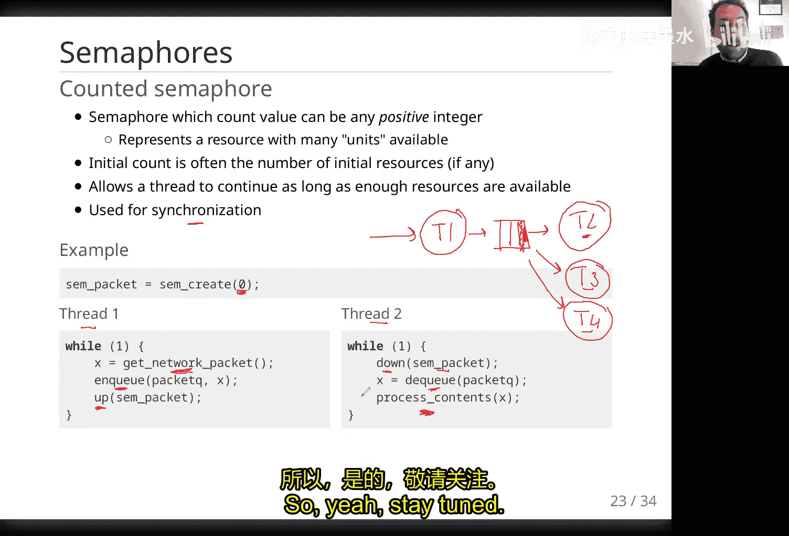

# 【全集 附课件】加州大学戴维斯分校 操作系统与系统编程 中英字幕 1080P p14 Lecture 14 - 进程同步part2 -BV1jXr5BBEKa_p14-

Hi， everybody。So today we're going to continue talking about synchronization。

And this time we're going to talk about synchronization primitives。

 which are mechanisms and implementations that we can use in order to avoid race conditions as we talked last time。

So actually， quick recap of last time。嗯。So let's say race condition very quickly。

 so imagine we talked about this， we have two threads executing concurrently and working on say the same shared viable。

 the same global viable。Depending on many things， which can include the scheduling of the different threads。

 whether they run perfectly sequentially or kind of like interleaved with one another or even in parallel。

It can happen most of the time that the result is going to be what should be expected。

 but it can also happen even if very rarely that the result is not what we would be expecting and that would be because of a race condition。

That meant that thread A and thread B would be working on viable X at kind of like the same time or in a way where the result depends on whether a was able to execute a little bit first or B was able to execute a little bit first and so on。

And so that's known as a condition and the result， the overall result would be incorrect。

Now we went through this example with the too much milk example。

 the two roommates trying to buy milk so that they would have milk for breakfast。

But not too much milk， at least one bottle， but not more than one bottle if needed。

 and we arrived at this solution which works but is totally asymmetrical in the sense that the first roommate has a sequence to enter the critical section that is different from the other roommate。

Then the critical section， so what we are really actually trying to protect is those three lines of code here。

 like checking that there is milk or not in the fridge and buying some if milk is needed。

So that critical section here is really what contains the shared variable。

 the global variable that we should protect。We should protect it in the sense that only one bottle of milk should be bought that the safety property。

And that at least one bottle of milk should be bought if needed， that is the liveness property。

And the goal of this code here， this asysymmetricme code。

Is about like entering this critical section in a way that is mutually exclusive。

The whole point of having like this little section of code here and then the end over there and same like the enter phase here and the exit phase here is to guarantee that thread one。

And threat2。Cannot be in the critical section at the same time。

 We want to make sure that we ensure mutual exclusion。For the execution of this critical section。

So now here we saw that this asymmetric solution is not great for many different reasons。

 including one that has about that。Is about scalability like how do I add a third thread here or a fourth thread also it requires the programmer to write aysymmetric code which is kind of counterintuitive and also it's difficult to understand I don't know if you remember the explanation from last time but it takes a few minutes to explain why it's correct and why it's going to work。

So today we're going to try to study some other mechanisms that should make things more simple。

So let's start with the first synchronization primitive， probably the simplest that there is。

 which is called a lock。A lock so is a synchronization primitive that provides mutual exclusion the whole point of a lock it's kind of like you have a room。

 you have a stall in the bathroom and the stall is only meant to be used by one person at a time and so on the door you have a lock so that you can go into the stall if the stall is empty you go into it and you close you close the lock and then you by yourself up until you leave and if someone want to use the stall the door is gonna be locked and they can't enter that's pretty much the same idea here。

It's to provide mutual exclusion。So two states， the lock can be either locked。

 which means that it cannot be taken or it's free， meaning that say like the door is open and someone can enter。

The API is extremely simple， it's like lock， you try to log the lock， like take the lock。

 if the lock is free， then you can just take it and you can enter the critical section and do whatever you need to do。

If the lock is already taken， then you're going to have to wait until the person who has already the lock already releases it。

And so then the other function is unlock， so here you had the lock。

 you executed the critical section， and now you can unlock。

 which means that you can let the next thread take it。Um。

 so if we try to kind of quickly apply this principle to the too much milk problem。

 we have our global variable here that needs to be protected against race conditions。

We have two roommates executing the same function。And you see that now the function is a lot simpler。

The roommate will take a look。If the lock is free， they will be able to proceed with the execution。

Enter the critical section and deal with the milk situation。 Once they are done， they unlock。

And then the other thread， if the the other thread had come in the meantime。

 like while the first one was in the critical section。

 then the second thread would be blocked on trying to take the lock。

 which is already taken so the the second thread will be will have to wait。

And only then it could proceed so here we're really guaranteeing that this piece of code the critical section can only be executed by one thread at a time。

 so we're like really forcing the execution to be almost like in sequence to be serial。

So how do we implement this lock now， like how how can we make that actually happen。

The first sort of naive implementation， and we're going to see why is that we realize， okay。

The whole problem with this。In the Taministic scheduling and the fact that we have raised conditions in the first place is that a threads。

Can be interrupted at any time， so it's like in the middle of executing like some assembly instruction。

And it's interrupted。And and then the other thread might be scheduled and work on the same variables and also get interrupted like right in the middle and that's what causes race conditions like it's the typical example with the x variable being like modified in different ways。

One simple solution would be to say， well， if the whole problem is that a thread is being interrupted at a moment that is not convenient。

Maybe we could prevent it。From being interrupted at any time。Now。

 you know that a thread is being preempted at any time because of a timer interrupt that you know gives the control back to the kernel and then the kernel can decide。

 you know what， I'm going to give the CPU to another thread。

That's the whole kind of cause of the issue in the first place。So maybe a solution would be to say。

 well， if you disable the interruptse。While you're in the critical section。

 then it means you cannot be interrupted during the critical section。

And so you're essentially guaranteeing a sort of a sequential execution。

So that's kind of the idea here and so this implementation which is extremely simple and very naive would be that locking pretty much is disabling the interrupts。

 you're making sure that like from now on I am not going to be kicked out of the processor I have the processor to myself and I can run for like how long I want so I can like modify those global variables in the way I want。

And only when I'm done。I re enableable the interrupt。

 so I allow myself to be once again interrupted at any time by the timer interrupts。

 but here now that I'm out of the critical section， if I lose the CPU to another thread。

 that's not a big deal。So it's an interesting solution。

 the problem is that it doesn't work all the time and it doesn't work in all contexts。

So first of all。It only works if you have one processor because the interrupts are always local to a processor。

Now the problem is that if you have， say two CPUs in the system。And it turns out that your roommates。

 your threads， like， say， T1 and T2。They're actually working on in parallel in like real parallel on the two different CPUs。

If T1 here， disable the interrupt。😡，On CPU1 that it's say， working on。It doesn't prevent T2。

 which is running in parallel like completely in parallel to still access the same global variables and still cause race conditions。

If T1 is able to disable the interrupts on CPU1， it only guarantees that T1 will not lose CPU1 during the time of running the critical section。

 but it doesn't prevent other threads from other CPUs to still run。

So it doesn't work on multiproces systems。Also， it's very dangerous to disable the interests in the first place。

Remember， the whole point of having interrupts and timer interrupts。

 especially is that the kernel can regain control。Of the machine frequently to organize the fair sharing of the system resources。

If we disable the ins， we're taking a chance because if there's a bug in the critical section and we start entering a infinite Y loop。

That's it， the machine is not usable anymore， and the kernel has lost the ability of like regaining control of the CPU and the machine will just like stop responding。

And last， probably the most important is that。User applications， they cannot disable the intros。

 it's not part of their sandbox， it's not part of their privileges。

 only the kennel can disable the intros for very good reasons because it's extremely dangerous to do that。

So that solution could never work at user level for regular user processes， that being said。

 it is a technique that is used by modern processor by modern kernels。And。😊，To detect locks。

 so if a kernel is a multi threaded kernel and is running multiple kernel threads。

 it's a way for the kernel to deal with certain like synchronization within the kernel in a local way。

 but that's anyway。That solution for what we're trying to do here， which is mostly at a user level。

 doesn't work。So let's go to another solution that now would work， so what can we do？呃。

The bottom line is that we need。For the hardware to help us with that。

 There's no way that we can do it only in software。 Like there's。

 we need some sort of hardware support。And it's been a while now。

 like it's been 25 years since like the beginning of multi processor systems。

That the hardware itself has provided the support for that kind of use cases。And so now processors。

 they provide actual assembly instructions。That can help with the implementation of locks。

And those instructions， they're often called test and set primitives。

 primitives here is another word for saying like assembly instruction。诶。So what is a test and set。

Instruction。Well， it's essentially an instruction that will do three operations kind of in one。

And it will be able to read the memory。Modify it。read the value from memory。

 modify it and write it back。But in such a way that it's only one。Assembly instruction。

And if it's only one assembly instruction， it means that it's guaranteed that logically it's going to happen in one step。

 which is extremely important because it means that it cannot be interrupted in the middle。And。😊。

And the way that the system， the hardware system， can guarantee that this。Multi step instruction。

Will not be interrupted in the middle or cannot be tempered with from another CPU。

Is that it will be done in an atomic way。So for example。

 if you have a multi CPU system and you have this CPU executing this。

Test and set assembly instruction， which is one instruction。Then it will。

Lock the bus between the CPU and the memory so that the other CPU can no longer access the memory。

And this CPU will be able to essentially like go to the memory。Read the value from the memory。

Bring it back。Modify it。And write it。Back to the memory。

 so it's it's going to be kind of a long operation。 it's a multi cyclee operation。

 It's going to take some time。But during the whole time that this operation is happening。

 which is still like triggered by the execution of one assembly instruction。First of all。

 the CPU here will not be interrupted by a timer interrupt because it will finish the execution of this instruction and also other CPUs in the system。

 they will not be able to interrupt this instruction in the middle。So there's radio guarantee。

From like， say you have a thread here executing on CPU on this CPU and。Executing this instruction。

 there's a guarantee for that thread that this really modify right thing will happen like all at once。

Sorry。Now here's a so test and is more of a category of instructions it actually depends on the on the exact processor so on。

X 86， the kind of test and set is called Compare and Exchange on other processors such as like power PC arm and MIPS。

 it's actually two instructions like it's called link load and store conditional。

Different processors have like different implementation。

 but it's still like a category of instructions that pretty much like provide the same thing。

 which is this read modify right in an atomic way。Now if we look at the implementation of this instruction。

 so keep in mind that I'm showing here like C code just to explain the logic of this instruction。

 but it's actually not C code， it's one instruction and that's everything that the processor is doing in hardware。

So essentially， the processor reads。The content of the memory at a certain address。

 a very specific address。And guess the old value that this address contains。Then it modifies it。

And it writes it back。And it returns to the， to the color， to the user of this。Instruction。

 it returns the old value that was read in the memory。So how is it used concretely？Well。

 let me actually， so first， let me show you how this instruction is used to implement a lock。

That would be through those two lines。So to tag the lock。

 essentially we would call this test and set instruction， not function instruction。

 and we would loop as long as what is returned is one。And to unlock。

 we would just put this location in memory to0。 So here are the different scenarios。

Imagine that the log currently is。0， which means that it's free。

When the threads callings spin lock lock。Will run on the CPU。

 the instruction test and set on that memory location。 The processor atomically will do that。

And so what it will do is say， okay， I'm reading from the memory location and so I'm going to so old vi here will be zero。

And now I'm writing a one at the Me location。So instead of a zero here。

 now we have one meaning that the。Lock is taken。But the instruction will return the old value。

 which was zero。So when we are back into the y loop here。

 what is written by this instruction is zero。Since zero is different than one。

 we get out of the y loop。And the spin lock lock function returns。 And were actually like。

In the critical section。And the lock has been taken。

Now imagine that we have another thread coming up。So we have another thread coming up。

While the first one is holding the log， so this memory location is one。

Now this other thread goes into spin lock lock and also executes the test and set instruction。

So what does the test head do？It reads from the memory location， so it reads a one。

So the old value here will be one。And then it， no matter what modifies。The memory location to one。

 which pretty much does nothing because it's already one。

 So it's just like overrites a one with another one。And it returns here the old value， which is one。

Were back into the while loop。 And now we have while 1。Equals one。

 meaning that we were not successfully able to take the lock。And so we're going to loop around。

So here you see that now the second thread， as long as this memory location is one will essentially try to take the lock but will not succeed because it's already taken。

And it's only when the first thread is done with the critical section and finally calls unlock that it resets this memory location back to zero。

So， here。It goes back to 0。And now the second thread。

 which was still like kind of stuck in this Y loop。

 will be able to essentially do the transition from zero。To one。

 which means that he will be able to take the lock and proceed and so on。So that's how we can。

Implement a lock using this very special assembly instruction that guarantees this like multi step read modify right operation done in an atomic manner。

And the reason that this one is called a spin lock is because we're actually spinning。

 we're actively spinning up until the thread is able to acquire the lock。

Now let's go back to this too much milk example。😡，We define a lock。

And pretty much well try to take it。When we're about to take it。

 it means that there is mutual exclusion and we can execute the critical section and when we are done。

 we release it。What do you see in this example， well。

 both threads have exactly the same structure now。Try to acquire the lock to guarantee me your exclusion。

Run the critical section。And unlock the luck。If we are in person。

 it'd be easier to ask you the question live， like do I need to convince you for five minutes that this solution is working？

In the same way that I had when we were doing the example with the asymmetrical note。Hopefully， no。

 it's pretty straightforward， dislike。Taking a lock， executing the critical section。

Releasing the lock。And now， what if I have more than two roommates？I have3，4。

I can just have exactly the same code and I don I still don't need to convince you that it's going to work。

 so you see it scales， which is a much better solution。This solution， though， is not perfect either。

First of all， because it's pins， right that it's in the name of it， it's a spin lock。

 so we're going to run this Y loop forever up until the log becomes free and we can take it。

But in the meantime， as the thread is like looping around trying to acquire the lock。

It's wasting CPU cycles。If we have only one CPU。In the system with say like thread one and thread2 running and say like thread one has acquired a lock and is like。

嗯。Running the critical section and gets interrupted during the critical section while holding the lock。

And then threat2 gets scheduled。 threath2 will spend its entire。Time slice of execution。

 trying to acquire that lock， which it can't because it's already taken and so it's just going to spin for nothing。

 not doing anything and just trying to acquire a lock that is already taken by another thread。

Which is will like run later。The only benefit that we can see is that if we have now two CPUs。

And say T1 would run on the first one and T2 would run on the second one。诶。T1 with take the lock。

 run the critical section and you know， like release it when it's done。T2。

 if it's running in parallel， would be able to take the lock as soon like the second that T1 releases it。

 So the latency would be like absolutely amazing。😊。

But it's really just the it's pretty much the only advantage of that technique。

How can we mitigate this issue？Well， here's the solution that is not great。

Because it's pretty much like， okay， we're not going to do this busy waiting and wasting a bunch of CPU cycles。

We're still going to waste a bunch of CPU cycles， but less。And so the idea is that like， oh。

 if we' are not able to tag the lock instead of trying again immediately and then again and again and again。

We're going to like the thread is going to yield。So okay I'm trying to get the lock if I cannot。

 there's no reason that I should try again immediately because there's no reason like next cycle is going to be available so let's just yield go back to the end of the readyDQ and hopefully someone else is in front of me in the readyDQ is holding the lock will release it and when comes my turn again I'll be able to take it that's pretty much the idea。

嗯。The issue with yielding is that like we're still wasting CPU cycles because like。

The thread will be in the ridicule， then the kernel will like pick it。

 make it run on the processor which takes some cycles because it like the whole context needs to be restored。

 then the thread will start running， we'll try to take the lock。

Cannot take the rocket still there and will'll yield so we need to like save the context again go back into the kernel the kernel needs to decide like okay which thread is next and so on so it's like just back and forth between like the kernel and the user mode to pretty much for nothing。

嗯。Sleep here is another technique it would be pretty much say saying like， okay。

 if I cannot take the lock， maybe I can sleep for like I don't know。

 a second and try again in a second。呃。That's an interesting technique。

 but it's really not great actually it might be even worse than the yield because sleeping kind of I mean it doesn't really make sense right like。

If you go to the bathroom and there's a long line in the bathroom and your ideas is to pretty much say like。

 oh， okay， I'm going to go back to my office。And wait like 10 minutes and you come back in 10 minutes。

Chances are the line is still going to be as long as before。

 except that there's just a bunch of new people in the line and you still have to wait a bunch of time。

So。And the the laency wouldn't be great。 so I don't know if I can like represent it here。

 but like imagine。T1， so that that would be like a sort of timeline here。

Imagine T1 acquires the log here。And starts executing its a critical section。

And T2 shows up in parallel。Write about it here and tries to take the lock here。

 but T1 is still like holding it because T1 is in the middle of its critical section and T2 says like okay。

 no worries I'm going to sleep for a while。And so T2 goes to sleep。Except that， in fact， T1。

Just finished its critical section and releases the lock here。

But because Ti2 went to sleep for kind of a long while。

 it's going to be much later that Ti2 finally like wakes up and takes the lock that in fact。

 had been released like a long time ago。So the Latin sea here is really not great。

A better primitive here， and you have to kind of remember the idea of like polling versus like interrupts from I devices because it's kind of the same idea is that instead of yielding or instead of like sleeping。

 not really knowing when the lock will be available again。

A better primitive would be that a thread trying to acquire a lock kind of blocks itself on the lock saying like I'm waiting for this thing。

And whenever this thing is ready， you wake me up。So we have a much better like coordination。

So essentially， like a thread tries to take a lock and if it can't， it blocks itself on that log。

And it's only when the log becomes available that the thread is woken up。

 So it's not up to the thread to like either yield。

 it's essentially it's not up to the thread to go and check every so often that the log is is available。

 It's more like， hey， lock， I'm waiting for you。Wake me up when you're ready to be taken it's kind of the idea and so that's the idea behind samaphos which we will like study in the next few slides and also MuT which are very equivalent to samaphos。

Okay， so let's go on。So semimaphos， they're another kind of synchronization primitive。

 they were invented a long time ago by this Dutch professor Dstra， which you may have heard， I hope。

 in your ECS 60 or 3060 class the algorithm class， because it's very famous for this ditra algorithm to find the shortest path in a graph。

But more generally he was a pioneer in concurrent computing， distributed computing。

 he invented a bunch of stuff around like mutual exc， Smaphos， deadlock and so on。

 in the early 60s so you're actually there here his name a couple more time in this class。

ASmapho is a much complex， primitive。Much more complex primitive than locks。

 it's usually called generalized lock。And it can be used for many different kinds of synchronization and here are two examples so for example。

 like a sma could organize the sharing of one resource or for example， like a bathroom stall。

And you have like multiple entities waiting for the like to access the same resource。

 So the same offer would be able to。Provide that service by having a queue of threads waiting to access a certain resource。

And so that resource can be like one resource， and that would guarantee mutual exclusion to access that resource。

But it's more， much more generic as well because like it can also。

Deal with situations where it's not only one resource that can be shared in a mutual exclusive way。

 it can also be multiple resources so for example， like in a restaurant。You have more than one seat。

 like more than one people can be eating at the restaurant at the time。

 like as long as you have seats to seat people。And then if there are no seats available in the restaurant。

 then you have a queue inside。Out， sorry， but same here。

 So you have a queue of thread waiting to access some resources。

 but there can also be more than like one resource available。

 And so same of can handle that use case as well。Okay。The API is also pretty simple。

It's pretty much like three functions， you have a function to create a C4 and you can give it account。

 which is an initial count of say like the number of resources that are available。

Keep in mind that it is the count that you give at the beginning is not at all a maximum value。

 it's just an initial value。And then it works in that way。You have two functions down。

 which is kind of the equivalent of lock， but it's not because like here。

 you know lock and unlock have just binary like you take it， you have it or you unlock it。

 you free it， that's it so it's like locked or unlock。With semiphos。

 because you count the number of resources， it's pretty much like either you have zero resources or you have more than zero。

 but it can be any number that's above zero。So with down， essentially， you try to take one resource。

If you can， if there were more than zero resource available。

 then you can just take one and that's it and you proceed， you continue。

If there were no resources available， if the count was zero。

 then you're blocked and you're put into a queue of waiting threads。Now。

 a thread that calls up will in fact release a resource by incrementing the account by one。

And if there were like any threads that were waiting for a resource to appear。

 then the first thread in the queue of We thread would be woken up so that they can continue and proceed。

嗯。So here is a possible implementation of those two functions down and sum up。So in same down。

 as we say， like if the count is zero， then we get blocked。And if not。

 we take one resource out of the account and we can just like proceed。And for S up。

 we give back a resource。And if there were other threads waiting。

 we take the first one and we wake it up。Now， this same effort here， it's。

 it's gonna be a data structure。 So see， he， it has a account and it will need to also like keep track of the。

Of the wait list of threads。That needs to be part of a critical section because if multiple threads are calling S down or S up kind of like at the same time or like in concurrent ways。

 we need to make sure that this count variable here and there like there won't be any race conditions on them。

So we actually have to protect the manipulation of a sepho with locks and typically we can use spin locks。

So now there are two ways that we can use semapho， they are logical ways。

 they are not like en in any ways it's more like you as a developer。

 you have this semimapho which is a very generic object and you kind of kind you kind of。

You can use it in two different ways for two different scenarios。

The first scenario is that you actually want to implement a lock using a semapho。诶。

So here essentially it means that you would use the sema as a binary sema。

 you would kind of try to constrain the fact that the internal count of the sma can either be zero or one and that would pretty much represent a lock if the count is zero it means that the lock is taken if the count of the samema is one it means that it's free。

And so the way that it could work here is that like you can create a sema。

Which initial count is one because it represents a log。

And it's free at the beginning and so whoever calls down on it first will be able to take it and that will guarantee that they can enter their critical section in a mutual exclusive way。

And if ever another thread calls down on the same samema。

 then that thread will be blocked and it will be blocked。

In a way that is not a busy waiting way because like now this thread will actually really block on that same a and will not be scheduled and it's only when a thread one here gets to calling up that it would wake up。

Thread2， which was stuck in down and now threat2 can proceed and execute the critical section。

So that's the idea of like using here a semapho。As a binary cinema in order to implement a lock that is not a spin lock。

 but that is a log that can handle a queue of wedding threads。呃。

Quick word here that muttes are very similar to binary semaphoes here。Except that in mutexes。

 you have the notion of who， like which threads。Which thread has owns。The the lock essentially。

 whereas here like it's not clear and also like here。

You can have bugs like say nothing prevents you in thread one to cool up。On the same。Twice。

And now you have a lock which internal account can go to two， which doesn't make any sense。

If your objective is to implement a log that can be either free or not free。

 but the API of the se is like so generic that you can call up two times with mutaxes。

 you could not do that， you could not like release a mutex more than once。Okay。

 and so the second way of using sameA force here， which is much more generic is to use them as a counted sameA force so here you're really taking full advantage of the fact that you have account that can be either zero if nothing is available or any other positive values if you have resources available。

诶。And so here， the goal is not necessary to use the sameF as a tool for mutual exclusion to like guarantee。

嗯。Like mutual exclusion of a certain critical section。

 it's more to organize the synchronization between threads。 So here is an example。

 Imagine you have two threads。In a scenario where you're dealing with， say like network networking。

And so the first thread here， its job is to get networks packets out of the network。

And the the second thread its job is to process the content。

 so you have kind of like this pipeline you receive packets through the network。

T1 will like receive them and will' enque them in a Q here。And then T2。

Will actually be the thread like dequeing them and processing the content and the idea of I mean the idea is that like if you have a queue here what would be nice is that say for example。

 like you can have multiple threads being able to。Like access this queue and process the content。

 And that's how you really use， like multi threading。In in an interesting way。

So thread one here would get the packet out of the network。Ancu it in in， in， in some queue。

And then the way that it would tell the the consumers。That like， hey。

 there's a new packet in that queue。 You should like take it and process it。

 We can use the same offer here。So the sameF at the beginning would be zero because like there are no packets in that queue。

 it's totally empty。And when this producer thread when receiving packets from the network and kills something。

 then it calls up on the samema。 and this same same here is shared。

On a threat on on the other side from the consumer。 And so the consumer calls down。On the same offer。

So here what's interesting is that the consumer threat2 would not run。

Would be blocked as long as the queue is empty And as soon as there is something in the queue。

 then thread2， the consumer would wake up and be able to deque whatever was being queued and process its content。

 And so we here we have like one thread calling up another thread calling down。

 and that's how they're able to like organize their the synchronization of their of their content or like whatever they are processing。

Okay， that's it for today and next time we're actually going to talk more about kind of real life examples of how to use those different synchronization primitives。

 so yeah stay tuned。

