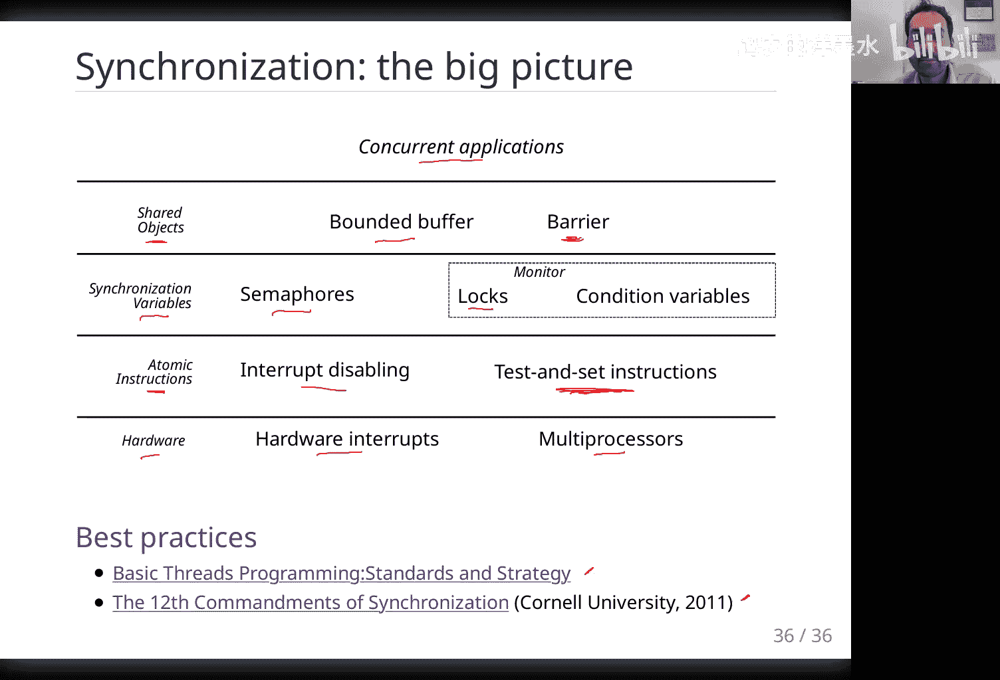

# 【全集 附课件】加州大学戴维斯分校 操作系统与系统编程 中英字幕 1080P p15 Lecture 15 - 进程同步part3 -BV1jXr5BBEKa_p15-

Hi， everyone。So today will be our third and last lecture about synchronization。So the first lecture。

 we defined synchronization issues such as race conditions and we introduced vocabulary such as critical sections and so on。

In the last lecture， we started talking about solutions， mechanisms， synchronization mechanisms。

And we talked about two of them。We talked about locks。

 so locks are those synchronization primitives with a very simple API， you have lock。To take a lock。

 the lock can be either taken or free， so lock， you try to take it if you cannot take it。

 then you have to wait。Once you're able to take it。

 the thread can execute the critical section and be guaranteed mutual exclusion with any other threads that would also want to be in the same critical section and at the end。

 unlock when we are done to allow other threads to proceed。

We talked about a very naive implementation that relies on disabling the interrupts。

But this one is quite impractical for user applications because user applications should not be allowed to。

Disable interrupts that's usually a privileged action on the processor。

So another better implementation that is based on using test and set instructions。

Whi are compatible with multi processor systems， unlike disabling the interrupts and also accessible to user processes。

So we studied this spin lock and spin lock unlock。That can use such atomic test and set instruction。

And here it works， it's accessible to applications。

 the only issue is that it's based on busy waiting。

 you see that here the spin lock lock has a Y loop。

 which means that if a thread is trying to enter critical section and tries to take a lock that is already taken。

Then the thread might be running in this wide loop for a pretty long time。

 wasting a bunch of CPU cycles。嗯。So， the。The idea here to avoid the busy waiting。

Was the same idea of as I explained last time like with hardware interrupts when theOS is waiting for a device to finish its current operation。

You have two possibilities， right if you remember your computer architecture classes。

One is called polling。Which is pretty much the same thing as what spin lock Lock is doing here。

 polling means that the would need to ask the device all the time。 Like， are you done， Are you done。

 Are you done， Are you done。Which is a waste of time。With hardware interrupts。

 the OS can tell the device， you know what， do this operation and when youre done。You trigger this。

This pulse on a wire and a metallic wire， which will interrupt me and I can deal with that。

It's pretty much the same idea here。How do we instead of just waiting for the lock to be free？

How do we have a system where the lock would essentially tell us like， hey， by the way。

 now I'm free so you can wake up。And those are pretty much the that's the concept between semimaphos and also MuTes。

 which aren't going to focus in this class， but you can look at it by yourself。So with semiphos。

 we have an internal account。And so we have also a very simple API made of down and up。

 which are very kind of similar to log and unlock， but in a much more general way。

So down essentially decrements this internal count by one。Or tries to。

If the internal account is already zero， then the thread instead of polling instead of checking when the account。

Becomes higher than one so that it could take decremented by one。Will block itself。Well。

 like asked not to be scheduled。And not run and not waste any CPU time。

 but it will like kind of register itself into a waiting list that's waiting on that same。

And so whenever a thread calls up on the same semapho， incrementing the count by one。

It will check whether or not threads are waiting on that samefo and it will wake up the first of them。

So that's how it happens that if a thread is waiting on the S is not available。

 it can just block itself， put itself in the waiting list。

 and then be automatically woken up whenever the resource becomes available again。

Smaphoes are very broad， I mean， they are very generic， they are very versatile。

So we can use them as binary same， which are essentially locks。So in that case。

 you would initialize the internal count tube one to represent like， oh。

 the sameF is a log that is free。And then the way that you would do it is essentially like call Sam down when you want to enter the critical section。

 so that would change the internal account to one from one to zero。

And so any thread that would call also send down would not be able to proceed it would be blocked。

And the one whos able to enter the critical section when it's done call S up and so potentially like web any thread that was waiting to enter on its own so here you see it's very similar to here like luck unlock。

But counted sphos can also。Be used as counted same metaphor。

 so here we're really taking full advantage of the fact that we have this internal account that can be any positive values and so it can be used to do synchronization between threads。

So here imagine we have two threads， a producer and a consumer。

 the producer puts say like packets into a queue and then wants to tell the consumer like hey。

 there's something in the queue that you can consume you can use a CF to do that by say。

 so at first you have a CF the count would be zero because there's nothing in the queue。

And whenever the consumer puts something in the queue。

 it ups the sameF it adds a certain it like increments the count of the sameF by one and on the the hand。

 the consumer downs the sameF before being able to consume a certain packet from the queue and so here you have this like nice synchronization。

And so what's going to happen for his example is that the consumer threat too will be blocked。

On its cool down if ever the queue is empty and so the consumer will not waste any CPUU cycle trying to proceed when there's nothing to come to so that that's kind of nice。

Okay， so let's go on。😊，So today， mostly we're going to talk about two very classical synchronization examples。

 one is called the producer Consumer problem， which is kind of an extension of what I just presented here but with potentially multiple producers and multiple consumers。

And then we're going to talk about another very classical problem， which is called readers， writers。

So， let's go。So here's the producer consumer problem。Here the idea that we have。Threads。

Which are producers， they are producing data， and we have threads that can be consumers consuming data。

And so we want to come up with this implementation of some sort of like data structure that would work for producers to be able to like essentially en queue data into a certain queue and then consumers decu that data。

And so for that， we use a circular buffer。So how does it work？Essentially。

 we have a buffer that's limited in size because。Cause of no reason it's just limited inside inside。

So size n。And we have producers。Trying to write data into this buffer。And for producers。

 we're going to have a sort of pointer or an index that represents the first cell in that array that is available。

 and that is characterized by this in index。And so when a producer produces a piece of data here represented in blue。

 it would essentially like go to wherever。The in index is pointing to。

 and then the in index would be incremented to the next variable location。

The thing that's very important is that producers should not be able to write more than what's available in this buffer。

And so now on the other hand， we have consumers， they read data from the buffer。

 they also have their own index out。Which points to the first available data。So the whole thing is50。

 first in first out， so out here would point on the all those data that was ened， but never mind。

And so if a consumer now consumes a piece of data out of this buffer at the location of where out is pointing onto。

 then out would be incremented by one。And obviously。

 like this cell now would become empty eventually for a producer to use an overrite。

And because it's a circular buffer， whenever out points on the last cell and the last cell is consumed。

 then it all like wraps around and we jump back to index zero and same for in。

So we kind of give the illusion that it's an infinite buffer when it's not。And so。

Last kind of requirement is that we should be able to have multiple producers。And multiple consumers。

 that's what makes this program interesting and complicated。So let's look at a first example of code。

 like a first implementation， very simple。嗯。So let me explain like in really like two seconds。

 so we have our buffer。And spots， we assume that the data are just like regular integers。

 but it could be anything。 I mean， it could be a buffer of data structure。 it doesn't really matter。

And then we have two indices in and out， also integers。The producers。When they want to produce。

 so threads that are producers， they would call the produce function giving an item。

We would put this item at index in inside of this circular buffer and then with updates。

In here by incrementing it by one and also doing a modular end to handle the wraparound properly if we got to the end of the array。

Threads that want to consume out of the array， they would call the consume function。

They would take out the item that's in the buffer at index out。

Then they would update out accordingly， same as in like plus one modular end to take care of the wrap around。

And then they return the item。So。I imagine that would be the type of code that you would have written。

 especially for a mono threaded process like you used to write before taking this class。Now。

 hopefully that you understand what threats are and you understand that it can go wrong with race conditions because we are not guaranteed that those statements are even like each。

Kind of sub action within a statement will be done atomically。In the sense that， for example。

A threat calling produce might be interrupted。In between putting the item in the buffer and incrementing the index。

 or it could be in interrupted in between。Incrementing the index by one and doing the modular。

It could be interpreted at any time， and then another thread could be running and call also the produce function and execute those same actions。

嗯。So maybe take a minute， actually， like if you want to post the video and look at this code and in the light of what you've learned about race conditions and all of it。

 like try to see if you can identify what potential issues they are with this code。

So there are two main issues that could。The first。Is a clear or clear race conditions on pretty much like all of those variables。

Those variables are global variables， theyre the shared states of that data structure of this circular buffer。

And as you can see， threads。So multiple threads could be calling produce at the same time or concurrently or in parallel。

 and multiple threads could be calling consume also concurrently。

and essentially like using that shared state and we have zero protection here no there's no critical section。

 so what could happen is that say two threads called produce pretty much at the same time and they both they both execute that line pretty much at the same time。

 meaning that they would overwrite one another。Because they would be writing at the same index。

So we clearly need to protect。😡，That shared state。There's another problem。

 This one more like logical， I guess the problem is that there is no synchronization。

Between those two pieces of code， between producers and consumers。Which means that here。

A thread can call consume。Even if there's nothing to consume。You see that in the code here。

 we're actually not checking if there is something to consume。

 maybe the circularta buffer is completely empty because no data has been produced and a thread could still。

Call consume and read whatever B at index out contains， which might be complete garbage。

 probably the garbage if nothing has been written。So we need to synchronize them。

So let's address those two issues one at a time。First， let's try to deal with the first issue。

 the issue with race conditions on that shared state， how do we do that？Well， let's have a look。

To provide mutual exclusion。So let's actually have two locks。

 we're going to have a lock for producers。And a lock for consumers。

And the way that we can create them is by using samea with a count of one。

And essentially use binary same force to provide mutual exclusion。

So producers would be essentially like takinging the lock by calling S down on the producer lock。

Then they would be guaranteed to be by themselves。In that critical section， and once they are done。

 they can release the log。And for consumers the same， they have their own lock， which they take。

 then they're guaranteed to be inside of their critical section by themselves。

And they can release it。The reason that we don't have， say。

 only one lock that both producers and consumers would share is that in fact。

They producers and consumers， they should not be。Interfering with one another in the sense that like the index in and the index out should never be pointing at the same location。

So the only thing we need to do is more like produce protect consumers from one another and protect producers from one another。

Okay， so first problem solved。We still have the other problem though we still have the issue of synchronization between producers and consumers here。

 if a thread calls consume when the buffer is empty， it will still read some garbage value。

 so we need to take care of that。And so here we could use。

Counted sas to keep track of the number of resources we have in the buffer。And actually。

 we are going to have two different xaphos because producers。

 they have to track a certain type of resources。And consumers。

 they have to track another type of resources。And that's kind of interesting here。Producers。

They need to track the number of empty slots。That that are available in the buffer at a certain time。

 and if there are no empty slots， that's kind of the condition for which they need to be blocked。

And wait。So for them。We're gonna have。A semapho counted semapho， which we call empty。

 That's primarily going be for a producer。 So when a producer starts。

 the first thing that it tries to do is like。Try to grab an empty slot。

If the buffer is full and there are no empty slot， then producers will be blocked over there up until an empty slot shows up。

And so at first。Because at the very beginning of the program， like the buffer should be empty。

 we would initialize this empty slot samapho。With the count of n。O。

And then it's the same code as before once a producer has been able to kind of grab an empty slot。

 then it needs to take the lock。Enter the critical section。

 like really actually like manipulate the shared data。

 then release the the the binary cinema for like to exit the critical section。

And now that's where the synchronization with consumers happened。Cause now， consumers。

They have to wait。For data。To show up so that they can consume。

So here a producer once it's done producing， will call S up on another counted semima that we call full。

4 at the beginning will be initialized with count of0， because at the very beginning。

 the the buffer should be empty。 It's not full。 There's no data in it。 So the full s would be 0。

But as soon as the first producer produces something， then it goes up on full。

And so now on the other hand， consumers， the first thing that they need to wait， and otherwise。

 they would be blocked in on。They need to call Sam down on this。呼。

Same a because they want to take something， they want to read something out of the buffer。

Then inside of the code here， same as before， we have the taking a log critical section。

 releasing the lock。Once a consumer has done consuming。

 it means that there's an available empty slot that a producer can use。So we call S up on empty。

And so here you see that there is this interesting kind of crossing that happens because the same down on empty is here。

And the sum up of empty is。In the consumer。The same down of fool。

Is in the consumer and the sum up of four is in the producer， and we have kind of like this。

This is crossing。嗯。Which to BnS can be a little difficult to track when you are actually like writing the code that like。

 oh， one。Thread will have this like we have to respect a certain structure and the other thread is kind of have to have the same structure but inverted because they are both waiting on kind of like the opposite event to proceed。

But there we go。 We have now a。A buffer that can be used by multiple producers and multiple consumers。

And which is safe to use。Okay， let's switch to the second example。

 so the second classic problem in synchronization， by the way， those two problems。

 the producer consumer， which we just talked about and this one。

 this new one reader's writer problem， they were both devised again by the same guy Daisra who I was saying last time had really been a pioneer in concurrent computing back in the early 60s。

So here， the problem of readers writers is very similar to the producer consumer problem。

But slightly different。😊，So let me explain via this example of a airline booking system。So。

If you're like me。When I buy a plane ticket。I'm going to spend like two days on the computer。

Looking at various websites and doing like。Tons of different searches of different airports and different times and dates and so on to find the best value essentially like the cheapest flight。

 but for the best features。And so。I'm going to be essentially a reader。

From the airline booking system， I'm going to keep reading the state of the system like how what flights are there。

 like how much does it cost and so。And most likely many people do that too。

 so at any kind of instance， we have many readers。Accessing the same system。Now。

 from kind of a concurrent point of view。It's kind of fine to have readers accessing the same system。

 they're not modifying anything。So technically， we should allow multiple readers to access the same system without needing to say like take a look because。

If I'm reading the system and you're reading the same system we're not interfering with each other whilere reading exactly the same。

Information， so it wouldn't make sense for me to like take a lock， access the system。

 get my information， release the lock and in the meantime you have to wait until I'm done reading so that you can also take the lock。

 read exactly the same information because I haven't modified it。And then release the lock and so on。

 it would be incredibly slow。So one aspect of the reader's writer problem is that we need to allow for multiple readers at a time。

To make it really efficient。However。Now it comes the complication。Sometimes。There's a rider。

Sometimes eventually someone buys seat。And when they bias it， they change the the system。

 They change what others will see。 And so here it's complicated because now。

Everybody else needs to stop accessing the system so that the writer can modify it。Automically。

And then things resume and we can have multiple readers accessing the system all at the same time in a concurrent way。

So we need to make sure that if there is a writer， then there's only one writer at a time。

And who like essentially tax a lock。Modifies the system by themselves， then release it。

 and then multiple rioters can continue。So that's the idea of the reader's writer problem。嗯。

Popular example is what I just described like this airline booking system。

 but it can also be true for like files， for example。

 if you have like multiple processes or threads accessing the same files。

 most likely they are going to access files more like in reading then in writing。

 so it's also a problem that can happen there。So let's start with the first solution and discuss it a bit。

So here is the first solution we're not starting from scratch we at least like acknowledging that。

There could be race conditions。So here what we're going to do is have a single lock。

A read write lock， which is a binary sma。And so when a rider shows up。Tt the lock。

 make sure that there is mutual exclusion。 The writer is by by himself， by themselves。

And then release his dollar。And readers did actually doing the exact same thing。Take the lock。Reads。

Really the luck。So。快损。Is this approach correct in what we're trying to do。

What we're trying to do is essentially like three things。

Are we guaranteeing that there is mutual exclusion between readers and writers？Here it seems like。

 yes， we do。If we have a writer inside of the critical section。

 then the readers will be excluded if we have a reader in the mutualte section in the critical section。

Writers will be excluded。 So here yes。Second question。

Are we guaranteeing that only one writer can be in the critical section at a time。Again， yes。

 there's only one lock。When a rider takes the lock， then if a another rider shows up。

 they're going to be blocked in Sdown。Up until the first writer is done executing the critical section and release his the。

 So yes。Now， the last aspect， the one that's a little tricky is like。Are we allowing multiple。

Readers to be in this critical section， at the same time。To allow multiple concurrent readers。

And yet， the answer is no。We have this lock here。 If a reader takes the lock and gets into the critical section。

 then another reader showing up would be blocked in same down。 So here we are not。

Allowing multiple readers to access the critical section at the same time。

So how can we make that happen， how can we make this last bullet point be correct？So here's an idea。

What we could do is that we're going to have multiple readers。We could make it。

 So that's the first reader。Take the lock。They call s down and takes the lock。

And which would block any rider from like from being able to proceed and change the system。But then。

If the first reader。Took the lock and is currently in the critical section。And other readers show up。

Well， maybe they would not be， they would not have to take the lock。Right， they would be just like。

 oh， there are already other threads in the critical section so I can just proceed and go into the critical section as well without taking anything。

And so now we'd be allowing multiple threads to be in the same critical section at the same time。

As they leave the critical section。They would not be releasing the lock up until the very last reader leaving the critical section。

 and now we don't have any more readers anymore。 the lock can be released。😮。

And become valuable again。And a writerer can take it and proceed。 So that's kind of the idea of the。

 of the。Of the next slide here。Let's say we have a account。

Of the number of readers currently reading the system。And so we're going to prefix the。

The critical section。By like counting the number of readers we have currently there。So when to read。

Calls the reader function。It increments the number of。Current reader。

If it turns out that this reader is， in fact， the first one。Then it takes the lock。

Otherwise it doesn't， it just says like oh I'm reading number two， the lock is already taken。

 I just continue directly in the critical section。Now， once a reader has finished。

Doing whatever it's doing in the critical section。It says， okay， I'm， I'm done。

 So I decrement the number of reader。And the last one。Will， eventually。Release the lock。

So that if we had writersers， they could also be able to like proceed or like come back from S down and proceed。

Okay， there's a problem with that code。Can you find it。Multiple threads。Can call the reader。

 the reader function。At the same time， concurrently。And。

They will be manipulating this account variable， which is。A global variable。

If you have multiple threads and a global viable that。

All of the threads might be modifying and reading you might have。E race condition。

How do we deal with a race condition here， We need to put it into a critical section。

So solution to that。Let's create。Another sort of lock。As a binary semi that's initialized to one。

And let's because this whole thing now it's a critical section because it's touching our account and so on。

Will put it in its own critical section。That only one thread， one reader now can be in at a time。

 so we essentially have like。If we have multiple readers， like multiple reader threads。

Calling reader at the same time， we're going to make sure that whenever they execute that little piece of code。

They're in a critical section and there is mutual exclusion。

 only one of them can like proceed at a time。 So we' kind of like。serialreizing them。And。Then once。

 once they pass this little piece of code， now they can be like。

We can have multiple threads actually like accessing the system at a time。And when they leave。

We again kind of like have this bottleneck where we make sure that they go one by one to manipulate the our and eventually。

Realleaing the lock for the system entirely。So this solution is not too bad， it's not perfect。

 though。It is correct in some ways in the sense that it does。

Fulfill the requirements that we listed previously。However。

 it's possible to have starvation of varieties here。In the sense that essentially。

 if we have a continuous flow of readers。And our count never goes back to zero because like there's always another thread like calling reader and point and there's。

 yeah， like this continuous flow。Then readers will be able to like access the system all the time and the poor writer will be like stuck on its same down like trying to get exclusive access to the system to modify but will be never be able to。

To proceed， because there's always a new reader showing up and essentially like passing in front of it。

呃。The codes to remove this potential starvation is a little bit more complicated。

 so that's why I didn't include it， but essentially you would need another semapho to synchronize writers and readers so that if a writer shows up。

Then， it doesn't allow。Future readers to essentially cut the line in front of it。Okay， let's move on。

嗯。So， interestingly enough。Or our Dutch professor Daistra， he invented Sammaphos。

In the in the mid 60s and then a few years later， he published this paper that essentially said like。

 oh， I'm sorry， that was the wrong obstruction。Because he was like not happy essentially with the concept of smaphos。

He thought that it would make simple algorithms a little bit too complex and it's true that when you look at the producer consumer example with this kind of like crossing of one calls S down and the other one calls S up and so on。

 it can get a little tricky to understand how the thing works and to like even write it in the first place。

He thought that because smahors were too generic， they can be like binary shors but also counted shors and there's no restriction in the API it's really in the way that you're using it so even if your if your objective is to say oh I'm going use that semi as a binary se nothing in the API prevents you from calling up twice which would make this binary se like the count would go up to2 which is。

ANosensical， if it's a binary， but the API doesn't prevent you from doing that。

 so it's very easy to make mistakes。And。😊，Then it's up to the programmer to like keep track of when do you call down and when do you call up and if one thread is the one like or if a category of thread is supposed to be calling up on certain than same affair and another category of thread is supposed to be calling down。

 you have to keep track of that is complicated。Essentially。

 he was not very happy with this abstraction and he thought also that like the fact that samemas can be used for mutual exclusion。

 essentially like binary samas， but also synchronization countsed samema。

That was kind of a mess because then like samemaphos are become too generic in in a way。

 And so he essentially。Advocateated。For a new synchronization primitive。

That would be a better abstraction and that would clearly distinguish between what is the mutual exclusionrus parts？

And what is the synchronization between thread spot？And a couple of years later。

 some other researchers。Eventually developed this concept， this new synchrongen primitive called Mon。

We're not going to be able to talk about them because lack of time。

 but like I would really encourage you to look on your own on Wikipedia or even like ask questions on Piazza。

Because monitors were invented after semis to essentially like fix the issues with semiphons。

That being said。Even though Daistra， the creator of Samphos。

 eventually grew kind of unhappy with it this attraction， Sampho are still very popular today。

 People use them in concurrent applications， and they have had a great life。

 So it doesn't mean that he should not use them or learn about。Okay。

One last thing that or one last synchronization primitive。

 very small one that I wanted to present here are called synchronization barriers。

So here the idea is that like sometimes you can have a program that has multiple threads。

And those multiple threads are going to say like work on different parts of a big computation。

 for example， like I don't know， like the example that we talked about a couple weeks ago。

Where you have a matrix and you want to I don't know。

 like multiply some lines and so you could create like multiple threads and each of them would work on a specific slice of the matrix。

Something like that。It's possible that you would have。

 so you would spoon multiple threads to work on different types of the data。

But you want to realign them in time at some point。

 even if like some threads might run faster than others。

 you want to have this synchronization point where the all weight for one another and then they resume together that's pretty much what a synchronization buyer is so you would say like have three threads here and it turns out that like T1 finishes its its computation before the other two well in that case T1 would be blocked。

Up until essentially， like the last one reachess the barrier。

And then they can like all start or all resume their execution again。

 and that's pretty much by calling a barrier weight So when you create a barrier。

 you indicate the number of threads that should be synchronized and then the o barrier weight and when the last of them reaches the function。

They all read。And so the way that synchronization bias can be implemented， for example。

 is by using ss。Or by using some of the sub primitives that were created with monitors such as conditioned variables and the broadcast feature。

 but we haven't talked about that though。Don't worry。Okay， and so to conclude。

This topic about synchronization here is kind of like the big picture。

 so essentially if we want to start from the bottom from the hardware。

The whole issue of the hardware is that we have hardware interrupts like timer interrupts。

 which influences the scheduling， make the scheduling be preemptive and in multith context。

It can cause race conditions。Same with multiprocessors， they can bring real parallelism。

 which also can highlight race conditions between threats。So how do we fix that。

 we have two kind of low level supports we have。Disabling the interrupts。

 like essentially making sure that like the timer interrupts can no longer happen and a thread of execution can just stay on the CPU and guarantee not to be interrupted。

However， that doesn't work on multiproces system， so we have another type of hardware seepot which are test and set instructions those are much more flexible they work for user applications。

And they work on multiprocesor environments。And so on top of those of the hardware reports。

 now we can create synchronization primitives such as semimaphos， as we talked about， such as locks。

 and we haven't talked about that， but we can also create monitors。Using those。

 we can create kind of smart synchronization objects， such as。Bounded buffer， the same type of。

 you know， circular buffer that we talked about in the producer consumer problem， for example。

 we can also create synchronation barriers and so on。

And all of those can be used by concurrent applications to really like take advantage of multi thread。

诶。Okay， so that's the end of this topic， I included a few here that I would encourage you to check out and yeah。

And next time we're going to start talking about a very interesting topic， which is deadlock。

