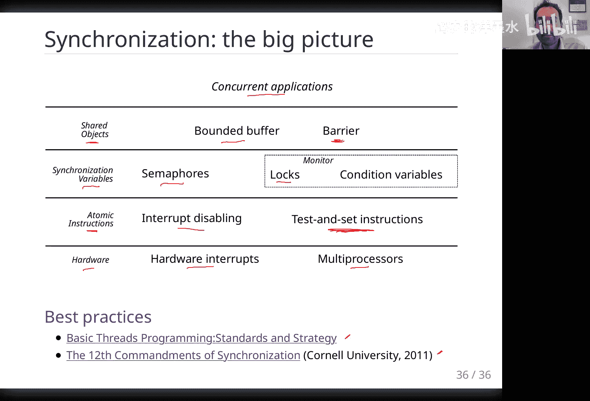

# 操作系统与系统编程：15：进程同步（第三部分）


在本节课中，我们将学习进程同步的最后一部分内容，重点探讨两个经典的同步问题：生产者-消费者问题和读者-写者问题。我们将分析这些问题的核心挑战，并学习如何使用信号量等同步原语来构建正确且高效的解决方案。

上一节我们介绍了信号量这一强大的同步机制，它既能实现互斥，也能用于线程间的条件同步。本节中，我们来看看如何应用这些知识解决实际编程中的复杂同步场景。

## 生产者-消费者问题

生产者-消费者问题描述了一组生产者线程和一组消费者线程共享一个固定大小的缓冲区。生产者生成数据并放入缓冲区，消费者从缓冲区取出数据并进行处理。核心挑战在于：
1.  当缓冲区满时，生产者必须等待。
2.  当缓冲区空时，消费者必须等待。
3.  必须保证对缓冲区（共享状态）的访问是互斥的。

### 初始实现与问题分析

首先，我们来看一个简单的、未加保护的实现。假设我们使用一个大小为 `N` 的循环数组 `buffer` 作为缓冲区，并用 `in` 和 `out` 两个索引分别指向下一个可写入和可读取的位置。

```c
int buffer[N];
int in = 0, out = 0;

void produce(int item) {
    buffer[in] = item;
    in = (in + 1) % N;
}

int consume() {
    int item = buffer[out];
    out = (out + 1) % N;
    return item;
}
```

这个实现存在两个主要问题：
1.  **竞态条件**：`buffer`、`in`、`out` 是共享变量。多个生产者或消费者同时执行 `produce` 或 `consume` 函数时，会导致数据覆盖或读取错误。
2.  **缺乏同步**：消费者可能在缓冲区为空时调用 `consume`，读取到垃圾数据；生产者可能在缓冲区已满时覆盖未消费的数据。

### 使用信号量的解决方案

为了解决上述问题，我们需要同时使用互斥锁和条件同步。以下是解决方案的组件：

1.  **互斥信号量 (`mutex`)**：一个初始值为 1 的二进制信号量，用于保护对缓冲区 (`buffer`, `in`, `out`) 的访问，确保同一时刻只有一个线程（生产者或消费者）能修改这些共享变量。
2.  **计数信号量 (`empty`)**：用于跟踪缓冲区中空槽位的数量。初始值为 `N`（缓冲区大小）。生产者在写入前需要执行 `down(empty)` 来获取一个空位；如果 `empty` 为 0（缓冲区满），生产者将被阻塞。
3.  **计数信号量 (`full`)**：用于跟踪缓冲区中已填充数据的数量。初始值为 `0`。消费者在读取前需要执行 `down(full)` 来获取一个数据项；如果 `full` 为 0（缓冲区空），消费者将被阻塞。

以下是修正后的代码逻辑：

**生产者线程执行顺序：**
1.  `down(empty)` // 等待空槽位
2.  `down(mutex)` // 进入临界区，获取缓冲区访问权
3.  将数据放入 `buffer[in]`，更新 `in`
4.  `up(mutex)` // 离开临界区，释放缓冲区访问权
5.  `up(full)` // 增加一个数据项，可能唤醒等待的消费者

**消费者线程执行顺序：**
1.  `down(full)` // 等待数据项
2.  `down(mutex)` // 进入临界区，获取缓冲区访问权
3.  从 `buffer[out]` 取出数据，更新 `out`
4.  `up(mutex)` // 离开临界区，释放缓冲区访问权
5.  `up(empty)` // 增加一个空槽位，可能唤醒等待的生产者

这个方案巧妙地通过 `empty` 和 `full` 两个信号量的“交叉”操作（生产者的 `up(full)` 对应消费者的 `down(full)`，消费者的 `up(empty)` 对应生产者的 `down(empty)`）实现了生产者和消费者之间的同步，同时用 `mutex` 保证了缓冲区内数据操作的原子性。

## 读者-写者问题

读者-写者问题描述了多个线程（读者和写者）访问一个共享资源（如数据库、文件）的场景。其要求是：
1.  允许多个读者同时访问资源（因为读取操作不改变数据）。
2.  一次只允许一个写者访问资源，且写者访问时需独占资源（排除所有读者和其他写者）。
3.  写者操作完成后，读者才能继续访问。

### 初步尝试与改进

一个简单的想法是使用一个互斥锁 (`rw_lock`) 来保护共享资源。无论是读者还是写者，在访问前都先获取锁。但这会不必要地阻止多个读者并发读取。

为了允许读者并发，我们需要一个更精细的方案：
*   引入一个读者计数器 `read_count`，记录当前正在读取的读者数量。
*   引入一个互斥锁 `mutex` 来保护对 `read_count` 的修改。
*   第一个进入的读者需要获取资源锁 `rw_lock`，最后一个离开的读者需要释放 `rw_lock`。中间的读者则无需操作 `rw_lock`。

以下是读者侧的伪代码逻辑：
```c
// 全局变量
int read_count = 0;
semaphore mutex = 1; // 保护 read_count
semaphore rw_lock = 1; // 保护共享资源

void reader() {
    down(mutex); // 进入修改 read_count 的临界区
    read_count++;
    if (read_count == 1) {
        down(rw_lock); // 第一个读者锁住资源
    }
    up(mutex); // 离开修改 read_count 的临界区

    // ... 执行读取操作 ...

    down(mutex); // 再次进入修改 read_count 的临界区
    read_count--;
    if (read_count == 0) {
        up(rw_lock); // 最后一个读者释放资源锁
    }
    up(mutex); // 离开修改 read_count 的临界区
}

void writer() {
    down(rw_lock); // 写者总是需要独占资源
    // ... 执行写入操作 ...
    up(rw_lock);
}
```

这个方案实现了基本功能，但存在“写者饥饿”的可能：如果不断有新的读者到达，`read_count` 可能永远不会降为 0，导致写者一直无法获取 `rw_lock`。更完善的解决方案需要额外的机制来保证公平性。

## 同步原语的演进与总结

信号量的发明者 Edsger Dijkstra 后来认为信号量过于通用（既可做互斥锁，也可做条件同步），API 简单但容易误用（例如错误地对二进制信号量多次执行 `up` 操作）。他倡导更清晰的抽象，从而催生了**管程** 这一同步原语。管程将互斥锁和条件变量明确分离，提供了更结构化的并发编程方式。尽管信号量存在这些理论上的批评，但在实践中仍被广泛使用。

最后，我们简要介绍另一种同步工具：**同步屏障**。它用于让一组线程在代码中的某个点集合，直到所有线程都到达该点后，才允许它们继续执行。这在并行计算中非常有用，例如确保所有子任务完成后再进入下一阶段。

### 同步知识体系总结

以下是进程同步相关技术的层次结构：
*   **硬件基础**：计时器中断（导致抢占式调度）、多处理器（真正并行）是产生竞态条件的根源。
*   **硬件支持**：
    *   禁用中断（单处理器有效，但用户程序通常无权使用）。
    *   原子指令（如 **测试并置位** `test_and_set`），适用于多处理器和用户程序。
*   **同步原语**：基于硬件支持构建。
    *   **锁**：用于互斥。
    *   **信号量**：兼具互斥与同步功能。
    *   **管程**：更高级的抽象，整合了互斥锁与条件变量。
*   **高级同步模式/对象**：使用同步原语构建。
    *   **有界缓冲区**（生产者-消费者问题）。
    *   **读写锁**（读者-写者问题）。
    *   **同步屏障**。



本节课中我们一起学习了如何运用信号量解决经典的生产者-消费者和读者-写者同步问题，并了解了同步原语的发展脉络。掌握这些模式是编写正确、高效并发程序的关键。下一讲，我们将开始探讨另一个并发编程中的重要主题：死锁。