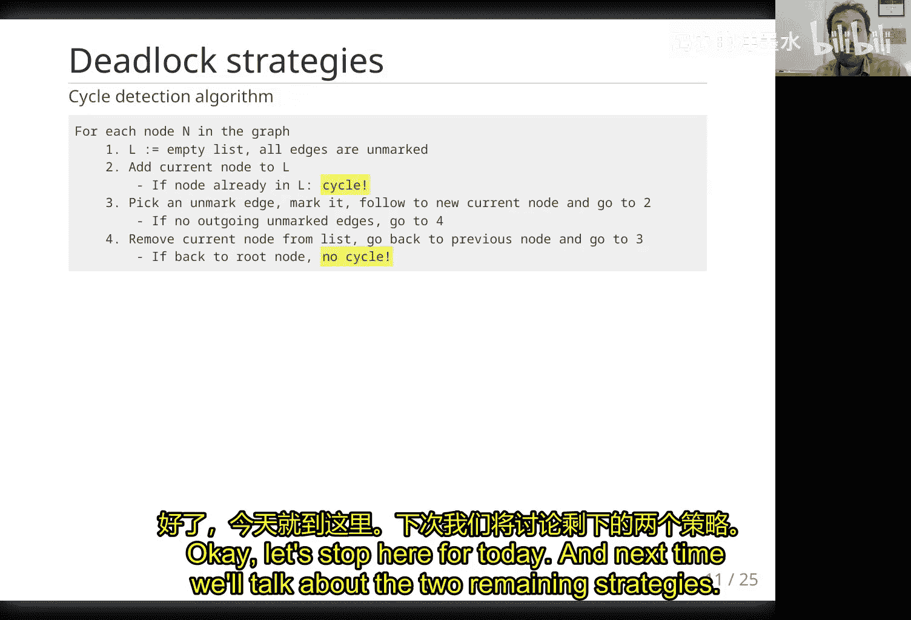

# 【全集 附课件】加州大学戴维斯分校 操作系统与系统编程 中英字幕 1080P p16 Lecture 16 - 死锁part1 -BV1jXr5BBEKa_p16-

Hi， everybody。So today we're going to start talking about deadlocks。

Which is essentially when synchronization goes wrong。

So let's start with an example of what a deadlock is and maybe something you have seen in real life。

A grid lock which is very much like a dead lock， so what happens here？嗯。Let's see。😊。

What we need to notice is that essentially we have those different entities and they're all waiting for one another。

 So for example， you see here that like those people。Are waiting for those people to move。

 but those people。They' are waiting for these people to move。

 And these people are waiting for them to move。 And then they are waiting for essentially。

 those people to move。 And so we have this nice。😊，Circle。Of waiting， of I waiting for you。

 you're waiting for someone else， this someone else is waiting for me and no nothing moves。

 so that's that's a deadlock。So obviously that's。An example like a real life example。

 now if we go back to code， what what does it look like Well lets let's take an example here。

So here we have this example with two threads and two logs and both threads they are trying to do some computation on their own and for that they need to take some logs because those computation are critical sections and they're I don't know touching like some shared variables。

And so thread one needs to take lock one and lock two in order to perform their computation and thread2 needs to take also lock one into。

嗯。Now， what's interesting is that this code， you might run it a billion times and it's just going to work fine。

And then you run it once more， and then it diallus。So why actually like maybe post the video。

 look at the code， take a minute and try to see why。Try to do the same thing as what we did。

With the critical section， like trying to understand race conditions like how how come a certain like inter living。

Of scheduling lead to surprising results here， think about the same because it's essentially the same issues。

So what could happen in real life is that like thread one would say start executing。And get。

Dscheduled right after taking lock one。Like just gets the timer interrupt。Right there。

Which might or might happen， I mean， there's like a chance in one a million that like it would get interrupted exactly at that very location。

And now threat two starts executing。And text lock2。And then tries to acquire lock one。

But it can't because the lock one is already logged by thread one， so thread2 here。

 imagining that this lock here is say like implemented by semaphos by the binary semapho。

So threat to now is blocked。Waiting for lock  one。To be released。A little bit later。

 we go back to Th one， which now continues its execution。

Thread one was successfully locked one and now gets to lock two and tries to lock lock2。

 but lock two is already locked。 so thread one says， okay I'm going to wait。

Let's block on it and wait until it's released。And what do we have？

We have a cycle of dependency here。Thread one is waiting for thread2 essentially to release lock2。

And thread two is waiting for thread one to release log one and that that's because they are both。

Holding resources that the other has。What's again， like very difficult is that this code might very well work over a billion executions and then just all over the blue not work because of a scheduling that's inconvenient。

嗯。One thing though， and that goes back to the last slide that I was showing in the synchronization lecture。

Most synchronization issues， they can be solved by respecting a consistent structure and sure it's pretty obvious that the structure is not consistent。

Thread one。Tries to lock， lock1， and then lock 2。Threat2 tries to lock lock2 and then lock one that is not consistent。

If threat2 had been written to take the same locks in the same order。

 which is lock1 first and lock2 second。Then the deadlock could not happen。

Because now even if thread one loses the CPU right in the middle of taking the two locks。

 when we get to thread2 thread2 will be stuck right away while taking to while trying to lock lock one which is already locked and so thread2 will be blocked like immediately and when we go back to thread one thread one will be able to continue so here you see that just respecting a consistent structure could save but。

It's not always the case， so sometimes we have a deadlock。嗯。这样。There's a very classic problem。

 deadlock problem that actually was phrased by Diestra， him again。

In 1965 as a student exercise and later reformulated by other people。

And that's an example that I will carry on like throughout this lecture， so let me present it to you。

It's the dining philosopher problem。We have five philosophers， we have plateau， we have Confucius。

 we have Socrates， we have Voltaire and Decos and I don't know they're at the Italian restaurant。

 they're eating spaghetti。And there aren't enough forks on the table， as you can see。For some reason。

The problem with the dining philosophers is that they can do two things。

 they can think very hard or eat their pasta。And when they eat their pasta， for some reason， again。

 they need to use two forks。So let me show you this problem using code。So we have n philosophers。

 five philosophers， and we have five forks。Alright。That's the big issue。So the forks here。

 we have n forks that are represented by binary saphos taken or not taken。

And then for every philosopher， so we represent a philosopher by an index from like say。

 I don't know， zero to four， we have five of them。And so for each philosopher。

 the philosopher has a right fork and a left fork， so here like plateau as a so what would it be a right fork here。

 left fork there。And then the philosophers， they are trying to do two things。

 they are trying to think。Or it。And so in order to eat。

 they need to grab their right fork and then their left fork， then they can eat。

 then they drop both forrogs back on the table and they go back to thinking again。

And so the idea here is that like， okay， when can it。Deadlock。Well， again。

 it's going to be fairly rare that that specific scenario would happen。

 it's again a situation where like you could run this code a billion times and it would work just fine。

But。It might deadlock。 So when does it LEDdo。It deadlocks if every philosopher。

 let me clear this screen， if every philosopher essentially loses the CPU。Right there。

Right after taking their right fork。So imagine like plateau。Tex。It's right。

 fog and then loses the CPU。Then Confucius gets to， oh， am I？I'm sorry。 I got confused。Okay。

 Pto text is's right fork。Cause it's inverted， it's difficult to see which。

 which one is right and we translate。 Okay， so Plaau takes the right for， confucius。

 takes its right f， loses the CPU Socrates。Text is right， for， let me okay。Then when we have Voltai。

 text its right fork。Then lose the CPU and then they。

Texas right fork loses the CPU and so they were both able for some reason， I don't know。

 randomly like random inter living of execution that's not under our control。

They all are able to reach the same down on their right fork and then they lose the CPU and then we are in a situation。

Where they both have their right fork in their right hand and now they're stuck because now they're like。

 oh， I need my left fork except that the left fork is taken by their neighbor。

And so we have this essentially like chain of dependency and everybody's deadlock because they're all waiting for one another。

So that's that's the dilemma。And we'll see like different solutions to actually solve this dilemma by rewriting the code slightly differently。

So let's go to a formal definition of what a deadlock is。

And let's start by actually defining another word， which is the word starvation。

So starvation is if only one or more entities or task if talking about computing are blocked and are not making progress means that theyre starving so back to like here the deadlock like or like starving would would mean that like I don't know four hour of the five philosophers are totally able to like eat some food。

And one of them， like Dick out， for some reason he pain the as。

 he's always like getting denied access to the fork and he's starving， literally starving。And。

But the rest of the people are still making progress。 That's starvation。嗯。Now let's see。Deadlock。

Is essentially when everybody now in the system is starving， all of the tasks are being denied。

The access of some resources that they need in order to make progress。So it's essentially。

 so starvation is only like if one or more task in the system。

 but not everybody is stuck and doesn't have access to their resources to make progress。

 deadlock is when all of them are in that situation。嗯。😊，And what's again， like very。

 very important is that， first of all， like the fact that a system might be subject to deadlock。

Does' necessarily that it doesn't necessarily mean that it will， it's the same as race conditions。

 like the fact that there could be a potential race condition and viable doesn't mean that it's going to happen。

 it's just like subject to happen but it depends on so many different factors like and indetaministic factors that it's very difficult to plan testing is pretty much useless。

 you can test like a program a billion times and the race condition。

 or deadlock is not going to happen。So what it means is that。In the same way as race conditions。

For them not to happen， you have to use proper critical sections and use proper synchronization for deadlock not to happen。

 the design must be made in such a way that it cannot happen in the first place' that's pretty much the idea because testing is useless。

Okay， let's move on。A little bit more about some definition and formalism here。

There's something called a resource allocation graph。That represents graphically。

How task can ask for resources and so on， so for example like philosophers like taking their fork。

 the philosopher would be a task， the fork would be a resource and so the task is trying to acquire the resource。

So in that formalarism， it's very easy。You have essentially two actions。

You have the action of holding a resource so here like task a which we represent here by a circle is holding a certain resource R which we represent by a square The fact that it's a circle and a square doesn't really matter as long as they're like both different What matters though is the direction of the of the arrow。

So when task A is holding resources resource R， then thearrow goes towards a。

And so now we have the other action of requesting。 So when task B is requesting。

Resource S than the error goes towards the resource。

So here is the example now of a deadlock where we could have two tasks。

 exactly like as I showed earlier with the thread one and thread two。

 trying to lock lock one and lock two。If we were to represent that graphically with C like something that looks like that。

 so task A is holding R and the arrow is standing at such and is requesting S and task B is holding S and is requesting R so earlier in the example we could we had like thread one。

And threat2。Thread one was holding lock one。And was trying to acquire lock2。And threat too was。

Holding lock 2 and was acquire was trying to acquire lock 1。Same example。

what do we see here that essentially tells us， oh， we are in a situation of deadlock where the tasks are waiting for one another in such a way that they are both blocked。

Is that we have a cycle in the graph if we follow the direction of the arrows。

 we see that like so A is trying to acquire S， but S is held by B task B is trying to acquire R。

 which is。Held by task A。 And we have a nice loop。That loop。

In this resource allocation graph tells us。We've reached a deadlock。Okay。

Let's stop a little bit with the formalism and let's go back to our example and to defining better what deadlock is。

So。When。We observe a deadlock so we're in a situation where there is a deadlock so like earlier we have thread one thread to lock one lock two and they are scheduled in such a way that like okay they're both blocked they're both waiting for each for one another there is a deadlock currently。

When there is a deadlock， we can observe that four conditions。Are met。

If we were not in a dead situation， then those conditions would not be true。So。Let me explain。

So the first condition for a deadlock to occur。Is that the resources？Are being held in a mutual。

 exclusive way and are bounded。So essentially like we don't have an unlimited amount of resources and when resources are being taken。

 they are being taken exclusively。So let's go back to this example with the cars and this like roundabout that's totally stuck。

The way that we could express this condition is essentially the fact that like when a car。

Is stuck here on the， on the， on the pavement， on on the road。

It's holding a spot on the road right like the road is not infinite。

 you see that the road has a certain like width here， which is not infinite if the road was infinite。

 then people could like would always be able to move to another lane and just go through。Here。

 the fact that we have a deadlock in the first place that this intersection is completely stuck is that we don't have enough space and people are just like crammed up in the same place。

And a car， when it's there on this intersection， it's holding a spot。

 It's holding like a physical spot on the the on the ground。

 That's pretty much the expression of this first condition。The second condition is that。

The a task or like an entity being involved in that deadlock。

He is holding on the resource that it currently has。

And is waiting to acquire another resource in order to make progress so again。

 like if we take that car here。It is currently holding。Onto its like spot on the road。

And because it's trying to move forward， it's trying to acquire the spot on the road that's just right in front of it。

But in the meantime。It's like I'm here， I'm staying here。

 I'm not going to start like going backward like I want to move forward so。

I'm going to stay exactly where I am and I'm only trying to acquire what's in front of me。

That's pretty much what this second condition is。Third condition。Is that it's not possible。

To remove the resource that a task or an entity involved in the deadlock。Currently has。And again。

 like so actually， like let's not look at this car， let's look at this bus。

This bus here is holding onto the space that it's taking on the road。

And there's pretty much no way to remove it。 It's not like you can say， oh， you know what。

 like I can solve this entire deadlock on the road。

By just like lifting the bus up and moving it into the air to like free the space that it's taking so that like all of those people。

 they can like move forward。 and then the thing is gonna be resolved。 like the bus is massive。

If it's right somewhere on the road， you cannot move it。

So you cannot preempt the resources that it's currently holding。And finally。

 which is probably the most obvious and we've talked about it。

 there's this idea that everybody is waiting for one another。In a circular fashion。So， again。

When there is a deadlock。It means that all of those four conditions are true。

If one condition is not true， then we are not in a deadlock situation。

So now that we've described what are dead logs， the vocabulary around it and all of that and the conditions that need to be true for them to even exist。

How do we deal with it， which is really interesting part of this lecture， I guess。😊。

So how do we deal with deadlocks？We have four different strategies。The first strategy。

 which is a little bizarre， is a strategy where we ignore the deadlock， it's the ostrich algorithm。

 just put your hand in the sand and pretend that it's not happening。诶。In computer sense term。

 it basically means like， wow， when thing is all stack， reset， reboot， I don't know。

 just make it disappear。And you'll see that it's a very valid technique。😊，Second strategy。

We try to detect that there is a problem and that like a deadlock has occurred so we're detecting that and then we're trying to recover from it okay。

 there is a deadlock what can we do。To say like negate one of the four conditions and make the deadlock disappear。

The third strategy is a little bit more interesting in some ways。

 it's how do we prevent a deadlock from happening？😮，By making sure when we allocate。Resources。

2 tasks that were not going to allocate them in a way that could cause a deadlock。 So essentially。

 like in the。Intersection with the cause。If you put a cup in the middle of the intersection。

 that would be up to the the cup to essentially like。

Orize the sharing of the intersection by all the different like four roads that are like coming to this intersection and by saying like。

 oh okay you can go you're going to stop and and so the cup will like dynamically organize the intersection so that like we don't end up with the big deadlock right in the middle。

The last one is， like， somewhat。Similar， but completely different。

The last one is really about prevention。Here it's like， okay。

 we're not going to put a cup or anything， we're going to like redesign the intersection。

To make the possibility of even having a D in the first place impossible。

So prevention is really like。Changing the system in itself。

So that like one of the four conditions for a deadlock to occur cannot even never be met this way we don't need to either detect and recover or we don't need to put a cop in the middle of the intersection because we're just actually redoing the intersection so that a deadlock can just never happen。

And I believe that's a picture。Of a deadlock free intersection， which looks very bizarre and big。

But it works。Okay， so let's start with the first one。Ostrich algorithm。In computer science term。

 essentially it's like， oh computer is deadlocked and it's dark and you move the mouse and you try to use a keyboard and nothing happens well。

 what you do， you reboot and you pray for it to not happen again so that you can use your computer again。

So if it's the OS。that deadlocks， you reboot， if you're lucky。

 it's just an application control adds up， you kill the application and you start it again and again you pray for the deadlock to not appear again。

嗯。That's really like the nuclear option。 But as a matter of fact， like。

 that's probably the most used strategies because in some ways。

If you know that you have a piece of software。And that deadlus can occur in your piece of software。

 let's say like it's a piece of software that's multi threaded and you have like tons of locking happening and samema and whatnot and your code is not perfect。

But your software has been like in the wild。Used by。

Tens of thousands of users and over the past like 10 years。

 you've had two users reporting deadlocks to you。And essentially you were like， yeah， okay， well。

 I don't know， maybe reboot and they'll fix it and it kind of did fix it。嗯。😊。

If you're in that situation， is it really worth it to have to hire a team of say like 10 engineers specialized in multi thread and all of that to find the bug that makes those deadlock happen？

Probably not from an economic like point of view。Spending a ton of money to find a bug that only has affected two users over the past 10 years。

That's probably not a big deal and here like the ostrich algorithm may be good enough。呃。Now。

 obviously， if your issue is affecting a lot of users and it keeps happening。

 then it's worth investigating it。Essentially， there's a trade off between convenience and correctness and also like economical aspect and so on。

And that's probably why also many applications in recent years， I mean， not recent。

 but like in the past 20 years since like。Computing has become so used by everybody。

More and more applications， they have recovery techniques。

 they have like auto save and all of that so that like if you crash right in the middle。

 which is possible。And you relaunch Microsoft Word or you relaunch your web browser。

 it doesn't tell you like oh you've just lost everything you've done in the past like two hours。

 like it's probably going to restart exactly where you left up because it was like saving your session or it was saving the document you were working on periodically。

嗯。上 some ways。Not fixing a deadlock， but providing some mitigation to users might be good enough。

 So that's why it's very valid technique to just not deal with it。Okay。

 so now let's say you have to deal with， you cannot just like forget about it what other options do you have？

So the other one， the next one is called detection and recovery。

So here the idea is that like you don't change anything。And if a dead happens， it happens too bad。

Your job is just to be able to detect that it's happening。

 like to have some sort of ways that you can like observe the system and see like oh。

 things are not moving anymore and no one is moving like it's not starvation it' a deadlock like no one is making progress。

So there must be a deadlock。What can I do now to make things moving again。

 So imagine that would be back to the。嗯。Intersection that's totally clogged with cars。You would have。

 I don't know， a surveillance camera that's looking at the intersection and so you have someone like looking at a screen every so often。

 like every five minutes。To see， oh， how the intersection is doing， oh， there's a deadlinelock。

 it's like Friday， 6 pm， like everybody's out。This intersection is deadlock。

 I can see that on the camera and no one is moving。

Let's let's send a cob there to move things around。

 to like tell people to move so that would be like detection and recovery。

So how do we do the detection in now back to computing， how do we do the detection？

Well we can use this idea of resource allocation graph。If we keep track。Of the entities。

Involved in the system and the resources that they are holding and requesting。

 Then we can essentially， in real time。Track the ownerships of resources and requests。

And every so often， we can analyze the graph and try to see， do we have a cycle in that graph？

If we don't， then we don't have a deadlock。If we do have a cycle in the graph。

 then we have a deadlock and we've detected it and now we can move on to， okay， let's try to recover。

So what is the recovery part now。Well， the recovery pots can be one of three things。The first one。

Is that in computing terms， you kill a task。If you have a cycle here。

Of task holding or requesting resources。If you remove a task。

Then that task will free the resources that it was holding， it will stop requesting。

Other resources that it was trying to acquire。 and that de facto breaks the cycle。

And now you're out of a deadlock。Obviously， the big。

Question mark here is like what task should you kill in in the that's super complicated for the system to decide which one to to kill。

 but usually in real life when。You have that kind of strategy being implemented detection and recovery。

 that's a very specific system and so you I would imagine you have tasks that are like well identified as ones that can be killed kind of safely because you have checkpoints and stuff like that and you can stop the task again and it has not lost anything pretty much and so on。

Another way that's less radical than just killing a task is to roll back a task to a previous state。

So let's say I don't know， your system is it's like task working on a database， for example。

 and you have a deadlock somehow。You could take one of them and roll it back to a previous state So kind of undo things that it's previously done。

 go back to a previous checkpoint and restart from this checkpoint and essentially hope that。

By rolling back， it will release enough of the new resources that had been acquired to again。

 like break the cycle， break the deadlock and make the system move again。The last option。

 which is extremely complicated， is to be able to preempt。

A resource that one of the task is currently holding。呃。So， in in in in。In that graph。

 it would mean that say， a is holding R。Somehow you're able to like break that link to make a not hold or anymore。

 And that would also break the cycle。In practice， it's extremely difficult。

Tag the example with thread one and thread two having like lock one and lock two respectively。

You cannot take a lock away from a task。 If a task is called lock on a certain lock and has succeeded。

 there's no going back。 I mean， you can not just like。

Unlock a lock on behalf of the task because you're changing the the entire logic of the task and you're making the critical section that is's trying to enter unafe。

 I mean， like it has big repercussions。 So resource preemption is extremely different to。

Extremely difficult to implement in practice。嗯。😊，Let's quickly zoom on the detection here and we will stop here for today。

If we're going to maintain a graph that shows the different task and the different resources and try to see if there is a cycle。

 we need an algorithm and we need an cycle detection algorithm。So how does it work。

 Let's take a small example。 Imagine I have a graph currently。

 So I'm not gonna bother like differentiating the resources and the and the task。

 I'm just gonna represent nodes。 So let's say we have node node number one。Note number two。Note3。No。

for。five。😔，And 6。So imagine that's the current state of a。

 we have tasks and resources we're not really different them， we're addressing them as nodes。

 but what matters is that we have those arrows that are like giving a direction and so we're trying to see is there a cycle in that graph。

And here's the algorithm that we can run to do that in practice。So it starts by having a list。

 an empty list。And let me change the color， maybe。And we're going to start from the first node in the graph。

 So let's say like node number one。So we add this current node to L。To the list。Then from one。

 we pick an unmarked edge edge， unmarked edge。We mark it and we follow it。 So let's say from node 1。

 I follow the first edge， and I get to node 2。Which I add。To the list。So far， so good。

 And I go back to step number  two。So two now is added to the list and again from two。

 we follow the next unmarked edge。 So from two there's only one edge which leads us to three。

 So three is added to the list。And now were on three。From3 here， there are no more edges to follow。

So we actually remove。We remove it from the list。And we're back onto no too。From node two。

 there are also no more edges， new edges to follow。So we leave two and we' are back to one。

So at this point， it pretty much means that like。In that section。Of the graph here。

 we have no cycles。Now from node one， let's continue the exploration of the graph and we're now following the edge。

Towards not4。So， we continue on to far。From4， we follow the edge that leads us to node 5。So。

 that edge gets marked。From 5， we follow this edge towards node 6。And we market。And from node 6。

 we follow the edge。2， note 4。And so， here。We add4 again， to the list。

And we get to this part of the graph。Which says that when we add a node。If we。Already had it。

As part of the list， then we have a cycle。So typically。

 that would be the algorithm that is run by the or some like library。

On a graph of tasks and resources， sometimes to discover if there is currently。A cycle。

 therefore a deadlock happening in the system。The question that's kind of difficult to answer is when do you run this algorithm？

Do you run it after every request to a resource， so every change to that graph。

Knowing that it's going to create some overhead， it's going to impact the performance of the system。

Do you run this algorithm like every five minutes， every minutes， every 10 minutes， every hour。

 every day like。Or when the CPU is available， like it gets kind of actually complicated to know when the algorithm should be run so that deadlock can be detected。

Okay， let's stop here for today and next time we'll talk about the two remaining strategies。

