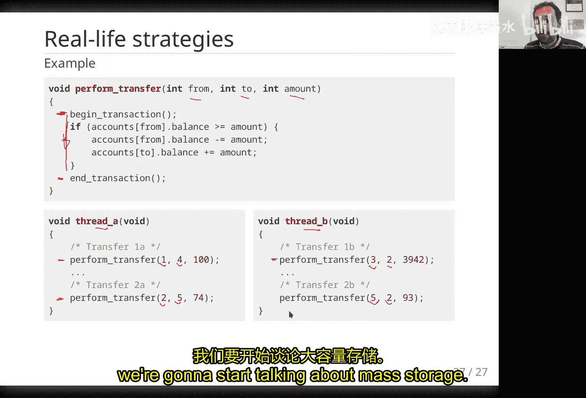

# 【全集 附课件】加州大学戴维斯分校 操作系统与系统编程 中英字幕 1080P p17 Lecture 17 - 死锁part2 -BV1jXr5BBEKa_p17-

Hi， everybody。So today we're going to continue and finish our topic about deadlocks。

So quick recap from last time。We defined a few terms。We defined starvation。

 which is when one or more tasks in a system in a cooperative system are indefinitely blocked。

 like those tasks are not able or denied the resources that they need and they are not able to make any progress in terms of their execution。

 they are just blocked。Deadlock is when all of the tasks in a certain cooperative system are blocked。

 so， for example， if I have a system that's made of two threads。

 thread one and thread2 thread one was able to take lock one and then got interrupted lost the CPUU and thread2 was able to get lock2。

Then they are stuck because lock one now owns thread one owns lock one and wants lock2。

 thread two owns lock2 and wants lock one， they are both waiting for one another。

 They cannot make any progress。 They are stuck forever。 That's a deadlock。

What's difficult and what we want to keep in mind is that like。Unlike。

Sex faults kind of bugs that usually like happen every time like if an application is subject to a sfold。

Then most likely every execution will trigger that Se fault。

 so eventually you find it if you do proper testing of your code， the Se fault is revealed。

 you find it， you fix it， youre good。Deadlocks as well as race conditions they're very。

 very difficult to identify because testing is almost useless。

 you could run that code a billion times and it wouldn't deadlock because because thread one would never be interrupted in between taking lock one and lock two。

But1 billion and first and one execution later。Out of the blue。

 that very rare case happens and then you have a deadlock。

 but you could have tested like as many times as possible in between you would not have found it。

So deadlocks。Need to be addressed properly by design almost and by ensuring that the code is written in a certain way that where deads won't happen。

And that's what we're going to continue talking about today。

Now we saw that there's a formal way to express the fact that a deadlock is。Ocuring like。

 is happening。And there are four conditions that kind of needs to be satisfied for a deadlock to exist。

If a deadlock exists in the system， it means that。The resources that are involved in that deadlock。

 there's a principle of mutual exclusion。Around those resources。

 meaning that only say one thread can be the owner of those resources。

And or that the number of those resources is bounded。

 like there aren't an unlimited number of resources。

The second condition for which a deadlock exists is that each task involved in the deadlock is holding。

Onto a certain number of resources。And not letting them go， like not releasing them。

 like holding on them。 and is a。Also waiting to acquire new resources that it needs in order to make progress。

 and so it's in that state。Of holding some resources and wanting to acquire more。

The third condition for a dialogue2 exist is that those resources that are currently being held。

Cannot be preempted， we cannot take those resources away from the tasks and say like relocate them to other threads or other tasks。

And the last condition for a deadlock to exist is that all of the tasks in the system are waiting for one another in a circular way。

 like everybody is waiting for someone else and eventually like the loop is closed and everybody is involved in the deadlock。

So now we started talking about the different strategies to deal with deadlocks。

To prevent them from happening or to even allow them so for example。

 like the first strategy is actually to just allow them to acknowledge like well some codes are not going to be written in such a way that deadlocks will be prevented so sometimes it could happen that an application will be in a deadlock that the entire system will be in a deadlock and it means that this application won't work。

 it will be totally stuck and the user will have to like kill this application or reboot the entire computer and that's fine。

That's that's a that's a strategy it's kind of annoying for the user to be honest。

 but at the same time if you know that。You have 100。

000 like million users around the world and the deadlock has happened to only like two of them。

Maybe it's not worth like spending six months finding above that really like doesn't affect many people。

So there's really like this idea of like convenience versus correctness with like some sort of economical perspective。

Now， if you want to actually address those deadlocks。

 there are different strategies and we started talking about the first one detection and recovery。

So with detection and recovery。We are not changing the code of the tasks at end， so for example。

 like if that was our code， we would not be changing that code， we would like acknowledge like okay。

 that's the code that's running。But if that code ends up being a deadlock。

 meaning that like thread one would own lock one and try to take lock two and threadh two owns log two and tries to take lock one。

Then we would need to be able to detect that a deadlock has happened。

 that something wrong is going on and that those two threads are now like stuck waiting for one another because those four conditions are satisfied and that could mean that we the system is maintaining some sort of resource allocation graph。

And is able to determine like， oh， there's a cycle in that graph， meaning we have a deadlock so okay。

 let's do something， let's try to recover from it。And the recovery could be， okay。

 we'm going to try to kill。One of the tasks that's involved in that deadlock and maybe killing that task will release enough resources that some other task can now like make progress and it kind of like unstabed the whole thing。

So here， for example， if we are in that case like thread one thread two， we could I don't know。

 like kill thread two， which would release lock two and so thread one will be able to proceed and then we can start thread two from the beginning again or something like that。

And。The last two strategies that we're going to talk about today are dynamic avoidance and prevention。

 so let's start with the first one dynamic avoidance。嗯。受。Again， with detection and recovery。

 we' are not changing the code。And were letting the code get to a deadlock if that's what happens。

 once we get to a deadlock， we try to detect that there's a deadlock in the first place and then we recover。

Dynamic avoidance。Is quite similar， except that we're trying not to get to a deadlock situation。

So instead， but we're also not changing the code of the applications either so here like we would not be changing the code of thread one and thread2 that are trying to take the lock in the order that they are trying to。

However。We will change the code of say the lock function。To only succeed。

If we can guarantee that we're staying it in what we call a safe state。

So to go back to the example with the intersection， you know with the different cars。

 it it would be the idea that like instead of letting the cars deadlock and then sending the cops to fix the situation we would put a cup at the middle of the intersection and that cop will see the cars coming from the different like for the four four different directions and would essentially for every car that's coming to the intersection we try to think like okay what is the current situation of the intersection。

Can I呃呃呃呃。Can I allow this car to proceed and enter this intersection。

 or should I tell this car to stop。And wait。That's kind of the idea here with a dynamic avoidance like the system would only agree for a task to own a certain resource if we can stay in a safe state。

Meaning that like we know that there's a path。After granting this resource to a certain task。

 that still leads us to completion。And we would not take any risk。To get into an unsafe state。

 which is when we agree for a certain task to get a resource。But in such a way that like。

 if ever something wrong happens。Which is not like necessary， but if ever were're like taking a risk。

It could lead to a deadlock。So for example， like in with the thread here。

If thread one takes lock one gets interrupted and then thread2。

 we let thread2 take or proceed here and potentially take lock two。

 and we're taking a risk and we should not let that happen。

So threat to here should not like the the when threat2 calls lock on lock2。

 we should be able to recognize like， oh， if we let that happen， things can go wrong。

So this lock operation should be delayed like it should not succeed just yet because we know that Thrh one is currently like doing some sensitive operation and we don't want a deadlock to happen。

I know that those sentences are a little confusing。

 but if you read them enough time they'll start to make sense in the meantime。

 let's take an example that they'll be a lot helpful。

So there is an algorithm behind this dynamic avoidance strategy。Whi is called the Banker's algorithm。

 which was invented by guesshu Daisra， again， same guy。

 invented everything around distributed computing。So the bankers's algorithm works in like three kind of steps。

 the first step is that every tasks in the system need to state in advance the maximum number of resources that they might need at any given time。

In order to reach completion。So we need to be able to know that in advance。Now， dynamically。

 those resources will be allocated。😡，When they are requested， only if we can guarantee。

That when the system grants those resources to the task。

 we can still find a sequence of execution that leads to completion。If we cannot。

 if the system cannot guarantee that。Then， then the task that makes the request would be brought temporarily。

Aenture， it's safe to give that task the resource that it needs。So let's take an example of that。

 and let's run this example together。 So imagine。A'm mini system where I have three tasks。Tusask A。

 task B and task C。And I have 10。Pieces of resource in the system to begin with。

And I know in advance because the task are kind of like saying it in advance that task A says at the very maximum I might need nine pieces of resource at kind of the same time。

In order to proceed。It's not going to happen like all through the execution of task A。

 but it might happen at any time during its execution that like。

Task A might need nine of them in order to complete。Tas B says。

 I will need maximum4 at any given time。And T C says I might need seven maximum。

And so now say like thread task ABC have been like running for a while like the system is currently like。

On their operation。And so task A has own three pieces of resource， task B2， task C2。

 and so we have three free resources available at the system at this very moment where we're kind of posing。

Now imagine that。Kind of， I don't know， like so the system is running and task B says， hey， system。

 I need two more resources。In order to continue， we like to do whatever I need to do。And so。

 so imagine again， like。The system is the cup at the middle of the intersection。

 sees the different car coming and needs to make a decision like， okay。

 are you allowed to enter the intersection or should I make you wait outside of the intersection because it's not safe for you to enter。

Because maybe a dead could happen。So when B requests two pieces of resource。

 the system needs to decide， okay， should I make B weight or can I give B those two pieces of resource in such a way that like。

All three tasks can still reach completion。The way to answer that question is to kind of like run this simulation。

 which is this banker's algorithm。Where we're going to simulate， okay， let's try。

What if we give B the two pieces of resource and then imagine that the worst case scenario happens。

 which is that right after we do that。All of the task will start asking for the maximum number of resources that they might need。

If we can find a path that if this worst case scenario happens。

We'll still be able to reach completion of all of them。

Then it means that it's okay to give those two pieces of resources to be。 That's kind of the idea。

 So let's do that。If B gets。Two pieces of extra resources。And we grant the request。

 Then it means that B would earn now4。And we would have one piece of resource left that's available。

Now， so at that point， like task A would still own three， task C would still own two。However。

 now let's imagine worst case scenario what can happen。 Well， task A could be asking for。

S pieces of resources more because it currently has three。

 but the maximum that it could need is nine。 so imagine like right after we grand B like two。

Task S has like， oh， now I need my six。Extra to make progress。And C says like， oh， I need my five。

Like 2 plus 5，7， which is the maximum that C might need。

 and we imagine the worst case scenario is that C says like， oh， I need my five in order to continue。

So now the system would be under a lot of stress and we need to figure out， okay。

 is there a way that we can schedule those different tasks so that they still all get to completion？

If be here。😡，Now， ons4。4 is the maximum amount of resources that be said in advance， it might need。

Which means that if we are in that situation。B would be able to。Rich completion。

When B reaches and so in the meantime。Because we cannot satisfy A and we cannot satisfy C。

Those would be waiting。 like their request would be。

 the request of plus 6 and plus 5 would be blocked temporarily。And。So when B ends。

 it releases the four pieces of resources that it owned。 So now we have。5 free resources。

Which means that we can now grant those five to C。And answer C's request。

 so here C would own seven we'd have zero pieces of resources left available。

And A would still be waiting。But if we're able to do that。

 then C will be able to reach completion because it has the maximum resources。It would ever need。

When C ends， it will release all of its seven pieces of resource。In the meantime。

 A would still be waiting。And so here， once we back with seven pieces of resource available。

 we can finally grant A request。By giving it all9。With so one left。 And so here once a as9。

 it can reach completion。 and so we are good。 And so here。

It means that when B requests two resources。We've run the banker algorithm of seeing like， okay。

 what if we grant this request and then the worst case scenario happens where like everybody still saying like I need the maximum number of resources that I said I could want。

Can we still reach completion for all of those tasks。The answer is yes。

 which means that we are still guaranteeing that there is a safe we're in a safe state。And so， yes。

 we can。Give those two resources to be。Okay， oops， no， didn't want to do that。Okay。

Now let's run another example here。Okay， so imagine we're back in that situation。So task A three。

 task B ons two， task C ons two， and we have three available so we'reing resetting back to the original scenario。

Now， let's imagine that。Task A request one piece of resource。

Can we grant a this one piece of resource？So same again， we would be running this banker algorithm。

So we would imagine， okay， what if we give a the one piece of resource that it wants。

 so that would bring the number of resources that a has to four。And we'd have two left。

As it free resources。Task B would have two， and task C would have2。

So we'd been in this situation if we were to grant A's request of getting one more。Now， you imagine。

 okay， worst case scenario， they all decide to ask for the maximum they can get。 So all of a sudden。

 then a says like， oh， by the way， I actually need five more。B says， oh， by the way， I need two more。

And she says， oh， by the way， I need five more。Can we now。Given that we have granted a request。

 supposedly that's the algorithm that we're running。

Can we still reach completion for all three tasks。So obviously， if a asks for five more。

 it has to wait because we don't have five more。 we only have two。C would have to wait， as well。

B here， if B as for tumor， we have those two。So we could still grant B request and give it four and so now it'd be down to zero free resources。

B now has the maximum amount of request that it said it it ever would。 So B would be able to end。

Except that when now B ends， we are back to having。F pieces of resources available。Except that。

A is waiting for five in order to reach completion。

 and C is waiting for five until it reaches completion。

Which means that now it would be impossible for a to reach completion。And it would be impossible。

For C。To reach completion。So。When we run this banker's algorithm。

And we are in that situation here and a request one resource。We should say no， we should say， no。

 I'm sorry， but like if we give you this piece of resource。

And then the worst case scenario happens where like everybody starts asking for all of their resources all at once。

We might get into a deadlock if that happened， it's not necessary that it would happen。

 That's why we it would be we would be going into an urban safe state。

But at least we're allowing potentially a deadlock to happen， and so we would say no。

 and so a would be kind of A's request would be delayed。

Up until we can guarantee that now it's fine to proceed。呃O。嗯。

Here I showed you an example with the banker's algorithm that only reasoned with one kind of resources。

If tasks have different types of resources， then this algorithm could be kind of expandedended by using a 2D matrix instead of this simple 1D array。

But overall。It's a very difficult algorithm to run because it's very difficult to know in advance how many resources a task might need。

 what is the maximum amount of resources that task might need like throughout its entire execution。

And in order to make sure that we're not making any mistake。

 it's possible that we would say a number that's extremely conservative and extremely high。

 which would potentially like prevent the application from running property and so on。

 so in practice it's a pretty difficult algorithm to really run。呃，O。

The last strategy is quite different。So the prevention， the prevention here。

 it's really about changing the rules， like even changing the code itself。

Of the application or changing the code of the synchronization mechanisms that the application is using。

In it for deadlocks to not be even possible in the first place。 So here it's not a question of like。

Letttting the deadlock happen and then detect it and recover from it or like distribute the resources in such a way that like we're trying to avoid the deadlock and so on like here we're really like。

 okay we。Bdozer the intersection and we build another intersection that cannot bedlock that's the idea of prevention and so。

In order to do that， it means that we need to redesign。The code in such a way that like。

At least one of the four conditions。Cannot exist。If one of the four conditions for a deadlock to occur cannot happen。

 then a deadlock cannot happen either， that's the whole point。呃Okay， so let's。

Zoom onto the different conditions and see what does it mean to prevent this condition from happening so let's start with the first one the metro exclusive exclusion and bounded resource。

Typically。If a dialogue is happening because of a lack of resources。

A good solution is to increase the number of resources that are available。

And if you take the dining philosopher problem。If you only increase the number of folks by one on the table。

There are no more deadlocks。If instead of five f on the table for five philosophers， you have six f。

Then it means that at least one philosopher。Will be able to get to Fox。It's the pasta。

And then release the two forks。 and then other philosopher will be able to proceed。

 And it's impossible for the philosophers to deadlock just by adding one fork。

So that's an example of like by design。We are negating this condition of mutual excursion and bounded resources。

Another example。Is so for example， like let's say you have different processes and somehow like they are deadlock because they want to all use the printer and the printer can only be owned by one application at a time or something like that。

Here， adding an extra fork to the dining phoso problem， it really means like only adding one samefo。

 it's pretty cheap。Now， if you need to add more printers to your system because applications are deadlocking on it。

 it's a lot more expensive。So that wouldn't necessarily be a good solution Another solution is more to like。

Neggate kind of like the mutual exclusiont part of this condition。

So instead of allowing applications to kind of lock the printer。

 like own it for the time that they are printing on it， you can do what is called virtualization。

 you virtualize the resource instead of allowing processes or tasks to own a certain resource。

You make a cu。And so tasks now can only send what they want to say。

 print to the printer to a printing queue。And then it's up to the printing queue to dispatch the different printing jobs to the actual printer without having the applications kind of own the printer themselves。

 which could cause deadlocks。And the last one and we're going to talk about it a little bit more in a few slides。

Is to make resources log free to begin with。 So for， let's say， in your application， you're using。

 say， like a stack or a queue。Typically， if you have a stack or a queue that is shared between different tasks。

 you would need to take a lock and then you'd be able to use the shared queue or the shared stack。

 push or pop things from it and then release the log。

 except that from the moment that you need to take a lock in order to own a certain resource。

You get to the mutual exclusion and bounded resource idea， and that can cause deadlocks。

If you can create stacks or queuees that do not need to be locked in order to be used。

 but can kind of inherently support the fact that they can be used by multiple tasks at the same time。

Then you're negating that condition。I'll show you a couple of examples of that in a few slides。

The next condition is hold and wait remember it's the idea that like a certain threads has like say taken a lock of or one of the philosophers has taken a fork。

And they are holding onto it and they are waiting for the other pieces of piece of resource in order to proceed and everybody is doing that。

Well， a way to invalidate this condition is to rewrite the code to not make that happen。

To not allow a certain piece of code， a certain task to hold onto a resource and wait for another one。

So one technique for his employees is called two phase locking。In the first phase。

The task will try to acquire all of the resources that it needs in order to do whatever it needs to do。

If it's successful。Then it proceeds。 and at the end， resists everything。 If it's not successful now。

 instead of holding and waiting。It releases everything that it's acquired and it restarts from the beginning。

So how do we apply that， say to the dining philosophical of problem？Well， the philosopher would。

Take the right fork。And then instead of holding on that right foot and just trying to get the left fork。

It would try to get the left fork， but。If that a ten is not successful。

 then it would release the right for and it would go back to the beginning。

And so we wouldn't be in a situation where like all of the philosophers。

Have their right fork in their hand， and theyre all waiting for the left， which they cannot have。

 And that creates a deadlinelock。 Here it's like， oh， I grab the right。

And if the left is not available， I put down the right for back onto the table。

 which should allow someone else to take that for and eventually everybody is able to make progress。

So for an example， like this one， the dining philosophers。

 were only talking about like two sephos and so on。

 so it's actually pretty easy to think of that solution。But it can also have some issues。

 so for example， it would be possible that a task starves because every time that they are trying to acquire all of the resources that they need in order to do their critical section they would never be able to succeed so let's say。

Now it's not just two folks that they're trying to acquire， but it's like， I don't know。

15 different pieces of resource and every time they're able to like get like 12 of them and they fail for like the 13th or the 14th ones and then they have to like release everything and start again from scratch and they have to like acquire so many resources that someone else like always bids them to the to the poll and they are never able to succeed that would make them starve。

It's also extremely complicated to manage if you have like 10 to 15 different pieces of resource to acquire and sell like different functions and the code gets pretty complicated and so on。

It's a nice strategy， but it doesn't apply all the time。呃O。

So this one is so the third condition is the fact that resources are not。Can be preempted。

 That's a condition for a deadlock to occur。So how do we negate this condition where we could try to make the resources preempable like we that we can the system can still a resource that a certain task owns at a certain time。

The problem is that it's extremely complicated to do that。If you take a test， that says like。

Own the lock。 You cannot make a task， not own a lock。 like if the task called lock on a certain lock。

And it succeeded， you cannot take that back， it's impossible， it defines the whole concept of locks。

嗯。😊，It's only possible when the resource that is being owned by a certain task。

Can somehow be like kind of temporarily saved somewhere else and then restored later。 So。

 for example， say。A memory page。Is being is is a resource that is at some point involved in a deadlock。

While memory pages are two things， they are a container that contains some contents。

So if a memory page is somehow like involved in a deadlock。

 then it's actually possible to take out the content temporarily without losing it。

 putting it somewhere else saying like on disk， then give the memory page to whoever needs it。

 which would like solve the deadlock situation， and then later we can put back that content from the disk into the memory page and give it back to whoever like owned it in the first place。

So that's an example of a resource that might be owned by a certain task and that we can temporarily preemp。

 but it's only because we're able to like save the state。

 put it somewhere else and restore it later and it's in most cases it's not possible again like if a task owns the lock。

 you cannot。Remove that。Okay。And so the last one。So the last condition is circular weight。

 this idea that in a deadlock， all of the tasks are waiting for one another in a circular fashion。

How do you prevent that from happening， Well one idea is to impose a certain order。

The intuition is that if you number all of the resources。

By a numerical number from say like one to n。If you have a deadlock。

 it means that at some point a certain task。Has essentially like acquired a resource with a higher number before trying to acquire a resource with a lower number when all of the other tasks were doing the opposite。

 were like trying to acquire a lower number first and a bigger number second。

If you prevent that from happening and impose that all of the request should only be in one order。

 like you always have to take the resource that has the lower number before the bigger number。

Then you prevent deadlocks from happening。So let's see an example with the dining philosopher。So。

That was the code。At the beginning for all of the philosophers， like regardless of who they were。

 they were always trying to take the right for before the left one。

Except that that creates that kind of circularity。Now。If you say that the last philosopher。

Should actually do the opposite， should take the left fork before the right fork。😮。

Meaning that it should take。Said the left fork would be number one。

 and the right fork should would be number4 if it。Respects the。The number。

 like the D I D of all of those folks。Then you solve。The deadlock。And like deadlock cannot happen。

Okay。嗯。I want to talk to you about the real life strategies that exist in typical systems。

 but first I wanted to just like mention one last concept， which is called the live lock。

A live lock is very similar to a deadlock in the sense that like things are stuck and tasks are not making progress。

But it's in a different way， which is extremely complicated to detect。

So the best example of a live rock is that imagine you're you know。

 in the hallway and you're walking and someone else is walking in the same hallway。

And you get to a point where like you're facing。one another。So that's one person。

 and that's like the other person。And you have this like word situation where like you're coming close to one another and then you're like。

 oh， sorry， and both of them， you know， move kind of at the same time and they end up like still being in front of another and they cannot move because they've both moved at the same time。

 like they' both took a step aside。And then they're stuck again and they're like， oh， oh， sorry。

 and then they both move again exactly where they were before。And so you have this back and forth。

Over like。Oh， you're in my way， oh， I'm sorry like， oh。

 I'm going to take a step aside except that the other person also takes a step aside and and it keeps happening and you'll start that's a live lock。

And that's extremely complicated to detect because from an outside perspective， you're like， no。

 they don't seem blocked， they're moving， they're executing some code， I mean if they're tasked。

But at the same time， they're actually not able to be making progress because they're both in the way of one another。

And that can actually be a risk with the detection and recovery technique。

In the sense that like the recovery might be this。This idea of like you taking a step aside in the hallway way and ending up still being in the way of someone else。

Okay。So quick digression closed。So what are the real life strategies to deal with deadlocks？

The first strategy。That weve talked about is the ostrich algorithm that's probably the most common strategy which is like let's not do anything thing is stuck like the user will be a night for a minute。

 but well that's too bad。In some cases， pretty rarely， but when it's easy to do so for the system。

 the system can try to do dynamic avoidance。There are in my knowledge。

 two instances of dynamic avoidance on Linux on not on Linux， but on Pos。嗯。

So those are positive functions。That can fail with a specific an code， which is deadlock。

The first function is lock F， which is a function that allows a certain application to a lock a file to make sure that no one else has access to that file。

Because it's locked， so it's a way to ensure that like a file will be able to own a certain file in an exclusive matter without anyone else like tampering with it。

If the system detects that we're in a situation where like。

 say one task is locking a file and another like file one and another task is locking file two。

 and then they are both trying to like lock each other's files。

 then the system would detect that and with fail。Another example is P thread Muech。

A muttec can only be locked by one thread if that thread tries to lock the same muttex twice。

 which is impossible， then the second call to the lock function will fail with a deadlock an code。

So those are two examples of dynamic avoidance in the world。For the most part， the techniques。

 dynamic avoidance and detection and recovery， they're usually reserved for super specialized systems such as like databases or banking like。

You cannot afford any error like the system can not crash， cannot deadlock。

 It needs to always like keep moving because like big things are at stake。

 but otherwise in regular applications， it's really it's not really a thing。And so last。

We have the prevention， which I would say is also extremely popular。

 but it's also complicated because it requires programmers to like really come up with code that is deadlock free which is tough to do。

 but so as I was saying， like a couple ways of doing that is to make some of the data structures that other ways would need to be locked。

 be locked free like you would be able to use some data structures without the need to use any locks。

So how does that work， let me show you a couple of examples。So let's start with the first one。

 lock free data structures。So what we mean by data structure is the 3060 meaning， which is like。

 say you have in an application， a multithreaded application that uses a stack or a queue or a set or a hash table like those kind of data structures。

 and the application is multithreaded so multiple threads might want to access those data structures at the same time concurrently。

Typically， if they wanted to do that， they would need to take a look。Like take a log。

 access this shared data structure， use it， and then release the log。

 except that if they take a log and release the log， then we can get into deadlocks。

So how do we do it so that like the data structure in itself supports being used by different threads at the same time without the need to lock？

It relies。On the hardware， helping us a little bit。

And the hardware in the same way that it can have test and set type of instruction。

The certain processors have another type of instruction called Comp swap。

So those are instructions that it's an instruction that the processor can execute。

And they're called atomic instruction because those instructions involve multiple operations with the memory。

 but those operations are guaranteed to be performed in an atomic matter。So， here's the。

The equivalent of what a comparing swap instruction does。 So again， like it's C code here。

 but it's just to show you what it does in real life。

 That would be one CPU instruction that is made in like assembly code。

This instruction has three opera， one would be the address of a location in memory。

 then we would have an old value and a new value and essentially the comparing to instruction that happens atomically。

Would compare。衣服。Memory location。Is different from what we expect the old value to be。

Then the instruction fails， return0。If it is equal to the old value that we were expecting。

 then the memory location is modified to be equal to whatever new value we want to put in it。

And the instruction succeeds。That's what it compare we compare， and if the comparison succeeds。

 we swap up with a new value。So now how do we use this comparing swap in order to implement log free data structures。

 let me show you an example。So that would be for a stack and we look at the operation push into a stack。

 how do we make the stack push？Not use a lock and be inherentrantly multi thread safe。

By using a Comp swap instruction， so let's look at this example。

It's a naive example because like things are in real life a lot more complicated。

 you can click on that link to see why， but at least bear with me。

 it still shows kind of like the idea that's between it。So here in that example。

 the stack would be implemented with the link list and so we'd have。

So the stack here would have a certain top that would be a pointer。And so。Then。

 like the different elements。The different nodes would have a data， and a next pointer。

And we could have multiple items in the stack。And so， because it's a stack。The items。

And so the last one would have a no pointer at the end。And。Because it's a stack。

 we would be pushing items at the top of thisIn this linked list。

 and we would pop items from also the top of this linked list。So let's look at this。Stack push。

Imagine that we have two threads， thread one that calls a push。On this stack。And we have threat， too。

Which also， at the same time。Or concurrently also cause push on the same stack。There's no lock。

 so how does it work so that it still works？Well， let's imagine that threat2 actually goes first。

So threat to cause stack push and is trying to push a new data。 So， okay， we create a new node and。

So right here， we create an。Then a error data is equal to the data that threat2 is trying to push。

 So okay， we initialize data。In that note。And then we start a do Y loop。And we say， okay， and next。

 So that here is equal to stack top。 So in other words， we copy the value of top in here。

 which means that our pointer next。We'll be pointing at the same thing。

As what top is pointing onto right now。Now let's imagine that leg。Right here。

Thread2 loses the CPU right in the middle of adding this new node to the stack and were in that situation。

But。The scheduler does whatever it wants and we get interrupted right here。And so now， thread 1。

Gets to execute and。Push its own value。 So okay， so right one calls stack push。

And will also create a node on its， of its own。And recall call will initialize its own data in that node。

And we'll also get to that line where it says like， oh， my next pointer。Is equal to stack up。

So now we are in that situation。And thread one actually is not interrupted and continues its execution and gets to the comparison swap and says essentially like。

 okay， I want， I want to change stackedtop。I think that the old value of stacked up is n next。

 which is essentially this guy， like the address of this node。

And I want to change stacked up to now point onto n， which is me， my new node。And here。It works。So。

 top now。Will be pointing。Onto this new node。And that link here will not exist anymore。And so。

 thread1。Has succeeded the Y loop， has succeeded the Comp web and leave stack push and continues its execution。

Now， a little bit later。😊，We're back into threat two。

 and so threat two resumes its execution right here。Now thread to says like， oh。

 I want to change stacked up。And I think that stacked up is equal to N next。

 I think that stacked up is pointing onto。Thatad guy。And if it is。

 I want to change it so that stacked up points onto me。

Except that here the Comp swap instruction will fail because stacked up is no longer pointing onto this node。

 it's changing in the meantime。 So here the Comp swap will fail for threat to。

And we'll go back to the beginning of the du loop。诶。So if we're back to the beginning。

 then we reexecute this instruction and next equals stackact top。

So that means that that link will disappear and will essentially readadap to what the current situation is。

 which is that next。Well now point onto this new node that had been inserted in the meantime。

And now we are trying this compare and swap again。 Okay， I want to change this stacked up。

I think that the value is that， which is actually the right pointer。 and I want to change it to。

Which means that top now。Will be pointing。Onto that node。And that link will be erased。

And there you go。Now we have the top pointing onto that node。

 and then that node points onto the following one and so on。And you see， we have not used any lock。

 like no one has owned。The stack for any of the time is just that they have tried to use it in a cooperative way。

And the fact that， like。Ting succeeded without having like any race conditions where the outcome like gets some crazy values。

Here the Comp swap allowed us to actually get to a result that's still consistent and that's correct。

Okay。Quickly， the last technique that I wanted to talk to you about。

 like something that exists and that's been like studied for like 15 years。

In academic circles and that now actually like exists in processors like at hardware level。

 it's called transactional memory。Sure it's kind of interesting it's the idea that like。Again。

 critical sections are not going to be within locks。

 we're not going to take a lock to ensure mutual exclusion and then release the lock。

The mutual exclusion will kind of be。Optimistically assumed。In the sense that， like。

Task will start executing their critical section， no matter what。

 and only at the end of the critical section， the results。

 the outcome of the critical section will be committed to memory in an atomic way。

And so transactional memory essentially comes with like two functions。

One that's called Be transaction。I mean that's a fake name。

 but like that that's the idea you would like essentially say like， hey。

 I'm entering a critical section。It doesn't mean that like。I'm creating some mutual exclusion。

 I'm just saying like him I'm starting a transaction。And stunning a transaction creates a checkpoint。

And all through the transaction， whatever thing that a task is doing stays local。

 it's only buffered locally。And it's only upon the end of the transaction that we essentially compare like。

 okay。During this critical section， when we've interacted with with certain like pieces of memory。

Have those。Me location being accessed or modified in the meantime。If yes。

 it means that the transaction didn't succeed and we need to start all over again。

But if it did succeed， then we can actually commit everything that the thread had been doing during the transaction into memory all at once in an atomic way。

 and then we're good to go。And so that allows to。rite that kind of code where say you have a banking application and so a transfer between like a certain account and another account for a certain amount would be a transaction and so here you would say like okay big in transaction then we modify the balance on the different account and then end transaction。

What's nice here is that like now if you have thread A and thread B working in parallel or concurrently on different accounts。

If they do some transfers。On set like accounts that are completely different。Then。

 those transactions。They' are not going to tamper with one another because they are touching completely different parts of memory and so the transactions will succeed。

 and here there's no need to take a look， there's no need to say like hey during the transfer。

I'm locking the entire like database， you're not locking anything。 You're just saying like， hey。

 I'm going to do a transaction。But if ever that transaction is compromised。

 then we need to start again， but if not， then it just works。And it's only say。

If you do say a transfer between say like account 2 and account 5。

 and the other thread is also doing the same， like on the same amounts。

If it turns out that they are doing their transaction kind of at the same time。

Then one of them will probably fail。And it will just like， repeat。

They failed transaction again until it succeeds。嗯。Okay。

 so that's the end of deadlocks and next time tall change of subject we're going to start talking about mass storage。

By。