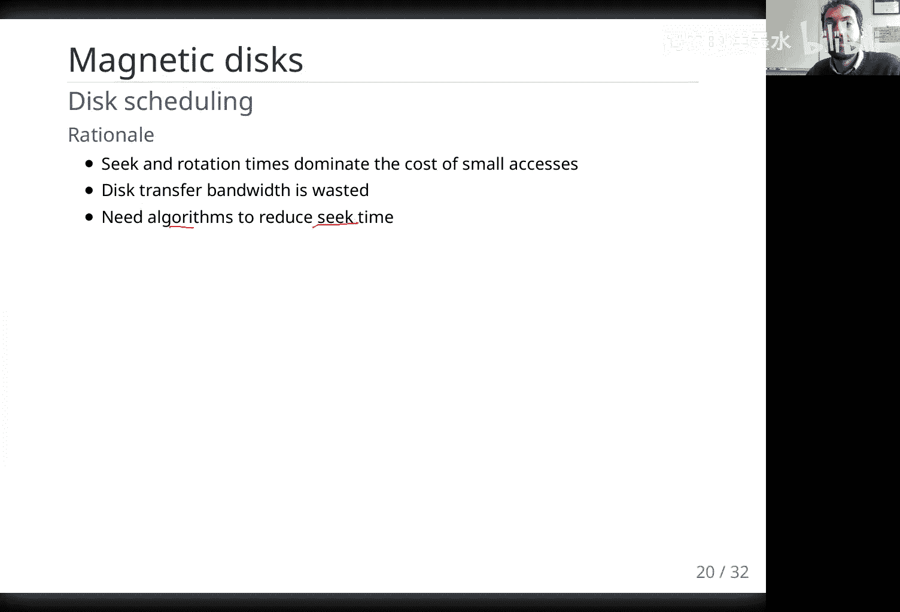

# 【全集 附课件】加州大学戴维斯分校 操作系统与系统编程 中英字幕 1080P p18 Lecture 18 - 存储part1 -BV1jXr5BBEKa_p18-

Hi， everybody。So today we're going to start talking about a completely new topic。

 the third big topic of this class so we started with talking about Ccos and system programming then we started talking about synchronization deadlocks and all of that and now this third topic is about storage and file systems and the last topic will be virtual memory。

So let's start talking about storage here。So as you know， probably from previous classes。

 you know this like pyramid of the memory hierarchy。

It starts by having CPU registers thats that's how information really gets processed by the CPU so like you know in assembly you would have like。

Processor instructions that would say like adds， you know， like a register to another register。

So that's how things are being computed through CPU registers。

And then CPUs can also access memory by doing like sts or load words， I mean。

 depending on the actual CPU， but the concept is the same。

 and so the CPU is able to talk to the main memory。嗯。

And just to make sure we're on the same page here， the caches here are only meant to accelerate the communication between the CPU and the main memory。

 but they're invisible， they're totally transparent。

 it's just that if they happen to hold the information that the CPU wants while accessing the main memory then the cache will answer faster than the main memory。

 but it's not like the CPU can access the caches directly like the CPU almost has no idea that there are caches along the way to the main memory。

Anyway， so the thing is that with that first hierarchy， first of all， the information is volatile。

When you power off the computer， everything is lost because all of those memory technologies lose the information when there's no power。

They're rather small， there are only a handful of CPU registers。

And the main memory usually in laptops or desktop computers typically we're talking about say like 8 gigabytes to like 16 gigabtes that kind of stuff and just to remind you8 gigabyte is very small that's pretty much the size of a blue ray movie one blue ray movie。

 that's it。And it's also rather expensive， so for example， like the main memory。

 you're going to pay like5 to 10 per gigabyte。When we're talking about like cashs。

 we're talking about thousands of dollars per gigabyte。Of cache memory and actually。

 cache memory is usually counted in like， I don't know， like2，4，8 megabytes at most。

so if we want to have computers that can contain a lot of data so that you can have multiple movies and you can have like all of your vacation pictures and all of your like schoolwork and whatnot。

 we need some bigger storage。And so what we do is that we expand this pyramid with what we call secondary storage。

And so namely like some flash memory or some magnetic disk or nowadays like the cloud。

 that kind of stuff。So here now in terms of size。Whereas before like we were talking about a few gigabytes for the main memory。

 now we can reach sizes that are in terabytes， so a lot bigger。The cost is also very different。

 for example， like magnitude disk， we're talking about a few cents now per gigabytes and for cloud storage we're talking about like。

Maybe like even less than a cent per gigabyte， it's very， very cheap。However， the speed。😊。

Is a lot slower when the CPU accesses some data from the memory here， and it turns out。

 I don't know that the data is contained the L1 cache， then the data can be accessed in nanoseconds。

If the CPU needs to indirectly access data that's somewhere in the cloud。

 then it's going to take seconds or even like minutes if the internet connection is bad。

 so the speed is very different。And it's not only me that there are also other aspects that make this ser storage very different。

So for example， there's this concept of addressability。When the CPU here accesses the main memory。

 he does it directly by issuing CPU instructions that can like。Give addresses。

In the main memory directly， like the CPU is aware of the main memory and can say， hey。

 I want to access this address。Here when the CPU wants to access something that is in the secondary storage。

Secondary storage doesn't have addresses that can be directly accessed by say doing like storewards and load words。

It has to be like the CPU has to ask to configure a certain controller so that the information will be transmitted。

 it's a lot more complicated。And。The way that the data is also accessed is different like here the CPU when it accesses the memory it can say。

 hey， I want to just read one byte at this particular memory address。

When we want to access secondary storage， we can usually access bytes individually。

 we have to access an entire block。Bring it somewhere into the main memory。

 and then we can have access to all of the bytes that it contains。However。

 it gives us persistence here if the machine is powered off。

 we're not losing what's on the secondary storage， that's the whole purpose of it。

The latency and throughput are a lot worse secondary storage as kind of a bad latency that is counted in like milliseconds to seconds and has a pretty bad throughput。

 like the amount of information that can be transmitted by per second is pretty bad。

And also it takes a lot more power and it takes a lot more space。Okay。

 so in the next few slides we're going to talk about the different types of technology of volatile memory technology and then some of the secondary storage technologies。

 so let's start with the technology that is behind caches， which is SRM。

So SRAM stands for static R access memory。And essentially， it's a way of combining transistors。

So here here's a picture of a sRM cell， so that would be a cell that is able to contain one bit。

 one bit， so either a zero。Or a one， that's it。And you see that like in that cell， we need one， two。

 three， four， five， we need six transistors total in order to be able to store one bit。

So it's pretty expensive。😊，However。once we store this one bit inside of this complicated like organization of transistors。

 this bit stays there， so if we brightle one， then the one will be kept up until we either like write something else or until the machine is powered off like the bit is lost only when the machine is off and we lose the electricity。

嗯。The access time is great。 Its very quick to access whatever information this SRM cell contains。

And so that's why it's a great technology for caches。

 so here is an example of a chip that actually is the kind of the processor that powers the Xbox1。

 it's an  Otocore XA6 and you see that it contains multiple blocks of S Rams that are probably used for being like L1 or L2 caches。

So the next technology now， DRM， which is now dynamic instead of static。Here。

 it takes a lot less components to store 1 bit。It takes a transistor and a capacitor。

And it's the fact that you can charge this capacitor。

By inputing like current into it that will make it so that you can store one or a zero。However。

 capacitors， it turns out that they are not very reliable components and they leak。

 so if you charge a capacitor to a certain value， then over time the capacitor will lose that charge。

And so that's why D is is called dynamic is that you need to refresh the information every so often so that the if the。

capapacitor is meant to be charged then it stays charged and thats how that's why static is different and dynamic is that with SRM you don't need to refresh anything if you write a one into SRAM cell the one will be there as long as necessary。

嗯。However， with D， because now it only takes two components to store a bit。

 you can pack a lot more bits in the same surface， in the same area。诶。

So yeah the access time is less good， that's why we don't use that technology for on chip caches the transfer is pretty good and so yeah we use it as。

As a main memory on its own， like Jra modules。So let's sit for the volatile memory。

And now if we talk about persistent memories or like for secondary storage。

The first technology that I wanted to talk about is magnetic discs。So here are the ideas that。

So you all what it looks like like a hard drive， you have a disk and you have a head。

And so the head will go over this like metallic layer and the metallic layer can be polarized in either of two directions。

And depending on the direction you're going to essentially encode ones or zero。

 so let's say like that direction is zero， so you have like zero，0，1，0。

 one and so on and so that's how like one and zero are encoded by changing the polarity of the magnetic information。

And and the heads can either read that polarization and read whether things are zero one or can like actually change the polarization to write information on the disc。

And。😊，The density is insane， you can like store a lot of data per square inch。

But you need the thing to move in order to read the information。As mentioned before。

 like the CPU doesn't have direct access to that information not by just like issuing a memory address and expecting an answer。

 it's something that needs to be configured by。Talking to a certain controller and the controller can will only respond to a block request so you can only read a block that contains multiple bytes。

Out of the disk。And all at once。The latency is a lot slower。

 it's in like tens of milliseconds and the throughput is also a lot slower than volatile memory。

Which makes it great for desktop computers or data centers and so on。

And the last technology that we're going to talk about or mention。Is a flash or SSD。

 which stands for solid state drive。So here it's actually kind of interesting。

 it's also based on transistors， so kind of same as SRM and D Ram。

But with a major difference is that those transistors will not lose the information of what they contain。

 even when the device is powered off and so that's why we can use it as persistent memory。

I'll tell you more about it in the next lecture well really detail how exactly flash memory works。

But yeah， and so it allows to now stop bits using only silicone using only like transistor technologies。

 even when it's empowered。It can be packed super densely， like a lot more densely than DM。

And we can change the values。The latency is a lot better than with magnetic disks which is great for many devices as well as the throughput and so now it's also a lot more expensive。

 but it's so SSDs and flash memory are great for all of the devices that computing systems that need to be mobile because there are no like moving parts involved in the device it's like pure silicon and it's not moving so it's great for like smartphones and laptops and cameras。

And things that I've done。So in the rest of this lecture deck。

 we're going to actually zoom on those two persistent technologies。

 we're going to zoom on magnetic disk and really like try to understand how they work and their pros and cons and then we'll talk about flash memory and try to compare them。

So let's start with magnetic disk。😊，Here is a zoom on the autonomy of a disk。 so let's start with。

I came of from the outside。A disc will be constituted of platters。

 those are the actual disc stem cells and they are rotating the platters are usually made of glass or ceramic or aluminumlum。

 so whatever is like pretty strong but also very lightweight。

And it's covered by a pretty thin layer of metallic film that's what willll allow to。

Write the polarized information， like the magnetic information。

Then on each platter we have two sides， we have two surfaces。

 we have the surface at the top of the platter， and we have another surface at the bottom of the platter and the information can be written on both sides of the platter。

嗯。😊，And so we can have multiple platters per disk。Now， all of those platters， they。

Attached to a spindle， which is an X here。That rotates thanks to a murder here。

And so it rotates at speed that are between like 4，000 to 15，000 rotation per minute。

 it's rotating like pretty fast。Then we have。Ahead。

So the head is what I showed you earlier in the previous slide。

 the thing that will be right above the tracks， like right above the information that is contained on the surface。

And。And that we'll be able to read that information or write this information。

And so what's interesting is that the head is very， very close to the surface。

 almost almost touching it， but not touching it。And there's actually an air cushion between the head and the surface。

 like the surface is rotating so fast。That the head can almost like just float above the surface and almost like touch the surface but not touch it because otherwise it would actually damage it。

This head is attached to an arm。And this arm is connected to another ax。

 which is called the arm assembly。 And so we can have multiple arms。

That are attached to this arm assembly and each of those arms have a heads that can read the surface。

And we don't see it， but underneath here， there would also be a head for the other side of the surface。

And one thing that's very important is that those different arms here。They are not autonomous。

They are all moving together， like as a come。And so now if we zoom on those surfaces， we have tracks。

 so tracks are really like what they are like circles of information and a track is divided into sectors and so sectors are really like what contained the different bits。

 they are like the smallest unit of data on a magnetic disk。Oh yeah。

 and one last thing that is not mentioned on this picture is that。嗯。😊。

The tracks that are on different surfaces， but that are。Like the same tracks。

 but on different surfaces， they form what is called a cylinder。Okay。😊。

What's interesting with that autonomy is that the principle hasn't changed for almost like 70 years now。

 the first one of the first hard drives was came up in the mid 50s it was the IBM 305 and you see that it's pretty much the same concept you have like platters。

 they are all rotating and the information was stored magnetically on them the big difference is that on these hard drive。

 the platters were huge they were like 24 inches in diameter whereas now like hard drives the platters are five inches to two and a half inches so a lot smallerer。

And this particular hard drive could hold four megaytes of information on 50 platters。

 whereas today a typical hard drive that would be on their laptop or something like that would be two and a half diameter in size and could contain like terabytes of data。

 so it's quite different。呃，O。So let's zoom on tracks。

So as I was saying like on each surface you have many tracks， they're extremely thin。

 theyre about one micron wide， something that you could not even see with your eye。

 the resolution of the human high eye is a 50 micron。

 you cannot really see like anything that's smaller than that and here it's like about one micron。

On a typical two and a half inch disk in diameter， you can hold 100，000 tracks onto the same surface。

 so it's really， really dense。And to avoid the magnetic information to kind of。

Interfer from one truck to another， there's kind of a little bit of a space buffer in between trucks to prevent that kind of corruption。

And as you can imagine。The tracks are not all the same size， so for example。

 like the track that will be the the innermost track like the first track of the disk that's near the center is a lot smaller in length。

Then the track that will be like all the way at the outside of the not outside。

 but like the outermost track of the surface。There are actually like two ways to deal with that。

There's something called uniform sectoring， so uniform sectoring is the idea that like well we're going to consider the inner most track。

Exactly in the same way as the outermost track， we're just going to divide them into the an equal amount of sectors。

what it means is that the density of information between the innermost track and the outermost track will be different like the density here because it contains the same amount of information。

As the sector that's right there， the density has to be different。

So that was for like older hard drives。Now newer hard drives， they do something else called ZBR。

 which says that essentially here we're going to skip the same length。Of sectors all across the disk。

 But so what it means is that now the inner track。Can be divided into a certain number of sectors and the outer track。

 because it's a lot longer， will be divided in a lot more sectors。 So essentially。

 like the the outer track will contain a lot more information。

And that brings us to a problem of velocity。诶。Think of of the。

Of a turntable with a vinyl disc that turns on it。When you have the head on the outer track。

Then you're reading a lot faster， kind of like the the the the。The track is going a lot faster。

 whereas if you put the head on the innermost track， then it's going a lot slower。

 so how do you deal with that？Well， the first way to deal with that， which is called a CLV。

 is to actually change the speed。at which the disk will turn and that's pretty much what old CdRs were doing。

 I don't know if you knew that error， but like back in the day you would put a CDDR into your desktop computer。

And you could hear that the cityR drive was changing its speed。And that's because。The sectors。

 like the tracks were divided into an equal amount of sectors。

 and so the CDDM player was changing the speed so that the information was always read at the same rate。

Now with hard drives， you don't want to change the speeds like the the disc on the hard drive will always turn exactly at the same speed at like 4000 rotation per minute or 7000 rotation per minute and it's just like that's a unique speed。

So instead， it actually means that like when the head is on the innermost track。

 it's going to read at a certain speed。And when the head moves to the outermost track。

 then the bandwidth will be multiplied by two because like within the same amount of time。

 the head can read twice as much information。嗯。Okay。Now， let's zoom a little bit more on sector。

 So what's a sector a sector is like this unit of information。That's part of a track。

 And so in a sector， it's divided into a header。So those are a few bits that will like help。

sortrt of characterizing that sector by containing like what is the ID of the sector like a certain number to be able to identify it and it could also contain the information that oh。

 the sector is corrupted， it doesn't longer work like for some reason this sector is broken。

 it cannot retain information reliably which can happen。

And so that would be marked somewhere in the header。Then we have the actual data。

 so those are like really the bits that will contain whatever data the user wanted to write。

Historically on hard drives， it's always been 512 bytes that chunk of data。

 but now it's being increased to 4096 bytes per sector on newer hard drives。And finally。

 we have a few bits at the end of a sector to contain some error correcting code。

 so if ever inside of the data for some reason like some magnetic bit like flips for like polarity issues or something like that。

 we will be able to detect that there was an error and even like fix it。嗯。

Now in terms of addressing an old way of addressing a disk， so from like the systems point of view。

 like using the magnetic disk and able to being able to access some of the sectors，20 years ago。

 you would have to actually like specify， oh， I want to read the sector that is located on this cylinder。

 that head or that surface and then like this sector within the track。

But it was a little bit too complicated to do that so now the new way of addressing is just that every sector has a different number like they're all numbered from like zero to n and the system just says like I want to RE sector 513 and it's up to the hard drive itself to know where sector 513 is located like physically on the disk and figure it out。

嗯。So actually in terms of speaking of numbering， there's something that's interesting here。

So imagineing like all of the sectors and numbers， so here like they have the same numbers per tribe。

 but it doesn't matter。诶。Imagine that the， the， the head。

Wants to read information kind of in in a sequential manner。

 like all of the sectors sequential and so it would start by like reading sector zero on on the in most track and so the disk is rotating in that direction。

 which means that the head could stay there statically and because the disk is moving in that direction。

 the head would be reading like all of the sectors。Sequentialally， up until the last one。

Then if the head wants to go to the next track to continue reading things in the same sequential order。

Well。When the heads。Gets actually like lifted and moved to the next track and then like， put back。

So when it moves there。The whole time during which like the head is moved over to the next track。

The disk。Keeps rotating。So we need to take that into account so that essentially like when the head moves and then goes to the next track and starts reading again。

 the disk will have rotated a little bit and so what we do to compensate for that is that we skew the like the numbering of the tracks so instead of having sector zero here correspond directly to sector zero of the next track we put sector zero of the next track a little bit shifted。

So that。After the heads as done， reading a certain track and moves to the next。

The disc will have rotated a little bit and it lands directly。A little bit further。Two sectors0。

 then it can read the whole thing。And when it's done， it moves and by the time that it lands。

 it will land on Six0 of the next track and so on。So that that's the idea。

Now let's talk quickly about what happens when a sector goes bad， when a sector is corrupted。

So it happens that a sector might not be able to contain some information anymore， like I don't know。

 the surface is broken， can no longer contain some magnetic information。

And so we like raise the bad flag for this sector and it can no longer be used。Well。

 the first technique is that on each track we we keep。

A few spare sectors nearby so that we can use them。And so if a sector becomes bad。

 what we're going to do is that we're going to allocate one of the spare sectors to contain the information from the sector that turned out to be bad。

And's be it's going to be completely transparent to the US because for the US。

 the US will still be like， oh， give me the content of sector seven and the US doesn't really care that sector seven is no longer between like six and eight。

 but is like has been moved to a spare sector。The issue here is that we're losing the sequentiality。

Like if it turned out like all of the information was sequentially stored。

 then it means that like oh， we're reading up to six and then we have to go fetch seven from another place and then go back here to read the rest。

So there's another technique here， which is called sleep spaing where essentially like all of the sectors that are。

After a sector that was deemed to be bad， to be shifted so that now sector 7 will be logic logically located after 6 and B for8。

And so here now we can really read an entire track like sequentially without doing like any sort of back info。

O， so。Now let's start talking about what's really interesting， which is how to use the disk。

 like how do we get information or write information onto a disk。

What's going to happen at some point is that DOOS tells the this， hey。

 I want to read sector number like 2042。And so the this will be like， okay。I'm on it。

So what needs to happen， three things。The disk needs to move the arm to the correct track。

 to the truck that contains this sector 2042。The time to do that， the time to move the heads。

Above the right track， the track that contains the sector that we are trying to read is called the sick time。

Like it's the time to go where the information is located。Once the head is above the right track。

 then we need to wait for the specific sector to like we need to wait for this to rotate enough that the sector that we're looking for finally appears exactly under the head。

That's gold。The rotation time。And， finally。Once the head is on the right track and the sector has like moved around and is now like right underneath the head。

 we can start reading the information by reading like the magnetic information out of the disk。

And that's called the transfer time。And then we can send that back to the US。

 we can send it back to the main memory and then it becomes accessible to the US。Yeah。So overall。

 like accessing a sector。Is the composition of those three operations that each take a certain time。

 seek time， rotation time and transfer time。So now a quick question for you。

 take just a minute to think about it。What time do you think is the slowest like what time do you think will be the kind of bottleneck so take a minute to think about it。

Okay， so let's zoom on each of those different times。Starting with sick time。So again。

 like seek time is oh， we need to go to this track。

 so we need to move the arm like we need to move the head to go to that track。

How long does that take？But it kind of depends on how fast the arm can move。

What we can think of are the different kind of times， like what is the maximum sick time？

The maximum6 time would be say that the heads。Is on the outermost track and needs to travel all the way to the innermost track。

 So like go like from one end to the other。 So that would be the maximum time。Usually on a typical。

Hard drive that can be anywhere from like 10 milliseconconds to say like 20 milliseconds。

What is the minimum。sick time。The minimum seek time is， if the head。Is on a track。

And the next sector that we want to read is actually located directly on the on the next track。

 like just one track over。Which still means that the arm needs to move like just a tiny bit。

And usually there's an incomppressible time of say like one millisecond to just do that。And then。

 so we have the max， the mean， and then we have the average。

So the average is a little weird because you would think intuitively like well。

 the average is essentially like。Halfway through， right？

Well it's not necessarily because it's only halfway through on average if the head is either on the outermost track or the innermost track。

If it turns out that the head is right in the middle， then on like the minimum。

 the best case average is that you only need to move。One quarter of the distance， on average。

To reach a track。So all in all， if you do the average of all the possible places you can start。From。

To go anywhere， on average。It's gonna be one third。Of the， of the distance。

There's also very quickly like so imagine the head is on a certain track on a certain surface。

And the sector that you want to read is actually on the same cylinder。

 so it's on the same kind of track level， but on another surface。

You will still need to like kind of readjust the head a tiny bit。

 and that's going to be pretty much equal to the minimum sick time of about like a millisecond。Okay。

Next， we have the rotation time。So now it means the heads is correctly positioned above a certain track and we need to wait for the this to continue rotating so that the sector appears underneath。

The head。So that depends entirely on how fast the disk spins。There are different speeds。

 kind of cheap discs or discs for like laptops， they tend to rotate not very fast。

And this that are pretty high hand high end， they rotate super fast。

What's for sure is that the rotation latency is now about half of the full rotation。

 which means that once the head reaches the right track。

 it usually on average takes about like half of the rotation to get to the sector that you were looking for。

 so it's like about half of that time。And so， finally， we have。The transfer time。So heres the time。

 so here the head is on the sector that needs to be read or Britain。And it's time to move the bytes。

 the bits from this two memory of Aive versa。The way that it works。

 the the information is not directly transferred to the main memory there's usually a buffer that's directly。

Inside of the hard drive。And so the information is read from the disk to that buffer。

And so that's called the surface transfer time。呃。And then。The content of the buffer is。

 is transferred to the D， like to the Ram memory。And finally。

 the CPU can access it and so that transfer here from the Leo buffer to the D Ram is called the host transfer time。

And that depends on how the hard drive is connected to the computer if the hard drive is an external hard drive connected in USB2。

 for example， then the bandwidth would be about like 35 megabytes per second。

 if the hard drive is an external hard drive but connected with USB3 then the bandwidth would be like up to 400 megabyte per second if it's connected with SaA then it would be 600 megabytes per second and so on。

嗯。😊，So let's actually take an example from a relatively old hard drive。

 but I mean the principle is still the same， so in that hard drive we have two platters。

 so remember like every platter has a surface on top and at the bottom so total we have four heads。

Has a certain capacity spins at 7，200 rotation per minute。

 the average sick time is 10 and a half for reading and 12 milliseconds for writing。And。

The reason that the sick time is different from reading and writing。

 it's slightly higher for writing is that for reading。

 the head doesn't need to be fully settled right above the track before the track can be read we can be less precise。

 whereas for writing， the track the head reading needs to be precisely located exactly above the sector。

Before things can be written。 and so that's why it takes like a tiny bit longer。

The minimum sick time， which is called track to track， is one millisecond。

The transfer surface time is between select 50 and 128 megabytes per second。

That depends whether we're reading from the innermost track or the outermost track。

 the bandwidth would be then like doubled。The host transfer time is pretty high。

 Probably is connected through like some sort of sata connection and on。

Divice buffer is 16 megabytes。So let's take an example here lets。😊，A potential workload。

 let's pretend that DOOS would send 500 requests to read sectors that are completely random across that disk。

And we would be serving them in five for orders so like essentially the the US tells the hard drive like ay。

 I want to read those like 500 requests here is a list that's totally unaudered。

Read them and so the question is like how long would that take to service all of them？嗯。😊。

So we know that the sixth time is 10。5 milliseconds to read。

 so on average for the head to go to the right track。Then the rotation time is 4。15 milliseconds。

 so the way that we。Find this value is from the spindle speed。So， if we have。呃。

7200 rotation per minute。That's 120 rotation。Per second， which means that it takes。8。

3 milliseconds for one rotation， and we divide that by two， on average。

 that will be the rotation time。And for the transfer time。

 we assume that it's going to be at least minimum like 54 megabytes per second so。54 me。呃呃呃。

Per second， that will take 9。5 micro。Second to read a sector of 512 bys， okay。So， total。

The time will be 500 times。10 and a half milliseconds。Plus，4。15 milliseconds。Plus。9。5。Microsecond。Oh。

 and actually， like I asked you a question earlier about。

Which one of those three times that composes the access time is the slowest。

 And you can see here that the slowest time is the sick time。

 That's really like what dominates this equation。So let's actually do the computation and it tells us that in order to service those 500 requests。

 it would take seven seconds， which is a lot of time。😊。

It's pretty bad performance here like can you imagine like 500 requests for five different sectors takes seven seconds to service that's pretty bad。

Now let's do another experiment and we're only going to choose we're just going to change one word out of the description。

It's still going to be 500 read requests。But this time。

 instead of assuming that they are like randomly distributed across the disk。

 we assume that there are sequential sectors。Like there are 500 sequential sectors。

And we have the same assumptions here。What's going to be different here now， Well。

 what's different is that now we're going to need to pay。The sick time。Only once。

To move the head to the right track。Then we going to need to pay the rotation time only once。

To wait for the first sector to show up underneath the head。

And then we can start reading and because theyre all 500 sectors that are sequential。

 we just need to pay500 times。9。5。Microsecond。So let's do the calculation。And actually。

 let's do the calculation for the two types of transfer time。

 like whether we're reading from the outer track， which has a higher bandwidth or from the inner track。

 which has a lower bandwidth， and essentially it tells us that now to read 500 sequential sectors。

 it would take 16 milliseconds。For the fastest track。

 for the outermost track or 19 milliseconds for the inner track。

So you see the difference here between whether the sectors are totally random and we have to pay for the sick time and the rotation time a lot。

 or if they're sequential， in which case the transfer is actually pretty fast。What it tells us。

Is that we need to have proper scheduling， like serving request in any order is not going do it。

We need to find an algorithm that will reduce the sick time in order to increase the performance。

 so we're going to talk about that next time and we're going to talk about those different algorithms。

