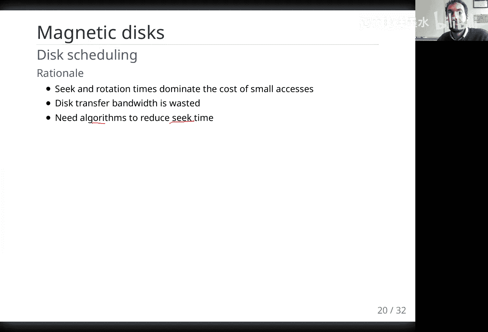

# 操作系统与系统编程：18：存储系统（第一部分）📚

在本节课中，我们将开始学习一个全新的主题：存储系统。这是本课程的第三大主题。我们首先讨论了C语言和系统编程，然后探讨了同步与死锁，现在我们将聚焦于存储和文件系统。最后一个主题将是虚拟内存。

## 概述：存储层次结构

你可能从之前的课程中了解过内存层次结构的金字塔模型。信息处理始于CPU寄存器，CPU通过寄存器执行计算。CPU也能通过指令访问主内存。缓存的存在是为了加速CPU与主内存之间的通信，但对CPU是透明的。这个层次结构中的信息是易失性的，断电后会丢失，且容量较小、成本较高。

为了存储大量数据，我们需要扩展这个金字塔，引入二级存储，如闪存、磁盘或云存储。二级存储的容量可达TB级别，成本低廉，但访问速度远慢于主内存。此外，CPU不能像访问内存地址那样直接访问二级存储，必须通过控制器以数据块为单位进行读写。二级存储的优势在于其持久性，断电后数据不会丢失。

接下来，我们将讨论易失性内存技术和几种二级存储技术。

## 易失性内存技术

### 静态随机存取存储器

静态随机存取存储器是一种用于构建缓存的技术。一个SRAM单元由六个晶体管组成，用于存储一个比特。这种设计成本较高，但一旦写入数据，只要不断电，数据就会一直保持。其访问速度极快，非常适合用作缓存。

### 动态随机存取存储器

动态随机存取存储器用于主内存。一个DRAM单元仅由一个晶体管和一个电容器组成，因此可以在相同面积内集成更多比特。但电容器会漏电，导致存储的电荷随时间流失，因此需要定期刷新数据以保持信息。其访问速度不如SRAM快，但密度更高，成本更低，适合作为主内存。

## 持久性存储技术

上一节我们介绍了易失性内存，本节中我们来看看用于二级存储的持久性技术。

### 磁盘

磁盘是一种常见的二级存储设备。它通过磁头在旋转的金属盘片上读写磁化信息来存储数据。盘片表面被磁化为不同方向，用以表示0和1。这种技术存储密度极高，但需要机械运动来读取数据。CPU不能直接寻址磁盘上的数据，必须通过控制器以数据块为单位进行访问。其延迟在毫秒级，吞吐量也较低，但成本便宜，广泛用于台式机和数据中心。

### 固态硬盘

固态硬盘是另一种二级存储技术。它同样基于晶体管，但特殊之处在于，即使断电，晶体管中存储的信息也不会丢失，因此可以作为持久性存储。我们将在下一讲详细探讨闪存的工作原理。SSD可以非常密集地封装比特，其延迟和吞吐量性能远优于磁盘，但成本也更高。由于没有活动部件，它非常适合移动设备，如智能手机、笔记本电脑和相机。

在接下来的内容中，我们将深入探讨磁盘和闪存这两种持久性技术，分析它们的工作原理及优缺点。

## 深入解析磁盘结构 💽

现在，让我们深入了解磁盘的内部结构。

一个磁盘由多个盘片组成，盘片通常由玻璃、陶瓷或铝制成，表面覆盖一层薄薄的金属膜用于记录磁信息。每个盘片有上下两个表面。所有盘片都固定在一个由电机驱动的中心轴上，并以每分钟数千转的速度高速旋转。

每个盘面都有一个磁头，用于读写数据。磁头非常接近盘面，几乎但不接触，其间有一层空气垫。磁头安装在摇臂上，所有摇臂连接成一个摇臂组件，并同步移动。

盘面上的数据被组织成同心圆轨道，轨道又划分为扇区，扇区是磁盘上最小的数据单元。不同盘面上相同半径的轨道组成一个柱面。

磁盘的基本原理在过去近70年里没有根本性改变，但存储密度和容量已发生巨大变化。

### 轨道与扇区

每个盘面上有大量极细的轨道。典型的2.5英寸磁盘盘面可容纳约10万条轨道。为防止磁信息干扰，轨道间留有间隙。

由于内外轨道周长不同，存在两种处理方式：
*   **统一扇区划分**：内外轨道划分相同数量的扇区，导致内外存储密度不同。这是旧硬盘采用的方式。
*   **区位记录**：保持扇区物理长度相同，因此外轨道能容纳更多扇区，存储更多信息。这是现代硬盘采用的方式。

区位记录带来了速度问题：由于磁盘转速恒定，磁头在外轨道时，数据流经速度更快，带宽更高。

### 扇区结构

一个扇区通常分为三部分：
1.  **头部**：包含扇区ID、坏扇区标记等元数据。
2.  **数据区**：存储用户数据。传统上是512字节，现代硬盘多为4096字节。
3.  **尾部**：包含纠错码，用于检测和修复数据错误。

### 寻址与编号

早期，系统需要指定柱面、磁头和扇区号来访问磁盘。现代方式则是线性逻辑块寻址，每个扇区有一个从0到N的编号，系统只需请求逻辑块号，由磁盘自身将其映射到物理位置。

为了提高顺序读取效率，相邻轨道的扇区编号会进行偏移。这样，当磁头读完一个轨道移动到下一个时，磁盘已旋转到合适位置，磁头能直接落到下一个轨道的起始扇区上。

### 坏扇区处理

扇区可能损坏无法存储数据。处理方式有两种：
*   **备用扇区替换**：每个轨道预留备用扇区。坏扇区的数据被重映射到一个备用扇区，对用户透明，但可能破坏数据的物理顺序性。
*   **扇区滑动**：将坏扇区之后的所有扇区向前滑动，逻辑上填补坏扇区的位置，从而保持顺序读取的效率。

## 磁盘访问性能分析 ⏱️

理解了磁盘结构后，我们来看看如何访问磁盘数据及其性能。

当操作系统请求读取某个逻辑扇区时，磁盘需要完成三个步骤：
1.  **寻道时间**：移动摇臂，将磁头定位到包含目标扇区的轨道上方。
2.  **旋转延迟**：等待磁盘旋转，使目标扇区转到磁头正下方。
3.  **传输时间**：将扇区数据从盘面读入磁盘内部缓冲区，再传输到主机内存。

因此，访问一个扇区的总时间是这三者之和。

那么，这三者中哪个最慢、是性能瓶颈呢？让我们逐一分析。

### 寻道时间分析

寻道时间取决于磁头需要移动的距离。
*   **最大寻道时间**：磁头从最外圈移动到最内圈，通常为10-20毫秒。
*   **最小寻道时间**：磁头仅移动到相邻轨道，约1毫秒。
*   **平均寻道时间**：统计上，平均移动距离约为总行程的三分之一。

### 旋转延迟分析

旋转延迟取决于磁盘转速。平均而言，磁头到达正确轨道后，需要等待半圈旋转才能使目标扇区到来。对于7200转/分钟的磁盘，旋转一周需8.3毫秒，平均旋转延迟约为4.15毫秒。

### 传输时间分析

传输时间分为两部分：
1.  **盘面传输时间**：数据从盘面读入磁盘内部缓冲区。速度取决于磁头所在轨道位置（外圈更快）。
2.  **主机传输时间**：数据从磁盘缓冲区传输到主机内存。速度取决于接口类型（如SATA、USB）。

## 性能实例计算 🧮

让我们通过一个具体例子来感受磁盘性能。

假设有一个硬盘参数如下：
*   2个盘片（4个磁头）
*   容量：未指定
*   转速：7200 RPM
*   平均读寻道时间：10.5毫秒
*   平均写寻道时间：12毫秒
*   最小寻道时间：1毫秒
*   盘面传输速率：54 - 128 MB/秒（内外圈不同）
*   主机传输速率：高（如SATA接口）
*   设备缓冲区：16 MB

**场景一：随机访问**
操作系统发送500个读取随机分布扇区的请求。
*   每次请求需支付：平均寻道时间 + 平均旋转延迟 + 传输一个扇区的时间。
*   传输一个512字节扇区，按最低54 MB/s速率计算，约需9.5微秒。
*   总时间 = 500 * (10.5ms + 4.15ms + 9.5μs) ≈ **7秒**。

可以看到，寻道时间是主要的性能瓶颈。

**场景二：顺序访问**
操作系统请求读取500个连续的扇区。
*   只需支付一次寻道时间和一次旋转延迟。
*   然后连续读取500个扇区。
*   总时间 ≈ 寻道时间 + 旋转延迟 + 500 * 扇区传输时间。
*   按外圈最高速率计算，总时间 ≈ **16毫秒**。
*   按内圈最低速率计算，总时间 ≈ **19毫秒**。

对比可知，顺序访问的性能（毫秒级）比随机访问（秒级）高出数个数量级。

## 总结

本节课中，我们一起学习了存储系统的基础知识。我们首先回顾了内存层次结构，并指出需要大容量、持久且廉价的二级存储。接着，我们介绍了易失性内存技术SRAM和DRAM，以及持久性存储技术磁盘和SSD。

我们深入剖析了磁盘的机械结构，包括盘片、磁头、轨道、扇区和柱面，并解释了扇区结构、寻址方式以及坏扇区处理机制。

最后，我们分析了磁盘访问的三个关键时间：寻道时间、旋转延迟和传输时间。通过实例计算，我们清晰地看到，对于随机I/O，寻道时间是主要性能瓶颈，而顺序I/O能极大提升性能。这引出了一个重要问题：如何通过调度算法来减少寻道时间，从而提升磁盘整体性能。我们将在下一讲中探讨这些磁盘调度算法。