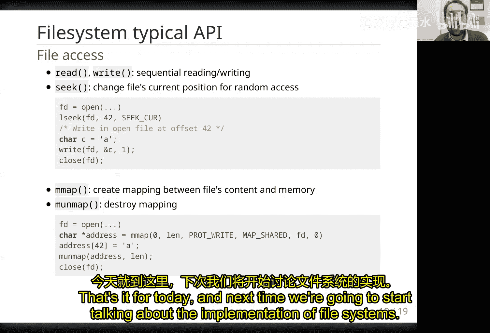

# 操作系统与系统编程：20：文件系统抽象 📂

在本节课中，我们将学习文件系统的基本概念。文件系统是组织和管理大容量存储设备（如硬盘、SSD）上数据的核心抽象。我们将探讨其需求、核心组件（如文件、目录、路径）以及操作系统如何通过虚拟文件系统（VFS）来统一管理不同的存储设备和格式。

---

## 文件系统的需求 📋

上一节我们讨论了大容量存储设备。本节中，我们来看看我们对这些设备上数据的组织方式有何期望。

首先，大容量存储设备（如SSD或硬盘）能存储海量数据（例如TB级别）。我们需要一种简单的方法来查找数据。这就像一个拥有巨大空间的图书馆，需要确保读者能快速找到特定书籍，而不是花费数周时间翻阅所有藏书。

其次，典型的计算机会并发运行多个进程。这些进程可能同时访问存储设备上的数据，因此文件系统需要支持这种并发访问。

第三，在一些计算机（如服务器）上，可能有多个用户同时或在不同时间使用计算机和存储空间。我们需要确保这种空间共享是受控的。

第四，我们需要良好的性能。大容量存储设备速度相对较慢，我们需要策略来应对这种固有的延迟。

最后，我们需要良好的可靠性。大容量存储设备的目的是提供非易失性、持久化的存储。数据需要在计算机关机、重启甚至操作系统崩溃时得以保存。理想情况下，即使一个正在访问存储数据的进程意外终止，也不应导致数据丢失。

文件系统正是为了满足这些需求而设计的抽象。它将数据组织成文件和目录，提供访问控制、性能优化和一定的容错能力。

---

## 核心概念：文件与目录 📄

上一节我们列出了文件系统的需求。本节中，我们来深入了解其核心构建块：文件和目录。

### 文件

文件是一个抽象概念，它将逻辑上相关联的数据（如一个文本文档或一个MP3文件的所有字节）集合在一起，形成一个**逻辑存储单元**。存储设备上用户可交互的每一个字节都属于某个文件。

一个文件由两部分组成：
1.  **元数据**：描述文件本身的属性。例如：
    *   文件大小
    *   创建时间、最后修改时间
    *   文件所有者
    *   访问权限
    *   文件内容在物理设备上的位置
2.  **内容**：文件的实际数据，即一系列字节。

值得注意的是，文件本身并不“知道”自己的名字。文件名是由目录提供的。

### 目录

目录是另一个关键抽象，它为文件提供名称，并用于组织文件和其他目录，形成复杂的层次结构。

本质上，目录包含一个**文件名到文件本身**的映射列表。当你想通过某个文件名打开文件时，目录会告诉你该文件对应的位置（如文件编号），然后通过该位置访问元数据，最终找到存储在硬盘或SSD特定扇区上的实际数据。

这类似于互联网上的DNS服务器：你输入“google.com”，DNS服务器会告诉你对应的IP地址。

---

## 文件名、路径与链接 🛤️

上一节我们介绍了文件和目录的基本概念。本节中，我们来看看如何定位和引用它们，包括文件名约定、路径以及两种重要的链接类型。

### 文件名约定

文件名的具体规则因文件系统而异。历史上，Windows系统传统上是**大小写不敏感**的，而Linux系统是**大小写敏感**的。文件名长度也随时间变化，早期限制较严（如FAT文件系统为11个字符），现在通常可以很长（如最多255个字符）。

文件扩展名（如 `.txt`、`.mp3`）过去是独立于文件名的一部分，并严格决定文件类型。现在，扩展名只是文件名的一部分，作为给操作系统的**提示**，以便在双击文件时知道用哪个程序打开它。你可以随意更改扩展名，但这不会改变文件的真实内容。

**那么操作系统如何识别可执行文件呢？**
对于二进制可执行文件（如C语言编译后的程序），操作系统会检查文件开头的几个字节，即“魔数”。例如，ELF格式的可执行文件开头就是“ELF”字符。
对于脚本文件（如Shell脚本），则依赖**Shebang**（`#!`）行。Shebang位于脚本第一行，指定了解释器的路径。例如 `#!/bin/bash` 告诉系统用Bash解释器来运行此脚本。

### 路径

路径用于定位文件或目录。有两种类型：
*   **绝对路径**：从根目录（在Unix系统中以 `/` 开头）开始的完整路径。
*   **相对路径**：从进程的**当前工作目录**开始的路径。每个进程在PCB中都有一个当前工作目录，进程可以通过 `chdir` 函数来改变它。相对路径中，`.` 代表当前目录，`..` 代表父目录。

### 硬链接

硬链接允许**多个不同的文件名指向同一个文件**。两个目录中的条目可以映射到相同的文件编号（即相同的元数据和数据）。

这带来一个复杂性：如果允许对目录创建硬链接，就可能创建出**循环引用**，使得遍历文件系统变得极其困难，因为无法区分“原始”链接和“副本”链接。

因此，为了简化，**硬链接通常被禁止用于目录**。所以，包含硬链接的文件系统结构不是一个树，而是一个**有向无环图**。

### 软链接（符号链接）

软链接与硬链接不同。**软链接本身是一个独立的文件**，它的文件内容存储的是它所要指向的**目标文件的路径**。

软链接在元数据中会被标记为链接类型。因此，遍历文件系统的程序可以识别并选择忽略它们，或者通过限制跟随的软链接数量（例如，POSIX标准通常限制为8次）来避免由软链接造成的循环问题。

---

## 卷、分区与挂载 💽

上一节我们讨论了如何引用文件。本节中，我们来看看操作系统如何管理物理存储设备本身，包括卷、分区和挂载的概念。

### 卷与分区

一个**卷**通常指一个格式化了、可用于存储文件和目录的存储空间。它可以是一个完整的物理设备（如一块1TB的SSD），也可以是设备的一个**分区**。

**分区**是将一个物理存储设备划分为多个逻辑上独立的部分。例如，可以将一块1TB的硬盘分成两个512GB的分区，并分别格式化为NTFS和FAT文件系统。每个分区就像一个独立的“房间”，拥有自己的文件组织。

在传统硬盘上，第一个扇区（扇区0）称为**主引导记录**，它包含分区表。早期MBR支持最多4个主分区，后来通过扩展分区支持更多。现代系统使用**GPT**分区表，可以支持多达128个分区。

### 挂载：统一文件系统视图

当计算机有多个卷（来自不同磁盘或分区）时，操作系统有两种主要方式呈现它们：

1.  **Windows方式**：为每个卷分配一个独立的驱动器字母（如 `C:`、`D:`）。各卷在文件浏览器中显示为独立的实体。
2.  **Unix/Linux方式**：通过**虚拟文件系统**将所有卷统一到一个单一的目录树中。这个过程称为**挂载**。

例如，在CSIF计算机系统中：
*   硬盘的第二个分区被挂载到根目录 `/`。
*   硬盘的第一个分区（引导分区）被挂载到 `/boot`。
*   存储用户文件的网络服务器被挂载到 `/home`。
这样，所有存储空间都嵌套在同一个目录树下，用户感觉是在访问一个统一的文件系统。

系统通过配置文件（如Linux的 `/etc/fstab`）来知道如何挂载各个卷。该文件指定了硬件设备、挂载点目录和文件系统格式。

---

## 文件系统架构与API 🏗️

上一节我们了解了物理存储如何被组织成卷并呈现给用户。本节中，我们从软件层面看看文件系统是如何工作的，以及应用程序如何与之交互。

### 软件层次

访问存储数据涉及多个软件层次：
1.  **应用程序/进程**：调用如 `open`、`read`、`write` 等系统调用。
2.  **内核与虚拟文件系统**：系统调用进入内核，由**虚拟文件系统**子系统处理。VFS提供了一个统一的文件接口。
3.  **文件系统驱动**：根据文件所在位置和卷的格式（如FAT、EXT4、NTFS），VFS将请求转发给相应的后端驱动。
4.  **设备驱动**：最终由知道如何与具体硬件（如SATA硬盘控制器、NVMe SSD控制器）通信的驱动来访问物理扇区或页面。

此外，有些“文件”（如Linux中的 `/proc/cpuinfo`）并非真实存储在磁盘上，而是由内核动态生成，用于提供系统信息。

### 文件操作API

进程通过一组API与文件交互：

**创建与删除文件**
*   `create(path, mode)`：创建一个具有指定名称和权限的空文件（包括元数据和目录映射）。现代编程中更常用 `open(path, O_CREAT, mode)` 来同时创建和打开文件。
*   `link(oldpath, newpath)`：创建一个硬链接，即一个新的文件名指向一个已存在的文件（不创建新数据，只增加一个目录映射）。
*   `unlink(path)`：删除一个文件名到文件的映射。**只有当文件的最后一个硬链接被删除，即没有任何目录条目指向它时，文件的元数据和数据才会被真正从磁盘上移除。**

**打开文件**
`open(path, flags)`：打开一个已存在的文件。系统会检查权限，如果成功则返回一个**文件描述符**——这是一个用于后续读写操作的句柄。

打开文件时，内核内部会进行复杂的管理：
*   每个进程有一个**文件描述符表**。
*   内核维护一个**打开文件表**，每个表项包含当前文件偏移量等信息。
*   打开文件表项再指向**文件元数据**。
*   关键点：
    *   同一个进程多次 `open` 同一个文件，会创建不同的打开文件表项，拥有独立的偏移量。
    *   使用 `dup2` 复制文件描述符，会共享同一个打开文件表项，从而共享偏移量。
    *   子进程会继承父进程的文件描述符，指向相同的打开文件表项。

**访问文件数据**
获得文件描述符后，可以：
*   `read(fd, buffer, size)` / `write(fd, buffer, size)`：进行顺序读写。
*   `lseek(fd, offset, whence)`：改变当前文件偏移量，支持随机访问。
*   `mmap(...)`：一个更强大的函数。它将文件内容直接映射到进程的地址空间。之后，进程可以像访问内存数组一样访问和修改文件内容，这为随机访问提供了极大的便利。

---

## 总结 📝

本节课中，我们一起学习了文件系统抽象的核心内容。

我们首先探讨了文件系统需要满足的需求：管理海量数据、支持并发访问、提供访问控制、优化性能以及确保可靠性。接着，我们深入分析了文件系统的核心构建块：**文件**（包含元数据和内容）和**目录**（提供文件名映射和组织结构）。

我们学习了如何通过**路径**定位文件，并区分了**硬链接**（多个文件名指向同一文件数据）和**软链接**（存储目标路径的独立文件）。然后，我们了解了物理存储如何被划分为**卷**和**分区**，以及操作系统如何通过**挂载**将它们统一到一个虚拟文件系统视图中。

最后，我们从软件架构角度审视了文件系统，包括从应用程序到硬件驱动的各个层次，并概述了用于创建、打开、读写文件的核心API及其内部工作原理（如文件描述符、打开文件表）。

下一节课，我们将开始探讨文件系统的具体实现。