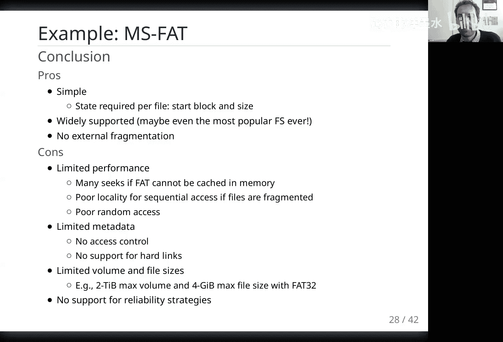

# 操作系统与系统编程：22：文件系统实现（第二部分）


在本节课中，我们将继续探讨文件系统的实现。我们将学习更多不同的索引结构，并通过研究微软FAT文件系统的工作原理来开始我们的第一个案例分析。

## 概述

上一节我们介绍了文件系统的基本概念和几种数据组织方式。本节中，我们将深入了解更复杂的索引分配策略，并分析一个经典文件系统——微软FAT的实现细节。

## 索引结构回顾与深入

文件系统的核心任务是从文件名和偏移量定位到磁盘上的物理数据。这涉及目录、文件元数据和索引结构。

### 直接分配法

直接分配法是一种策略，其核心思想是将指向数据块的指针数组直接存储在文件的元数据中。

*   **工作原理**：文件元数据包含一个指针数组，数组中的每个元素直接指向文件的一个数据块。
*   **优点**：支持真正的随机访问。要访问文件中间的数据，只需计算并访问数组中对应的指针即可。
*   **缺点**：文件大小受限于元数据块的大小。为了支持大文件，元数据块本身会变得非常大，这通常不是理想的设计，因为元数据最好保持固定且较小的尺寸。

### 索引分配法

索引分配法是对直接分配法的改进，旨在解决元数据过大的问题。

*   **工作原理**：文件元数据保持固定的小尺寸，只包含一个指针，指向一个专门的**索引块**。这个索引块是一个普通的数据块，但其内容不是文件数据，而是一个指针数组，数组中的每个指针指向文件的一个实际数据块。
*   **优点**：元数据尺寸固定且较小。文件大小理论上受限于一个索引块能容纳的指针数量。
*   **缺点**：
    1.  文件大小仍受单个索引块容量限制。
    2.  对于小文件存在开销。即使文件只有几个字节，也需要分配一个完整的索引块和一个完整的数据块，造成空间浪费。

### 多级索引分配法

为了突破单个索引块的容量限制，引入了多级索引。

*   **工作原理**：文件元数据指向一个**一级索引块**。这个一级索引块中的指针不直接指向数据块，而是指向多个**二级索引块**。每个二级索引块中的指针再指向实际的数据块。这样就形成了一个树状结构。
*   **优点**：能够支持非常大的文件。例如，使用4KB块和32位指针，两级索引就能寻址4GB的文件，且最多只需两次磁盘访问（读取一级和二级索引块）就能定位到任意数据块，性能较好。
*   **缺点**：对于小文件的开销更大。一个只有几个字节的文件，也需要分配一级索引块、二级索引块和数据块各一个，空间浪费更严重。

以下是多级索引的简化示意：
```
元数据 -> 一级索引块 -> [二级索引块1, 二级索引块2, ...]
每个二级索引块 -> [数据块1, 数据块2, ...]
```

### 混合策略

正如我们所见，从直接分配到多级索引的各种策略各有显著的优缺点。在计算机科学中，最佳策略往往是多种策略的混合。我们将在后续课程中看到，现代文件系统如何根据具体情况综合利用这些策略，以达到灵活性与性能的平衡。

## 案例分析：微软FAT文件系统

现在，让我们来看一个真实世界中的文件系统实例：微软的FAT（文件分配表）文件系统。它与链接分配法非常相似。

### FAT简介

FAT是一个历史悠久的文件系统，诞生于20世纪70年代末，最初用于软盘。它曾是MS-DOS和早期Windows（如3.1、95、98）的主要文件系统。尽管年代久远，FAT因其极简的设计，至今仍在许多嵌入式系统、移动设备和USB闪存驱动器上广泛使用。
FAT的主要版本有：
*   **FAT12**： 支持最多约4000个文件，卷大小至多32MB。
*   **FAT16**： 支持最多约65，000个文件，卷大小至多2GB。
*   **FAT32**： 最流行的版本，支持最多约2.68亿个文件，卷大小至多2TB。
*   **exFAT**： 现代版本，支持超大卷（128PB）和大量文件。

### 核心：文件分配表

FAT系统的核心是**文件分配表**。它实现了链接分配法，但进行了一个关键改进：将“下一个数据块”的指针从数据块本身分离出来，集中存储在这个FAT表中。

*   **工作原理**：FAT表是一个大数组，数组的每一项对应磁盘上的一个数据块（在FAT中称为“簇”）。数组的索引号就是簇号。每一项的内容指示了该簇的下一个簇是哪个。特殊的标记（如`EOC`）表示链的结束。
*   **双重功能**：
    1.  **索引结构**：通过遍历FAT表中的链，可以找到属于某个文件的所有簇。
    2.  **空闲空间管理**：FAT表项值为0表示对应的簇是空闲的，可用于分配。

以下是FAT表示例：
```
簇号:   0   1   2   3   4   5   6   7   8   9   10  11  12  13  14  15  16  17  18  19 ...
FAT项: [保留][保留] EOC  17  EOC  0   0   EOC  0   10  11  3   EOC  0   0   0   0   0   0   ...
```
对于文件`foo.txt`，目录项指出其起始簇是9。查看FAT表：
*   簇9的项是10，指向下一个簇。
*   簇10的项是11，指向下一个簇。
*   簇11的项是3，指向下一个簇。
*   簇3的项是`EOC`，表示文件结束。
因此，`foo.txt`的数据存储在簇9、10、11、3中。

### 目录结构

在FAT中，目录被视作一种特殊文件，其内容是由固定长度（通常为32字节）的目录项组成的数组。

每个目录项包含以下信息：
*   **文件名和扩展名**（早期为8.3格式）。
*   **文件属性**（如是否只读、隐藏、系统文件、目录等）。
*   **创建/修改/访问时间戳**。
*   **起始簇号**（文件第一个数据块的索引）。
*   **文件大小**。

从目录结构可以注意到FAT的两个特点：
1.  **无权限控制**：目录项中没有文件所有者信息，因此FAT不支持基于用户的访问权限控制。
2.  **不支持硬链接**：文件名直接与文件数据（通过起始簇号）关联，缺少“文件名->inode号->元数据”这层抽象，因此无法让多个目录项指向同一份文件数据。

### 磁盘布局

一个FAT格式化的磁盘或分区，其布局通常如下：
1.  **引导扇区/超级块**： 存储文件系统参数（如块大小、FAT大小等）。
2.  **FAT区域**： 存放文件分配表（通常有备份）。
3.  **根目录区域**： 存放根目录的目录项。
4.  **数据区域**： 存放文件和子目录的实际数据。

### 性能与碎片整理

FAT的链接分配策略可能导致文件的数据块在物理上不连续（碎片化）。顺序读取一个碎片化的文件会导致磁头频繁移动，降低性能。

为了改善这种情况，需要进行**碎片整理**。这个过程会重新排列磁盘上的数据块，使每个文件的数据块尽可能连续排列，同时将空闲空间合并，以提高未来分配的连续性。

### FAT的优缺点总结

**优点：**
*   **结构简单**： 设计简洁，易于实现和理解。
*   **兼容性极广**： 几乎被所有操作系统支持。
*   **无外部碎片**： 只要有空闲簇，就可以分配给文件增长。

**缺点：**
*   **性能局限**：
    *   **FAT表内存占用**： 对于大容量卷，FAT表本身可能非常大（例如400GB卷的FAT32表约需400MB内存），若无法完全缓存，性能下降。
    *   **随机访问慢**： 访问文件中间部分需要从头遍历FAT链。
    *   **碎片化影响**： 碎片化会严重影响顺序读写性能。
*   **功能局限**：
    *   **无高级特性**： 不支持硬链接、文件权限控制（ACL）。
    *   **容量与文件大小限制**： 例如FAT32最大卷为2TB，单个文件最大4GB。
    *   **可靠性弱**： 缺乏日志等机制，系统意外崩溃可能导致数据损坏或丢失。

## 总结



本节课我们一起深入学习了文件系统的索引结构，包括直接分配、索引分配和多级索引分配，并分析了它们各自的优缺点。随后，我们以微软FAT文件系统为案例，剖析了一个基于链接分配法的真实文件系统的设计、磁盘布局、工作原理及其显著的优缺点。FAT的简单性与广泛兼容性使其经久不衰，但其在性能、功能和可靠性上的局限性也催生了更现代的文件系统。下一节课，我们将研究另一个经典案例——主要用于UNIX系统的文件系统。