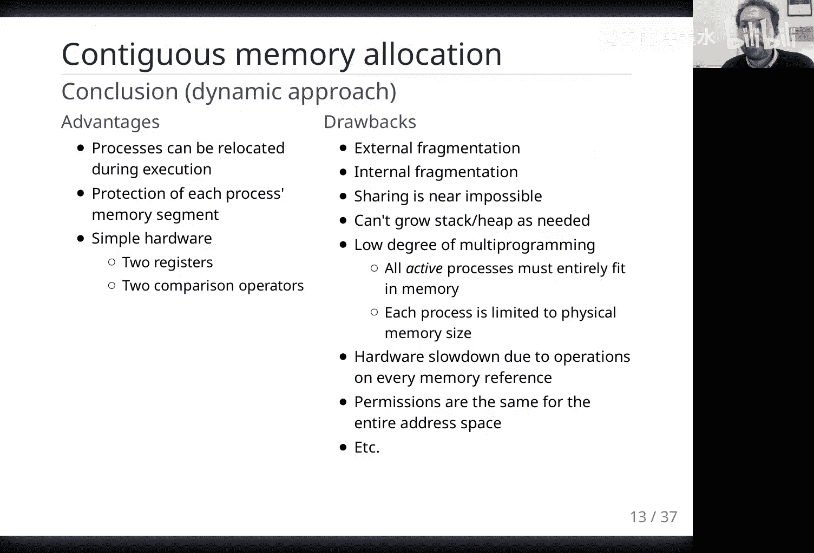

# 【全集 附课件】加州大学戴维斯分校 操作系统与系统编程 中英字幕 1080P p24 Lecture 24 - 地址转换part1 -BV1jXr5BBEKa_p24-

Hi everybody， So today we're starting the fourth and last part of these course。So if you remember。

 the first part was about system programming and defining the interface that we have between applications and the operating system。

The second part was about multi threading， synchronization mechanisms and deadlocks。

 the third part which which we just finished。It has about file systems。

And this last part is about virtual memory。So why do we need virtual memory in the first place Well。

 ideally， if things were perfect in a computer， we pretty much only need a CPU and main memory。

And obviously some I devices so that we can interact with the outside world。

 but at least in terms of memory， we would just need some main memory。In a way that's very。

 very fast， like the main memory would answer the processor in say one cycle。

So every time the main processor executes a load instruction or a store instruction。

 the memory just answers super fast。The memory would be extremely large。

 large enough that you could like store all of your files directly into the main memory and all of the processes that are running on the computer。

 everything could be just stored directly in the main memory。

Like the main memory would be like terabytes in size。And it would be non volatile。

In the sense that you would turn your computer off， turn it on again。

 and the main memory hasn't moved to the extent that you could just resume whatever was ringing before exactly where it stopped。

 so that's the ideal scenario。If we had that， we would not need。A Vitro memory。In practice， though。

As we know， the main memory is not so fast， it's fast enough， but it's not that fast。

 and that's why we need processor caches， even multiple levels of processor caches to accelerate the communication between processor and memory。

And it's also not that large， just nowadays， still like a few several gigabytes in size。

 and it's volatile， meaning that you turnt off your computer。

 everything that's in the main memory is lost。And those two reasons are why we need persistent mass storage。

 so like big SSDs or big magnetic hard drives and so on。And。😊，In the future。It might change。

This ideal memory model might totally happen， especially because we discovered some years ago this new element。

 the kind of fourth basic element called memory store。

 which might one day enable that kind of memory that's like super fast。

 we can make it very large and it nonvolat。And as a matter of fact， as of now。

 CPUs are kind of ready already to handle that kind of model。If you take 604bit processors。

 they are able to address。Quantities of memory that are huge， like way beyond。

Everything that you have currently on your hard drive。 and I mean， the CPUs could handle very。

 very large amount of memories。 So the issue is not in terms of what the CPU can support at this point。

 it's more in terms of like what the memory itself can provide。嗯。

And so in the past and up until now and probably for many years to come still。

We need to use a memory hierarchy。To make sure that we are using this main memory that has a lot of limitations as best as possible。

Meaning that because it's slow， we need some very， very fast memory cache so that the CPU doesn't need to go to the main memory all the time and kind of like can get the data that it wants quicker。

The main memory itself is medium speed， medium price， and it's addressable by the CPU。

And for the large amount of data and the volatility aspect， we use just second level mass storage。

And so to make sure that we are using this hierarchy as best as possible。

 we need to manage it properly and that's pretty much what this virtual memory is about。

 it's like how do we make the most of this main memory to make sure that we still get a computer that's pretty usable that does a lot of things and so on。

So let's actually like start from the beginning and from a model of computing that has existed maybe like 70 years ago and we're going to start from there and then we're going to pretty much like see the different techniques that have succeeded up until today。

So at the very beginning， probably 70 years ago， we would be only able to load one program in the memory into a process at a time。

So the compiler would have compiled some code， created an executable， say executable A。

 and so we want to run a， so we load a in memory。At address 0。

We also create so loading a here means that we're loading the code and the data segment and the stack and the he are created dynamically。

 so overall we're like occupying a contiguous segment of memory。Here for the process。

And when this process runs on the CPU， it uses directly physical addresses。

 there's no layer of translation or whatsoever。The OS on its end gets a fixed part of memory。

 usually like at the very top end so that it doesn't bother the user process so much。And essentially。

 like the memory that is available for the process is everything that the kernel。

 the OS is not using。And here to provide potentially a little bit of protection。

 we could make sure that the physical address that the processor issues。

Doesn't fall above the threshold here into the  kernelnel。

 and so we could compare it to a certain bound。And if the physical address like goes beyond that bound。

 then we raise an exception， and that means that the process has tried to tam with the kernel。So。

 back in the day。It probably such a computing model probably existed。As you may imagine。

 there are a lot of issues with that model mainly due to the fact that we can only have one process loaded at any time in memory。

 which obviously makes the computer less interesting than what we would want to do。First of all。

 because usually we want to be able to use multiple processes at the same time。

 but also because it's actually a waste of CPU if I can only load one process at a time。

And that process will obviously be blocked by doing some IO Accesses like reading stuff from the keyboard that you would type or waiting for the。

 I don't know， hard drive to complete some operation， then it means that the process cannot run。

 it's in the block state and the processor is totally idle in the meantime。

Whereas it could be running other things。It's also a waste of memory because if the user process here after being loaded and having the stack and the he created。

 we still have some free space in memory here。Well， ideally。

 we would want to use that space to put another process， for example。

 here in that model just wasted up until this process is done and we load another one。

So bottom line here。What I just presented is called uni programming because we only have one process at a time。

 what we really want is multiprogram， we want to be able to have multiple processes loaded in memory and running concurrently at a time。

So。Actually， one way of achieving multi programming。

By still kind of relying on the uni programming model， and that's something that existed。

 I think maybe in the 1960s or something like that is called swapping。The process is interesting。

 the idea is that。😊，You， you can still only have one process。

At a time in memory and executing on the on the CPU。However。Sorry。

When this process gets blocked for some reason because it's， I don't know。

 waiting for NIO or something like that。It's possible to swap it out。

 So you taggged the entire image of the processing memory and you put it back somewhere。

On your big master device。 So， I mean， given that you have the space。

 but usually like hard drives are never used100%， or you could create a specific partition just just for that。

But so essentially， you copy the entire user process。

Back to some temporary space on your second level storage。And instead， you swap another process in。

Into the memory and now that process can run and so here by swapping you can like load the process。

 run it fairly bit until this block， then put it back on this， then take another process。

 bring it in memory， run it fairly bit until this block。

 put it back into this and you essentially do it's still kind of unique programming every time you look at what the computer does。

 but you're able to switch between two processes。The massive issue here is that swapping is extremely slow。

嗯。😊，And that's due to the fact that mass storage devices are very slow， as you now know。

A hard drive doesn't have a very good bandwidth。 A hard drive might have like something like a bandwidth of 100。

Megabytes per second， that's the amount of bytes that it's able to transfer per second。

It's very likely that processes running on a computer at a time。

 they will take say like I don't know， 200 megawabytes。

U I'm sure that today if you look at the memory occupation of your web browser。

 Firefox or Chrome and you have like， I don't know， 50 tabs open at the same time。

That would be even more than 200 mebytes， we would probably be counting the amount of space that Chrome or Firefox is taking in gigabytes。

So now it means that， say you have a process of 200 megabyte and your hard drive as a bandwidth of 100 megabytes per second。

 it means that swapping out will take a couple of seconds and swapping in the next one might also take a second or two。

Which will make your computer like probably very， very slow。So， O。Great， but not that great。

What we want is true multi programminggram， not this like pretense of multi programminggraming。

So how do we define this true multiprogramming and what do we need to make it happen？

We need transparency。Transparency means that we need to be able to have multiple processes。

In the memory， at the same time， like the actual same time， not like one after the other。

We need processes。To be completely transparent to that fact， totally agnostic。

They must not be aware that the memory is actually shared between multiple processes。

 because there's no reason they should know。呃。And if processes are going to share the same memory together。

 they should also not care at what address they are being loaded。 We cannot guarantee like。

 they cannot be all loaded at address 0。Only one can。

So they're all going to be loaded at different addresses and they should be fine with that。

So that's for transparency。We also want safety。If we're going to have multiple processes loaded at the same time in the main memory and executing on the CPU concurrently。

 we need to make sure that we have good protection so that processes are not able to corrupt one another and they are not able to corrupt the kernel。

 the operating system。Next is efficiency contrary to swapping。

 which is super slow here the idea is that ideally we would like for the CPU and the memory to not be too degraded from doing this multi programming because otherwise it's not going to be worth it if we have to wait like three seconds in between like。

Switching from one process to the next， it's not going to be that great to use that computer so。

as much as possible， we want the performance to not like suffer any too much overhead from that multi programminggram。

And finally， we want flexibility。That means a couple things， the first is that。Ideally。

 it'd be great if we could。😊，Have。A lot of processes active in the system at the same time。

Even though the combined size of all of those processes is actually larger than the amount of space we have in the main memory。

嗯。That flexibility we're not going to address right now like we're going to address it in a little while。

 but keep it in mind。And same for this one like。The fact that ideally。

 it'd be great if we had a process that was huge。And potentially bigger than what we have a variable in the main memory and it still so let's say I don't know。

 you have a computer that only has one gig of main memory。And you want to run Chrome with like。

 I don't know， 200 tabs and Chrome overall should take2 gigy in memory， while ideally。

 that should still work。And we'll see how。And finally。

 we would also want processes to be able to share memory with one another。

 so if two processes they want to have some sort of like shared buffer， they should be able to do so。

So here are all of the requirements now we're going to go through different techniques in order to try to implement all of those requirements。

And it's obviously going to take a while until we can really。Check all of them。

So here's an illustration of this multiprogram again。

 like the idea here now would be that you could have multiple processes。

Loaded at the same time in the physical memory and then kind of taking turn on the processor for execution。

 so they would execute concurrently。In order to make that happen， we need two things。At least。

We need something called relocation。Relocation is the ability to load。A program anywhere in memory。

So remember， like before with uni programming and swapping。Processes were loaded at address 0。

 That's the only option here。What we want to be able to do is that if we want to execute。

 say executable D and the only space we have is up there， it should be possible to load。Process D。

 add an address。 That is not。0， that's like anywhere in memory。

 And that process should be able to run from there。

And even we should be able to dynamically relocate a process。

 so even if it starts running at that address the first time that its loaded。

 ideally it'd be great if we can later for some reason move that process somewhere else in the physical memory and it would still work。

We'll see how to make that happen。And the second big requirement to make that happen is protection。

So here if we're going to have multiple processes loaded in memory and all of them taking a turn on the processor。

 we want to make sure that say process R a will not be able to access any data or anything from process B or anything from the kernel and so on。

 so each of them is in a little box。诶。So how to make that happen。

Here is a first big strategy that was also used once upon a time。Called contiguous memory allocation。

So here are the idea is that。嗯。😊，When we compile a certain exeable executable A based on some source codes。

The compiler， because it doesn't know where this executable will end up being loaded in the main memory when it actually runs。

By default。Each executable will kind of implicitly be compiled as if it would be loaded later in memory at address0。

 that's the only possible like reasonable assumption we can make。And。😊。

Except that then when an executable is loaded in memory to become a process。We need to be able to。

Relocated it。At a certain base value。Which is where we have the space to create this process。

 and this base value will most likely be something that is different than 0。

So then as part of a process。In memory， we're going to have the code segment， the data segment。

 the he and the stack that are growing towards one another。And at the very beginning of the stack。

That's where we have the bound。And what we know， what we need to guarantee is that。

When this user process a runs。There's no reason that it would make memory accesses。

Below that base or above that bound。All of the memory accesses should be in this one contiguous。

Memory segment。There are two approaches to try to implement this idea。

 one of them is called the static approach， and the other one is called the or implements a dynamic approach。

So let's start with the first one。With the static approach。Everything is going to be done beforehand。

Up to when the process is loaded into memory。So actually， let's go back to the beginning。

 Let's go back to when we write。A certain program ourselves。In a code editor。

 So that's not real code。 but imagine like that's essentially like function main calls function full。

 And that is the end of function main。 That's something you would like write in your in your code editor。

When the compiler compiles this code。Into assembly language， like human Readable assembly language。

Those statements that you would write in C are in some like compile language。

They will be so transformed into assembly instructions。呃。And the。

 the function names will become label。So when you actually like declare a main function。

 it's just going to。Be seen as a label。Which means it's going to be seen as an address。 So here。

 for example， like fo。Is a label that corresponds to the address of the first instruction of this function P。

And in Maine， when we jump， when we call the function foo。

 what we really do is just like jump to the first instruction of function fo。啊。

Right after having pushed some arguments in the stack if necessary or not。So yeah。

So that's the representation in assembly code。Now， we have the asler。

Which takes this human readable assembly code and transforms it。Into。

A binary object into binary instructions。And now those labels， they are， they are actually。

Transform into numbers。So for example， like the first instruction。

Of a certain C file will be put at address 0。And say function Fu here。

 the first instruction of function Fu， which was of still now represented by a label。

 will now be represented by a certain offset in the program， such as like offset 75。

And so our jam fo now becomes a clear gem to whatever is at address 75。So now like labels。

 they become addresses。😡，At this point at the end of the assembly phase， what we have is this dot O。

 the object file。And every C file is compiled into its own object file。

And so all of the object files， they all start from address 0。 So they are all like a very local。

And the last phase is to take all of those object files and link them together。And essentially。

 we're going to concatenate them。嗯。What it means is that。

A certain object was not aware of the other objects。

 so they were all starting from zero now that they are being concatenated to one another。

 we we need to offset all of them。So for example， like this object will now be placed at address 100 because there's something else at address zero。

So this jump 75 needs to be shifted by 100。To jump 175。

And the first as instruction of F will also actually be at address 175。So here。

 like addresses are adjusted。According to the number of object files that we have for that program。

And so， at this point。We now have an executable。Now。

 when we run this executable and we transform it into a process。

It's very possible that we will need to load it at an address at a physical address that is not zero because there could be another process there。

So， we need to translate。Those addresses to the final physical memory address。

 where this executable will be loaded。So imagine that in the physical memory。

 we are actually loading this executable at address 1000。Then it means that now at load time。

 when we're really actually creating a process。😮，We need to relocate one more time all of the addresses and shift them by the base address at which this program was being loaded。

And so if it was loaded at address 1 thousand0， then we need to go through the entire app。

Program here and change。Essentially， like add 1 thousand to all of the addresses。

That were used in the program。The issue with this static approach。

Is that we can only do one initial relocation。😡，Like we start this executable。

 we load it in memory where we have some space at a certain base address。And we now like adjust。

 readjust all of the addresses inside of the program。

And now we start like running this actual process once the process runs and starts defining like memory pointers and and all of that。

 there's no going back。 Like now this process needs to be at address 1000。All the time。

 we cannot further relocate it somewhere else。 It's not possible anymore。

 So we lack a little bit in terms of flexibility。Also， there's no actual protection。

If here in the code。We have an instruction that says like， I don't know。

 load something from address like I don't know， 75 we'd be able to access something else in the physical memory that is in another segment that is not ours。

 which is bad。So there are many issues with that static approach。

So let's now see the dynamic approach。So in the dynamic approach。

 instead of doing this relocation statically at load time to like move all of the addresses to correspond to the base where the process will be loaded here we don't do that and we do the relocation and the protection at runtime。

Like once the process will actually be running。That essentially means that the process。

Running on the processor。Will run by using certain virtual memory addresses。

 because now the process will not know about its own relocation。 So the process will think。

That it's loaded at address zero， exactly at the same location as it was compiled。

The process will issue virtual addresses in that memory space。

And those addresses will be translated at runtime。To， in fact。呃呃呃嗯。

Like point to where the process really is in the physical memory， which can be somewhere else。

If the translation is deemed to be invalid， and that's how we're going to provide the protection part。

Then we can catch it， raise an exception， and the process would be stopped accessing memory that it doesn't have access to。

So that's kind of like the idea， let's look at the implementation for that approach。So。Again。

What I said is that process a here。Would think that it's running， say between address  zero。

 which it was compiled for and say like address 500。

 that's the boundary that's where its stack is and so doesn't need to to go beyond 500。

A runs on the processor under that assumption。And then when it issues addresses。

 those are virtual addresses in between zero and 500。Now the thing is like。What if user process A is。

 in fact， loaded at address 1000， because that's where we had space in the physical memory。Well。

 what we can do is have a base register or a relocation register that actually contains the offsets between what a thinks its virtual address starts at and where it actually starts at in the physical memory。

And so every time that a will say， hey， I want to address access， I don't know， address 20。

The processor will say， hey， I want to access address 20。

And we'll add the base register to this address 20 to 1020。

 and now we're actually accessing the right data into virtual memory。

So the relocation here is done at runtime。Every time that the process issues of memory address。

And because we know that a should not issue addresses that are above 500。

 we can also have a bound register that contains the address， the maximum address。

And if ever we go beyond。D bound。Then we can raise an exception。Colonll takes over and deals with it。

So we're getting somewhere here。Like， just by adding a couple of registers。And other and comparator。

 we are able to provide。😊，Dynamic proation。And。It's great here because like it means that if for some reason we want to move process A later。

As it's running to another location in memory， the only thing we need to update。Is the base register？

That's pretty much。A will still think no matter what that it's executing between 0 and 500。

All we need to do is change the offset that we're adding to the virtual addresses to match where a is actually located in the physical memory。

嗯。The big issue that we still have here is that。The entire process needs to be。Contiguous。

In the physical memory。 So we need to find the space in the physical memory that is enough to contain all of A's data。

 like all of the code， the data segment， hip segment。Stack segment， and so on。

So speaking of memory allocation。There are呃。T like every time we talk about memory allocation and the idea of like。

 say allocating a bunch like a segment of memory。Inside of a certain space。

 we have different strategies。So for example， we have something called first fit。

 first fit would mean you start from zero and you look at all of the sections of free space and you pretty much allocate the first section of free space that is big enough to accommodate whatever allocation you're trying to do at the moment。

Another strategy is called best fit。 So here you go through the different。Segments of free space。

 And instead of giving the first one that that is big enough。

 you give the one the the first one that is。Big enough。

To accommodate for the space that you're trying to allocate。

 but that is the smallest one as possible so that you don't waste too much。

And worst fit is the exact opposite of best fit。Every time you have an allocation。

 you just return the biggest memory the biggest free segment of memory that's available in the system。

So。Here is an example of now like multi programminggramming where say at some point you have three processes in the system。

 ABC， then say like B terminate so you can like the system can free that space。

Then the user decides to run process D， so you find in that free space here。

 a segment of memory that's big enough for D， which say is like here and then I don't know later like process a1 minute so that makes some free space over there and so on。

There's a typical issue that can happen at some point， what if the user wants to run user process。

 I don't know F？And it turns out that F。Has。That size。You need that size in memory。

The problem here is that。This segment of memory is not big enough。This one is not big enough。

 and this one is not big enough either。 So technically。

 you can't run F because F needs more space than what you have。

The thing is like you actually have that space， right？

If you were able to somehow allocate that space， plus some of that space。Then it would work for F。

The problem is that with that strategy， you need the memory to be contiguous and here it's not contiguous。

What kind of fragmentation is that？This is extra fragmentmentation。

So there's a technique here to still make it work。Which is called compaction。

Compaction is the idea that like。If you have holes。In the physical memory。You can。

Kind of stop all of the processes and the kernel can move the processes on say like on one end of the memory。

2。Merge all of this free space together to maximize the amount of free space and be able to answer memory education requests for like future processes。

And with the dynamic approach， it's possible to do that because。Again。

 like say if user process D here。Who was located at offset 1000。

It's very easy to relocate that say address。500， all you need to do is just change the base register that is associated to use a process D。

And the whole thing will still work because the computation of physical addresses is done at runtime whenndy is actually running onto the CPU。

So that's one strategy， compaction to deal with external fragmentation。

Another idea to make sure that you can accommodate multiple processes at the same time。

Even in situations where you have say more processes than the amount of memory you have in the system。

 you can use swapping so for example， like if you have a bunch of processes in your system and it turns out that user Pro B is waiting for someone to type something on the keyboard。

And it's been like。5ive seconds， I don't know that nothing has been typed in the keyboard。

And so bees here like waiting for nothing， I mean， are being blocked for a long time。

Well you could swap it out。Of the main memory and put it on some temporary space on disk。

Change its state to something a little bit more than blocked。

 Change its state to something that says like， oh， it's suspended。

 Like it's actually not even loaded in memory at the time。 it's like。

It's been temporarily copied onto this because it's blocked for a long time and then whenever the user like finally I don't know a minute later like enters something on the keyboard and presses enter。

 that's when you can like swap it back in but in the meantime it means that all of the space that this process was using has been freed from the physical memory。

And can be used by other processes。And so here it means that we're on our way to allow more processes than what we can really like than the memory we have in the in the main memory。

Okay， so quick conclusion in here， more on the dynamic approach because the static approach is really pretty bad。

嗯。So dynamic approaches getting us like definitely towards through multiprograming， not quite yet。

 but we're on our way， we can relocate processes upload loading and also during the execution。

The segment， the contiguous segment of every process is protected。诶。

And that by using pretty simple hardware two registers based on the bound and two like hardware operators to do the addition and the comparison。

However， unfortunately we have a lot of drawbacks as well with this dynamic approach。

 one we talked about is external fragmentmentation because of the fact that all of the memory segments needs to be contiguous。

 so we do have compaction for example， but that has a cost to move things in memory back and forth。

There's also an issue of internal fragmentation because it means that for every process。We need to。

 so we have the code segment， we have the data segment， and then we have the heap。And the stock。And。

😊，We don't really know before the process is running how much stack we need and how much he we need。

But we need to make a decision because we cannot make this he and stock section as big as possible。嗯。

But what might happen is that， in fact， we' are。Provisioning some space here to make sure that the process will not run out of stack or run out of heap。

 so we make it like probably bigger than necessary， except that if the process， in fact。

 doesn't use use a lot of stack or out of heap， there will be a lot of space in the middle that's totally wasted。

So that would make some internal fragmentation。We mentioned earlier the possibility that。

Process would share data with one another， which means that they need to have a section of memory that they both see。

That's very difficult with that strategy to make that happen。嗯。

So here I talked about interim fragmentation， there's the other。

Issue what if the process needs more stack than what was provisioned and or more he？Well。

 once we've allocated all of that space， it's very difficult to move it。

 it's actually impossible to make it grow so。Not very flexible either here。

We are getting on our way to multiprogramming， but it's still like far from ideal， all of the active。

 which means non suspended processes， they still need to be able to be all in memory at the same time。

Every active process needs to be in memory and it's limited to the amount of physical memory we have。

 even though the memory the physical， like even though in the situation where we we would only have one process at a time。

We would still be stuck or be limited by the amount of physical memory total that we have。

We have a little bit of slowdown because now every time the processor issues an address。

 we need to compare it to a bound to make sure that it's not an illegal access and we need to add a certain offset to get the physical address takes a little bit of time。

嗯。And last drawback。We cannot define different permissions for the different segments like so even if an entire segment here for the process is composed in fact of code。

 data， he and stack。We have no notion， we cannot protect the code differently from the stack。

Because all we see is one big memory segment。Okay， that's it for today。

 And next time we'll start talking about better strategies than this one。

