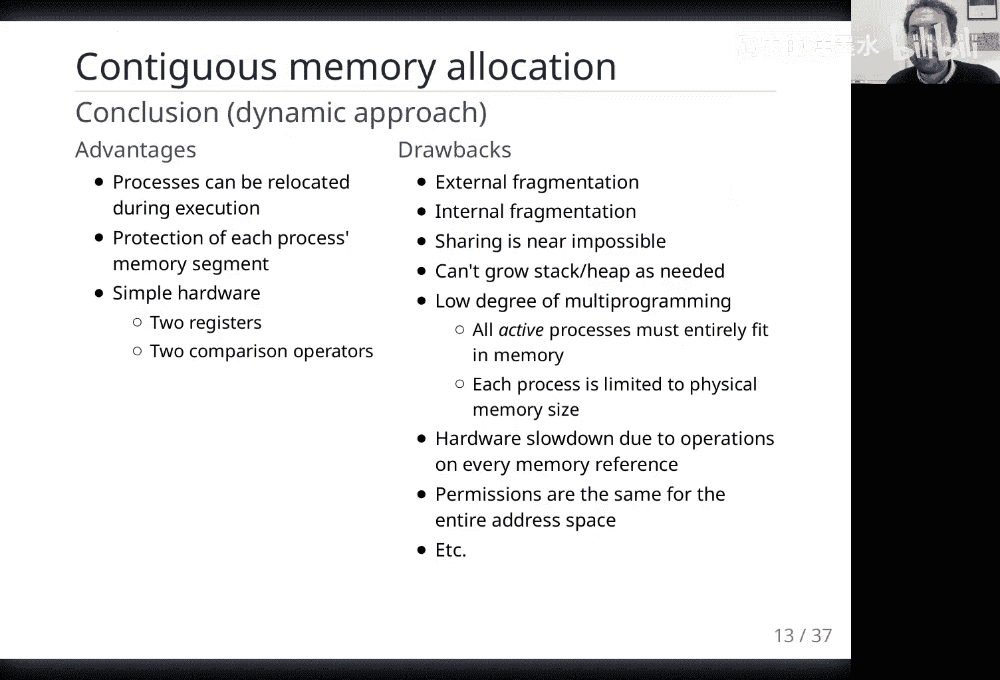

# 操作系统与系统编程：24：地址转换（第一部分）


在本节课中，我们将开始学习本课程的第四部分，也是最后一部分——虚拟内存。我们将探讨为什么需要虚拟内存，回顾早期计算机的内存管理模型，并深入分析实现多道程序设计的初步技术及其局限性。

## 概述：为什么需要虚拟内存？

理想情况下，计算机只需要一个CPU和一个主存储器。这个主存储器应该速度极快、容量巨大且是非易失性的。然而，现实中的主存储器速度不够快、容量有限且是易失性的。因此，我们需要一个**内存层次结构**：使用高速缓存来加速CPU与内存的交互，使用大容量持久存储来弥补主存的容量和易失性问题。虚拟内存的核心目标，就是高效地管理这个层次结构，以充分利用有限的主存资源。

上一节我们结束了关于文件系统的讨论，本节中我们来看看内存管理的开端。

## 从单道程序到多道程序

### 早期模型：单道程序设计

在早期的计算模型中，内存中一次只能加载一个程序（进程）。操作系统内核占据内存固定的一部分（通常在高端地址），用户进程则从地址0开始加载，并直接使用物理地址。

**主要问题**：
*   **CPU浪费**：当单个进程因I/O操作被阻塞时，CPU会空闲。
*   **内存浪费**：即使进程只占用部分内存，剩余空间也无法被其他进程使用。

这种模型被称为**单道程序设计**。

### 改进尝试：交换技术

为了实现多任务处理的假象，出现了**交换**技术。其核心思想是：当一个进程被阻塞时，将其整个内存映像保存到磁盘（换出），然后将另一个进程从磁盘加载到内存（换入）并执行。

**主要问题**：
*   **速度极慢**：磁盘I/O速度远慢于内存，进程切换会带来数秒的延迟，严重影响用户体验。

因此，我们需要真正的**多道程序设计**。

## 多道程序设计的需求

为了实现真正的多道程序设计，我们需要满足以下几个核心要求：

以下是实现多道程序设计必须满足的四个目标：

1.  **透明性**：多个进程应能同时存在于内存中，且每个进程都无需感知内存被共享的事实，也无需关心自己被加载到哪个物理地址。
2.  **安全性**：必须提供保护机制，防止进程之间或进程与操作系统内核之间相互破坏。
3.  **高效性**：多道程序带来的性能开销应尽可能小，不能像交换技术那样引入巨大延迟。
4.  **灵活性**：这包含多个方面：
    *   能够运行的进程总大小可以超过物理内存容量。
    *   单个进程的大小可以超过物理内存容量。
    *   进程之间应能共享部分内存。

接下来，我们将探讨实现这些需求的早期技术。

## 连续内存分配与动态重定位

为了实现多道程序，我们需要解决两个核心问题：**重定位**和**保护**。

*   **重定位**：能够将程序加载到内存的任何位置，甚至能在运行时动态移动进程。
*   **保护**：确保每个进程只能访问自己的内存区域，不能越界访问其他进程或内核。

一种早期策略是**连续内存分配**。每个进程被加载到一段连续的物理内存空间中。这需要通过重定位来调整进程内部的地址引用。重定位有两种方法：静态和动态。

### 静态重定位（不理想）

在静态重定位中，地址转换发生在程序**加载到内存时**。链接器生成的可执行文件默认从地址0开始。加载器根据进程实际被放置的**基地址**，一次性修改程序中所有内存地址（如跳转指令的目标地址、数据引用地址）。

**公式**：`物理地址 = 程序中的逻辑地址 + 基地址`

**主要缺点**：
*   **缺乏灵活性**：一旦加载完成，进程就无法被移动到其他内存位置。
*   **缺乏保护**：进程可能通过硬编码的地址访问到不属于它的内存区域。

### 动态重定位（更优方案）

动态重定位将地址转换推迟到**运行时**。进程运行时产生的地址称为**虚拟地址**，它认为自己是从0地址开始运行的。硬件在每次内存访问时，实时地将虚拟地址转换为物理地址。

实现这一机制需要两个特殊的CPU寄存器：

*   **基址寄存器**：存储进程在物理内存中的起始地址。
*   **界限寄存器**：存储进程的最大允许虚拟地址（即进程大小）。

**转换与检查过程**：
1.  CPU发出一个虚拟地址 `VA`。
2.  硬件比较 `VA` 和**界限寄存器**的值。如果 `VA > 界限值`，则触发异常（保护错误）。
3.  如果检查通过，硬件将 `VA` 与**基址寄存器**的值相加，得到物理地址 `PA`。

**公式**：
```
如果 VA > 界限寄存器值: 触发保护异常
否则: 物理地址 PA = VA + 基址寄存器值
```

**优点**：
*   **灵活的重定位**：只需修改基址寄存器的值，就能在运行时移动整个进程。
*   **基础保护**：通过界限寄存器防止进程越界访问。

## 连续分配策略与碎片问题

在连续内存分配模型中，当需要为进程分配一段连续空间时，操作系统可以采用不同的策略：

以下是几种常见的内存分配策略：

*   **首次适应**：从内存起始地址开始扫描，分配第一个足够大的空闲块。
*   **最佳适应**：扫描所有空闲块，分配能满足需求且大小最小的那个空闲块，以减少空间浪费。
*   **最差适应**：总是分配最大的那个空闲块。

### 外部碎片与压缩

连续分配会导致**外部碎片**问题：即内存中散布着许多小的空闲块，它们的总容量可能足够大，但由于不连续，无法分配给一个需要较大连续空间的进程。

**解决方案：压缩**
操作系统可以暂停所有进程，将已分配的内存块向一端移动，将所有空闲空间合并成一个大的连续块。由于采用了动态重定位（只需更新基址寄存器），移动进程是可行的，但这个过程本身有开销。

### 内部碎片

**内部碎片**是指分配给进程的内存块中，未被使用的部分。在连续分配模型中，我们必须在进程运行前就为其栈和堆区域预留空间。如果预留空间大于实际所需，就会在进程内部产生浪费。

## 动态重定位方案的总结与局限

本节课我们一起学习了实现多道程序设计的初步方案——基于连续内存分配的动态重定位。

**优点**：
*   实现了基本的重定位和保护。
*   硬件支持简单（两个寄存器，一个加法器，一个比较器）。
*   支持通过压缩来缓解外部碎片。

**主要局限**：
1.  **外部碎片**：需要连续的物理内存空间。
2.  **内部碎片**：需要预先固定栈和堆的大小，可能造成浪费。
3.  **共享内存困难**：难以让多个进程方便地共享同一块内存区域。
4.  **扩展性差**：栈或堆空间不足时，难以动态扩展。
5.  **所有活动进程必须常驻内存**：进程数量受物理内存容量严格限制。
6.  **性能开销**：每次内存访问都需要进行地址加法与越界检查。
7.  **保护粒度粗**：只能保护整个进程段，无法对段内的代码、数据、堆栈设置不同的访问权限（如代码段只读）。



尽管动态重定位方案让我们向多道程序设计迈进了一步，但其局限性仍然非常明显。在下节课中，我们将探讨更先进、更灵活的策略来克服这些缺点。