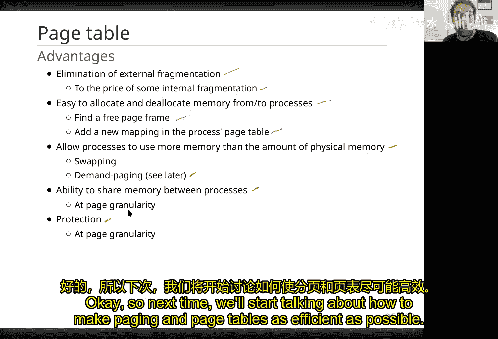

# 【全集 附课件】加州大学戴维斯分校 操作系统与系统编程 中英字幕 1080P p25 Lecture 25 - 地址转换part2 -BV1jXr5BBEKa_p25-

Hi， everybody。So today we're going to continue talking about virtual memory。

 which we started talking last time。So last time we defined that the main problem we're trying to solve here。

Is the fact that the main memory。Is not super fast。It's not large。And it's volatile。

 meaning that when you turn the computer off， the entire content of the main memory is lost。

And so that forces us。To use a much slower。But much bigger in terms of size and persistent second level mass storage devices such as SSDs。

 hard drives and so on。The problem is that if we're going to have those two levels of memory。

 the main memory that the processor sees， but that's not very fast， not very large and volatile。

And this big memory。That is not directly accessible by the processor。

 we need to use a controller and make request and it takes like multiple milliseconds for to be for request to be answered and so on。

We need some good management of memory。So we started talking about a first strategy that I called contiguous memorymor allocation。

Here the idea is that each。Active process in the system will be allocated a certain portion of the memory in a contiguous way and so within within that portion will be all of the code of the process。

 its data segment， its he and its stack and all of that within one big segment。

And with this strategy。By using only two registers。

 a base register and a bound register were essentially able to have the process。

Run in some virtual space。 So for the process。All of that contiguous segment is like set to be to start at address  zero。

And at run time， when the processor issues virtual addresses on behalf of this running process。

Then we add the value of thes register and we can access exactly where the process is located in memory。

so we can handle dynamic relocation， the process here can really be located anywhere in memory doesn't matter and we can even like move it at runtime。

 we can copy the entire segment somewhere else。Because this as long as we update the best register。

The process will still be able to function。We also have some memory protection by having the bound。

 so here we make sure all the time that a process will be constrained to its own segment and cannot go beyond that segment。

And that with， as I just explained， like some pretty simple hardware， like just two registers。

 a little bit of logic and we're good to go。So that's a first pretty good solution towards having some memory management here of like sharing this。

Not that fast and not that large physical memory between processes。

But it has also a set of drawbacks。We have external fragmentation。诶呃。

Every process here has to be contiguously allocated so we can get in situations where we need a certain number of memory which we have。

 but it's scattered in like multiple little portions and not directly accessible。

We also have internal feration。Within one memory segment of a certain process。

 we might be wasting space because of the stack and the heap that may or may not grow to fill that space entirely and so on。

It's also impossible to do any memory sharing。Here if process A is constrained in between those two bounds。

It's impossible for this process to share some memory with say like process B。

 how can they have a shared segment of memory with that system？And。

Also because a certain process is bound by a base and a bound and that has to be determined upon loading the process for the first time。

Once a certain process has。A segment in memory， we cannot touch this segment anymore。

Like for that process， we'll have probably like the stack going downward from the very top of the memory segment。

 we'll have the he going upwards from a certain location。

 and then we'll have the data in the code below。But so with that configuration here。If we plan。

 like if we provision not enough space for the stack or the heap， there's nothing we can do。

And finally， the last drawback here。Is that the entire segment here。Can only have。

One set of permissions。which is likely to be read write and executed because the code needs to be written read from and executed。

 but the data needs to be read and written to same as the he and the stack we cannot have a finer granularity in terms of permission for all of those different subsegments。

Okay， so。So， it seems like。If we try to take a step back on this memory allocation strategy here in terms of sharing the memory between different processes。

We're essentially very limited by the fact that we see the entire memory that a process uses as just one block as just like one big segment。

 it seems like that's the biggest limitation。So instead of seeing like the code， the data。

 the he and the stack as just one big block， why not seeing them as their own segments that can be allocated separately？

😡，And that's what the second。Strategy is， which is called memory segmentation。

So memory segmentation started existing in the early 80s。

 and that was actually the strategy that was used in the processor Intel。诶。😊，82，86。

So the idea here is that instead of having essentially just one pair of base and bound。

 so one possible segment。We have many of them， we have an array of them。

 and so we can have now multiple segments， each of them with their own base and their own bound。And。

😊，And so now from the processor's point of view and from the process。Spot of view。We can see。

That we have a code segment that is not necessarily con to。A data segment。 We have a heap segment。

And a stack segment。 And we have some potential like space in between。

 They are like just completely independent segments。嗯。😊，嗯。And then， when the process。

Rearunning on the processor issues virtual addresses。That are related to one of those four segments。

We will， in fact， go to a segment table。😡，And now， each of those。Segments here can be， in fact。

 located at。Any location in memory。So for example， like now the stack can be up there。

 the code can be there， the data can be there and the he can be there。

 they don't have to be like contiguously packed into one big segment in the physical memory they can they each on their own。

And but the principle is the same。 The principle is still that like for a certain segment and a segment is here identified by the。

Highest bits in the virtual address。 So that's essentially what tells us here。

 like whether a certain process is accessing the code segment， data segment and so on。

We locate the right entry in the segmentation table。And then from this entry， we essentially have。

A pair of base and bound value， the base will be added to the virtual address in order to form a physical address。

 and the bound will be used to check that in fact。The process is not like going out of bound for this specific segment。

Something that we're gaining as well with that strategy is the fact that now every segment can be protected by a different set of permissions。

So for example， say the code segment。Can be protected against。Writing to it。

So when a certain piece of code loaded is loaded in memory， a certain program is loaded in memory。

It would be a bad idea that this program could be modified at runtime。

 that's usually something that viruses try to do。Here， if we can guarantee that the code segment。

Is only is read only。Then no one can change it at runtime and virus could not like inject code at runtime。

So that's the big idea。 And also here another advantage is that so say the stack here。

Is growing downwards。Because now the stock is its own segment。It's possible to make it grow。

We can push。The limit of the stack by updating。 So I don't know imagining that the stack is this entry here by changing the value of the bound。

 we can make the stack。Grow further if that piece of memory here was free。If it wasn't free。

 then we could try to find another location in memory that's bigger than the current stack and move the stack over there and now like update the base to this new location。

 update the bound to make it bigger and would still be good to go。嗯。So here you see that like。

Going from looking at the the the the image of a process in memory has one big block to actually like。

ADuing between the code segment， the data segment， the he segment and the stock segment is really pretty useful。

嗯。Quick question here。What happens。If the process， so running on top of the processor。

Makeax an access that say， I don't know。 is right in between two segments here。

So not in the data segment， nor in the H segment。That would mean that when the processor makes the actual axis。

We won't find。Any entry that corresponds to that location in memory in the segmentation table。

What happens here？It's a segmentation fault。That's exactly what happened when you in your code。

 you say access an index in an array that is invalid。

Usually what happens is that it makes you access something that's outside of the current segment and it's being caught。

There's another massive， very interesting feature。With this memory segmentation approach。

The fact that we can share segments between processes。So let's take an example here。Imagine。

A process that forks。 So you have a parent So say like process  one is the and forks into process 2。

Process，2。我。Execute the same codes as its parents。Up until maybe it calls X Z VP and then it becomes like another。

 it starts running another program， but up until it calls X VP and it's not even guaranteed that it will like after the fork。

The child process executes the exact same program as the parent process。So it would be a lot。

 it would be a waste of memory to have。Two of the same code segments loaded in the physical memory。

With each of the code segments of the two different processes， pointing on those。

Two segments in the physical memory。Here with segmentation。😊，Well。

 we can make the base for the code segment of the two different。Processes。Actually， point。

Onto the same segment in physical memory to the same the exact same content。

And so here we're saving a lot of space because now processes can share entire segments if they want to。

As long as they have the same base that points them to the same location in the physical memory。嗯。

We could even imagine that they could have different permissions。

One process could have access to a segment。In read only and another process could have access to the exact same segment in say right only。

 who knows， but it's a possibility。So quick。Conclusion here on memory segmentation。So big。

 big feature here， the fact that we can share segments between processes which can save a lot of memory in some situations。

 for example， like a process forking。We can now have permissions that are different。

For each of the segments， so we can protect， for example。

 like the code segment from being overwritten by setting the permissions as read only while setting the permissions of the other segments。

 such as data， he and stack as readr。We can extend。Fly easily。 the stock and the heap segments。

If they need to grow， we can allocate more space in the physical memory and update the bound register to reflect that growth。

Or if the current。Segment in the physical memory is not big enough。

 we can try to find another segment in the physical memory that's big enough and then transfer the content and update the the base register and the bound register accordingly and so on。

So pretty nice advantages here。We still have some drawbacks。One of them being that the segments。

Still need to be contiguously allocated。If a certain process needs a he that has， I don't know。

 that requires like one GB of memory， for some reason。

 I don't know you're playing like a big video game and the V video game like issues a massive mallock of one gig。

 totally possible。With that approach of memory segmentation。

 you still need to have this entire heap of one gig be contiguously allocated in the physical memory There's nowhere around that。

So that can be a big issue to find that space。呃。And the fact that things need to be contiguously allocated leads you to obviously having external fragmentation。

 like you might have the space， but it's not contiguous。

 so you will need to use some other techniques such as like swapping or compaction to make some space。

 but those techniques even if they work， theyre pretty slow and they would definitely like slow down the system by a lot。

Another issue is that we have a limited number of segments right like here per process。

 essentially a process is allowed to have a good segment， data segment， he segment and stock segment。

 that's it for of them。Now， what if a process wants to create an array？

A buffer and wants to share that buffer with another process。

We could do that if we had more segments than just those fork。This way， if we had， say。

 like a fifth segment， then that segment could be dedicated to having this shared buffer。

And two processes could be pointing onto the same buffer。

But the thing is like you have a certain segmentation table and you cannot grow this。

 I mean this segmentation table is most likely in hardware like it it's made of registers in the CPU。

 you cannot grow it to a certain size， so you have a limited amount of entries。And。So， it seems like。

So。😊，From the strategy that we talked about last time。

 the contiguous memory allocation to this strategy， the memory segmentation。

We have reduced the granularity。Instead of looking at a process in its entirety as like one big block of memory。

We've looked at the fact that， in fact， this one big block of memory was made of multiple segments that had different behaviors。

And and and that could actually be。Seen separately。 And it really helped。Now， the question is。

 how do we achieve a granularity that's even finer than that？

So one possibility would be to increase the size of the segmentation table and have more segments than just four。

The thing is like， where is the limit？So maybe a good idea would be to look at the issue in the other direction。

Instead of of， of continuing to segment the content。Like what we've been doing。

 maybe we could segment the container。So that's what the next strategy is about。

And it's called paged memory。😡，So， the idea here。Is that instead of splitting the the code or the data segment based on the content。

 we're just going to split the actual memory。So we're going to determine a certain size。So， that's。

 that's。A certain size， and we're going to call that a page。So typically， we'll say， for example。

 like a page is 4 kilobytes。So if the code here of a certain process。呃。Is of size like， I don't know。

7 kiloB。Does the entire size of the program， then it will span。Two pages， two virtual pages。

Because the entire virtual address space will now be segmented into virtual pages of each4 kilobyte。

诶。So that means that the first Vitro page will be completely full。😮。

And since the code is only 7 kiloby long， then it means that the second page will be filled。

Only like a three quarter of it。嗯。And then we have the data that also spans multiple page and the he same and the stack same。

And on the other hand， on the other side， we do the same， the physical memory。

 so say you have a laptop that has like eight gigabytes of physical memory。😊。

That physical memory is divided into page frames。And each pay frame will be also of size4 kilobytes。

So now you may ask like， okay， what's the goal of doing that？Well。

 the idea here is that if you're splitting all of those segments into fixed size pages。

And you're splitting the physical memory into fixed size frames。Of the same size。

Then you can actually。Put those different， the content。Anywhere in those frames。

 it doesn't have to be contiguous anymore。 So， for example。The first page of the code。

 So the first 4 kB of the code。Might be located at some location。In memory。In physical memory。

 in a certain frame。And the following page of the code。That is seen from the process。

As contiguous in the virtual address space。Would actually be located in physical memory。

Somewhere else。Now， it doesn't have to be contiguous。In the physical memory anymore。And so on。Here。

 it's even easier for segments to grow。So for example， like take the stack。

So the stack currently is made of two pages。That are located at different locations in the physical memory in two different frames。

If the stock needs to grow。So we'll allocate a new page to make more pacee on the stack。

And that virtual page can now be mapped to any。A physical frame that's available， Like， say。

 I don't know， like。This one。Now， that physical frame will contain。

Like whatever the stock needs to grow with。And we don't need to move anything。

Like as long as we have a free frame in the physical memory。

 we can allocate it to whichever process needs it。So， by dividing。The address space into pages。

We're essentially solving the problem of external fragmentation。诶。

To the price of potentially having internal fragmentation。As I said。

 if the code here is 7 kilobytes in size， but we allocate two pages of four kilobytes。

 then we're wasting one kilobyte that will not be used like the second page for the code here will not be completely full。

Whereas before with memory segmentation we would have allocated a segment that was precisely the size of the code and we would not have wasted any space here we are potentially wasting a lot of space because now the memory is divided into blocks of4 kilobytes pages。

And the allocation is based is it's made as at page level。

 like blocks the memory ared by pages of 4 kilobyte。

So we have a little bit of internal fragmentation。But as well see。

It solves so many issues and it provides so many features that， well。

 thats that's a small price to pay honestly。So let's zoom a little bit more on those frame of page frames and virtual pages to really like understand what does it mean to like split the physical memory into page frames and the virtual address base into Vi pages。

So let's start with the physical memory and page frames。So as I mentioned earlier。

 imagine you have a laptop， you have physical memory of like eight gigabytes。

What it means is that logically you are going to divide this8 gigabyte。😮，Into page frames of， say。

4 kB。嗯。Those are page frames。 So I say4 kilobytes， but it could be any number that makes sense。

 You can have pages that are bigger than4 kilobytes or smaller than 4 kilobytes。

 It's it's a decision that。The OS or the processor designer makes。

What happens now is that like a physical address， which is then a bunch of bits。 So for example。

 on a 32 bit processor， the physical addresses will be 32 B in size。

That physical address is now seen as the concatenation of two different information。

The first few bits of the address will be。The frame number。And the。Remaining bits of the address。

 So the lower bits will be a certain offset within that frame。So the idea here is that like。😊，Now。

 instead of。Looking at the physical memory。As essentially a one dimensional array of bytes。

You' are now looking at a two dimensional array of bytes。It it's a logical construct。

 it's not like physically it doesn't have any any sense， it's a logical construct。

And so as a two dimensional array， you now have the idea of a row and a column。

That's pretty much what the frame number is and the offset within a frame is like the frame number is the row。

And the offset is the column within that row。And so， a physical address。I。

A certain location within that two dimensional array based on a certain frame number and within that frame number。

 a certain offset。So let's let's run a quick example here to make things even clear。Imagine。

I have a computer。And on this computer， I have a processor。A 16 bit processor。

 And so the address space is a 16 bit address space。

Now we decide that that 16 B address base will be divided into 512 bys。Paage frames。

So whatever amount of memory I have in this system， we will consider that as a two dimensional array。

 and each item is 512 bytes。Now， the question is like， okay， if the processor。Issues。

 a physical address。That is with 0， x 0，6，1，8。How can I understand this physical address to locate which frame number I'm trying to access and within that frame number at which offset？

So first thing first。We're going to need to look at that address at bit level。So。

 let's rewrite this address。As a sequence of bits。So first digit here， zero that's。4，0 Bs。

Then we have a six。So， a6 is。4 plus 2。Then we have a one。 so in bid， that's0，0，0，1。And finally。

 we have an8， which is 1，0，0，0。So here's my address， my physical address。

Represented in binary and as you can see， I have 16 bits。

So now I need to understand where is the cutoff。In this binary address between the frame number and the offset within that frame number。

 if we go back to the previous slide quickly。I am being told so that the frame number will be the first few bits。

 and the offset will be the last few bits。And the cutoff here that I'm trying to determine corresponds to log2 of the maximum offset。

So essentially， like how many columns do I have in one row， that's my Oax。

And to determine the number of bits that can represent this OMax， I need to find the log2 of it。So。

 let's go。Back to the next slide。So here I'm being told it's part of the assumption of this problem is that page frames。

Will be of size，512 by。So， I need to find。The log two of 512。Two possibilities to do that。

 either you take out your calculator and you type it out。

Or you might also want to know a few of the log2 values because some of them they come back all the time in computer science and you might as well learn them。

So far as important， like。诶。You have like the， the values that are good to know are like 1，2，3，4，5。

Then，8。电听。Then，15。16。And then，32。So we know that2 to the power of 0 is 1，2 to the power of 1 is 2。

2 to the power of 2 is 4。8，16。32。So up to 32 I would like up to 2 to the power of five。

 I would think like， yeah， you should probably know it。Then there's kind of a gap。

 no one knows those values， they're not that difficult to figure out。Two to the power of eight。

 everybody should know that because8 is the number of bits in a character in a bitete。

And you all know that it makes for like 256 possible combinations。

Then  two to the power of 10 is an interesting one and that's not too difficult to remember because it's 1024。

Then actually。Two to the power of 12 we're going to see a lot that corresponds to 4096。

 which is often a value that comes back very often because it's often the size of a page4 kilobytes the size of a block on disk and so on。

 I mean it's the size of like many things in computer science。

Then two to the power of 16 starts to get like a pretty big value， it's like 16000。

 like 16 I actually don't know the value。16，6， not3。 I don't know，16000 in some。

And then 2 to the bar of 32， this one is I don't know all of the numbers。

 but it's essentially like foggyab。So those numbers are pretty。

I would say like pretty useful to know by hot。And so here， lock two of 512。

It's not exactly in those numbers， but we know that。2 to the power of8 is2。56。

And two to the power of 10 is 1024。It means that 512 is like right in between those two。

 and there's only one number here in the middle， so it's9。Okay， sorry for the digress。

 So what it tells us is that we're going to have 9 bits here to represent the offset。So。1，2，3，4，5，6。

7，8，9。So all of those bits here。Will be for upset。And all of those。

All of those upper bits will be for the frame number。Okay。So now we can just do the we can count。

So what number is that number。1，1， and then all zeros。That's number。3e。And for the offset。

 what that number was that's 8 plus 16。So that's 24。24。So that's the answer to the question。

Given a 16 bit address space with page frames of 512 bytes。

And you have a specific address physical address。 then it means that this physical address will be located in frame number three。

And within that frame at offset 24。You have the proper drawing here。

So here it means that the high level bits of a physical address will indicate the frame。

And the low level bits。Of a certain physical address will within that frame point to a certain offset to a certain bys within that frame。

Okay， let's go。We have the same exact same idea for virtual addresses。

The virtual address space of a certain process is also divided this time into something that we call virtual pages。

The only thing that matters is that the size of a wheel page should be the same size as as a page frame because the content needs to match。

But it's the same idea， we have virtual virtual address that's also divided into an offset within that virtual page and a certain page number。

 all the same。Now we get to the interesting part。If we can divide the virtual address space。

Of a process into virtual pages。And we can divide the physical memory into page frames。

Now we can map。Certain virtual pages to certain page frames。And what's nice is that。

Two virtual pages。Here in the virtual address base that are contiguous。 So let's say， I don't know。

 those two pages here。They correspond to the code。Of the process。They don't need to be。

Contiguous in the， in the physical memory。Like the content can actually be in two different locations in the physical memory。

And。All we need。Is this black box in the middle that will actually be able to translate that will know。

The mapping between physical virtual addresses and physical addresses。And。😊。

So that's that's what we need now。 how do we make that happen。

 How do we make this translation happen。Conceptually， to make it happen。

 we need something called a page table。So a page table will be a table with a bunch of entries as many as the possible entries of like as many entries as the number of physical of sorry。

 virtual pages we have within a virtual address page。And for each。😡，Entry in that page table。

 we have a translation， a possible translation to a frame number。So when a process。

Runs onto the processor。Issues。A virtual address。We split this virtual address just as we discussed into a page number and an offset within that page。

The page number here is used as an index。In the page table。At that index， we find a page table entry。

And in that entry， we find the certain translation we find to which frame number。

This virtual page is located at。So we extract the frame number。

And we now built a physical address that is made by a frame number。

And you see that the offset within a page is the same offset within a frame because they are both of the exact same size。

And that gives us finally access to the content。In the physical memory for that virtual page or for that virtual address。

呃。If the process running on the processor issues a virtual address。That for a certain page number。

 does not have。A translation。 So it would still have an entry in the page table。

 like every page number has an entry in the page table。 But it turns out that in the page table here。

For that particular page， we have。Nothing like， we have no translation。Well。

 that would be a page fault， it's called the page fault and that would almost the same as a segmentation fault。

 it would trigger the OS to take over the execution of the process and somehow like deal with it。

We'll talk more about it later。So yeah， that's the whole concept here。So， let's。

Wrap up this presentation， let's quickly zoom a little bit more on that page table。

So there would be one page table per process because every process is running into its own virtual address space。

 so they all need their own set of mappings。And。That page table would be part of the processes state。

 so that would essentially be part of the PCB that the kernel maintains and that's actually up to the kernel to build this page table in the first place。

The page tables because they're pretty big， they would be stored in physical memory we'll talk a little bit more about that next time。

And so what happens is that when the processor issues virtual memory。

 virtual address on behalf of a certain process。We split this virtual address in two。

The page number is used to。Find the right。Page table entry that we also called called a PE。

And at that page table entry， we find a bunch of information。

 so as I said previously like we find the translation。

 the frame number that can then be used to build the corresponding physical address。And also。

 some other flags。 So， for example， like some protection flags。

 So every page now can be associated to specific permissions， read， write， execute。

It's not necessarily like at segment level anymore now it's really at page level so even I don't know like the code different pages of code could be protected with different permissions or different pages of the data segment could be protected with different permissions if we want to。

And some other flags here， so for example， like a valid bit that would tell us if the entry is even valid。

 that's how we would for example catch that that entry for a particular page number actually is not valid doesn't have any valid translation。

 that's how we would detect that there's a page fault。

And some other bits will come back to that later。So， conclusion on this。

Paging approach using the page table and so on。We have eliminated any external fragmentation。

Every piece of every frame page frame in the physical memory can be allocated on its own completely independently。

 we don't need to allocate memory contiguously and therefore like find a contiguous segment that fits our need here everything is the same size so if we have an available page frame it can be allocated to whoever ask。

To the price of interim fragmentation， that's always an issue when you start dividing things into blocks of the same size。

Very easy。To allocate memory for processes。 So here again。

 like example of a process wants to grow its stack。

 it's very easy to find a page frame that's available in memory and then map that page frame to the virtual address that corresponds to extending the stack。

Now we're getting some to some of the interesting。Flexibility that we talked about。Last time。

The idea that you could have processes in the system that actually require more memory than what you have。

 like you start a big video game and the video game technically requires like， I don't know。

 10 gigabytes of physical memory。Except that you only have eight。Can it still work Well。

 with page memory， Yeah， it can because you don't have to load all of the memory at a time。 So。

 for example， like， if the video game is currently executing code that's from a couple of of pages of code。

Then only those pages of code need to be really loaded in the physical memory。

The other pages of code， they don't have to be there up until they're being required。

So we'll talk about that。Next week we'll see some techniques that allow to do that that's called demand paging。

We're also able to share memory between processes。So that's something we could do with memory segmentation already we could。

Share an entire segment between two processes。 but that was a segment level。

 Now we can share memory at page level。 So say like now within like the entire stack of a process。

 for example， we can dedicate one page。To contain a buffer and share that buffer with say like another process and just that buffer in just that one page。

And same for protection， we already had protection with memory segmentation。

 but it was at segment level now it's at page level within again like say the data segment made of multiple pages。

 we can say， well， I want this one page to be I don't know just read only and not read write like all of the other pages and we can do that at page level。

So it gives us a lot more flexibility than just memory segmentation。Okay。

 so next time we'll start talking about how to make paging and page tables as efficient as possible。

