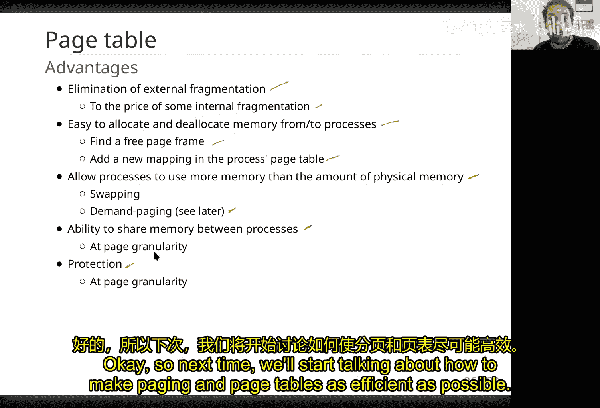

# 操作系统与系统编程：25：地址转换（第二部分）

## 概述

在本节课中，我们将继续学习虚拟内存。我们将回顾上次课介绍的连续内存分配策略及其局限性，然后深入探讨两种更先进的策略：内存分段和分页内存管理。我们将了解它们如何解决连续分配的问题，并提供更灵活、更高效的内存管理功能。

## 回顾：连续内存分配

上一节我们介绍了连续内存分配策略。其核心思想是，系统中的每个活动进程都被分配一段连续的物理内存空间，其中包含了进程的代码、数据、堆和栈。

通过使用两个寄存器——**基址寄存器**和**界限寄存器**——我们能够实现动态重定位和内存保护。进程在虚拟地址空间中从地址0开始运行，处理器发出的虚拟地址会加上基址寄存器的值，从而访问到进程在物理内存中的实际位置。界限寄存器则确保进程不会访问超出其分配范围的内存。

这种策略的优点是硬件实现简单，仅需两个寄存器和少量逻辑电路。但它也存在一些明显的缺点。

以下是连续内存分配的主要缺点：

*   **外部碎片**：由于进程必须被连续分配，可能导致物理内存中有足够的总空闲空间，但这些空间分散在多个不连续的小块中，无法满足新进程的连续内存需求。
*   **内部碎片**：在一个进程的内存段内，堆和栈可能不会完全增长以填满整个分配的空间，导致段内空间浪费。
*   **无法共享内存**：进程被严格限制在自己的基址和界限内，无法与其他进程共享内存区域。
*   **缺乏灵活性**：一旦进程被加载并分配了内存段，其堆栈大小就固定了，难以动态扩展。如果预留空间不足，无法在运行时轻松调整。
*   **统一的权限控制**：整个内存段只能有一套权限（如读、写、执行），无法为代码、数据、堆、栈等不同部分设置更细粒度的权限。

因此，连续内存分配的主要限制在于它将进程使用的全部内存视为一个整体的大块。为了获得更好的灵活性和效率，我们需要更细粒度的管理方法。

## 内存分段 🧩

为了解决连续内存分配的局限性，我们引入了内存分段策略。这种策略在20世纪80年代初出现，例如在Intel 80286处理器中就被使用。

内存分段的核心思想是：不再将进程的整个地址空间看作一个连续块，而是将其划分为多个逻辑段，例如代码段、数据段、堆段和栈段。每个段都有自己的基址和界限，在物理内存中可以独立、非连续地存放。

### 分段的工作原理

当进程在处理器上运行并发出虚拟地址时，地址的高位用于标识访问的是哪个段（例如，代码段、数据段）。系统根据这个段标识符在**段表**中找到对应的条目，该条目包含了该段的基址和界限。然后，将基址加到虚拟地址上形成物理地址，同时用界限寄存器检查访问是否越界。

### 分段的主要优势

与连续内存分配相比，内存分段带来了以下重要改进：

*   **独立的权限控制**：每个段可以设置不同的保护权限。例如，代码段可以设置为只读，防止运行时被恶意修改，增强了安全性。
*   **动态扩展能力**：堆段和栈段可以更容易地增长。如果当前段空间不足，操作系统可以寻找更大的空闲内存区域，移动段内容，并更新基址和界限寄存器。
*   **内存共享**：不同进程的段表条目可以指向物理内存中的同一个段。例如，父进程和子进程可以共享只读的代码段，从而节省大量内存空间。

### 分段仍然存在的问题

尽管分段策略有了很大改进，但它仍有一些不足：

*   **段内仍需连续**：每个段自身在物理内存中仍需连续存放。如果一个堆段需要1GB的连续空间，系统必须找到一整块1GB的连续空闲内存，这可能导致**外部碎片**问题。
*   **段数量有限**：通常，一个进程只能有少数几个预定义的段（如四个）。如果进程需要创建额外的共享内存区域，可能会受到段表条目数量的限制，因为段表通常由硬件实现，大小固定。

从连续分配到分段，我们将内存管理的粒度从“整个进程”细化到了“段”。接下来，我们将探索一种粒度更细、更灵活的策略。

## 分页内存 📄

为了克服分段仍需连续分配和段数量有限的问题，我们引入了分页内存管理策略。其核心思想不是根据内容（如代码、数据）来划分，而是根据固定大小来划分容器本身。

### 分页的基本概念

在分页系统中：
*   进程的**虚拟地址空间**被划分为大小固定的**虚拟页**。
*   物理内存被划分为同样大小的**页框**。
*   常见的页大小是4KB。

虚拟地址和物理地址都被视为二维结构：
*   **虚拟地址** = **虚拟页号** + **页内偏移量**
*   **物理地址** = **物理页框号** + **页内偏移量**

页内偏移量的位数由页大小决定。例如，对于4KB（2^12字节）的页，偏移量需要12位来表示。

### 地址转换示例

假设一个16位地址空间，页大小为512字节（2^9字节）。给定一个物理地址 `0x0618`，我们需要找出其对应的页框号和页内偏移。

1.  将地址转换为二进制：`0000 0110 0001 1000`
2.  页大小为512字节，所以偏移量占 `log2(512) = 9` 位（低9位）。
3.  高 `16 - 9 = 7` 位为页框号。
4.  因此：
    *   页框号（高7位 `0000011`） = 3
    *   页内偏移（低9位 `000011000`） = 24

所以，该地址位于第3号页框，框内偏移为24字节。

### 页表与地址转换

虚拟页到物理页框的映射关系存储在**页表**中。每个进程都有自己的页表。地址转换过程如下：

1.  处理器发出一个虚拟地址。
2.  **内存管理单元** 将虚拟地址拆分为虚拟页号和页内偏移。
3.  使用虚拟页号作为索引，在进程的页表中查找对应的**页表项**。
4.  页表项中包含了该虚拟页对应的物理页框号，以及一些控制位（如有效位、读写权限位）。
5.  将找到的物理页框号与原始的页内偏移量组合，形成最终的物理地址。
6.  如果页表项中的有效位显示该页未映射（即不在物理内存中），则会触发一个**页错误**，由操作系统介入处理。

### 分页的优势

分页策略解决了分段的主要问题，并带来了更多好处：

*   **消除外部碎片**：由于分配单位是固定大小的页框，任何空闲页框都可以分配给需要的进程，无需寻找连续空间。
*   **高度灵活的内存分配与共享**：可以轻松地为进程分配或共享单个页，粒度更细。
*   **细粒度的权限保护**：保护权限可以设置在每个页级别，提供了比分段更精细的安全控制。
*   **支持虚拟内存**：这是分页最强大的特性之一。进程可以使用的虚拟地址空间可以远大于物理内存。并非所有虚拟页都需要同时驻留在物理内存中。当访问一个不在内存中的页时，操作系统通过页错误机制将其从磁盘调入。这种技术称为**请求分页**，它使得运行大型程序成为可能，即使物理内存有限。

当然，分页也会导致**内部碎片**，因为分配给进程的最后一个页可能未被完全使用。但考虑到它带来的巨大优势，这是一个可以接受的代价。

## 总结

本节课我们一起深入探讨了虚拟内存管理的演进。

我们首先回顾了**连续内存分配**的简单性及其在外部碎片和灵活性上的局限。

接着，我们学习了**内存分段**，它通过将进程地址空间划分为多个逻辑段（代码、数据、堆、栈），实现了更细粒度的管理、独立的权限控制和内存共享，但每个段内部仍需连续存放。

最后，我们重点介绍了**分页内存管理**。通过将虚拟和物理地址空间划分为固定大小的页，并使用页表进行映射，分页策略彻底消除了外部碎片，实现了极其灵活的内存分配、细粒度的保护，并为核心虚拟内存功能（如请求分页）奠定了基础。它为现代操作系统的内存管理提供了核心机制。

下一节课，我们将探讨如何优化分页和页表的性能，使其更加高效。