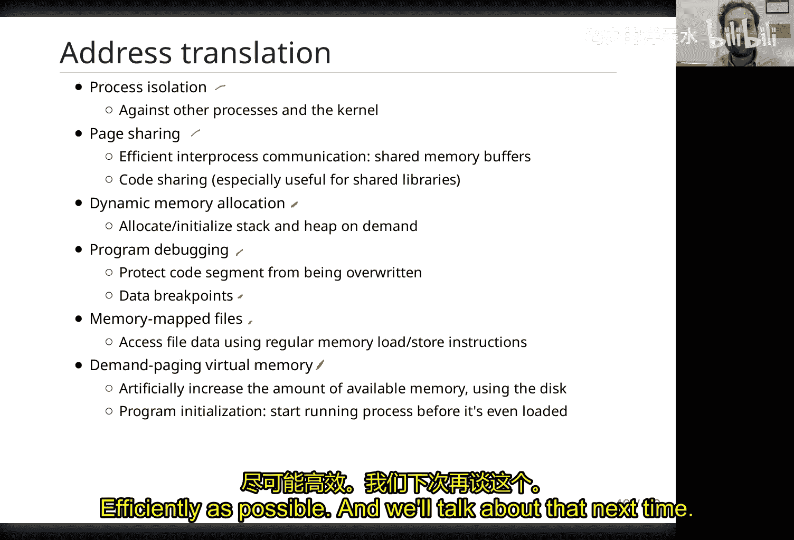

# 【全集 附课件】加州大学戴维斯分校 操作系统与系统编程 中英字幕 1080P p26 Lecture 26 - 地址转换part3 -BV1jXr5BBEKa_p26-

Hi， everybody。So today we're continuing our current topic。

Around address translation for the implementation of virtual memory。So quick recap from last time。

So you remember that at this point， the goal is that we have a process。Running on the processor。

That believes a certain layout of the memory。 So for that process running on this processor。

The code segment for that process， say would be loaded at address zero and then the process would have its code。

 its data following the he the stack， and so we would go like towards higher memory addresses。

And every process sees pretty has the impression。Of the same thing that their code is loaded at address zero and there's this like succession of segments。

Whereas in fact， behind the scene， whenever the process running on the processor。

Tries to interact with the memory to access its its code segment， its data segment， and so on。

What it issues is only a virtual address。And that virtual address is dynamically translated into a physical address。

In that first strategy that we talked about last time memory segmentation。

 the idea is that every virtual address to access one of those segments。

Is translated by using a segment table。The segment table。Contains where each segment。

OfIn the in the virtual address space of a process is actually located in the physical memory。

So even though the process sees that say the code segment should be loaded at address zero。

As a matter of fact， in the memory， the code segment here can be located anywhere。

 anywhere that fits anywhere where we have the contiguous space to have this entire code segment。

And it's at runtime that when the process。Issues a virtual address that， in fact。

 targets somewhere in the code segment。That we're going to locate the entry in the segmentation table that corresponds to the code segment。

We're going to extract the base of where the code segment is actually located in the physical memory。

We'll be able to check that the access is within the bound of that segment。

And the processor will reconstitute the actual physical address and will be able to access whatever。

Memory location。The process was trying to access。So that's the idea of the memory segmentation。嗯。😊。

Now， some of the drawbacks here with memory segmentation， if you remember， is that。

If the process here sees a certain segment。As a contiguous amount of。Of， of memory。

Then that segment must also be contiguous in memory。

And that can sometimes lead to external fragmentation because then it means that every segment we have needs to be allocated in a contigious manner in physical memory。

 which sometimes can be a little difficult。Another issue is that。The segmentation table here。

Has to have a certain size， we cannot make it like unlimited size usually actually the segmentation table will be part of the processor itself that will be a table made of registers and so we can't have like an absurd number of registers in an absurd number of entries in that table so it limits the number of segments that we can have total。

However， and that's nice， it provides a lot of nice feature， for example。

 it makes it possible for processes to share entire segments。😊，So for example， when a processor fors。

 the child can share the same， say code segment with its parent and we don't have to duplicate the content somewhere else。

It's also possible to protect segments in certain ways， so for example。

 like the code segment would be protected in read only or even read and execute if execute is one of the possible permissions。

 whereas the other segments will be protected in read writeite。

And we benefit from some segment extensibility。 So say like if the stock needs to grow。

It's possible to do so because we can change the segmentation table， change the bound。

 and we can make it grow。The second strategy that we talked about last time was the page memory。

 so here it's radically different or it's tackling the same problem but from another angle here the idea is to by default。

 divide the virtual memory of a process into fixed size pages。

Divide the physical memory into fixed size page frames。

And have a way to map the virtual pages into page frames。And。

Which gives a lot more flexibility because now say take the code segment。

 the code segment will be composed of multiple virtual page。

And each virtual page can be mapped in memory to a completely different page number。

 So now we don't have to guarantee anymore that a segment。Needs to also be contiguous in memory。 Now。

 it doesn't have to be。嗯。And to make the mapping in the middle to map virtual addresses。

 so virtual pages， to physical addresses， we use a page table。

 which is a massive array that for every virtual page contains the translation to a frame number。

 if this translation even exists。So yeah。So we' are actually going to continue talking about page memory here all through this lecture。

 and we're going to try to see how we can solve some of the issues that are raised by using a page table and using a page memory。

So the first issue with page memory and using a page table is that the page table might be huge。

Take a typical 32 B processor machine。And assume that virtual pages and page frames。

 so pages in general， we decide they' are going to be four kilobytes in size， that's a typical size。

If you remember， it means that。Every address will be on 32 bits。Because we know the size of the page。

 we can derive or compute the number of bits， so we have a certain address right which is on 32 bits so from bit 31 down to bit0 and we need to split this address in two different parts。

One part will correspond to the offset， which is the offset within a page and the other part here will be the page number。

If we want to have a system with pages of 4 kilobytes。

 it means that the number of bits for the offset， so for that part will be 12 bits。

And the remaining number of bits will be the bits to describe the page number。

That means in that system， which is a very typical system that technically the page table needs to have 1 million entries。

In order to cover the entire virtual address base。Now， let's imagine that every entry。

Has four bytes because every entry needs to contain the translation to the page frame number。

And also some access bits and some like valid bits and like some other information。

 so let's say the entry will be one word of four bytes。

Then it means that a page table will be four megabytes in size。😡，1 million entries，4 byte by entry。

4 megabytes at the end。That's for every process because every process is running into its own virtual address space。

And so needs a table that translates this virtual address space into where pages are actually located in the physical memory。

So four meabytes per process。Technically， and then on a typical computer， like my laptop right now。

 which I'm using to record this lecture。There's probably like over 100 processes that are running like concurrently on my computer right now。

So imagine like if each of those processes we need to have。A page table。

 a linear page table that describes the translation for like the entire virtual address page。

 we're talking like in terms of hundreds of megabytes。

That needs to be somewhere also in the physical memory and I mean you can realize like that's too much。

 too much overhead。嗯。And that that's for a 32 bit computer。Nowadays， we have 604 bit computers。

If I take a 64 bit processor with pages again of 4 kilobytes， now I have 52 Bs for the page number。

 which means that if I have a linear page table， I need4 quad brilliantll entries。

 which essentially means that the page table would need。

16 petabytes just for one linear page table per process。 So cannot not work， right。嗯。

So how do we solve that？Like clearly the linear page table won't work。

 we need to find another strategy， we need to find another way to organize this mapping between virtual address space to physical address space still based on like page memory。

 but we need to we cannot use a linear array that describes the translation for all of the pages。

 we need to find a way to compact this information。So that it takes。

 it's more efficient in terms of memory space。So here are a few observations。

 and let's start by talking about the size of pages here。So the thing is like。

One possibility that I could have is。Increase the size of each page。So for example。

 like instead of saying， oh， I'm going to have a page of  four kilobytes。

 why not having a page of 32 kilobytes？That would help a lot with the size of the page table。

If my Vi address space now is divided into pages of 32 kilobytes， I'm going to have less of them。

 which means less entries that need to contain mappings。However。If I increase the page size。

 I'm going to suffer from internal fragmentation。Because chances are my pages that are now big。

 they might not be full of data， but because all of the allocation is based on the size of a page。

If I only have one kilobyte of data in a 32 kilobyte page， I'm wasting 31 kilobyte。

 which is not great。On the other hand。If I make my pages small， for example。

 like one kilobyte in size， then I'm going to actually like increase the number of entries in my page table。

 which is bad because like I already have a memory problem。

But the internal fragmentation inside of each of those pages is going to be small because I'm more likely for the pages to actually be full of data and for data not to be wasted for space not to be wasted。

呃。So that's pretty much where the。4our kilobyte page size comes from which is very typical number。

 it pretty it's a good number because it makes the page table not be too big。

 not be too small and the in of fragmentation not be too much of an issue。

I don't know if it's like something that's formally proven or it's just like kind of some empirical observations。

 but yeah that 4 kilobytes is a typical size for pages。嗯。Here is another。

 and probably that's the most important observation。

 the page size was a little bit of a digression here。The biggest observation to help us with this。

 the problem that page tables might be too big we have too many entries。The observation is that。

When a process runs into its Vi address base。Most processes。

 they do not use their entire address space。😡，entirely， they actually， like， for the most part。

 use only a small， small fraction of their address space。So let's take like a 32 bit processor。

A process， a process running on a 32 B processor will have the illusion。

That it has access to an entire memory address space of 4 gigabyte。

Like that' that's the illusion it doesn't have access to all of that memory of you just leave it like。

That's what the size of the address space is。Except that within those4 megaytes。

 chances are the process actually will have a pretty small code segment， a pretty small data segment。

 a pretty small he segment and so on， and so over the potential four gigabytes that it has access to in fact it doesn't use most of it。

And。So actually let me show you an example。Of that。I wrote this。 super tiny。Example。

 so it's really just let me zoom a little bit more。

It's just the main function something that prints something and then I call pose so that the program。

 the process will just like stop and wait for a signal and that allow us to in fact like have this process be blocked for a little bit and this way we can do some introspection about its address base and different information。

So嗯。If I I， I compiled it here。And now， I run it。So here my process is running it's blocked in pose so I can do some introspection on it so let me do it I control Z put it in the background now it's like suspended but it does exist in the system now I want to find its PID number so I'm going to list all of the processes in my system。

And grab for， for this one。And I say it's this one， it's running here。And its PD is this number。

 oops， not the mouse here。Okay， the PID is this number。On Linux。

 it's pretty easy to do some introspections about processes。

 so you have a lot of information in slash Pra。And then you can just past the P I D number and then Linux。

Give you a ton of， like。Filees from the V profile system that can help like getting introspection about a certain process。

嗯。So， for example， like here you have the files that the file that that's called map and map here will give you。

The actual segments of memory that this particular process is using。And you have a bunch of them。

So for example， like this segment of memory。You see that the permissions are Rx。

That usually means that it's a segment of code， and that's essentially the segment of code that corresponds to our executable hello that I just compiled and run。

And in terms of size， that's the start。 Those are that's the range of addresses for that segment。

 So that's the start address and the。The end address and essentially goes from 3000 here to 4000。

And it means that it's taking one page one page of four kilobytes that's it it's a very small segment of code then here you have the segment of he。

 then you have like different segments for the shared libraries so you have like the Lese you have the LD the dynamic loader。

 you have the segment of stack over here and so on。Now let's use another tool here quickly。

It's called P map。Pma will give us almost like the same kind of information。

 but here you see it tells you like more easily the size of each。segmentment。

That this process is actually using in its own address space。What's important to see？Is that。

So those addresses are on 64 bit because my laptop is a 64 bit laptop。

 so you see that the addresses are like rather long。

But so what's very interesting to understand here is that。When this process is running。

It sees a certain Vi address space。So in that case， from address 0， all the way to address。

2 to the power of 64。Minus one， that's the entire address space that the process sees。But， in fact。

 within that address space。What it's really using。😮，Is almost nothing。

So it uses a bunch of segments here that are like fairly close to one another。

 and essentially it means that it's on all of this virtual address space。Those few segments。

They're gonna。Only represent like a tiny， tiny slice。

Then we have another segments over here of addresses that are like fairly close to one another。

And that's going to be like a little bit above and also going to take like just a tiny， tiny slice。

And then we have another one and another one over there。

 so essentially like we have only like this this process。

 which is a simple like hello world also obviously like it's a small program， but。

Even other programs for the most part， other processes for the most part， they're not going to use。

A lot of the Vitro for the most part， they're only going to use like tiny， tiny slices。What it means。

Is that we really only need。Translations。For those little segments。

There are in the middle of this vast。V try address space。

And all of those massive areas here that are not even used by the process。

We don't need entries for those。If we had entries for those in a linear page table。

 those would be just entries that say， oh， this this page is not mapped。

 There's nothing in there that's the segmentation fault。嗯。😊，所以啊。So let me go back to the slides here。

Oops。So that's the that's the big lesson of this example is that most processes。

 they don't use a lot of their address space。 They only use a tiny fraction。

And so if we look at a linear page table， most of the entries would be empty because they would not correspond to any mapping。

So based on that observation。😊，How can we design a better way to organize the page table entries to。

 in fact， discard those big regions that are， in fact， not mapped。

 That's what we're going to talk about。 and we're going to see two different approaches。

One is called。Page segmentation。It's， it's kind of funny。

 the combination of memory segmentation and page memory its like one on top of the other。

So here the idea is that。We have the virtual address base。Of a process。

 And so we just said that like within this virtual space， as a matter of fact。

 the process will only contain like a few pages for the code segment。

 a few pages for the data segment。Like some pages for the heap segment。

And say like some pages for the stock segment。And then the rest of the space are just empty areas we don't need to really have like page entries for that。

So the idea here is to first have segmentation。So identify those different segments。

And have them be part of a segment table。And then for each valid segment。Then so within one segment。

We actually divide this segment into pages of the same size。

And we do mapping between Vi pages that belong to a segment and page frames in the physical memory。

When the processor issues a virtual address， we locate which segment it belongs to。

If the virtual address is part of those empty areas who are just going to have like straight up a segmentation fault and that's the end of it。

Now if the virtual address。Actually falls within a valid segment。

Then we we extract a page number and we have a page table that really now like contains multiple entries for each segment that gives us a mapping towards。

Page frame number。嗯。So yeah that's the whole idea and with that strategy we're able to essentially like take big chunks。

 big areas of the virtual phase system that are not virtual address phase sorry that's not used by the process。

And we don't need to have any information for that。 We're not wasting space to describe that space。

We have a very fast way of saying just like， no， that' those are not valid mapping and that should fail。

The issue with that strategy， because again， we are using a segment table is that we only have so many segments in that segment table and sometimes the number can be limiting。

So in the same way that like。We solved segmentation by instead of looking at the content。

 just dividing the container， here is another strategy。Which is called。Multi level paging。

So here's the idea。Imagine again， you have。The actual address base。For a certain process。And so。

 that process。y uses segment of code， segment of data。heap。And stuck。呃，我。Now， let's so code。

 Let's put the data like rights。Above the code。And then we have， let's say， the hippies here。

And the data the stack is here。Now the idea is that。

Instead segmenting of splitting this virtual address space directly into say4 kilobyte pages。

Which would then have to。Would forced us to have a linear page table that has many entries。

 like a million of them。Instead， we're going to look at this virtual address space and we're going to first divide it into into pretty big areas。

Of say， like 4 MB。So we're going to look， let me change the color。

 we're going to look at pretty big slices of four megabytes。Those big slices of  four megaby。

 Let me So again， like that would be the stack area。Keep area。得啦。En code。And the rest。

 everything that's blank is empty， we don't have any mapping in there。Those big areas of 4 MB。

That would be covered from the first level。 We would have a first level of page table entries to cover those big four megabyte areas of pages。

If we have。A4 megabyte page here that， in fact， doesn't contain any data。

Then that's it for this first level of page table it means that we can already not have any translation。

 not have any mapping， and we can discard an entire big chunk of four megabytes all at once。So here。

 typically like the the for the first entry in the first level， we。

 we wouldn't have any mapping for the second entry， we didn't have any mapping。 And so in that way。

 we can discard。All of that area that's empty for which we don't have anything。And it army。

For areas that actually do have real segments in them。That now， the second level。

We'll look at those area by dividing now the Vi address space into pages of 4 kilobytes。

And into having entries to cover the virtual pages that span those like 4 megabys。嗯。And again。

 the idea is that we are finding a way here to discard big chunks of the virtual address space that are actually not being used so that we don't need to have entries for them。

Issue now with that approach。Is that where？All of that multi level page table will it will take a certain size。

 obviously less than the linear page table， but still。

And it will need to be also stored somewhere in physical memory。The issue with that approach is that。

Now it means that every time the processor。Issues a certain address。On behalf of the running process。

We need to。Go through。This page table。Go through the first level。

 see if the first level corresponds to。An area that actually has some mappings in it， if it does。

Then it will give us the location of where to find the second level page table。

This second page level table we index through some other bits into from the Vitro address。

 we find the right entry and this entry will give us。The frame number。

 So we'll have the now we have the the mapping between。

That virtual page number to that frame number and willll be able to reconstitute the physical address。

The problem is that now it means that somehow we'll have to access level one， then access level two。

And then， finally， access。The data that the processor was trying to access in the first place。

So that's the issue here。By the way， the two level paging strategy is a very popular strategy for almost all of the 32 bits。

CPUs out there。And nowadays for 64 bit CPUs that we have in laptops and all of that。

 the strategy is also a multileve page table， except that instead of having only two levels。

 it has up to like five levels。嗯。But so again， like the big issue is that when we use a multile paging strategy。

For each memory access that a process is trying to do。

 we're going to have some additional memory accesses to actually walk the page table。

 find the right mapping， the right translation。In order to do this memory access。So the question is。

 how do we not do that because it's going to take a lot of extra time and a lot of overhead。

So here's an observation that we can make， and probably it's something that you've heard in your computer architecture course。

Processes when they execute on the processor， they tend to exhibit something called locality of reference。

Meaning that a process is very likely to access the same collection of data or the same pieces of code。

 the same instructions of code within a certain period of time。And it makes sense。 the code is。

Usually like executed sequentially so we follow like a certain sequence and then we have loops in the code so we go back a few instructions prior and we reexecute the same instructions kind of over and over again if we have a follow loop。

 things are moving like kind of slowly in a running program。Then if we have functions。

 they are very likely to modify their own local variables in their own stock frame， so again。

 like it's very likely that within a short amount of time。

 a certain piece of code will repeat the same instructions on the same data like affecting the same pieces of data。

All of that means that the working sets of a process changes fairly slowly and by working set we mean that the pages that a process is actually using within a certain amount of time is pretty low like a process will tend to use data or to read from to。

Read instructions from the same pages。And that's great for us。

It means that if we take a snapshot of the running process。For say like， I don't know。

 a certain slice of time， that process will access the same pages over and over again。

It won't like if a process。😡，Uses a thousand pages all across its Vi address space。

It's not likely that it will access all a thousand of them。Like all the time。

Most of the time it's going to access maybe like three or four。

And then it's going to switch to using three or four other pages。And so on。

So how do we leverage that？If we know that processes。

 they will tend to access the same pages over and over again。Well。

 instead of paying for the translation， every time the process makes a memory access。

 maybe we can cash this translation。That's what TlBs are for， So TlBs stand for translation。

 leukcoocyte buffer。The idea is that。But T， I mean， it， it's， it's。

 it's very much like an instruction cache or a data cache。 The goal is to。

Have access to a certain piece of data without going to the memory。

 You cache it closer to the processor so that we can have access to it right away。

So nowday idea is that。A process。Running on the processor will issue virtual addresses。

 those virtual addresses， they go to this TB， this little cache of translations。

If the TRB happens to actually know the translation from that Vi address to the physical address。

It will have an entry that can provide。The frame number。

And the physical address can be reconstituted in no time and we can send the access to the physical memory right away。

And it's not taken like modern a cycle。That's obviously if we have a TLB mi hit， sorry。

 if we have an entry for that particular Vi address。

 meaning that like there was before a little bit before in the past an access to a V address within the same page and so we were able to already have the translation in the TLB。

Now， if the TLB has a miss， which means that no entries in the TLB have a translation for this virtual address。

 we need to find it。So now we need to go through the page table， walk the page table。

 like according to its structure， find the right translation。And from that translation。

 we can find the right frame and reconstitute the physical address and so on。

And if we were not able to find the right translation。

 that's where we actually have a page fault or a segmentation fault like。Something bad is happening。

 we need the kernel to intervene and deal with it。Ideally。

 and thanks to the locality of reference principle。The probability of having a TB miss。

Will be pretty low。And so the cost of walking the page table， which can be pretty high。

Will now happen very frequently。And so the only thing we're going to have to pay most of the time for all of the memory accesses is the cost of looking up through the TLB to find the right entry。

 which is usually like pretty fast。So let's actually zoom a little bit more on this TLB。

In the same way as caches， data caches or instruction caches。

 TLBs are caches of entries that can be either full associative or set associative。

 it's a part of the processor， it's very close to the processor。

 the goal is that we can find the translation as fast as possible so that the memory access can go to the memory。

And。😊，So when the processor issues a virtual address， we extract the page number and very quickly。

 if it's a full associative cache， we compare the page number to the different entries。

 So each entry has。A virtual page number and so we're trying to find the one that for which it's equal and if we find the entry that corresponds to this virtual page number。

 then this entry will give us the page frame number so that we can reconstitute the physical address and send it to the physical member。

嗯。😊，The TLB doesn't need to be that big， typically on more X86 processors。

 the TLB will be also in different levels， the same as like instruction caches and data caches。

 we're going to have an L1 TLB and an L2 TLB。For the L1 level。

 we're talking about a couple hundred entries and for the。The second level TLB。

 we talking about several hundred entries。嗯。So yeah， the big question here is， okay。

 so we have this TLB。If the process issues a virtual address and for this virtual address。

 we have a translation， then we can provide this translation and we're good to go。Now。

 what happens if the TLB does not have the translation that we're looking for， What happened？

We have two strategies。The first strategy is that the processor itself。Will know in hardware。

How to war the page table to find the missing translation and to refill the TLB with a new entry that now contains this translation so that future accesses to the same page will succeed。

So that requires the hardware to know where the page table is and how the page table is formatted。

So that would be the location of it would be provided by a register。

That the OS can configure for every single process when the process is running on the processor。

And the format of the page table would be defined by the processor specifications。嗯。

Pros of this approach is that it's super fast。The the hardware is taking care of it already。

 it's going to take about like 100 cycles to issue to walk the page table to like get to the page table in memory。

 like read from it and go through the different levels， find the translation。

 put it back in the TLB and resume。The fact that it's in hardware removes any flexibility like the processor specification will tell you。

 okay， I need a page table that's formatted in a certain way。

 And that's the only way that I can understand because everything is hot coded with transistors and I cannot understand anything else。

And also because it's done in hardware， I just mentioned transistors， we need logic。

 we need combination logic to be able to walk the space table and that's take some space because it needs to be a part of the processor。

嗯。Another strategy is to do it in software。So here the idea and that's how many risk like small risk processors do it。

 such as like MIPS processor， for example。Here， when we have a TLB miss。

Where essentially the processor award just raised an exception。And we'll jump back to theken。

And the kennel will like run， will detect like， oh， I'm here because there was a TlB miss。Oh。

 let me in software， walk the page table for that process。 Find the translation that I have。And。

Load that translation manually into the TRB。And then resume the process that was interrupted in the middle because of like one of the we had the TLBs。

系。The big pro here is that there's no extra cost in terms of hardware。😡。

Like while not adding any new logic to the processor， the processor only needs a TLB， and that's it。

呃。And because everything is done in software here， we're completely flexible in terms of what the page table can look like。

 we can decide， oh it's going to be a linear page table。

 or it's going to be a twolel page table or a three levell page table I mean or I put a link here。

 an inverted page table it can be any structure because it's in software。

 we can scan whatever we want in software。The big con， though， will be that it's slow。

Every time we have a TB miss， the running process is interrupted， we need to jump to the kernel。

 save the context， not like figure out why we're here， then call the right function。

 walk the page table，lah， blah。 I mean， those are like instructions that need to be executed up until we can finally resume the process that was just interrupted。

 That can be over1 thousand cycles。 So it it takes a lot of time。

Another couple of issues we have by using T LBs。So one has to do with the fact that。As we said。

 every process has its own virtual address space。On a 32 B processor。

 every running process will think that it has the entire fog gigabyte of memory space for itself。

 except that obviously it's not true。The thing is the TRBs will the TLB will be the one containing the certain translations。

Between a certain virtual address space for a process to the physical memory。Now。

 the problem is that if you take two processes， P1 and P2。For P1。

 say address 0 will be mapped to physical address X。Now， when we run P2。

Addres 0 of P2 will be mapped to physical address Z， which is completely different。

 So for those two processes。They might see the same virtual addresses， but in fact。

 they are mapped to different physical addresses。So what do we do when we switch from one process to another one？

Because it means that the TLB entries that were filled out for one running process are completely irrelevant and even wrong for another process。

 it only applies to a certain one。We could。Every time we switch from one process to another。

 just empty the entire TLB starts from from empty。And then this process will make like TLB misses and will refill the TLB with the proper entries that are relevant for that running process。

The problem is that every time we switch from one process to the next。

We're going to start from an empty TRB， and so we're going to have a lot of TRB misses。

To essentially like reconstitute n of entries to cover the current working set so that we stop having TLB misses and now the process would be like pretty fast to run。

That's not acceptable。So how can we do better？The idea here is to tag TLB entries with the PID。😡。

So now it means that when。P one。Runs on the processor。And issues。Addresses， the processor will also。

Say， hey， it's P1 that's running。The T LB still has entries between virtual pages to a。

Page frames and so on。But as part of each entry， it also tracks。

What this like to which process this entry belongs。

 like for which process this entry is actually relevant and makes sense。And so for example。

 in that table， we can have an entry for process one that says， oh。

 page X of process one is translated into page frame Y。And so later， when we contact switch to P2。

Now， P2 sends also say a virtual address to page X。Except that now its process2 will be advertised。

And so this entry here will not be matched。 However， if we have another entry that says。Process 2。

 has。A translation between page X and frame Z。That will be taken into account。

And so now we can have translation between technically like the same virtual page。

 but it's associated to a certain， it's relevant because it's associated to a certain process ID。

One last issue that we have with T LBs is that the OS might want it's possible to change the permission for a certain page。

So the certain process has pages and the US says like you know what for this page。

 this page was read and write and I want to change it to read only something like that。

 or I want to make it actually not accessible anymore。

That's something that can happen with when you set data watch pointss in G， for example。

 to track the evolution of a certain variable。You would tag the page that contains this variable and switch its permission to read on me so that every time the process writes to it。

That will trigger a page fault and well be able to capture precisely which。

Vs are being modified and we'll be able to stop the execution when it's the variable that we are trying to track。

The problem is that the TRB might contain an old translation from what the page table in memory now would be modified to。

So two techniques to deal with that consistency issue。The first is that for the local processor。

 the processor that the OS is is would be running onto。

The processor could ask the T LB to kind of purge itself from certain entries。 So， for example。

 the processor， the the the。Or as would say， oh， okay。

 I want to change the permission for that very page。And I'm also going to tell the TLB， hey。

 if you have pages for that process， if you have a translation for that process and that virtual page。

 just remove it because it's not current anymore， I want you to actually do a TLB miss next time you access that page so that you go to the page table and you retrieve the new translation。

 something like that。And。What if you have a multi core system now you can have multiple processors。

 each of them with their own TRBs。How do you make all of them purge their own local TLBs to update a certain entry？

While that's something called TLB shutdown， the idea is that the OS would be running on a certain processor and would be able to send interrupts to the other processors with certain comments to tell them like。

 hey， if you have in your local TLBs like entries for this virtual page and this process。

 just remove them。Okay， and so。To finish on this topic。

 I just wanted to like quickly list again the different features of having addressed translation for virtual memory。

So again， that's a great way to do process isolation to make sure that processes。

 they cannot interfere with other processes or with the kernel。

It allows to do page sharing like every page in the system can be shared between different processes if they happen to have mappings between their own virtual address space to the same page frames that's possible and that way they can share information。

It's pretty easy to dynamically allocate memory to extend or reduce the stack or the heap。

 for example。It helps with program debugging， we can protect pages with permissions。

 so for example like we can protect the code segment from being overwritten as I just mentioned earlier。

 we can also change the permissions on certain pages containing data to set up data breakpoints。

We'll talk about that maybe next time we can use paging to。

Map files directly in memory and use them directly as the arrays。

And that we're going to talk next time demand paging virtual memory so here is really like how do we use this page memory principle and having a second level master to manage them both as as。

嗯。Efficiently as possible and we'll talk about that next time。

