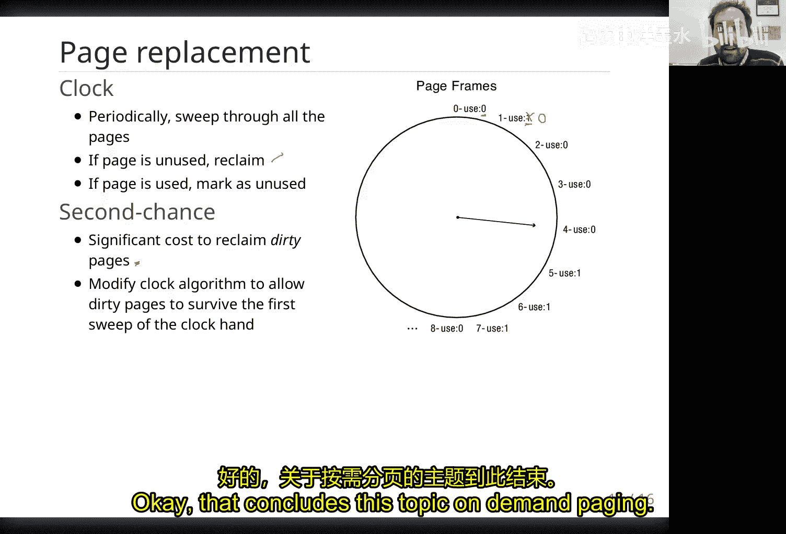

# 【全集 附课件】加州大学戴维斯分校 操作系统与系统编程 中英字幕 1080P p27 Lecture 27 - 请求分页 -BV1jXr5BBEKa_p27-

OkayOkay。

Hi， everybody。So today we're going to talk about the last topic of this class。

We are going to examine this mechanism called D paging。

 which even better uses the memory in order to accommodate processes。So last time。

 the previous topic we talked about address translation。Which allows us to completely。

Separate what a process running on the processor。Has as a view of the memory。 So for the process。

 the view of the memory is that the entire memory。Is belongs to the process。

The process segments are at addresses that are determined by the compiler。

And all of the segments are contiguous。Whereas in fact， it's not true。

And that's provided by having the possibility of mapping。

Vtro pages from this virtual address base to。Physical page frames via a translation mechanism that。

 for example， is provided by a page memory。So it really greatly simplifies。😊，嗯。

The way that processes can be actually stored into the main memory。But we still have an issue here。

 The issue is that up until now， we're still assuming that in order for a process。

To run to be executed by the processor。All of its memory needs to be there， like all of its code。

 all of its data， all of its he and， all of its stacks。

The address translation mechanism only allows us to say， oh。

 they don't have to be contiguous in the physical memory and they are allocated at page level。

 so we have like a lot of flexibility in terms of where they need to be located。

 but so far we're still assuming that they're all there。And this assumption is an issue。

Because if the process is said like pretty big， then it's going to be slow to actually have all of its memory。

In physical memory， so all of its code， all of its data would need to be loaded from the disk。

 which as you know can be very slow if especially if it's a magnetic disk。

 would need to like first load all of the data and memory before the process can even run。嗯。

And more importantly， we know that it's actually completely wasteful。

 We talked last time about processes tending to exhibit something called locality of reference。

Which essentially means that they are working sets。

 so the memory that they're using a lot over periodss of time is actually pretty small because when a process is executing it's executing like instructions that are going to be a。

Consecutive and the code will contain loops so we're going to go back executing the same instructions over and over again functions are going to access local variables a lot during the execution of each function and so on so。

What it means is that a process will exhibit something called temporal locality。

 which means that if a process accesses an item in memory。

 it's very likely that it will access the same item in memory in the immediate future。

And it will also exhibit spatial locality， which means that if a process accesses an item in memory。

 it will。It's very likely that it will access another item that is nearby in the immediate future。

 so for example， if some code accesses an array， then it's very likely that like when it accesses one item in the array。

 it's going to also access the neighboring items。Or when a function uses a local variable it。

Probably will use all of its local variables， which are all located like nearby in the stack。

So the goal here is how do we leverage that？How do we make it so that a process doesn't need to have all of its data loaded in memory？

😮，Since we actually know that it doesn't need all of that data。

 it probably only needs a subset of that data that the process is currently using。

 which is what is known as the working set。Well， the solution would be to only load the pages。

 the data， the pages。When they are needed。So if a process is currently executing some code。

 then we need the page of data that contains that code。

 but not all of the other pages of data that contain code that is not being executed at the moment。

And same for the data segment， for the stock segment， and so on。

So the idea is to actually only have the pages that are currently used and needed。

And to also like keep only the ones that are frequently used。😡，And to discard the other ones。

And that will really give the illusion of having。Access to an infinite amount of memory from processes。

Up to the point that like a process could technically need more data than what's available in the physical memory。

 but that's fine because we know it's never going to use all of that data at the same time and we'll be able to load things dynamically during the execution of the process。

So that idea。Is what's behind this technique called demand paging？So here's an example。

 imagine you have a process and in the virtual address space of this process， the process uses。

 in fact， what is it like six pages？So I don't know， like for example。

 those two pages would be pages of。Could and data and those two pages would be some like he。

 and that would be the stack or something like that。 And the。

 the space in the middle would not be even used。 like it's part of the virtual address space。

 but it doesn't correspond to any segment。 So if the process tries to access a page4 and 5。

 That would be an actual segmentation。 It's not map to anything。Now here's the trick。

With demand paging。Some pages。Which would call resident pages would actually be mapped in the physical memory。

So for a page F here， imagine that page F is a page of code。

And the process is actually currently executing code from that page。

 so it really needs to be loaded somewhere。Then， for that page。

We have an entry in the page table telling us， okay， page F is， in fact。

 loaded into page frame number4 and。That's where we all find the content。Okay， so far so good。Now。

 imagine that page E。Here is， well， let's say it's another page of code containing code that has not been executed so far。

 Like so far， the process has started running， and that's only executed code from page F。

With demon paging， the whole trick is that page E。Doesn't need to be loaded。In Rome。

 because we don't need it yet。So that page is called non resident。Where is page E？Well。

 it's on the disk。It's part of the binary for that process。

 like the program that's being executed has a binary that contains the code and the data。

The curs there on the disk is just， we have not。Louded it yet in the physical memory。

And it's only so for page E， we have no translation available in the page table and there's no content currently in the physical mirror。

 but it's not an issue。If page E。Ends up being accessed because say in F here。

 you have code that calls a function that's defined in page E。

Then you'll have a page fault because we won't have a translation in the page table。

The kernel will detect that and will understand， oh。

 this process is now trying to access a valid piece of its virtual address base。

 so it's not a segmentation fault。But it is for a page that is not currently loaded in the physical memory。

Let's find it on disk。And bring it to the memory。嗯。So for processes， all of the code and the data。

Is backed on disk by the actual executable， like the actual executable of a process corresponding to a process is somewhere on the disk。

Now quickly we're not going to get into the details， but for the stack and the he。

 those are dynamic segments they are not part of the executable on disk。

 so how can I have them on disk anyway to do this demand paging。Well。

 that would be what the swap space does。So often on a computer。

 you're going to have a relatively small， but still。

Area of swapwab space that can be set like a specific partition on your disk and that's space that can be used to put the stack or the heap of a running process temporarily to make space in the physical memory。

Okay， so question here is。What is actually this page fault。

And how does it work like so imagine process the process here。

 max and access to page E is not mapped。 We have a page full。 How do we solve that。Well， that's a。

Multi step procedure here that we need to follow。So。The way that is gonna work from like， very。

Like the entire procedure in， in great details。So the fact that page E。

 the missing page is being referenced。Starts from， at some point， say。

 the processor executing a loading instruction。From a memory address that corresponds to that page that is not currently loaded。

This memory access will trigger。A T LB access to find the translation corresponding to this。

Vitro address。The TRB will not contain any translation for that address。

 So we're going to have a T LB miss。The Tabbis will trigger。诶。

A page table walk we're going to have to like go to the page table and and see if the page table contains。

A translation for that virtual address。 So remember。

 there are like two different ways of of processing that it can be either done in software by the US or in hardware directly。

 depending on the on the processor。Doesn't matter let's just imagine， okay。

 the page table gets walked and in the page table， we actually do not find a translation for that virtual page because the data is just simply not in the physical memory。

So the page is invalid and now the kernel needs to take care of it。Now the kennel needs to determine。

 okay， is it an actual segmentation fault like is this process really trying to access an area of memory that is that just doesn't belong to a segment at all？

Or is the process actually trying to access a segment that does exist？But for which。

 the data is not available。So in that case， we assume yes， the data is available。

 it's part of a legitimate segment， it's just that it's not loaded。

So the kernel needs to locate where this data is on disk。

So imagine that we were trying to access some code， the data on disk would be in the executable。

For the program that's currently being run by this process。So we locate the binary。

 the the executable， we locate the page that contains the missing code。And。

We load it somewhere in the physical memory。So we're actually going to talk about that。

 but thekennel also needs to identify a page frame that is currently available in the physical memory。

And if it cannot find any， it needs to find a page frame that it can。力。

Free by potentially like evicting some data so that it can allocate this page frame to this new piece of data。

 We're gonna talk about that in a minute。So。The data is retrieved from the disk put into the physical memory。

Okay， so now we have the data in the physical memory and we need to make the connection between that data and the process。

And。😊，That's where the kernel will now need to。Complete the mapping in the page table to now say。

 okay， your virtual page here。Is now loaded into this page frame。

 so I'm going to write the proper mapping into the page table。And， finally。

The canoe can resume the process。And here， actually。

 it's not the complete end of it because when the process resumes。And reexs。The same instruction。

It's again going to issue a memory access that again will trigger a lookup in the TLB。

 the TLB will actually have a TLB miss because the translation is not yet in the TLB。

Which will trigger another page table walk， except that this time the page table will contain the right translation。

 So the TLB will be refilled with the right translation。 And finally， the memory access can succeed。

So you see that it's a pretty long process。And by the way。

 I mean it's a long process that might take a lot of time and you might ask like， well。

 demand paging doesn't seem very performant because like if every time there's a page fault。

 we need to pay all of that price make an access to a disk， then have like multiple TLB mees。

 multiple like page walks and all of that like how come that be performing， but remember。

Because the working set of a process is fairly small， and moves slowly。

We don't have to pay that price very often。 So when we do pay it， it's expensive。

But most of the time processes are not going to make page faults。

 they're going to be able to execute a bunch of instructions for a long time without any page faults。

 and so it's actually a pretty rare event。Thats why it is still very performant。嗯。

So here is what I just explained on that slide。So I was saying earlier。That's。

When the kernel needs to bring a page of data from the disk。To the memory when there's a page fault。

诶。It needs to allocate a page frame to receive that data。Two scenarios here。

One that's easy is the memory is not full， so we have available page frames that are already there。

 we can just allocate one， put the data in there， complete the page table and so on and everything's good。

Now we also have the case where the memory is full， all of the page frames have been allocated。

What do we do now。Well， we need to find a page frame that already contains some data and replace that data。

With the content of the page that we are trying to bring back from the disc。

So there are also a few steps here to complete。First of all， we need to select which page frame。

Will be。Chen and replaced。嗯。And that we're going to talk about in a couple slides。

 it means we need a page replacement algorithm。So for now。

 I'm just going to assume that we have some algorithm that given a certain number of page frame willll decide。

 well， that's the one that we're going to try to free。

 it's currently used and we're going to like make it available。If a page frame was used。

 it means that another process had a translation to that page frame from their Vi address base to that page frame。

So the first thing we need to do to free the page frame is to remove any mapping that other processes had towards this page frame。

whichch can be kind of complicated because a patron can be shared between different processes。

 it can have old translations into other TLBs on other processors， so it's also a pretty complex。

AThing to。Make it de。嗯。Another pretty difficult issue here is that this page frame might contain。

Data that should be written back to the disk。 Imagine the page frame was actually associated。

To a file。诶。And the process that had a mapping to that page frame to the data that the page frame contained。

hadd like modified some data and the data needed to like be written back to the disk。

And so the kernel should also take care of that and make sure that the data is properly written back to the disk。

And。Here is an example of like mapping a certain file to the。The memory by using M map。

And two different scenarios。 so for example， in that scenario。

A file was opened by a running process mapped into memory。 And it turns out that this memory。Root。

Or modified the file。The page frame here would now contain data that has been updated that has been。

Modified， so that's a case where。If we want to free the page frame that contains that data。

 that data would need to be first written back to the disk before the page frame can make become available。

On the other hand。If we have another processor that opens the file。

 maps it into memory and then only read from it。Then it means that the page frame。

 the data in the page frame can just be removed and we have nothing to save because it was only a read only access。

啊。How do we distinguish？Whether a page frame contains data that needs to be saved back to the disk or not。

 we need to be able to detect。Whether data was written to or just read from。嗯。😊。

So let's about let's talk about that first， like let's talk about how do we detect that page data has been modified and then we'll talk about this page replacement algorithm。

So first to detect that a page has been modified。It嗯。In some processors。

 we're going to have some help from the hardware directly。嗯。And by， by the T LB， essentially。

 and the page table。On some processors， the TB will when there is a right。Access。

 right memory access。 the TLB will always be consulted because the TLB is on the way for every memory access because it needs to provide the translation。

And so at the same time as the bright access happens and the TLB returns the translation for that memory access。

 it will also。Write somewhere in the page table entry。That。Page is being modified。

And so it will it has a bit that is usually called a modified bit。

 and it will flip this bit from zero to one to say， oh， this page here like for this Vitro address。

Has been modified because there was a right access to it。嗯。The T RB can also track。

Whether a page has been accessed。 So here it's more than just like writing。

 it's like any type of access。This way， in fact。When we look at the entire Vi space。Of a certain。

Process， we can know which pages have not been accessed and which have been accessed and keep track of that。

 too。And that would be called a use bit。嗯。And we'll see later how this use bit and the modified bit can be used in other strategies that are related to a page replacement。

What's nice is that those bits that are being set by hardware when pages are being accessed simply or written to specifically。

Those bits can also be reset by the US。 So， for example。

 like when a page is being removed from the physical memory and just being put back onto disk。

 the the US。Can just like lower， say like the modified bit because now like the disk would be up to date with whatever is in memory。

A the can also track whether a page has recently been used， so for example。

 if a page is if a page is currently loaded in the physical memory and so we have a translation for it in the in the page table。

 theOS can lower the use bit as part of the PTE。And then wait and later see， okay。

 has this page been used recently， let's look at the use bit if the use bit is still zero。

 it means that within this entire period of time， the running process has never accessed whatever page was in this physical memory and that can be an indication that the page can be replaced。

 for example。嗯。So here is a graphical example， so imagine you have a process that's running。

And that's currently accessing like a certain virtual page， Vi page A。

 and for which we have a translation over here， and so page A is currently like loaded into the physical memory。

嗯。And so far， page A was has been loaded the first time from the disk and has not been modified at all。

 like， say we like read some data and， and that's end it was just brilliantly accessed。

The first time that the running process will say now like write some data to page A by making right access to the actual address that belongs to page A。

The T LB。We'll switch the modified bit， which is also often called the dirty bit2 one to keep track of that。

Which will also be transmitted to the actual page table itself。

And that will be the indication that the content of page A now has been modified in memory and is not in sync anymore with the disc。

And so we're in a situation where if this page frame。

Ever needs to be freed to make some space because we need to allocate it to another process。

We will need first to save the content of this page。Back to the disk。Before we can proceed。Okay。

And so the other thing that I wanted to mention is the page replacement algorithm。

If the memory is full here。How do we decide which page frame will be allocated and which page frame should be evicted from its current content to be given out？

So， we have different。Strategies。And different algorithms that we're going to go through。

The first algorithm。Which is actually not really a proper algorithm because it it's a random algorithm I added it because of like。

It could be a strategy to just randomly choose which frame will be the victim and can be allocated。

The big advantage of having a random selection algorithm is that there's zero cost。

 the decision is just to pick one at random。嗯。😊，And it doesn't even give the worst kind of results。

 its just it just doesn't give the best results ever。

 and mostly we can characterize this random algorithm as just something that's highly unpredictable。

🤢，But anyway。If we now talk about real strategies where we actually try to make a good decision。

 we're going to go over like three of them。The first one。

 probably the simplest one and the most intuitive one is the PIFO algorithm。

So here are the ideas that。The memory is full。So all of the page trends are being taken by data and by pages。

And we need to select a victim。With50， the victim will be the page。

 the page frame that has been loaded。The the the。Like the longest time ago。So here's an example。

Imagine we have four page frames that are available in the memory frame 1，2，3，4。And then we have。

 say， one process。That makes different accesses to virtual pages from A to E。So at first。

 the process would make an access to page A。And so page A would need to be loaded。

In an available frame， At first， all of the frames are empty。 So page A would go to frame 1。

 and that would be like one page route for which we need to bring some data from the disk to the physical memory。

Then the process accesses page B。Page B needs to be loaded。 So far so good。

 it's easy because all of the frames were empty at first。 So essentially。

 like all four first accesses， we can simply load the meeting， the missing data。

Into the frame that's currently available。At this point， after accessing page D。

 now all of the frames are now taken， memories full。Let's go。 The process now accesses page A。

 page A is already loaded。Into frame line one， so here we have no pagevols。

The memory can just be referenced。Then the process accesses page B。 same page B is already loaded。

Okay， now it becomes interesting。The process。Tries to access another page E。

 which has not been accessed so far。So that's where now the 54 algorithm steps in。

We need to find a victim frame and five hotel tells us。

Takeag the pay train that has been loaded for the longest time。

The first one that was loaded was frame one with content of page A。 So that's going to be the victim。

 So we remove page A from the memory， and instead we load page E。Except that right away。

 the process accesses A again。So okay， we need another victim。Now， at this point。

 the longest that has been loaded was page B in frame 2。 So okay， frame 2 will be。handanded out。

And we're going to load a into frame2 and you see what's happening here is that we're actually redoing the same sequence of A。

 B， C， D。And every new access replaces kind of like the previous one。

 which ister it's pretty not a good strategy， and we keep having page folds。So to here。

We had 10 page folds。Which were like all of those locations where we had to go to the disk to load。

The data into frames。You'll notice that the first four page faults。Unavoidable。

 we cannot they have to be there because like at first the memory would be empty and we we need to load things for the first time。

Those page folkss though are more debatable because like maybe we could find a better strategy。So。

For the P algorithm， the prose is that it's a pretty simple implementation。

Every time you need a page frame， you just pick the one that has been around for the longest。

The cons as we can， as we just saw here is that like。Even a， if a page is heavily used。

It it might still be replaced because it might be the page that has been loaded the longest time and the strategy tells you when you need a victim。

 just pick this one。So you could be in a situation where even if a page gets like always referenced。

And so technically should stay in memory for as long as possible to avoid page faults。

That algorithm might evict it。The other interesting aspect of this。

Algorithm is that it suffers from something called Bellades anomaly。

 Belladi is the name of researcher who。Found out about this anomaly。诶。

So let me actually show you what this anomaity is about。So that's an example。

 the exact same example I just showed you like you have a memory that has four available frames and you have a certain sequence of page accesses that causes 10 page folds。

Now。Let's run an experiment。Where instead of having a memory with four page frames。

We have a memory with three page frames。 So less like a smaller memory。And now， let's。

Take the exact same sequence of page accesses。Technically， you should have more page faults。😡。

If your memory is smaller。And that's where the anomalies is is that with the exact same sequence of reference。

And less。Memory than before。 So less frames than before。We actually get less。

Page folds instead of more page fold。😡，That's a typical issue with FiFA strategies around like caching mechanisms and like replacement mechanisms。

诶。That's what the validity anomaly is and that's why like the FiA strategies has some like deep issues。

Now let's talk about another strategy， which is called min。Which is the optimal strategy。

But this strategy， unfortunately， is not possible because it requires you to look into the future。

The idea of this strategy， but we're talking about it because like even if it's not a possible strategy。

 it kind of gives， okay， what is the best scenario like what strategy can we invent that actually would tend toward this optimal。

So knowing what is the optimal in the first place is good。So mean here this。A theoretical strategy。

Says that。 we should replace。The page， we should select the page frame that will not be used for the longest time in the future。

So that's why we need to know the future， like we essentially need to know in advance exactly the sequence of of reference here。

So that when we need to replace a page， we can look in the future and see， okay。

 which one is the one that we are not going to use for the longest。

 because that would be the one that we can evict without too too much consequences。呃。

So here up until that point， it's exactly the same as the FiO strategy。

 except that now when we have access to page E。We can actually look ahead and see， okay。

Of all of those， of all of that data that's loaded into frame 1 to 4。

 which is the one that in the future。We're not going to have needs for the longest time。

And that would be D。 So that's why now frame 4。Which contain D is the one that's evicted and allocated to page E instead。

And overall， this best strategy tells us， okay， if you were to be able to look into the future。

 then for that sequence and that number of page frames， you could have only six page fold。

 which is the optimal。啊。So again， it's not a technique that's possible to implement。

 but it does give the ideal bound。So what does it tell us。

 it tells us that like maybe a good strategy would be a strategy that's actually based。

On how pages are used。And not like which one has been around the longest because that's not a very good indication。

So here's the next strategy， which is LRU。Here are the idea is that like we don't have access to the future。

 but we can try to predict the future。By looking at the past。

 that's really what RRU is about and by the way， it stands for least recently used。

So here it says that when we。Need a page。Page frame。

 We're going to take the page frame that has not been used for the longest time in the past。

Because probably it's the less likely to be used in the near future if it hasn't been used for a long time。

嗯。So yeah so typically again， like the up until here。

 it would be the exact same sequence as50 and when we get to the first page access that requires an eviction。

We choose to replace page C。Because。When we look at the past。Page A has been used twice。

 including like pretty recently， page B has been used pretty recently。

 and it's pretty much page C that hasn't been used for the longest time。

So most likely it's a page that we're not going to use in the future。So we can evict it。

And it's a pretty good approximation of mean total， we have like one，2，3，4，5，6，7。

 we have eight folds， which is。Obviously， more than the six of the optimal solution。

 but better than the 10 that we had with50。The problem with LRU is that it's pretty difficult to implement in an accurate way。

To really track all of the uses of pages。In software， it's super easy。Just have a list。

Every time that a say a page is being referenced， you move it to the to select the front of the list。

 And so every time you need to find a victim， you just pick whoever is at the back of the list。

 that would be the the， the page that has been used the。

The least frequently and thats you have your victim。The problem is that in hardware。

 you cannot have lists like that like the concept of link list doesn't apply like you cannot have that as part of your processor。

嗯。And you couldn't really like。Trap to the kernel every time you have a page access to actually update the list。

 So cause you have memory accesses all the time。You cannot like stop on every memory access to deal with your linked list and move things around。

So the solution， instead of implementing a very accurate LRU strategy。

 you try to approximate it as best as possible。And for that， you can use the use bit。

Which is part of the TLB and part of the page table that tells you when a page has been accessed。

So the implementation of this approximate LRU is known as the clock algorithm。

So what happens is that。Periodically， so not all the time say like。

The can will run that like I don't know once every。Meu does something like that。

It goes through all of the pages。And it looks at the use bit for all of the pages。

 and it sees if the use bit is0 or one。If the use bit is zero。

Then it means that within the past period of time since thekennel has run this clock algorithm。

 that page has not been accessed by anyone。And so potentially it could simply be freed or it could be added to a pool of pages that next time we need a victim。

 we can pick that one because it just hasn't been used in a long time。Efa page。

Has been used within the previous period of time。 What you do is simply。Flip back a bit to 0。

 and you leave it alone。And this way。If it's a page that's heavily used。

The use bit will be naturally flick back to one during the next period and so on。嗯。

So that's an approximation of trying to determine okay， within a set of pages。

 which are one are being used frequently and which are not。

 so we can distinguish it actually between two pools of pages。

 the one that we can evict and the one that we need to keep around。The problem is that。

The the pages that we determine like， oh， this page has not been used in a while。

 so it it can be potentially evicted。There are actually two categories of eviction。

 there are easy eviction because those would be pages for which the data doesn't need to be written back to disk and we can just discard it and allocate the page frame to someone else。

But we talked about like some of the pages when they're evicted because they contain modified data。

 we're going to have to go to the disk and update the disk with that data。

 so the eviction here is not the same for all pages。That's what the second strategy。

 like kind of an improvement of this clock algorithm， which is called second chance， is trying to do。

Again， the observation is that the cost to reclaim pages that are dirty pages that have been modified is a lot higher than the reclaim of pages for which we can just like throw the data away。

So the second chance modifies this clock algorithm so that。

If we have  dirty0 pages that have not been accessed。

 they're going to survive the first sweep of the clock and it's on only at the next time that we do another sweep and that they potentially have not been accessed still。

That they're going to be reclaimed and we're going to pay the price to update the disk and so。Okay。

 that concludes this topic on demand paging。

