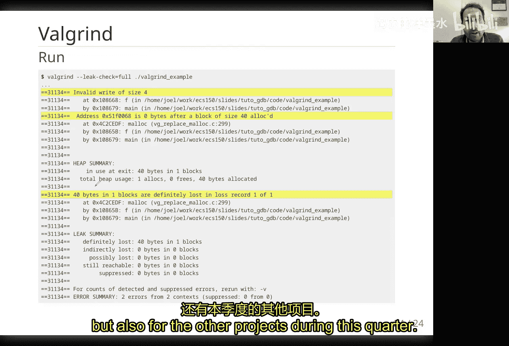

# 【全集 附课件】加州大学戴维斯分校 操作系统与系统编程 中英字幕 1080P p29 Lecture 29 - 调试 -BV1jXr5BBEKa_p29-

Hi， everyone。So today I wanted to in this discussion section。

 I wanted to talk about debugging and GDP。Which hopefully should be useful far。

All of the projects in this class。So what is GB very quickly？

It's part of the GU project or new project， I don't know how it's pronounced。

That's this project that was started at MIT by this researcher called Richard Staman。Back in 1983。

 So kind of a long time ago。And his idea was， so at the time the big OS was UniX。

 which was proprietary。And so his idea was to try to push for free software。

 for developing an entire software stack from kernelnal to like the entire OS and applications and all of that that would be completely free that everybody could use。

 modify， redistribute entirely freely。And so he came out with many different ideas。

 including an ID to create。A specific license that would authorize that kind of distribution and that kind of sharing in a legal way。

 and then they started to work on many different user programs that were part of theOS so like having a text editor like having a compiler。

 having a Dbuer， which is GDP having many different tools that you all are still using today on on typical Linux computers。

And they even started working on the kernelel called New Herd。

 which really like never came through and thats。Probably why Linux had such a big successes that like it came and it actually worked anyway so。

Part of the stool of this new project was GB， which is the new debugger， it supports many languages。

 pretty much like all languages that are compiled into assembly codes or like CC++ go objective C。

 Fran and Pascal， B ADda， the N many more， and it pretty much like allows two things for the developer for the programmer to do to debug their programme。

It allows to inspect what the program is doing in terms of execution flow。

 like what are the sequence of statements that are being executed so you can really follow through what the program is doing。

And the data， so like all of the variables and all of the data。

 all of the values that the program is handling during runtime， so that's what GDPB really does。And。

There's a full manual that you're very welcome to read if you want to know more than what we're going to discuss here。

So let's start with the basics like how do I use G？As you know， when we compile a program。

 we use GCC， we can specify some options and then say that's going to be the name of our executable and those are like that's the file that we want to compile。

And so。Some of the typical options that one could use would be， for example。

 like those three like W dash wool， W error and O2。

 which means that we would want to have all of the warnings。

 we would want to treat warnings as errors to like really forces to fix those warnings and dash O2 would be to optimize for speed。

Now when we want a debug， we need to use another set of flags or at least one different flags。

 instead of dash or2 to optimize for speed， we should use dash G to enable debug Spot。

Here I would really recommend when you enable the debugging support to not use dash auto at the same time。

 because then you have both the optimization of the code。And the debugging， and when you debug。

 it can make things like really tricky to debug。So by default， if you use doesG。

 just don't use any other optimization。Um quick regression because probably if you have a Mac file and you type make and that takes care of the compilation。

 then how do you juggle between？Compiling for speed and compiling for debugging support。Well。

 it's actually possible。To combine those two in the same Mac file and it's really important to like not say just configure your Mac file to use the doesG and debug for and compile for debugging because。

If you always compile for debugging， even after the product is done and you like distribute it to your users。

When you compile for debugging， it increases the size of the executable by 50% because it adds a bunch of like debugging support and also the code will not be optimized and actually sometimes the performance might be affected like when youbug when you compile for debugging without any optimization。

 then your program can be twice as slow。So it's really important to like make sure that when you're debugging。

 you're using the debugging flags when you're not debugging and your code becomes ready for production。

You actually use the proper optimization flags。So how can you have both？Inside of the same Mac file。

 say， well， you can use。This kind of construct， that's just an example。

 but personally that's the kind of stuff I use in my own Mac files。

You can test that say a viable D is equal to one or not if it is then you compile for debugging if it's not then you compile for optimization and the way that you would use or set up this de variable is directly on the command line when you type make so if you type make D equals one then you do debugging and no optimization if you just type make then you go for deep optimization and so you have a quick way like that to change in between the two modes。

Okay， so imagine you're ready you've compiled your program with the debugging support and now you want to start using GB。

 two ways to do that， you can either just run GB， then G will show you a prompt and you can load the program that you're trying to debug by using the command file。

Or more easily， you can run GB and give us an argument the name of the program that you're trying to debug and。

GB you will like automatically load that program and you'll be able to get started。

Once you're in GDB， GB knows the program that you're trying to debug。

 you can actually run the program。Either so if your problem doesn't have any arguments like any command line arguments。

 then just typing run。If your program has arguments。

 you want to give arguments your program on the command line。

 then you would type run and you would provide the different aVs after run。

 and that would be equivalent to so imagine like you have this my program doing that would be equivalent that if you were in the share you would type like dot/lash my program。

嗯。And then like Ag V1， Ag V2， and so on， okay。If ever you're lost。

 which is probably is going to be the case at some point， there's some help in GBB。

 so if you really don't know what you're doing， you can just type help and then you'll have a list of categories of command。

And so if you're interested by certain categories， so for example。

 I do category that helps you setting breakpoints， then you can say help breakpoints。

Then you get a list of actual commands that are related to breakpoints and you can even have some help about each of those different command and then it really tells you like。

 okay， here's how to use the command so you type B and then you have those different like arguments that you can give and so on。

Okay， so。When you run your program with GDP or when you run your program in general。

There should be three possible scenarios。The first scenario is that your program is totally fine。

 doesn't have any bugs， and it works great。 so you can just like tap yourself on the back and be happy。

The second scenario， which is my personal favorite， I mean， apart from scenario number one。

 obviously， but when things go wrong， that's my favorite scenario is when the program actually crashes。

And typically with a segmentation fault。That's my favorite and we're going to see why because like when the program crashes。

 it's actually usually not too difficult to debug。Because it crashes。

 so you have a moment where things go wrong。And that gives you a starting point to kind of like go back in time and try to see。

 okay， why did it crash？Now the worst case scenario， in my opinion， is when it doesn't crash。

 so there's no real moment where things go wrong it's just that it doesn't produce the right result。

 it doesn't work。And so here it's， in my opinion， a lot more difficult to debug because like you don't necessarily know where to start。

 you just know that it doesn't work。And I'll show an example of that as well。嗯。Okay。

 so let's let's start with examples， actually， and let's start with the first one like this。

So what do we have we have a main function we have like a string and essentially we call printf and we try to display the length of the string like how many characters do we have on the string and so for that we call this function fulllen that in turn called STRN on the string and that should be the number that we're trying to print。

And this program is not meant to be like very difficult to understand， but like as you can imagine。

 after computation， we run this thing and we have a segmentation form。So actually here。

 maybe just pause the video for a few seconds， look at that code and try to determine yourself like。

 okay。When reading that code， do I know why the segmentation fault is happening just looking at the code itself？

Okay， so hopefully you have a fair good idea of what's happening。 but just in case you don't。

You have this good doesn't work。 You're like， okay， what's the problem， Let's use GDB so。You would。

 obviously。Make sure that your code is compiled with the dashG option so that you have the debu and support activated。

 then you run GDPB on your executable and your just type run has no command line argument。

And as we can expect， so the program runs and at some point boom segmentation fault and you even start having some indication like。

 oh， the segmentation fault is happening in STR。The first thing to do when you have a segmentation fault。

Is to understand。What was the sequence of operation that brought us to this segmentation fault？

And the perfect command for that is called back。So you call back here。

 or you can also just type Bt and then press enter and Bt will essentially print。

The chain of function calls。 And you have to breathe it backwards。 So the one that's at the top here。

Is the function。In which the segmentation fault happened。

 then that function STN was called by the function Fuin and footin was called by main。So in fact。

 you can also read it this way， like starting from main main calls fullland。

 fullland calls SDR and and。The segmentation fault happens in STR。

And here already like just based on this back trace。

 you can start investigating and play the detective。And you can already see like，huh。

 something is weird here。Fuulland receive is receiving a pointer and this pointer is no and usually like when you have a nerve pointer。

 it's not good， especially when you have a segmentation form。嗯。

And so what probably happens is that this full end calls STN with a no pointer。

 STN is trying to determine the length of a string except that there's no string， and so STN fails。嗯。

So。The way to fix the program， even if it's like a little series that like。

If you're going to compute the length of a string， you actually need to have a string in the first place。

 If you have a no pointer， then there's nothing here to do。So let's say we rewrite this program。

 we actually provide a string。We compile and run it again， and now it's working。

A better fix here because like chances are maybe in a week I'm going improve on that I'm going to work again on that program and maybe I'm going to make the same mistake again I'm going to again call full end on a null pointer and that's going to crash again and I'm going have to run GDP again because like I don't know I didn't learn from my previous mistakes and it's going to take me a while to figure out things。

So maybe here the best way would be to actually protect this full end function a little bit better。

 And so one thing that we could do is measure that full end。

Can only be called with a pointer That is not nu。And for example。

 what we can do is use an assertion like。Aset that S is a valid pointer。 that S is not nu。

And if S is no， then this asset will fail and so now like if I do the same mistake again。

 instead of having a segmentation fault， which I would need to debug。

I have a proper kind of an exception that really gets triggered when I get here and so message then tells me like hey。

 your problem is crashing and here's the actual reason like it's crashing in that function and the reason is that the string can not be known here so it like helps you debug your code better。

So let's look at another example now。嗯。This one is a little trick。诶。

But so essentially we have this this program right。

 and it turns out that if we compile it and we run it， that's what we get We get a segmentation form。

So， again。Poose the video， maybe for a couple of minutes。

 look at the code and try to see if you can identify the error yourself。

It's a pretty typical error I've done it probably。A handful of time。

I wasted hours of deing on it now I don't do it anymore because I got really frustrated。

 but yeah I think it's a classical error that you probably should know about。So。Hopefully you。

Found out what the error was， but let's imagine you didn't， which is fair。

 So let's try to use GB to find what's happening。So as usual。

 you would compile your codes with the debugging support and then run G D。

And the GDP would stop when you get the segmentation fault and it actually tells you。

At what line the fault was。As usual， when you have a segmentation fault。

 it's always good to kind of understand， okay， how did I get here。

 so the first reflex should be run batteries。Except that， as you can see here。

We are actually in the main function and there's nobody really anything in the function cold chain that really like help us know anything。

And。I guess the so we can kind of go back to that line， okay， so we have a segmentation fault。

And we're trying to access a certain element in this tab array to assign sign a value。

Usually when you have a segmentation fault and you're trying to access an array。

 the most typical mistake is that you access。A cellll of the array that's incorrect like so imagine like your array only has 10 cells and you try to access the 20th one that's a mistake and that might cause a segmentation fault because you're accessing a part of a memory that's invalid。

And so actually， here， if we want to know， Okay， so maybe were trying to access。

The element of tab that is incorrect。And we're trying to access tabt index I， so maybe like， okay。

 let's print what I is。And what we see is like， oh， okay。I is like， 4 billion。

So we have an rate that it's certainly not 4 billion in size。

 and we're trying to access the 4 billion。Eleement， which is why we get the segmentation fault。嗯。

Here， in case you hadn't noticed in the previous example。

 the problem is that we were using an unsigned int instead of a signed int。

And so when we would decrease I。Up until it essentially becomes negative。If I was an enzymesed int。

 it cannot become negative。 What happens is that when it's 0。And you decrement it by one。

 It actually wraps up to the biggest value an uns integer can contain， which is 4 billion。

So instead of stopping the loop， the loop would continue and we would try to access the array at an index that's way too big and the program would crash。

That's a tricky one。诶。So that's not segmentation folds。Now we have other types of bug。

 which I call like behavioral bugs。They're more difficult to find here because like they won't make the program crash so take this program。

 for example， that has a string and essentially like we loop through all of the characters of the string and the goal is to transfer every character to an uppercase character。

And so the idea is that like we have a certain。String here that's made of uppercase and lowercase characters。

 and then we try to transform them all into uppercase characters。

And the bug here is that you can see the last character is not transformed into its uppercase equivalent。

 it stays lowercase so here that's a program that doesn't work technically like the output is incorrect or partially incorrect。

But it's not crashing either。 So there's no moment where we know like， oh。

 here it crashes and we can investigate the cause of the crash。

 It just doesn't do what it's supposed to。So those bugs are a little bit more tricky to find and investigate。

But GDB gives us a lot of tools to help us with that。So for example。

 it allows us to set up breakpoint。Which means that。As the program is running。

 instead of waiting until the program is done to observe that it didn't work。

 we can interrupt the program as it's being executed by the debugger。And by doing so。

 we can essentially like inspect the the running process during its execution So how do we do that。

 How do we set up breakpoints， there are three different ways。

The first way is that we can break at an exact location in the code by giving the file name。

And the line number。And so what's going to happen is that a breakpoint will be set。

 and then when we run the program。The execution will be stopped exactly when it reaches the line that we specified we wanted the execution to stop at。

So that's option number one。Option number two， we can break at a specific function。

So as soon as we the execution reaches this function， like the function gets called。

 then the program would be stopped。So here， like in that program， we only had one function。

 which was the main function so we could break directly add the main function run it and the execution would be stopped right at the very first。

Statement in the main function。And last， which is actually pretty powerful， is that we can break。

 but only if a specific condition is fulfilled， which is very convenient sometimes。 So for example。

 like we can say， okay， I want to bring， I want to break。In that file， at line 13。 but only if。

Or only when say I is equal to5。 So for example， like you can break inside of a for loop。

Only when the index。Which is a certain value。 So not like at the beginning of the followup。

 and then you need to debug like throughout the entire followup， you can actually set say like， hey。

 I want to break in that follow up， but say at the last iteration， which can be super convenient。嗯。

Once you have set up breakpoint。There are different things you can do， so for example。

 so when the execution reaches is a breakpoint， then you go back to G and you go back to the prompt and you can enter new commands。

And so something that you can do， for example， is continue the execution and either it will reach completion or it will break again at the next break point。

You can start executing step by step， so here it means that。You stop the execution。

 then you enter step or just S， and it will execute the next statement and then it will break again and you'll be able to choose what you want to do。

Or you can call next。 So next that in step are very similar。Except that with next。

If you're currently at a function call。With next， you're going to execute this entire function and break after the function returns。

 whereas with a step。You would actually enter that function and stop debugging the function as well。

There are also other things you can do is printing variables。 So when you're at the G prompt。

 you can print the status some variables and explore the data of the running process to understand what's happening。

So imagine you had like a bunch of variables that had been like different variables， like integers。

 characters， pointers， and so on。You can inspect our values using GDP in the common print。

So if you use a print。Or just P。By default。The printing will follow the type of the variable。

 So here， like， if we say print a。A is an integer。 The output will be a。

under the the form of an integer。Now here if we print B， B is a character。

The G will show us the character format。Or the。The ascico， like the numerical ascico。

Here C is a pointer。If we print see。GDB will show us the address that C contains and so on。

 And here like S is a string。 GB will try to read the actual string at the address where the string is located。

Now you can specialize the spring command by printing things a little differently so you can print different things。

You can affect like the way that prints prints and word print specifically。 So here， for example， a。

I could decide you know what， I'm not interested in the integer value or like the decimal value。

 I would like to have the exact decimal value so you can prefix。

Print or you can use the slash X after print， and it will force the integer to be displayed as an the decimal value。

Here with like slash C， you force the display as a character and you can even modify the value of B。

Here for C， which is a pointer， you can actually dereference the pointer and print what's behind the pointer。

And here like S is a string， it's an array， you can actually specify which character of the string you want to display and so here like if you want to display only the first character you can access only the cell zero。

呃。The printing is very powerful， so it also works if you have like complex data structures。

The print would understand that like for example， here you can like if you have a data structure E that has like internal fields。

 you can access each of the fields separately and so on。

 works with like pointers on data structures or data structured objects directly。

 G is very powerful here。Another pretty cool thing is are called watchpoints。

So breakpoint are about debugging the execution flow like putting breakpoint at certain lines of code。

 like certain statements。Watch points are kind of like break points， but for data。

 so let's say you want to interrupt the program when a certain variable is being modified so it's not magnetic。

I want to break at a certain line of code。 It's more like I want to break whenever viable I changes its value and that's something you can do with watchpoint。

 So here you would say watch I and then continue the execution and。

It would break whenever eye is being modified and it will tell you like， oh。The old value of I was0。

 the new value of I is1， and it's in that statement that it happened。

 which makes sense because that's where I is being modified。

So sometimes watchpoint can be like super interesting because I'm sure we've all have the we've all had the bug where like I don't understand。

 I put this value in a variable and later in my program the variable has changed its value and I don't understand how well with the watch point here you can watch a certain variable and it will tell you exactly when and why it happens。

And so finally some other command that you can use in GB is like say finish。

 so let's say you're stepping through a function and it turns out like you want to just finish the execution of a function and break after the function has finished executing。

 then finishes the command that you should use。If you're in a loop and you want to just not debug the rest of the loop。

 but debug after the loop is done， you can use until。

You can show some information about the different breakpoints that you have in your currently setup in G。

 you can delete the breakpoint if you're not interested in breaking at that location in Yo code denimo and so on。

 it's pretty powerful。Last thing that I wanted to mention in that discussion is var grind。

 so that's totally different from GB and I pretty just have a quick example here to show you。

So here's some code。Again， take a few minutes to look at it。Try to understand what it does。

There are two issues with this code I can tell you right away。

The issue with that code is that most likely it's not going to cause a segmentation fault。

 It's still a code that's going to be wrong， but it's not going to trigger a segmentation fault。

So let me tell you what's wrong with that code there are two things。The first thing is this line。

If you malloc。Essentially， a neurory that has 10 elements。Then your pointer here。

 which point onto to this dynamic array。You can access from element 0。2 element9， That's 10 elements。

 which is what you have allocated here。Now in that line， when we access。Index 10。

 were actually accessing the 11th element， which is wrong。 Like this element doesn't exist。

 It hasn't been allocated properly。So essentially here。

 we're accessing a piece of memory that we should not， like conceptual， it's incorrect。Except that。

No segmentation fault will happen because it's close to memory that is legal and so the chances are like it's not something that will be caught by the processor。

The other mistake is that here were allocating some memory。

We're getting the result of the education in a pointer in this local variable in this function。

 and then we return from the function here and the result of the malloc has not been freed。

 so that's a memory leak。So how do we。How can we catch those errors that would not trigger any segmentation fault and the memory might be difficult to detect well var grind is your frank here。

You can run v grind。There are many different options that but so that's that's one here。

 that's the option that allows vulgen to report if there are memory leaks。

And then you run the actual program， the one that you're trying to debug。And so here。

 Vgram will really check everything that's happening in terms of memory。😊，And here it will report。

 so it will report the first error when we're accessing the element at index 10。

 it will tell you like， oh， there's an invalid right axis of size 4 because we're trying to write an integer of size 4 bytes。

And then it tells you exactly where this invalid access is happening and it's telling us that it's happening。

Essentially， right after the block of memory that was allocated by Malo。

 So just one further the block that was allocated。And finally for the memory leak it's reported a little bit later and it tells us like。

 oh， you had allocated 40 bytes and those bytes have been lost which is correct because we allocated those bytes we got the result into a local viable and then the function that contain this local variable returned which means that we lose the local variable so we lose the pointer onto that space but the space has not been freed and so here Vi is able to tell us that and tell us that。

We have an issue here。Okay， so that's it for the discussion。

 hopefully that will help you a lot with the current project if it's not too late。

 but also for the other projects during this quarter。

