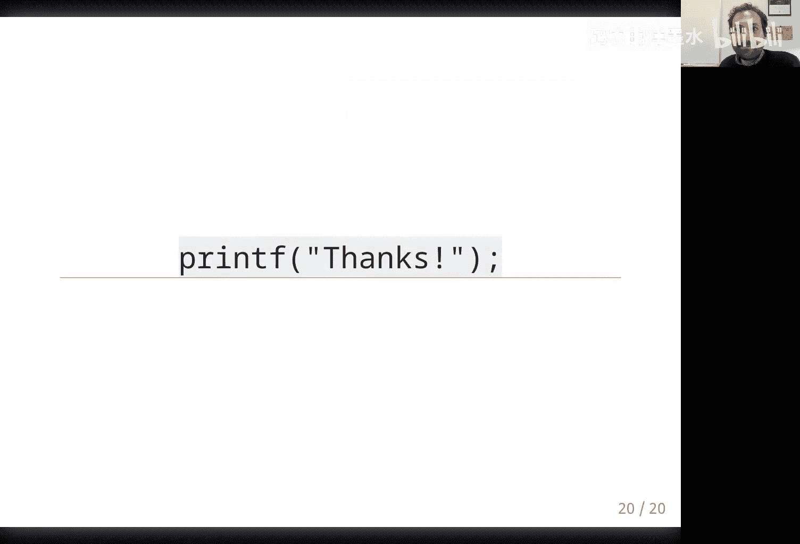

# 【全集 附课件】加州大学戴维斯分校 操作系统与系统编程 中英字幕 1080P p30 Lecture 30 - printf 函数 -BV1jXr5BBEKa_p30-

Hi everybody， so for today's discussion I decided to do a presentation which I actually gave a couple years ago as part of my job interview here at UC Davisvie。

And it's a presentation that explains how printf works。So you know。

 printef is the function you probably first learn in your very first intro CS class。

 whether it be ECS 30 or ECS 36A， you start using it， you take it for granted。

 it does what it's supposed to， and you don't really ask any question。

In terms of what happens behind the scene。And to be honest。

 like up until the day that you write your own operating system。Which maybe you will。

 maybe you won't， but in my case， one day I had to write my own operating system and so I had to actually figure out okay。

I need this print function， but now I need to write the code for it， how does it work？And it felt。

Very much of the aha moment of like， oh， wow， that's it's not that complicated that the end of the day。

 this function that I just used for so many years。So yeah。

 I thought you would enjoy it and it's also very， very relevant to that class because it's purely system programming at the end of the day so。

So。😊，Let's start from the beginning。Printf， what can we do with it？Printf is extremely versatile。

Can handle very simple scenarios to pretty complex scenario。 So here is one very simple scenario。

 You just want to print a string and it's just going to do that。

You'll notice here that we are not really using any of the formatting part of print F。

 you know print F， it's print and the F stands for formatting here it's more just like printing。

If we want to do formatting， that's when we start using placeholders。

 So the formatting here is that you have what is called a format string。So it's a shrink。

That contains placeholders and so in C with printf those placeholders are determined by using the person sign。

 so here you have person S， which means that you want this placeholder to be replaced by the first argument to printf or the second argument to printf。

Then you have here person C that will be replaced by the the next argument to printf。

 which is a character。And then person D， the it will be replaced by the following argument。

 which is an integer， a decimML integer。And so here。

 that's where print have really stopped shining that it is able to do this on the fly replacement。

That formats a certain string given parameters。And you can go even beyond that。

 so here is an interesting example of printf which is kind of weird， but it does something so。And。😊。

Here there are two sort of arguments in the。In the formatted string， you have back slash B。

 which is a backspace， so essentially I'm not really like going to print anything and here you have an interesting one which is percentage n so B and n is very bizarre。

ItYou give it it corresponds to the address of an integer。And it's actually an output argument。

 meaning that I here will not be taken as an input。 It will be an output， and I will be set。

With the number of characters that were printed by printf up to the point where it finds this placeholder percentage N。

 it's a little bizarre。嗯。😊，And so to put that。Long story shot。

 this little pieces of piece of code here will make it so that I equals one because we we。

Be only printing the backslash B， the pack space。Which is one character。 and then we set I to1。

And so here is another one， like a longer。嗯。A longer version where say， so we print a string。

Which will correspond to this argument。And then backslash B， we actually go back one character。

We overwrite。The last character with another letter， then we go， then you see some like weird。

Sequence thats actually will enable coloring in the terminal。

 So here we are coloring in red and in bold font。Then we have percent D。

 we're going to print this value I， and then we have another weird sequence which in fact goes back to just like。

Black font， regular weight and then exclamation point and backlash shed in for the new line。

And so you'll see that what's printed is UCD is number one， number one being in red and bold。So yeah。

 you can do pretty interesting with prints。So just a little bit of history here。

 let's see how did we get to printf as we know it it's a pretty old function as you can imagine because printing is really like one of the fundamental part of programming like you always need to print。

And so if we go back in time。Prntf west spot of the very first version of Forran。

And so here we're talking mid's 1950s， so 70 years ago。

And printing and formatting was one of the 32 possible statements in Fortran。

So right of8 was like directly part of the basic things you should be able to do。And here。

The printing and the formatting were actually separated into two different statements。

Write was a statement and as part of writer you would say， okay。

 I want to write to the output which is tape number six at the time mid650s。

 there was no screen you would just like print to tapes。

Then you would give the number of a formatting command。Or formatting statement。

 and then you would give some variables that you wanted to print。And。Other the呃。Corresding number。

You had this format statement。And that's kind of like the printf。So the syntax is a bizarre。

 there were like no strings within double quotes， so the way to represent that was called hoith constant。

And the idea was it's this 4H here that would say that the next four characters are actually characters that should be printed。

 so like here's a space1 a equal space four characters。Then you have what you want to print。I5。

 so integer on five digits， and that would print the first argument that was given here。

 which was viable a， which is an integer。Then we have the next Aith constant。

 which is five characters。Double space， B equal space。And then another integer on five digits。

 which will correspond to the given viable IB。Then five more characters， space， space。

 C equals space。And another variable integer on  five digit， which will now be i C。

Then eight characters， space space， area brala， space， and now another viable。

 but this time it's a floating point。10 digit。For the non decimal pot。

 dot2 digits for the decimal part。And that will print this area。

 which I'm guessing is a floating point number。And finally， next line，13 characters， space。

 square space units。😊，So here is like kind of how you would just simply write it in C。

 you see that the C version is a lot easier than what you had to do to write in Fran。

 but you see that the idea not changed very much。It's just the syntax that are strange。

So started with Poron here， the writing and the formatting were like two separate statements。

A little bit later， like about 10 years later in the mid 560s， sorry。The language that was。

Kind of before C which strongly inspired C， which was called BCplL here they started having formatting and writing within the same function like within the same statement and you see that it starts looking to look like the print that we know where the formatting string contains everything and we now have the double quotes and we have the placeholder with using the person sign so here like person sign we want to print an integer on two digits then we have some regular character another person placeholder with。

Pson sign integer on five digits and we can give the argument。You'll notice here。

 interestingly enough that the new line character， which now is backslash n in BCPL was a star n。

But you see that the now the the。Way of printing。It's very similar to what we have today。And so。

 finally。😊，Pretty much like 10 years later in the early 70s。

 C was released and we got the syntax that we are very familiar with with the call to printf and the string。

 the back slash N and different placeholders like person S， person D and so on。

And it seems like that syntax。Made everybody agree because that is the syntax that still is still in use today and that's used across like all different tools and languages。

 printf even became its own。Tool in the common line that's that's a common line tool。

 you can that's that's like in the in the shell， there's a print program that。

Works exactly with the same formatting commands and so on and pretty much like all of the other languages。

Do implement a form of printf that is very similar to this one？Okay， so。Now that we。Understand it。

Prntf can be pretty powerful， we understand the history that led to it。

 why do we even print in the first place？There are in my understanding two reasons why we print things。

A kindin of two and a half。The first big reason is to actually。Generate some output， like print。

呃 information。To the user。Whether it's relevant or not。

Printing is also the way that programs can interact with one another。So， for example。

 and that you know now with use by using a pipe， you can make it so that。A certain process。

Will output something that is given as the input of another process。And finally。

 the result of all of that computation can be displayed to the user。So even between programs。

 between processes， printing is also the way of communicating。Printing can also be very。

Useful to do introspection。So you have a program， you have a process， you have some running code。

 and you're trying to gain knowledge。About what this code is doing in order to find bugs or to get like inside about the current state of the machine and it's very。

 very important that you can do that and it's also super important that like in fact。

 as soon as you boot the computer，You want to be able to see what's happening in order to be able to debug even at the earliest stages of the boot process。

诶。So here is， for example， like when the Linux kernel boots， it starts printing very。

 very early on so that you can really trace exactly what's happening。嗯。

So let's look a little bit under the hood at how things get printed。So let's take a quick example。

 like a pretty easy example。Imagine you have a terminal that's running a shell， and so in your shell。

 for example， you type date in order to know what date it is。Inside of the program date。

 you have a print app somewhere that will print the actual date。The way it works is that。

 as you know， printf。Will transform into a Cisco。So that gets into the kernel。In the kernel。

 you have different layers of code that will understand what you're trying to print and that will redirect the characters that should be printed to the right output。

Those layers of code are fairly complicated。😡，They are pretty old as well。

 they have to deal with like all devices that have existed for a long time and that ends up being some code that's fairly difficult to the point that even very experienced programmers。

Will say that they' are not looking at that code because they're too scared of it。But anyway。

 long story out in that example， Pri will go through all of those layers of code。

And the kernel will figure out， well， the program date here is running inside of this。

Terminal emulator， in that case， Xter， that's the program that actually is drawing that window on the screen。

And so this 2018， yeah， well， sorry for the。Lack of update on the date here。

 but I gave this presentation in 2018。And。😊，的。The 2018 will be then sent to Xter in order to be printed in this terminal emulator。

呃。So that's typically what happens when you run a program inside of a terminal window。

Now say you're running some code on a computer that doesn't have a screen。What happens then？

So for example， like embeddedbed systems well or even like systems that have a screen。

 but before the screen is up， like before the screen can display anything。Well， so usually here。

What we use is something called a serial pot。That's going to be a tiny physical device that's inside of the computer。

 and pretty much all computing system that have a processor on this planet have a serial po because that is the easiest way to print something。

 That's the easiest way to send characters。To the outside world。

 from a computing system to be able to transmit information。This cell pot， which is also called a UO。

It's very simple。 it only needs like one physical pin， like one physical wire。

 and it essentially sends bits。By modulating an electric signal into like a sort of like square signal。

 so the up levels will be once， the down levels will be zero and you are able to send bits so you're able to send bytes。

 so you are able to send characters， you're able to send text。嗯。

And what's funny is that and it kind of blew my mind when I realized that like as I said every single piece of computer has a zero po。

 so for example， like even my phone， if I open it and I look at the motherbo I will find somewhere the little pin that's called Tx and that sends characters onto that pin so that like even if the。

Display is not functional on my phone， but the phone still boots。

 I would still be able to connect myself to that pin and get something out of the computer。嗯。

And same for everywhere， so for example， like all of the models of the PlayStation 4。

 they all have somewhere this Leopin that's able to print information and that's one way that people were able to kind of hug the PS4 and get some like be able to replace the running operating system。

And even F， even the controller of the PS4 has。Those pins。

 and so it's possible to essentially solder some wires and get whatever the controller is printing。

Okay， so now let's start talking about implementation。😊，How do we print， Like。

 what is the code that's behind print。The cornerstone of printf is a tiny function。

That we need to have， and that depends on the scenario， it's called put car putchar。

It receives one character and it prints it。Probably on the computer， you have this zero po somewhere。

 you need to know where it's located。And all you know is that way， you can send a character。

To this sailport。And the whole print of infrastructure depends on it。

 that you are able to send a character， a single character through that interface。

So here's an example on a typical X86 machine of how you can transmit a character through the zero pot of a typical X86 machine。

So now， based on this putchar function。You can start implementing。Printive。

So here is a first version of print。Where essentially you would receive the string。

 the formatting string， and actually you don't really do any formatting。

 you just loop through all of the characters of that string and you call putcha on every single character one after the other。

With that code。You can already the print F 101， which is printing a single string if you do that。

 you're going to be able to see the message。However。In order to do actual formatting。

You start to need to add more logic， right， because then you're going to have the formatting string。

Which contains the different placeholders。And you don't know how many of them until you start scanning the string。

And then for each placeholder that you are able to identify， you need to go pick the right argument。

Formatted in the way that's requested by the placeholder， so if the placeholder here is percent S。

 it means that you need to get the following argument as a string。If the placeholder is person C。

 you need to get the next argument as a character and print it as a character。

And if the placeholder is press D， you need to get the next argument as an integer and print it as an integer。

And in fact you will need to convert this integer into characters that actually represent this integer。

 I'll show you a demo afterwards。The print function here。Has a viable number of arguments。

If you call the print function。With no placeholders， then you're only going to have one argument。

 which is the formatting string。If you go printf and in your formatting string。

 you have one placeholder， then your whole printf will have two arguments。

 the formatting string plus the argument that corresponds to a placeholder and so on。In C。

 in order to write a function that has a viable amount of arguments。You need to do it like this。

So first of all， you need to include this very specific headerophil because called STD Arc。

That will be the headerophil that gives you access to some functions or macros that give you the ability to write functions that have a viable amount of arguments。

So here is an example that's not really to printf， it's just an example to show you how to write functions like that。

So imagine you want to write a function that's called sum ins， so you want to sum sum integers。

But you want to do it in a generic way in the sense that you want to be able to specify account。

 which is the number of integers to sum up。And then you can give as many integers as you want between say0 and n。

And so this way you could call the same function， some int。

If you have three integers that you want to sum or if say you have five integers。

That you w to sum up。And with this function here using the dot dot dot notation。

 you don't need to write multiple function， you can do everything with just one function。

Which is pretty cool。So how do you write the code inside of this function to make it work？Well。

 here's the example here。So， first of all。You need to declare a viable。Of type V， A list。

That's where the inclusion of this header kicks in because that's where this type is defined。

And the first thing that we're going to do， the very first statement is calling this macro VA do。

On AP P， which is our V list valuable。And we're going to give count。

 which is the first parameter that was given to a function。Once we do that。

 now we can start having the body of the function。And so here in the body。

 we essentially want to loop through。Out of the parameters。

The variable parameters and the exact number is given by count。

 which is the very first argument here， so we're going to do that we're going to loop count number of times。

And each time we're going to retrieve。The next argument。 So here， like the dot， dot。

 dot means that we we're going to have like multi like between 0 and n argument。

 we're going to every time take the next one。By calling VARg on this AP variable and here we're going to specify that the argument that we're trying to kind of pop out of the list is an nteger。

And by doing that， we'll essentially like read the first argument， then the second argument。

 the and so on。To match whatever count was given to us by the user。And we can do up some。At the end。

 when we're done looping through all of the arguments。

 we can call VA and on this AP variable and we're good to go。

 we can return the overall sum that we've computed。Okay。

 so let's get to the part that everybody is waiting for the implementation of。

Prntf or at least a simple representation of print。So let's switch to the terminal here。Okay， so。😊，嗯。

I have this。Skeleton code。 Let's look at it。So it's really not complicated， I have the main function。

And I have two examples of printf， one that actually doesn't use formatting just like print a simple string。

 and the other one actually has some formatting with the three placeholder that we talked about S C and D。

And the goal is to complete this print function so that both of them work。And so on the other side。

 I have a Mac file I can make my code。And so right now， if I run it。

 I don't have anything because my printer function is not doing anything。So let's get started。

 let's try to implement the code。So what do I need？Well this printer function here。Okay。

 so my printer function is avariic function， you see with the dot dot here。

 it has a viable number of parameters。So what it means is that I'm going to need to have this viable AP of type V least so that I can scan through those variables。

I'm going to support three types of placeholders。 So the string placeholder。For with a person S。

I'm gonna need。What the character plays all there。I'm going to need to have a variable of that type and then。

诶嗯。I have the person D place holder。 So I'm gonna need a character of that type。Ok。Okay。

 so the first version that I could。Right here， which is very similar to one that I showed a couple slides ago。

Is the one where I go through。All of the characters。Of my formatting string。

 And what I could do is just to start with， even if it's not correct， I could just print。The content。

Of it。And then move to the next character。So， let's try that。O。So here it's starting to work。

 you see that by doing that， the example that uses no formatting at all， actually it already works。

 however， for the one that uses formatting with the placeholders， what the placeholders。

 they are not replaced by anything they are just being printed Fabatting and that's what we want to handle。

 we want to have them replaced by what they' are supposed to be printing。So that means that。

First and first， when I go through all of the characters of my formatting string。

 I need to discriminate the percentage sign。So if my formatting string。At the current location。

Is not。A person sigh。So here， like。Check that current character。Is not the person sign。Then。

I can simply print it。And continue。To the next character。Now。That would be。That's。Current character。

Es。The persons sign。So now I'm really in the I have to deal with the placeholder itself。

The person signed， I don't care。About it。 I can just forget about it so I can skip to the next character。

When I see the person's sign， it just tells me， oh， that's a special case。

 so don't treat it as the regular case。But then what I really want to know if it's an S or a C or a D。

So I can skip over。Did person sign？And then。Distinguish。Between the different place order。

So let's do that with a switch case。So now my FMT。Poonner here will point on whatever the actual place order here。

 And so I will have。Case。If it's a character。For example。Then I will have， if it's。String。

If it's an integer。And。And that's all I'm gonna see。Okay。

And after I'm done distinguishing this placeholder。

And taking care of replacing it with whatever it's supposed to stand for。I can skip over it。

And simply continue。So let's see。 let's just do。hoops。Just to see if it works， let's have like， fake。

P cha。To just show what's happening here。Oops。嗯。Okay， let's see。I'm going to compile。呃不是。

So what's happening here。Oh yeah， okay， that's I need to make that a character。O。

So see here I was able to really replace。Pcent S by thisput are S。

 then the person C by this capital C。And D by D。So that shows you now that we are starting to be able to replace the placeholders that appear in the formatting string。

Buy something else。Now we need to put the actual code in each of those cases to really do what they're supposed to。

So let's remove Oh actually， like， let's start from the first one so。If I have place order， see。Well。

 I need to read the next available argument from the list of viaic argument from like the dot dot dot。

So before I forget any longer， let's add the code that allows me to go through those viaic arguments。

 So I need to have a VA start here。On A P， giving the first。

Argument to the function FMT and at the end。I will need an F V A and and V。Okay。Now。

 inside of the function over here。I can get the next argument。I already have a variable。

 See over here。So I can populate it with whatever the next argument is in the list of arguments。

And it turns out that in fact， it's not possible to get an argument under the type of cha。

 the minimum argument is an int。Now that I read what corresponds to a placeholder see。

 I can actually print it。So let's start with that。Oh yeah。 no it's not V。 it's A， okay。OK。嗯。Oh yeah。

 it's not working yet because I need to do all of them。So you see。

 I was expecting to see from A to Z。But because Pre S is the first place order and we're not processing it properly。

 then it breaks everything。I thought we could do it step by step。

 but I guess we'll just have to do it all at once。So for C。

 I can just get it from the ViISta argument and use Pja。Now， for the S placeholder， that's a string。

 which means that the argument that's being given is a pointer to a string。So， I need to。

Get this drink。So I have my variable S， which is a string pointer， and I'm also going to。get V Ag。

From A P， as a job pointer。Now I have a string behind S， and I want to print。All the characters。

Of that string。So I can do is。Pretty easy。 I can do while。S。So up until the end of the string。put茶。

And I can pretty much like go through all of the characters in the string that I just got。

And print all of them。And so， here for D。I need to get the integer。From the arguments。

With the same construct as， the other ones V A R。A happy integer。Okay。

 now it's still not entirely functional， but it should be closer to being functional。Okay。

So you see that in our example。The person S。Was properly replaced by printf。

 which is the first argument。To the print that function。 and then。Person C was replaced by a。

 which is the character we associated to person C， so we're pretty close here。

The only thing that we have left is to deal with the integer。

This one is a little bit more complicated。Because what happens here？Is that。

We got the integer here in variable D， which is a n。But we need to transform that integer。

Into a string that can be printed。So let me draw something here。嗯。

So imagine we have well we have like number 45， and thats that's an integer。

 The thing is like we can only print strings。So we need to be able to like make a buffer。

Where we're going to have character for。And character 5。And now we can print4 and 5。In there。

So how do I from from an integer。Int。How do I get to an array of character that contains。

All of those digits。Well， so the way that I'm going to do it。Is that。What we're going to do is that。

Here's the number。 We're gonna make。A buffer。With many characters。

As many characters as we can as can an integer can contain。We're going to start from the very last。

Item in this array of characters。And we're going to take the first digit。So，5。

And we're going to analyze。The first digit and we're going to transform it into an ASI representation。

 so we're going to put five in it。Then we're going to take this 4 or 5 and we're going to divide it by 10。

 which is going to give us four。And four will now be the new unit digit。

So we'll distinguish four and willll associate it to asking number 4。

And so 45 here is a small number so we'll only have to do that a couple of times。

 but if the number was bigger we'd need to run this loop multiple times and look at each unit digit and essentially were reconstituting the string version of this number kind of in the opposite direction。

From the smallest digit to the higher digit。And once we are done。

 once we get to analyzing like all of the numbers， now we have a string。

From which we know where the beginning is。And we can print 4，5 in the right order。So。

 let's transform that。Into code。So I have the integer in D。And so now， I need to transform。

D into a string。Using Ask conversion。So let's make a temporary buffer of say like size 10。

And let's have a pointer， and。That for now， points onto buffer， the beginning of buffer。嗯。Oh no。

 actually， I'm sorry。 I made a mistake earlier in my explanation。 Let me。Go back to it， sorry。

So we're not going to start from oops。We're not going start from the beginning。From the end of the。

 of the。Dary。I mean， it would be somewhat similar。 but what we're going to do is we're going to start from the beginning here。

 We're going write。The first digit5， then the next digit 4。

 And we're actually gonna fill it in order。And once the number has been converted。

 kind of like from the smallest digit to the highest digit。

Then we'll stop and well we'll go backwards and preach。

Print each character up until the beginning of the buffery。 That's， that's the。

Algorithm that I'm going to write now。嗯。O。So what we're going to do is that we're gonna every time。

Anaze。The unit digit by doing modo 10， so that will isolate the unit digit。

And we're going to add this unique digit to。0 in ASI。

 And that will give us the ASI letter that corresponds to the digit。And then we're going to move。

The end pointer went forward。 and we're gonna remove。

This unit digit so that the next one becomes the one。 So here again， like we're going to start by 45。

 When we do that45 modular 10 plus 0， that will give us5。Then we'll move the pointer。To。

To the next location。And we'll divide our integer by 10， which will discard the five， give us four。

 and then we'll loop again and we'll loop around。While D is not0。Okay。

 and so once we are done doing that， then that's when we can display the string by。

 as I was explaining， going backward through this buffer array。嗯。So， why and。Different than B。

And now we can call Pchar。On each of those。Items in the buffer。Okay， so let's try。Make。And yeah。

 it works。Now I'm able to actually print this format string printed from A to Z in 45 minutes。嗯。Okay。

 that's the end of the。Deor， let's go back to the slides。So。

Just you have the code I give the code in the in the slide here。

For you to look at if you want to know more and here' is like the entire。

A code that we just type together。 I totally understand that there might be part that I might have gone a little fast on。

 but please take the opportunity to。Look at it yourself。That's the end of this presentation。

 thanks for watching it。😊。

