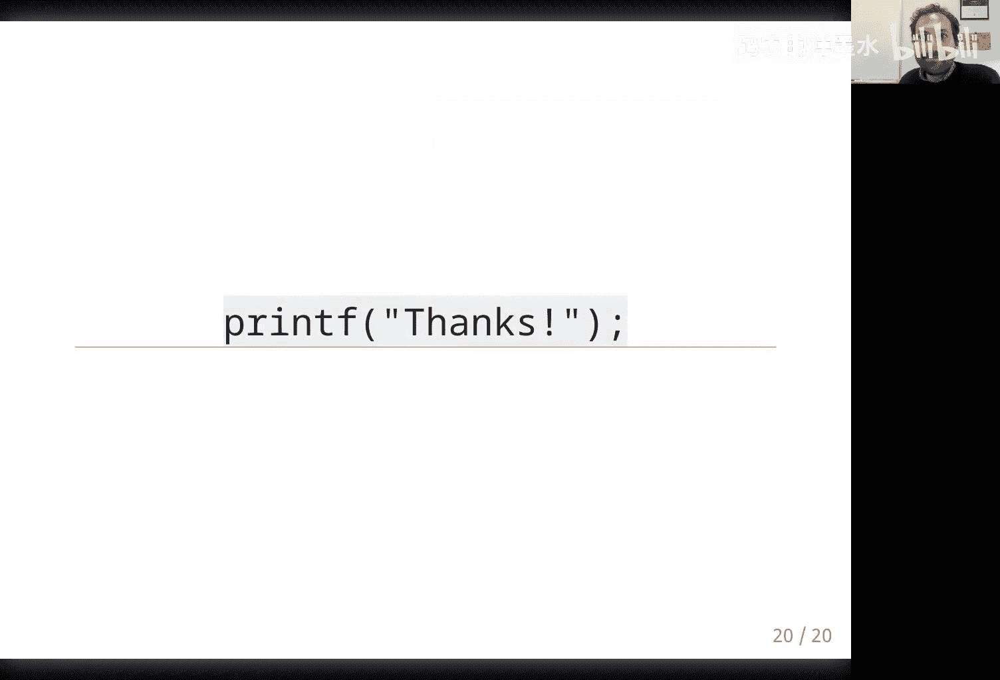

# 操作系统与系统编程：30：printf 函数详解 🖨️


在本节课中，我们将深入探讨C语言中一个看似简单但功能强大的函数——`printf`。我们将了解它的历史、工作原理以及如何从零开始实现一个简化版本。通过本教程，你将理解格式化输出的核心机制。

---

## 概述

`printf` 是C语言中最基础、最常用的输出函数之一。它能够处理从简单的字符串打印到复杂的格式化输出。本节课我们将剖析其背后的原理，并动手实现一个简化版的 `printf` 函数。

---

## printf 的功能简介

`printf` 函数极其灵活，可以处理从简单到复杂的多种输出场景。

以下是其功能的几个例子：

*   **简单字符串打印**：当不需要格式化时，`printf` 可以直接输出一个字符串。
    ```c
    printf("Hello, world!\n");
    ```

*   **格式化输出**：通过使用占位符（如 `%s`, `%c`, `%d`），`printf` 可以在运行时将参数动态插入到格式字符串中。
    ```c
    printf("String: %s, Char: %c, Int: %d\n", "example", 'A', 42);
    ```

*   **特殊功能**：`printf` 还支持一些特殊功能，例如：
    *   `\b`（退格符）：将光标回退一格。
    *   `%n`：将当前已输出的字符数写入一个整数变量（作为输出参数）。
    *   控制序列：可以输出控制终端颜色和字体的特殊字符序列。
    ```c
    int i;
    printf("\b%n", &i); // i 将被赋值为 1（\b 是一个字符）
    printf("UC%c is number \033[1;31m%d\033[0m!\n", 'D', 1); // 输出红色加粗的 “1”
    ```

---

## printf 的历史演变

上一节我们介绍了 `printf` 的功能，本节中我们来看看它的历史渊源。`printf` 的语法并非一蹴而就，而是经历了数十年的演变。

*   **FORTRAN (1950年代中期)**：在最早的FORTRAN语言中，打印和格式化是两个独立的语句（`WRITE` 和 `FORMAT`）。格式字符串的表示方式非常原始（使用Hollerith常量）。
*   **BCPL (1960年代中期)**：这是C语言的前身之一。在BCPL中，打印和格式化被合并到同一个函数中，语法开始接近现代的 `printf`，使用了双引号和 `%` 作为占位符，但换行符是 `*n`。
*   **C (1970年代早期)**：C语言最终确立了我们现在熟悉的 `printf` 语法，包括 `\n` 换行符和各种占位符。这一语法被广泛接受，并影响了许多其他编程语言和命令行工具。

---

## 为什么需要打印输出？

理解了 `printf` 的“是什么”和“从哪来”，我们再来思考“为什么”。在计算机系统中，打印输出主要出于两个半目的：

1.  **与用户交互**：这是最直观的目的，程序通过打印信息向用户展示结果、状态或提示。
2.  **进程间通信**：程序可以通过标准输出（stdout）将数据传递给另一个程序（例如使用管道 `|`）。
3.  **程序内省与调试**：开发者通过在代码中插入打印语句，可以了解程序的内部状态、执行流程，这对于查找错误至关重要。甚至在操作系统启动的最初阶段，打印功能也是不可或缺的调试工具。

---

## 打印输出的底层路径

那么，当我们在程序中调用 `printf` 时，字符是如何最终显示在屏幕上的呢？让我们看一个典型场景。

假设你在终端里运行 `date` 命令。`date` 程序内部的 `printf` 调用会产生一个系统调用，进入操作系统内核。内核中复杂的设备驱动和输出管理代码会识别出这些字符应该发送到哪个“输出设备”——在这里是你的终端模拟器（如 xterm）。最终，字符被传递给终端模拟器，由其渲染在窗口上。

对于没有屏幕的系统（如嵌入式设备）或屏幕尚未初始化的阶段（如系统启动时），输出通常会通过一个称为**串行端口（UART）** 的硬件接口发送。几乎所有计算机系统都具备这个简单的硬件，它通过调制电信号来发送字节。通过连接到此端口，开发者可以获取系统的调试信息。

---

## 实现 printf 的核心：putchar

现在，让我们进入最核心的部分——如何实现 `printf`。所有打印功能的基础是一个非常简单的函数：`putchar`。

`putchar` 接收一个字符作为参数，并负责将它发送到正确的输出设备（例如串行端口）。它是整个 `printf` 基础设施的基石。有了它，我们就可以构建更复杂的输出函数。

以下是一个在典型 x86 架构上，通过串口发送一个字符的简化示例代码：
```c
void putchar(char c) {
    // 等待串口准备好发送
    while ((inb(0x3F8 + 5) & 0x20) == 0);
    // 将字符发送到串口的数据寄存器
    outb(0x3F8, c);
}
```

---

## 实现简化版 printf

基于 `putchar`，我们可以开始构建自己的 `printf` 函数。首先，我们需要处理可变数量的参数。

在C语言中，要编写一个像 `printf` 这样参数数量可变的函数，需要使用 `<stdarg.h>` 头文件中定义的宏。

以下是使用可变参数的一个简单示例，该函数计算多个整数的和：
```c
#include <stdarg.h>

int sum_ints(int count, ...) {
    va_list ap; // 声明一个参数列表变量
    va_start(ap, count); // 初始化，`count` 是最后一个固定参数

    int sum = 0;
    for (int i = 0; i < count; i++) {
        int arg = va_arg(ap, int); // 获取下一个 `int` 类型的参数
        sum += arg;
    }

    va_end(ap); // 清理工作
    return sum;
}
// 调用示例：sum_ints(3, 10, 20, 30); // 返回 60
```

---

### 逐步构建 printf

接下来，我们将分步实现一个支持 `%s`、`%c` 和 `%d` 的简化版 `printf`。

**第一步：基础框架和字符串打印**
我们首先创建一个能遍历格式字符串并直接输出每个字符的版本。这已经可以处理没有占位符的简单情况。
```c
void printf(const char *fmt, ...) {
    va_list ap;
    va_start(ap, fmt);

    for (const char *p = fmt; *p != '\0'; p++) {
        putchar(*p);
    }

    va_end(ap);
}
```

**第二步：识别并处理占位符**
现在，我们需要在遍历字符串时识别 `%` 符号。当遇到 `%` 时，我们查看下一个字符以确定占位符类型，并调用 `va_arg` 获取对应的参数。
```c
void printf(const char *fmt, ...) {
    va_list ap;
    va_start(ap, fmt);

    for (const char *p = fmt; *p != '\0'; p++) {
        if (*p != '%') {
            putchar(*p);
            continue;
        }
        // 跳过 ‘%’
        p++;
        switch (*p) {
            case 's': { // 处理字符串
                char *s = va_arg(ap, char*);
                while (*s) putchar(*s++);
                break;
            }
            case 'c': { // 处理字符
                // 注意：`va_arg` 中 `char` 会被提升为 `int`
                int c = va_arg(ap, int);
                putchar(c);
                break;
            }
            case 'd': { // 处理整数（暂未实现转换）
                int d = va_arg(ap, int);
                // 接下来需要将整数 d 转换为字符串并打印
                break;
            }
        }
    }
    va_end(ap);
}
```

**第三步：实现整数到字符串的转换**
处理 `%d` 是最复杂的一步，因为我们需要将整数（如 `45`）转换为其字符表示（`‘4‘， ’5‘`）。算法如下：
1.  创建一个足够大的字符缓冲区。
2.  通过 `d % 10` 获取最低位数字，并将其转换为 ASCII 码（`‘0‘ + 数字`）。
3.  将转换后的字符存入缓冲区（从后往前存或从前往后存再反转）。
4.  通过 `d /= 10` 去掉已处理的最低位。
5.  重复步骤2-4，直到 `d` 为 0。
6.  将缓冲区中的字符按正确顺序打印出来。

以下是该算法的核心代码片段：
```c
case 'd': {
    int d = va_arg(ap, int);
    char buffer[20];
    char *ptr = buffer;

    // 将整数转换为字符串（反向存储在buffer中）
    do {
        *ptr++ = '0' + (d % 10);
        d /= 10;
    } while (d != 0);

    // 将反向的字符串倒序打印出来
    while (--ptr >= buffer) {
        putchar(*ptr);
    }
    break;
}
```

将以上所有步骤组合起来，我们就得到了一个能够处理 `%s`、`%c` 和 `%d` 的简化版 `printf` 函数。

---

## 总结

本节课中我们一起学习了 `printf` 函数的强大功能、历史演变及其在系统编程中的重要性。我们深入探讨了打印输出的底层路径，并最终动手实现了一个简化版的 `printf`。关键点包括：
1.  `printf` 的核心是格式化字符串和可变参数处理。
2.  所有输出的基础是 `putchar` 函数，它负责向底层硬件发送单个字符。
3.  通过 `<stdarg.h>` 中的宏可以处理可变参数。
4.  实现 `printf` 需要解析格式字符串，根据占位符类型获取相应参数，并进行必要的转换（尤其是整数转字符串）。



理解这些原理，不仅能让你更深入地掌握C语言，也为理解操作系统层面的I/O操作打下了基础。