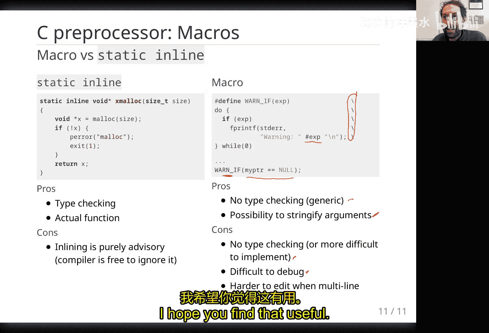

# 【全集 附课件】加州大学戴维斯分校 操作系统与系统编程 中英字幕 1080P p31 Lecture 31 - C 语言中的宏 -BV1jXr5BBEKa_p31-

Hi， everybody。So today I wanted to talk to you about some adventent programming techniques in C。

And actually focus specifically on macros， which can be very， very powerful。

 although sometimes a little dangerous， so let's see。How do we use macroynency？

One of the first examples that you know is to。Use macros to associate a certain name。To a value。

And this way， you can use that name through your code。

And after it gets pre processed by the compiler， remember that the first step of the compiler is to pre process the source code。

All of the。Uses of the macros will be replaced strictly。By the text that the name corresponds to。

So it's really a search and replace。嗯。So that's one example。Here you see that like my macros。

 which are names associated to values， the values are sequential。They start from 0， then 1，2。

 and so on。Which in an example， for example， in P2 with the thread library would be just perfect to determine the state。

Of a certain thread as part of the TB。And。In that case。

 when you have values that say like start from zero and are just incremental。

It might actually be preferable to use an NM rather than a bunch of defines， like a bunch of macros。

There are a few reasons for that。The first one is that when you use inum。You get autonm numbering。

By default， the first value of your inM will be value 0。

And then there will be an incremental numbering of the next values。

 so ST running will be value nu1 and ST block here will be value2 and you don't even have to specify it the first one will be zero and then one。

 two and so on。诶。Which means that later on you can reorder your states or you can like add new states and you don't need to care about the values that they are associated with because the numbering will be taken taken。

Taking care of for you。Whereas if you use macros here， that's up to you to maintain the numbering。嗯。

😊，Another interesting advantage of using a Num is that if you have a switchcase。

 so I you let me go back to the previous slide here。If you have a switch case like that。

 and so you're switching on a certain。Vable， and then you have a bunch of cases。

 depending on the value。When you use an anum。The compiler will warn you。

If your switch case is not complete， meaning that you do not have a case for each one of the values in your enum。

Because the compiler will know， oh， well you're looking at this variable that's our type of reum。

 but your switch case is not enumerating all of the different possibilities。嗯。When you use the macro。

Compillir has no idea。 It， It doesn't see the logic that all of those values are somehow like connected to one another。

Another very nice advantage of using anems is that the debugger will know about those。Names。

 so as you're debugging your code with G。Those names here will make sense to GDPdB。If you use macros。

 GDP will not know because that's after compilation。

 you will only if you print a variable like the state variable of your TCB。

 you will only see the state as a numerical value， like 012。

 and it will to you up to you be to go to the source and see what value corresponds to what state。

And。One possible drawback here is that when you use an anum。The compiler will choose。

What type of viable。Will actually be used when you declare a variable that's of the type of the NM。

In C+ press， actually， they added the possibility of。The user specifically choosing what。

Underlying type， a viable of a certain anum type should be declared with， but in， it's not possible。

So when you declare here， if you have an NM state and then later you declare a viable of type NM state。

You have no guarantee， no control of what like what type the viable will actually be declared with。

 is it going to be a charge is it going to be a int。

 is it going to be a short int like you have no no control？O。Another example here。

 which is very similar， is when you use a macro to still associate a certain name to a certain value。

But here you do so in a way that like is not sequential， so for example。

 you just declare that hertz are 100。Or that I don't know， you have like a bunch of registers。

 and so you have different names that correspond to different values and those values are not like sequential one by one。

 They are kind of arbitrary。In that case， macros are the way to go like they are the right way to not actually like use those hard codeed values in your code。

 but instead use meaningful names that will be replaced by those values at computation time。嗯。So。

 when the values are。Arbitrary， then macros are the way to go。 If they are sequential。

 then inms are usually preferred。And okay。Another。Extremely popular way to use macros in C is to replace code。

 so let's take an example。Imagine in your code， you have to multiply variables by two a bunch of times。

 So maybe you're like， okay， I'm going to factor this code and I'm going to use this micro twice。

 which gets a parameter X and every time that I call say like twice on a certain variable。 in fact。

 it's going to be expend as。Two times x， right， so this way you can write that code and later it is expandedend by。

 say like two times a。So code replacement， extremely popular。

The problem is that code replacement has a lot of pitfalls， we're going to go through a few of them。

The first pitfall with that very example。Is this one。Imagineine I do that。

So imagine I have a variable C。Which I assigned to be twice a plus one。Then0， times 3。Obviously。

 you would expect that when you write that code， that you will do a plus one。Times 2。

 So youre you twice that value and then times 3。Except that the compiler will not be smart。

 The compiler will actually replace this twice a plus one by exactly。The text that shows up there。

And so when it does that。That line of code will be expandedend by the preprocessor。

As two times a plus1 times 3。Now， the problem in C is that the multiply operator has a higher precedence than the plus operator。

Which means that。When the compiler now sees that， it will actually evaluate。Two times a plus。

One times 3。And then add those two。Sub values together， which is definitely not。

What you intended to do。When calling twice on April1 times three。So how do you solve that。

 Very simple fix。That you have to do every time you use a macro。To do code replacement。

 and especially a macro that。Text a parameter like that。 you need to use parenthees。The macro itself。

Should be within parenthees。And every use。Of a parameter needs to be within parentheses。

If you do that。Then。Writing that code will be properly expended。

 Here you will have April one being done first。Times2 being done second。Times 3。Being done third。

 which now corresponds to the intended behavior。So again。

 super important to parentheize the macro itself， the macro expansion itself。

 and all of the parameters。Let's look now at another pitfall and gradually we're going to write more and more complicated macros in terms of code replacement。

So let's look at that。It happens pretty often that say you Maoc a value and then you quickly want to check that like the Maoc was successful and if it wasn't。

 you want to probably do two things， you want to call P to show on the screen what happened and then you probably need to just like quit the program altogether because if MaO doesn't work。

 nothing can work。So it's worth it instead of having like。

Multiple statements in your if condition to just gather those statements。togetherther。

 this way you only have like one line of code to write that does like， okay， die and also you know。

 print a message on the output at the same time。呃。So imagine that the first version of a macro looks like this。

So I have this macro di PR x would be the parameter that I want to give to PR。

 which is the name of the function that fails， and then we call exit one。

And because this macro here spans multiple line。I need to use the back slash to set that in fact。

 here my micros is defined on like three consecutive lines。

Which is then read by the preprocessor as just one big single line。

So what's the issue with this syntax here if I do that well？

Let's look at what happens when we run the preprocessor and the macro gets expanded。

That's how it's going to get expended。This Di call will be expandedend to exactly pure semi column exit semi column。

And so what it gives is that now I have my if statement。😊。

And you'll notice I don't have an open curly bracket。Then I have my P error Maoc。

 so Maoc was properly replaced by the X parameter。Smi column， then I have my exit one semi column。

 And because I had a semi column here at the end of calling Pi。It actually shows up there。

So that's why I have after expansion。And， obviously。It is wrong for many reason。

 The first reason is that because my if here doesn't have a curly bracket。 In fact。

 there's only the P that's really。Part of this if condition， which means that the exit。

Wwhich is not properly indented， actually belongs to the body of the function F and will always be called regardless of whether or not my pointer a is no。

And then I have this empty statement with just a semi column that doesn't do anything。

So not really what I wanted to do。So how can I rewrite my。

Micro here to prevent this kind of bad expansion to happen。Well。

 what I could try to do is like have some。At least like curly braces。

Around my two statements so that when it's expanded， I have curly braces。Like below my if statement。

 so let's try to do that。嗯。Okay， so that would be my。New experiment。

So I still have my DiP and except that now I have。Cly braces。And still。

 I'm calling it by calling diPR the name of the function semi color。

And I'm hoping that it's going to work better。It actually does in some ways。😮。

But there's kind of a weird thing is that。The semi column here。

Will fall once the diPR code here is expandedended with that text。The semi column。Actually。

 doesn't really belong to this block。 It's just going to be like， weirdly added。

After the closing of Michael Kelly Bra。Which is is not correct because the semi column is not closing any statement。

And also， it allows weird bugs。To work。So for example， like if I make a mistake。

And I changed this micro and after closing the semicolon here。I write a plus， plus。In my code。

 which you would agree， is super bizarre to like write8 plus plus after closing the bracket here。

It's actually going to work。Because when this dipP error is expanded。By my macro。

It's going to be expandedended with this open curry brace， then I'm going to have my two statements。

Close the curlib brace。 Then I have I will have my a plus plus。

 which is actually properly close by this semi column。And it becomes a valid statement。And你。

It's going to make very weird things。So probably not what I want。

Another solution to prevent that weird thing from happening is to omit。The semi column。

 after calling my。My micro here。This way， I don't have this problem。When my macro is expanded。

 it ends with a curly brace here， and I'm all good except that now it's bizarre because like。

Everybody knows that in C， every single line needs to end with the semi column。And in some cases。

 when I specifically know that I'm calling this specific macro that has curly braces as part of it。

 then I should not use。A semi column it makes the whole thing like weird as well and confusing and hard to write and it's counter intotu it even it's not great。

 So not a great solution。Okay， we're finally getting to the solution here。

What is the best way to write that？It's a little bizarre， but it works perfectly。The right way。

Is to use a do while structure。So now I'm going to have a do。Open a cur brace。

 Then I have my multiple statements。Closing the calibs。

 and here's the kind of the weirdness is that I have a while zero， which is a wild false。

Why do I have that？Well， I'm essentially creating。A Y loop。That is guaranteed to only execute once。

 because。The while hair will always fail， so I'm never going to go back to the beginning。

 which makes it only like execute once。And when I write this construct。

 then I actually need this while zero to be ended with a semi column in order to be a valid construct in C。

Which is exactly what I'm providing with that semi column。

So now that's the micro column that at the end of calling my macro will purposefully be to complete。

A statement that otherwise would be incorrect。That is kind of a weird construct。

 but like I guarantee you that's totally。Something that I've seen many， many times in many。

source code base in C。 and that's the right way to go。O。

Let's look at another pitfall pitfall number three in terms of code replacement。

Here is an example that you might have seen， very popular kind of macro。

 you want to have a max of two values， and so you have a macro with two parameters。X and y。

 And then you check that X。If x is bigger than Y， then you return X。 Otherwise， you return Y。

 you use this。Tary operator to do that in one beautiful line with no like if statement or whatever。

 like and that's great。You probably can analyze， like， I don't know。100 projects written in C。

 they all have this macro and it's pretty much all written in the same way， which is that way。

The one issue with this macro。Is that it can sometimes fail or not fail。

 but have like an unintended behavior。Let me show you an example。What if you do that？

So here you call max on two variables， except that when you call it for one variable。

 you want a pre increment it。That should totally be legit， right？

I w to assign D with the maximum of either。Plus press A or B。

That seems like something that I should be able to do。Except that。When the preprocessor。

Exppens the max macro。That's actually what the compiler is going to compile。

Which is now not the behavior that I wanted。Because at the end。衣服。

press plus A ended up being bigger than B。What is actually assigned to D is again， plus plus a。

So I end up， if a was the biggest， I end up like increment by two instead of just by one。

 which is surely。The intention of that statement。So how do I do that？Well。

 so here's another construct that's super powerful。

Especially for that kind of macros and that makes it like。Completely resistant and well defined。

That's another way of defining a max macro。Using something called a compound statement within an expression。

So。Let me kind of dissect this， this macro。 First of all。

 we start by opening parenthees and opening a curly brace。

Opening a parent means that I'm opening an expression。A right side handed expression。

 which result can be assigned to a variable。Now， my expression here will actually be composed of multiple statements。

So I use an open curly brace to start a compound statement。

 which is a statement made of multiple statements。And then I have my multiple statements that are all ended with a semi column。

And I finish my。Com pressure here。Now when looking at the codes， here is the trick。😡，I can create。

Temporary variables。For my two parameters。So I can assign X。

Only once to this temporary variable underscore X。And then I can assign why only onces to this temporary variable underscore score y。

Because I have no idea when max is being called what type are X and Y， they might be char。

 they might be shot in， they might be int， they might be U E and T64 like they might be any kind of type that's the beauty of macroses that they work they are completely generic。

 they are just text replacement。The problem is that if I'm going to create。Vables。

 temporary variables， underscore x and underscore Y。I need them to match the same type。

As the arguments， X and Y。And that's the beauty of it here is that。In C， I'm allowed to do that。

 I'm allowed to。Determine the type of variable。At runtime or at least at compile time by using this type of。

The name of a variable and the compiler will figure it out。So here if x and y were like integer。

 then my temporary variables will also be declared at integers。

And so the trick here is that now x and y will be only evaluated once。

Then their values are being put in those temporary variables。

And the whole expression to compare which one is the biggest is done with those temporary variables。

If I use this definition of the max macro。In a situation like this。Now it's going to work。

Because now plus plus a will only be evaluated once。

 and then we're going to do the comparison on that value on the result of that value。

 which ends up being like。Making a correct behavior。For the little story。

 a friend of mine went to a job interview for a pretty low level， I mean， not low level。

 but like system software position。Which would be like mainly in sea language。And was asked。

To write a proper max or mean macro like that。And my friend actually knew about that trick using the type of and all of that。

 which is like resistant to any kind of input。The job interviewer did not know about that。

 so my friend ended up like teaching the job， the recruiter about that technique and my friend got the job so it's useful。

Anyway， so。Last thing that I wanted to show you for today in terms of like advanced techniques。嗯。

Is how to return the value from a macro， which can be also very useful。

 so let's actually start from a quick example so that you understand the idea。That is a weird。

But totally legal construct in C。 Please do not write that in your own code， but it's valid。

So what am I doing here？I have this valuable B and I'm assigning a value。

And I'm kind of using the same。Contract is the one that I just showed you。

 which is using an expression and within an expression， having a compound statement。

So I use this parenthesesis and block opener， which I finish here。And now within that block。

 I can pretty much write any legal C statements so I can even like declare a local variable。

I can call printf， I can call functions。I can do like anything that I want。

In order to finally figure out a value that will be kind of returned as part of this big expression so that it can be assigned to C to B to variable B。

And the thing is， like。My block inside can be as complex as needed。All that matters is that。

The last statement， the very last statement of this big compound statement。That last statement is。

 what is returned。As the value for the entire expression。

So how can I leverage that to write macros that can return values？Well， let's take an example of。

 say in a macro that can be very useful， too。Just。Actually do not write that macro because in that particular case。

 it's just for the example， but if you really wanted to do that。

 you should declare it as a function as a static inline function and not as a macro， but anyway。

 bear with me。So， imagine you。Want to have a malllo function that kind of internally already checks that Maoc works and otherwise it calls like P and dies and this way in your code you can just call this like X malloc and that's it and then you don't need to like manually check that like Malo returned the right value because the macro itself will do all of that work and so in your code you can just keep using XMoc XMoc X Malo。

And the error checking is like taken care of。诶。So this X malloc is also declared as this like expression with a compound statement and inside you're actually calling Maoc。

 you're doing a check on the value that Maoc returned and if it failed。

 then you can call PR and exit1 and so on。And so the last statement here that you want to return for this entire big expression is the pointer that was actually written by Maoc。

And that's what will be then transmitted as the result of calling Xma。And so on that note。

Of whether or not like X malllo should be a macro or a static in line。

 So let me show you the static in line version。That's how you would write it as a static in line function。

So what's the difference between them two， like macros and static in line？

They're very similar in some ways， but when youre actually writing something that really looks like a function。

 then you should write a function。which is what static guidelineslines are most likely it's going to have the same effect as a macro。

 which means that whenever this XM function is called by some piece of code。

 then this entire function will kind of be copy past。Where the function call happens。

Almost like a macro。The。Pros that you have by using a static in line function is that first of all。

 it's a real function。And also it has type checking。Like you have here， like so for example。

 when you call x Ma， you can guarantee that the size that's given will be of， say like size t。

You can also guarantee that the value you return from the function will actually be a void pointer。

And the compiler can guarantee that。With the macro things are generic。

 like the an argument to a macro is totally generic。

 it's very difficult to do any like type type type checking on it。The one drawback is that the。

In linening here， turning the compiler like， hey， every time this function is called。Don't make it。

 don't make it be cold， like actually take the code of that function and paste it where it's called。

This inlining is actually kind of ady to the compiler， the compiler can decide like。

 you know I don't want to inline that function， I'm going to make a real function goal even if it is less performant。

And so on the other hand， you have macros。Which here can be like extremely powerful。

If what you're trying to do is not actually write a complete function。

 it's more like do some sort of like do a few lines of code that otherwise you will have to repeat throughout like all of your code。

So there's no type checking in what you give as an argument。

 which can be actually a good thing because then it means that your macro is totally generic。

And one big thing that macro have macros have is that they can what is called like strify their arguments。

 So here's an example like of a macro called like one if and you give an expression。

And essentially checks that it checks this expression and if the expression is true。

Then it prints a warning message on the screen。And so throughout your code。

 you can call this macro1 if。And。Essentially， yeah， like one user， if a certain condition。

Is actually true and that could cause some issues。And what's nice here is that when you call one if。

 you call it on an actual expression。But the macro can strify this expression and actually kind of auto generate a message that will say oh warning column。

My pointer equal equal no like a new line， and that's actually what's going to be written on the terminal。

嗯。The con。Well， so here it's kind of like the opposite of the pro is that there is no type checking。

 which can sometimes be a great thing and sometimes be a bad thing。It's difficult to debug。

Because then that code will be like like copy past it into your own code and GCC doesn't really like know about it and it makes it difficult。

嗯。And because macros。Eventually have to be just on one line。

Even if here like you write them on multiple lines。

 you still have to have those like back slash to maintain the fact that it's like the exact same line of all along。

When you get to write big macros of like， say， 10， 15， 20 lines。

Having to maintain those back slashes on the side gets a little annoying and it's prone to like making mistakes and all of that。

 whereas here like when you write a function you don't have to do that。

 it's a lot easier to maintain。So yeah， that's it that's all of my knowledge about macros and all of the power that they have and that we can leverage in our C programs。

 I hope you find that useful。

