# 【全集】加州大学戴维斯分校 分布式交易与区块链架构 中英字幕 完整课程 p01 扩展：Web3 - 用区块链编写Instagram复刻版 -BV18YFVzME2f_p1-

Gys， I've got another super exciting blockchain tutorial for you today。

 I'm going show you how to create a blockchainbased image sharing website just like Instagram where you can earn cryptocurrency for posting and it's gonna be a super advanced Web 3。

0 application because it's gonna be powered by the Ethereum blockchain and also IF the interplanetary file system so it'll be censorship resistant and unstoppable And at this point if you're thinkinga I don't even understand anything you just said that's okay hang with me basically the main idea is that we're gonna recreate Instagram on the blockchain and it's gonna be better because we use blockchain in the process and you'll see why this tutorial and don't worry you don't have to be a programmer already or understand anything about blockchain order to follow along I'll show you everything step by step I'll show you how to create Ethereum smart contracts the Soity programming language how to write tests for them put them on a blockchain and then I'll create a client application with react that will take these images put them on IF so we can put them on the blockchain So before get into that if you're new around here I'm Gregory and on channel I turn you into a blockchain。

MasterSo if that's something that you're interested in。

 then smash the like button down below for the YouTube algorithm and subscribe to this channel and if you want to learn how to master blockchain step by step from start to finish head over toive get demo app decentralized called decent reward for great content you can decentralized and other users can tip your images cryptocurr the best will be curated the top of newsfe this is gonna be completely powered and decentralized this will be unstopp web3。

 Here's a diagram of how the application will work let's first look at how Instagram works whenever you use you access it with a mobile device and this mobile device talks to a back。

And web server this is where all the code， all of the data and all of the images for the application lives and whenever you request the images to your timeline。

 this data serve back from the web server to your mobile device this is how many mobile applications are built but it has a few major problems the biggest problem is the application creators have full control over which content gets shown to their users social media is notorious for its algorithms and one of the biggest problems with these algorithms is that they can effectively cens users on the platform by hiding certain content and also surfacing specific content that the application creators think is best for their users to see so we don't want to build an image sharing website in this centralized way that's prone to this type of manipulation we want to build it in a decentralized way the very different straightforward transparent algorithm that's free from censorship so I'll show you what that looks like so instead of having a mobile。

That talks to a web server will have a blockchain based application that you access with a web browser with a blockchain wallet and it'll talk directly to a website written at HTML CSS and ja and then this website will talk directly to the blockchain where our code will be written in Ethereum smart contracts deployed to the Ethereum blockchain and then all the images will get stored on a decentralized file storage system called IPFS so the images can never be censored or taken down or anything like that and this will be a fully transparent algorithm we know works the same way every time because the smart contract code is immable it cannot change and users can go verify how it works by reading the code Now let's install the dependencies we for this tutorial The first dependency is node JS This is gonna allow us to install all the packages on our computer as well as run our client side application So you can see if we have node already installed by going to your terminal1typing node。

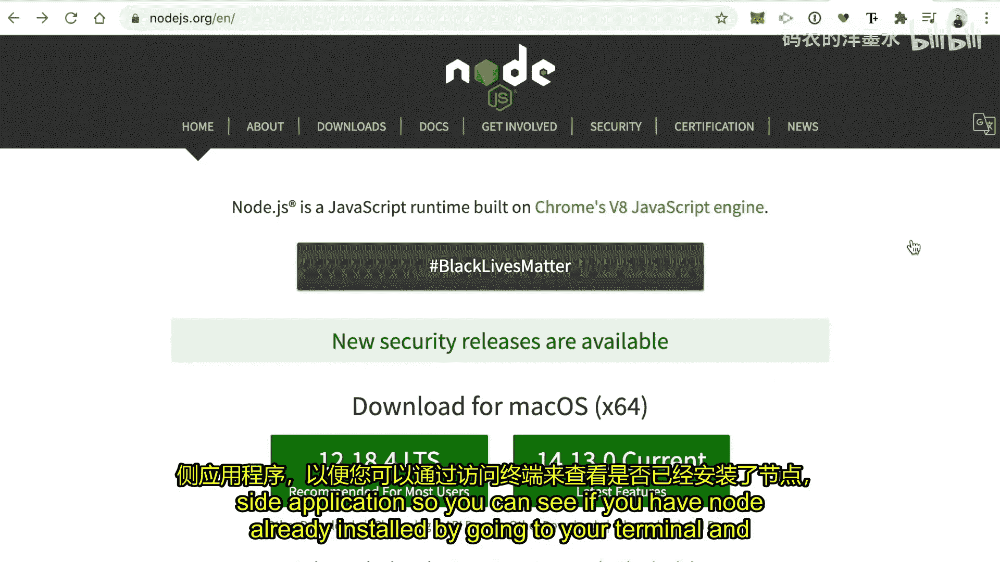

9。10。0 I would recommend using the exact same version for best results during the tutorial but you can probably use the latest version if you really want to and you know what you're doing so you can download node directly from the website or you can use a command line tool like homebw package manager to install it that way The next dependency is the truffle framework This is a for creatingthere contracts can write Ethereum smart contracts with theity programming language write tests against them and them to with truffle as well as many other things which you'll see in the you can install truffle from command line like this say NP install truffle version51。

39 The next dependency is theache personal is a that run on our computer we can simply download it and run transactions in the blockchain deploy smart contracts to it without having to pay any real money So go ahead and download can just click the version for your operating system here and whenever it's finished。

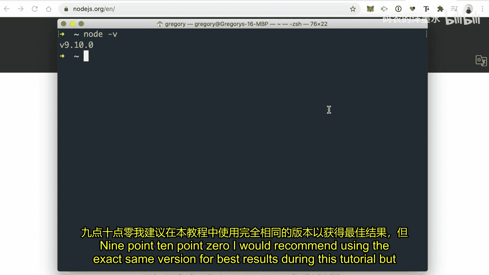

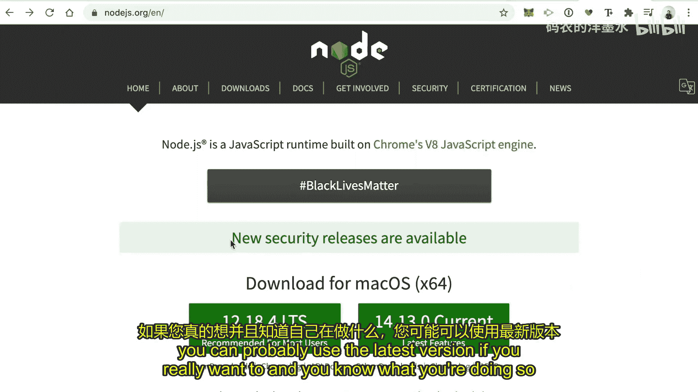

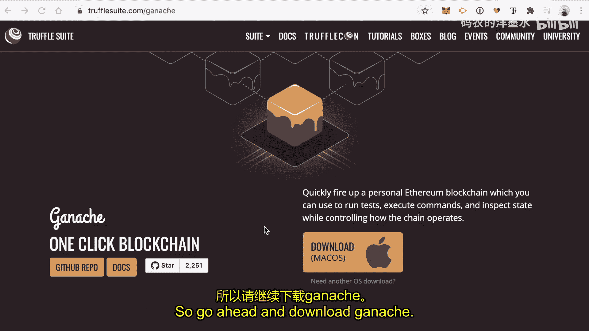

loading you can open it and you'll see that you have a brand new blockchain running on a computer just like this。

 you'll see lots of different accounts funded with 100 fake ether and don't get too excited because this isn't actually worth anything The last dependency is the metamask extension for Google Chrome Most modern web browsers won't connect to the blockchain out of the box and so we need to install a special browser extension to do that that's exactly what Memask does's an Ethereum wallet that turns our browser into a browser So go to the Google Chrome web store find Memask and click install and once you have it installed you should see a f icon in the top right hand corner and just walk through the setup steps to get that started Now let's start coding the project go to this Github link in the description below this is the final code solution for the project today this is D diversity decentogram repository and we're gonna clone this to get started so that we don't to set everything up from scratch on our computer but we're gonna start off on a very specific branch with the starter code not the final code solution。

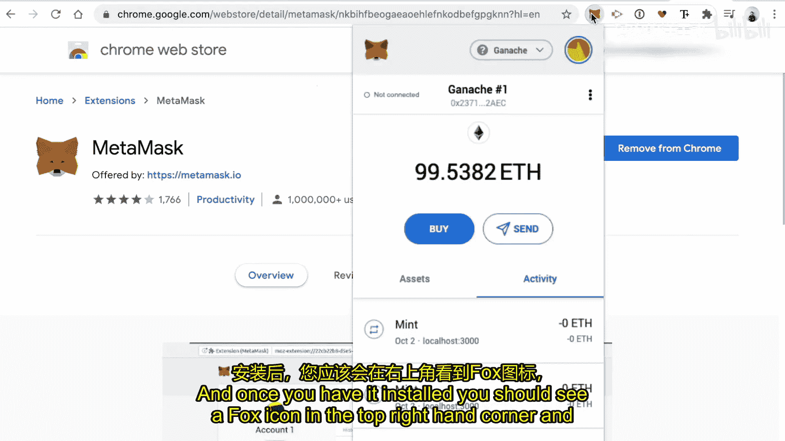

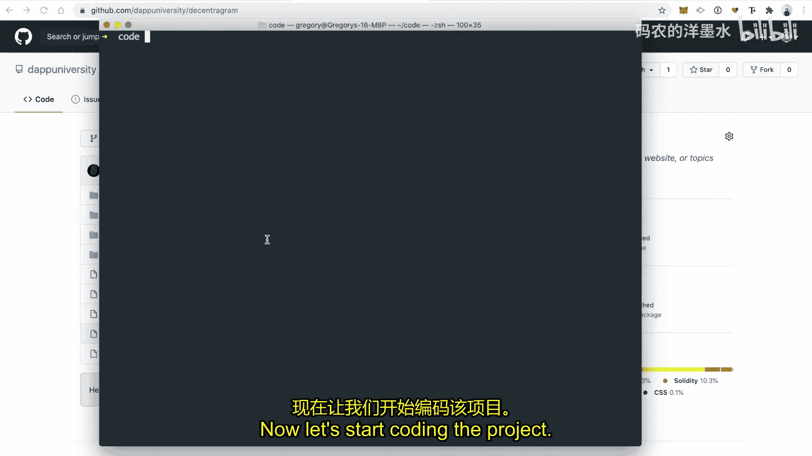

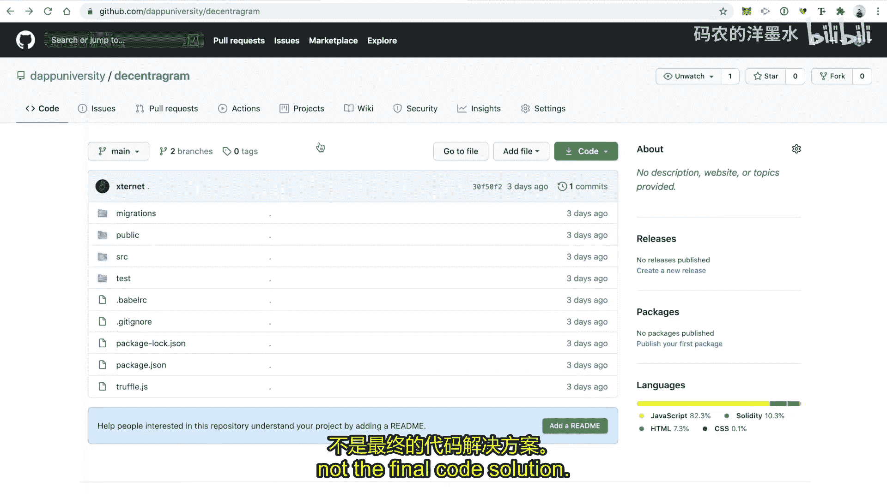

So you can do that like this， say get cloneb starter code。

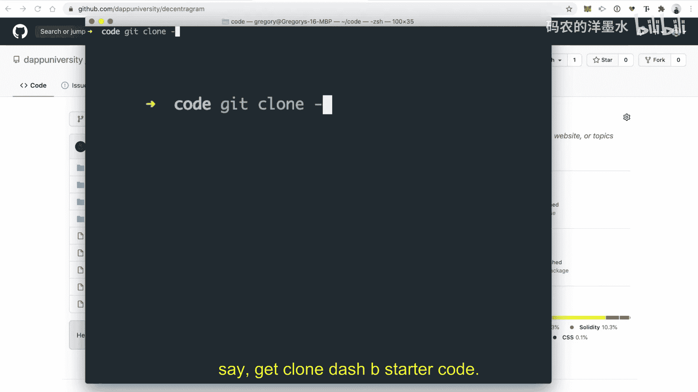

That's a very specific branch， and then you can just copy this link here and then paste it into your terminal。

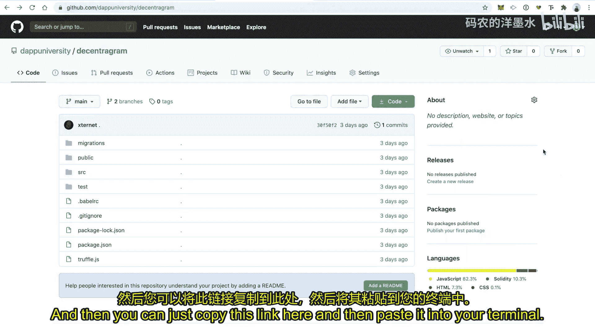

And then give it a project name， I'm just going to call it decentroogram。And hit enter， all right。

 there we go， and then we'll enter into that newly created directory like this。

 we'll say C decentcentricogram。All right， and now you'll see the project here on a very specific branch。

 the starter code。 so now we can install the dependencies for the projects like this we say NPm。

Install。Al right， now those are finished installing and the next thing we want to do is make sure that we have Gaache running so Gaache is our personal blockchain that we you know installed during the dependency section。

 but you want to make sure you open that so this is the test blockchain that we're going to use for this tutorial series。

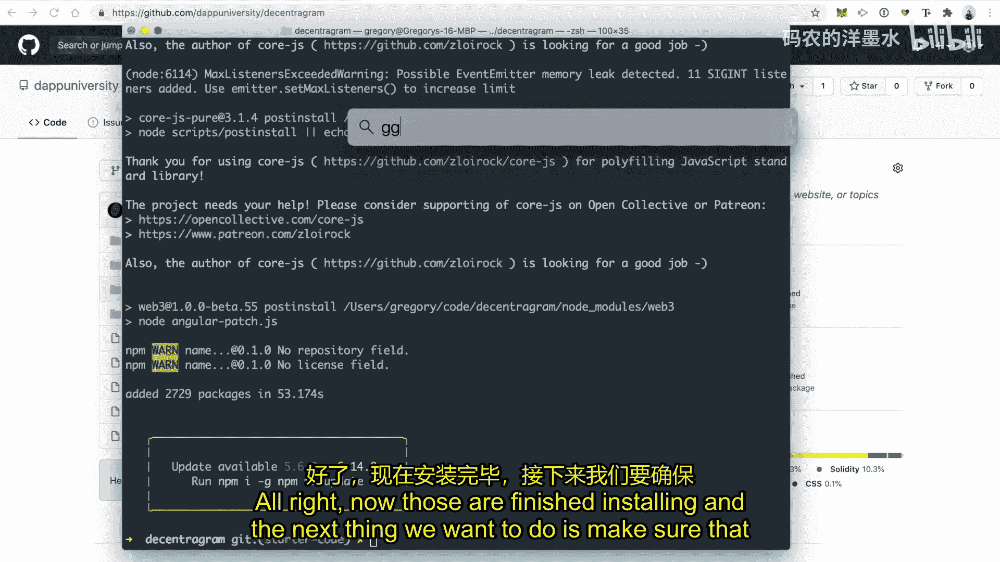

And it makes it really nice because we can spin up a blockchain on our computer without having to spend any real money again whenever you use a blockchain in real life。

 you know you have to spend actual cryptocurrency so we can just get 10 accounts here for free that I'll have100 fake ether in it right because this is an Ethereum blockchain that we set up here on our computer so awesome fake cryptocurrency here and it's not worth anything don't get excited。

But that makes it nice and easy， so we'll push our smart contracts for this tutorial to this specific blockchain so we need it running here。

 right？

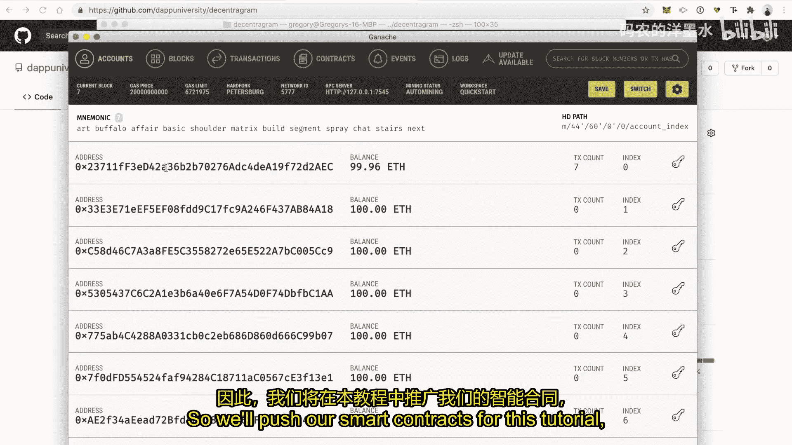

So next we want to do is open up a new tab here。In our terminal。

 I'm going to go ahead and start the web server just to ensure that everything is set up properly。

 I'm going to say MPm run， start， this will be the client side portion of the application。

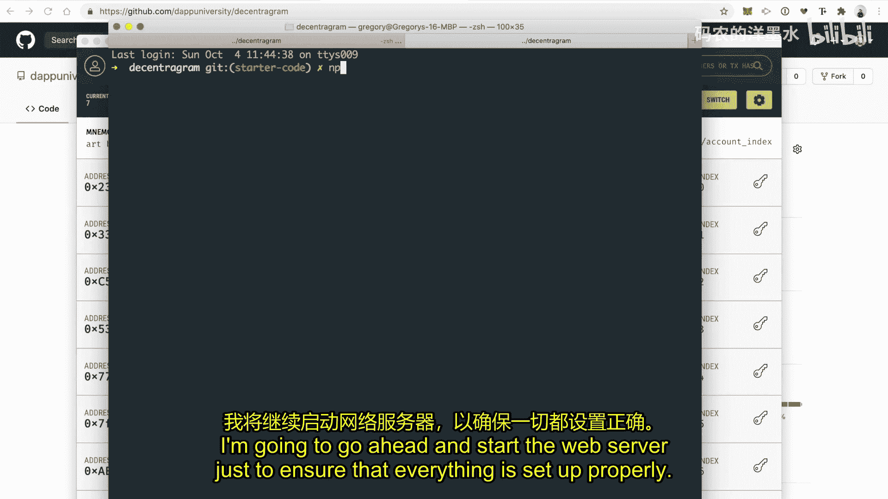

So let's see here that's my old demo， this will probably go away whenever I refresh。

So let's just check the status here。 usually takes a second。 All right， there we go。

 So here is the cleared out version。 So this is just the starter code that doesn't have anything wired up inside of it。

 It just has the basic nav bar up here。

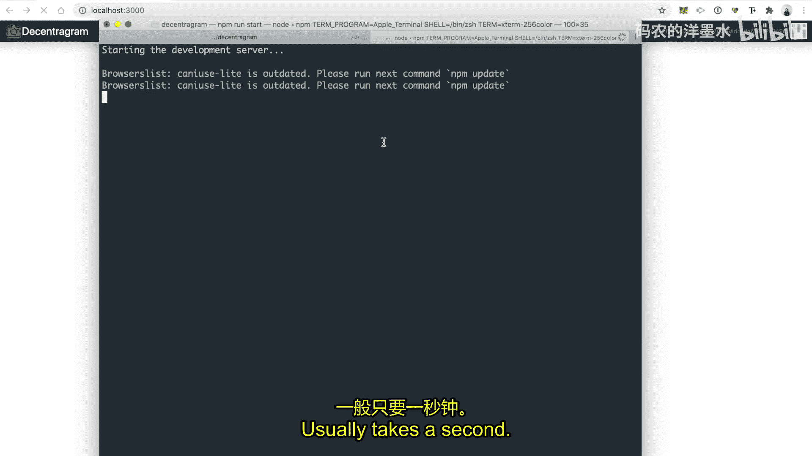

With our decentrogram name a place for our Ethereum account but it's blank here at the moment that's okay and then the instructions is to edit this file in app。

js so let's just take a look inside the project code to see what was created for us so I'll go back to this tab and say Subbble dot so this just opens the code inside of my text editor I personally use sublime text sorry sublime text you can use whatever text editor you're most comfortable with whatever you prefer is just fine but inside of here well actually quickly sometimes people ask me what that subbble dot means it's just a shortcut that I have configured on my computer that opens the code and sublime text it's not required for you in this tutorial if you want to open you your code some other way that's totally fine。

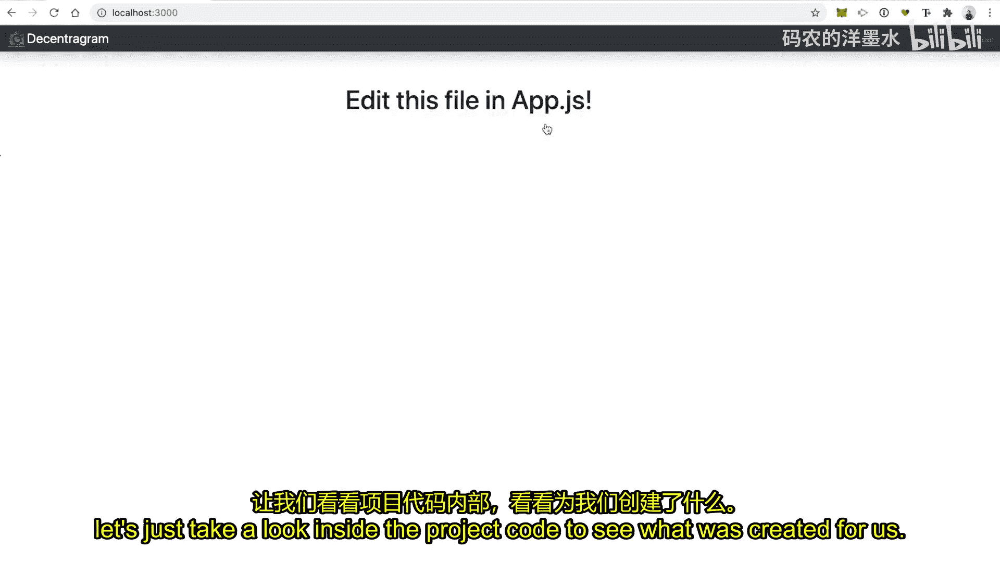

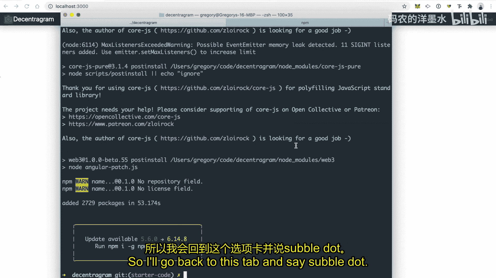

That's just how I do it。So let's just take a quick look here so let's look at the instructions so edit this file app JS so in the source directory we see source components app JS this is the starter code for the project here all right so you can see all that and then let's look at the blockchain portion is this is all the client side application but we also have a place for our smart contracts so source contracts we have a discentiogram smart contract here it's blank we'll fill in the code for that and then the other place to note is our test file so we'll write test for the smart contract inside of here。

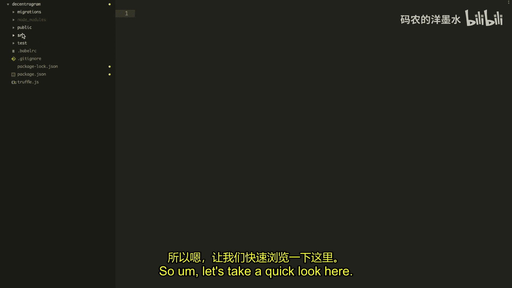

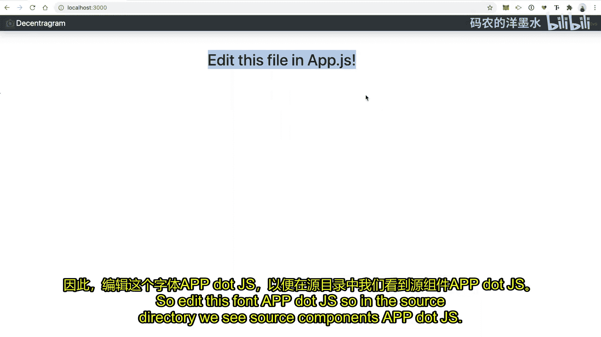

Al right， so we'll clear some of this out。 It's okay。 And then finally， we have the。😊。

Let's see here that the the。Tuffffle configuration file all right， so this is truffle。

js if you have a naming conflict， you could also call this truffle dashconfig。js。

 which is go ahead and do that。So we'll say truffle dash config。js， okay？

So actually when I rename that file， sometimes there's a naming conflict on different systems。

 so that's what it does and you might notice you've done other truffle projects before that。

These directories are in a different place， that's okay。

 I just put the smart contracts and the build files in a different directory because they get exposed to react better when I do it this way when I organize the code in a specific way。

 right？So let's go ahead and start with the blockchain portion of this。

 let's go ahead and write the first smart contract。

 let's test it out to make sure that it works properly and then we have the environment set up that we can actually start coding out the rest of the application。

 right？So we'll go to source contracts， decentureogram。

 and this is where we're going to write all the code， all the business logic for the app。

 and solidity， right？So that's what this is， this is a solidity smart contract。

 you know that's the main programming language used to write Ethereum smart contracts。

It's pretty basic at the top of the file， we have pragma solidity version 0。5。

0 this is just the programming language version and then we have the contract keyword。

Whi just tells validityity that we're writing a smart contract。

 and then they give it the name decentiogram here， and then all the code will go inside these curly braces。

So the first thing we want to do is just set a variable name， we'll say string。

Public Char name equals decentiogram， right？So what this does。

I it uses a basic variable and solidity which is which is a state variable。

 meaning that it belongs to this entire smart contract。

 you know variable is just a way to store information and the value of this variable is this string。

 you know disintroogram string is just like any arbitrary collection of you know keyboard characters that are contained inside these little。

Quotation marks here， so it could be like a word， it could be a phrase， it could be a past word。

 it could be lots of different things so this is a string。

And this string gets stored on the blockchain because this variable is a state variable and we see that it is a string data type here because solidity is a statically typed language。

 which means that we have to tell it what the data type is whenever we define a variable and then you the data type can't change。

 it can't be a number later or anything like that。And then finally。

 we call this public so that we can read the value of this variable outside the smart contract。

 which we'll see in just a second whenever we do it in the console all right。

 so let's go to the terminal and say truffle。Migrate and I'm just going to go ahead and do the reset flag。

All actually， that's going to fail， so I'm going to stop this really quickly。

 it's going to fail because we didn't actually create a migration file。

That's actually the next step I've made this mistake before I've made it lots of times and I've caught myself doing in the tutorial and I'm going to leave it on the film because you know it's good for you all to see what the what the errors are you know because they happen whenever you're creating your own projects so if I try to do this it wouldn't work because we didn't create a migration so go this migrations directory and look at this file number two deploy contracts so。

What this file does is it puts smart contracts in the blockchain that's what the migration files do inside of truffle they move the smart contracts from one place to another they migrate them。

Um from our computer basically to a blockchain， all right， it compiles them down， it you know。

 puts them in a machine readable format for the blockchain so that they can be run executed that way okay。

Soum。This file looks just like the default migration inside of truffle so this default migration just puts this migration contract in the blockchain that's the one that determines how all the other smart contracts can be deployed don't worry too much about that this just shifts by default in every single shuffle project but this one is created specifically for the tutorial so like if you created a new shuffle project on your own you wouldn't see this deploy contract in here you'd have to create this yourself but I've already created it as a boilerplate for the tutorial so you don't do everything ourselves okay。

So we imported the decentureogram smart contract into JavaScript right here。

 right so artifact required decenterogram and now we just deploy it to the blockchain like this。

 we'll literally just take this line， copy it from here， put it inside of here and change the name。

All right， and then it deploys the decentricogramra smart contract to the blockchain。

And now we go back to our terminal and say truffle， migrate dash dash reset。And then it'll work so。

A quick note here， I'm doing the reset flag in case you happen to have any old smart contracts inside your project already。

I typically run with a reset flag and development a lot just by default， all right。

So that looks like it worked。 let's see if it worked。 We can go to the terminal and say truffle。

Console。This will open up a JavaScript runtime environment where we can interact with the blockchain so they can write JavaScript commands。

To fetch our smart contract， to interact with it， you know， to read information from the blockchain。

 all that kind of stuff so。We'll just go inside of here and say。Decentiogram。

Equals capital D decentiogram。Dot deployed。All right， but before that， we want to say， oh wait。Okay。

 so it's undefined， that's okay， but we're going to type decententiogram。And there we go， awesome。

So it's worked。So let me explain what I just did。You'll scroll back up here and see decentcentiogram equals a weight decentigram。

 deployed。So what we've done is fetched decentcentiogram from the blockchain。

 that's the smart contract we just wrote and we assign it to a variable。

But there's a few things to note here， this is an asynchronous function call so we can't we need this await keyword in order to get the result if we didn't have the await keyword it would just return the promise。

 not the actual smart contract itself so I've talked about this a lot on my channel you know asynchronous programming can be a little bit confusing so if you want to understand more about that just Google how promises work with JavaScript and also like how the async await pattern works okay。

So anyways， you get the value here and you'll see that it's undefined。

 that's just the value that gets logged the console， it's not the actual return value。

 so just type in decentiogram again and you'll see the actual JavaScript version of the smart contract here。

 okay。And that's that it， so we can say decentcentiogram。The address。

Al right boom there's the address in the blockchain。

 so smart contracts have addresses just like users do on the blockchain it's sort of like the smart contracts username it just tells you know us where this smart contract is located on the blockchain so that's the address and then we can get the name like this which say name equals 08 decentcentigram lowercase D。

Dot name and then parentheses。All right， so it's going to say undefined。

 but then we just type a name again to the console and then boom， there we go， decentiogram， awesome。

So we have successfully read this variable value out of our smart contract， okay？Say。

 say source contracts。All right， so we've made this work awesome very cool So that's it。

 that's the first smoke test to see that， you know we've opened the practice on our computer。

 we've started the blockchain， you know， we've talked to the smart contract and the console。

 all that kind of stuff， so that's looking good。The next thing we want to do is out continue on coding out this smart contract。

 but we're going to do that with the help of some tests， okay。

 so instead of like going to the console and you know doing these steps over and over and over and over again to like test out the behavior。

 we're going to automate that process， we're going to speed it up， that's what use tests for。

So basically we can write tests in JavaScript so this test directory， so look at this test IJS。

 so it looks like all the tests are already in here， but we'll clear these out right in my hand。Um。

 but instead of writing every single one out by hand， let's just clear out， you know， these。

um let's take out this。All right， just take out the describe images part， okay？

And then we'll just run the basic test because that way we don't have to code that from scratch so this particular tutorial you know we'll spend less time setting up this test if you to if you want to look at more you know testing examples I've done that plenty of my other tutorials。

 but let's just start off with this boilerplate。Where we just check for what we just did in the console this is literally the same thing just translated into tests so if you go toOcha。

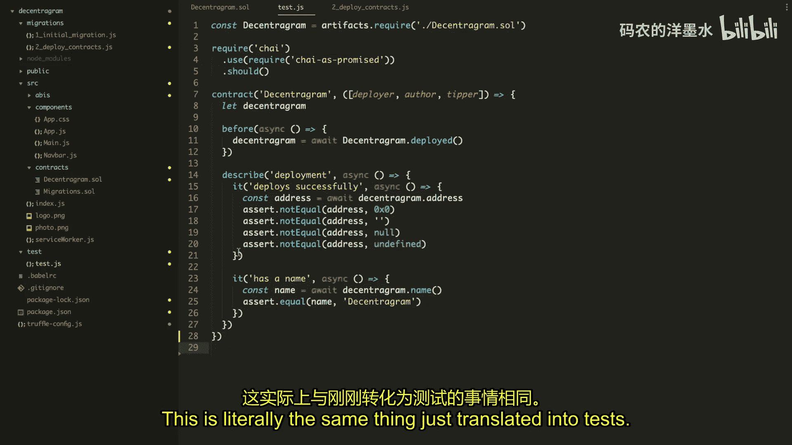

And then Chai， so the Mocha testing framework is what comes bundled default into truffle。

So that's what allows us to write a smart you know test for the smart contract in JavaScript and then also the Chai assertion library lets us do that too。

 it lets us do things like， you know， fo should be a string， you know， Chai should。

 which is exactly what we're going to use in this tutorial。

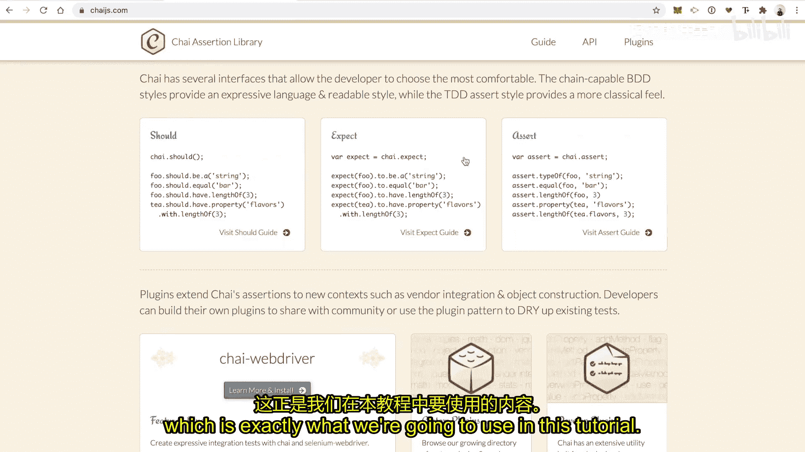

So you'll look at this like here's Chai imported right。

 and then this like contract decentiogram is what。You know is basically moA in action where we can write test for the smart contract。

 we write these describe functions， we write these assertions inside these it functions and so we're doing basically what we just did in the console but inside a JavaScript test and it's gonna to speed things up so we write this first test example we say it deploys successfully all and then we get decentcentiogram just like we did in the console here。

 we store to this variable value and then we say address equals a weight decentiogram address and we could say assert not equal address we don't want it to be blank so we check to make sure it's not the empty address that it's not a blank string and it's not null or undefined and that's going to tell us that the address exists because we don't necessarily know what it's going to be。

And then next we just checked the name is actually the centiogram。

 just like we defined in the console， okay？So let's run that test like this， which say truffle。Tests。

All right， there we go， it passes awesome， so that's going to show you how we can， you know。

 make sure that the smart contract works while we're coding it out because we'll build the back end for first before we code at the front end。

 so basically we'll write all the code for decentcentiogram inside of here。

And then we'll write tests to make sure that that code works。 and then once we're sure that it works。

 we'll go ahead and code out the front end part of the application。

 So another important thing to note here is that testing is。

 you know it's important for a lot of different pieces of software。

 but it's particularly important for smart contracts。 Here's why smart contract code is immutable。

 it means it cannot change that's the whole point And so whenever you put a smart contract on the blockchain。

 you want to make sure that it works really， really really well because you can't change it you know once you've deployed it All you can do is deploy a new copy of it right。

And so it's extra important to test your smart contracts and make sure that the behavior works because once you've put it out there in the wild。

 there's really no going back and so that's what we'll do in the tutorial as you write the tests while we write the code here so before we start coding out the rest of the smart contract。

 let's do a quick review of how it's going to work so remember we're going to connect with our web browser in a blockchain wallet to the website which will code out in the next section but that's going talk directly to this blockchain smart contract and what this smart contract is going to do is hold all of the posts the social media posts that contain images in disentiogram okay。

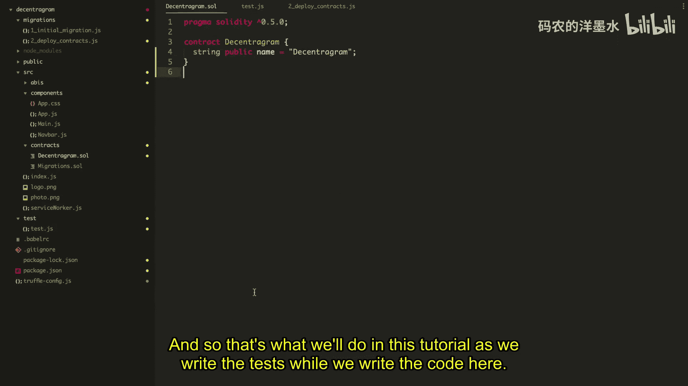

But the images themselves are actually going to get stored in IPFS right。

 which is a decentralized file storage service okay and those IPFS images， they just have hashes。

 so sort of like our smart contract has an address right it's very similar on IPFS。

 they have hashes that tell us where the files is located。

 which is very similar to the address like we have on the blockchain okay？

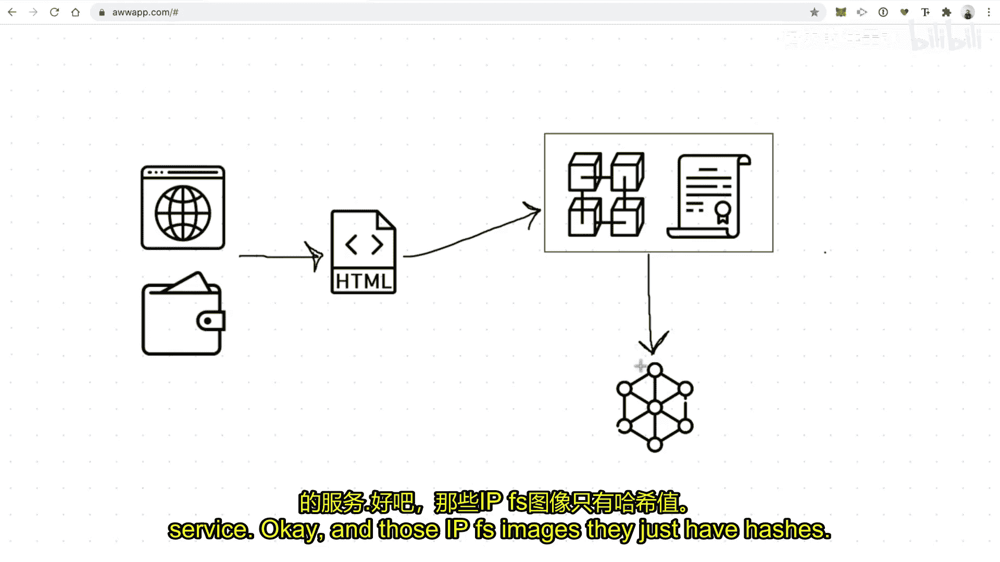

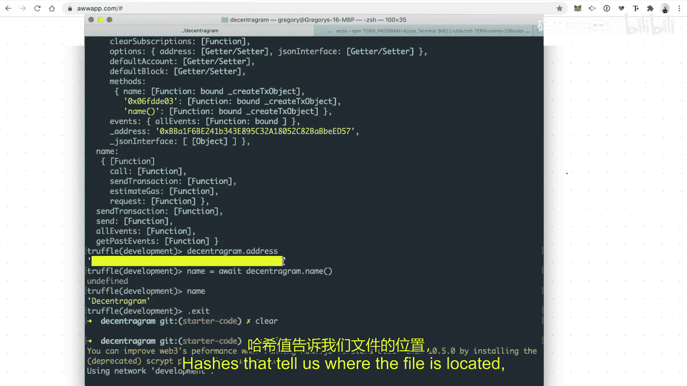

So what we're going do is basically just whenever we create a new post。

 we're going to store the IPFS hash or kind of address right on the blockchain itself so the blockchain will actually host any images because that would really be cost prohibitive I mean you have to pay a ton of cryptocurrency to store that much data on the blockchain and we don't want to do that we' going to put an IPFS and then store the IPFS hash on the blockchain itself with the smart contract and then the smart contract will be responsible for listing out the posts and then also creating new posts and also tipping posts in the newsfeed so that's what we'll create in this coding section。

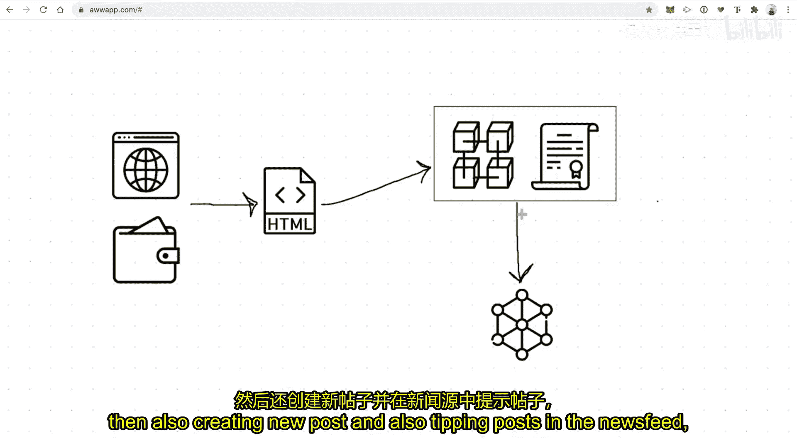

So first， we need to store posts。We need to create posts。And then we need to tip posts。

And I guess these will really be images， so I'll just rename that。To make it。You know。

 more self explanatory， less confusing， I'll say。So let's start off with story images。

So we created this you variable here with a string that is the name of the smart contract。

 so very similarly we want to create a storage mechanism kind of like a database for storing these images or at least the hashes of the images that come back from IPFS so we're going to use something called the mapping inside of solidity to do that so let's just look at this up so here's a solidity documentation and then you can see the mapping data type here so mapping is just a key value store which basically means that it just takes a key with a certain data type and a value。

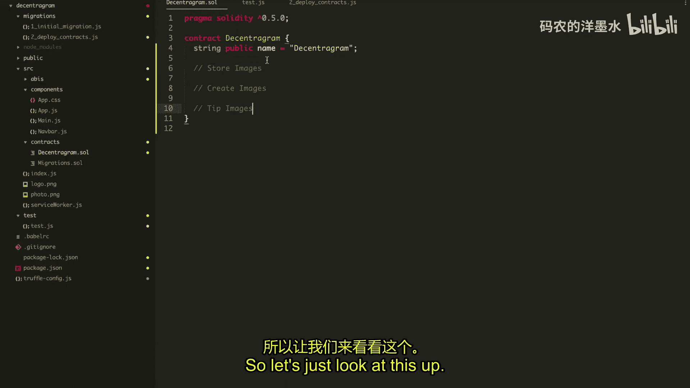

And this acts like a database， so the key is kind of like an ID。

 and then the value is the data that actually gets stored in the blockchain so you can see that in action here。

 you can read about it more in the documentation， if you'd like。

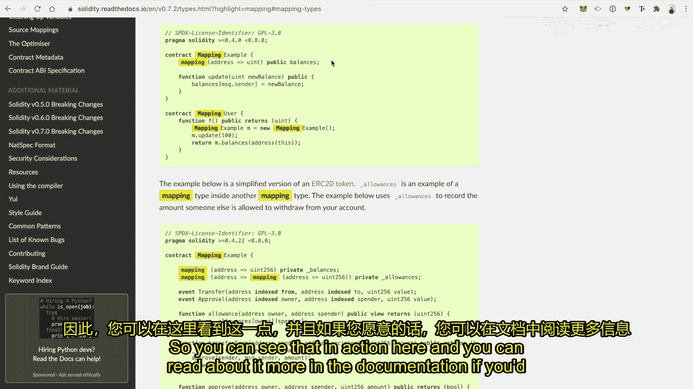

But it looks like this in solidity， so we'll say mapping。All right， so you in。

And then here's the value is image， all right， we'll create that a second public。Images， right。

This is how we're going to store the images， all right？So this mapping， like Isette。

 it is just it's like an associative array or you know a hash table and other programming languages where it has a key and this key is just going to be a number。

 it's going to be like an ID all right and then the value is going to be the actual image which I'll show you in a second it's going to store the reference to the IPFS hash and this will be public we can read it outside the smart contract just like this decenturegram string and we're going to call it images all right。

So the image is not created yet， we're going to use something called astruct for this， all right。

 and I'll just go ahead and show it like this boom。

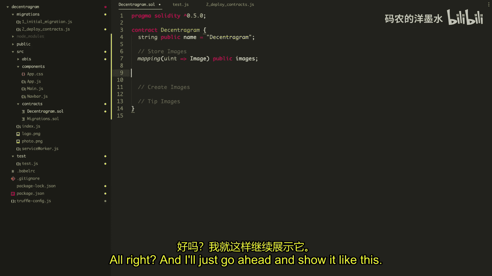

Strs are really cool because they allow to create your own data types inside of solidity。

 you can define any kind of arbitrary data that you want to and that's exactly what we're going to do here for our images so here's a structure that we've created。

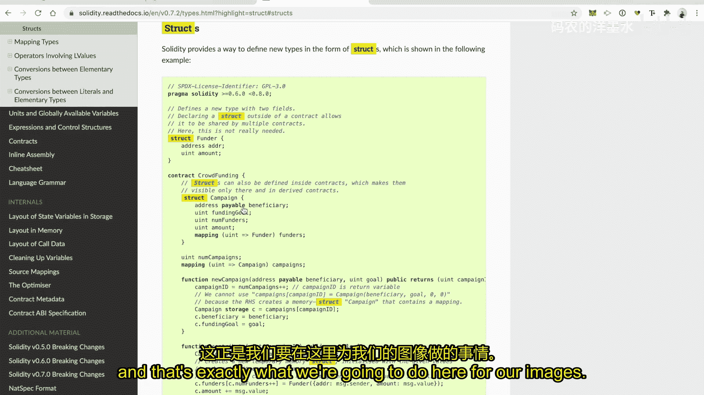

We just call itstruct and then or sorry， we use thestruct keyword then we call it image so that's the image here right and we can give it any arbitrary values we want to so uentt here is just an unsigned integer so I don't think I explained that a second ago basically unsigned means it has to be a positive integer or I guess yeah basically it doesn't have a zero or sorry it doesn't have a minus sign in front of it。

 So like minus7 would be a signed integer。 It has a sine in front of it but an unsigned integer does not so basically it just can't be negative。

Anyways， so it has an ID which has to be non negative is a string is the hash。

 this is the location of IPFS， the string will have a description for the post right so you can create a body for it。

😊，An unsign integer for the tip amount， so we're going to tip cryptocurrency and this will store how much and then the address of the author so that we can send them the tip all right。

 and so that's the image truck that will go here all right。So again。

 this is a mapping works like a database where you have an ID for every single image。

 every single post in the newsfe， all right， and then this will be the value that's stored in that database quote unquote。

 this will be this arbitrary image， it's kind of like defining a table in the database or these will be the columns right with the ID。

 the hash， the description， the tip amount and then the author and that's going to get stored in this public variable images all？

And when we do that， solidity will basically just give us a function for free called images right。

 and that way we can call the I function outside the smart contract in order to fetch all of the images okay。

So I know that's kind of a little challenging to understand without seeing an action。

 so let's go ahead and create an image right with a function and this will all make sense once we start writing it in the test。

 it's a lot of ground to cover initially but just hang in there， bear with me。

 we'll create this and you'll see it in action okay。

So let's just create a basic function to create the image， so let's say function。Upload image。

All right， and then I'm not going to get too fancy here。

 I'm really just going to create a basic function public。And then inside of here。

 I'm going to add a new image to this mapping here so you'll see it in action。 This is not。

 this is not the final function code。 It's just going to show you how it works so that we don't like keep coding for a long time and you don't see it in action。

 So we add new images to the mapping like this。 We'll just say images and then。

This is an unsign integer， so we'll just add one the first time。

 so we'll say you know image the first one will be ID image one， right。

 so images number one is equal to a new image。Okay， and we'll give it just in the idea of one。

 we'll give it a hash， we'll say ABC， 1，2，3， all right， and then a description we'll say hello world。

And then we， no。No description。I showing no tip。 And then for the author， whatll say0 x。

 we'll say address。Z x0。Alright。So let's see if that works。

So now we're going to do is write a test to create this image， let's just see if it works， all right。

So we'll create a new testing block， we'll say instead of described deployment。

 we'll say describe images。Images， and we'll say async。All right， so again。

 this is an asynchronous function comb。mSo let's go ahead and put some variables in here。

 we'll just say say let result。And then we'll create another before， oh， let's just do this。

 let's say it。Creates images。All right， let's say async。

I'll bump the font up here so you can see a little better。Great images。

And then let's call that function。We'll say results。Equals0 weight decentiogram。

So upload images or let's just say， yeah， upload image。

 so'll make sure I got the function name right？And then。Yeah， let's just see what happens。

And then actually let'll see this results。Others say will say let。

Let image equals a weight disiogram。U。Images and then we'll read in one。And then we'll console log。

Image all right， take away these。All right， so let's try on that test and see what happens。

 it might fail， but let's' give it a try， it a truffle test。Ohpe， sorry， I forgot tea there。

 trouble test。So this is not a complete test， I just want to show you there's in action all right。

 so it didn't fail， it didn't blow up on us either Okay。

 so I wrote this test to show you what's going on so far。So here's what we did。

 we called this upload image function， okay， which we coded out here。

Which stores a new image in the mapping so would have this image function right and this this image function is what sorry we have this image mapping here that we referenced directly。

 We use these open and closed brackets to write a new value to this。

 So we say images and then the key of one， just the ID of one， the first image right ever created。

Will be a new image and how that's how we create a new image you know we create an image struct all right with this capital image word right here and then we do these open and close parentheses and we pass any arguments so the ID is one the image hash from IPFS this is just a demo hash。

 ABC 1，23 the description of the image， so hello world。

 the tip amount will be zero for now and then the address of the author is just a blank address。

 I just do address0 x0。To show you what the possible values are and that it works okay so we call that function inside the test and then here's I did this to illustrate how the image mapping works so we call it images but when we call it public you know Soity gives us a function for free called images that we can read out so the smart contract like this decenttrogram images right and then what we do is this doesn't actually return the entire image mapping that doesn't work Soity doesn't work that way。

When you use this function， you have to call out each individual image by passing in the ID。

We can't call images and get all the images， we have to access them out one by one so we know that the first one exists because that's the one we created so we just pass in one it returns that image and then we loggged into the console here。

 which we can see in the test so here's the results here's the ID is one of JavaScript big number the hash is this description is this tip is this and then the author is this awesome so。

That's how it works so far。That's the really basic bare bones implementation for creating images now we're going to expand this out and code it out a lot more。

 but I wanted to show you that how that basic functionality works before we make this more sophisticated。

 all right？So let's keep going we'll create the rest of this function and then we'll write some more advanced tests for it so instead of。

Just hard coding in this ID here。What we want to do is actually generate Is。m dynamicyically。

 so every time this。Function gets called， we want to create a new ID instead of just saying one here every time。

 okay？So we're going to do something called image count all right， so just above this mapping。

Or just let's do it below， well， let's do both， I think it's better organization willll say you ain't public。

Image count equals zero。All right。So what we'll do。Is。

Use this to generate IDs so every time this function gets called。

 we'll take this image count and add one to it and we'll use that as the ID so just above this we'll say adds images to contract。

We'll say increment。Image ID。So we'll just say image count。We could do this plus。

We could say this midge count plus one， all right。That would basically add one to the images every single time。

But we have a shortcut in solidity that does the exact same thing， we just say image count plus plus。

 and that increments it by one。And then we can use this image count to as the ID for the mapping。

 okay？So yeah， you can see what happened， we had image ID1。

 but the first time this function called was called the exact same thing would H。

It would start with zero and then when we call this function。

 the image count would get incremented by one and you'd have a this would now be equal1 and then you know we create an image with the ID 1 with these values okay。

And then every time the next time the function called， this will be two。

 the next time it'll be three the next time will be four and so we'll have an ID management system built into our smart contract with this variable value and then this line here so boom that's awesome。

That's the next major step。So after that， we want to。Generate these values dynamically。

 so first we need to change this and say image count。All right。And then we want to。

Let users set these values。So whenever they upload their image， we'll say string。Memory。Image ah。

 okay。So instead of this these are function arguments。

 so these can be these are just arbitrary values that can get passed into the function。

 so the image hash is what will come back from IPFS after it's uploaded。It'll just be a string。

 so it could have been ABC 123， or it could be the actual IBFS image ash。

 and then we'll say the descriptions， a string memory description。

And then we'll pass this value in here boom。And so you'll notice that I use underscores here。

 that's because I just use that as a convention to differentiate between local variables that are passed in as function arguments and then these state variables。

 so I don't use underscores for state variables like this。

 but I tend to use underscores for these function arguments like this just as a general rule。

 I don't always follow that rule， but that's my general rule。And so still。

 the first time we create this we'll say zero tip， all right。

 because you don't want to generate a tip whenever whenever the image is uploaded。

But we do want to set the。Author of the Post dynamically， so how do we do that？Well。

 Soity has a global variable called message all right， so let's just clear this out。

It's called message abbreviated by MSG so you can do MSG anywhere inside any function and it represents the global message that's coming in with the solidity transaction or sorry the Ethereum transaction。

And it has a few values on it， one of them is MSsg。sender， okay？And so MS。

ser or message sender is the person who's calling this function。

 it's their Ethereum address All right so we saw you know the Ethereum address here。

 this is the author， it's a blank address， this will actually be the real Ethereum address of the person who's calling this function whenever they upload the image so that'll be the author and it'll get stored here。

Okay。So boom， there we go， that's how we dynamically upload an image inside of the smart contract with this function。

So next， let's。Let's actually just。Yeah， let's write a little more code before we write tests for this。

 okay。The last thing you want to do is create an event for this， right。

So Soity allows us to create events that let us know that things happen on the blockchain。

 I know we're covering a lot of ground inside this。

 but it'll all make sense when we see it in the tests and we'll also repeat a lot of this information whenever we write the second function。

 but let me just show you really quickly。

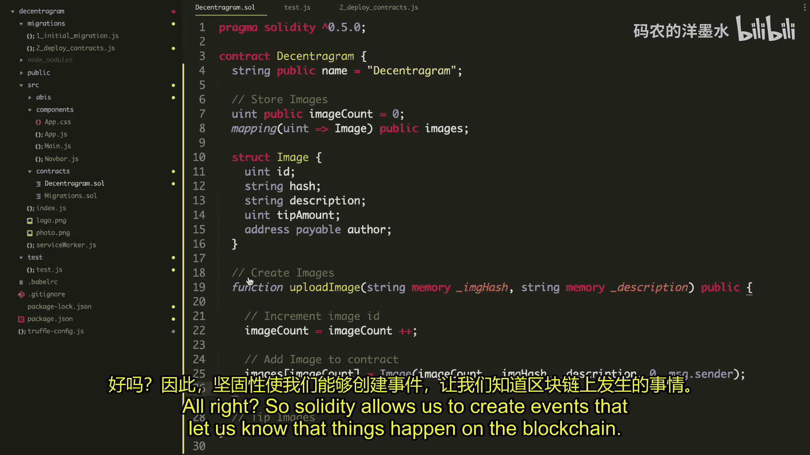

All right， so solidity， let's look at here events。Like I said， just hang with me。

 I think this will all make sense。Let's see here looking at the documentation。All right。

So let's see here events。Soeleity supports these events that let us know that things happen on the blockchain。

So I'll see here。You can create your own events like this inside Soity and you can subscribe to them externally in your application you know witness the activity on the blockchain。

 So basically we can create an event every time this function is called。

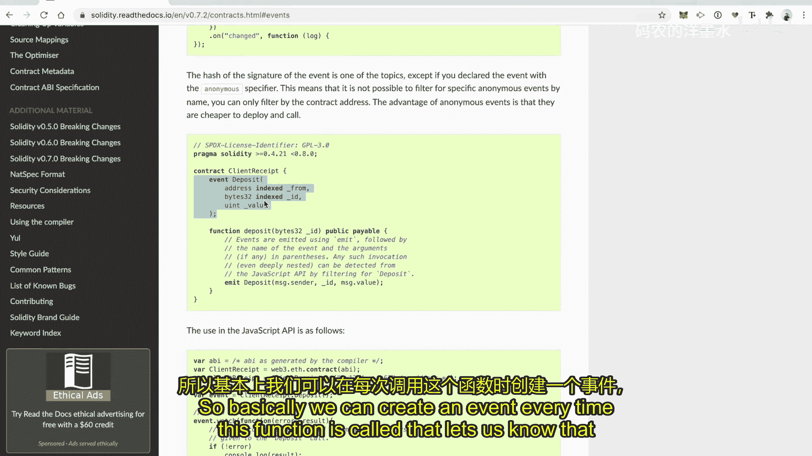

That lets us know that an image was uploaded。And we can inspect all the values that happened whenever the image was uploaded and we could get like a push notification on our phone or something like that。

 we can see the entire event log stream， which basically shows us the entire history of this function called in the blockchain。

So I'll show you how that works basically the we'll define an event a lot like this struct here because you can define arbitrary events just like you can define arbitrary data types withstructs like this boom so we say event image created that's the name right and then we pass in the values for the event and you'll notice these look suspiciously like the values here that's because they're the exact same thing right。

So we just store the ID。The IPFS hash， the description， all right， the tip amount。

 and then the author， the guy。So we can。Tgger this event with a single line at the end of this function like this boom。

We just say emit image created just like this， boom and then we say image count， imageash。

 description， zero， MSG center， so it's the exact same arguments they get passed into the imagestruct。

 get passed in down here whenever we trigger the event。With that being said。

 let's go witness some of this in the tests that I're not just coding all day without seeing how this stuff works and I don't want to be too abstract I want you to witness it in action instead have the test so let's go back to the test file。

And then we'll continue on building out this test example， all right。

 so let's move some of this logic up to a before function just like this， okay。

 so it's going to look like this all right。So inside， describe images above， it creates images。

 we'll do this boom。So we'll say before a sync， and let's say discentiogram upload image。

 so just like this， we actually want to pass in， you know， the function arguments。We'll say hash。

 so we need a IPFS hash， all right？And we'll just boom we do like this。

So you can pass in anything you want to， you'll actually just say like ABC 123。

 just so that it's you all can replicate this on your own machine and you don't have to have the exact IPFS hash。

 okay？And then we'll at the hash here and then let's just say you know image description can be the image description。

And then。We pass in some metadata here。So like。This would be the function arguments。

 the two arguments that we define， but then if you put a comma。

Here you can pass in a JavaScript object to provide the function metada right。

 these are not actual function arguments， they're just the function arguments。

In JavaScript that simulate who calls the function inside the test。

 so basically like we say from author， this is just telling solidity who the function color is All right。

 so author is coming from up here。All right， so these are the accounts in the testing scenario。

 we have a deploy。We have an author and a tipper okay。

 so the deploy is the person who deploy the smart contract right the author will be the person who creates the posts and that's who we're sending this function。

 that's who's sending this function right here again。

And it's important that the author is going to be translated to message sender here inside the validity function。

 right， so the person who's calling it is the author and then that translates to message sender inside the smart contract okay。

Okay， so then next we will get the image count， all right？Let me just clear this out。

So we'll say decentcentiogram， a weight decententigram image count， all right。And then。

We'll need a place to store the image count like this， so result and then image count， all right。

So now we'll code out the C images part。Soum。We'll say。Success。Say assert。Equal。嗯。Image count。

Equals one all right， because remember whenever we increment this function。

 the image count is public and it should now be one after the function has been called。

And then we'll say con event equals result。Dot logs actually， let's just do this。

 Let's just ensure that the。Let's just show that the count is right and then let's console log。

The results。To see it in action， I think it'll make more sense that way all right。

 before we run the test， I realized that I made a little bit of an error in the solidity code。

Basically， we need to take this out。All right， so sorry about that。

 I just overlooked that while I was talking and recording the same time it happens sometimes it's difficult to think and talk at the same time。

 it's easy to miss your mistakes so let's do this Sa that。All right。

 then go back to the test and say T test。And now this should work。So let's give it a whirl here。

And boom there we go。 So it works and it also deploys the result sorry。

 logs the result of the console。 So you can see here。The image count does in fact equal one。

 that's what we expect right， so the image count was incremented properly after I fixed this line of code All right。

 image count。And then the result was lo to the console and here you can see that the results of the function call has all this data inside of it。

 it has a transaction hash that was triggered on the blockchain it has a transaction receipt and then inside of that it has the actual values from the event all right so you can see like here's the event itself and then these arguments have like the name and all that kind of stuff so we could say like result let's just run one more time。

'Sa logs。Okay， so you can see the logs here， okay， then this is an array， this is an array here。

 and then we'll say logs， we'll read the first item out of it， all right。

 and then we'll say look for this Args argument here。Say as。

 all right and a lot of console like this。嗯。Absurial tests。And then boom there we go。

 so here's the actual event that comes back， you can see it as an ID， hash， a description。

 a tip amount and an author， so thats that's why we use the event so that we can see like the data that comes back you see the ID。

 the image hash， the description， the tip and then the author and that's all these values logged to the console here。

All right， and so now we can dig into that event。We can do this， we can just say。Event equals that。

 so say boom。Cost event equals result， logs， the first one，0，0 based index array， and then aGs。

And then we can just assert that all the values from the event are correct。

So you can say a certain dot equal event。 ID to number equals the image count all right。

 that the ID is correct， that the hash is correct all right。

 so event do hash is the hash event description is image description right which is what we put in here。

That the tip amount is in fact zero because， you know。

 we haven't issued a tip yet and that the event author is the same as the author that called the function here okay。

So let's just。Do sh tests。Let's see what happens。All right， boom it passes， perfect。

So the next thing we want to do is finish off this function。 right， we're almost done。

 We got to create one more function to tip the owner， but we'll， we'll finish off this last part。

 We want to add some requirements to this function。 Okay， so basically， like， for example。

 we don't want people to。You know。We don't want people to。Upload blank images here。

 we don't want people to upload blank descriptions and we don't want invalid senders to like put N on the blockchain。

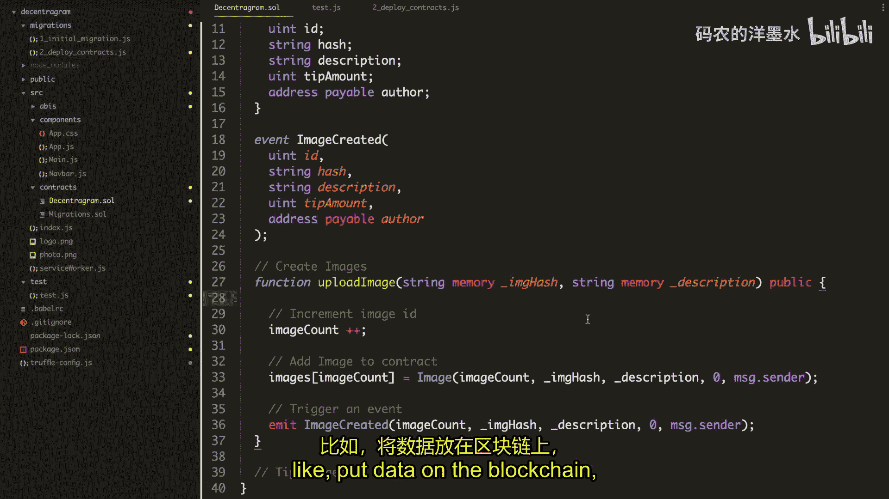

I'll show you how it works so Soity has these things called require， all right， I'll show you。

And the documentation here。So basically， they just select safeguards。

So we can create something called require。So the function like this。 All right， we could say like。

 you know require is basically a function and that it has some sort of expression inside of it。

 and if that expression evaluates to true， then the function will continue execution。

 and if it's false， it'll halt and it will revert and none of the code below it will run Okay。

 so let me show you what that looks like inside our code。

 So you can say something like you know require。

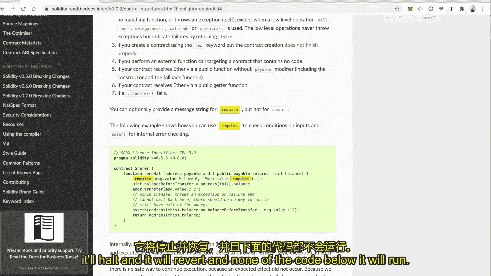

You know， one plus one。Sorry， equals two and then say yaea， it's true or something like that。

 you know what I mean like or like and if not， say you know， bad math。So basically like， you know。

Yeah， this is going to value to true and if it's true。

 the function will continue execution and if it's false it'll stop and this error would come up or something like that okay。

So we're not going to add a message necessarily， but you could just say like require true and and the function。

 if I just left this line here， the code would keep running and this would never get triggered but if I said require false here all right then the code would stop execution and this code would never run and so you can make that more complicated I say one plus one equals two。

 this would always execute if I did this， this would never execute and so now we can make that more complicated and say。

 you know， require bytes。Description。U length。Is greater than zero boom。

So what that does is make sure that this is never blank so that they can't create， you know。

 a description。That is an empty string。 It's basically requiring it that the image always has some sort of body post to it。

 like some sort of description whenever they upload it to the decententerogram social network。

 So we do is take this， convert it to bytes， different data type than the string because we can determine the length that way。

 So we say bytes description length is greater than0， all right。

And we'll just say you know make sure that the image description exists and if it doesn't exist。

 this code will halt execution and none of this code will run right here it's just a safeguard inside the function okay so similarly we want to make sure that the image hash exists so we don't want a blank IPFS hash to get uploaded to the blockchain so say boom require bytes image hash length greater than zero。

And then finally， we want to ensure that the person who's uploading this all right。

 is not the blank address， so we do this boom。Require MSg。ser or message。

sender is not equal blank so bang equals address0， so this is the empty address。

 we could say address 0 x0 for to make it clearer。So also notice this bang equals is the opposite of equals。

 so basically it means that like not equals， so we always want to make sure that the message sender is not equal to the empty address okay。

So basically it's just validations if you've done other software development。

 validations on a database or validations inside a function， so make sure that the image hash exists。

 make sure that post description exists， and then make sure that a valid uploader exists， right？Soum。

Now we can write test for this that's our complete function we'll just write a few tests to check for the failure so the first thing we'll do is say you know we'll try to upload it with a empty hash and we'll reject it inside the test like this boom say await decentcentigram upload image with a blank image hash all right。

And then we'll do it from the author and then we say should be rejected， right。

 that's how we do it with the test suite here， so say should be rejected。All right。

 so let's run the test， triple test， see if it works。All right， so creates images， boom， done。

 all right。And then next， we want to ensure that it uploads it fails for the blank descriptions like this。

 boom， so just ingram， upload image， image hash， blank description all right。

 so from author should be rejected so if there's no description， then it should fail to。

So write a test and then run it。See what happens。And then boom， it fails。 awesome， perfect。 Well。

 man， it fails。 it it， it it doesn't。 we we check for the failure， I guess this is what I'm saying。

 you'll see a green test， which is what you expect， but the test is green because， you know。

 we caught the failure message here and ind。That the failure indeed happened， okay， a boom done。

All right， so next， let's write a basic test to show you how the images get listed out on the page。

Because this is what's going to happen on the client side。

 so basically like we'll write this block that just says it lists images， okay？

Because it's important to understand how that works， so like we'll do this boom。

So we'll say it lists images， all right， so it creates images， it lists images。

 so like when we want to create a newsfeed for an example， we have to fetch all the images。

 all right？So what we'll do inside of here we'll say constant image equals a weight decentcentiogram image。

 image count， all right， so remember we did that and the first test where we read out the image all right。

And what want to do is actually， you know。rite then a test that we can always run it later， okay。

 so we'll just dig into thestruct values like this。

Will say a sort equal image I D to number right is the same that the image has is correct。

 The description is correct and the author is correct。 Just like the event here， but inside the。Yeah。

 inside thatstruct。Right， travel test。All right， bow it passes。

And so the last thing we need to do here is write a function to tip。The author， okay？

So we're going to move a little bit faster on this because we've explored all the basic solidity。

You know， concepts and this first function and we're going to move a lot faster in the second function because we we have a lot of ground to cover to create the front end application for this as well。

 okay。So we're going to create a function called T images or sorry， tip image owner。Tip image owner。

 all right， I'm going to do this。I still too much tip image owner and this is basically just going to accept the ID of the image and it's going to be public and so it's going to be payable all right this is important to know because we're going to actually send cryptocurrency in this function call whenever we tip the image and you have to use this payable keyword right here。

 in addition to public if you want to send cryptocurrency whenever you call the function right。Okay。

 so。Let's。Write the basic behavior in here。Basically。

 what we want to do is fetch the image from storage all right， like this。We'll say image， memory。

Image all right equals images ID so see how we we created a new image like this in the previous function call。

 we said I I count all right， and then we created a new image like this。

 well similarly we can just like you know read the image out of the mapping like this so underscore image equals images then passing the ID from the function。

 but then we got to give it the data type which is image right which we defined here。

And we say that it's memory because it's not an image from storage， so storage is on the blockchain。

 this image is just a local variable in memory inside this function call okay。So。

Next we want to do is get the image author so we can just read it off of thestruct like this。

 we just say you know， image。Author。And then we want to pay the author， so let's store to a variable。

 so we'll say fetch the author。All right， and then we want to send the cryptocurrency from this function call to the author and it's pretty simple All we have to do is get the author。

And call this special function right inside of solidity called transfer。So transfer。

And then we could say， you know， like some amount of cryptocurrency。

 we could say like one ether something like that boom， all right？

So that that's how you send cryptocurrency inside of a function。

 use this special transfer function because this is an address and in fact we're going to be explicit here。

 we'll say address。All right， author。So this address here comes off the image。And we'll say。Author。

 and then we transfer some amount of cryptocurrency to this。 Now。

 I just use this one ether as an example。But let's actually。

Used the cryptocurrency that came in when this function was called so just like we' had MSg。ser here。

 this message。ser message is， like I said is a global key it's a global variable。

But it also has another value called。Value right， and that references the amount of Ethereum cryptocurrency that's sent in or ether whenever this function is called Okay。

 so message value is the amount of cryptocurrency that's sent in when this function is called and so we say transfer message value the amount of cryptocurrency thats sent in to the author that came in from this image all right。

So we'll say， you know， pay the author by sending them Ether， okay。So that's critical， okay？

That's the critical line of this whole function。 tip the image owner。

 that's the biggest part is actually sending the tip to the image。

 basically what happens is the ether comes in with this function call and then it gets passed on to the author directly right here on this line。

And then finally， we need to update some values on this image before we put it back in the struct。

So we'll update the tip amount。All right， like this。We'll say increment the tip amount， so image。

 tip amount equals image tip amount plus message value， right， that's what was sent in here。

It'll update the image like this， put it back in the mapping。Allright。

 so basically we fetch the image out， we read the author off the image， we send the author ether。

 we update the tip amount on the image， and then we put the image back in the mapping after we read it out All right so boom that is the core functionality of this entire function there's a few steps left。

But that's the basics。Read the image off of the blockchain， find the author。Send the off of the tip。

Update the tip amount on the image， put the image back in the blockchain， all right。And so finally。

 we're going to emit an event just like we did here。

So we're going to do an image tipped event allright， like this。So image tips， so ID， hash。

 description， tip amount author， just like this exact same arguments。

We will emit that event at the bottom。All right， so after this。So we trigger to event。Image tippped。

ID， image hash， image description， image tip amount， and then author okay。And then lastly。

 we will make sure that the ID is valid because we don't want you tipping the wrong image or an image that doesn't exist。

 So let's do this。 we'll say require that the ID， al right， is greater than 0。All right。

 that's it's essential and。That the ID is less than the image count all right， so the image count。

 if the image count is 10， then the only valid image IDs are 1，2，3，4，56，7。

8910 right sorry image count。Because it can't be zero and it can't be。Bigger than 10。

 so if you try to tip ID 99， then this function call would fail。

 if you tried to tip you know function 0， it would fail， if you try to tip negative one。

 it'll fail by default because it's an unsigned integer okay。All right。

 so that's the complete smart contract now I know I moved kind of fast on that second function。

 but there's a lot of ground to cover and we saw a lot of the you know fundamentals。You know。

 in the first function， right， so let's write a quick test。For this second one， all right。

 I'm actually just going to go with the test。From the final code solution so you can find this then in the。

In the description below。I'm trying I pasted it in。

 so don't really have time to go through all this one by one， but I'll walk you through how it works。

So first of all what we do is track the author balance before the purchase so what we want to do is make sure that the author receives the tips okay。

 so here's the old author balance， so we use this Web3 Eth Git balance。

 that's how you find the balance of the author。All right。And then we say the results。

 we call the function， so disinogram tip image owner。So you passing the image count， right。

 we went the latest image。And then we use the function made from Tper， that's a different account。

 just like we saw previously， all right？And then here's the next thing you need to understand is。

Value， message value。 Here's how you determine message value。

 So just like in this previous function call， this is how you determine message sender is with the from keyword。

 All right， remember message sender。Well， in this case， you want to do message value。

 which is this right here， which is the amount of cryptocurrency getting sent in when you send the tip。

And that's how you do right here， message value Okay， this is the message。

So the value here we're going to use the Web3 library， web3 u tills two way in one ether。

 so basically we're sending the author one ether or one Ethereum cryptocurrency basically。

But we have to convert it to this thing called way， all right。

So that everything Ethereum doesn't work with decimal places like so smart contracts don't handle decimal places。

 That's why we do these like unsign integers。 So everything is stored in basically like。

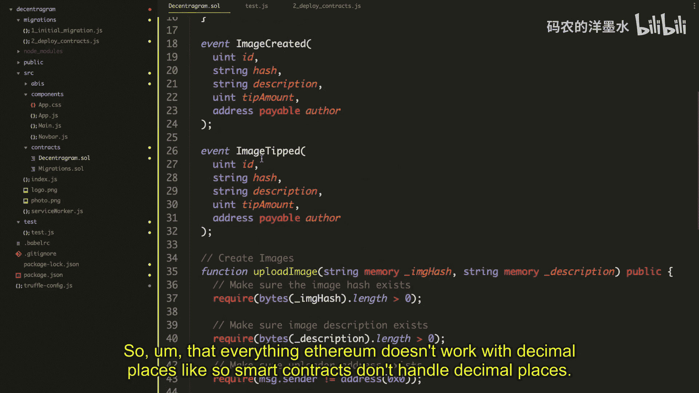

Whole numbers or on engineers in this case。And so like way is like Ethereum's penny， for example。

 so like， you know， one penny，100 pennies equals1 US dollar， for example， but like ether。

 one ether equals one followed by 18 decimal places。All right， way。

 so that's how they get around working with fractions for cryptocurrencies。

 you use these really big numbers at the smart contract level so that you don't work with decimal places。

 so you always convert your ether values to way whenever you're sending cryptocurrency around like that。

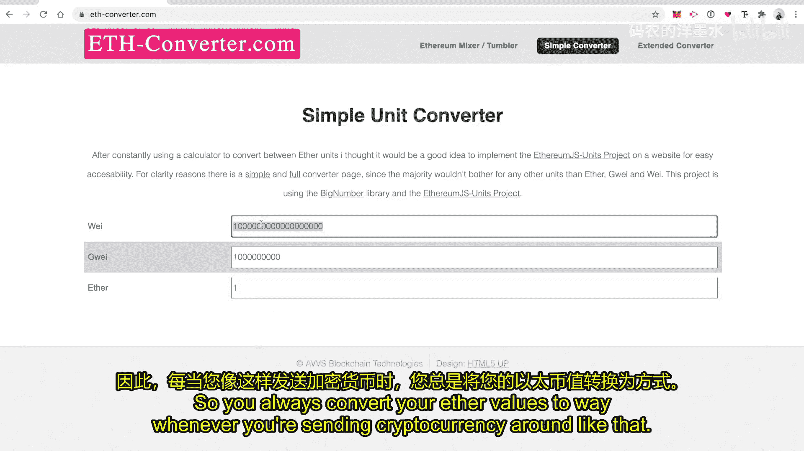

And that's what this helper for。 So Web3 tells two way and then one ether right so we want to send one ether right So anyways。

 we send it， we check that the result is correct All right。

 so it emits the event just like we did in the previous test and now what we want to do。

Is a check that the author balance has。Has gone up all right。

 so we say check the author of balanceance receives funds right and that the new balance is actually bigger okay。

So we'll start off there and。Yeah， there we go， old balance add tip image owner， all right？

And then the new balance is what we expect it to be。And then finally。

 we check for the failure so that it won't tip image number 99 and that it'll be rejected until it happens just like the rejections that we did up here。

So let's clear this out。We're on the test and see if it passes。Hopefully it should work just fine。

Al right， boom， it works。 All right， so that is a complete smart contract with tests。

 I gonna move kind of fast that last portion but again。

 we spent more time on the basics on that first function and the first test we get a lot of ground to cover on the front end application。

 So now that the backends done before we move on to the front end let's just make sure that we've compile our smart contract and deployed them to the blockchains we'll say truffle migrate dash reset So I'll reex what that reset flag is for。

 remember whenever you deploy smart contract to the blockchain， you can't change the code。

 you can only deploy new copies of them So that's what we do whenever we use the reset flag okay。

And yeah， I do it here because we already deployed one version of the smart contract to the blockchain。

 but we have now changed the code。 So that's why I use the reset flag to put a new copy on the blockchain the complete version and tells truffle you know where it is to update the address and that kind of stuff So boom it worked and now we have the yeah。

 the complete smart contract that we're gonna use to start coding out the client side part。

 So let's do that now All right so now let's start building out the client side application So you need to make sure to go your terminal and ensure that you know the web server is running So you dompm run start and a new tab if you want to。

 I'll just show you so Nm run start All that should reload the application here on your client side I'm gonna keep it a separate tab terminal tab so that I can you know work with the code and this side。

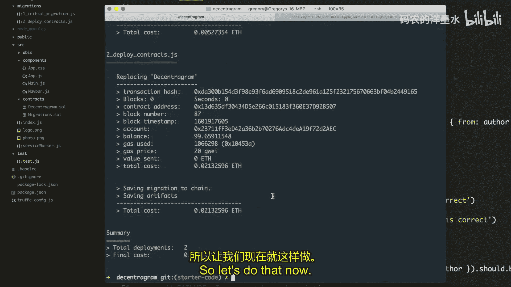

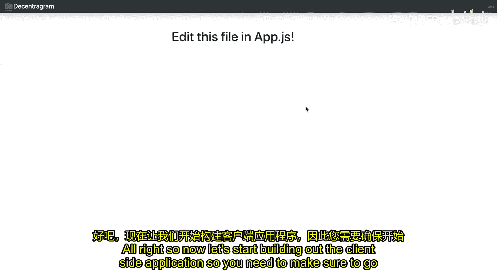

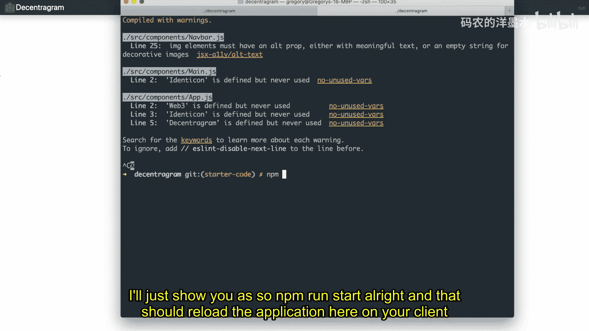

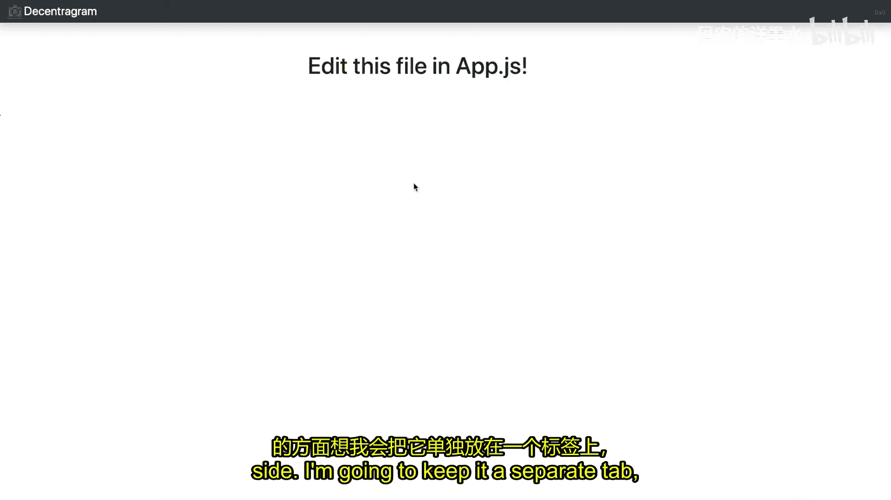

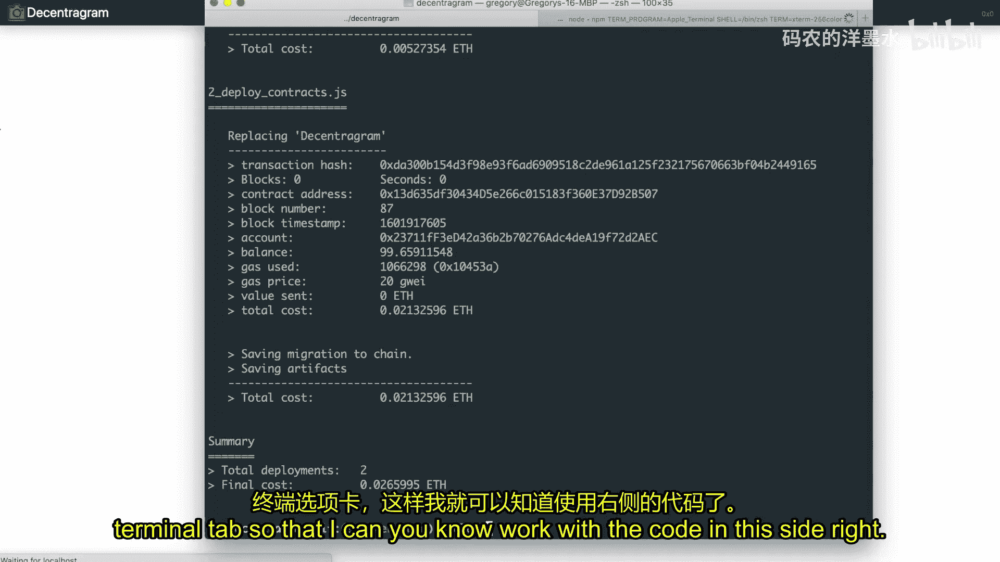

So you know， go ahead and open up your text editor and navigate to the source directory。

And then the components directory and then app。js， So this is going to be the main file that we modify initially to build out the client side portion。

So this code right here is it's JavaScript， but it's written in React JS or written with React JS。

 so I'll explain that React is a JavaScript library for building user interfaces so it's a modern web development framework it's very popular in the blockchain community that's one of the main reasons I teach it。

 but it's popular for a good reason， yeah it's a well thought out JavaScript framework。

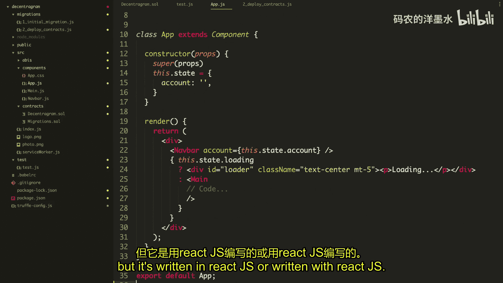

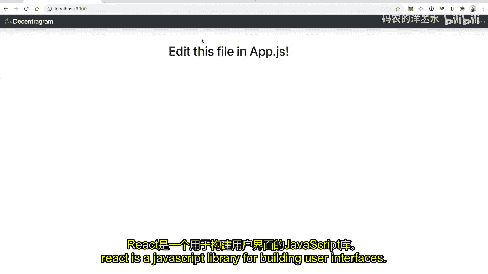

Solves a lot of the common problems that you encounter whenever you're creating JavaScript client side applications or user interfaces。

 so Ra component based library， which basically means that you organize all of your code into react components。

 it has a state object which basically is like a little mini database for the front end。

 so that's where we'll put all the blockchain data when we hydrate our application。

 we put it in state。

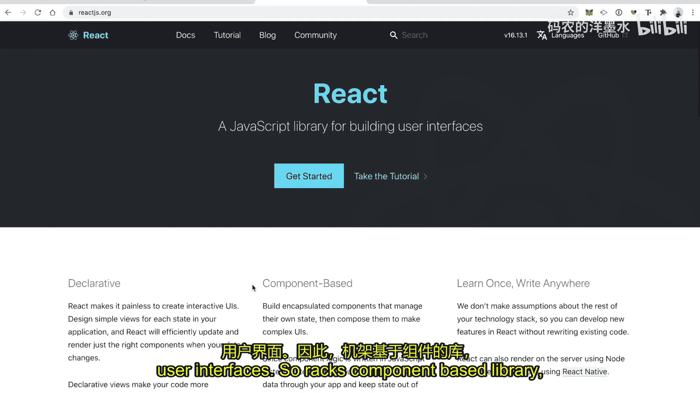

So a pretty good example of that is like this to do list right here， we know what is state。

 so if we say item one。😊，You know， and then like item two。Where do those items go。

 well they go inside the react state object， which you can see here。

 this state equals this with items， all right？It's got some special functions for interacting with that state。

 which we'll see in this tutorial。So the big things to note are components， which are these。

 the state， which is this， this is where the blockchain data will go。And then lastly。

 you the components are basically you can mix HTML code and a JavaScript code together in the same file that's how the components work so you see this like render function right here well this lays all the content on the page and you can put HTML code right here but then you can remix JavaScript code inside of here with these curly brackets。

 you can just say like this props。 name all right that's JavaScript inside these curly braces。

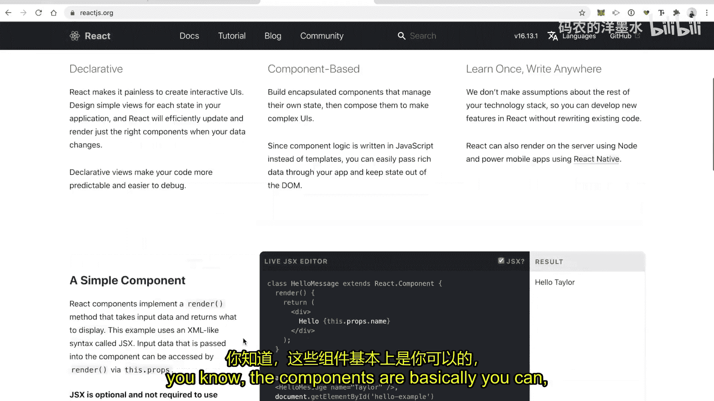

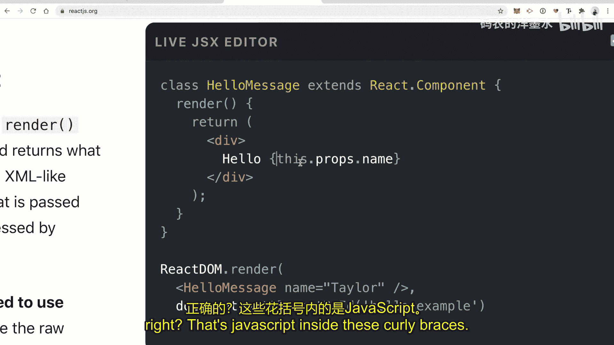

We'll definitely see that in action inside this tutorial okay so the best way to learn react honestly if you don't know it is to just watch along and code along with the tutorial。

 that's like how I learned these types of things initially when I was first learning programming was just like just watch it being done and do it over and over again and then it'll start to make sense okay。

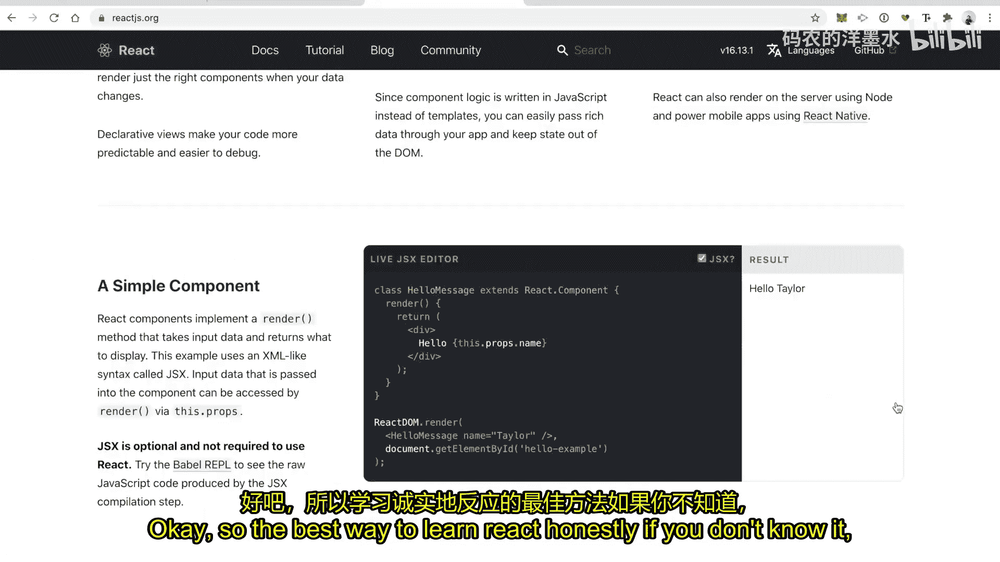

So theres main there's three components that we're going to work on in this tutorial so this app component。

 this is the main component all right and then like I said components are how we organize the code so you'll see it's got some HTML inside of here to the render function there's another component already inside of here called the nav bar okay so the nav bar is you know this code right here with the little camera icon。

 the title and then also the blank Ethereum address here。😊。

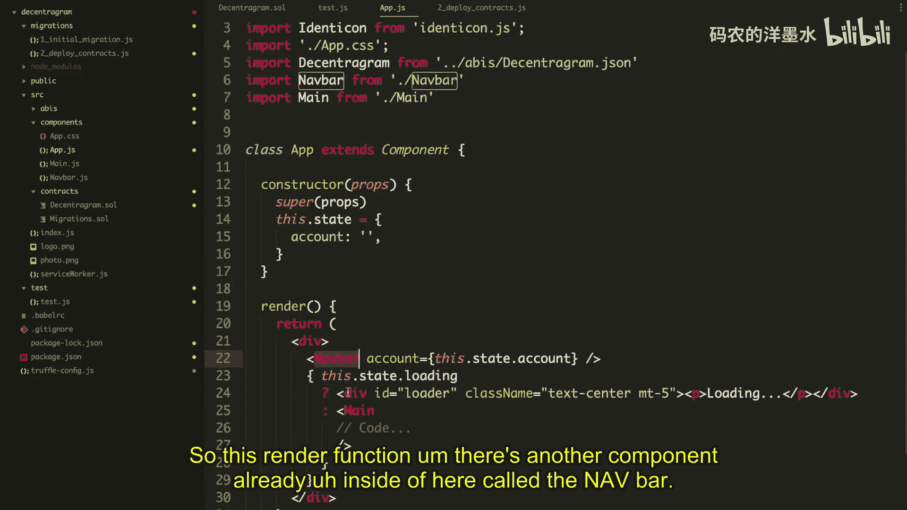

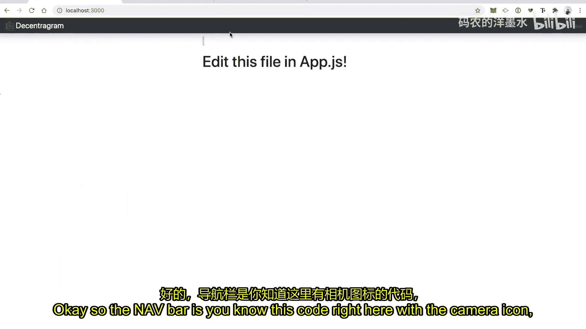

and that navbar code is inside this file here， so navbar， boom we'll edit this。U。And let's see here。

 the nav bar is also imported at the top of this file。

 so that's important to note anytime you create a new component， you have to import it like this。

And then lastly， we had this main component。All right that。Is here right。

 and we'll also put code inside of here， you can see that this you know edit this files out of at dot Js。

 that's the main content， which is here all right。

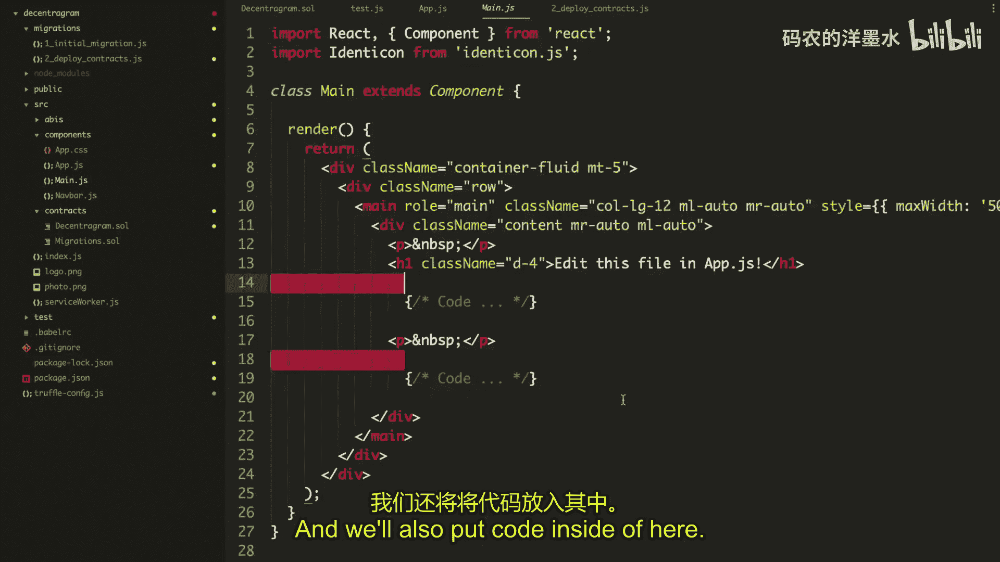

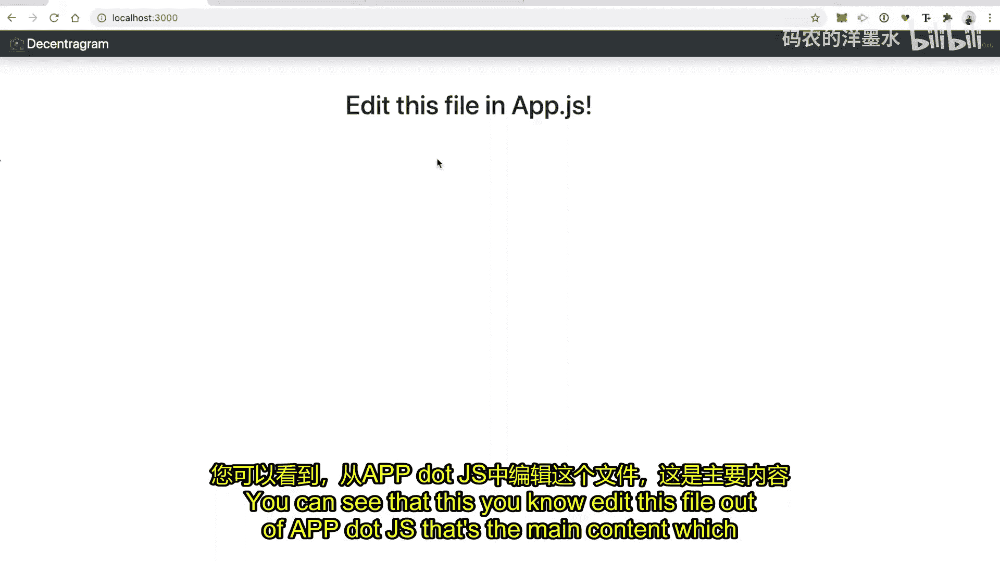

So app DJS governs like the whole app， the navbar is up here and the main is down here and it kind of makes logical sense。

 you know you use components for organizing your app code based on logical groupings。

 so the logical code for the NAavbar goes in the NAFbar file。

 the logical code for the main component goes here okay。

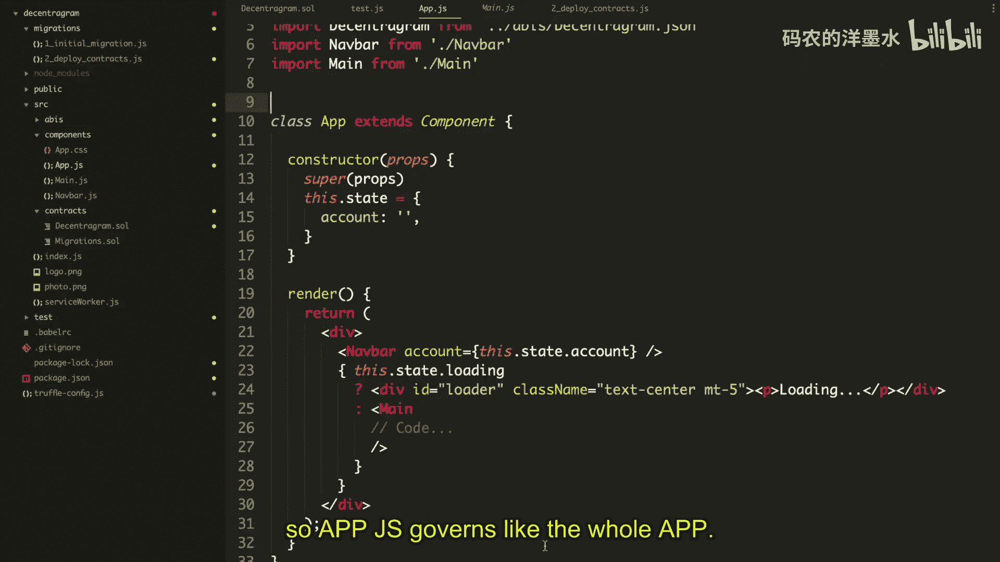

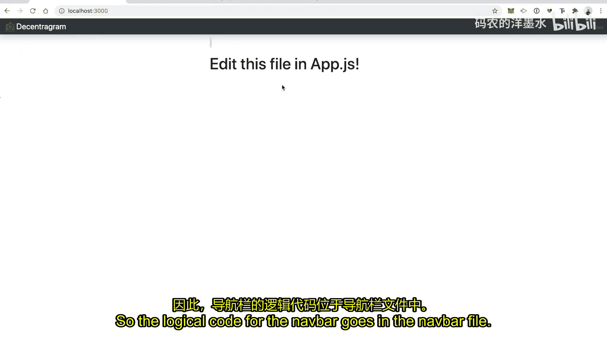

All right。So let's start wiring this up right， so the first thing we want to do is actually connect the application to the blockchain。

And in order to do that， we're going to use the Web3 library， so let me show you the Web3 library。

Pull that up here So web 3 is the main JavaScript library for interacting with Ethereum and that's the one we're going to use in this tutorial Okay you can see you know web 3 here we'll use this a lot。

 but here's the documentation So we're going to use web3 but we're so。

It's important to notice that like。We have to do two things。

 we have to turn our clientside app into a blockchain app， that's what Web3 does。

 but then we also have to turn our web browser into a blockchain browser in order to connect with this and that's what Metamask does okay。

So Metamask is an Ethereum wallet all right that turns our browser into a blockchain browser again that's what we installed the dependencies and that's what's on this diagram here so this is Metamask。

 which works in tanium with our web browser to talk to this HTML portion which talk to the blockchain So we've built this part already now we have to build this part that talks to the blockchain and then also IPFS right first before we actually wire up Web3。

We need to import a account into Gaache， sorry from Gaache into Meask。

 so basically you'll open Gaache wherever that's running。

You'll find the first account in the list here。You'll reveal the private key。

 so don't actually use this private key in production right。

 because everyone who's watched this tutorial。Well， I have seen it。

 so click copypy and then go to Metamask， go to your accounts。And then go to import accounts。

 paste in the private key， click import。 I've already done it。 So it won't do anything。

 but once you do， you'll see your account connector here with Kaache。

 you might need to refresh the page， but you should see your ether balance Yeah。

 you can see that the ether balance has actually gone down。

 that's because you have to pay Ethereum and gas fees or ether cryptocurrency and gas fees whatever you put the smart contract on the network。

 So remember， any time you write data to Ethereum， you have to pay gas fees because transactions cost money。

 you know rights to the blockchain cost money but reading information from the blockchains totally free。

 So if anybody wants to get on decentureogram and just look at pictures。

 it does not cost them anything。 But if you want to put new pictures on decentureogram。

 then you have to pay money to do it。 And then of course， if you want to issue tips for them。

 then you also have to pay money to do that so。Trffle uses this first account list as a you know the deploy account and so it deployed the smart contract to the blockchain already and that's why the balance has gone down but it also used it to simulate the tests。

 and so that's why this balance has gone up。 so this is the。Person that received the tips， I guess。

 or maybe maybe this is the person who is yeah yeah， this is the author。 This is the tipper。 So yeah。

 these are the first three accounts in the test scenario。

 that that's why these balances have changed。 So sorry they right that's kind of a little bit of a tangent。

 but。Yeah， so we've edited so we've imported our account into Gaache。

 let's go ahead and import another one， let's just import this second account all right boom is Gache number two。

 so repeat that process because you want two accounts in here because you want an author and then you also want a deploy okay。

So I go ahead and do that。sorry author and a tippper because we don't want to tip our own post。

 we'll get back to that later All right， so it's good ahead and wire the application with the blockchain inside of here we want to create a function for doing that So first of all。

 we have Web3 imported at the top of our project already right so that's good。

And then we want to load Web3 like this。I' just going to paste in a function。Like this boom。

 So Lo Web 3。 Now， don't worry about coding this out step by step。

 I don't code this out step by step my own projects because it's really just a copy and paste。

 This is exactly how Metamask tells us to import Web 3 into our projects。

 And I've just adapted it for this tutorial， okay。

So don't worry if you don't even understand all of this。

 basically what it does is it gets the Ethereum provider from Metamask， okay？

Metamass is going to put an Ethereum provider into our browser to allow us to connect to Ethereum and it just uses that Ethereum provider to instantiate a connection to the blockchain with this line of code right here。

 basically it looks for window Ethereum or if that doesn't exist。

 it looks for window without Web3 and it doesn't find that ether it tells us hey。

 like you don't have。

A Ethereum based browser you should try install metaask， Okay。

 so don't stress if you don't understand that， okay。

But now we've defined this function now we need to。

Call it So I'm going to use a special function and react called component will mount。

 So this is just a lifecycle function。 So basically this is a magical function provided by a react that that react always knows what to do if we。

Toefine this function， basically， before this render。Meth gets called here。

 it's going to run this code right， so there's react has a lot of different lifecycle callbacks。

 you can go read about those if you want to。But basically， we'll just do this inside of here。

 we'll say low Web3。All right， so we'll go back to our page and just make sure that nothing is broken I've opened the the console down here。

 you could just do like inspect all right then go to console if you want to。

That'll show you how to use this， all right？And then。

Now we've loaded our connection to the blockchain， now it's actually load up the blockchain data。

 so I'm going to take make a special function here。I'm going to name it， let's just call it。

Load blockchain data。Right。And then we'll also call it here。So after lowbed 3。

 we'll do this load up blockchain data， right？And what we'll do here is we'll just fetch the account from metatamask and then log it out to the page Okay so inside Web3 Gs。

 let's look for accounts So this is how we'll actually get the accounts from Web3 so we say web3 E get accounts and this is just going expose all the accounts from Metamask into our app so we'll just call that functions out of our code like this we'll say constant accounts equals a weight web 3 E get accounts all right just like we saw in the documentation So we sign it to a variable all right and then we can just log that to the console say console log accounts。

And then we'll actually just do the first one so it counts zero。

 so it counts as an array all right we'll just do it so let' just look at that first without the value right and then we see it in the console right here right so it's an array and here's the account that we were connected with inside a metamask All right so you can see that here。

All have boom， it's exact same one， two AEC，2 AEC， right， perfect。

So now what we want to do is actually store this value inside the react state object so remember inside of react we have this state object just like we did in our to do list right so we're gonna create our own state。

 our own kind of database so to speak on their client side to keep some information in there for the app and we're going to store the accountant there so know react tells us to create a default state object like this we use this constructor object so this is just a function that gets roam over the componentss created constructors a special keyword here right。

So it tells us how to do it and then it has this this dot state is just this JavaScriptscript object all right with the default state inside of it。

 so we do the exact same thing in our app right here with constructor all right this is just like the react documentation but then we define our own custom state so the account is blank in this case。

 but we want to update this value right because you see the accountss blank and then whenever we are inside of our app here it's blank right here right？

So we want to say。Cocounts equals a weight with their Gi count all right and we want to update the state to update this value right here。

 so we say this set state。And then we say count。And we say accounts。Z all right。

 so member accounts as an array and we can fetch the first account like this all right。

 so let's say this does set state。

We'll go refresh the page and see what happens。 All right， so no， we don't see an address here yet。

 but we do see a little identicalon， which is pretty cool。 right， I'll explain that here in a second。

 So let's， let's trace this logic， right， So we， we've set the state。😊。

With the account， and then you'll notice that。The naav bar， when it's rendered。

It has a variable called account， okay？And the account is set equal to this dot state account。

 so this is how we write to the state object with the account。

 and this is how we read from the state object with the account all right so this dot state dot account right。

And then this account gets passed down to this navbar file， which you see here。

This is a lot of code already you know wired up inside of it you all this HTML inside of here you see all's extra styles and stuff。

 we're using the bootstrap templating frameworks that we have to write a bunch of HTML and CSS code ourselves all right that's what all these extra classes are for it's for the bootstrap framework okay。

But you'll notice that。You'll notice this line here， so the ID account， instead of 0 x0。

 we want it to be this dot propps dot account。

And save that and go back to the page and then boom there we go。

 we can see our account from Metaasks listed here all right so。

Basically， let me show you how that works。Account is passed in here。

 so account is the variable value， it's actually the component props。

 that's what it's for prop just stands for properties so that we define a custom account prop here and then inside of the component。

We read it out with this dotprops。 account， which is just the same name that we arbitrarily defined here okay。

So awesome， now the nav bar wired up and we can see our。

Our ID there and that is powered by the special Identon library， so let me show you that。

Dentticcon JS， that's just this file here。 You can create a fancy image here just from arbitrary data。

 you can put your name in there， you can say food bar。

But we've done is basically taken it and put in our Ethereum address and then boom。

 it creates you know data like that， so it didn't actually use our entire Ethereum address。

 I guess it has a limit on how much it can actually do。but you can use。

This is not the same library。 Let me actually look it up here。 Identon。 Yeah。

 this is error right here， but you get the idea。 it's the same idea。 But we yeah。

 these these are the idents that we have。 So basically。

You just have a special code all right that passes in the identicalon。

Or passes in the data for the entityon and it generates that image automatically。

 So it's not the same library that I showed you with that demo。

 but it's the same idea right And then here's all the code that just。

Does it So if you want to copy and paste that for your own apps to use your Ienton。

 it's just using that Ientcon library from the package。 JO file we've already installed it here。

 just make sure you dompm install。Ident Js right， and then import it into your component and then render it out on the page just like this and we just pass in the Ethereum address。

 right？So that's how that works boom， done， so we have connected to the blockchain。

 we have added in the account。So the next thing we want to do is get the decenttroogram smart contract from the network。

So I'll show you， we go to source， let's see you hear ABI's decenttroogram JSo。

So this is a special file generated by Tffle， it's not really an A。

 that's not the best name for this directory， but it's the same idea， the A's inside of here， right？

So the smart underer A is basically just a a JSON representation for how the smart contract works。

 it describes the types of functions that the smart contract has。

 and for example the A tells us that the smart contract has an upload image function and that it requires these arguments you know it tells us that it has a tip image owner function right and it requires these arguments that's what the A does okay。

And then it also has an address， which is the location of the smart contract on the blockchain all right so you can go all the way down to the bottom。

 you can look for networks right and then you can see。The address here again。

So we're going to do is create a JavaScript version of the smart contract with Web3 JS。

 so let's just look at the documentation here。

嗯。We want to use this web 3 Eth contract， again。And we're going to create a new smart contract like this so we'll just create a JavaScript version of the smart contract so we can call the functions inside the app like fetching all the posts。

 tipping the posts， etctera， etc， so we'll say web3 Eth contract and it requires two arguments the JSON interface which is the AB and then the address so both of those pieces of information that I just shows you in that big file we need both of those to create a JavaScript version of the smart contract Web3。

And so we need to dig those out all right， so basically inside of here， we's just say like。

Let's do this， let's say like。This is the final destination we want to go to。Const to centtroogram。

Equals web3， Eth contract， and then decentriogram。Or just say we want A B and then address。

 that's the final destination we want to go to， but there are a few steps。

Required in order to do that。 Okay， so the first step is。We need to find the AI。 all right。

 so the ABI is。Is contained here。All right， well sorry， it's contained here， right？

This entire file just has the ABI right here， so this entire thing A right and you'll notice that the top of this file。

 we've imported it all right， so we've already imported decentcentroogram from A's decentcentrogram。

 JSson that's this right here so we've already got that。The ABI。

 so we can just say descentogram do ABI。But the address is a lot trickier， okay。

 because we'll see here， I don't know why this decided to move it into anything， but anyways。

 the address is trickier because the address is nested。

Deeply into this file under the networks key okay？Because this smart contract could be deployed to multiple blockchains。

 multiple blockchain networks， but we want to find the specific。Address for Gache， okay？

You'll notice that Gaache has a network ID of 5777 all right。

 so you can see this 5777 is the name of the network here， all right？

And that's the address you want to get because you， if it was deployed on the main Ethereum network。

 this will be like one， if it was a test net like Kon， for example， it could be like 42。

 but we want this specific network so。We need to get the network data for the particular network right and then find the address。

 so I'll do that kind of fast， but I'll show you how it works so basically。

Ill go back to this app J file and then we'll say the network ID， we can get it from。

Web3 like this network ID equals a weight web3 E get or sorry， net get ID that'll return 57。

 77 from Gaache。And then we want to get the network data。Which is， you know。

 this network key right here， and then we want to get want to pass in the 5777 right like this。

So network data equals decentcentiogram， network network ID that we got back here。

 so this is going to be 5777 right so basically we're just reading on that file finding that。

 but instead we get it dynamically here。All right， and then we say like， you know。If you know。

 network data。Okay， and then。elselse。Alright。This is the if L statement。

Then we want to get the address and so the network。

 the address is just available on the network data right。

B so here's the AB and here's the address and the address is assigned dynamically based on the network。

 we fetch the network， we get the data out and then we instantiate the smart contract with the A and the address like that。

 right？So。And if that doesn't work。And basically we're going to create an alert that says， you know。

 the centgram contract has not been deployed to the detection network。

So we can just check that out in our browser。Go back here and then boom no errors。

 But if like we switch to the main Ethereum network here or sorry as to main Ethereum network or Robton test network doesn't matter boom dis Srogram contact not deployed to the detion network so it works All right。

 but we want to go back to Kaache and now we should no longer see that error and awesome。

 There we go。So we have successfully connected the smart contract to our app。

 it's running inside of there。

And then now what we want to do。Is hydrate the app with all the data from the smart contract。

What we want to do is load all the images for the timeline right。Well， actually first， let's just。

 we're going to do that， but first we need to store the smart contract into the state so for this default thing here。

We're going to say。After account， we'll say to Cigram。Is just null。

 and let's go ahead and fill out the rest of this state。'll say images。 Let just be an empty array。

 This is going to be all the images in the timeline Alright， and then we'll say loading。

 we' say just true Allright， so it's gonna。We're going to see a loading flag there， but that's okay。

It's going refresh and that's what we expect bones to be loading， that's all right。

Rightright。Soum。I'll explain that in a second。We just fill out the state。

 so we don't have to come back and do this。 So we want to do is populate this。

So that'd be pretty easy， would to say this you know， set state。And we'll do it right here。

Does set state disentiogram， we could say is disentiogram。So we did that just like we did here。

But the goal by E6 is if we have a key and value with the exact same name， we don't have to do this。

 we can just do a shortcut like this boom， so that's the exact same thing。

And then now we want to do is actually load up all the images in the newsfeed， Okay。

 so first thing we want to do is get the image count。All right。Does image count。Alright。

So basically we do disinogram methods， image counts look at it in the test。

 but since we're using Web3 J directly， we have to say call here， okay。

 so you know with web 3 and find the documentation here。

Anytime you're reading data from the blockchain， you can't just call the function。

 you actually have to do the call function on it so basically like。

Methods， image count， you can't just do that。 Al right， if you want to actually get the image count。

 you have to do call， Alright， boom like that。

And similarly， if you want to create a transaction， you have to do send， which is， yeah。

 we'll see that in action whenever we actually create new posts and tip them， all right？

So next， we're going to update the state with the images count， oops， like this bone。

 say the set state images count。All right， now before we continue。

I actually want to change gears here because。I don't want to continue building this out until we've actually created an image。

 and I kind of want to show you how IPFS works with this application。So we're going to pause here。

 we'll come back to this， I want to check you how to actually create an image so before we actually list the images out on the page because I think it'll make more sense that way。

 okay。So first， let's， let's。Let's let's like create an image， okay。

We're going to do that inside the main component here。So we'll go to this。Let's just see here。

I don't have it open yet，Okay， here's the main so inside of here， we're going to do。

Is actually creative form。For uploading a new image， right？

So I'll just start off with some template code like this。U。A。

 you can find this in the final code solution。But I'll just put it in here for now to kind of make it easier。

All right， so we'll take away this。You know， edit inside@。js file and then。

We'll take all this out and then we'll replace this code with。This this form。

 this is in the final code solution if you want to find it there。嗯。But I'll show you how this works。

 so let's just go refresh the page and see if it works so loading。U。One more thing here。

 so before we do that， let's go back to our。Deent grant sorry， the main or app do Js file okay？

At the bottom， let'll should do this this。U。Set state。

 we want to actually make the loading done this not set state。Loading false。

 so I know I've jumped around quite a bit here， I'll explain what's going on， all right， boom。

So basically， what's going on is like。

We a't see that loader flash all right， it' basically we want the app to be loading while the blockchain data is loading up。

So that's what this loading is here by default whenever the app boots up， we want loading to be true。

 but then once we've loaded all the blockchain data we set loading to false and that's just managed with the state object。

 all right？And you can see the logic here on the page so say this state loading。

 so if it's true that's what this little turnernary operator does this question mark then we show this loader right here so that if the vet expression evaluate are true。

 we show this if it's false then we put in this other component， the main component。

 so if it's loading show the loader it's not loading。

 go ahead and show the main component which is all the code down in here okay。So。Yeah。

 that that's what's going on there and I just updated that so that we're not just showing the loading page。

But now when you see it， here's the form boom for sharing the image， all right？

So I'm going to move this part kind of quickly， which as you can see how it works。

 basically we just you know upload an image here all right， so it doesn't work just yet。

 but you know you could click this to expose some images so let's see how it works。

Basically it's just an HTML form and it has this input here all。

 and it accepts the specific file types。And so it has two inputs really one for the file here。

 all right， and then one for the image description。

 So I'm going to actually bump this code over to make that a little more。Consistent。Alright。

So let's do this。Actually， this is better。I'm meant to do this。Yeah。

 so input for the file and then an input for the description。

 so I want to focus on first and foremost uploading the file to IFS right because it's a two step process。

 right？

So step1 is gonna to be we upload the file from from our browser here from our desktop or wherever。

 And whenever we do this， we need to process the file so that it can be uploaded for IPFS okay and then it's going to get captured by IPFS and then put on the blockchain。

 So it's a multistep process basically whenever you choose the file。

 it's going get preprocessed and then whenever you submit the upload it's get put it's gonna put on IPFS once it comes back from IPFS or get put on the blockchain So let's。

Actually write all the code for that so go back to app do Js all right so first thing we want to do is write create a function called capture file Okay。

 so just below low blockchain data we'll do that All right。

 we' create this function like this'll say capture file equals event All right。

 so should be a function right arrow function here。

First thing is the event Prevent default because we're going to submit a button。

 we don't want it to refresh the page and the first thing is we'll read the file okay。

So this is how you do it off the event， we say event target files zero。

 this is just reading the file off the HTML element， right？

And then the file reader is just going to be the native window file reader from JavaScript and then we read it as an array buffer so basically what this does is it just a。

Allows us to pre process the file so that it can actually be uploaded to IPFS。 So basically。

 it takes the file the image file from our computer and it converts it into a。Format that。

The IPFS uploader expects all right， so basically whenever does that。

 we just state buffer equals buffer reader results all right so converts it to a buffer object and that's what we need in order to upload IPFS Don't worry if you don't understand everything inside of here that's just what has to happen okay。

So basically， we can take that capture file all right and then pass it into。

The pass it into the main component like this。And so we can say， you， capture file。😊，All right。

 capture file， this do capture file， and then inside main JS， you'll see that。On change。

 whenever this input is， you know done， then we will capture the file like this。

 this prompt capture file。 All right， and then it'll get preprocessed for uploading。

 And so now'll just upload a file just show you how that works。

 So I'm going to click this choose file button be and you can see here that it's logged to the console。

 So this is what the array buffer looks like。 don't worry if you don't understand this， like I said。

 this is preprocessses of the file。

So it can be uploaded to IPFS and that's all this code does here and you can see the logged value out of the console right so it's working so we've captured the file all right。

 we've pre processed it basically。And now we want to do is actually create a function for uploading the image to IPFS and then also the blockchain itself。

 all right， so let's do this next function like this boom， we'll say upload image all right。

 so it's another function that is going to accept the description。

But here's what we want to do here here's how it goes to IPFS so basically we just doipFs。

add all right， thisstate。 buffer right so that's what we set here after we precros the image we loaded it to the state and then basically if there's an error。

 we'll log it to the console。And then if there's not。

 we'll actually say we're going to load it and then we're going to say this dot state dot decenttroogram。

 you know， methods upload image， and that's actually going to call the smart contract function， Okay。

 load the blockchain， and then add the description that was created。

Whenever we pass it in from the form and then we send it from this dotstate。 account。

 and then when the transaction hash comes back， we'll set to say loading to false okay。

So that's a lot， I know we skipped a lot ahead there， let's just ignore this part for now。

 which you' got to comment it out。Let's just upload the file IPFS because we don't even have this IPFS thing added yet right so don't worry about the smart contract port yet。

 let's just get the image actually on IPFS so we need to set up an IPFS connection which is really easy right so in our set package JSON file we have it IPFs HtTP client right if you go to the package JSON file here you can see this IPFS HtTP client。

All we have to do inside this at that JS file is import it like this。Ill say。

Const IPFS client equals require IPFS HTP client， and we can use the default one for emFRA like this boom IPFS equals IPS client host andFRA Port 501。

 and then HTPS。So。Don't worry if you don't like， understand all that out of the box。

 but that's just how you。Connect to IPFS for free really easily inside the app。

 So now we can call methods like， you know， IPFS add and then put the file on it like this right And so let's just let's just add a file。

Log up the console so you can see what happens before you actually put it under the smart contract on the blockchain Okay。

 so we need to pass that down to the component here。

 so just below capture file we'll actually do upload image。All right so。Now you can see。

When we click submitm， we have an on submit handler here。U，That does。This。Upload image。

 and it passes in the description。And then that's how it work， so let's just give it a try。

Reresh the page here。So。

Got a little issue。 Let me just fix this really quickly because bugging me So this is telling me that you can't use class So line 32 inside of mainine。

 so on line 32 here， let's do this so let's change us to class name because react doesn't let you use the word class because it's a conflict All right。

 so that's gone。

All right， so let's actually upload it， so I have selected an image。

 of course we've seen this array buffer here， let's give it a description。

 we'll just say hello world。Upload IPFs and you can see that it is submitting to IPFs and then bo it comes back。

 So here's the IPFs result， which is a array of objects。 but then it actually yeah。

 it returns the hash All right so that's the real worldld IPFS hash that we're going to store on the blockchain。

 So we have successfully uploaded an image to IPFS。 In fact， you can just look at it like this。

 So let me just pull this off screen。Let' see， IPFS。Hello。All right， let me just see here。Let me。

 let me， let me show you what that file looks like an IPF S before we actually try to read it out on the。

Inside the project， so let's see here。m。Yeah， we can do like this so basically。

We can use the inferior URL， so we just say like IPFs。Infera to IO。Okay， and then we say IPF。

Pass an image like this。 And then boom， there we go。 A。 So that's our image that we just uploaded。

 So you should be able to see yours like that。 So let me show you the let me show you how I built that out。

 So here is the image ash。 Okay， alright， and then we prepen the image hash like this。😊，So boom。

 IPfsfaIio， forward slashipfs then pass up the imageache， and that's what we just uploaded okay。

So you'll see this in action here in a minute whenever we actually put this inside the smart contract from the blockchain。

 but I just wanted to show you before we got there All right， all right。

 so now what we want to do finish that part up all right， so let's see here inside of。

Hptide JS， we actually want to put that IPFS hash onto the blockchain。

 so remember we got the hash back whenever we upload an image and now we want to put that on the blockchain so was that loading to true。

And then we'll re uncoming out this line。 So let's say this state docentogram this is the smart contract。

 we'll do methods upload image Alright， so here's the result zero hash。

 Okay that's what that's what this is result zero hash okay。

 and then we'll pass in the description So that's going to come from this text box right here alright。

And then we'll say send from this data account all right and then whenever that's finished we'll set loading to false So remember inside Web3。

 we have these we did the call functions， so like whenever you read data from the blockchain you call a function you say call at the end for whenever you're actually creating a transaction and you are you know putting data on the blockchain。

You're making a transaction so you call send at the end and then accepts these options and we pass in the options。

 which are a lot like the metadata we saw inside some of the tests。

 so this is from okay so from thisstate。 account all right。

So let's give it a try。And then let's just see， I think that's everything。

 Let's just look at main dotjs。 So on submit， upload the image， I think that'll work。

 Let's just give it a try。

So Ive chosen my image， it came back and let's do， we'll just say hi， vitalik。Alright。

 so submitting to Fta IPFS came back。 and then here we go。 Asome。

 A meta mask confirmation pops up and says， do you， you know， do you actually want to。😊。

Write this in the blockchain we' click confirm and now you'll notice that you'll see the gas settings here。

 So remember whenever we。Whenever we write data to the blockchain we have to pay money and that's what we're doing here。

 This is the gas fee， you have to pay gas fees in ether of the native currency of the theorem blockchain。

 whenever you write new transactions and that's what we're doing so we click confirm to say yes。

 we want to pay money to do this and boom there we go， confirmr transaction refresh the page。

And it worked。 So we don't see any confirmation that it worked because we're not actually showing any images on the page yet。

 So let's do that next， Okay， we will。We'll go ahead and list out all the images on the page like this。

 we'll do that kind of fast because we're getting to move this along here been going for a while I want to go ahead and wrap this up today so。

Come really far congratulations， but there are a few more other things we got to do so we're going to go back to where we left off with when we were filling in this low blockchain data。

So instead of here， you know， we've already got the images count。

 now we want to do is loop through all of the。

Images with Javascript。 So Javascript for loop is what we want to use。

So you can see how a JavaScript for loop works is basically if you have an array。

 then you can loop over each item in the array， even so this example is an array of cars right so or is a string they're doing a string here we're going to do an array。

 don't worry let's just see if they actually use an array example ohping of an array so here's a cars array and so basically they says like because you could do for x of cars or you could do the old school way or into the old school way just because。

Yeah， where's you in the old school way？So we'll do it for loop like this， you'll see how it works。

We say load images， so we say four i equals one， so this would be the first ID。Say images count。

 that's the total number of images。 And then each time in this loop。

 we're going to increment the count by one。 So say image equals a weight decentogram methods。

 images just like we did the tests， we passed in the ID， which is going to be one。

 and then we say call right or we get do call。 We're gonna do it from the blockchain and then we're going。

We're going to update the state with the images like this， we take the existing images。

 we use the ESX spread operator and we pop the new image in， right？So boom， there we go。

 and then the last thing we want to do， well， yeah， that'll work for now okay。

So we'll load up the images and we will listen on the page。

 so then we want to pass in the images here。So let's say this state pass that to main do Js and then we want to put in the code that。

Yeah， I' put in the code that。Shows images on the page。

 So I'm just gonna to paste this in from kind of code solution。

 So I'm going to spend all day on this particular part again。

 I want to make this more about the blockchain part of this rather than like all the front stuff。

 The front is important， but understanding how the blockchain part is more important。 Sorry。

 Under how the blockchain part works is more important。So。

 and also if you want to learn a lot of this stuff more in depth。

 you can definitely do that inside the boot camp， I'll put a link down in the description below。Soum。

What we're going to do is take this prop images which we passed in， we would call the map function。

 which just loops over all of them， and then we basically list out each image onto the page like this。

 we put in the author with their idon all right we put in the image description that was created and then finally we put in the image from IPFS like this we just put in this URL that I showed you in the web browser a minute ago pass in the image ah and then we have a button at the bottom that allows them to tip the post so the tip amount。

It's always going to be 0。1 ether it's a fixed amount okay， so it's always like you just tip 0。

1 ether anytime you like a post so liking is tipping in this case and then yeah。

 we tip the image owner so that's going to be a function that we'll create in a minute。

But that's how it works。 So let's look to see if we can find our post。And boom， there we go。Awesome。

 so。😊。

So we have another conflict here though， so line 51 this changes this to class name。

All right， get rid of this error。And then boom there we go， awesome。

We can see our image that we uploaded first， right？So yeah， there we go， boom。

 let's go ahead and add another image， all right， so I'm going to choose another file off screen here。

All right， recent， I'm going to upload my own image， okay。And then I'll tip say hello world。

 or click upload。And then Ms confirmation pops up， click confirmfi。Right。Bone， there we go。Awesome。

Boom， awesome。 yeah， we have two images in the timeline now。 Alright， alright。

 so now what we want to do is allow users to tip these posts。 Okay， so we've created the fee。

 you know， we've upload them to IPFS and let's actually change accounts here at Memask。

 So go ahead and opened up your metamask and switch to the different account and list。

 So you to switch accounts I'm gonna do my second Gsh account here。😊，All right。

 so I just done that off screen， you can see just click on this。

 you'll see your accounts come down and then scroll on that list and find your second account here's mine so I've got some more ether in here。

And now I'm going to interact with this so that I can tip another person okay。

 so we haven't done that just yet， so let's go the code， this is the last part。

It adapt to I Js， we're going to create a tip post function。 Alright。

 and so it'll look like this we'll say。Tip。Image owner。All right， and this will be。诶。All right。

 and let's be async， I't thing let's see here's just do this ID and then tip them out。All right。

And so this is going to be the function that actually。Calls that method on the smart contract。

 So we did this in the test already， so this should look pretty familiar。

 So let's set the state loading to true and then we'll say this test state centgram methods tip image owner that's the smart contract function name which passing the ID say send from the current account and then the value be the tip amount which is passed in from this function。

 which you know is set elsewhere I'll show you that in a second。

 and then we have a transactions finished。 we'll set the state loading to false okay。

So we need to pass that function down to our。Main component。All right like this boom tip image owner。

Alright。And then inside of main do Js， we say。We have the tip image owner function already wired up on this button。

 so on click， we do a hard coded tip amount and then we say tip image owner event target name and then tip out and we call that function so boom。

So let's give it a try。And so now I'm going to very specifically tip this image。All right。

 the most recent image， not the first image because you see these don't have any tips yet but I want to tip the second one for a very specific reason okay。

 so you'll see the Mad mass confirmation pop up you can see the tip amount right click confirm。

And then boom， there you go and then refresh the page。All right， so now you'll see the tips is 0。

1 ethere and this one doesn't have any ether yet。Alright。

 so the tipping worked and the last thing we want to do is actually curate the news feed so that the highest tipped posts go to the very top so it's going to flip flop the order of these images if we write the code correctly and that's the last thing we're going to do right。

So basically， we're just going to sort the images。At the very last line like this also here inside of low blockchain data right before the loading part。

 say boom， sword images， show highest tipped images first。Say this set state images。

 this set state images sort， this is just this function in JavaScript that source the array。

 so A and B， so B tip amount minus a tip amount， so the highest tip post shows up first right so boom say that go back to page and boom there we go awesome so the highest tip post goes to the top。

So that's it everybody that is a decentralized image sharing platform。

 basically an Instagram clone called decentrgram， so congratulations， you know。

 you've written a smart contract， you put it on the blockchain， you've written tests against it。

You know， you have done Re JS， you've used IPFS， this is an unstoppable decentralized application。

And so if you want to take this to the next step， there's a lot of things you could do。

 you could basically。You can put the front end so this react JS application。

 you can put it on IPFS as well and so that other people aren't accessing it like you know on a centralized web server。

 you could put on IPF so it's a truly unstoppable application。

 you can have more features to the smart contract， all that kind of stuff okay but this is definitely you've made a ton of progress in this video。

So there's there's lots of things you can do from here so you know， of course。

 what you can always do is。Whenever you create your project。

 you can tag me on Twitter and share your project with me that way。

 can be sure to share that out to the world and show people what you've been working on and know as always。

 smash the like button down below that really helps the YouTube algorithm surface these video so that more people can find them and if you want to take the next step and really learn this stuff even more so that you can land a high paying job。

 become a freelancer build your own project then you can head on over to Divesity co bootc to get started today I can show you how to build a realworld blockchain application not just a tutorial but a realworld app for your portfolio you can land that job。

 become a freelancer build your own app whatever you want to do So that's all I've got hope you like this video and until next time thanks for watching DP diversity。

