# 【全集】加州大学戴维斯分校 分布式交易与区块链架构 中英字幕 完整课程 p03 扩展：Web3 - 用区块链编写YouTube复刻版 -BV18YFVzME2f_p3-

Gys I've got this super exciting blockchain tutorial for you today。

 I'm gonna show you how to create a blockchainbased video website just like YouTube and this is gonna be a futuristic unstoppable web 3。

0 application because it's gonna run on top of the Ethereum blockchain and also IF and this is the perfect time to learn this because these technologies are gaining a lot of ground and more people are becoming aware that censorship posts a potential problem online and so I'm gonna show you how to build an uncensorable version of YouTube on the blockchain in this tutorial but don't worry you don't have to be a programmer already or know anything about blockchain order to follow along I'm gonna show you everything step by step I'll show you how to Ethereum smart contracts with programming language put them on a blockchain and also create your own frontend website so that people can upload videos to IF I'll show you everything from scratch before we get into that if you're new around herey I'm Gregory and on this channel I turn you into a blockchain master So if that's something that you're interested in then smash the like button down below for the YouTube algorithm and subscribe to this channel and if you want to learn how to master blockchain step by step from start。

Finish then heading over to dadiiversity co bootc to get started today Here's a quick preview of the application that we're gonna build together today in this tutorial This is a blockchainbased video sharing website a lot like YouTube this users to upload videos and also watch them and share them inside their browser but unlike YouTube this is a censorship free platform because it runs on the and the interplanetary whenever someone it will be stored on the blockchain forever and no one can it diagram of how the application will work So first let look at how YouTube in basic sense you use YouTube browser and YouTube and whenever you to a web server and this web server is where all the code for YouTube lives and also the data is stored inside of a database。

And all the images are also stored in the cloud right here Okay so this is a centralized model where basically the creators of the application can do really anything they want to。

 they can take videos down at any time， they can change how the algorithm works you know whatever but we don't want to build a YouTube clone in a centralized way like this。

 We want to build it in a decentralized way like this so let me show you how that works。

So first users will connect to the website with their web browser。

 but they'll also use a blockchain wallet to connect to the blockchain right so they'll use their browser。

 they'll use their blockchain wallet to be metamass in this case I'll show you that here in a minute。

And they'll connect directly to a website that'll talk to the blockchain， okay。

 and this is where all the code for the application will live and also the data because it's powered by Ethereum smart contracts。

 all right？And then these smart contracts will store references to the videos of the platform which will live on IFS。

 the Interplanner Terry file system。 This is a decentralized file storage system where you can upload images and upload videos。

 upload documents whatever you want to and they can't be taken down because it runs in a decentralized way just like a blockchain does and then that will serve the images back to the user and their web browser like this and so here's a diagram of how we'll build the application well be the Dap creator in this case and we'll create smart contracts with the truffle framework will'll publish them to Gaache。

 our development blockchain and then we'll use Memask to connect to our website that will create andreact JS we'll show you that here in a minute and then we'll run the D and whenever we interact with the blockchain we'll be able to talk directly toganache with Memask and we also code the client side application and react which will also talk to IFS so this might look kind of complicated and you can pause the video。

At this point to study this diagram but all of this will be much more clear once we build the application and then I recommend going back and looking at this diagram once you've finished the project to get a higher level understanding Now let's install the dependencies for this tutorial the first dependency is node JS This is gonna allow us to install all the packages on our computer as well as run our client side so you can see if we have node already installed by going to your terminal and typing node so I'm using node9。

10。 I would recommend using the exact same version for best results during the tutorial but you can probably use the latest version if you really want to and you know what you're doing so you can download node directly from the website or you can use a command line tool like Homebw package manager to install it that way the next dependency is the truffle framework This is a framework for creating Ethereum smart contracts we can write Ethereum smart contracts with the solidity programming language write tests against them and deploy them to a blockchain with truffle as well as many other things which we'll see in this tutorial can。

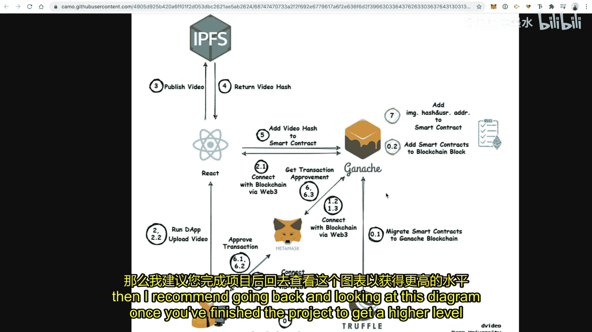

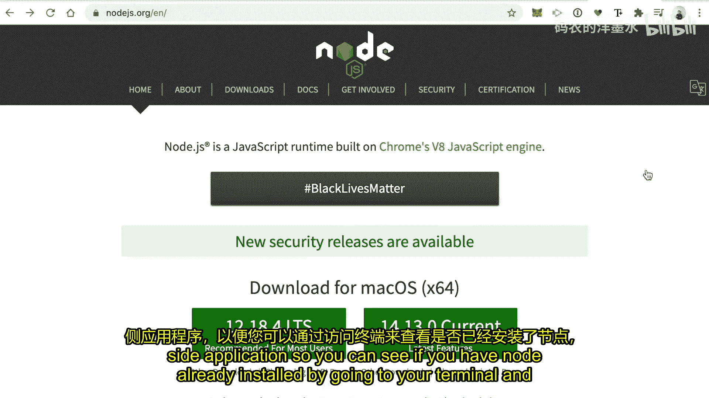

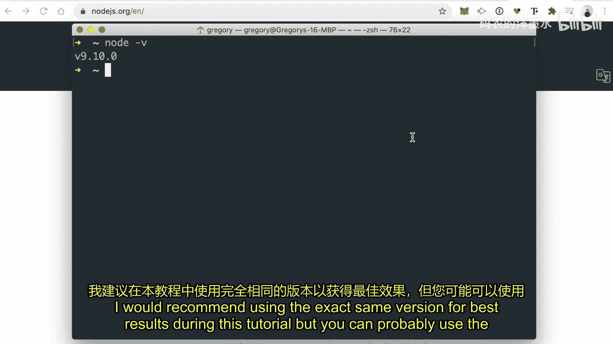

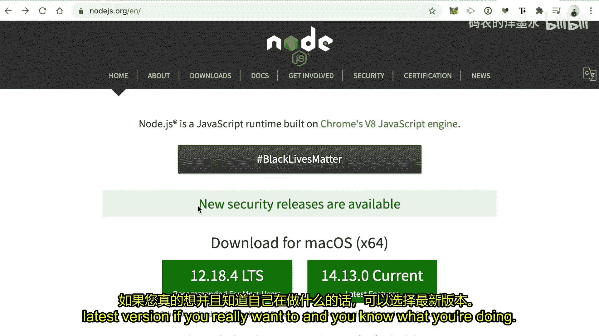

All truffle from your command line like this， say NPm install a truffle at version 5。

13 the next dependency is theganache personal blockchain a run on our computer we can simply download it and run transactions in the blockchain deploy smart contracts to it without having to pay any real money so go ahead and download can the for operating whenever it's download you can open it you'll see you have a brand new running computer like you'll see of different accountsed with10 fake ether and don't get too excited because this isn't last dependency is the Meask extension for Google Chrome web browsers won't the box and so we need to install a special extension to do's what metaasks an Ethereum wallet that turns our browser into a blockchain browser so go to the Google Chrome web store metamask and click install and once you have it installed。

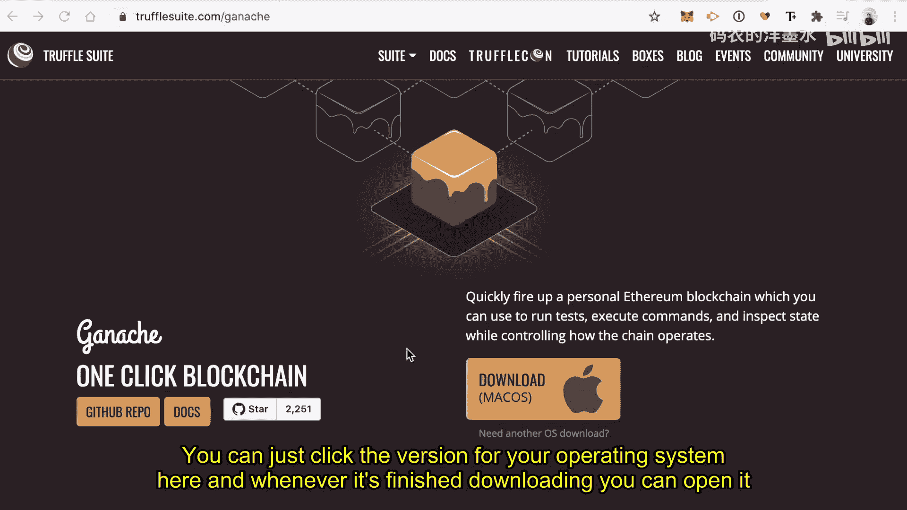

You should see a f icon in the top right hand corner and just walk through the setup steps to get that started Now let's start coding the project so heading over to the link down in the description below this is gonna be the Gitthub repository for the final code solution right you can see the project diagram listed here as well as all the code okay so you can download this if you want to know if you're not familiar with Git you can download a zip file but I'm going to use Git and I'm going to clone a specific branch so you can see that there's a starter code branch here and that's what I'm going to choose so copy this link from your browser like this go to your terminal and say git clone B all starter under code and then paste in the URL here and that'll create projectright。

So now I'll enter into the newly created directory like this CD starter sorry， D video。All right。

 and then here we go。😊，So now I'm going to open this in my text editor。

 I'm going to use sublime text， you can use whatever text editor do you like。

 so that sublime text command that I have subable dot is just a shortcut that I have configured on my computer。

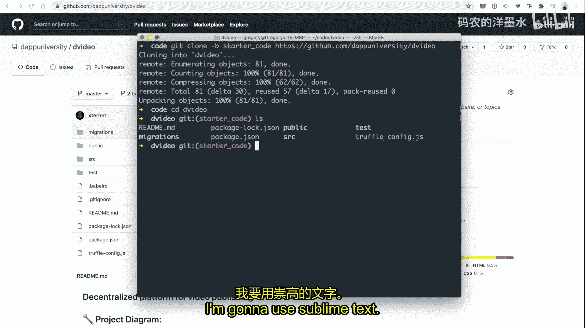

That's okay if you can't do it， you can just open it manually your text editor from the file browser if you want to。

So now I'm going to take a quick tour of everything inside this application so we have the basics here。

 we have a truffle dash config file this is where we configure figure our truffle project to connect it to the blockchain so in this case we are connected to Gaache so make sure that you have Gache open and this is our development blockchain that has you know 10 accounts all with you know 100 fake ether credit to their accounts like this okay。

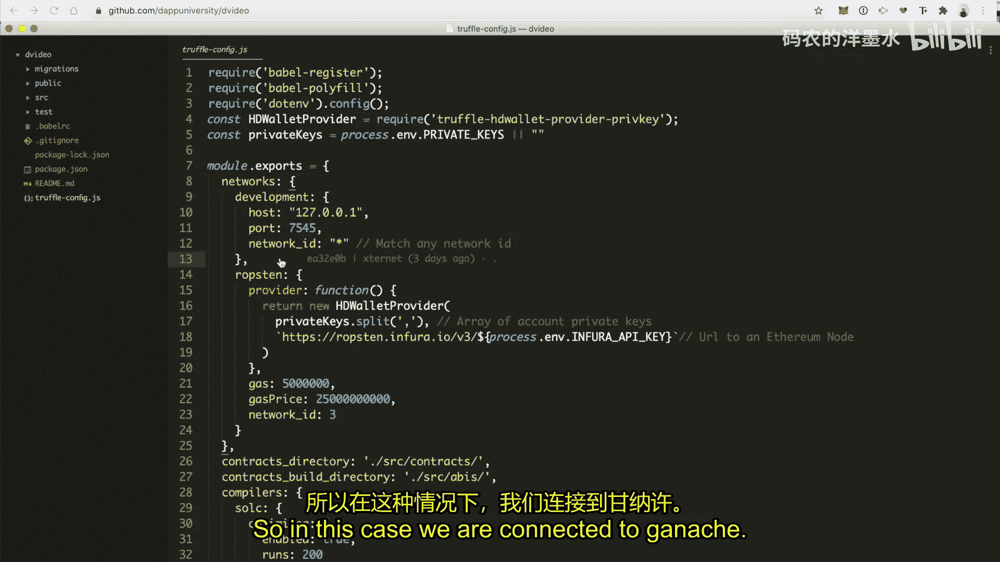

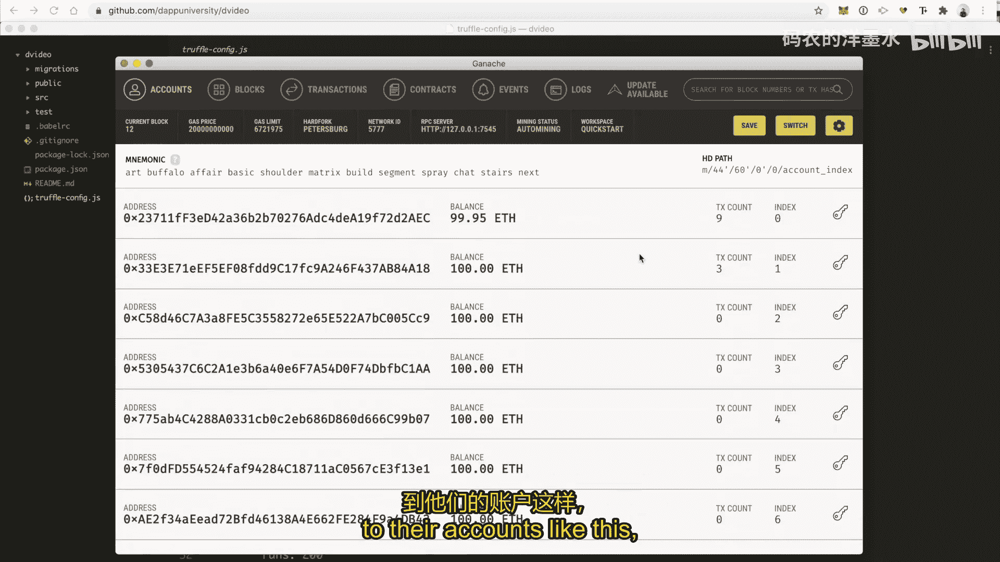

So what you can do is you know， configure your project to connect to any blockchain you want to here。

 I also have it connected to a test network， but for now we're just going to use the Gaache connection right here okay。

So next， we'll take a quick tour of the source directory。And the contract directory， all right？

So this is where we have the basic smart contract for the D video contract。

 this is going to be the contract that governs the application where we can basically upload videos and we can store them on IPFS okay。

 so in this case。Like I said， we've got some of the codes sketched out here already but we'll fill this in throughout the tutorial this is just to get us started really fast so we have to build everything out from scratch okay so if this is your first smart contract that you've ever created then what you're looking at is the solidity programming language so this is the main programming language for writing Ethereum smart contracts it looks a lot like a JavaScript。

So if you've written JavaScript before， then this should look familiar to you okay so here we just have the contract keyword for D video。

 that's the name of the smart contract and then we put all the code for the smart contract inside of these curly braces mean you' got the solidity programming language version at the top 0。

5。0。And then you can see some basics inside of here。So。At the very top， this is a variable， okay。

 we'll start with this one， this is a variable name， it's just the name of the smart contract。

It's a string， so we call it D video okay， and this state variable。

 the value is actually written to the blockchain， so it's stored forever。And of course。

 solidity is a statically type programming language， we have to say string here。

That's the type of variable and this data type can't change right， and we call it public。

whichhich means that we can access this value name outside of the smart contract and we'll do that inside the JavaScript console here in a second。

Just to show you how that works okay， and then of course we have some functions inside of here。

 but we' back we'll get back to that in a minute okay， let's just go ahead and set this up。😊。

Booot it up in the console so we can see that the project is actually connected to the blockchain that it works。

 okay？So now that we have this basic smart contract。

 we also need a migration file that puts the smart contract on the blockchain。

 and that's what you see over here。So if you go to the Mis directory。

 you'll see this initial migration， this comes by default and truffle projects。

But I've also created a migration to put the DVo smart contract in the blockchain。

 so we just say D video equals this right here。And then we deploy the D video contract to the blockchain like this okay。

 so let's go ahead and do that， go to our terminal and say truffle， migrate。

And this will put the existing Dvio smart contract on the blockchain All right so it looks like I had a little problem here I haven't installed the node packages yet so that really should have been the first step so we'll go ahead and install the node modules like this we'll saympm install and we'll wait for that to finish right so now that's finished and what we want to do is put on the blockchain but before I do that Ill make a quick note you might see some warnings here this is pretty verbose it's not ideal but that's just sort of the state of the libraries and dependencies this state in the game so don't worry about those as long as you see the success message here everything worked so we can clear that。

Now we say truffle migrate。All right this will put the smart contract in the blockchain。

I'll wait for this to finish。All right， so it's comping the contracts and then it's starting to migrations and then boom。

 there we go。So you can see here the initial migration happened and then the deployed contracts migration happened。

 you can see that here。And also these are numbered。

 so you know this tells truffle which orders run them in。

 so initial migrations is first deploy contracts is second all right and you can see that reflected here。

Okay。So let's go ahead and boot up the console like this a truffle console。

And this will give us access to a JavaScript runtime environment that we can talk to the blockchain with。

We can write commands and JavaScripts of this console and interact with the smart contracts。

 interact the blockchain， you do whatever。So we'll just check our smart contract like this。

 we'll say D video equals a weight D video。Got deployed I think that's the right names just see all right and you might see undefined here that's okay。

 that's just the the the console output that's not the actual return value。

 So we'll just say D video。And then boom， there you go。

 here's the JavaScript version of the smart contract。So we can access the name like this。

 so you'll see the smart contract name D video name， all right。

 so we'll say a name equals a weight D video。Or was our ID video。That name。Okay。

 it says undefined that's okay again that's just the console log value that's not the actual return value see name and then boom there we go do video。

 so that's how we talk to the smart contract。Inside the console so that's how you can access this public state variable here so again this is a variable value that's written to the blockchain with this smart contract and we can fetch the return value because it's public all right it's accessible outside the smart contract。

And it's a string and the name is Dvio which we can see that here so now before we continue coding out the smart contracts。

 let's revisit the diagram of how the application is going to work so you know like I said。

 we're going to use our front end you know our web browser to connect to an Ethereum wallet's going to be meta maskask in this case to talk to the blockchain all right。

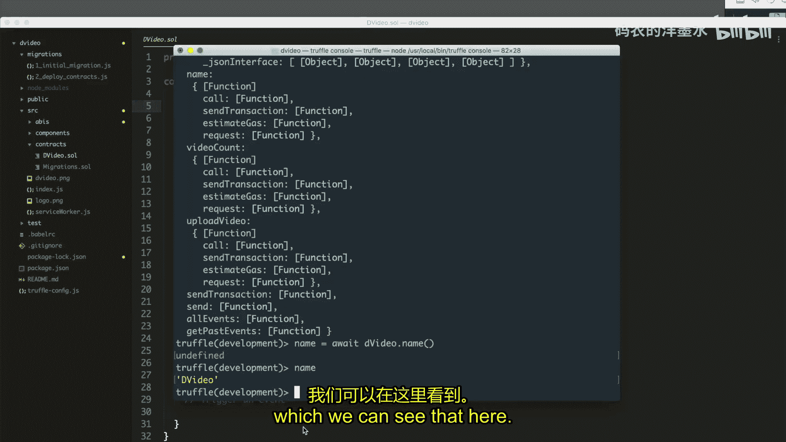

And that's where this smart contract is going to live that we're coding right And what this smart contract is going to do is going it's going to do a few different things。

 so it's going to。It's going to store videos。It's going to list videos。

And it's also going to let us upload videos。And maybe there's a better order of that。

 maybe it's you know， one is upload videos。So one would be upload videos。

 two store videos and three list all the videos okay。So basically。Whenever we upload the video。

 what's going to happen is we're going to upload it directly to IPFS okay。

 that's the interplanetary file system all right and how IPFS works is it gives us a hash okay。

 and then we're going to store this hash back on the smart contract whenever we upload the video okay。

And it's gonna store that hash on the blockchain okay and then we can access all the videos that we've created when we list the videos like this so let me show you a quick example of what that looks like so at the end of the day whenever you upload you know a video to IPFs you'll get a hash that looks like this All right so you see this big old hash right here that's basically the ID of the file on IPF okay and then you can access it from the IPF gateway like this IPF you to IO slash IPFS and then you give it the hash so here's an example video this is actually're running on the IPF network okay。

This is a test video that we'll upload later when we create the project。

 but essentially what we' want to do is kind of do this handoff where we upload that file to IPFS。

 It returns this hash right here， this will be the location of the video and we'll store the location of the video inside the smart contract that's when we store the videos right here then we can list all the videos that are saved from the on IPF with this smart contract as well so that's gonna be the entire responsibility So back to the code So basically we need three things we need to store the video with IPF hash。

 that's what this upload video function does。 we give it the video hash from IF we give it the video title。

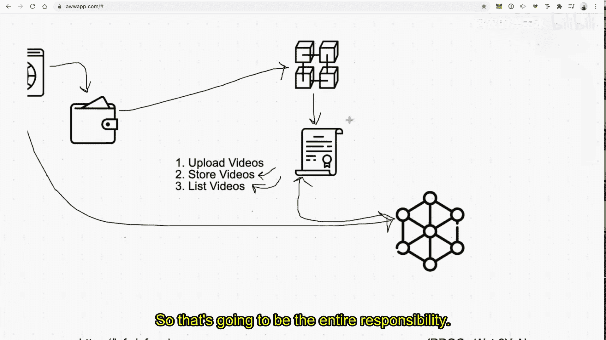

So that's going to be the function I that we'll create later。

 we need to actually save that video on the blockchain。

 so we'll create a way to do that inside of our smart contract and we also need a way to model the video。

So those steps will be one model the video。Okay， and then we'll say store the video。All right。

And then upload video。And then。For list video。Okay， list all videos。So let's start with number one。

 how we model the video。So we're going to do this inside solidity with something called astruct all right。

 so that's be this step right here， so we'll go ahead and model the video。Model the video。

So soliddity allows us to define our own custom data types withstructs so we can saystruct video like this all right。

 so this will be something we just make up out of nowhere。

 that's what Strs allows us to do we kind of video object。And inside of here we say a unentt ID。

 so this will be the unique identifier for the video inside of our smart contract。

 this is an unsign integer， this is just a number with no negative sign， that's what unsigned means。

All right， and then string will be the hash of the video， so'll be the location of IPFS， okay。

 that'll be this thing right here。

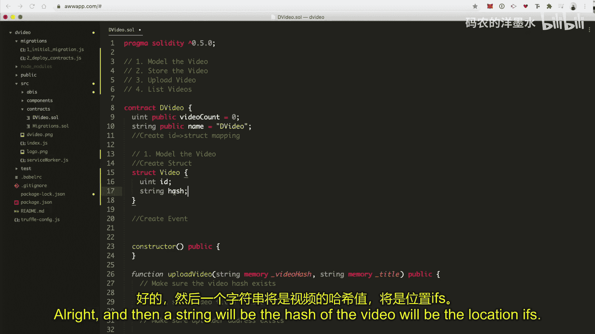

This hash， okay？

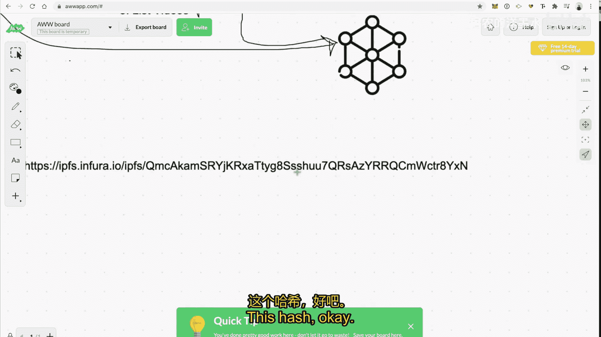

And then we'll have the title。This will be the title that we create just like YouTube has and then we'll say the address。

Of the author， this would be the person who uploads the videos， this would be the Ethereum address。

 the person， you know， their wallet address as they're connected to the blockchain。

s like their username on the blockchain。So we'll save that all right。

 so that's how we model the video， that's step number one， okay。

So because we've created a way to do this， we haven't actually stored any videos in the blockchain yet。

So let's go ahead and say that's done。So now you want to store the video and we're going to do this something called a mapping instead of solidity。

 so mapping is another data structure。That we're going to store here。

 we can create one just like this， so we'll say mapping。Youent。Video。Public videos okay。

 so a mapping inside of solidity is just a key value store it's kind of like how a database works。

 we can give it a key and a value。So in this case， the data type of the key is an unsign integer。

 so this is a number one，2，3，4，5，6，7，8，9， 1011，12 all the way up until you know early big number and then the。

Reter value is going to be this videostruct that we just created here okay。

 and we'll call this public videos okay， so basically that that crosses off this responsibility so store the video that's what we do here whenever we put a video inside this mapping with an ID and it's going to write it to the blockchain that'll store it okay。

And then that's also going to give us the ability to list the videos because this。Mapping is public。

 so it's going to give us a function。Called videos that we can call。

 pass in the ID and fetch out each individual video okay。So you can see that here。

Just like we have this video name， all right， it returns a the name D D video we can call。

Videos pass in an ID and get back a videostruct， just like we got back this D video string。

 we can get back a video with all the data like the ID， the hash， the title and the author okay。

So that crosses off both of those responsibilities， and then now we want to upload the video okay。

And that's what this function is going to do right here so this is just a function inside of Soity with the function keyword called upload video。

 we just create this name， it takes two arguments a string all right the video hash that's going to be this hash here from IPFS all right and then an arbitrary title。

That we create whenever we upload the video， all right so。Whenever we do that。

 we'll just add a new video to the mapping like this okay。

 so we'll create a new video like this and we'll put it inside this video as mapping。

 so I'll show you how that works。So we'll say， let me bump up with the font a little bit here so you can see。

So I add a video of the contract like this， say videos。

And then we'll use these brackets and we'll say。You know， we'll call it the ID。

 let's just say Uent ID equals one， we'll just hard code this for now and you'll see how this works in a minute。

 so ID。Basically， we're going to store the video based on the ID inside the mapping like this。Videos。

 video ID equals。Video， and then we'll pass in the ID。The video hash。UhThe title。And then the author。

 which in this case is either to be MSsg。snder。So I'll explain on that here in a second。

 but this is how we store a video under the blockchain， so what do we do here？Well， first of all。

 we created a new videostruct， so this right here a video。

It's how we do it whenever we cut a new one we just call thestruct name。

 you know capitals like this and we use these parentheses all right then we pass in all the arguments needed to create a new struct。

 so we defined those here an ID which is an unsign integer， a string of the hash。

 string of the title， and the address of the author。So here's the ID。

 which we've just hard coded for now， we'll change this in a second， the video hash。

 which comes from here， the title， which comes from here， all right， and then this thing called MSg。

sender。Wwhich is the address of the person calling the function so let me explain how that works so basically solidity has a global variable inside of the smart contract called MSG or message and that has a lot of different attributes so one of them is the person calling the function so message sender that's the address Ethereum address of the person who is uploading the video in this case okay。

So we created a。Videostruct and then we save it and the videos mapping here like this。

 we just say videos passing the ID， and then it's going to be equal to this new video okay。

So now let's actually update this to have a real ID。

So we're going to use a counter cache for this all right。

 and that's what this is here so this video count at the top。

This is a just a a variable that stores the number of videos that have ever been created all right。

 so whenever we create the smart contract， it'll be zero。

But we can change this value inside the function like this。

 basically we'll just say videos count or video count。Inend the functions is called。

 we could say you know， equals。Video count plus one。All， we can do that。

And then pass in video count here。All right。So that's how we create the ID。

 so basically every time we just take the existing video count。

 we add one to it and we use that as the ID here okay。But there's a shortcut。

Inside Soity where we can just say video count。Plus plus， all right。

 and that's a shortcut for just adding one to the existing video count。

 just increments it by one okay。So we'll say video account is this， all right， pass it in， boom。

 done， all right。And then that's what uses video account for， it keeps track of all the videos。

 it's basically our ID management system， and then we save it inside the videos mapping which acts like our database like this and we create a new video with all the required arguments。

All right， and so really that's the basic functionality。Of the entire smart Con。

 we could just leave it like this and it would work。

 but we want to add some additional features to this to make it more robust， okay。

So the first thing we want to do is create an event that allows us to know when the video was uploaded。

So we can create events since that's validity like this。 Alright。

 we can just do this alright and use the keyword event and say video uploaded and we pass in the same arguments as the。

Strt， so we just say the ID， the hash， title and the author。

And this is going to allow us to subscribe to this event whenever it's triggered from our application。

 okay？So we can trigger the upload event just like this at the bottom。Basically， let's do this boom。

We use the emitmit keyword and just say video uploaded， all right it's the same name as the event。

 and we just pass in the arguments， the video count， the video hash， the title。

 and then message sender， right。So next what we want to do is add some requirements to the function to make sure that it's more robust。

So。Right now， someone could call this function。And。With an empty video hash or maybe like， yeah。

 and that would not be good。We want to make sure that it's present that it exists。

So we can do something。If you like that like this， we can use Soityities require function require。

And what this function does is it checks that a set of parameters are true before the rest of this function executes。

 so you can basically say like required true。And if I just left this here。

 then this would be fine and the function would always execute， okay， but if I said to require false。

 then none of this code down here would ever run， it would just throw an exception。

 it would blow up and this wouldn't work okay。So we can basically pass expressions inside of here that evaluate a true or false。

 and if the expressions evaluate a true， then the function will continue running and if they evaluate to false。

 then it'll halt execution， it'll blow up all that kind of stuff。

This is basically a way of just adding a set of criteria that must be met in order for the function call to occur。

So we're going to add some of those criteria here and the first one is to make sure that the video hash exists so this video hash so we can do is take the video hash。

AndCon it to a bytes， say bys。And then I just say at length。Is greater than zero， okay？All right。

 so basically what that does is it ensures that this string has a length that's greater than zero。

 all right？That effectively means that the video hash exists。We can do the same thing for the title。

 all right， make sure that the title exists， so I'll take this title and do the exact same thing like this。

All right， and then we will。Also make sure that the uploader's address is not from an empty address like this。

 so boom message sender this bank equal the empty address okay。

So that is the complete smart contract code。So it's pretty simple， it models the video。

 it stores the video， stores the IPF hash of the video。

 we you can upload the videos with that new function。And then we can list the videos， okay？Soum。

At this point。What we' want to do is show you the tests okay。

 so I'm a little short on time today so I don't have time to code out all of the tests for this smart contract step by step。

 but I'll just leave them in the code solutions that you can see how they work。

 you can read through them and you can check out any of the other videos that I've done on my channel that show you how to code the tests step by step or if you want to learn testing in depth of course you can do that inside the blockchain boot camp。

And so if you go to the test folder here， you'll see all the requirements for the video。

 the D video contract so this is a。Tasks written in Mocha and Chai， which are bundled with the。

Trffle framework and they're just tests written in JavaScript that you know， check that the。

DVo contract works the way we think it does， so you can see the tests here。

 so say to describe deployment and we just make sure that the deployment happens and that it has a name just like this is basically everything we did in the console。

then next we check the behavior of the video contract。

 so this is where we basically say that it creates a video， we test the upload video function okay。

 so we upload the video with the hash， you can see a test IPFS hash here all right so video title from the author。

All right， and then we also say that it lists videos and this shows us how we you know dig into that contract。

 we call the videos function we pass in the ID and we check all the arguments of the hash that's sorry。

 the struct that's returned okay。So I'm going to save this， I'll show you how to run the tests。

 so we'll exit this。And was it trouble tests？And hopefully it'll pass as long as we didn't make any coding errors when we created the contract so let's see all right boom there we go so they all work。

 it deploy successfully has a name， it creates videos and lists videos So at this point you know if you want to go back and look through those tests。

 code them out from scratch， you can do that yourself。

But what I'm going to do now is go ahead and put this smart contract on the blockchain so that we can create the client side website。

So I'm going to say truffle， migrate， let use the reset flag， dash dash reset。

And so what this does is it puts a new copy of the smart contract in the blockchain so remember smart contract code is immutable。

 it can't change and so if you want to update the smart contract code。

 the only thing we can do is deploy a new copy of it all right and that's exactly what the reset flag does whenever we run truffle migrate with the reset like that okay。

So boom there we go we've got a new copy of the smart contract on the blockchain yeah awesome so we're we're good to go so now we want to do is switch over to building out the client side portion of this application Now let's start coding out the client side portion of the application all right。

So first thing we want to do is go and open up a new terminal tab here and we want to start the web development server。

 sorry， so let's go ahead and do that like this， say MPm run a start。

And that's going to boot up the react application that we have instead of our project。

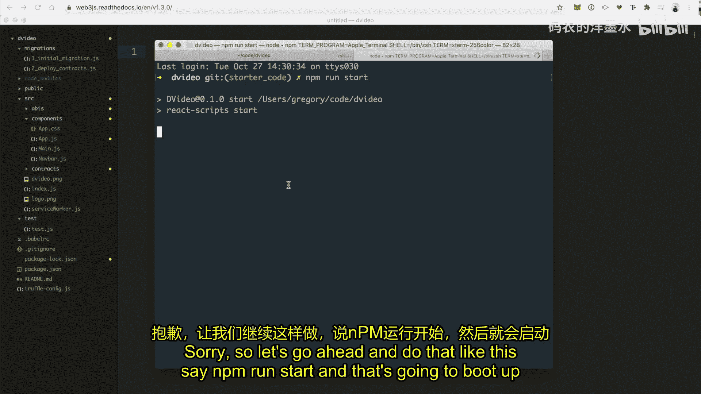

All right， so if you go here， let's see， sorry， this is my old copy， you should see a new。

New browser window pop up for you， you won't see this just yet because that's my old version。

Wt for this to refresh。Oh， waiting， waiting， waiting。Yeah。Sometimes this takes a second。

 we can go see what's going on here inside the terminal， you can see this waiting message。All right。

 cool awesome， see yeah this is exactly what you should see this is the cleared out starter template so you can see D video up here' the name of our project。

 see the blank Ethereum address here and then an empty canvas。

And this is the empty canvas that we'll use to create the project So if you go back to the text editor。

 you can see the source code for all this go to the source directory and then find the components directory and you can see this app。

js file okay so this is the main file for the application this is a react component so let me go and explain that if you're not familiar to react as a JavaScriptscript library for building user interfaces okay so basically it allows us to code websites with JavaScriptscript。

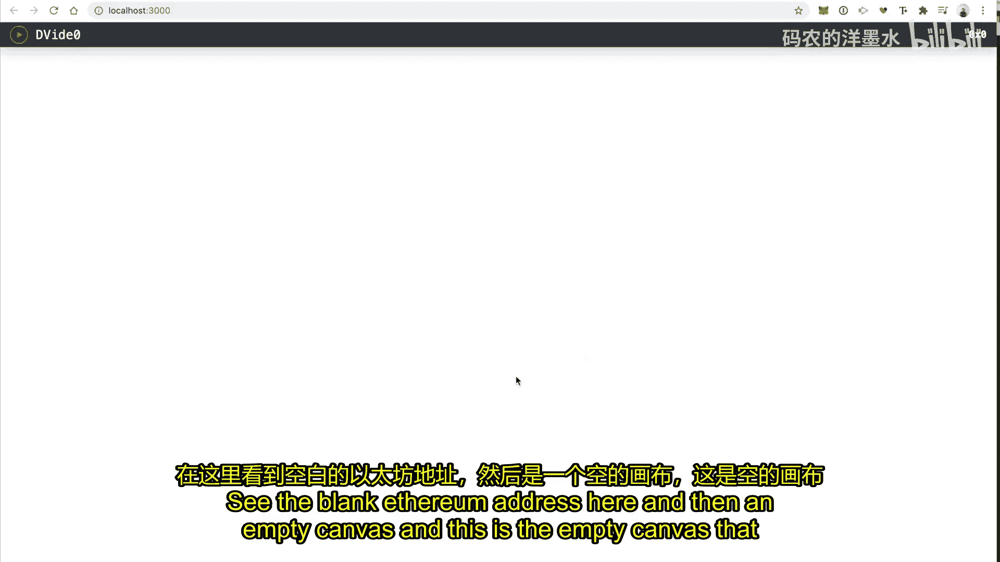

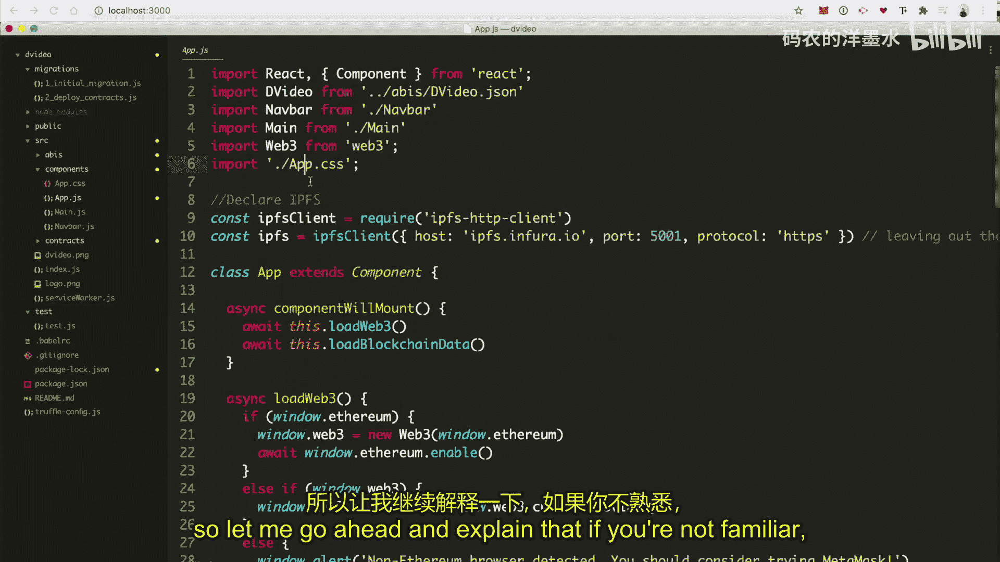

With something called RA components， they're basically just a way of organizing our code like this。

 basically you have these classes and you give it a component name and it allows us to write JavaScript and HTML code all in one place。

 all right。And so we can create components， we can organize our code this way， we can reuse them。

 and then it also gives us something called the state object and that allows us to。

Basically store data inside of our client side application。

So an example of react state is this to do list here so you can see a to do list like what needs to be done。

 you can say item1。then add item one and the item two。Okay。

 so how does React know what items are on this to do list， well， that's what the state object is for。

So you can see it here， basically the state is equal to this and it keeps track of items inside of an array right here okay。

And so that's exactly the two main benefits we're going to get from react， the components。

 which will allow us to write our code with JavaScript and HTML and then the state object that will create a front end database where we can put all the blockchain based data inside of the JavaScript front end app okay？

So don't worry if you're not a react expert， you can pretty much catch on just by following along tutorial。

 but if you're an experienced developer and you want to check out React。

 then highly recommend it because it's used pretty heavily in the blockchain space。

 particularly with Ethereum。

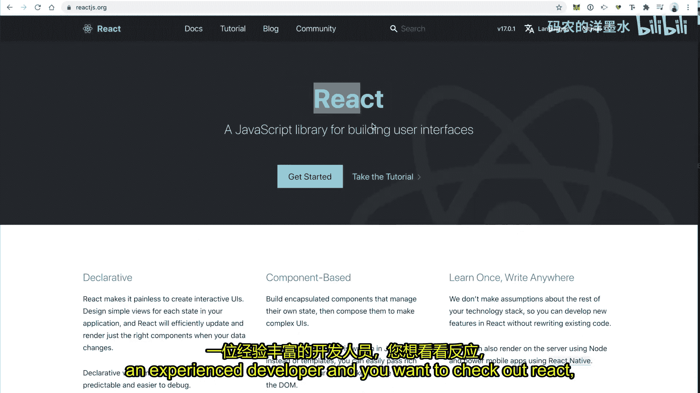

Soum。If you open up this At JS file， it's got you know， some basic。

Code already laid out for us so we can get sorted fast。Because again。

 I'm moving a little faster today than I normally am and we're going to fill in all this code to wire up the application。

 but I'll call out the important parts as we go along here。Um， so， you know， we can see that u。

 this render function here is what lays out all the code on the page。And it's got several main parts。

 you can see this nav bar here， all that's a component here。The nav bar， okay。

 and if you go to the page， then you can see the let's see here so find it。

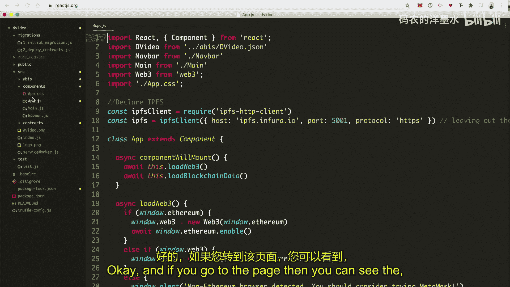

The puter here， the nav bar here。 So D video and the theorem address all right， go the nav bar。

 you can see the D video al right， and then the。

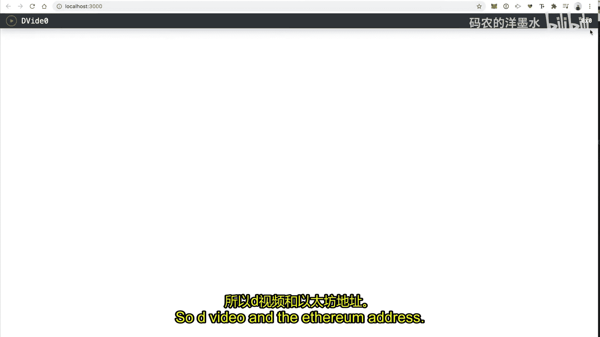

Theem address here， okay？

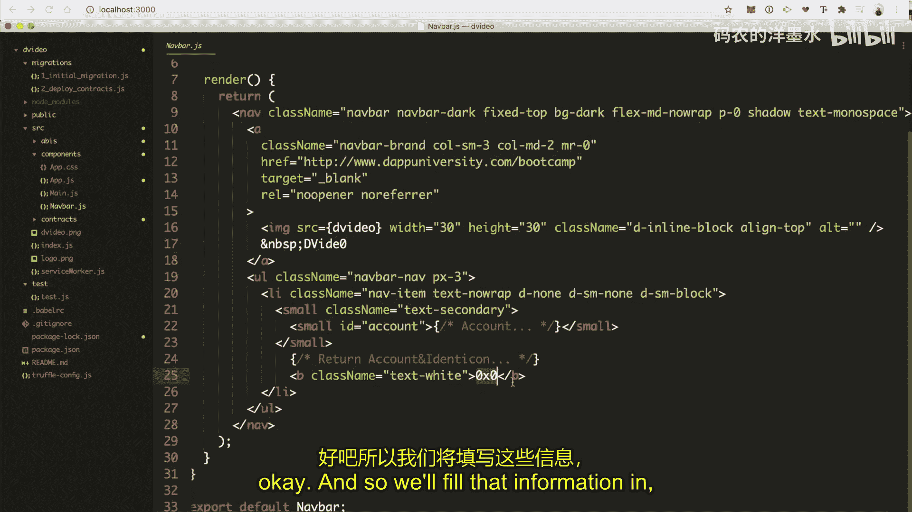

And so we'll fill that information in all right then。

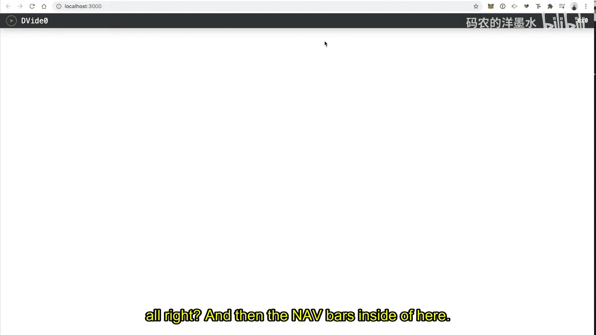

Thent have bars inside of here。Here's where the navbar rendered on the page and then the navbar is imported to the top just like this。

So yeah， you can see that then the content on the page is here， so main， right？

And then mainine is where we have all the code for a video like this。All right。

 so let's go ahead and the first thing we want to do is connect the application to the blockchain。

 so let me explain。

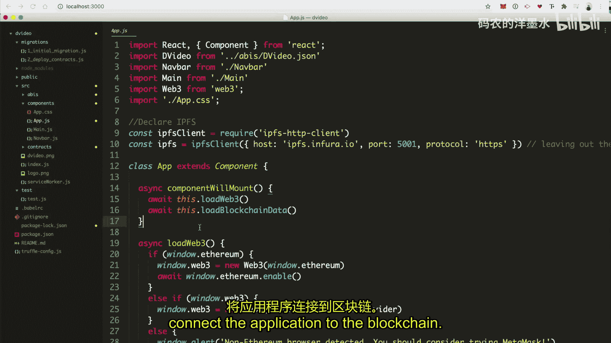

The out of the box， there are a few different things we need to do but out of the box basically like your web browser does not connect to the blockchain natively so that's what metataask is for。

 You can use metaask to connect to the blockchains。 The first you want to do is open metatamask and。

Select the Gache network， okay， so you can go to custom RC paste in the RC URL。

 so go to Gache and then you know copy this， let's find it。Allright， and then。Say。RRPC URL， okay。

 so this already exists for me， you could call Gash if you want to。I've already done this。

 so it's telling me it already exists， but you can just click save and once you do。

 you'll see you know Gaash listed here in your networks click anash。

And that's going to allow your web browser to connect to the blockchain so what you want to do also is import your account because you need a username on the blockchain that's basically what the account is so you do that with your private key so the private key is kind of like your password if the username is like your address so I'm just gonna show the private key here normally you wouldn't do this because private keys is sensitive data so you know never do this for real。

And highly recommend you never use this account in real life because everyone who watched this video has seen it so you can just copy it like this All right。

 click done。Go to Metamask and import the account so we' just say import account private key paste it in click import。

 So I've already done it。 it's gonna to tell me it's a duplicate。 but when you do it。

 you'll see your account listed here。 you can give it a name if you want to I have or you can just leave it as the you know the name that Metaask gives you So now we've caned that our web browser to the blockchain with Memask The next thing we need to do is connect our application to the blockchain and that's exactly what Web3 Js is going to do So Web3js is an Ethereum library for talking to Ethereum。

 know that's the blockchain that we're going to use in this tutorial and you know web3 is can just be imported into our project really simply and easily and we can connect it to the blockchain and just a few lines of code So let me show you that inside the application。

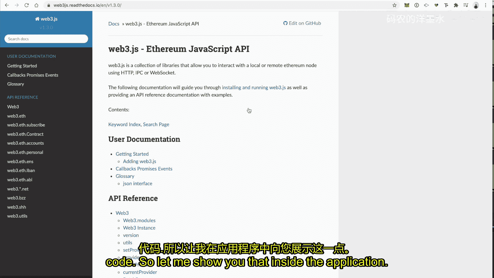

That's what we've done here so we say import web3 from web 3 all right and then now we can use this web3 import to instantiate a connection to the blockchain that's what we do here So one of the reasons I have this hard coded already into the starter code。

Is that these are the exact instructions that Meask gives us to connect our application to the blockchain。

 so I don't personally even write this code myself whenever I create decentralized applications I basically just copy and paste this every single time so that's why it's already done for you here you don't even have to understand how this works completely just know that it basically takes the Ethereum provider from MetaMask and injects it into your application。

AndSo we call this function here inside this component wheel mount。

 this is just a lifecycl calledback inside of react， so we say low web3。

And the next thing we want to do is load the blockchain data。

 and that's exactly what we do inside of here。 So a lot of the heavy lifting for you is done。

 I want to get to the important part since I'm a little short on time today。

 which is this function here。 This is what actually。

Takes all the information in from the blockchain and puts it into application this is the really important part Okay。

 everything else is kind of you know rinse and repeat。And we'll get all that as we go along。

So let's just。Let's go ahead and fetch our account at a meta maskask and show it on the page so that we can see that。

The application is working properly and that we've actually connected to the blockchain so we'll do that like this basically we'll say we'll use web3s get accounts function so you can see that into the web3 documentation here。

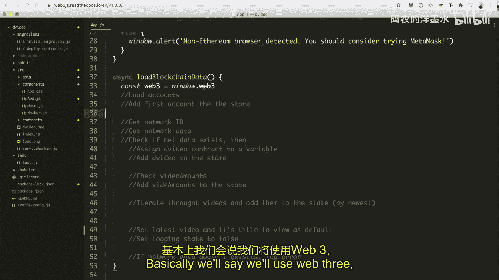

Seeing say Web 3 Eth。And we'll say I get accounts。So this is exactly how you do it。So Web3 has。

e you to Web3。eth and then get accounts all right， and that'll show you all the accounts from your wallet。

 which will be metaask in this case， okay。

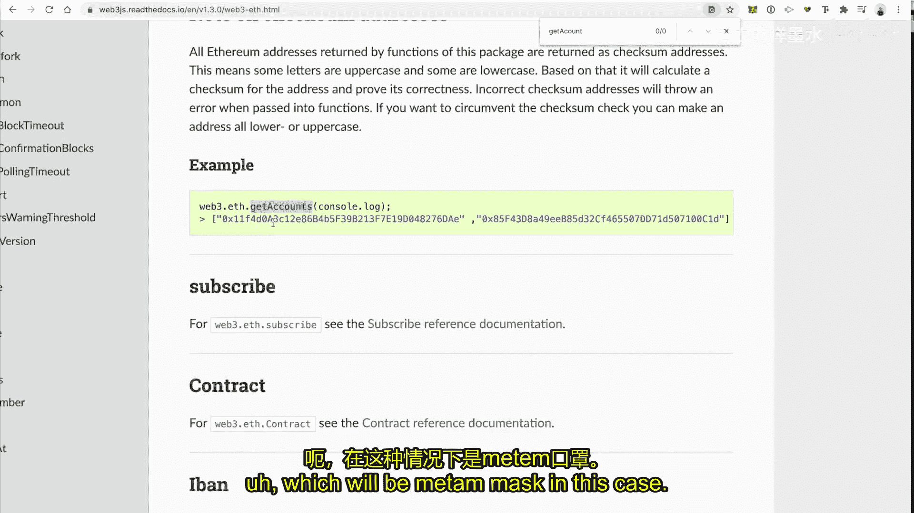

So。I'm going to do that inside this function right here， will load accounts。

So we'll say cant accounts。Equals a weight， web3 to E。Dot get accounts。All right。

 so we'll save that and then we'll console that log。Accounts。All right。

 so we'll save that we'll go to the terminal。😊。

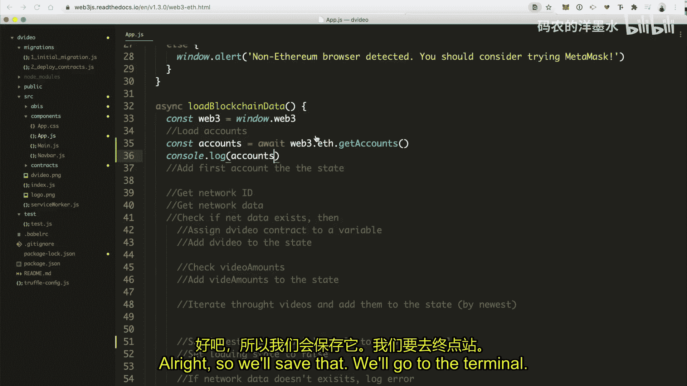

And then we'll open up the console here。I adjectted that you could do inspect element if you want to inspect and then go to console and you can see that information here。

So here you go， you can see this array is logged here and we'll open that up and then boom there you go there's our address from Metamask so that's the exact same address that we see here you know to AEC and then to AEC awesome so we have connected our application to the blockchain we've connected metataask to the application as well so the web browsers talking to the blockchain and the application is also talking to the blockchains that's a huge that's huge progress okay boom。

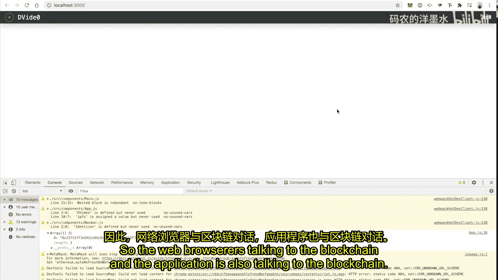

So now we want to do is actually save this account and store it on the page， okay。

 we want to basically populate this address right here。

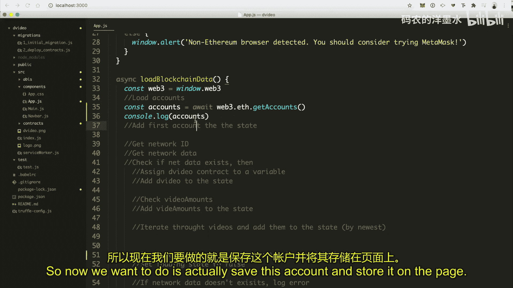

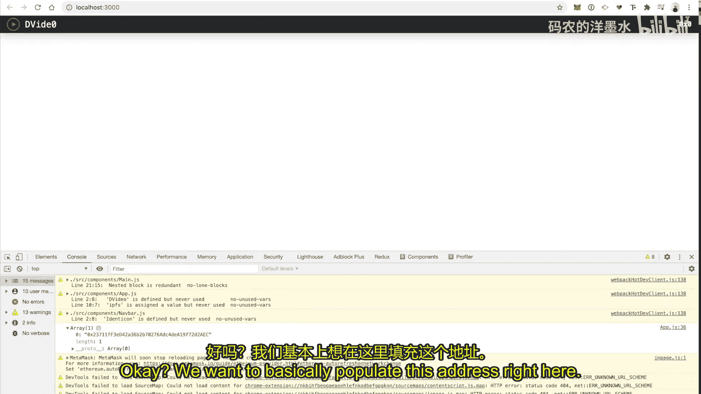

With the account。We'll do it like this， we'll use the react state object that I showed you earlier。

 basically we'。

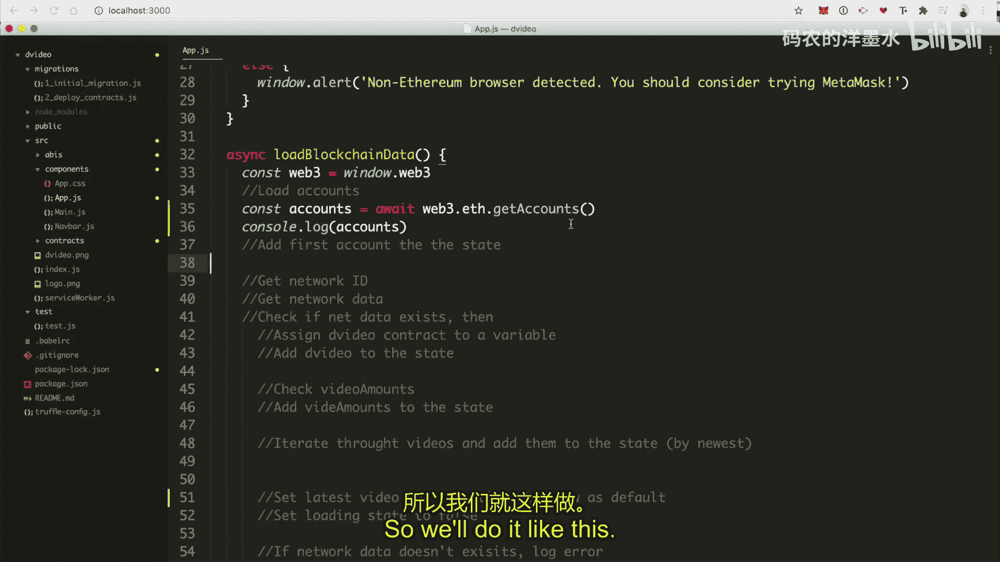

Use this， this state object that we add the to do items with。

 but we'll store a lot of other data like the account， the smart contracts。

 all of the videos for the application we'll store it inside this state object a lot like this zoo list。

 So let's go ahead and load up the。

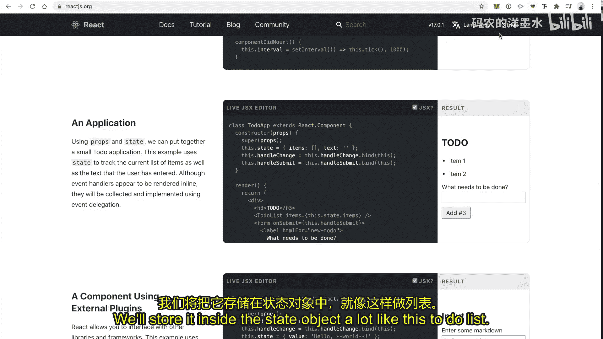

Account like this will say this set state。This is how we add new accounts to the。

Stay object inside of Re， say account。And we'll say accounts。We'll pass in zero。

 so it count as an array here。I mean， it's a zero based index array。

 which basically means you start off with0， one， two， three， et cetera， ettera。

 instead of starting from one so we can get the first item out of the accounts array by saying accounts and then passing in zero here then。

We're going to store that inside the state object， so let' let's look at the state here。

We can basically set the default account like this。And say account goes， you know0 x0。

 but we're going to update this to be our actual account。 Okay， so here's the。

Constructor just like the react example， and then that's inside of our project。

 and we're setting the default state， this case may be 0 x0。

 but this will change to our metaask account whenever we do set state account here。All right。

 and so we could even prove that and say， you know。呃。Well， we'll prove it here in a second， okay。

 so save it， just refresh the page， make sure everything's working， it's not broken， all right。

 nothing's changed， that's okay。

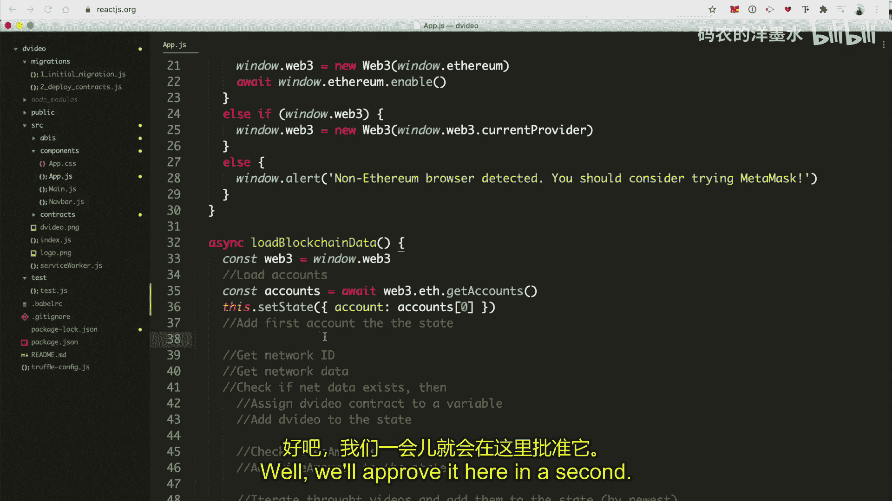

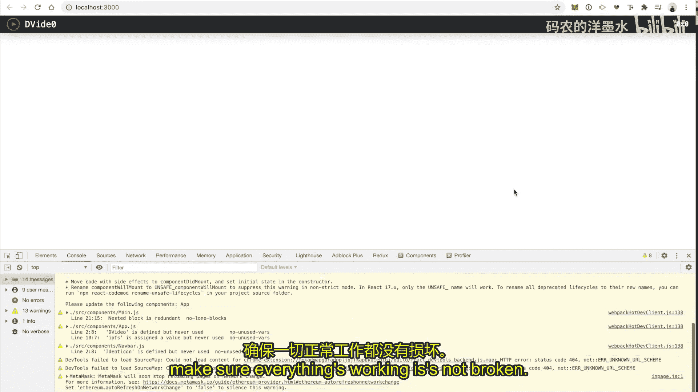

So now I'm going to do is pass this。Value down to the nav bar so you can see this app I Js component is the main component for the the application。

 but we have this navbar component that's actually going to render out the account here so we can just pass it down pretty simply like this we just say。

Account。Equals。😔，Thisstate do account， right？So we set items to the state like this。

 this set state account， and then we fetch it back out of the state like this。

 so this state account all right。And then inside the navbar file。

 we go inside of here and we add the account here so we say this dot propps do account Okay。

 so it's different。 we did this state dot account here。

 but what that does is it passes it to the navbar's props or properties Okay so this dot prop do account is going to be the。

The value that's accessible inside of the navbar， so account has properties。

 account is sorry NavbarR has properties， account is one of them。

 and inside up here we just do this dot props dot account， which is inside of here okay。

Oops all right there we go boom So now we can go back to the page here and then click boom and then there we go we can see it Now it's not totally correct because we still need see this is 0 x0 off in the corner let's change that go back to the nav bar and then。

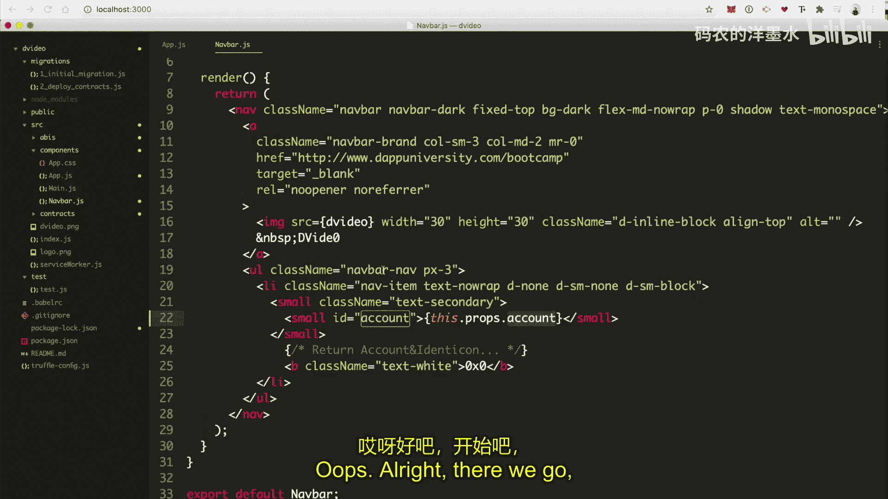

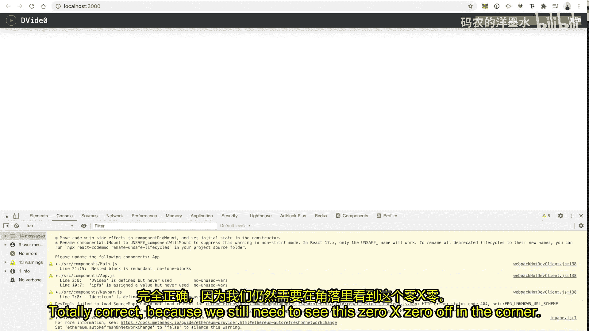

Do this， alright。All right， like this。Let me just make sure that's right。All right， yeah， awesome。

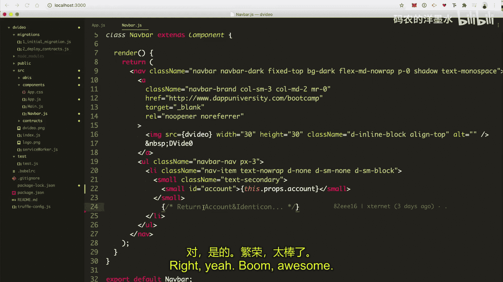

All right， so now now that's working all right so we're able to fetch the account from metasask put on the page the next thing we're going to do is actually add an iddenton so that's the fancy user avatar and we'll do that like this we'll use the Identon library。

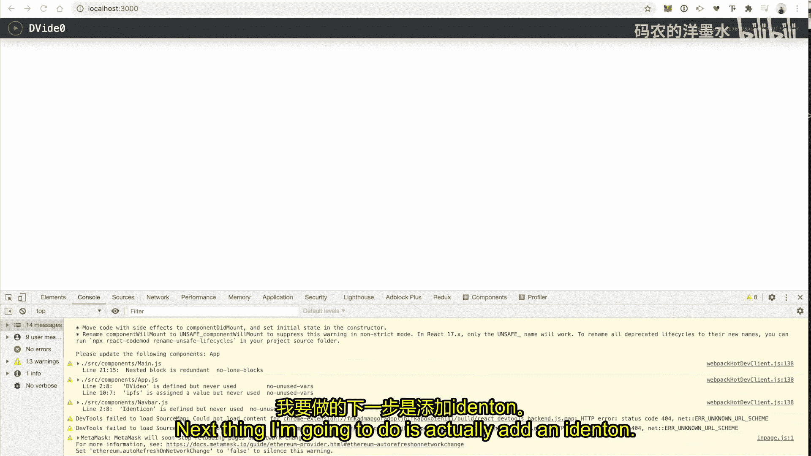

I'm just gonna to paste in this code from the final code solution like this Okay。

 so basically if the prop if the account prop exists， then we're going to add this image Okay。

 so this is the Ienton image， this comes to the Ienton library。

 which you can see in the package Json file here so package Json this identon library Okay and it's going to automatically generate a fancy user icon for this。

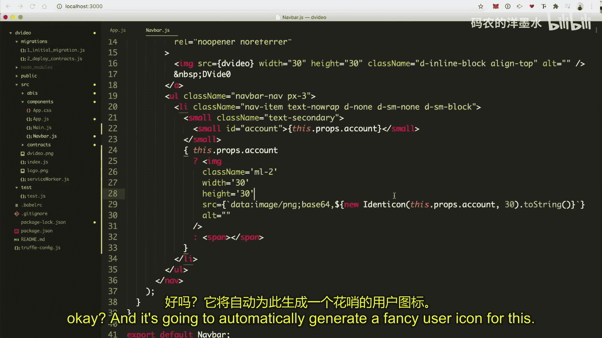

For this application。All right， so we got a little bit of an issue here， let's just fix this。

We go back in here。

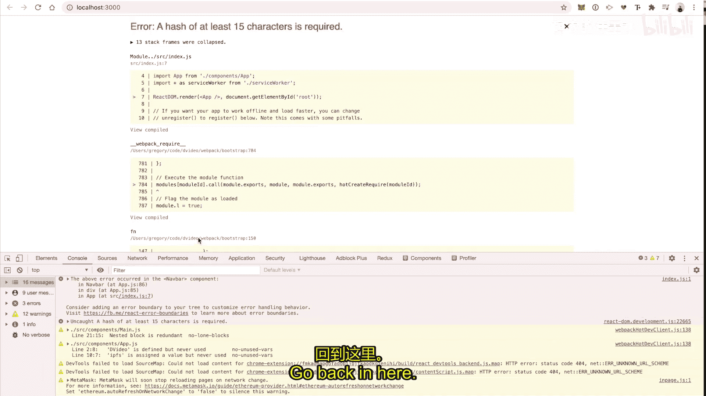

And then let's just do this。 All right， save it。

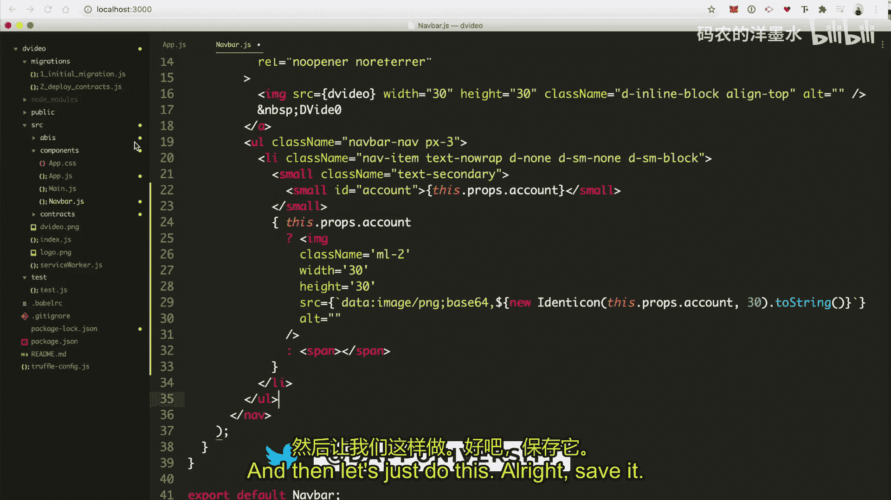

All right， so let me just figure out what's going on here， All right， so I just fixed it。

 so it's working now。So let me show you what I did so you can do the same thing。

 so go back to your code。

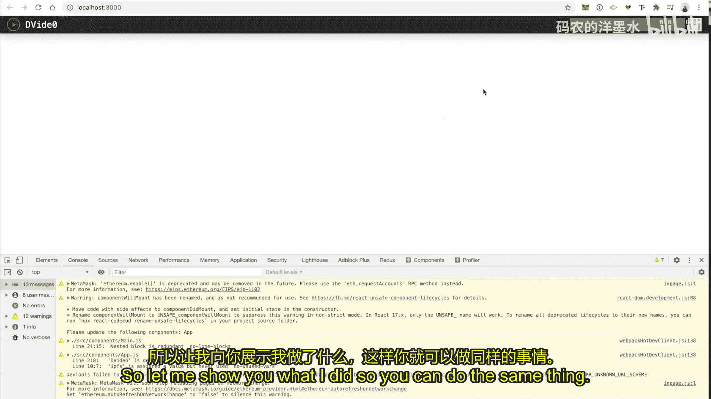

And in the default state， set your account to an empty string。

 so don't use 0 x0 because that will cause the Ienton library to blow up as far as my fault。

 so just set it to empty string and go back here and yeah boom there you go。

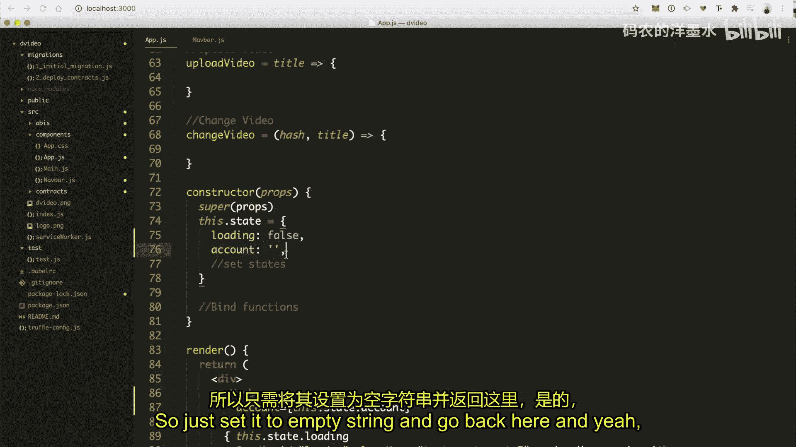

So you can see the automatic user generated avatar here， yeah， it's pretty nice。

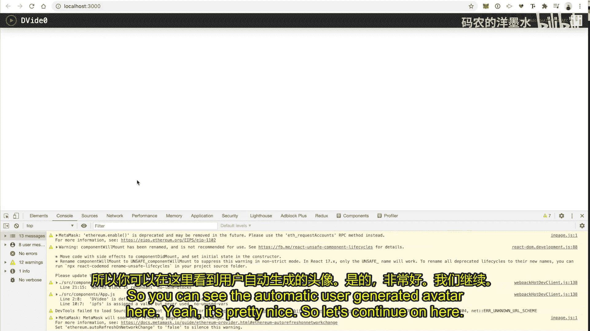

So let's continue on here。Now that you connected our application to the blockchain let's do a lot more so next we want to do is actually fetch the smart contract the DV contract and put it in this application so you can see。

We've imported the DV ABI file up here at the top， really this is a truffle artifact so you can see this here。

Source contracts。Actually， it's source ABI is my fault， is D video file。

 it's got all the information that we need in order to create a JavaScript version of this smart contract。

 so let me show you how that works。

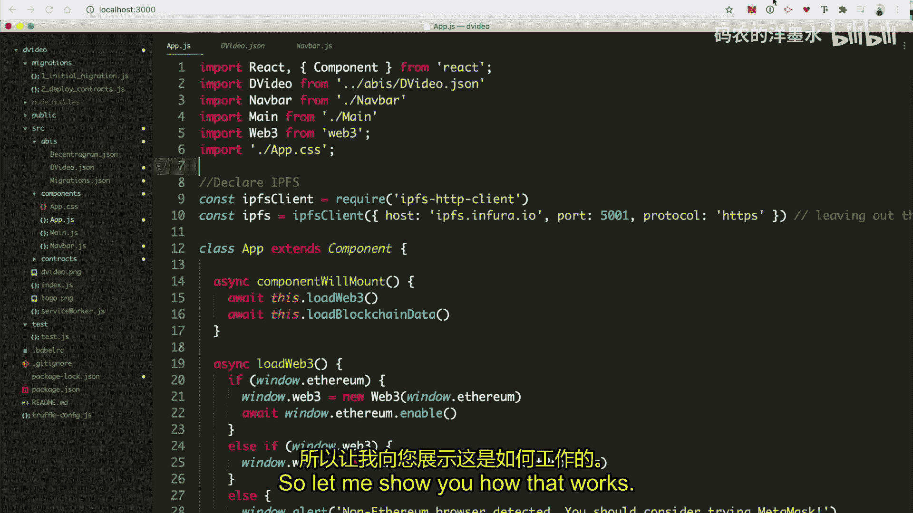

So inside web three， let's go back here。Web 3 Eth contract web3 is going allow us to create a JavaScript version of the contract so we can call the functions on it and pull the data in the application and upload videos so we can see。

That we create a new Web3 contract like this， we say new Web3 E contract。

 and then we pass on pass in two pieces of information， the AB。

 which is the JSON interface and then the address So the AB is just a JSson description of how the smart contract works。

 all the functions and then the address is just the location of the smart contract on the blockchain right's like whenever we deployed it。

We got back an address which you can see here or sorry。

 you can see here and you can also see the address like this except truffle networks。

And it'll list the addresses here， okay？So boom， there you go。I'm going to clear that out。And then。

 now'll see her。

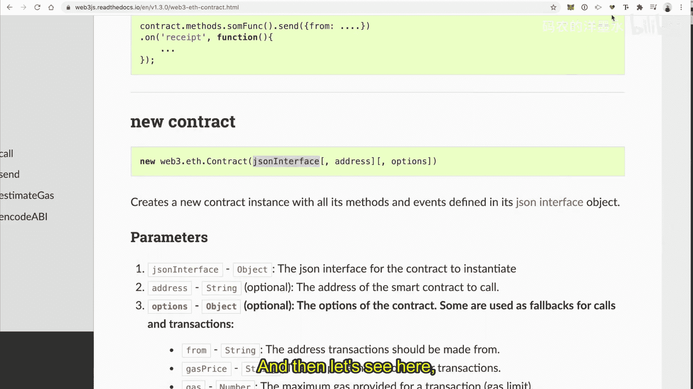

Go back to the code and let's go ahead and use that。So just copy this from web 3 like this。

And we can do it here okay。I' do like this。Basically， we'll want to do this part。

So we will do this here okay。But we need all this information。

 so let's get the JSON interface first so we do that from this file， so this D video file has the AI。

 so that's the AI here so basically we can just say。Oh'll see here。Got D video at the top。

 so we can say D video， just copy this。For the A， we can just replace this and say Dvideo。ab。

 and then now we want the address。Okay， so D video， we don't， we can't。

 but we can't just say D video address here because the address changes depending on which network you're connected to。

So if you look at networks。You can see the different networks that are deployed here， okay？

So you can see like 57 77 is the network that we're connected to with Kaache， you can see that here。

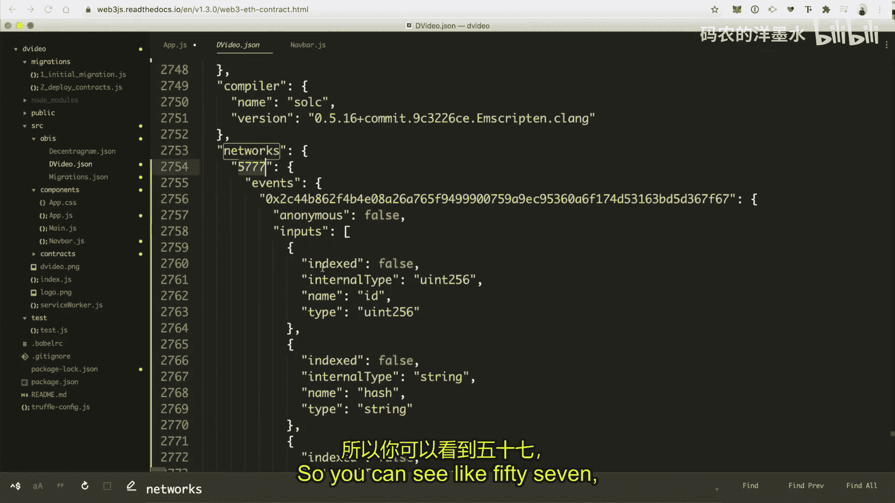

Allright，57，77。

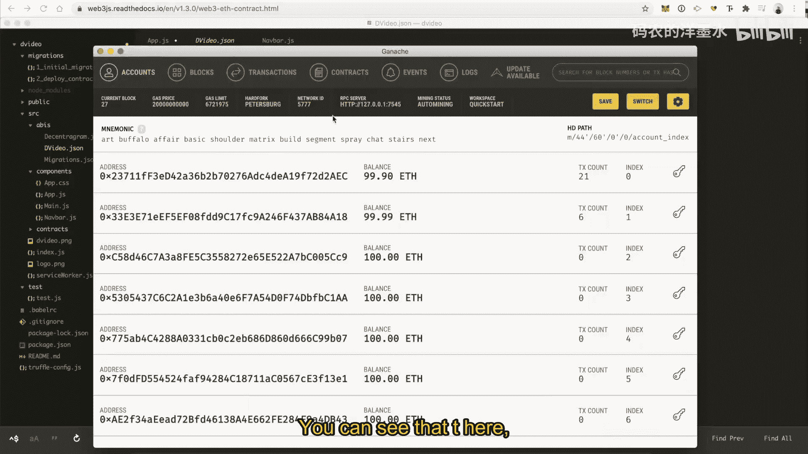

And this has the location of the address right here， boom。

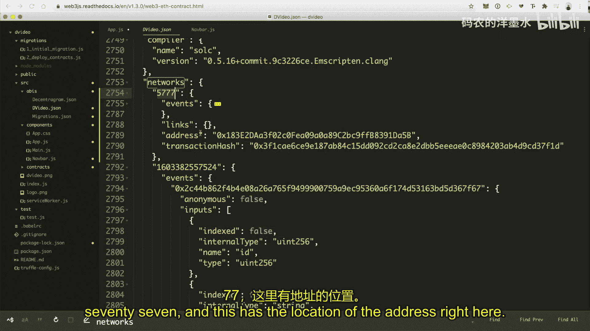

So basically what we have to do is say like。

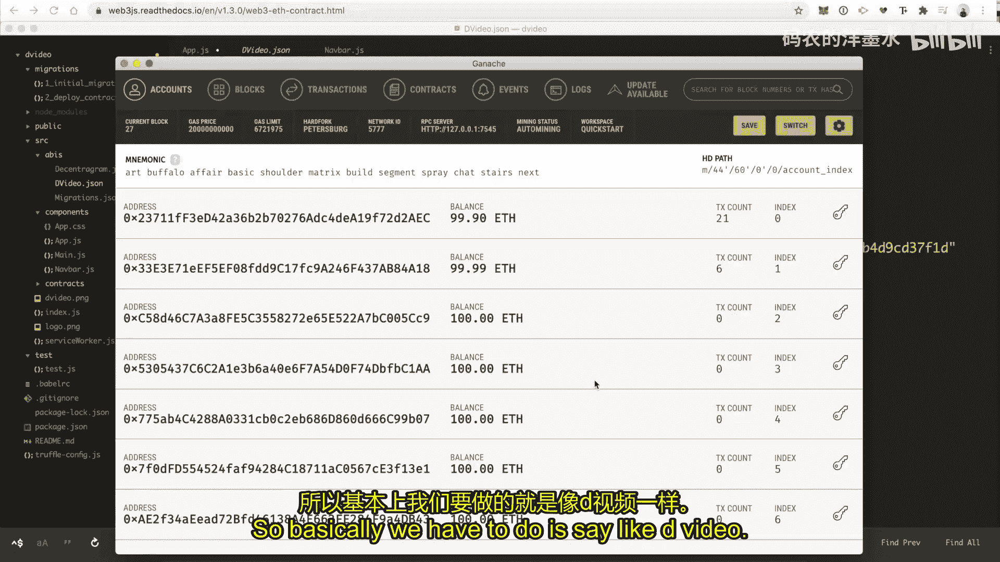

D video。And then passing the net like this， sorry， divvio。networks。

And then pass in the network address， which is like， 57， 77。The address， okay？

And that would create a copy of the smart contract that we can call the functions on。

 but the problem is we want this to be able to change and be dynamic whenever we change addresses and meta maskask so we need to actually fetch the network back from。

Web 3 like this so we can say u。

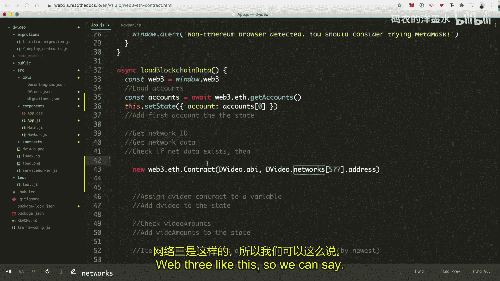

Let me show you。So Web 3， E。😔，Dnets。Oh， see。Get IDd。Sere Anneette。Let's try this on。For some reason。

 I don't see the。See your get ID I don't see it in the documentation for some reason that's okay I'm probably just in the wrong place what we can do is basically say this we can get the network ID like this and say cons network ID equals a await web 3 Eth。

net get ID all right and that'll give us the current network that we're connected to and then we can pass it into networks here to get back the address required for the smart contract so we can say network ID and then boom and that will give us a copy of the smart contract。

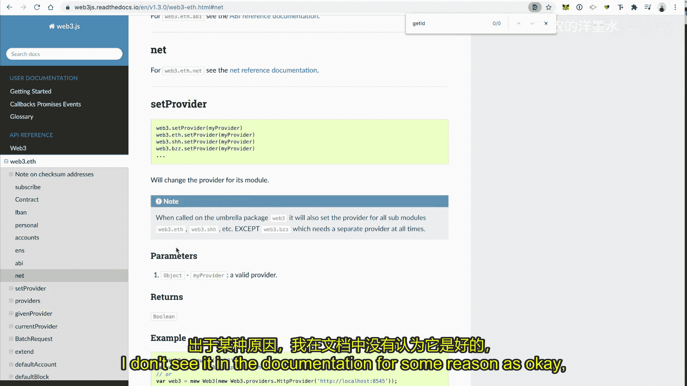

So the next thing that we want to do is only do this if the network ID exists， okay。

So we'll say get the network ID all right and then。Beest always say。Cons network data。

This is the network specific data inside of here， so oops sorry。So networks。

 all this specific data in here。唔该。Basically， we'll store that to a variable like this。D video。

Networks。Oops， sorry right。And then pass in network ID。Okay。And then。

That's going to be the network data。And then we'll say basically， if network data。Okay。

 then we'll pass in， then we'll do this whole thing。Okay， but then we'll just say。

 we'll do like this and we'll sign it to a variable，'ll say， oops， sorry。Soy boom。

 so cons DVo equals Web3 Eth contract， D video A and then network data address。

 okay so that breaks that up so it's better code。And it'll only run if the network gig data exists okay。

 and if it doesn't， all right， it doesn't。Then basically we just want to say， you know， boom。

 the contract has not been deployed to the detective network and we want to you know show that。

Gaming console log。😊，D video。

Here。Alright。So go back to the。Thinking。All right， so DV doesn't defined， that's okay。

 let's just fix that。

Basically。

We need to change that lowercase。

Let's see here， sorry， uppercase。So these three are the the。

Sry that。Al right， boom， here we go。Awesome， so now you can see the contract is lo at the console here and if we change networks and like go to the main Ethereum network。

 we just say I'll see your。Ming。Rere page and boom。

 so DV contract is not deployed to the detection network。That's awesome， so it's working properly。

So now we can say。You know here and go back and the error goes away and we can see the contract in the console。

Awesome， so we have imported the smart contract into the。

Project so now we want to do is set the state here so instead of console logging。

 we're going to see this set state the video and let's go ahead and update the。

Let's go ahead and update the default state to handle all the future things we're going to write to it okay。

 so we're going to store the account， the D video， the videos loading， current hash， title。

 all that kind of stuff okay。So。N， we want to do is import all the other data from the smart contract like this。

 we'll go up here and we'll say。First thing we'll do is fetch the videos count from the video。

And tell you what， we're just going to go ahead and curl this out pretty quickly。

 so we'll say your D video。I'm just going to do this faster because now you've seen the basics and then we'll do this boom。

So I' going to add some video， I'm going to add some space so we can explain all this。

So what we do now is fetch the videos， so we do that first by taking the videos count。

 so we say wait D video methods， video count call so that's how you do it in Web3。

 I'll show you right here。

So let's see here Web 3 E。Contract。And we could see my methods call so anytime you read data from the blockchain。

 you have to actually say call after the method name in order to get the value so you can't just say video counts right because that won't return the actual value。

 you have to say video count。 call okay。

That's going to turn the videos count， which is going to be。

 you know zero in this case because we haven't uploaded any， but as we you know add videos。

 this value will increase by one every time all right so we save that to the state and the next we load the videos。

And then sort by the newest。So we use a for loop in JavaScript here。

So we start with the videos count and then we add one each time， okay。And we say video methods。

 videos， we pass in the eye， for the index or the ID， let say call。

And then single every single video， we add it to the state like this。

And then last what we do is basically set the latest video as the preview， okay。

 and you'll see how that works here in a minute。And then we set the loading state defaults okay so this is all the code that we need in order to fetch all the content from the blockchain so this just hydrates the application with data。

 it takes all the videos from the blockchain， puts them into the application， loads the video count。

 it sorts the videos and puts them in the app and it adds the latest video to the video player。

 which will hardwire that up here in a second okay。

Say if they go back to page， make sure nothing's broken。All right， boom done。All right， so now。

Let's add the ability to。Upload a video， all right。

So first we're to do is。Basically。Let's see here we want to try and think about this best way to do this。

Let's go ahead and go to the main component， okay？And show this content on the page。

 we're going to show the。Upload video form and then。

We'll actually capture a file and then we'll lay the content on the page like that， okay。

So inside this main component what we want to do is create this form for uploading the video so what we'll do is fill in all these sections one by one okay so we'll start with this we'll just remove this commented out part here all right we'll just do this this will show the video so let's say share video okay this should be the text for that section click save all right go back here let see the share video pop up so this is where the form is going go to put the video all right。

So you can go ahead and。Take out some of that， so we'll say。Right here。Add the input first， Okay。

 so we'll add the upload button so you can see that on the page。

 we'll just put that in here like this this from the final code solution all right。

So this will be a submit button so we can save this and go back to the page and see that here so I just share a video and then upload all right and then next we can create an input all right。

 so we'll do that like this we'll just say input。

Inputs。Say that。All right， and then we can basically say this is a file。Basically what we want to do。

Is。Add some， add some features to this input to configure it with react so that it can actually。

It can actually upload the video。So we'll do that like this。 We'll just do like this boom， all right。

 so input。UIt's a video title？Text form control is for bootsottrap and then the place hold for title。

So that here and then boom， there we go， said video title。

So that's going to be for the title of the video， okay。

 and then we also want to input for the video file， okay， so we can do that right here。

So we can take this out and say， boom， all right， so input。He his type of file。

And this will basically allow us to upload a file and we'll go back to the thing here， boom。

 there we go， all right。So you can see share a video， you can choose the file， add the title。

 click up Lo， this be the basic user interface for doing that。So let's go ahead and finish this up。😊。

Sorry， let we got the text editor here。So when we upload this video。

 it's going to be a two step process， okay？

So what we're going to do remember is we're going to basically allow them to talk to IPF whenever they upload the video。

 so it'd be two steps， we'll catch the video from IPFS， sorry。

 we'll catch the video from the web browser， we'll put in an IPFS。Okay， IPFS will return this hash。

 okay， and then we'll save that to the blockchain， okay， with a smart contract here。

So let me show you how that works we'll go back to this and what we want to do is。

Basically have this function called props capture file， okay， and when we capture this file。

 it's going to put it on IPFS for us， okay。So I'll show you what that looks like。

Go back to this app J file and say capture file。What this capture file is going to do is basically convert the file to a buffer all right。

 and then it's going to get it ready to be processed and put on IPFS so capture file will look like this。

going we're going to fill this function let's go ahead and pass it down at the component。

 so we'll say。We'll put capture file here。All right， capture file。And then inside of here。

 know we've got this Pros stackt capture file here。So basically， whenever this。

It's changed whenever we actually upload a file， it'll process it and convert it to the format that we need for IPFS。

 right？So essentially what we want to do is convert this into a buffer object for。

The upload like this， basically I want just do this。

So what we do is prevent the default behavior and then we capture the file and then we convert it to a buffer like this and then we add it to the state like this so all this does is preprocess the file。

 don't worry if you don't understand everything inside this code block right here。

 basically it's just saying preparepa the file for upload to IPF right？

So I'm going to save that and then。

We' can go ahead and see that in action。So I'll go back to my page here， click refresh。

 and I' click this choose fileile button， I'll do it offline so I don't reveal all my files on my computer。

 but I'll choose a video here。All right， so I save that and bring it back onto the page here and I've taken a video and you can see the output here。

So this buffer is just the file format that we need in our web browser so we can process the file and put it on IPFS and you can see that logged to the console here。

And that's exactly what we did in this console logging statement right here， okay。All right。

 so the next thing we want to do is actually take the title as well。

Take the title and then take the file and upload the information to the blockchain so inside of this。

Inside of the file name here， we'll also add an on change handler to capture the file。

Or say this video title， basically or not on change， we'll do a ref。

 I'll show you what I mean by that。So it's out here after title， I'll say ref。All right。

 reference input。And then it's going to just be that。The name here。So we want to do is basically。

Capture the submit event or this form is submitted and fill this part out right here。

 So this is where we upload the video to IPFS so I'll show you how that works basically we'll just。

Place this。And say， you know， event， prevent default， say title equals this video title value。

 which we changed here。And then we want to upload the video to IPFs with a special function that we pass in called upload video。

 which I'll show you how to do that now so you see this upload video right here， boom。

This is what we're going to。This is what we're going to change okay。

 so we'll go ahead and pass it down to the function like this。Go inside the have as components。You。

 capture file。do this， upload video， boom， justta upload video。Right here。

 so we pass in the title and then first thing we're going to do is you know。

 tell up the console boom， you know submitting file the IBFS so we can just test that out and just see if it works so I'm going to upload my video off screen。

All right。I'll say。Don。And then I'll give it a title， oops， sorry。I'll get a title that just says。

 you know， look at this cat video， click upload and then boom because he's submitting file to IPF。

 so that's wired up okay。

So now inside of here we got to actually do that， so here's the secret sauce。

 here's how we add the file to IPFS。First of all， we need a connection to IPFS。

 which we already have saved inside of our file here at the top。Here's our IPFS client， okay。

 so IPFS client is just a library。In JavaScript， so we've installed it with NPm and we can see our IPFS connection here so we say IPFS equals IPFS client。

Passing the host for inFa， the port and then the HtPS protocol Okay。

 so now that we have that connection， we can add new files to IPFs like this。

We basically just say IPFS。Add。All right， it has a function that just passes in the file and then callback it's pretty simple okay that's all it is IPF has add。

 we pass it in the file and the callback now this file needs to be in a special format which we already did in this step to capture file okay and we saved it to the state so we can just say this state buffer or we converted it to a buffer object already。

And then we pass in a callback function。To to execute some more code whenever it's been put on IPFS okay。

 so that's going to look like this。Okay。And then once that's done， you know。

 we can wait for that to finish and then what we want to do inside of here。Is put on blockchain。

All right， because remember， it's a two step process。It is， let me move this。

We have to pass the file to IPFS， we get the hashback and then we put it inside the smart contractor to actually save it to the blockchain and act like our database in this case。

 okay so let's look we got a little bit of an issue here。

Let's go back and see what the error is。So let's just fix that all right me。Sorry。

 I forgot to do the closing。

Lets see， say that。Allright， sorry。Okay， boom works。

对。So next， we want to do some basic error handling， well just let's just let's。Actually。

 let's just do it once。Okay， and then if it has an error， we'll just return the error okay。

So lets load it let's just post it to IPFS before we save it to the blockchain。

 let's do that and go here and then I'll do it our screen again， I'll open with the cat video。

Say look at this cat video。All right， and I'll click upload。

Switting file to IPFS and here we go boom here's a result awesome so here's the actual IPFS hash and you know we can go back to our example here and look at this。

😊，And I can actually edit this text and replace the hash。Bone， right， take off the。Quotation marks。

Copy this and then go to my browser here。

It's off screen and there we go， awesome， there's the video that I just uploaded boom， very cool。

 so we are cooking with gas。Now that we have the file uploaded to IPF。

 we're going to save it to the smart contract。On the blockchain and we'll do that like this。

We'll put on blockchain here and it's pretty easy， we first of all， set the state loading to true。

And then we'll say this at state。d videoo is the smart contract methods upload video all right。

 and so that's the exact function that we created when we created the smart contract。

 so look at this。Sorry， source。Contracts D video。You know， this upload video function。

 we're going to pass in the video hash and the title。So the video hash is going to be results。

Z because that's the result that comes back from IPFS。

And it's an array we you get the first item out of it， say hash。

And then the title that's past in from the function call here。Okay。And then， yeah， there we go。

So now inside web three course。We don't want to we can't this won't actually call the function we have to say send so here you go you know my method call is when you're reading data。

 but when you're writing data you have to say send at the end because this actually creates a transaction in the blockchain and you have to tell it who is sending this so it say do send。

we going to pass in the account so I say， oops， sorry。So we say from this state account， okay。

 so that's the account that we're connecting to with Metaask， all right？And then after that。

 basically， whenever we get a transaction hashback。

 we want to stop loading the app to say you don't on transaction hash here。Oops， sorry。

 my mouse has gone crazy。嗯。After the transaction has come back。

 we basically want to set the loading state to false like this。So this set state loading false， boom。

 awesome。So that should work and whenever we upload it。

 we should see a Mads confirmation pop up and yeah let's give it a shot。

So go here， I'm going to choose the file off screen again。I'll choose that cat video。

I'll open it All right， so I got the file uploaded and then I'll do a title， look at this cat video。

 click upload you see a Mads confirmation pop up yep， boom there we go Allright。

 so we'll sign it we'll pay the gas fee with cryptocurrency。Click confirmfim。And。Let's see。😔。

Quick refresh。All right， I think it worked， yeah， it worked。

 so we don't see anything on the page yet， that's okay， but it's， you know。

 it's on it's on the blockchain。If you really wanted to。

 you could boot up the console and verify that for yourself。

 but I'm going to keep coding this out and list the videos onto the page so we can see that video we just uploaded。

 all right。So let's u。

Let's go back to the app here。And。Let's let's do this the main component and we can see we want to show the selected video at the top of the file。

So。Still like this。Sorry， let's see here。Let me find the best way to do this。

Inside the main component， let's change。Yeah， let's change the current hash。Yeah。Sorry。

 I'm trying to think here。Yeah。We need to change some of this here inside of that app Jish component okay。

So basically what we want to do is we have the current video listed here。

So basically we said set state current hash is the latest hash because we sorted the videos。You know。

 by the most recent。So we got the latest video。And we want to show that on the YouTube player， okay？

So。Let's pass in the current hash like this。Here we'll say current hash。Okay。

 and we'll go into this D video， sorry in the main component here。

And then we'll render that video out of the page。So we'll just add a。Video。Eleement here。

We's remove this and do this boom So here's the video。 So the source will just be the IPFS URL。

 It's the same every time。 and then we just put in the current hash like this Okay so this props that current hash。

 which we saved here。All right， this site say the current hash， which we set here， all right， boom。

So now let's go back here and we've got an issue here， so okay， let's let's just fix that。

These the main components， yeah， I see what's going on here。Basically， we need to。

Do a closing video tag my fault， everybody。

All right， now that should work。All right， boom， there we go。

 we can see our video here so click play and there's our cat video。

 I'm go ahead and close the console here so we can see our interface， all right。

So now we're getting somewhere， all right， so we can upload a video， we can choose a video。

 and now we want to do is list all the videos out here on the side of the page， okay。

So I'm going to do that like this。

And'm I go back into the application。All right， and then we're going to。

Also show the video title so I'm ahead and change that here。

Bm。And then here we go。

Let's see oh， we haven't passing in the current title。So we got to do that here。So just below。

Current hash， we want to do current title。

Allright。And look at this cat video， you know， boom， awesome。

Very cool。All right， awesome。B， so now let's list the videos in the sidebar so we can get。

We can list little videos like this we'll go in here and we'll。Well， wire up this right here。

So we can say。We're going to use a we're going to map over them below the form here。Basically。

 we'll just do it like this。Take everything after the form。And then replace it like this boom。

So this props video we map over it and we'll list all the videos here all right so might blow up on us we're going find out all right so we don't have any videos inside there so it doesn't work so inside of App Js we need to pass the videos down bit like this。

I will say videos at the very top。

哎。And then boom， there we go， here's our videos on the side okay。

So now what we want to do is actually be able to change the videos。

We need to basically。Add this add this function here。

So what we're going to do is just set the state to the current video whenever we click on it。

 Allright， so change the video， the state current hash。

 and we're going to pass that function down to。The main component like this capture file。

Capture change video。And then inside of here， we should be able to change it。

Sa look at this cat video and click on this and it changes it now we already have that so let's go and in a second video I'm going to do that off screen。

Click a second cat video like this。This one。All right， so I have a second。

And we'll say， you know， all cute kitty。Click upload。

We come to IPFs， then we'll have a metas， you know metas confirmation come back， click confirm。

All right， and then。

Oh， there we go。So all cute kitty。 and look at this cat video。 All right， so boom。

 there we go we can。

Change it all right， and it shows the light one， and now we can swap between videos here。

So I'm going to add another one to go ahead and populate our feed here with a nice。

You know， nice。Rich timeline， so say。Kitty was to play， click upload。All right。And a firmm。

And then boom there we go， awesome， so now we can see， you know。

 a sidebar just like YouTube over here with our videos。

 we can upload them and then change the videos on the player， all right。

So I think we're getting pretty close to finish here， let me just kind of browse over this。

 make sure I miss anything let's look at the main file。I think all that's good。Let's see here。Yeah。

 that's it。 everybody。 So this is a complete decentralized YouTube clone on the blockchain。 Al right。

 so congratulations， you know， this's the first time building the blockchain application。

 you've come a long way。 you've used the interplanetary file system， you've used Ethereum。

 you created smart contracts。 you created an unstoppable， you know。

 YouTube clone that can't be censored because hey， now these files are on IPF now they're on the blockchain。

 no one can take them down and they can't change All right so。😊。

Congratulations if you you got stuck anywhere， of course you can compare your code with the final code solution and the GitthHub repository as always。

 and if you like this video smash the like button down below for the YouTube algorithm。

 subscribe this channel， share this video around that really helps them get found so that more people can learn about blockchain and if you like this video and you want to know take the next step build your own realworld blockchainlockcha application step by step from start to finish way beyond the depth of this particular tutorial build a real worldorl project so you can land a high paying job。

 become a freelancer you know whatever I can show you to do that step by step over at deputyversion。

 co forward s bootcamp right just click the link here below sign up today。

And I'll show you how to do that so that's all I've got and until's the next time。

 thanks for watching Dappy University。