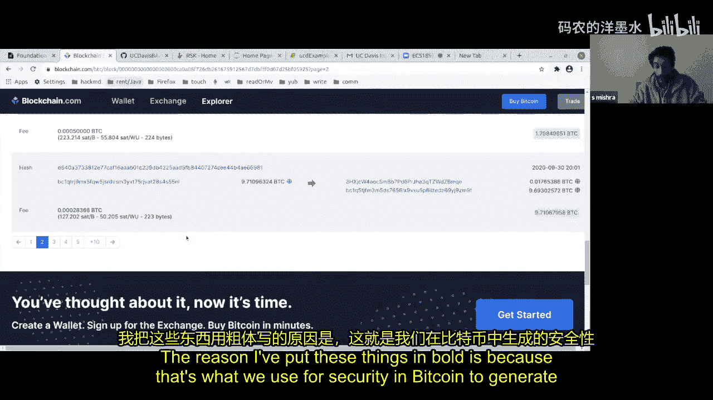
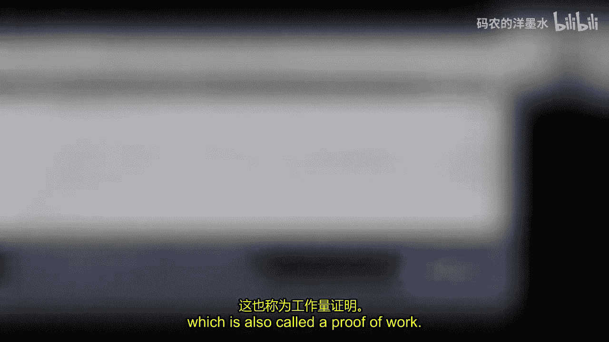
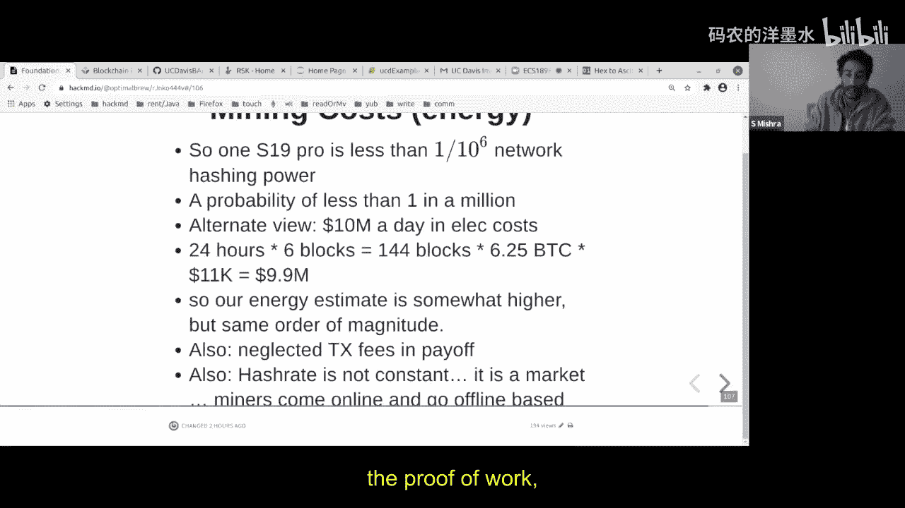
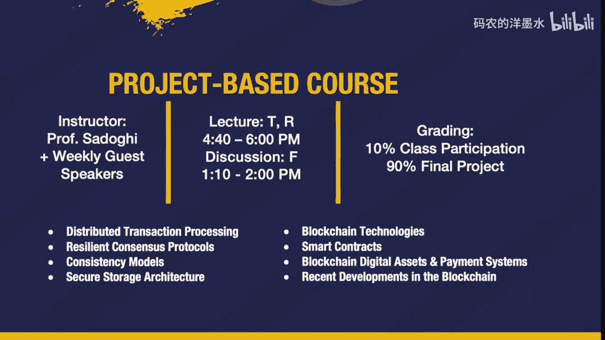

# 【全集】加州大学戴维斯分校 分布式交易与区块链架构 中英字幕 完整课程 p05 Lecture 1 - 比特币的核心原理 -BV18YFVzME2f_p5-

Hello everyone， so welcome to 189， so this is our first industry speaker and so it's exciting to have。

Dr。 Shimoi Mira from IB Labs and he has a very exciting background so he got his PhD from UT Austin in game theory and economiccons and he's been and not only been been teaching。

 but he has worked in different industries and。Exciting researchers。

That he has done over the past years and in particular he now be the Bitcoin and given his economical background。

 I think that would be very exciting to have him please。Take it away。Thank you。

 it's great to be here， okay great。😊，As as Mo already mentioned。

 I'm an economist and former academic economist and engineer。

 I'm a researcher at IOB Labs which is associated with the RSK blockchain。

 so if you are familiar with the Ethereium Foundation that's separate from the Ethereium blockchains。

 that's sort of the relationship between IOB labs and the RSK blockchain。In short。

 what RSK tries to do is allow people to run Ethereum type smart contracts， but using Bitcoin。

That may not make a whole lot of sense to those of you who are just getting started in this field。

So let's just carry on with the agenda for today， which is just to talk about some basics of Bitcoin。

And yeah， I should thank Cameron and Mo and Umaher for this chance's。

I think it's going to be a fun for everyone so let's see。

So I think last meeting I was here for your Thursday meeting for the first 10 minutes and there were some questions。

 one of you asked Mo if there are any prerequisites for this course and while there may be prerequisites for the course。

 in general， the industry doesn't really have any prerequisites and that's because it touches on a whole lot of different areas in economics and computer science and math and crypto also there are social and legal implications。

Of blockchain technology， so there's no specific background or prerequisites as such。

 almost everyone is self taught to some extent in the field。

So there I'm just listing some of the areas that people have expertise in， but you always。

 always have to expand your horizons if you want to be in blockchain。

So I'm going to just quickly check if there are any conversations in the chat， nothing there。

 so keep going。Here are some links in case I lose my mind or or if I lose the internet。

 which did happen 10 minutes back， here are links to the slide itself。 and for later。

 in case we don't cover everything that I was thinking about。 Here are two links。

 One is the original markdown for these slides。 and a simple i Python based a Jupyter notebook。

 which you can find on this Github link So you can look at that now or later。As me go on。

In terms of what I was expecting from the students who are here。

 just basic awareness of the idea of what a cryptographic hash is， not the technical details。

 but just the idea that these are one wave functions。Which are nearly impossible to invert。

And also that there are no practical collisions in a way you give。An input to a hash function。

 the output is sort of unique。Or at least we don't know of any collisions。

The second idea that I assume people are familiar with that which is a very top level is private。

 public key based cryptography。So here's a simple example in Python， for example。

 that uses three variations of a string， the binary version of a string。

 to generate hashes using the Sha 256 hash function。

And you can see small variations in the first variation， I add a space here next to the E。

And another example， the E is dropped。 and is see small changes in the input have a big change in the output。

These are the hexadeadecimal versions of the output。And so we'll be relying on the shelf to6。

 which is the primary hash function for Bitcoin。So what you will be seeing on block explorers and in the field a lot is the hexadecimal format。

 which if it's a 256。String of binary， then that 32 Bs of data。

 that just comes out to be 64 characters lo in hash。And they'll be seeing this a lot。

And for the basics of the public and。Private key cryptography。

Some of you may be using SSH to authenticate into your GitHub repos。

 authentication is not that much of an issue of Bitcoin or encryption。

 the main issue here is signing， signing transactions。So that's going to be Corey here。Keys。

 as you may know， are just very large integers。The private key is generated from a pseudo randomdom number。

And once he have the private key， we use that to generate a public key。

The specific ways depend on the standards we use， their whole variety of standards。

 but the critical thing here is even if your public key is revealed。

 there's nothing anyone can learn about your private key。

Lots of different mathematical structures I use in cryptography which I'm really not well versed or an expert to talk about。

 but what I do know is the special rules for arithmetic so adding keys and subtracting keys multiplying keys what do you do when you add two keys and the resulting key is more than5 to six bit so you need to have rules for overflow how to handle those so those are special rules for the mathematics for a managing keys。

That we won't get into。The specific standard used in Bitcoin。

And also Ethereum is a class of cryptographic keys in a family called elliptic curves。

And the signatures are denoted by a pair， typically R and S。The first time I saw this。

 I'm not a crypto person， I was really surprised I almost thought signatures were just one long string of bits。

 but it turns out in ECDCA and signatures are。A pair。

And those of you familiar with Ethereium will actually see that signatures in Ethereium and Alton RSK are three components。

 in addition to the R and S Ethereium added another component V。For some security purposes。

At this point in most Bitcoin introductions you will see a picture like this for ECDCA elliptic cry。

 I find this pictures in a short talk to be quite misleading so we'll skip it and leave that for a crypto talk。

But the interesting part is in Bitcoin with ECDCA， each private key is actually it can be used to generate two public keys and so two addresses we'll see in a bit an address is。

Here is a simple go example of signing a message。The first library here is just appealing to a specific standard and a specific type of curve within the standard。

 a random number generator to get us started with。 and so here's a simple example mostly based on。对。

Go source。The animal。嗯。Maybe the GiHub version is easier to see because it's at one place。

So this just demonstrates a simple process that we start with a random number。

 then use elliptic cryptography to generate a private key in ECA， the private keys have two bits。

 R and S， we use those to sign messages， the message here， for example。

 is a byte version of some string and then it's easy for people to verify that the keys used to sign the message belong to the public key associated。

With it。It's very hard for me to kind of not get any feedback from the Zoom calls I just going occasionally check So here is a question。

 why do we need arithmetic on keys？From NAau。啊。So this is a question better suited for a crypto person。

 but my understanding exists， we use a pseudo random number generator to get a private key。

 and then we compute me computations on this private key on the Litic curve。

 say add this 10 times to itself。Or subtract some number from it。

 So you start the private key and do arithmetic on it。

To get your public key and the steps to be taken are part of the standard。

So that's my top levelable answer of why we need an arithmetic on private case。

 How do we ensure a function is one way。 That's sort of the definition of a hash function is it's almost like taking everyone's names and putting it into bins for the letters that the name stored with。

 So we'll have 26 bins。So if you pick the bin for a。

 all that you know is that it contains names of people whose names started with A。

 but you can't recover the original input that it gave it。

 everyone who was name starting with A so it's one way。

I think this reminds me of a different question of how do we know there are no collisions because you couldn't possibly try every combination of inputs。

That reminds you the story of how 10 years ago， maybe Google found a collision in Shah 1。

 and so Shah1 is no longer considered secure。But shot2， as far as we know now。

 no collisions have been discovered。 And so be fairly confident that if you change the message。

 the input to a hash function in any way， it will be detected。

 It will lead to large changes in the output。To two it， fantastic questions already。

Just maybe stop for 20 seconds， not 27 seconds to see if there are any more questions on the chat。

Are there comments on clarity， speech， if you need me to speak louder？Two more seconds。

 Why is it arietic to generate a public key not reversible。

HmI don't even know if that's true if the arithmetic is not reversible。

 since the arithmetic follows a protocol， it's an algorithm。So the algorithm。Should be reversible。

 but modular arithmetic with overflows。嗯。Hins， if it was。

If it was predictable deterministic maths on the space of real numbers or all integers。

 including up to infinity， then you could invert some functions。

But this is a specifically defined mathematical field。

 and so it's hard to recover the inputs from the output， even if you know what the steps are。And。明备。

😊，A long time ago in grad school， my teacher told me it's。It's better not to answer some questions。

 so I think。Rather than pretending to be someone who knows crypto。

 I should just not go there and just I don't know。呃。

Let's wait three more seconds to see if there are any other questions。Right， so keep going。Hna。Here。

Moving on to Bitcoin， the reason why most of us are here。

 that's what got this field started in blockchain。If you go to the Wikipedia。

 not Wikipedia's page on Bitcoin， but Bitcoinin。org has its own Wikipedia page。

sometimes it has outdated information。 But at least from my point of view， is mostly free of bias。

 There's no one selling their own blockchain。 So here is something I just coding step from。

It's not the first cryptocurrency， not the first distribute cryptocurrency。

 but it's the first widely successful implementation of a cryptocurrency idea was described earlier by wait die and both of those names。

 the first name and the lasting of the researcher are now used for different units in the Ethereium。

😊，Doctor。And the second part of the statement is its not it was the first successful implementation used cryptography。

 and there is absolutely no reliance on any central authorities。And the question for you all is。

 are you comfortable with the idea of what a central authority is？

I think the reference here is to like a Federal Reserve Bank that issues currency。

 are there questions about central authorityity work？Not so far。So let's keep going。

A lot of folks are very interested in the history of Bitcoin and the motivations and who founded it。

 was it an individual or a group， I really don't care so much about it。I do care about the motives。

 but not the identity， so we'll not get into the speculative stories or if Craig Wright really is or isn't approach。

 but I thought we will think about is it's a fun idea， a peer to peer monetary system。

So since it doesn't have physical currency， the currency can have any kind of denominations。

You can choose what it says in Bitcoin， for example。

 you can have numbers as small as 10 to the minus8 Bitcoin， that's the smallest integer。

 the one in Bitcoin represents1 hundred of a million Bitcoinins。

 and so that's called a a throw sheet。嗯。Coins are just digitally signed messages。

 And when you sign a message and you basically transfer ownership of your coin to whoever you are giving it to。

 and they can have nearly arbitrary value except this lower bound here， one。

Let's have a simple example here。 Someone gives you two coins worth a cumulative 7 Bitcoin。

 That's a lot of money these days。 It's about 10500。 I think today's price per bit and dollars。

 So what you can do is you can create a coin using these to as inputs and pay 4。5 to someone。

Up to remaining， you can redirect 2。4 yourself in a new coin。

 And whatever little residual amount is left， point1 is not so residual。 It's not so little anymore。

 It's still 1000 votes goes as a transaction fee to people who create blocks in the blockchain。

 We'll come back to this example in a little while。And before I check for questions。

 I'll just put this slide on there to say the fundamental security problem in Bitcoin is double spending。

There are some other concerns like people censoring transactions or privacy issues。

 but the primary issue， the primary security issue is this。 someone pays you 100 coins。

That's assigned sign a message。Someone then uses the same coins。

And either pay somebody else or they send it to themselves。So that's a second sign message。

 and then they try to convince others that the first message which was a payment to you is invalid。

 so that's called a double spending problem and that's a primary problem in blockchains。

Let's check for some questions here。对。Yeah， sure， I think everybody so we could just ask question on the mic so that would be easier so you don't have to keep checking back either。

Okay， that yeah， hi。 yes， Professor Mishara， sorry， sorry about doing your name。 I'm so sorry。

It's fine。 We can just call me。 Can you go back to the previous slide。Yes。

 so I'm confused about the concept of coin。 So when， when we do， when we do transactions。

 let's say bit。Does when coin represents represents can Can can a coin represents different values。

 Like， it seems a coin have like。Absolutely， it's not like a dollar in physical currency。

 which says a $1 or 5 or 20 here， these coins are just messages so they can say anything。Okay。

 so what you mean is two coins can。2 coins value can be different。 Say one coin can value 100 dollar。

 The other can value， like， say，1000。Y， the only restrictions are really that the value cannot be less than the number one。

 which represents。A hundreds of a million of a Bitcoin。 So the lowest value is once associateing。

But in terms of payments， there is no idea that a coin must be worth a certain number of bits。

 it's completely asked right。Then then how how do we know。The value of a certain coin。

So thinking about some a transaction in which you spend Bitcoin before you spend Bitcoin。

 you get Bitcoinins from somewhere way right， either you buy it on coinbase or some1 cents you some Bitcoin we cover that right now when you get those Bitcoinins。

 let's say five。There's no specific way of getting to five。

 you can receive 100 transactions that cumulatively give you five Bitcoin。

So each of those will have denominations that can be completely arbitrary as long as those integers add up to5 Bitcoin。

So the system really works in terms of inputs and outputs through transactions。

Every input to a transaction， so if you get 100 inputs， each of those inputs is really a coin。

And if you use these0 inputs to fund a single payment to someone。

 you have just combined all these inputs， it's fungible to create a single coin worth five。

So once the inputs are added within our transactions。

They lose any meaning or way they came from is just one sum。 and then it's up to you。

 the spender to see how you allocate them if you。嗯。Have you， you know what， hold on to this question。

 maybe we'll see some block explorers in a bit。Yeah， okay。 Thank you。 And that it may help clarify。

 it's really。Misleading to think of a coin as a specific number， just think of it as transactions。

 having inputs and outputs。Okay， great。 Thank you。嗯。So we'll revisit your question in a bit。

Just to remind you where we were， the fundamental security problem is double spending and if it were not for this cheat problem。

Electronic currencies are quite simple to create is just about databases。

And so we don't want to allow multiple histories。You want to find a system that allows us to agree on a single history。

 another bit of jargon here just to talk about addresses because they differ across blockchains。

 Bitcoin was first so the way Bitcoin addresses work is you start with your public key。

The hash at first using Sha 256， that hash is then hashed again with the different hash function。

This is one of the few instances in Bitcoins in which the double hashing does not use shot 256 twice。

 usually most hashing and Bitcoin is use sh 25，62 times that's not the case in the first step of adverse generation。

So once you've done that， we now have an output that is 1160 bits long， so that's about 20 bytes。

To that， we add version number。And a check some。The checksup and the version number and finally a base 58 encoding。

So if youre lost here， there's three things to take from here first is this is one of the first unusual cases of not using double Sha。

 but a different hash function， a Sha combined with renet 160 The second thing is the use of a check sum which prevents users from accidentally sending money to invalid addresses so check sums。

Help。Confirmed that bitco address is valid and base 58 is it just expands the number of characters we can use to denote addresses because if it is just hexadeimal。

 then we have 16 choices of characters if we use the entire alphabets a to Z。

 then we get 26 and 26 more for uppercase lowercase the number 0 through9。

 and what's associated was it says to avoid confusion， let's not use the uppercase or lowercase O。

 and let's not use lowercase L or uppercase I to avoid confusions with0 and1。And so that's base 58。

 and that's how a Bitcoin address is created from public keys。

A transaction closer to the question asked a bit ago。

 a transaction is just a transfer of a bunch of coins。

 how many coins that depends on how many input transactions are there for the one and how many recipients there are to the funds。

And instead of coins， it's much better in Bitcoin to think about how much of the transactions that you receive Bitcoin in。

 what have you not spent yet， and so what you'll see often is a reference to UTxOs。

 which stands for unspent transaction outputs。So more jargon a block。

 a block is just a container of transactions， the transactions can come from anywhere in the network and they are constantly transmitted。

 but blocks are produced about once every 10 minutes and so blocks are just containers for a batch of transactions。

Who creates the blocks， those are， as you may be aware， are people called mines who create blocks。

And finally， we somehow link these blocks together kind of like a single linked list。

 But the linking is done through cryptographic hash functions。

 And we'll see details of that coming up。😊，The blockchainlock is just hashing blocks together。

 the goal， of course， here。Is to agree on a single historical record of transactions。

Here's an example back again。Two inputs three and four， so those are two coins。

 one point containing three bitin， another containing four and there are two outputs from the transaction。

 4。25， I pay to someone 2。4 I redirect to myself so Ive mixed the coins。

These seven coin together within the transaction and created two new coins， one for 4。25。

 another for 2。4， the research will go through the miners as a transaction fee because these add up to less than seven。

The only requirement is that the sum of all output has to be less than the sum of total input transactions。

And the difference is collected by mineters as a fee。

Let's go to an explorer here in which The lots of different explorers I just picked wine for an example。

And be looking at a specific block that is at a block number 65750。

 a block number is also called a block height。什么意。Go here。That is the hash of the block。

You'll see it's a number that starts with a whole lot of zeros。That's the height。

 it was mined by a group that goes by the name F2 pool。We'll see some of these other stuff later。

 but let's come here to see and look at the transactions， this transaction here。Has one input。

 that's one coin。 and it has two outputs。 Those are two coins。

And here you see what these coins are worth。 So that is sort of related to the question you asked earlier。

 I'm sorry I didn't catch your name。You can just call me， Jason。Ajason。

 that if you see the block Explorer here， any of these transactions。

 you can just count the number of inputs and outputs and that's one to interpret what the coins coming in and out are。

And you can see these coins have vastly different numbers on them。 This one here is worth 。001。

 You can convert to dollars。 And they just quickly see some questions here。

What does the game source mean I was just trying to be cute there and say let's say I want to pay someone for the source code to a game they developed This wasn't the example I was trying to make for double spending I paid them 00 Bitcoin for their source code and then I send the same coin to myself later in a different transaction We want to avoid those situations。

You don't see any other text questions here。So。Linger here in the block Explorer for a bit。

 all these transactions in this block 65750。A lot of them are， usually。

So this one also has a single transaction。 If you look at the details。

 you'll find several that have more than one input in。And several output， this one， for example。

 has four different outputs。So these are just。Acquaintted。And vastly different denominations。嗯。

Some of the things that we care about， especially to understand how security works in Bitcoin is to look at specific fields from the block。

 specific fields we care about on the hash of the block。The timetent of this block。So for example。

 the block I'm talking about is from the last day of September。

 the Merkel root will get a bit later into what the Merkle root means。In version and Nos。

 the Nos is something that's entirely different in Bitcoin and Ethereium。

 those of you who are familiar with Ethereium， this is a different Nos。

And we care about another number called bits， which we'll see is related to how difficult or easy it is to create a Bitcoin block。

The reason I've put these things in is because that's what we use for security in Bitcoin to generate a blocks hash。

 which is also called a proof of work。

It's working now， perfect。All right， so we can do this again if it happens， we have a solution。

It sounds good。Alright， so。Ja had a question about a slide or do？No， I。

 I wasn't having a having a question。 We just simply couldn't see this。 Cant see it It's horrible's。

So some of the things you can see here are this tra。

 it has nearly tweets house and transactions and the block reward and fees together or that much。

 if you kind of do that computation you'll find that the average transaction in those block and that's fairly true of recent blocks costs about $220。

So not exactly cheap。Bitcoin transactions used to be quite reasonable。

 and that's one of the reasons I did not include any points from Saoius's introductory section of his paper because one of the things he wanted to stress on was the possibility of doing micropay。

 small payments， and that's really gone out of the window with Bitcoinin。

Although second layer solutions， which you'll learn about later like Lightning are trying to change some of those problems about transaction fees and batching。

So the average transaction fee currently is about $2 and for an interest of time。

 I'm going to skip some question， just ask you what do you think is the smallest number。

 but as you see most computer scientists have no trouble saying zero as the first number so we'll just go there。

In the interest of time， dude， does anyone know what's special about blog zero apart from it being the Genesis blog？

There was a message in block0， Does anyone know。About the message in blog 0。

Do you mean the message that tells everyone that this is the first block and there's this block has no parent。

So that's one。 So if we go to the block， this is block 0。 and here's the。

The initial blog that paid 50 Bitcoin to the minorr， which obviously was at Dohi。

Himmself or themselves and the input to that block， obviously since nothing was there before。

 is some arbitrary data thathi put。In now some of you would have seen this before。

And these are actually characters that we can convert to ASci to see a message from Satohi in。

So some of you know this already for the others， it may be a little bit fun and here is the message that he left us。

The context here is the crash， the financial crash of 2008， 2009， where the banks were bailed out。

 And so he left this piece of this message in the Genesis headers that gives you part of his motivation。

 which we don't need to speculate much on was the idea that our trust in banks is。呃。

That trust is fragile， the banking system is fragile。

 and so he wanted to build a system that does not rely on trusting any person or any institution。

Purely， peer to peer。So that is a message， let's go to the paper。

 which we'll spend a little little bit of time on we' are 522， I'm all in the West Coast here so。

Quick check for questions。Chat。Alright。And now for some reason I can't see in the chat。

 So if there are questions， someone would you please jump in or tell me that there's a question because I can't。

I'll just let you know I think everyone from now I thinkm just going to speak out their question Yes。

 read it I will read it thatll be great thank you。The motivation in a pure P2P cash system without being to trust anyone。

 digital signatures are necessary but they're not sufficient because of the double spendingending problem and the solutions that came up with was use transaction timestamps so that if I sent two conflicting messages and the first one I passed on one and the second one I paid that money to myself we can have the ordering system that says。

 hey， this one arrived first and so we're going discard all other messages just think of the first one as the valid message。

The problem， of course， is if you send a transaction from Portland。

 it's going to arrive in Davis faster than a block from Korea or South Africa。

 and so we need to figure out a system of ordering without relying on actual time in which a packet。

 transaction or a block arrived on your computer。And so that's what we need to look at。

 it is a system to agree on ordering transactions that will be baed together in a block。

And we want to create cryptographic links between these different blocks。

 which feels going to make them very impractical to falsify。

The keyword here is impractical because a lot of marketing departments and blockchain companies like to sell blockchain as irreversible and that's not true。

 it is possible to reverse blockchains and reversals happen all the time it's just that it's impractical。

Computationally impractical， monetarily impractical to try and reverse the history。And essentially。

 rewriting blockchain history， how easy or how difficult rewriting a blockchain is determines how secure that blockchain is。

Some of you may be aware of recent double spending attacks on a blockchain called Ethereum Classic。

They were tracked about three times in the past six months and now they are moving from their proof of work system which relied on Sha E hassh to a new system based on Sha3。

So the security is all all this tied to how easy it is to modify their record。

So what do you want to do is if you want to think about changing a single block from a year ago。

 then you can just。Replace one block and plug in another。Any block that we want to rewrite。

 startinging from that point on， we have to rewrite the whole chain。

 And that's what makes the task very difficult because to do that， you have to。Outcomp others。

And right now， I think my estimate is that the system overall spends about $10 million a day to create blocks。

And so if you want to gain a majority of that hash power。

 computing power that's needed to offset the other notes。

 then you need to be spending at least $5 million a day and trying to outpace everyone else and read write history I'm skipping some details here the math is not exactly going to be right。

But the point is it's often going to be a lot more profitable to just keep mining if you have those resources。

$5 building a day， spend that in mining or something else rather than trying to rewrite Bitcoin。

Because at most， all you can do is just double spend your own coins。

Even if you have 100% of the hashing power or computing power。

 you can never spend someone else's coins。But for other blockchains that have less security。

 less computation power like Ethereium classic， it's still possible for people to attack them and reverse transactions。

Another thing you will often read about Bitcoin is that the majority of nodes working together leads to what's called the longest chain。

I would encourage you to interpret the longest chain as a heaviest chain。

 heaviest being measured in terms of computation power that went into forming the chain。

We'll see an example in a bit。So she provided in his paper。

 simple examples using the Poisson distribution。And see code so those of you who are familiar with Poison distributions they often use for count processes。

 for example， the number of buses that arrive within a one hour window。

 the poison processes are very convenient to work with and he uses them as illustrations to see what would happen if Bitcoin network is attacked with arrival computing powers and how much of a gap do we need and how much power they would have to spend to offset the honest notes。

Another great thing about the network is that if you're running a no。

 you don't have to be online all the time， notes can stay online or go offline and rejoin as the please。

 just like whenever they rejoin， whether it's after a day or after five years。

 they just accept the then current longest chain as the true chain。

 and they treat that as evidence of what happened in the network when they were offline。

A transactionaction is a coin suggests digital signatures we talked about that before。

 and one thing that's kind of confusing to people is。It doesn't。

 you don't have to do anything to receive bitins。All the actions of signing and cryptography are really about spending money not to receive it。

 so if you want to spend some coins that you've gotten a transaction。

 then the way you spend coins is by using your private key to sign the transaction。

And you unlock the funds of the input transactions。

 how you got the money and that's how you create that's how you get to spend the step one is whatever transaction you got the money in。

 you use your private key to unlock those funds title transaction and you must specify who the funds are going to and doing so you create a new coin or as many coins as the number of outputs in your transaction。

So just to remind again， you got nothing， it does nothing to do when you're receiving coins。

 they just stay there in the records。The only conditions are on spending。

Anyone can verify signatures and so the chain of ownership， so when you spend money。

 people can see where you got the source of your funds from。

 which transactions you got the money from and which transactions those came from。

 which blocks those came from so the whole chain is auditable。But of course。

 only if you have access to the full database， not everyone runs a full node。

 that's not practical for most people。Ss。Kind of speed up a bit， and get。2。

What the solution is to avoid。Double spending。So though she thinks a Bitcoin network as essentially a peer to peer time server。

 what it's going to do is timetamp transactions。Are batched together in a block。

And all these transactions that are in a block together will use some data from the block to compute a hash。

And share that hash all over the network。The patch of the block will prove that the transaction that you're specifying was known at the time when the block was created。

And so if there are two competing transactions， all people have to do is figure out which block showed up first。

And since we have a linked list of a change set of lists， they have a specific ordering。

 it's easy to show which transaction happened first。Any reuse of funds will be rejected。

And the idea of how to prove that something was included that spending some money you sent somebody was included in a block。

 realizing an idea called Merkel trees and Merkel proofs， which we will see in a bit。

The job of the network is to act collectively as a timestamp server。

Another thing that at least I found confusing at first was the use of the work timestamp when I think of timestamp I thinking off 30 at September 8 o'clock。

 but that's not what Sadosha means by a timestamp server the hashes are really the timestamps here and it's okay to use the block number or a block's height to reference。

When a transaction was included， because those are unique。

 a block has a unique number and a unique cache but no one really talks about the actual timetamp in terms of date and time。

So think of a timestamp as the hash。Stop for five， six seconds to see if that jog is a memory you have any questions。

Yes， I have a question。 So when we we don't talk about exact time in Bitcoin， right， we use hash。

 But how do we tell two hash，2 hashes， Which one is earlier， Which one is later。嗯。

So let's say you mine a block and I mine a competing block。

If you mind the block and these are very close in time within seconds of each other。

 your friends who are closer to you in Davis or California will get you a block first before they see mine。

So ties like that happen all the time。And if there are two competing blocks competing for the same height of same position。

 what happens is the network， the node will calculate which of the two hashes required more computational work。

 and they will accept that。So if the transaction you packed into your block and the hash computation you did。

 essentially if your hash is more zeros， for example， then you win I lose。Does that make sense。 Yeah。

 yeah， yeah。s So that's how ties are broken。 Yeah， Thank you。

And what I would like to do at some point， depending on where we are in the clock is walk you through a simple example of what it means to compute those zeros。

So basically， what it does is a block has lots of information like you saw on the chain for 65750 there。

And we will use some of the information to create our hash。So what you'll use are。

Maybe me just go to examples。Is this something you all can see？Is this visible this。Yeah， yes， yes。

 Okay， good。 thank you。 thank you， because I can't see the chat。

So what this is is a simple exercise of using that block that we saw in the Explorr。

 we'll use some of the information。From the blog to compute its hash。

And that essentially will tell you what mining。Pools do all the time。

 This is what mining is basically about。 So you pick a block number。

And there's lots of APIs that you guys can use。 I use this one and did not use the Expr that I was just showing you because in the Expr。

 the timestamp was leaving out seconds， it was only showing hours and minutes。

 but part of the protocol needs， Uni time that you need the whole access to so from the block。

 these are some of the fields， the hash of the block， the blocks height， the fees。

 how many what's the total size of all the transactions in there。So from these。

 we need to use six of them to compute our blocks hash， these six fields are the version。

 which is4 bytes。The hash of the parent block， the previous block， that's a hash。

 so it's 32 bytes because all these hashes are shall out to 56。The Merkle root。

 which we go over next。That's also 32 bytes。And these are in order。We also need the blocks timestamp。

4 bytes， bits， this is related to the difficulty of the mining tasks， so simply speaking。

 the more zeros you need out front， the more difficult the task is。

 so this is what kind of references the difficulty of mining Bitcoin and the Nos。

Okay so if you are to participant in a mining pool because it it's' just not feasible these days to be a solo mine with your own equipment。

 its just the only profitable way to mind Bitcoin is is being a part of the pool what the pool operator is going to do is the pool operator has no choice on the version。

The pooloperative will have no choice on the hash of the previous block that's already been mined。

The only choice is the mining manager is they decide which transactions to include and that will generate a binary tree of hashes of the transactions we'll see later。

 but the root of that binary tree is called a Merled root。

The bits are the difficulty determined by the network。

 so you cannot choose that the only degrees of freedom。Really are the nos？That's four bytes。And。

The a little bit， the timest you can play around a little bit the timestamp。

 so this very little degree of freedom， most of it is concentrated on the knots。

So we use these six fields。We can'tcatenate them， but before I do that they should be in hexadecimal and they should be in a certain ordering with the biggest number upfront called Big Indian so here is just grab the fields once you grab the fields。

 this is a target that you want to match that main number of zeros and that specific hash。

So you've got three integers here for the version， the Nos and the bits。

 there's a timestamp that will be converting into Uni time and then into a hex and decciimal and these hashes are already in hex。

 we just need to reverse the Indian。The example in Bitcoin。

 the court example that I found on Bitcoin Wiki is a bit outdated that no longer once。

 so it just wrote some helper functions to speed up the process we'll skip that。

This example file is on the GiHub thing I posted earlier。

And so all they've done is taking those three integers。

 the timetamp and the two sha hashes convert them into big Indian and hex。Add them all together。

Convert that hex string into an integer。That's converted to a byte。

If you are following the description of six fields， you'll remember that two hashs that's 32 and 32。

 and the rest of the four are all four bytes each， so that's total 80 bytes for the block header that's being hashed。

And once we hash it， which is， of course， in Bitcoin a double hash that's the first。

 sorry that's outer one， if this the inner one。And you grab the hash， this is what we get。

And that's what's called a proof of work。 There's only one more step left。

 If you reverse the indianness。 So the zeros are out in front。

And this is what we're trying to imagine。well it matches because it should the first time it didn't match because I was using a different block explorer which did not have seconds。

 so obviously the hash won't match。And that's what mining pools are doing pretty much the whole time。

 The computing hashes just like this。 The manager gives them most of the information of those six fields and。

The individual folks are varying the nons， that's those four bytes。Four bys is。

I think a computer can go through a billion numbers in a second。So with the modern mining equipment。

 this 4 B isn't really enough。 So they add other randomness to it。 But this illustrates how。嗯。

Sort of the lottery of creating a block is one。You do a double has on those six fields in a specific way。

There's lots of combinations， as you can see， shot6。

 And so the work needed in terms of computation depends on the number of zeros you want out front。

 So the more zeros we pack out front， the less likely we are to find a block。

So finding a solution is extremely hard because you have to make lots of random guesses and so we have specific think and sotohi started this Bitcoin mining was CPUU based。

 then it became GPU based， Ethereium is still a lot based on GPUs。

But Bitcoin went from CPU to GPU to field processor programmable gate areas and A6。

 which are application specific integrated circuitss。Just a quick question， so why the double hash。

 as you mentioned earlier。You were doing the double hash。

Almost everything in Bitcoin is a double hash， I do not know exactly why my understanding is we don't really know what the probability distribution of the shaw looks like。

But one thing the double hash does is it allows us to make an approximation that all two to the26 combinations are sort of uniformly distributed。

嗯。Do you recall some other。no， no， no， I would just kind of。

 I thought maybe there there is some reason I'm unable aware aware of。

 but I one of our understanding was based on what you describe as well。

 but I thought maybe there is some。Other factors as well involve。Yeah， because I mean。

We can't even imagine what this distribution would look like， right？

We hope that shot of6 is closer to being uniform and using it twice just makes it。

But then it can't just be about the proof of word because the double hashes show up everywhere。

 including themerle trees。hich we' will see in a bit， so。I guess I should just say， I don't know。

 It know one reason， but there must be many other reasons why double hash is used。Right。

 so implementing the system， we just walked through a simple Python example that showed you what the Bitcoin system does every day。

 the computation I showed you was one double shell computation。

The number of computations that happens is。IThink I had it。There。I'm not sure if I have it here。😔。

This is what the network is doing， every day。150 times billion billion such computations。

Every second。So， that's the。It's kind of astronomical， but it's beyond astronomical。

 these to think of these numbers astronomical and now they're just bizarrely big 75 billion billion block cache computations every second。

So if you want to double spend the Bitcoinco， that's the kind of forest people would have to fight with。

Okay， I can't see the chat， so。There's no chat。 I'll let you know if there is any Thank you。

So part of the proof of work system is in a distributed system。

 we are all competing to addd transactions in blocks and so the proof of work provides us with a way to say。

 hey， we have a winner， this miner gets to mind the next block because they have found the solution to the current problem and when one block is mined。

 the hash changes。And so people move on to the next block。

So the first part proof of work is how someone gets to create the next block。

 the second thing is how everyone agrees that yes the problem has been solved I mean no one can force people there's no one sending emails to say a block has been founded move on to the next one so it's up to each individual minor to either accept the systems。

That broadcast or just keep working on by themselves。In a way， I have a question。

So as you mentioned before。Bitcoin updates， like。Approximately 10 minutes， right， So thats。

So if we want to calculate a hash for a block， does it mean that that calculation process takes approximately 10 minutes。

Oh no， no， no， no， no， we want blocks to be processed in less than a second。Like in RSK。

 our blockchain， we generate blocks every 30 seconds。

 Ethereium generates a block every 14 to 15 seconds， all those smart contracts， payments。

 whatever is happening there， the block is itself processed in less than a second。

The rest of the time is communication， it takes a few milliseconds for the block to be passed around the network Z。

 a Bitcoin block， the 10 minutes is just a choice。Okay， so we spend a lot of time waiting， right？

Yeah， so your Bitcoin node is not going to be running as hot as your it node。So we。

 we actually get the hash for the block very quickly。

 and we wait for a long time and then push the block to the chain， right。

dependsds on what kind of node are you running if you are running just a user node not you're not a mine。

 you just have your own Bitcoin node， then you're just receiving transactions you're receiving blocks and most of the time you're just forwarding the information to your peers the actual computation is just a second you're just forwarding you're not pass it。

But forwarding blocks is mostly a network thing， you're not using so much CPU。

 but if you are a minor。Then you are constantly processing blocks for two reasons。One is。

 if you are one of a thousand people mining as part of the pool。

 how do you know how you're going to share their rewards？

And so what they do is mining pools operate on the system of shares if Bitcoin needs a solution with say eight zeros out in front。

What the mining operator is going to do is give you a target that only needs five zeros。

 which is more frequent right it's easy to hit five zeros than hit eight zeros。

So everyone that's part of a pool is trying to。Compute hashes that are less difficult because their share of their pools reward is going to be based on how much effort they put。

And so the question it really is how much competition are you doing depends on what your role is if you're a user。

 not much， if you're a minor or you're participant in a mining pool， you are quite busy。Okay。

 so what if Im。I am a manager。 say a boss of a pool。 I can't hear you。 Can you speak louder， please。

 I'm sorry。Let's say I am a manager or a boss of a。And I get a bunch of Ha hass begin with 5 zeros。

 But how can output a hash with 8 zeros， say。Well， you can't。

You just give the headers to all these miners who are working for you automatically。And by chance。

 some of those。Hashs will have eight zeros， there's nothing that says a hash that needs to have five zeros cannot have eight zeros。

 I see you see， it's just that if the difficulty is set lower， you'll find blocks and caches easily。

 And that's how our network， the RSK network， operates at。20 times the frequency of Bitcoin。

 we generate blocks every 30 seconds because our hashes are easier to find。

But once in every 20 RSK hashes is good enough to meet the requirement for the Bitcoin network。

 and that's when that RSK blocks， tag or information is imprinted on the Bitcoin chain。 so we sure。

 So it's based on the system called shares。 Think about hashes that satisfy less difficulty as the share or a fraction of the rewards youll get as part of a money pool how many。

Hashhes with five zeros or four zeros， you find。So they'll keep going so that's very interesting is are you going to kind of capture that that whole ecosystem。

 how that works， is that something that you will be talking about？

I had the mining thing it gets interesting because there's lots of strategic game theory in there Okay。

 maybe just maybe you want to just give a picture of what just overall picture on the details of it。

Maybe right because yeah， I can give you the reference。 it's a paper by many Rosenfd， 2012。

 which analyzes it。 But yes， so let's take a time check。 It's 550。

 let's once we've done it the miracle let's yeah， let's continue。

What we can do is let's see where we are when we get to the Merkel proofs and at that point we can decide which way you want to go depending on how it's time we have。

Okay， so the main ideas so far have been。Using six fields from the block header to generate a double Shaw hash that meets some target。

 if it meets the target， that minor gets the block。And everyone else moves on to the next one。

 and everyone， importantly， who agrees must point their effort the next block。嗯。

So when a block is found and you agree that it's been found。

 you move on to the next one and you point your block up the one that you're working on at the previous one and so in a way that's a voting system。

Where so Thi's paper he called it one CPU one Vo， CPU is no longer relevant。

 so we can just think of as one hash computation nowadays is onevo。

EveryEvery blockchain system has some way of voting。

 Ethereium is moving to something called proof of state and we'll skip talking about that now because we don't really need to spend time on that。

So the way miners vote for a solution is a valid blog comes in， they check that it's valid。

 the fields match the number of zeros are。Satisfactory。

 so just move on working on the next one and put a pointer。Two to one they have accepted。You。

 as an individual， can say， I don't accept it。 I'm going to work on my own。

 But if a majority of the miners agrees， that chain grows longer。

 it gets more computational proof and hence heavier。 by heavy， we mean。

The computational weight of blocks。How many zeros are enough。

 that' tied of parameter called difficulty or bits， we saw that on the Expr。

 there's this number which is a floatat here。And it's related to an integer called bits which we use in the hash computation that determines how easy or hard it is to find a block。

 this number is readjusted every 2000 blocks so it's based on a moving average and the idea is to make the difficulty larger or smaller so as to keep the average block time to about 10 minutes。

Of course， some block just by chance will be mined in two seconds and some will take a half hour。

 but the average is about 10 minutes。Money creation。

 this is the part that I think most of you know is whenever a minorr creates a new block。

 they earn 6。25 BTC is currently used to be 50， it have every 210。

000 blocks about four years currently it's 6。25 and of course it collect fees from all the transactions so in the block we saw and the Expr the block CA 2834 transactions for total fee award5 let's convert this to。

Dollars。Oh， the wrong， wrong slide， anyway。So。The rewards are 625 BTC plus a variable component for the transaction fe by convention。

 the miners create a special transaction called a coin based transaction。

 and that creates a new coin which has these rewards in it。And you can see that。In our block。

 that's a block。These are the transactions， that's the coininbase transaction。

 let's look at its hash。 It has no inputs because it's a special transaction。

 It has all these stock codes， this note。Inputs needed。And it has these outputs。Oh。

 let's while we are here， I can show you a little bit。

So this this minor in the output has included some operators returns。

 just like if you write a C program that ends in return， return zero， nothing else。

 Well that program is not going to do anything。 So that's what these。

Bitcoin script offerturn means it doesn't。 It's not really processed。

 but it allows people to put arbitrary data in the blockchain。

 just like you saw the message from Saoshi in the Genesis block。

 So let's look at one message here from transaction number3 in position。0。

 and I'm highlighting this because it's related to the folks I work for。 we had。嗯。

So you get a hex converters somewhere where。Well， I hope it doesn't chew up any funny sights。

That's the data from that coin based transaction and you see it translates as RSK block and then some binary data。

 so this is us the RSK blockchain piggybacking on the security of Bitcoin by imprinting tags of our blocks in every not every Bitcoin block。

 but some of them。Because Bitcoin is very hard to attack。

 so we tie our security in a process called merge mining。

 which you will probably learn about later in the course。I check。5 does be fine so。

Quick stop on money supply。If you get the calculations on how many bitins there are in the new transaction。

 6。25， and that's going to be the same for the next four years and then it's going to get half again to use the geometric series formula and come up with theoretical maximum of 21 million Bitcoin as a total supply possible and I forget when we will reach that。

 but it's several decades from now。Maybe as an economist I should remind you this has nothing to do with inflation and economics。

In blockchain， people use inflation just for the supply of the cryptocurrency。

 how much either or Bitcoin there are， it's got nothing to do with inflation and economics。

 which is about the price level of goods and services。Let's skip a few slides。

 because I think the main。I think this is something that's mentioned before。

 but it's worth repeating， even if a majority of miners become dishonest and attack the chain。

 with's 51% majority of tax， all they can do is spend some of their own past coins。

They cannot steal other people's coins， and you should know why。

Anyone venture a guess why the mines with no matter what the computation power is。

 cannot steal other people's coins， any guesses？We can stop for maybe five seconds。

I believe you need the private key to access your coins。

You need the keys so you can sign for spending requires signature so absolutely correct。

 even if you have all the computation power for hashes。

You don't have access to other people's keys so you can't sign their UTXos。 Thank you very much。

So we've been at this since' 557 minutes lets。Go on to this important bit。

 And then maybe we can decide if we want to keep going to other stuff。

 So the issue at hand is very fine how a transaction was included in the block。

You send a transaction using an app on your smartphone that smartphone obviously does not have all of the Bitcoin networks data or processing power how would you figure out that the app says money was sent was actually sent So once we send a transaction using an app the app will give us a transaction hash which is a hash of some data of some fields within transactions we will not get into details of how transaction hashs are created。

But what we need to know is a transaction hash that we want to verify and the block number in which it was included。

And the idea in Sooshi's paper， it is called SPV simpleple payment verification is based on two concepts。

 one， the app that you're using only needs to store block headers， not entire blocks。

The entire blocks can be pretty big。 this one here， for example， the block size is。1。4 megabytes。

Okay。So the block is 1。4 megabytes and if that was block number 650。

 750 so you can't store a billion。A million of those on your phone。

 but you can store on your phone just the headers because those are just 80 to 100 bytes each。

So the first idea is use block headers only for these simplified payment verification proofs。

 and the second part is something called a Merkel proof。Mkel trees very quickly are binary trees。

 you are computer science students， you guys know what binary trees are， these are binary hash trees。

 so all the values in every node in a tree is just a shot 256 being Bitcoin these are double shot 256。

Starting at the very bottom of the tree， the leaf node are hashes of all the transactions in a block。

The parent。嗯。So one level up in the tree is just the hash of its two children。

 we can call them the left and the right。If there are an odd number of leaves， then we repeat them。

And then we repeat the process until we get to the root of the binary tree。

The rib is included in the block header， and is called a Merrled root。Example。

 let's say we only have two transactions from users and the minor includes a coin based transaction for themselves。

 so this block only has three transactions。Each one gives us a hash， so we have three hashes。

 we want to have even number of hashes at the end so that'll repeat the edge2。

And the way we form the tree is these are the four hashes。The first two will give us。One parent hash。

 these two will give us another parent hash， then we hash those two parents to get a root because that's just how deep this tree is。

That's a miracle tree。 and as you have seen from hashing。

 you cannot change anything about a transaction without affecting the hash。

 So changing the single transaction if your transaction was not included， the hashes will not match。

 So that's a simple idea。It gets a little simpler and will you steal up image from someplace here。

 this one is from investortopedia if you search for Merkel trees depending on the source。

You'll find different images， This one has very simple notations， T A， T B。

 more CS friendly ones will have a T0 for the coin base instead of TA。The idea is simple。

 start with the coin base， write out the hashes of all the transactions。And in this example。

 the red one here is the transaction you are interested in TD。

To confirm that this one was added in the block， you do not need to know the transactions of all the hatches of all other transactions。

 all we need to do。Is we construct the path from your transaction to the root。

 so for that we need to know the hash of the adjacent， the sibling。From that。

 if we can compute the parent， we need to know the transaction for that second layer。Again。

 you compute that parent。And then we need to the hash of this side of the tree。

So with just the hash for your transaction and three other hashhes。

 we can verify that a transaction was included in a block， and that's called a Mile proof。

And this is how。Most smartphone based apps， simple wallets work without access to full blockchain data。

The general advise is to also wait a certain number of blocks， so typically people say six blocks。

 I personally if I'm just spending a small amount then a block or two confirmations are fine if you're spending a large amount that you want to wait more blocks it's really the receiver's choice you as the sender have nothing to do once you send the bit they're gone。

 it's up to the sender to decide how many confirmations they want to wait before they think of your payment as verified and practically irreversible。

That's the receiver's choice， not the sender's choice。A couple of trick questions。

 what if a block has no transactions？Then your Myrtle tree only has one node。

The coin based transaction is always there。 and so in that case。

 the hash of the coin based transaction will match。 We can verify that quickly for the Genesis block。

There。And see the Merkle root is that hash for a5 e。

 and that's the same as the coin based transactions hash。So it was kind of cheating a bit。

This happens， for example， not so much in Bitcoin， but it happens in networks like RSK。

 which are just starting out， not a whole lot of transactions。

 miners still have to mine so they just mine a block with no transactions。

That's perfectly realistic Merkel trees also show up in other applications。

 Those of you who are fans of bit toent may have seen the updates made to a liptorent recently。

 So when you're storing a file on distributed file storage systems， your file is。

Bken up into chunks and those chunks are hashed and put in a tree。

 And that's how you can verify that your data was stored。

 You can only recover the parts you need and reconstruct the files。

 Lots of exciting stuff happening on swarm and the interplanetary file system。

 which we won't get into。 but I'm sure you will see them in your course later。6，0，4。

I think this is a good time for me to shut up and just see where we should go from here。

We have already talked about tie breaking。 two blocks arrive at the same time。Then。

Whichever one has more computation wins。I think personal thing I think iss excellent。

 let's continue and I mean， if you're available， let's even finish the slides I think。

These are really valuable for everyone。And for those of you who need to have other commitment at this point。

 please。You may drop off and I'llll post the button across the。

The slides and the recording and the website。 So， I mean， the slides are already there。

 and I will put the recording to itself。But yeah， if possible。

 I think it wouldd be great to finish it because I can learn， it's very nice。Okay。

 so just wait a5 seconds for folks to。看。Get to other things they have to and we will continue。

 I don't think I have a whole lot and deleted bunch of stuff because it wasn't sure how much time itll great。

So just stop here for a second that that float。In space。This is。

Kind of related to the double shock question， but it's not a complete answer。

 but here's an approximation of what the probability is of a hash satisfying any given target。

 It's one over2 the 32， the 32 is coming from bys。And D is called difficulty when Bitcoin started。

The difficulty was one。And now the difficulty is。One， wait， oh， let's block 0。

Blocks zero difficulty of one。 And now the difficulty is I don't。 So that's not a billion。

 That's like。We have a trillion，19 trillion。So this gives an idea of how difficult it is to hit a target。

 it's readjusted every two weeks。And the idea is to keep the blocks coming at an average rate of above 10。

Heyoffs for mining。If you're very lucky and you have access to mining equipment like a an minor or something As。

嗯。'Not sure。If you can put one in your dorm room， someone will find out。

But let's say you have mining some kind of apparatus that can produce hashes at the rate edge。

These are double shell hashes of blocks per second， and in mind for a time T with difficulty D。

 then given that probability on the previous slide。

 this is the approximate number of blocks we will find。Some probability times the hash。

 great kinds of time， of which we are mining， gets a number of blocks， multiply this with the reward。

 which is 6。25， and we get an idea of how profitable mining is。And。Oh。

 I think I had to figure somewhere I didn't have it anymore。That。Here are some numbers。

Using a formula， if you have equipment that can do1 gig hash， which is really nothing these days。

 professional mining equipment can do。Let's see if have a link to。 I had a link to。Iic unit here。

This is an advanced mining。It's not a computer， you attach it to your computer。

 all this does is it's hardware specifically designed to compute double shell hashes of Bitcoin headers。

It costs。2400 bucks。 And if you put this in your dorm room， someone is going to notice because one。

It consumes about 3 kW。 So it's like running3。3 space heaters in your room and it also weighs about 30 pounds。

 but the generating capacity is 110terra hash per second。That's compared to say。

 what can I do on my laptop。 My laptop is 1。5 gigHz， so maybe I can do 600。600，000。

 maybe a million hashes in a second。This thing can do 110，000terra hashes。

These are numbers that I often lose context for how big they are， but to remind you。

The Bitcoin network was doing those 75 billion billion things that we talked about earlier。

 and so even if you were to get your hands on an ant minor S 19。

You would still only be one of a million of the computation power of the whole network。

So even with this machine， you're not be likely to make a very steady income。

 so what people do is that they become part of mining pools。

And because solar mining just has too much variance in how frequently you find Bitcoins you join a pool。

 we already talked about the shares used for accounting and mining systems。

And shares are hashes that have fewer zeros needed out in front。

So the manager just counts how many valid chairs you have produced and the more。Okay， so。

I guess it was my question。And depending on the number of valid shares。

 pool members get distribute the earnings。嗯。So I estimate the electricity cost of running that one S9 minor in Seattle electricity prices is about $10 a day。

 so that's something else that if you put this in a dorm room。

 someone will notice is the utility bills are going to be really high in addition to the 3 kilowatt of heat that's going to be generated。

嗯。We talked about this is what the network is doing。

 And so that gives us an idea of how much money is being spent in just electricity overall。

 So about $10 million a day， most of it。Is depending on the source。

 it's hydro in China and hydro in Bitcoin miners in Washington and Oregon。

 and those in West Texas are mostly using wind。But it's just natural for miners to float into spaces where energy is cheap and not rely on gas power or coal power。

How much of the volume of the payment actually gets transferred per day，$10 million to mine。

Cash flow。I would imagine more。 I expect the 10 million to be just energy costs。 Yes。

 they're also spending on thousands of these miners and。

 and they put them in cages inside data centers， the cooling equipment and so people costs I would。

 I saw an estimate somewhere that those overheads are about the same as the energy costs。 So Perda。

 if this is 10 million a day， then maybe 20 million overall。And you know how much cash flow。

 how much transaction， how much money gets transferred per day。No， I， I don't know that。

你 just just window。No， but I think。One way to check the numbers， I don't know about the distribution。

 but one way to check the numbers is to suggest we know how much Bitcoin is being generated every day。

 6。25 every 10 minutes。And so we multipied the number of blocks and。M you have a lock time。

So when someone mines a blog， they cannot immediately access those client based funds。So people。

 I think they can use the time and follow the。Forlow the money and then get an estimate of how frequently the distributions are shared。

 But I don't have any numbers。 that sense No， makes sense。 It's about 900 bit generates a day。

 They are about 10000 each right now， yeah。嗯。So not by。So that's about 9 million then。Yeah。

 that's about if that's 9 million， then my numbers are off by a factor of two it can be spending 10 million on energy if total value of Bitcoin is 9 million so I think my numbers are off by at least a factor of two maybe it's 5 million a day and not 10 million a day Yeah。

 but did you know how much the volume of the actual transaction people do So I said like。

So $10 million， let's say， is being generated，$10 million worth of Bitcoin being generated and。

How much money is get， actually。mean to kind of you overall transaction cost as a percentage of the。

Flow。That will be hard to get for one。For example， in this block。

 we see the total amount of Bitcoinins moved。That's close to 6。

000 Bitcoin and the coin base that the miners are playing with is only around seven or eight Bitcoin。

So a lot of transactions。AndUnless we go and look into how much of this is about just miners。

 I don't know， but the size of the overall market is way bigger than the number of bitcoins we created。

Make just this one block in 10 minutes。Has 6000 Bitcoin， So that's 100 times。

 that's1000 times bigger than the miners。But there is a separate market for what are called pristine Bitcoinins。

There are some banks in Europe in Hong Kong that they buy bitins from miners。

 they pay a premium for Bitcoinins that have never been used before。

 and they sell for about 15% premium over the market rate。

It helps them avoid some money laundering loss because they can prove that their bits did not come from any dirty money laundering operations so that's called a pristine Bitcoin project。

And 616， I think this is a good place for us to stop。Sure， so also， my cap question was in slightly。

 So I think would be 15 million Bitcoin generated per day，1515 $10000 price。

 I don't know what the price is。 I just be 10000。 So if it's 1，5，15 million then。

I would still think the energy costs， the electricity costs are about a half。

And the margins are still kind of small for miners， they just make it mostly on volumeumd。I see。嗯。

And so yes， I think we should wrap this up now there's more we have covered the main ideas really where about proof of work。

 how the hashes are computed， that gets us a way to add to the chain and it's also a voting system and then proving that the transaction was included using Mer proofs I think if folks can just focus on those three takeaways。

 the rest of the details。Can really be dropped and they'll come back。

The main three ideas are Merle trees， the proof of word computation and the voting majority。

So if there are any further questions， I think we can wrap it up。Yeah， so I think it' was wonderful。

 Thank you so much。 It was excellent。 So let me just， I guess we have。😊。

I see final round of questions any other。In that you wish to ask。I think we all very appreciate it。

 I think it was just a wonderful lecture。 very informative and。

Can be touched them upon many interesting topics。 So I think。It's a rabbit hole。 I mean。

 I stopped my actual job。 in the last four days， I've been reading about Bitcoin。

 preparing to talk to you guys。 It's been， it's been great。 I enjoyed it very much， too。

 Thanks for having me so much。 Oh Thank you。 Thank you for。😊，Delivering this wonderful lecture。

Al right， I'm gonna to pop into some of your other。 you meet every Thursday around the same time。

 Yes， and Tuesdays。 on Tuesday。 So yeah， so the schedule is on the website。 So yeah。

 you have the link and sometimes I think there's two sessions that we have it on Fridays as well。So。

 yes， absolutely。 anytime， please， please join us and we will be happy happy to have you。好死你。

Thank you so much， Thank you everyone， goodbyee， thank you so much。😊，Thank you by。

