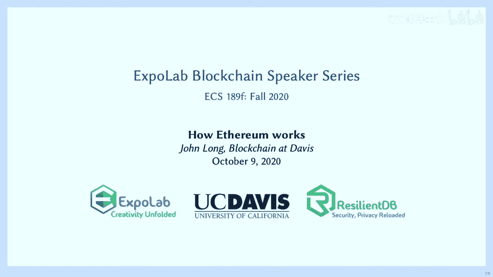
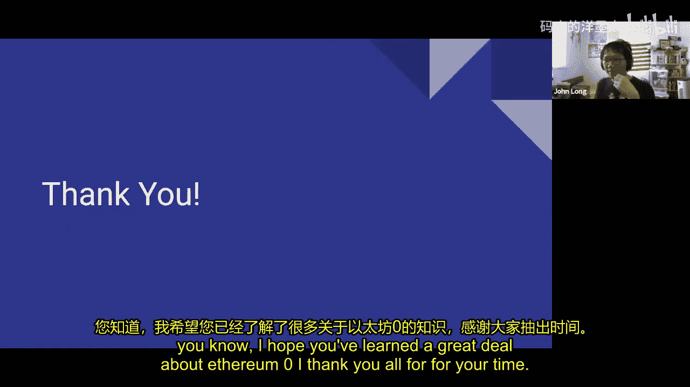
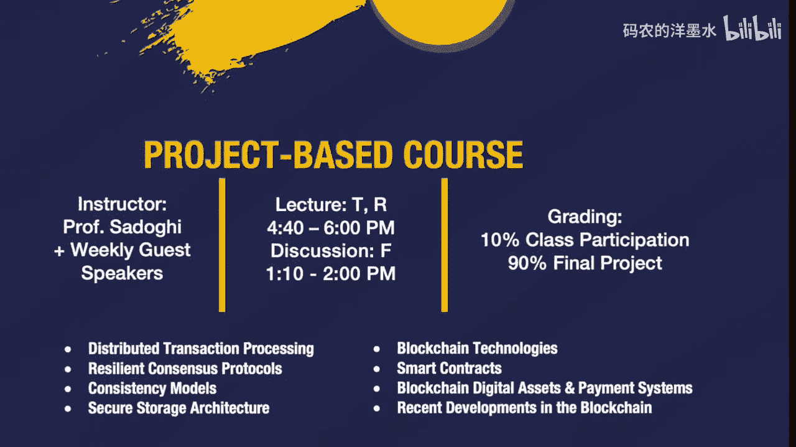

# 【全集】加州大学戴维斯分校 分布式交易与区块链架构 中英字幕 完整课程 p06 Lecture 2 - 以太坊的工作原理 -BV18YFVzME2f_p6-

Hello everyone welcome to our second session of B speaker series and today it's my pleasure to introduce one of our own John Long is a UCD student and he's been one of the most active folks in the blockchain at Davis and' kind of the head instructors against official title of head instructors and had the opportunity to know him for the past few years and his excellent speaker as well。

 so he's going to talk about Ethereum a sort of the basis of the Ethereum and how it works and he's really to have a lot of expertise on the subject so with that John please take it away。

Thank you so much for that wonderful introduction it's been a pleasure to work with Professor Sadogi and I'm incredibly happy to be in front of you guys today。

 so without further ado I do have something prepared for it's sort of like an introduction to how Ethereum works let me share my screen and you know do let me know if you can see it let's go ahead。

😊，Hit share， now I have to drag everything to the right， that will go ahead and hit present。

Poiner and I also have the chat open so if there are any questions you know feel free to raise your hand or you know go ahead and put it in the chat I'm more than willing to to answer those。

So with that being said， as Professor Dogie mentioned。

 I'm the head instructor for blockchain at Davis coming up on my wow。

 it's already been over two years now so'm you know'm ecstatic to do something like this so just a brief overview of what I'm hoping to cover today is to provide some historical context to sort of put Ethereum where it belongs in maybe where you understand the kind of cryptocurrency environment and then build off of some existing knowledge from maybe the prior lectures you've had or I see that on the course schedule there was a talk on Bitcoin which I think will be very conducive to helping you understand how Ethereum works。

But on top of that， although they're like some places where they're related。

 there's also what I call like the secret sauce， so there are a couple components about Ethereum that make it really stand out as a unique a unique blockchain environment and you know along with that you know amazing sort of innovation there's of course。

 some shortcomings and I have maybe one or two concluding remarks to give you some food for thought。

So without further ado， let's go ahead here so I'm going to go way back in time so we're going to go talk about some very early cryptocurrency history so around 2008。

 2009 Bitcoin got launched by the the kind of mysterious Satoshi Nakamoto to this day no one really knows who he is there are some farflung hypotheses but nothing solid but Bitcoin was pretty revolutionary in the idea that it was living proof that you can accomplish a decentralized consensus it is feasible it is capable of being self-sustaining and it works and from the moment Bitcoin was born we see what I always call the kind of altcoin flood so in the subsequent four to five years we see alternative cryptocurrencies at first people would just fork the Bitcoin code and play around with it but they added a bunch of new features as well to address some of the concerns that they were having with Bitcoin for example incentivization so the。

Nos that host copies of this blockchain， why aren't they being rewarded as well and some coins tried to implement features for that or a centralization。

😡，You know there are stories these days of you know like huge mining operations in China like Bitcoin mining operations and it's a concern for the security of the network as you know they gain more and more power or a more remote concern but still warrant it is what if the hashing function that Bitcoin relies on what if that gets compromised so then you see the birth of X11 X12 x13 I think they even managed to get up to X17 so they daisy chain multiple hashing algorithms to try and deter this although it is it didn't gain much popularity and you can pretty much treat them as being dead at this point。

So around 2014 that's when we start to see the birth of Ethereum so it was launched by a Viic Butterin。

 I think he's in his mid-20s very young guy so know if you guys take this course and get out of college there's plenty of stuff you can do in the realm of blockchain technology but Butterin had the idea of leveraging this blockchain technology for this decentralized application so it's an application that apps that do not need to rely on a single provider for access a single provider is like we're using Zoom right now zoom is hosted on the zoom company server or Google you have to go to a central location and if that gets compromised or fails or data gets leaked then it becomes very problematic so we can you have the idea like let's go ahead and leverage what blockchain is good for which is that decentralized capabilities for applications。

And Buterin also recognized the need for a more powerful scripting language。

 so in this picture below this is what you know like a very， very simplified Bitcoin transaction。

 but the idea is that although Bitcoin does have its own a programming language is literally just called script it's not Tcomp the only reason that language exists is for complex transactions so maybe like you know two people want to send money to three people pending a certain condition or a signature but you can't write applications with it so it's a very handicapped in that regard Buterin was like well if we have something more powerful then we can have these applications which can live in this blockchain environment。

😊，So that being said， the way Ethereum has grown is through a kind of series of milestones so it has a very sort of rich history I remember when Ethereum was still in sort of test net phase so it hadn't even become a viable currency I was already messing with the language some very interesting stuff there so frontier and homestead or sort of the code names that was the initial release they just want to make sure that you everything is working properly and then we see sort of Byzanttheium and Contantinople which are designed to address certain scalability problems as more and more people use Ethereum we might we start to see some network latency problems and concerns over security but as I near the end of my little presentation here I want to pay attention to serenity or Ethereum 2。

0 which is a major kind of。Upgrade to the security and throughput that this network has some of these updates have required hard forks and the hard fork is essentially just a protocol upgrade so the way the whole blockchain systems work is that all the nodes have to be an agreement everyone has to follow the same protocol but as a developer if I implement a new protocol then usually what happens is I have to sort of get all the other nodes to comply so they have to upgrade their software and all the other nodes become invalid so it's this constant kind of game of catch up and Ethereum has been sort of chugging along with these in order to implement much needed infrastructure。

In that regard。So I know you guys have some pre existing knowledge of Bitcoin so。In many regards。

 if you were to look at Ethereum from a purely architectural standpoint you could get away with saying that they are similar in some regards。

 so it's still you know it still has a main block and it still has the same kind of hashlinking technique so you know one block holds the pre hash or the other block and it's this you chain so if you tamper with one block everything prior to it becomes invalid and it's it's still possible to have orphaned blocks so if two blocks get submitted at the same time and we still see the kind of。

You still see the same they still get accepted and there's kind of a race to see which chain becomes longer there is still an incentive model based around mining so expending computational power to verify transactions。

And there's still nodes， so nodes have to hold copies of this blockchain and they are responsible for verifying and distributing that blockchain to ensure that the entirety of the network remains synchronized。

So you know there are your similarities， but with that being said。

 the similarities and then and there， so there's plenty of new stuff to explore and that secret sauce that I alluded to in the beginning is the smart contract。

So we'll start with a traditional contract， so it is just an agreement between at least two people and it has to be recognized or it's usually recognized by a trusted third party so you know if I were to make financing deal between me and a small business I might go to a bank and the bank would be like okay this checks out everything's legit and if someone breaks that contract then there are you know there are punishments and there's a way to verify the validity of such an event but the traditional model does have one glaring flaw and there's plenty of all this stuff on the news is what if that third party gets compromise what if I bribe that third party and how much vetting know how much like verification do I need to make sure that this third party is good enough like there's no guarantee that they will not run off with my money or violate that contract。

So in around the 1990，1991， I believe is the exact time。

 Nick Sabo so he's a legal scholar and a computer scientist。

 he comes up with this idea of a smart contract it's the same idea it's still an agreement between you know multiple parties but instead of having a comproable human or some other human-based entity as the enforcer we now have a machine or a computer enforce it and the example he gives in his paper is a vending machine that's the earliest idea of a smart contract you give the tokens or your quarters in and then you get your bag of chips out it is and it's enforced by you know bunch of circuits。

 no human intermediary but we want to take that one step further knowing what we already know about。

Blockchain here and we want to have contracts that are enforced by blockchain tech。诶。

And turn completeness。The term of completeness being the scripting language here。

that I mentioned earlier with you know， Bitcoin script not being good enough and lacking the ability to develop applications on。

So here's how smart contracts sort of work in Ethereum。

 if you have familiarity with the platform you'll notice I'm glazing over a large number of technicalities and some of the architecture。

 but then again it is my goal to give a higher level overview of how Ethereum works and what makes it so prominent in today's sort of cryptocurrency or crypto environment。

 I would say。So how these smart contracts work is that the developer will compile a contract and something to nodes on the blockchain network to understand so the analogy I want to give here is if you've ever seen an actual like you know legal contract like you know it's all in this sort of legal you know very high English and you know lawyers are there to interpret it and whatnot so the same thing goes for Ethereum we have high levell languages like solidity and Viper but these high levell languages that you write your contract in get translated into EVM op codes and I'll tell you what EVM is in a short moment。

 but。With that being said， the what happens is the compiled code piggybacks on a transaction。

 So if if I'm submitting this contract for enforcement， I want to publish it in a sense。

 it sort of gets wrapped in this transaction and then sent off to the network Now the Ethereum nodes are smart enough to realize like wait a minute this isn't。

 you know a money that's going to anyone in particular， but it's rather it is a。

it's a it's a contract or a unit of execution in itself。

 so it's not meant to you know it's not meant to be receiving or sending any money like a normal user so what the nodes do is that that smart contract gets granted its own address so that address is how you interact with the smart contract it's how you find it on the blockchain it's how you will invoke some of its functions or built in properties and one thing that I have to emphasize here is that all the nodes every node on the network will execute that contract it isn't you know half the nodes or a selective number all of them will execute the contents of that contract。

So we'll want to， you know stay tuned on how the Ethereum nodes differ from Bitcoin nodes because for now I imagine you're assuming that the Ethereum nodes are just holding a copy of the blockchain there。

呃。Let's see。So with that being said， we can jump into the kind of architectural considerations for these Ethereum nodes。

So the Ethereum nodes like Bitcoin nodes they hold copies of that blockchain。

 but they're also capable of executing code so that's a rather unique kind of feature there what would be an example contract like what are people agreeing on okay so let's say that maybe I'm starting a business and I want to issue a number of like limited tokens and those tokens would represent ownership in my business let's say I don't know I'm selling apples I'm an apple farmer so what the contract does is when it detects that you set the contract the Ethereia the ether it will issue out the tokens to you and you become and an official shareholder in my Apple farming business or you can have multiple parties and you can make escrow applications in essence so maybe a certain number of criteria have to be met or a number of people have to give their digital signatures off onto that contract and then the contract。

Will distribute a locked sum of money， so those would be some examples of some example contracts I hope that answers your questions act。

 but you know feel free to keep asking it in the chat I'm more than happy to answer them。

So each of these Ethereum nodes possesses that EVM that I mentioned earlier and EVM stands for the Ethereum virtual machine and this virtual machine is incredibly weak like it only has op codes or instructions that are a by long and it doesn't even use all of them so we're talking about a miniatureature computer that has less than 255 instructions to put that in context modern Intel AMD and arm we're talking thousands。

 maybe tens of thousands of units of executable instructions the machine is stackbased so it's almost like if I had a stack of papers I push data onto the stack and execute on that singular stack so very limited memory model there and it's sandboxed and this is very important because we don't want people to write contracts that can hack your computer or leak your information so。

They are kept away from the internals of the computer runs on。😡。

And also you know this is part of the Ethereum model here concurrency versus parallelism so you know once again these contracts are run by every every single node here oh it looks like I'm looking at Sean's question in chat is there a limit to the length of the programs because I maliciously upload an infinitely long program to halt all of the notes that is an excellent question yes there is a limit I'm about to get to what that limit is enforced by or what the limit looks like and you can't you could potentially do something like that if you have like you know there we go Cameron nice Cameron's here Cameron is hinting at it there's a thing called gas that is there to prevent such things and also you know if you wanted to do something like that you would have to have like all the ether on the network which is impossible。

So I'm going back to concurrency， what I'm trying to get at here is that people mistake concurrency with parallelism。

 so you would think like oh， if I have my smart contract。

 maybe I can split it up on different notes and you can't。it runs everything at the same time。

 which is great for concurrency though so if half the Ethereum network failed for some reason。

 the other half can still keep chugging along and and running your application or smart contract that's great。

 but it cannot computationally split up you know different。😊，Different things there。

 So you can't think of Ethereum as one big old supercomputer in that sense。

And here we go this is what Cameron was alluding to thank you this is sort of the idea of gas and ether so ether as I hinted at earlier is the name of one unit of the Ethereum crypto so you know like Bitcoin and bitins and you know ripple has its own like。

😊，And I guess you would call them droplets or ripples I guess I'm not too familiar with that unit of currency so ether is just you know one unit of the Ethereum cryptocurrency。

 but there's also this other thing called gas and gas is how you what I would call a unit of computation。

😊，So those smart contracts are coded right they have a number of you know sort of op codes and instructions they execute each instruction has an associated gas cost。

 so for example if I wanted to add two numbers that might be 1000 units of gas or if I wanted to take the hash of a string that might be 12000 gas guess an example。

😡，And you can also have static and dynamic costs。 So addition like adding numbers maybe a static costs。

 but hashing and where the size of the data is variable may very well be dynamic cost。

 So every by the gas the amount of gas grows on you And you can purchase gas via e the network does this automatically so you can't go on some crypto exchange and say like I would like。

 I don't know 10 million gas for one ether you can't do that the blockchain internally handles that And you know's the smallest unit of Ethereum is like I think I believe it's like a gray as it's called So's usually when market people talk about like oh how much is gas。

 they will say it it's like maybe some number of。And why why does Ethereum bother doing this。

 Why do we want to separate this unit of computation from the currency itself isn't this more hassle than it's worth well the idea behind this is that we want to separate the utility from market volatility so imagine like you know you're using your laptop and all of a sudden like just because the NasSdaq lost 100 points you can't do anything on your laptop anymore like like oh you know it looks like you are forbidden from doing any work。

😡，And that's sort of the idea here， cryptocurrencies， as many of you may be familiar with。

 are notorious for being very volatile。😊，So the idea behind this was they didn't want smart contracts and applications to suffer from this market volatility。

 so the idea here is that if we separate the unit of utility from the sort of token or the unit of currency itself。

 we can kind of cushion the market volatility from affecting the actual network's computational capacity too much so the analogy that I always love to give here and this is not my own unfortunately。

 is that you need gas to drive a car， but you pay for that gas with you know money you know cold cash or credit card。

😡，So that's the analogy that I like to think of between Ga and ether。Now with that being said。

 you guys have like this rough overview of smart contracts， you know。

 being able to run this kind of highly concurrent code and and whatnot。

Now it becomes a matter of dealing with these decentralized applications。So smart contracts。

 as I mentioned earlier， have their own addresses you can invoke them via transactions and it doesn't matter where the transaction comes from as long as it's valid so smart contracts can reach out to other smart contracts and as a result you can sort of chain together or lump together these smart contracts and you can have multiple contracts work together to create a decentralized application And I mentioned spoke and hub here and the idea behind here is you can have like one smart contract be like be responsible for you know dealing with。

The front end and then the hub contracts are the ones that the spoke will sort of reach out to and and it will。

They're responsible for smaller units of execution like objectoriented programming， for example。

 and with this idea in mind you know now we can have these decentralized apps so they run entirely on the Ethereum blockchain and they don't need a single server to rely on them so you as I mentioned earlier if half the Ethereum network vanished overnight。

 no sweat your application is still up and running whereas Google if Google server is vanished overnight well then you can't use Google and you're going to have it's very you cumbersome for the user。

And one of the pioneering applications that has come out from Ds or decentralized applications are DOs or decentralized autonomous organizations。

 and the idea is that we can have certain organizational rules codified as smart contracts so some examples I put out here is that managers can only get paid you know they get paid via this contract and the payment is conditional on maybe some vote by shareholders or some criteria being met。

And it allows for a much better integration with tokens or voting so many of these das have a public component where like you as a stakeholder get to decide should this company work on project a or project B I can use my token on this smart contract and that will sort of notify the organization okay this is what we're going to work on and this is where our our payment is locked up as so only until the organization satisfies the condition that they finish work on project a then they will get paid for their work so the smart contracts do that all there is no human entity you know pulling the strings here and it reduces a lot of the。

Problems with having a human intermediary such as you know corruption or you know things like that。

INow， you know， with the smart contract being the main focus。

 I wanted to talk about a number of sort of architectural peculiarities that you will encounter when working with Ethereum。

😡，So one of them is that the Ethereum block size is not fixed。

 so that might be a little unusual because blockchain are not blockchain。

Bitcoin has a fixed limit on that size， but it's one megabyte。

 although with the segregated witness update and a number of broiling controversies。

 there's been some variations where they've expanded it to two megabytes， four， eight megabytes。😡。

But the Ethereum block size is dictated on gas so it's how much gas all the transactions and data in the block that's being worked on contains so right now they're around 10 million gas right now or no the limit the block limit is 10 million gas so that is that's and remember different op codes different instructions in a smart contract can have different amounts of gas so as a result you can have varying block sizes and I think last time I checked it's like 20 to 30 kilobytes so much smaller than what Bitcoin has for one block which means those blocks get generated faster so faster transaction times as a result。

Also miners get to collectively vote on what the gas limit per block should be and the reason that is is you got to remember that gas as I mentioned。

 is a unit of utility， a unit of computation so the miners that are doing all this work that are verifying transactions if there's too much gas in a block there's too much data then the miners get crippled and it doesn't accurately reflect what the network can handle so by letting the miners vote you know there's sort of a variation in the gas limit and as a result the block sizes so this this kind of variability which is advantageous in many ways but as you'll see in the shortcoming sections may become a bit of a problem rather very soon or it already is a problem I should say。

Ethereum mining is currently proof of work， but it will transition to proof of stake rather soon and if you don't know what proof of stake is I can I'll have a nicer explanation very soon the hashing algorithm that Ethereum uses is Shah3 related so Bitcoincoins 256 Shah3 was meant to be this kind of successor that the national Institute of standards and technology kind of pushed for if you're really into cryptography you can look at dagger hasshimoto which is sort of the name of the actual algorithm there but the idea is that it's designed intentionally to deter custom miners or these AsI chips from being implemented。

And the way they do that is by being as very memory intensive so you've got to remember that you know these computer chips have limited space and the more space you use up。

 the more expensive it becomes， so memory is one of the most sort of space consuming things you can have on a chip so by forcing the algorithm to you know by forcing this hashing process to be memory intensive you kind of deter the market from deciding okay we're going build these chips。

 although as you'll see in the picture below this has been fored but it's not a concern as you'll soon see。

I put this in quote here the idea of a difficulty bomb and this is implemented in the Ethereum code to deter a centralization of power and the way that works is that at some specified number of blocks so maybe after 10。

000 or after 30000 blocks difficulty will grow like it's skyrockets so you might go from a difficulty of I'm using arbitrary units here from 100 to 10000 so now you generate less currency but it's harder to。

Centralize your power around that unlike you know Bitcoin， which you know it has a very。

 I think it's like the twowe sort of difficulty adjustment system and this is just meant to kind of keep everyone on their heels and prevent someone from amassing a bunch of mining power solely for profit。

So AsI mine do exist， but the market research has shown that the profit margin as of now is too narrow for many people to really invest towards this hardware and do anything potentially threatening。

😡，And one last sort of unique feature here is this idea of uncles or I think I call them armors it might be a Nordic origin。

 I might have that pronunciation incorrect， but it's as I mentioned in the very beginning it's highly possible that two valid blocks will be submitted simultaneously so you know in our minds an ideal blockchain is just one sort of continuous chain with blocks you know pinned together or pinned subsequently pinned in sequence excuse me I'm getting ahead of myself here。

But every now and then because there are so many people using the network。

 you will get two blocks submitted at the same time and they're both valid。

 they're both equally valid， you know they meet the criteria of being accepted。😡。

And the traditional idea here is that the longest chain becomes the valid one and the other one is orphaned。

 like okay， it's like we just forget about it， it becomes so you get no reward for working on those side chains。

So yeah， traditionally miners just didn't get rewarded。

 but in Ethereum these orphans are called uncles and you get a reduced reward if you were working on one of these one of these armor or uncle chains and the idea behind rewarding this is to deter Bitcoin like pooling so you know that for Bitcoin mining people will get into these massive pools Bitcoin is susceptible to the 51% attack and there have been like known cases where pools have gained so much power they hit that 51% mark although out of goodwill they have decided to you know intentionally cut back to 49% or less。

But the idea by rewarding people who still work on these unused chains is that people won't be willing as much to pull together because you still get a reward even if you were on the wrong side。

 so the pooling the motivation to pull resources together is significantly hampered there。😡。

Now with all this you know all these bells and whistles。

 Ethereum still has a number of shortcomings know it's not a perfect technology by any means。

 although it has you know opened the gateway for many interesting applications and has sort of revolutionized the kind of crypto environment here and I want to start off with the scalability trilemma and this is also an idea by vitalic butorin and it's that every blockchain has you know three things that aspires or wants which are decentralization security and scalability but the problem is for every blockchain in existence you can only have two out of the three so I can have decentralization and security like Bitcoin but I cannot have scalability and as you'll notice from more concerning。

Headlines， the Bitcoin blockchain has grown it's very bloated。

And it's also the more people who you know make transactions on Bitcoin。

 the slower things seem to seem to get if I remember correctly we're capped at like 21 or less transactions per second for Bitcoin whereas like visa can handle 10 million in a second。

So that brings me to speed Ethereum is not designed for high performance applications and this goes back to what I mentioned earlier。

 concurrency versus parallelism Ethereum can run everything at the same time for very high fault tolerance but it cannot split up a payload and choose specific nodes to do work。

 so if you're trying to look for like I don't know simulating molecules Ethereum is not your best bet。

😡，The immutability here immutability is you know like it's always been crowned as one of the tenants that every blockchain needs to have and that's true it is advantageous because it prevents people from editing things that they're not supposed to or to commit fraud but there have been there's a very notable case where this sort backfires in the Ethereum environment and also those smart contracts I mentioned these decentralized applications that are based on smart contracts have a major shortcoming which is that you can't really upgrade them you have to like destroy the smart contract and then you have to launch a new one and sort of reroute everyone to the new one and that's part that's part of trying to stay in line with this immutability so as an example the apps in our smarts know if the developer finds a bug no sweat I just push and update but if there's a bug in a smart contract you know tough luck you have to destroy the contract and people may have lost money at the time there's no way to edit。

That and I also that also goes to this sort of explosive growth that I'm talking about so with all these smart contracts and all of these decentralized applications on top of normal ether transactions you now see a bunch of stuff with regards to you know like these applications that want to put data on the blockchain so with the variable block size I mentioned the fast block generation and the smart contract data on top of all your traditional transactions we're seeing like the growth has been exponential or super exponential and as a result the chain is already greater than one terabyte and it deters people from creating node because that means I as an enthusiast or as someone who would like to support the network I have to invest in all this hardware just to you know help protect the network and enforce the protocols。

😊，And the last problem I want you guys like if you take away one thing from this presentation。

 even if you don't if you're not a big fan of Ethereum。

 you should be aware of this as like Neo and other smart contract platforms exist is the oracle problem smart contracts can't get data about the outside world so what this means is let's say I wanted a contract that would give all of you maybe one ether if it rains in the next 30 seconds。

😡，I have to have some way of letting the node know like okay it's going to rain the time and these are historically difficult things to do because all the data that goes onto a blockchain has to be verifiable。

 you have to have some way of proving over and over and over that this was true， but with oracles。

 you know I can't just have one oracle I need to like have some kind of consensus but then I have to have a whole like network based on how to you know like check the rain and there has to be some way to vote and as a result it just it is fundamentally incompatible with the blockchain methodology of constant verification and immutability。

😡，So this is something that remains unanswered， although there's a lot of research。

 it's a very speculative field over how one could resolve this。

And I mentioned this immutability problem here， I actually wanted to in let's see I still have some time here。

 I wanted to go over this very quickly， this is something that is haunted for Ethereum's entire the entirety of Ethereum's existence。

 the Doo incident has always come to haunt the Ethereum community。😡。

So how a Dow usually gets started is that a smart contract gets created with the initial logic to take in ether for the exchange of tokens。

 so this is sort of like if I go on my bank account now and I buy shares in a stock shares in a company。

 excuse me。😡，And those tokens that you get for giving your ether away represent voting rights for that organization。

 so usually you have maybe a month or two weeks， a period of time where people just shell out ether to get these tokens and then that purchase period ends and the Dow will begin operation。

So there was a Doo called the Dao literally， that's why I put it in quotes but there was a flaw and there was a bug that was identified in this kind of exchange logic and a hacker managed to siphon away millions of dollars worth of Ethereum cryptocurrency and the entire community was in a panic and the users to this day are still split so one approach is leave everything as is so all the people who paid for the tokens。

 they don't get their money back and the network just continues operating as normal and this is just know to live within those rules of immutability because one of the things that people don't like about blockchain hard forks is it's a reminder that the control over the blockchain is still with the developers it's still centralized to a degree for the sake of maintenance and security。

Another half of the community was like let's attempt to do a hard fork so we invalidate all the transactions that surrounded that that doo and people will get their money back but by doing that you've essentially shown to the entire community like hey you know I'm vital uterine if there's something I don't like I can make your data invalid I can violate immutability which is terrible。

😡，And Cameron， Cameron has a humorous qui here I have an answer to the oracle problem。

 it's just not decentralized。And that is unfortunately would not be considered an acceptable answer because for those oracles to know integrate with the blockchain there has to be or people need to see some sense of decentralization because we don't want to implicitly trust a single entity that is the bane of blockchain technology so you know going back to the Dow incident with that being said if you look right now they're actually two versions of Ethereum there's Ethereum like the mainstream version and then there's Ethereum classic and classic was like okay we're not going fork and we're just going leave things or we will fork and know we'll keep our money so that's the split that I'm talking about and this is just a cautionary tale about how you know you should be very careful developing the smart contracts and wrestling with the immutability that this platform provides。

Now before I wrap things up you know I mentioned all this bad stuff about Ethereum so I think we should end on a positive note here that Ethereum is still you know very much active being actively developed and that's what I want to talk about with version 2。

0 so I mentioned that Ethereum has plenty of milestones so one of those milestones is a code named serenity。

😡，And serenity is a full shift to proof of stake， so the idea behind proof of stake or PoOS is that instead of people having to waste electricity and hardware and money to mine coins or to do these repetitive calculations you will lock up your ether so I kind of waive my right to my money to get the chance to validate transactions and false transactions or if you're caught invalidating or like pushing false information will cause you to lose ether so the other nodes will essentially punish you and revoke your right to the ether you locked up so there is an incentive not to lie or not to falsify information。

Pro of stake is very advantageous because you don't need all that custom hardware。

 you're not wasting all that energy I think if you look at like the current Bitcoin power expenditure for mining it's almost like the equivalent of a small country at this point it's pretty scary stuff but the problem you know a drawback with proof of stake is that you still go back to that hoarding problem so there are whales and you know some people will inevitably like have a million ether and they'll just keep amassing more and more ether because proof of stake rewards staking by giving you more ether so in a sense you haven't really fully resolved that centralization problem。

There's also this idea this is a very， very new it's still under development and very much in research are shd chains。

 so instead of having one main blockchain that all the nodes have to kind of follow with and do their computing on。

 we redistribute chunks of that main chain to other nodes for faster processing。😊。

And this is very tantalizing tantalizing hints of parallelism， so we have concurrency。

 but with this it might be possible to create more computationally intensive applications on the Ethereum chain before I get to beacon chain let me look at Zach's question here if you lock up your ether to have proof of state do you still get a small reward just like the miners or do you purely do it because you're an Ethereum enthusiast and want to help keep it decentralized you still very much get a reward you are still rewarded for sort of giving away you're right to that currency so you can't move it or touch it because then you become like a validator so you' you're busy signing off on these blockchains。

So yes， you're still rewarded so it's not just you know for enthusias。

 I mean there will be inevitably people or institutions that are more than willing to contribute to this staking process for the safetynctity of the security of the network so that's an excellent question。

😡，Oh whatops and with that that the beacon chain here so if we're taking a blockchain and we cut it up and send it off to other nodes so the nodes are no longer like all in agreement。

 there has to be a way to kind of make sure they're not like you know fi their data or they're。😡。

Making things up。 So there's a secondary chain called the beacon chain that is there to。

To try and synchronize all of these shards and allow them to reach a consensus so this is sort of like I think of it like scratch paper when you're doing a test it's like okay I'll verify on scratch paper and then I'll put the final result on the exam so the exam being the main blockchain。

😡，So very much you know a lot of great stuff in store for 2。

0 and with that being said you know leaving on that positive note you know I hope you've learned a great deal about Ethereum and I thank you all for for your time now let me go ahead and all stop sharing I see some questions here so i'm going to go ahead and okay it looks like my webcam is on great so let's see there is a。

😊。

Theres a question here from Jonathan how safe is staking Ethereia is there a possibility it won't be unlocked ever The only way that could happen is if somehow during the staking process you manage to lose your cryptographic keys to your account so as long as you don't you know I don't know a publisher keys online or let anyone else tamper with it it's incredibly unlikely this is almost the same degree of likeliness that someone will encounter a hash collision in be shot 256 hashing protocol so it' it's a rather safe thing to do because it's you。

😡，Theoretically someone could compromise your computer。

 but it's up to you to keep those keys as secure as possible because the staking is represented by activity on the blockchain。

 it's not something your computer is contributing any intensive sort of computational power towards。

😡，h does prove the stake still require minors or what happens to everyone who is doing lots of mining if they no longer have to do a bunch of pointless hashing for proof of work？

😡，I think what happens is if I remember correctly these stakers。

 let's see proof stake in a 100% proof of stake environment。

 there will be no more no more mining essentially it just they don't really get incentivized anymore to continue that mining process so luckily one of the things with Ethereum is that。

Most people are doing GPU mining， so the thing with the GPUs is that they're not catered for Ethereum。

 there are plenty of other cryptoos they can migrate to so that's almost like an inbuilt benefit。

 an unthought benefit of how Ethereum has been so adamant in deterring the centralization that you see in Bitcoin and other currencies where you might witness like the AsIs that I mentioned。

 even though they exist they take up such a small portion of the market because they are not as profitable as you what Bitcoin has become。

But yeah that's an excellent question what happens to the miners they will essentially I believe they they will not be rewarded once that switch happens because you don't want people to still be expending all this electricity and resources on something that is being actively deterred via proof of state。

But yes， those are all excellent questions。It's all really good stuff， I'm very happy to answer them。

And happy to see the interest in this technology。Excellent talk wonderful job and so the proof of stick that you kind of kind of ended that's a very exciting I think new。

New types of protocol we're actually going to have few sessions just fully dedicated to proof up stake。

 we are also going to have few sessions dedicated purely to sharding as well too。

 and one of the even the project that we propose the servers is sharding protocol that we have been developing here in our lab as well we actually have three different sharding protocol but one publicly available one is the servers protocol。

Which is done in the collaboration with the Ras teams，s blockchain。So。

And in terms of the mining of the proof of stake sure you're not going to do your traditional mining of solving kind of a random puzzle。

 but there still will be incentivized and so there is a protocol that allow incentivizing the node to join and I think maybe one way have to think about the proof of stake is that you essentially put your account into a saving account and you gain interest and that。

And that interest is for you。Be able to signing off those transaction as a validuator so the incentive is still going to be there。

 but it's going to have a different flavor。 I think the other interesting point that you mentioned with regards to concurrency and parallelism。

Kind of诶。Put it in from the database perspective is that what we really so in a database sense。

 as you pointed out， there is not much of a parallelism because we just have redundancy we have redundancy running the same contract on different machines so。

It's not going to give us any improvement in terms of performance because。

It's not that we're breaking the same task， dividing it up into five pieces and so we can do it faster。

 we'll just have the same task and run it five times so we'll just get redundancy。

So it's a more kind of a redundancy as opposed to being in the parallel in concurrency again。

 so for us for little theory the concurrency means you could still have parallelism so concurrency really means you concurrtly executing transaction at the same time and if the hard allows parallelism and those transaction can be in fact not in parallel let out and in conflicts that you do get parallelism there as well too。

 but well in this case it's really the question of redundant redundancy which is simply redundantly running the same task in every machine so as John said there is no really gain and there is not。

The parallelism provides。Durability as a opposed to performance。

Or reliability as opposed to performance。absolutely so any any questions again。

 there was a very exciting very energetic speaker and I think yeah I always like listening to John that he teaches on different topics so was excellent I personally enjoyed it very much。

Thank you so much for having me and thank you to everyone for attending and asking such wonderful questions。

 I greatly appreciate the opportunity。😊。

