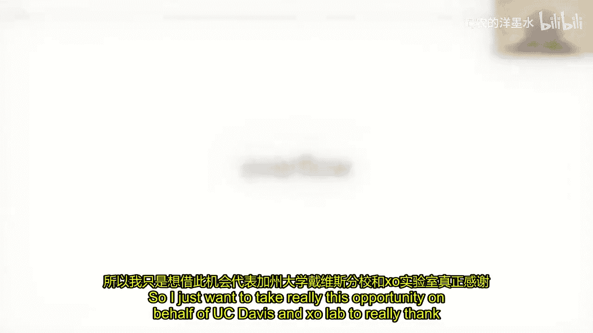
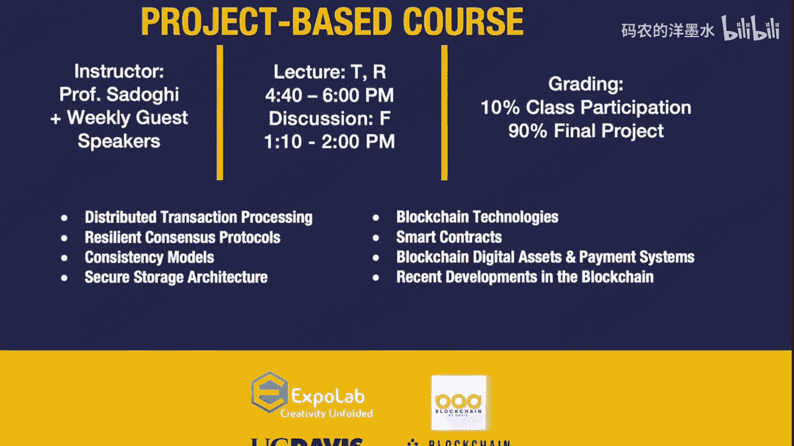

# 【全集】加州大学戴维斯分校 分布式交易与区块链架构 中英字幕 完整课程 p07 Lecture 3 - Libra Diem的核心原理 -BV18YFVzME2f_p7-

Hello everyone， welcome to another session of Expo Lab blockchainchain speaker series today is my great pleasure to have Dahalia Malki from Libra and now it's called the De Association。

 she is I would say the sort of the real force behind the whole Facebook Libra blockchain project and she has had tremendous impact and seminal work and distributed fall toler and system from flexible taxes to more recently hot stuff so it' just a wonderful and a great pleasure to have Dahalia today with us and she's also been the founder of VMra research she has been senior scientist at the AT&T principal researcher at Microsoft and just tremendous experience and impact in this field so without further ado please take it away。

Thank you Mo pleasure to be here today virtually what we're going to do is this is your last session for the semester we're all you know zoomed out of Zoom presentations we're going to play a little game。

 I had to you know I had two minutes to change the title slide from Libra to DM。

But not the rest of the presentation so you're going to see a lot of Libra however。

 you're going to catch me every time I say Libra instead of DM and you can whistle you can shout or you could just keep a tab of it and when you ask questions every time you say Libra instead of DMm I'm going to keep tab at it and whoo you back。

Okay， good enough。Sounds good and so maybe since you mentioned that that's I think it's an important point so you are our 27 speaker and so this is the final session of this speaker series so we definitely saved the best for the last and we now have a little game to play so I think it's exciting I'm just all looking forward to it。

Cool， the second thing I wanted to say is really feel free to Terry turn this into interactive you know session。

 I prepared a bunch of slides， but I'm not went to it so feel free to ask so with that you know in June 2019 Facebook announced to the world their intention to launch a global currency then named Libra that doesn't count because I remember to say then and the formation of an association that will develop the technology and operate the platform over which the DM payment network will operate。

The mission of DM is to create a simple， inclusive。

 efficient payment platform that will reach everyone everywhere。

 anybody with a smartphone will be able to handle the currency that is supported by the payment network and financial services some you know imaginative and creative that we can't even think of today well be able to come to the platform。

 so that's the compelling mission in the vision， and what DM， the D payment network。

 the DPM what it is， is very simply it's a blockchainbased system that records the history of payments and keep track of account balances with the set of stable single currency stablecos and a system of financial services that support。

The issuance and the handling of stablecoins。So with this mouthful。

In order to deliver this global disruption， the main thing that DM needs to do is gain the trust and it's gain the trust of the users。

 the consumers gains the trust of financial world and gain the trust of regulator。

 so it's 360 gain trust， and we do it in three main columns。

 we want to gain the trust of everybody in creating an efficient medium of exchange that can be handled in everyday life and in every application。

We want to gain the trust of everybody in the foundations， this is the technical。

 as well as the economics foundations in which the system is built。

And we want to gain everybody's trust in the ability of the framework and organizations that we've established to continue growing and evolving this platform and maintain a distributed collective and inclusive governance that allow to grow these you know the platform。

 and this is， you know all this。To bring this down from kind of a fluff or a marketing level down to earth。

 all of this is very， very different from anything before that。

 so if you think about the evolution of blockchains and cryptocurrencies and cryptooeconomic systems。

 it started with the idea of creating a decentralized platform that bypasses any regulatory oversight and any existing mechanisms and is really controlled and governed and operated in a completely decentralized way。

 and so if you look at the three kind of layers operated for cryptooeomic system。

 there's the infrastructure layer who operate， then there's who's allowed and to benefit and you the mechanism for creating value or minting or tokenizing value and then there's the financial services operating on top of it because you know the end of the day。

A virtual imaginary world at some point needs to have entry of fiat and exit and merchants accepting it or you know something in order to hold value so these is the virtual asset service providers to built on top of it so if you look at the first generation mostly Bitcoinco that introduced this disruption very soon after Ethereum the infrastructure the foundations has been completely public and peerbased everybody participates in the operation everybody has a chance to it and it's completely decentralized and it's out of any jurisdiction and any sovereign control the way value is created is by allowing the participants to create value in the network and so the primary mechanism for。

You know， for these networks to operate is as a holder of value， not as a means of exchange。

 but as creating value and holding value， and some of the difficulties that are associated with them is the liquidity and the volatility of this value and only on top of that when interfacing with the real world financial services you know。

 had to have any kind of liability and any kind of responsibility for their consumers。

So this led to the emergence of the layer2 services that are operating above these platforms and essentially provide a stable regulated means of exchange。

 not a holder of value through the issuance of stable coins。

 so this includes blockchains and systems like USDC dye， Paxos。

 Gemini and so forth and what they're doing is they're anchoring a fairly minimal anchor on the you know unregulated infrastructure and using it for transparent settlement and issuance of tokens and everything on top of it is regulated and centralized so essentially the systems come as a centralized service provider they issue token which the back in a very trust。

A manner and one that is heavily audited and regulated。

 such that every coin that's minted or issued on these blockchains is backed by them and they operate this issuance mechanisms in a transparent way and with immediate and efficient phe by anchoring themselves on a decentralized infrastructure。

And once again， the wallet providers， the service providers that are providing the entry and access to the system。

 they are completely regulated and centralized and provide the same responsibility and compliance that any other money transmitter should do。

Um。I do want to note that even though the very， very foundation is decentralized。

 really the token issuance itself is completely centralized because somebody has to at the end of the day。

 say， for example， Ethere and forts or if there's a problem or if there's a compliance issue or sanctions that need to be enforced。

 this is all done by the entity that controls these tokens。

DM is completely different in that all three layers are ones that are distributed and in that we are seeking to be licensed from the ground up。

 the entire infrastructure， the entire layers of the codeb。

 the entire architecture is distributed by design， it is controlled and operated by the DM Association and its 27 members。

 and we are seeking license to operate as a global medium of exchange and as a global payment platform with the entire system having this distributed control。

So this is really， I think especially useful for what we've been covering in the course。

 I wonder if you can maybe just say a few words on that issuance of this token。

 how much how does it is something backed backed by something and how does the issuance words。

 how does the value of the token is determined and any sort of a lifecycl on the actual currency and from understanding the liberal is perhaps also creating this global currency？

You just said the L world。Oh okay， yes， the DM is creating the global currency in addition to be I guess in this distributed global payment platform as well too。

Yeah， so I have some slides later on on the technical side of it。

 I actually removed from the stock of some of the more macroeconomics aspects。

 so let me just speak to it on DM what we're going to have is we're going to have the mechanism for issuing single currency stablecos。

 so for example there could be a DM EU or a DM British pound or DM yen and of course know a DM US dollar。

Each one of these will be issued only by the licensed payment company that we are seeking to regulate and to obtain license for。

 and that's DM networks， the Treasury of DM networks is the one that can is the only one that can create or issue these stablecos on chain and the guarantee that we provide is that this issuance is backed one for one。

 mostly in cash reserve handled by trusted reserve custodian which again is regulated and adhere to the highest standards of maintaining this trust with the guarantee that at any any time there no more tokens on chain than there are backed by the reserve and again this reserve guarantees stability of the investment no loaning。

 it's one for one backed as well as capital。Mment and risk buffer management that adheres to the highest possible standards so with this this is what we' are asking a license to operate what this guarantees is that at the infrastructure level there's always backing if you know anybody wants to redeem their tokens back they're always backed。

Moreover， we're also requiring all of the participants that are directly accessing the platform to also have one for one backing for you know the accounts that they are custody maybe I should remember yeah maybe I should move to the next slide and give you a kind of a bird's eye view somewhat from a technical point of view but look i'm also I'm not an economist and this course is mostly you know a technical people so this is a bird's eye view of the DM platform and its component so let me go very quickly through it at the bottom at the foundation we have the DM blockchain。

And what it is is simply a mechanism to replicate the history of transactions。

 most of the transactions are payments， transfers， but obviously there are also governance and now maintenance transactions。

On top of the blockchain is what we call the DM framework。

 this is the set of rules that define the logic of how participants can interact with the blockchain and ask to change the ledger state so the framework you can think of it as the set of software modules that DM allows after testing and after scrutinizing them to be part of the state that the platform stores and they define the only way in which you can access the state of the blockchain and mutate it this framework is written in a new language called move and I'll say a few words about it later that was designed。

Especially to provide the safety of financial assets and handling of them。

On top of the blockchain and you know the framework that provides the API and the rules for interacting with it。

 the participants that you will see when we launch and the personas are essentially you know three types first of all there's DM networks itself it operates the reserve and it is the only entity on the blockchain that can create and destroy token resources it does that through a system called the association operation services or the AOS。

That secures those critical operations of the reserve。

 as well as securing the governance and compliance operations by DM networks。

The Treasury interacts directly with networks of designated dealers。

 these are you can think of them as banks， they are actually banks and they are the only ones who can ask the reserve to swap fiat for tokens and affect。

 effectate， you know mint and burn operations， so the designated dealers interact directly with the reserve they transfer you know they establish relationship。

 financial relationships with them to guarantee counterparty risk management they can transfer fiat directly to the reserve and D networks in response will mint tokens on the blockchain and send them to the addresses that these designated dealers establish on the blockchain。

This network of designated dealers are the ones that provide liquidity on and off hours with immediate service to all the financial services。

 the VAPS， virtual assets of financial services that are operating on the network and they're split into two types wallets and liquidity providers。

 liquidity providers are again ones who can establish participation。

 obtain tokens from the designated dealers and they can serve further wallets， the end users。

 the end consumers as you can see on the slide are outside the perimeter of the payment networks。

 they are participants of participants， they're not directly accessing the network is first in order to become to directly access the network you need to be permitted by DM networks as a participants。

It adheres to compliance and regulatory oversight。Questions on this。I'm going to， you know。

 in a few slide I'm going to overview very quickly， kind of one， two， three， four， five， you know。

 the blockchain。The framework I'll talk a little bit about minting and burning and then if I have time I wanted to switch gears and talk about some of the more academic work。

So one quick maybe so one quick sort of clarification for the big picture so one is the one to one asset of the user is that sits in this dotted area that one to one backing or is it outside that dotted area so the one to one backing is guaranteed by the reserve operations and this is guaranteed contractually as well as technically the reserve never mins or burn tokens without a corresponding exchange with designated dealers and the security of this operation and orchestrating these flows is something that you know a system that custody addresses secures。

So one last question in terms of this big picture， so kind of to see what is really happening here is that。

What DM provides， I said it correctly， what it really provides as opposed to have this banking system and perhaps Vis car to connect the different banks it says okay bring the asset and once you brought the assets or they have different entry point for different banks to or for the user of the banks to put the asset into this dotted framework and from there on you no longer have to kind of worry about the bank banking system sort of virtualize and so all of the movement of the money and the assets it's just now within this framework backed by the fiat money that different banks bring in but at the face of it all those boundaries kind of in。

Disappeared。And it allows a very fluid movement of the Dm currency。Yep。

 and this is really what tokenization is about， it's not a security。

 it is a proxy for a liability that's represented by a central bank and government。

 it's not creating value out of nowhere， it's not creating utility， it's a tokenization。

 what it provides different from you know traditional payment system or banking system is immediate finality。

 immediate settlement， transparency and inclusion。So it allows tech and innovation to come to the platform。

If you want to start a startup up here in Silicon Valley tomorrow and access Swift or access the Fedwi system of settlement。

 good luck。Thank you so much。Other questions， comments？All right， let me talk a little bit about the。

The blockchain from the angle of why we think that this is a platform that can gain your trust as consumers as well as you know Washington Trust or you know the trust of regulators and the reason we do this is we chose to operate this platform over a permission set of participants。

 each one of the participants is itself a company that goes through you know a rigorous。

Selection process for their ability to operate services 247 and have the technical。

Strength to operate a you know a transaction recording system。

 so essentially each one of the validators that we have in the DM network could。

If needed operate the entire payment system on itself it stores the entire history。

 it has the capacity to execute transactions you know it belongs to companies that operate these type of services all the time however we're going to have you know right now we have 27 members in the association and so should any one of them experience any cyber attack or any disruption or temporary availability or network problem any one of the other you know 20 plus node can immediately take over so in some sense this is a system with zero recovery time zero fail over time and not with one or two replicas but you with over 20 replicas now in the blockchain world。

Decentralized often comps or you is synonymous with billions of users， but the reality is。That。

know the permissionless systems out there are not really decentralized。

 they very quickly devolve and it's hard to resist to being controlled by a handful of parties if you look at Ethereum。

 if you look at Bitcoin， Bitcoin is currently more than 50% of it is controlled by five large mining pools。

 Ethereum it's probably three stellar one， if you start with you know a very very decentralized basis。

 which is you know it leads to rich getting richer phenomena and consolidation here this cannot happen the association was established to retain the distributed control and distributed nature of it。

Moreover， in our deployment， we contractually enforce diversity criteria。

 the guarantee that these validators are deployed in geographically dispersed regions in multiple clouds。

 such that no single point of failure， whether it's geographic or whether it's administrative。

 no single point of failure exists in the system and no entity or no platform controls more than a third of the validators。

The deployment itself is publicly accessible but not directly。

 so the inner circle of validators is not going to be directly accessible each of the validators will operate。

 full nodes that are constantly synchronizing their state with the validators and they will be the upstream nodes to which public participants and other full nodes are going to connect to。

So this is of course， you know something that in this course， people have worked on a lot。

 this is a Byzantine fault tolerance replicated system。

 but when you ask yourself what is BFT good for， then this is what it's good for is to gain the trust in its diversity in its fault tolerance and the fault tolerance is not only for the unavailability or the benign crashes but what we see is that the way these systems fail typically is with insider attacks or cyber attacks in those attacks when you have a replicated system。

 the system faithfully replicates contaminated or corrupted state and the system will not。

In addition to it， the fact that this is deployed over a distributed control collective run by association nodes is very important for the governance and the growth and the ability of this system to evolve in the future without being controlled by any entity that is driven by economical interest to become proprietary。

And so kind of also understand the picture is that these mid tier validity they're essentially an observer。

 they don't really engage in the consensus itself， the consensus is only done within the inner circle。

 correct？All right， let's move on so I talked about how important it is to let the system evolve now the D blockchain is a system that governs itself so when the genesis block is deployed。

 it contains a set of initial permission set of validators but it also contains the rules that allow to change every aspect of the blockchain so you can change the set of validators。

 you can remove validators you can add validators you can change parameters on the network itself like count balances or compliance measures or other things。

 you can change obviously a software modules that define the rules for interacting with the network you can even come and change the state of the system when you need to patch it now when you think about it。

 if you think about the Dw attack of 2014 on Ethereum。

The community had to go and effectuate a hard fork in order to and revert a really。

 really bad occurrence in the network and first of all it did effectuate a fork and as you know some part of the community is still following the original Ethereum network that didn't change so it devaluated the coin and that happened to Bitcoin as well multiple times here there's the ability to evolve and decide by the association when a bad event happens and you need to fix it or when the software needs to update and so we believe that a financial systems evolve and changed dynamically very quickly much much quicker than a community of millions of users can come to a consensus。

False。And so the mechanism for evolving and updating and changing the。

The DMm blockchain is through a reconfiguration operations and these appear transparently on the blockchain itself and mark the time and the place where changes happen to any part of the softwareer and again it could be the validator set it could be the softer itself it could be any parameters now these reconfiguration transactions are of course。

You know super sensitive you have to secure them and you need to define the governance mechanisms for who can send these transactions and here the DM association established the two paths for government the happy path or the business as usual path and then there's the urgent security or compliance need path so when the protocol evolves as usual business as usual and you simply want to continue evolving the protocol。

 the DM blockchain is governed as an open source project with a team of maintainers that have maintainer rights on the open source project and with a steering committee。

 the technical steering committee that has oversight over them there's a mechanism for proposing changes to the protocol that's the dip DM improvement proposals framework by which。

The community can make proposals and when they're accepted and implemented and merged into master。

 at the next release， they're effectuated to the blockchain。

In order to actually roll out a change after it's been implemented and discussed and so forth。

 two-tds of the validators need to attest that they've installed a new version of the software successfully。

 it looks like what they were expected and follows the discussions that they saw on GitHub and so forth and protect this kind of rollout and once they give their signed asestations that turned into a transaction which is properly signed and effectates this reconfiguration。

On the right hand side， there is a change protocol or change management process for urgent fixes。

 so when there's compliance or risk to the payment network itself the company DM networks。

 the license company does have the means to go and you know fix a bad transaction a security breach or you know any kind of。

Urgent operation so just a quick question here is in terms of this governance so the example actually you provide the theuterium and Bitcoin in those cases perhaps a single person decide what's going to happen whether to fork or not to fork。

 I mean there's no really distributed governance at that point either。But in here。

 the setup is such that those inner validity， there are those that I guess the 27 entity or the whatever number of validity the inner nodes are those。

Breach a consensus on to make these changes or this is done by that I forgot what you call it the custodian that's a really good question let's distinguish between who has the decision。

Authority and who has the credentials or the execution power to execute the decisions so the 27 validators are not deciding at the time of the rollout you know whether a new algorithm is better than a previous one or things like that this is something that the community discusses and the association through its oversight body of the technical steering committee and group of maintainers governed just like an open source project does what the validators are testing to is the safety and the security of a patch and this is again a place where。

BFT consensus， if you ask why blockchain， this is where it helps you know a single rogue admin or just negligent admin or a system that has been breached will not will not allow anybody to roll out a bad version of the software and again if you look at some of the stuff that's going on in Ethereum right now in some of the other networks people don't even know what the right variant of the software is here remember so you know these attestations is not really exerting any judgment they're really sec and in terms of judgment the reason we have the business as usual versus urgent path is remember there's no question when like when Ethereum for there's a question of。

Which fork the users believe has value because it's a holder of value here there's no question where the value is the value is in the DM network treasury and they are the ones that consumers and customers at the end of the day has claims to so DM network is the one that decides where the network is and what to do with it。

嗯。So would it be fair to say that there is that so there is that governance body that they kind of。

 they have centralized way of。Creating the law or writing the law。 And this validate。

 there is a decentral lives。Safe executions of those mandates and regulation by that governing body。

嗯。The second part I agree with fully， the first part， it's not centralized， it is a consortium based。

 it is yeah the consortium yes exactly sorry， a consortium that the 27 members。

 whatever they come up with as a body okay。And this is really important。

 this is to me a key value of why blockchain and why isn't in fault tolerance。All right， let me move。

 let me skip some slides， let me move to minting and burning since there were questions here。

So the process of maintaininging and burning from a technical point of view is designed to guarantee that。

 you know， if the power goes off。At any moment in time in this protocol。

 the invariance that you maintain is that you always have backing in fiat of the coins oncha and so this is in the financial world what is often referred to as DVP delivery versus payment guarantee and so the protocol is designed such that designated dealers are allowed to request a mint order。

 they will receive a premin authorization from the association operations service you know this orchestrator of flows this premint order something that guarantees that operations will succeed once the fiat is transferred and there's no risk。

嗯。The designated dealer would then send the money transfer。

 the AOS automatically monitors for the transfer confirmation。

 it immediately issues a mint operation on chain and sends the money to the designated dealers。

The burn operation is the inverse that when a designated dealer wants to redeem coins。

 it sends a redeem order to the AOS， the AOS will again confirm that there's enough fiat liquid right now to the designated dealer。

 designated dealer will then move the coins first to a preburn account on chain that only the reserve can then。

Access， okay， so again， this。Preserves are invariant that already the coins are burned or at least they are in an area where they're not really usable for the payment system。

 then the Fiat transfer will happen once it's confirmed the Treasury authority will go on chain and will move these coins from the pre burn account and destroy them if for any reason the Fiat transfer fails。

 then the Treasury can take the coins from the pre burn account and return them to the designated dealer。

嗯。Let's see， I wanted to switch gears。For the remaining half an hour or so。

 and talk a little bit about the depth of the tech behind the design of the DM system。

So in order to create again， a trusted， secure and safe core for the D blockchain。

 the community went through 40 years of advances that led to creating a BFT protocol that can really scale to internet scale have essentially a linear complexity in its behavior and will be safe against any communication disruptions。

So what this table kind of shows is a slightly skewed historical overview of the evolution of beefty protocols from their introduction in '82 by Lampertpe in Shostack。

I don't know， is there anybody on this Zoom call that doesn't know the basic you know Byzantine general's story and protocol and its property。

 I guess you can use the raise hands。嗯。Motion of Zoom。

So I assume this audience does not need an introduction to that Well if there's a story。

 I mean the story may not everybody may be a aware I mean everybody I think knows about PBFDs is evolved but the story of maybe that would be interesting to my favorite story in the whole world so this is aquintesation story of a technology that's developed you know with the vision and a core that finds a completely different use 40 years later and really shows the gist of research so in '82 actually a little earlier in late 70s NASA approached a group of scientists here in the Silicon Valley in SI。

 Stanford Research International with the design for a fall tolerant a control system to operate the control system of a spacecraft cockpit。

And the design had three systems with sensors and with a network connecting them。

 a real-time network connecting them and you know NASA figured that you know some of them might get faulty and some sensor may have a faulty reading and so they designed a system with voting two out of three need to vote with the same sensor reading in order for the control system to effectate some action and again with this design to the group of scientists and asked them to confirm formally with this design is correct and is safe and so what happens and these three scientists where Lampert Pe and Shost at SRI and so what happens is you know the story is they looked at the design and first of all。

 they found that it was flawed secondly they proved that in the settings of that system which did not have problems。

the cryptography， it had real time communication， but no signatures in that setting。

 you could never have any design that would be safe if sensors could arbitrarily have arbitrary readings with only three systems。

And they proved the lower bound and they said you know proved that at least four would be needed and for a good measure。

 they also gave the first algorithm that was synchronous and was safe against a third。

 you know less than a third of the participants being faulty a good result needed a good story and so they dreaded this story of a Byzantine generals trying to coordinate their attack and some of them could be traitors and hence the community got the name Byzantine。

Failures， which is what we use to model arbitrary bugs as well as malicious attacks to this state。

What I find truly amazing about this story is that。

They extracted the minimal problem that you need to address in order to solve the system。

 the control system is back there and they said you know。

 if three control systems can agree on a single bit， then they can agree on anything。

 you can operate it again and again and again， and so if they've formulated this consensus Byzantine now photo consensus problem that really remains the core problem model for coordination and replication in systems。

However， the solution they introduced was first of all synchronous and secondly was not meant to scale。

 so in terms of the number of operations and messages that it sent it was super super polynomial in the number of participants so Dwarrk Lynch and Stockmire in '88 introduced the first solution that would be safe even if the network was not synchronous and thereby allowing it to operate on internet or even data center networks that are not like the real-time network of a control system and then 10 years later the community through Castro and Lisco introduced a practical version of it and by practical what they meant is that in all steady state。

あ。Scenaos， only a quadratic number of messages are exchanged， however。

 when there are failures and in particular when the leader of PBFD fails。

 the protocol they've introduced was essentially based in principles on the Dwarle Strmire protocol and it resulted in N to the three and Cbic communication complexity。

And so since then the community has really looked for for you know two decades for a solution that would be linear and what I would add to it is not just linear but also simple。

 so all of these solutions were made for experts and only experts could really implement and deal with them and then what happened was blockchains。

 you know Bitcoin and Kamoto consensus came up with a completely different mechanism that looked much more simple and from the blockchain and cryptocurrency world introduced mechanisms that had very different flavor so course。

So if you look at nakamootic consensus， it looked like a very。

 very natural protocol for mining networks whenever somebody minds a new result。

 they add a block to the network and in order to chain them。

 you need to prove that you invested the right amount of work and that was pretty difficult and that created for the most part the ability to chain blocks using this proof of work into a chain that everybody agrees to。

And so what we did a few years ago is introduce a protocol that kind of takes the flavor of an akamootic consensus protocol and brings it to the standard setting of Lampert piece Shasstack and all these protocols and works for a known set of participants and this is the hot stuff protocol。

 and you similar to nakamoto consensus， it works by chaining blocks to each other through a mechanism that guarantees that the chaining is for the most part unique and requires two-ts plus one of the votes in order to chain them sometimes you get you forks in this chain and the same link you the same。

Diamond shape here is used to create two forks， however， in order to guarantee uniqueness。

 it's enough to wait for a consecutive chain of three of these blocks and three of these certificates of twof+ one votes in order to guarantee that no two forks can get this。

And what this protocol provided is。You know， very nice academic measures。

 you know it's linear in most paths and it's safe against asynchrony， but more importantly。

 it provided the developer friendliness and the simplicity that。

Brings you know confidence that implementations are simple enough to be robust and if you look you know at these two protocols they look very similar and so this has become the core of the D blockchain as well as others。

I'll stop I'll pause for questions here。Right so I think I have time to talk about two more innovative mechanisms that we've injected into the development of the Dm blockchain core until now so one of them relates very。

 very closely to this protocol the three chain commit protocol of hot stuff and it's。

Productionized version， which we call。Lira BFT， that's the name it's not going to change with the DM change。

嗯。So the first mechanism I want to mention is a optimistically higher resilience BFT protocol。

 which is superimd on the。The hot stuff mechanism and the idea and the observation is that you know。

 when you have these chains， if each one of them obtains exactly the same two of plus one votes。

 then we're really resilient to only a third of the failures， however。

If there's variance in these set of2f+1 votes in these QCs。

What we want and this is what happens in practice right as the proposals of these blocks are rotated and they collect votes from different sets of responders。

 what we're seeing is that gradually over time， different sets of validators will respond so for example。

 if we have a network of four participants， ABC and D。

Then maybe this block was proposed by a and the vote on it or by A B and D and then maybe this block was proposed by B and because of network delays。

 A B and D we the ones that certified this block and so forth and so on this was ACD however normally we cannot really use the fact that you get more and more of these votes and moreover。

 you know especially in a setting like the DM setting where these validators， as I said。

 are very robust and highly resilient and reliable participants that are contractually required to participate and respond and vote you expect to get votes from everybody not to have failures。

 but we're not really able to use these votes because each set of votes is voting on a different block and you cannot mix and match so the commit rule that says that you can commit the head of a block。

When you see a chain that has three quorum certificates。

You cannot unify all of the votes on these quorum certificates and say that this head is now。

You know attested to by a larger set。You cannot mix the match。

 however what you can do is you can do it with a very simple modification if each one of the votes will actually say not just that it's voting for the preceding block but will also be what we call a strong vote it will also say that it hasn't voted for anything conflicting up to you know some place in the branch so in this picture you know these votes are essentially saying I didn't vote for anything conflicting ever since this head of the chain and so do these votes and so do these votes。

Now what we can actually do is we can combine all these votes and say， well。

 now we actually have votes from A， B， C， and D certifying all of this chain。

 and this means that the head of this chain。Is committed with stronger resilience。

 So this head is resilient， even if up to two third are faulty。

 not a third because they've already participated。Okay。😊。

So essentially this is sort of a new way to think about Byzantine for tolerance where if the adversary is active and iss trying to attack the system。

 it sends votes and we can start seeing more and more votes， we see active for participation。

 we actually get higher resilience to real corruption attacks。

If the adversary is not actively attacking they're just benign crash failures。

 it may not send these votes， but then it's also not active。

 it's not trying to corrupt or fork the network So what we get is we get optimistically higher resilience than what the。

lowower bounds and the foundations， the academic foundations allow us。

 and we're not breaking these lower bounds， but we are bypassing them by realizing what type of attacks or failures actually happen on the network。

If I'm looking for normal finalization。No delay if i'm looking for stronger you know for this green finalization you know will it take much much longer so our experiments show that you know normally to get 20% more resilience 30% more resilience you know not up to two thirds it's linear but it happens very very quickly so in a network of 100 nodes you might increase the commit of finality from five second to almost double to 10 seconds but not much more normally this diversity in votes occurs without trying too much we can also help it so we can also say hey look here for example here we have。

Two quorum certificates that are not contributing too much for to the diversity it's just the same voters over and over can we wait a little longer can we delay on this quorum certificate and wait until you know a new voter will arrive and again in the normal situation there are no forks everybody will immediately tell you yeah we're certifying everything and then you get the diversity without delay it all so we actually played with it a little bit and show that either you wait for the stronger resilience or you wait normally in the normal mode and delay even the normal finalization but then the stronger resilience occurs much faster。

mix。All right， I want to talk about one more。嗯。Topic， which is。

know some no approaches that we've injected to testing our systems and dealing with these adversarial Byzantine attacks。

嗯。And so this project， which we call twins。Deals with the problem and the challenge of systematically emulating and observing Byzantine attacks so Byanting attacks are pretty challenging for system developer to protect against for a lot of reasons first of all they're unconstraint so there's no systematic way to enumerate essentially infinite behaviors secondly。

 even if you could enumerate them the state space explodes very quickly because they can do whatever they want and a lot of them the ways in which a Byzantine node can behave is not very interesting you know if they send a message that doesn't have the right format or doesn't have a signature that can be easily filtered at the network level the last challenge that we have with Byzantine photorant system development is that even if you had a very good way。

To implement some attacks， some Byzantine attacks， it's likely that you want to maintain。

Attacking code in your code base that you put out on Github and you know published to the world。

 So for all of these reasons BFT development is challenging and finding bugs and finding attacks is really challenging So what we do with the twins approach is to observe that the most interesting attacks are actually internal so they leverage the。

Correct behavior and code and modify it in a subtle way such that they go unobserved and everybody。

 all the other nodes will treat the behavior of a faulty node as if it's correct。

And with this observation the way the twins attacks work is they deploy for a faulty node。

 they deploy two instances， they deploy a node and its twin they give both nodes。

 the same credentials， the same network addresses the same secret signing keys and so forth。

 and so each of them can send messages that look like the same node。

 however their internal state is completely different to the rest of the network。

 they look like a single network endpoint that behaves。

baadly so how badly can it behave so for example， you know one twin can send a proposal and its twin will send a different proposal and we do that again without modifying the code just by playing with the configuration with the deployment and in this in this way we've systematic automatically created an equivoating behavior the same node is sending two different messages to different participants。

嗯嗯。We could have a onenode vote for a proposal and then forget that it voted and violate its own rules by having the twin vote for a different message because the twin doesn't know about the vote。

 we could also violate other kind of internal logic where you vote for something you need to maintain a lock and reject some other proposal。

 but then the twin doesn't know about the lock and forgets about it and it's as if it violates its own logic rules。

So in this way we can systematically efficiently create attacks with the existing code base。

 we don't have to worry about the code base evolving and keeping up with it。

 it's automatically and systematically generates these attacks。嗯。

So in order to effectuate these attacks， what you do is create these misconfigurations。

And then we have a network emulator that executes scenarios that are generated systematically and automatically and operate and execute the original protocol with the misconfiguration。

The emulator works round by round and for each round it says which node will send and receive messages from each others。

 so you start by saying what is your faulty configuration so here again I used the configuration with four nodes but I've deployed two twins and。

What this test is essentially validates the approach itself。

 it tests attacks when the number of faulties is more than a third。

 so here you have two faulty nodes， each one of them has twins。And。

It's very easy to validate that any BFT protocol that you use with this system will lead to。

You know incon when attacked by more than a third of the network。

 so in one round we will have let's say C as the leader and then its twin will be a leader that talks to you know one part of the network in the second round you continue deploying this and within three rounds if it's a hot stuff。

 you will get conflicting commits because the number of faulties exceeds the threshold of the protocol。

 so in this way we've implemented you know in just a few rounds and a few steps。

 a Byzantine attack by more than a third of the network。A more subtle attack would be， as I said。

 one that affects the internal logic of the protocol。

 so again you will misconfigure but here we don't have more than a third that are faulty。

 only one twin， however it's enough for this node and twin to violate the logic of the protocol by you know going through run round where D。

Get a proposal from a leader here a， but in the next round。

 the twin will actually be communicating with the petition that previously communicating。

 but the twin will violate you know any rules， any voting rules that the algorithm has so in this way we can generate systematically small scenarios with you know a handful of nodes。

 let's say seven nodes or 10 nodes or four nodes and you know a handful of rounds。

 let's say up to 12 rounds and just go through these combinations of communication and systematically generate these attacks。

fast forward to here so using this approach we were able to generate scenarios that first of all find bugs in some newly published manuscript。

 secondly we materialized some known vulnerabilities that were already known in the literature so you go and implement inner algorithm and you let twins generate the scenarios it will generate the scenarios that break these protocols。

 and we also deployed it on you know the DM system itself。

 luckily it didn't actually find vulnerabilities in Lib B5 and the blockchain however。

 to validate the approach itself when we intentionally inject flaws and bugs in the protocol then twin's surfaces。

嗯。So嗯。Yeah， so I'm personally pretty excited about twins being a fairly innovative and exciting way to effectuate Byzantine attacks on protocols and if anybody's interested in this course or in general。

 there are a lot a lot of directions to continue the twins work that we're very happy to collaborate on so is there a other possibility to further expand this set of test cases and perhaps prioritize and rank especially when we're dealing with millions of test cases to find out the best one to run or the most。

呃。There's a lot， there's a lot to this is really just the first step， first of all。

 you know anecdotally yes it covers some limited number of cases。

 the state space obviously grows exponentially but intuitively we feel that that is not where the problem is because when protocols break that typically break in。

Up to 10 steps that you don't need more than that， but we don't actually know which type of behaviors we don't know rigorously how to characterize which type of behaviors can be emulated and which types cannot also we've used it so far to test safety but there are many other properties of beefFT protocols that once you have a scenario generator you might be interested in like liveness like fairness like any kind of specific bounds timing bounds that you may want to check that hold you know performance of the protocol so that's another direction to extend realtime or synchronous protocols is yet another extension that we're very interested in exploring。

How to capture timing behaviors as well as what to observe in them and also just just。You know。

 applying twins to many other systems and protocols and see what it results in。

So I mean just also kind of our own experience with our own fabric resilient D。

 we have about a dozen protocol implemented including hot stuff and testing it has been the one of the most difficult tasks and it seems be able to do this in a much more systematic way。

 I mean we can never test manually at these scales。

And especially I team liveness and the view change I think that's where our experience shows there's a lot of corner cases so I think that would be really interesting to be able to apply that and I think if I go back to this slide so look the network scheduler is the only system specific component and one that you need to tailor to the systems you have to control the delivery of messages and decide things like who is the leader in a round or at least you have to know who the leader is even if you cannot decide and which group of nodes or validators are communicating with each other the scenario generator itself is a Python。

Generator， everything is open source and released so that's that's available in the integration with existing systems so long as you have a component that emulates。

A network can be integrated with。And we have a team of researchers that are happy to。

To interact over write。So in that figure that you were showing。

 are there sort of any thoughts on making probabilistic things so the schedule or probabilistically maybe concurrently start creating these twins boxes。

Flowing messages。Yeah， we thought about it。We。We played a little bit with probabilistic scenarios to increase the system size and the number of scenarios。

 the number of you know steps that we can effectate。

 but the problem is that it's very easy to miss those。You know。

 critical attacks when you're probabilistically sampling， however。

Generally pruning the space in a smart way。Applying any kind of probabilistic testing techniques。

 I don't know， I feel like there's a million directions in which this would go。

 I think that the key observation here is that really the material way in which Byzantine attacks happen can be captured by twin behavior。

Actually turning this into a completely effective system， you know the integration。

 the effectation of scenarios， I feel like。There are a lot of directions in which it can grow。

Sounds very fascinating。Just one last question is out of curiosity。

 if the underlying system that is built is aware of this twin behavior。

 is there any way that they could function in order to circumvent being caught？

Sorry not sure I understood the question so underlying system if it's so the implementation we don't have control over the implementation and they know they they have a prior knowledge of how this twin behavior testing is happening is there is there any possibility that they can。

嗯。Use that a prior knowledge to。Hide anything。We behave in certain ways。

To ensure that ensure that you can pass all your twin stuff。

SoSo if I'm an attacker and I know that you've tested the system with twins。

 can I still subvert everything that you're protecting against？Look。

 busy data attacks are so hard to implement to begin with that if you actually know that the system is hardened。

😊，I mean， it's always there's no fool proof system it's always always an arms race it raises the bar。

Does it guarantee that the system is foolproof and no attack is possible no I wouldn't say that so I just want to take really this opportunity on behalf of UC Davis and Expo Lab to really thank you for this lecture which was all also Martha' our CS Department Distingued lecturec series as well too。

 so I really want to take this opportunity and really thanking you。

This amazing for having me and I hope you have a nice break， everyone。Thank you。

