# 【全集】加州大学戴维斯分校 分布式交易与区块链架构 中英字幕 完整课程 p08 Lecture 4 - 去中心化金融(DeFi)入门 -BV18YFVzME2f_p8-

So hello everyone welcome to another Expo La blockchain speaker series today's my great pleasure to have Travis known as deffiad and he is the chief operating officer at Zappper and he's been looking the last three years trying to demystify this whole blockchain space especially when it comes to financial application。

 the centralized financial application and today is going to take us to that journey and help us to better understand what are the possibilities and what is the promise for this exciting new field so but to do please take it away Thank you Yeah thank you so much for having me so what I'll do is we'll kick off here with just a few slides on just my background because even what was just shared there I think it's really helpful to understand that。

I and everyone else in the crypto community in Ethereum and Bitcoin Dfi， whatever。

 we all started in totally unrelated places， you know， so the community。

 what's really special is that you won't find that if you want to end up working in the crypto space after college。

You won't find a community of everyone that worked in Silicon Valley I did。

 but a lot of my colleagues have never ever been to San Francisco and one of the most interesting things is that while we're living through this pandemic。

I would argue that our community was fairly unaffected mainly because we all were working。

 most of us were working remotely already and we all sort of I think there's a philosophy in crypto about adopting a digital first lifestyle now like obviously like I I'm not opposed to meeting people in person like I have two young kids and I'm at very social outside of being online on Zoom all the time。

 but I think itss it's definitely proven over the last 12 months that a digital first lifestyle is probably more where we're going and not to take it in a direction of like a Black mirror episode but。

I recently listened to a podcast if you all check this out。

 it's called a bankless and they do a great job of also talking through all these different deffi concepts and their guest whose name is Balagi whose last name I can never pronounce。

 but he's the former CTO of coininbase， he talks about the fact that the last 12 months have been the first time where we've ever moved to the internet being our primary source of interaction。

 that the Internet was truly born this year， which is sort of counterintuitive。

 you hear that and you think what are you talking about like we've all been using the Internet for decades now。

 but we've never lived in a world where people were opting to order on Amazon and only going and store it by their groceries because they had to suddenly everything including like classes for me work。

Everything is online first and that is my primary and the secondary or the mirror of what I'm supposed to be doing is when we meet up in person so anyways I'm going to kind of talk through some of that as well so can you all see my screen says introduction to deffi。

Oh good， yes。Okay， excellent， great and cool so yeah。

 just a quick background about me going with what I was saying earlier about not having。

 I think the most traditional background to be in crypto if there is a traditional background。

 maybe like having a computer science degree but for me I studied chemistry。

 I ended up in a UC San Diego Che PhD program and I left that after two years。

 really enjoyed teaching found out I like really loved explaining complex concepts and trying to help people to understand the hardest parts of chemistry that I personally struggled with as I was learning it I ended up working across a number of software jobs and then。

😊，My wife and I had met in San Diego。 we moved up to San Francisco and I got a pretty typical Silicon Valley type job that job。

 the jobs that I worked were one of them was like an advisory consulting job with companies like B and malware bys sales for so kind of all those big names。

 but I was working with them to advise their like heads of marketing heads of sale heads of product So anyways funny enough though I ended up then you know getting tired of talking about like here's how you make a great software business or how you optimize it and I started working across more of the startups in San Francisco and I found my way in 2017 I had a friend at work who told me about Ethereum and basically told me that it was like this thing that brought together。

Public policy and governance and economics and you know monetary theory and like all all sorts of stuff that he was like。

 I feel like you would really nerd out on this。 not to mention the prices of cryptocurrencies were going you know as high as they had ever gone。

 So it was hard for anyone not to pay attention。 And I started going to meetups。

 met a bunch of folks found out that it was still a very niche community。

 but that it reminded me of chemistry。 So I guess to bring this full circle。

 I really felt like cryptocurrencies had parallels to the physical sciences and the thing that I enjoyed the most was how do we communicate this to the masses to help more people understand the value of using a cryptocurrency。

 let's say like Bitcoin or to use a smart contract platform like Ethereum。 And anyways。

 I ended up working。😊，Two years with this company called Consensus they build a lot of different software solutions on Ethereum the most famous of those is Memask。

 they incubated Memask and they still at the day support metamask which is you might know up by now it's the number one way to use a browser with an Ethereum wallet so we call it a web3 browser and anyways now I work at this place called Zapper。

 Zappper is a tool for visualizing your Dfi portfolio and so we'll talk through all of like what exactly Dfi is。

 but if you think about it kind of like Robin Hood on steroids or any other like if you've ever used a trading application or heard of one you can do anything in finance that is you can do anything in finance but it is rebuilt in a peer topeer form on Ethereum so your take。

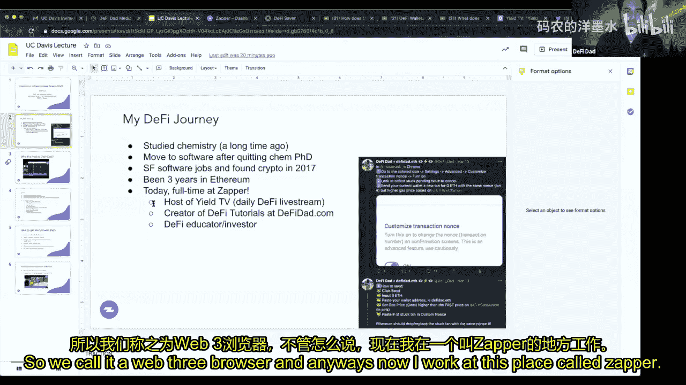

。Really like legacy， finance， institutions with lots of professional services。

 lots of overhead and you're you're breaking it down then into money applications that are automated by smart contracts and so anyways。

 what you're looking at here on Zapper is I can track here's an example of a portfolio so I can track like what tokens are in my wallet。

 maybe like as you guys know like I wouldn say they're the equivalent of a stock。

 but if you think about it like that it's like a portfolio of stocks but there's all sorts of complexities or。

Different mechanisms and applications where I can lend my stablecos and earn trading fees on those or I can lend an asset like the wfi token in my wallet and earn 0。

86% APII on it so anyways， this is for tracking all of the different Dfi protocols in one place because。

All of these protocols that we're going to talk through。They all have or tend to have a front end。

 but at the end of the day， this is different than what your parents would have where they look at a mobile app for Bank of America or they look at eTde imagine if Bank of America ET and all the other finance finance services could come together on a single platform and they could end up exchanging value with one another and as a result of it。

 you get cool tools like like Zapper where you can track everything in one place we'll also talk a bit about what is a DX aggregator which is DXagggregator is it's a way to find the best trades that are sourced through decentralized exchanges on Ethereum it's basically like Google flights or kayak for finding the best trades or the best rates。

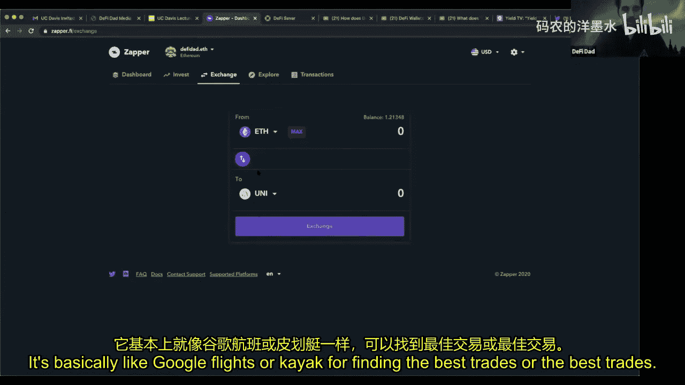

So anyways， quick question that's very interesting is so in terms of a cross chain so does it handle like atomic swapwab across different chain is that。

not not that， but it's so right now everything is u the everything that we're tracking there is on Ethereum。

 which as you know， kind of mirrors the fact that。I mean 99。

9% of Dfi applications are built on Ethereum however we've left the door open with we're keeping a close eye on like finance smartcha and cosmos Polka dot a few of the other like major blockchains we do track Bitcoin wallet addresses though as well so that's one thing you can do but you would have to I guess soon this is worth pointing out very soon we will be incorporating one of the applications that lets you move your Bitcoin into a tokenized version of Bitcoin so that'll be really exciting。

So the Zaper itself would act as a proxy for that transfer。

Yeah you could think about it that way we are like right now we're a dashboard。

 weve facilitated all over 900 million in over 900 million in transactions over the last year。

 actually less than a year it's just in the year 2020。

But we never actually take control of one's assets so we're。

We think of ourselves as like this hub for DFI Basically people are able to use all these different Dfi applications。

 We are simply like one of the many gateways to get into that。

 but we actually don't hold any assets under management So it's kind of like if you think about there was what some old saying years ago about like Uber is the number one taxi company in the world and owns no taxis and Airbnb is the number one like hotel you know Soer and they have no hotels I've always kind of thought of us in that way that we source we've sourced 900 million in transactions。

 but yet we've never taken custody of anyone's funds we're just integrating and piecing together all these different applications。

SeeSo for example， like fidelity you have buy all kind of funds that did necessarily their funds so that's would that kind of be another analogy of what is happening in Zappper as well too like a manager yeah yeah yeah definitely that's a way to think about it because at the end of the day that Zapper dashboard this is something that anyone can come to and they can connect their Ethereum wallet that's it there's no you're not I'm not doing any work to track this money I'm simply just connecting my wallet I'm not signing up I'm not Kyc I'm not providing any sort of information about myself just connecting my wallet also you can even paste in wallet addresses so if you are tracking one thing that's popular in the community is there are wallets that become known as because everything's public as you guys know on the blockchain there are these。

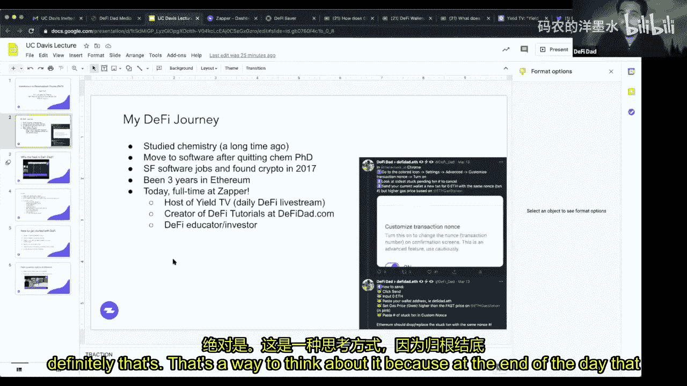

walls with you know sometimes 100 million or even more than that in the wallet and so you can look at that and start to see like what is someone with  a00 million doing with their money and is this something that I should potentially consider？

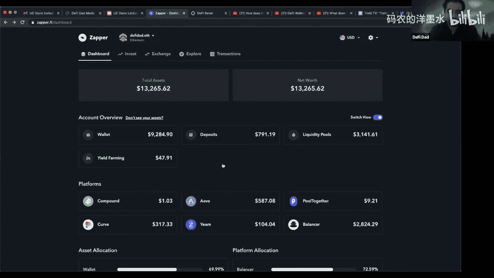

Let's see here so oh in anyways just to wrap up on that just you know reminder。

 you can check out it's called yield TV actually I could just pull it up here so there is a daily DeFfi live stream we host through Zapper so it's five days a week it's normally at 12 pm Eastern we host all the you know leading developers and founders and builders and investors and basically do 30 minute to hour long interviews all about their insights into building on Ethereum most of the applications relate back to DFI you know yesterday we interviewed the leading application in decentralized finance insurance and then today we interviewed a UC Berkeley alum that built this。

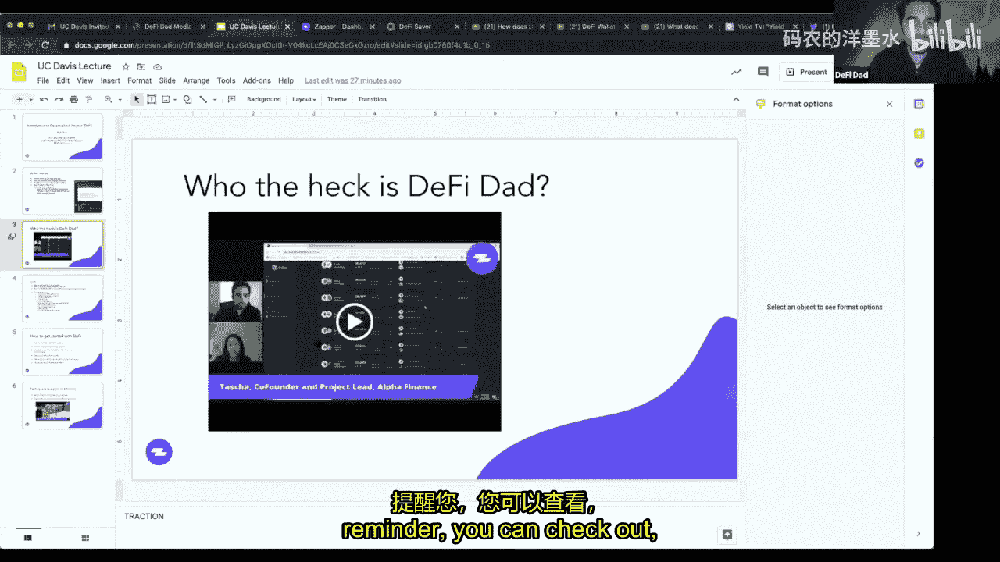

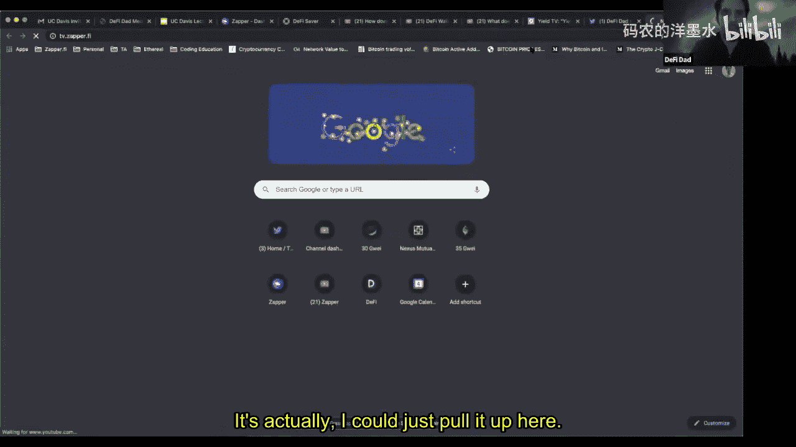

It's called Alpha Fin and they enable you to automate investing strategies。

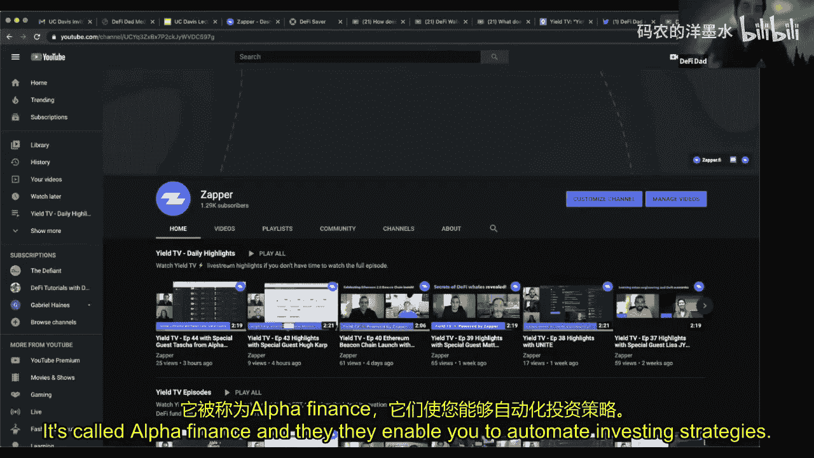

So anyways， these are some of the things that I want to cover today。

 but I just want to pause on all this for a moment I would love if you know。

 feel free to just unmute yourself and chime in on like。😊。

What topics are you most interested to learn about DI or if you know anything already。

 if you have questions you'd like to make sure we answer I'd love to just get some feedback and then some of this I might toss out as we go along and then maybe I can add some more detail if it's not covered in the agenda。

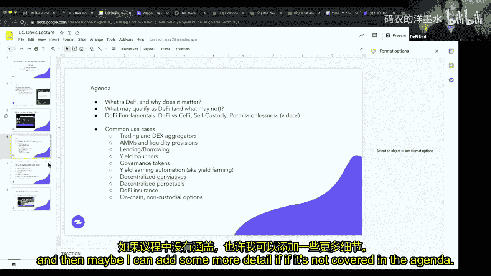

Are you guys starting to see any kind of like machine learning start to come into this kind of Dfi industry here now。

 So， so not on the Dfi side， I'm just personally not aware of it， but funny enough。

 There is a separate company called。Aletheia。AI。

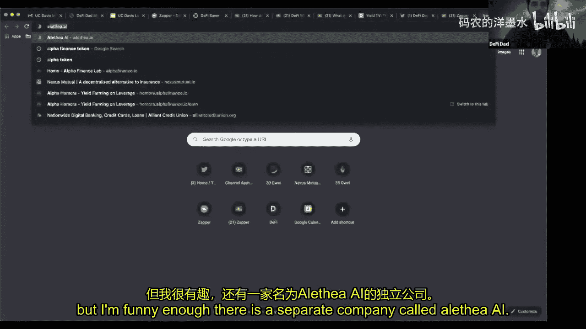

So this allows you to create an avatar and that avatar acts as we call it synthetic media。

 I don't know you guys might have like learned about this on another class。

 but anyways they've been calling it synthetic media and the ideas that you can。I mean。

 you can ultimately what create like a cartoon character。

 you can create something that looks like a real person， but regardless your're。

You're creating something that can suddenly communicate and act as like a proxy for a human being。

And there's all sorts of crazy ideas here with the fact that like。

Would you buy an avatar as like a token， would you access services through that。

 would there be creator personal tokens to go with some of these avatars。

 but anyways that's the most I know about anything related to like AI。

 which I guess kind of circles back to what you were saying， but anyways。

So I we kind of talked about this already just in a nutshell， what is defI and why does it matter。

 I would think about DI as。It's taking it's taking what we all know as Fintech and the way that money applications work today and it's turning it's making digital money the primary。

 it's moving us away from applications that reflect what we use in the physical world where I've got 100 US dollars in a bank and it shows on my mobile you know application that I have $100。

 really what they're showing me is that in their database。

 I have 100 of credit according to what they should have in their reserve。

What we're moving to with DI is all of this is digital first。

 you know suddenly if I have 100 digital dollars or maybe we call it die。

 which is one of the popular stablecoins， it's in my wallet I can see it if I deposit it into an application I can see it in the application reserve which is part of the reason Dfipulse。

com is one of the most popular websites in DFI。

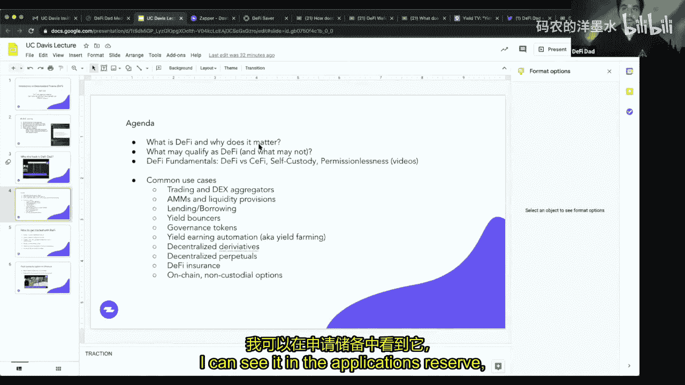

Everything is you know tracked on chain so we can look at these to see how much money in US dollars is deposited into the smart contracts of an application it's similar to assets under management。

 but remember in this case it's the idea with DI is that you're building a piece of software that should be able to stand on its own without a team there to make any changes。

Obviously， there are teams continuing to， to iterate on that software and make it better。

 But the idea is that。A censorship resistant DFI application should outlive anyone on their team。

 let's say， no longer being with them or not being available。So you can， you guys can see here。

 Maker Dow has 2。6 billion。 compoundound has 1。6 billion a year ago， these numbers were incredibly。😊。

I mean they were so small but they were so big from where we had come from so in December 2019 we were at 657 million sore whatever that is。

 I don't know over 15 x to get to 15 billion and then if you go back even further this goes back to when when we joined the crypto space。

 Mohammad and I so if you go back to August 2017， this is when some of these applications like Maker Do are launching and for a while the number one applications in our space was MakerDo。

 which is for borrowing and lending and so we'll cover that here in a moment so you said that that website examines the contents of smart contracts。

 is that what you said correct okay cool so it just like it just displays like all onchain smart contracts at this time and just gives you stats on that cool。

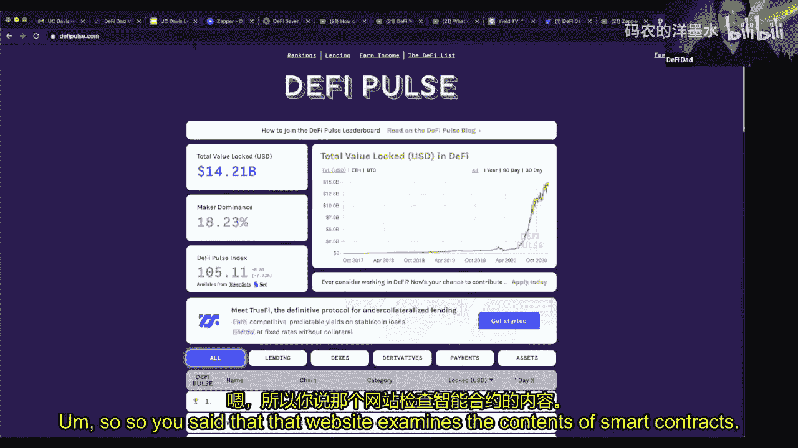

Yeah， I was just yeah yeah yeah it's it's it's definitely this stat sometimes can be misleading。

 there are protocols where this isn't like the best stat to compare them so keep in mind it shouldn't be apples to apples but it has become a really popular way to demonstrate how many people are putting their money or how much money is being trusted in that application so it's definitely a demonstration I think of product market fit。

 you know people trust 1。6 billion in compound to lend their assets and to borrow their assets versus unISp people are providing 1。

3 billion in liquidity so that others can trade between those different assets。

Let's see here so one of the things we were sort of talking about earlier。

What qualifies as DI and what doesn't and I say what may qualify because I don't think that like any one of us has you know。

 the one and final answer when we're so early on in this space。

 but a few things when I'm using a decentralized finance application like，Let's use as an example。

 let's go to UNIWP。

Here we go。So unSp is a place where I can trade and again。

 it's very simple me just trading between different assets here if I put in one ether I will get 5100 I'm sorry。

 51841 acro。The ability to trade here。Only requires a few things。

 One is that I have an Ethereum wallet， which is my meta maskask wallet。 So you know first off。

 I have to be able to store my wealth using an Ethereum wallet this requires， of course。

 that I am 100% in control of my assets So that sounds great to the person that lives in a country where they will seize their their money from a bank account overnight for those of us in the United States you know you know that there's a lot of friends or family you might have talked to who said why would I want to be in control of that like that sounds really risky So is this is where we talk about you know whether defying crypto like which types of profiles of users it fits。

 But anyways， we've got a wallet we're 100% in control I don't have to sign up through email There's no KyC and at the end of the day。

 no one takes control。Of my assets， so if I were to trade this ether。Actually。

 let me just make sure that I shared my desktop pulled on a sec， Wait， what did you mean by KYC？

Oh good question know your customer that would be like have have any of you signed up for a bank account and you had to show your ID and fill out like your billing address and stuff like that those are those are commonly referred to as KYC laws know your customer it's meant to prevent money laundering I mean that's that's what we're told and I do believe it it works。

To a certain extent。 But then you'll very like quickly find out that some of the largest banks in the world have facilitated all sorts of money laundering and it happens。

 And then you say， so why do we have to all submit to this if those with some of like the the greatest amount of wealth or able to get buy it。

 So anyways， if you check this out， if I'm going to trade some ether for acro。😊，好。

Let's try that one more time。嗯 boy。What's going on， the darling of Dfi here is going to fail me。

 Let me grab another token。Here we go。I won't go through this and confirm it。

 but this is all I'm doing is I'm submitting a transaction。

 I'm paying a little bit of ether to a smart contract on Ethereum。 And as a result。

 it's allowing me to trade some ether for that acro token。 And when I do that。

 it's based off of the fact that。It's based off of the fact that in Uniiswap。

 there's been 53 million in liquidity provided。 People are depositing combinations of， in this case。

 the Unitoken and ether。And I'm basically just， I'm adding one e and I'm withdrawing however much of the Unii token it is。

 and so what what you end up finding， though， I guess my point going back to like what defines Deffi here is it's that simple。

 you know， it's the fact that no one takes control of my assets。 I'm 100% in control。

 I only interact with software， I don't interact with a human being。

 a human being doesn't have centralized control to take control of my money or take control of those smart contracts maliciously。

 So anyways， it's as simple as that Any questions on。

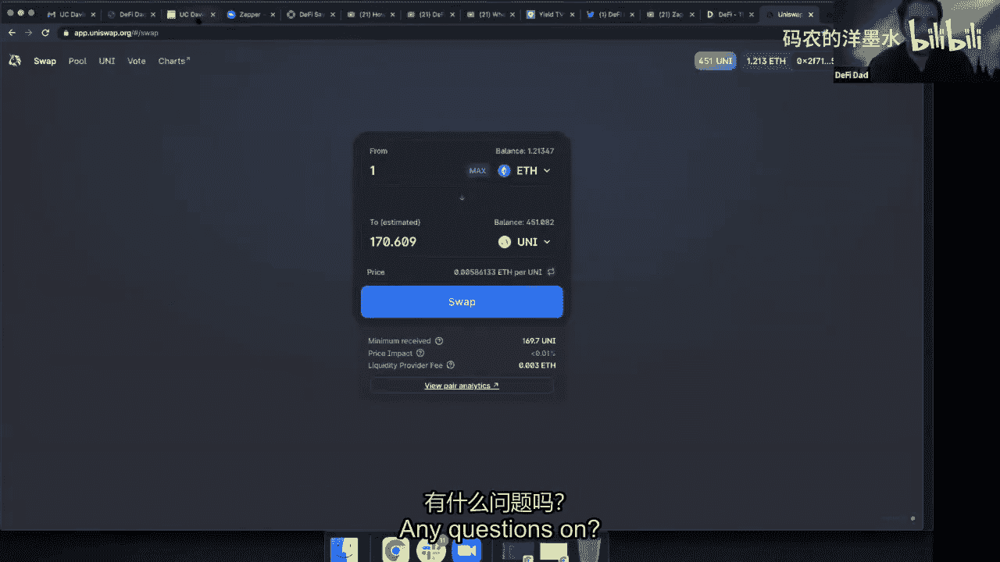

How I'm qualifying what is DI， and then I tell you kind of like what is not DI。

So the reason I pointed out what may not be DI here is I'm only calling that out because it's become a very popular marketing term and I take pride in that marketing term because I think I've helped to make it popular and our community has made it into a really popular way to quickly explain what you do you know like oh I'm building XYZ。

 what is it it's a DI application oh cool so it's like a money application and it's peer to peerer and it's probably built on Ethereum。

 got it。The problem is， is that you'll find that it's a term that many want to。

 they want to broaden the definition of it because it's great for marketing。 So if， for example。

 Coinbase isn't guilty of this， but I'll just use them as an example。 if Coinbase said。

Hey if you're willing to lend your ether to us Coinbase。

 we will pay you interest on it this is deffi lending come lend ether with uset Coinbase well what's wrong there first off to use Coinbase you have to KYC you got to sign up give them your email all of the usual all of the usuals there they're going to take custody of my ether I have to trust them to do that even though I'm obviously using Coinbase software it's the fact that it's you know upfront it's centralized if I submit ether into their software。

It's possible that I won't get it back so of all of these constructs don't mean that I shouldn't use Coinbase it just means that to me it's not defy and it's important that we understand the differences because for those for those who don't live in a country which is a lot of people in this world who don't live in a country where they can 100% depend upon the laws to let's say。

 protect them from a bad actor or or even be able to depend on a government not to be a bad actor and to seize their assets unlawfully。

That that's scary。 And so so that's what like to me， like DI right now。

 it's kind of like the computer clubs in the early 90s or late 80s。 It served a very niche community。

😊，But 15 billion is going to look like nothing when we get to 1 trillion and 1 trillion means that that many more people have exposure。

 and it means that maybe you know a grandmother that lives somewhere in Southeast Asia is able to invest I don't know。

 $10 into the S&P 500 because she buys an S&P 500 derivative token that's built on Ethereum and why can she do it because all she's using is an Ethereum wallet and she's connecting to the internet and using an application that's permissionless。

So I'll pause there， do you have any questions about anything I've covered so far？

So it's very interesting so if I may kind of go back and sort of go through this one more step by step。

 so one definition so one way of sort of thinking about DI here is that I don't need registration。

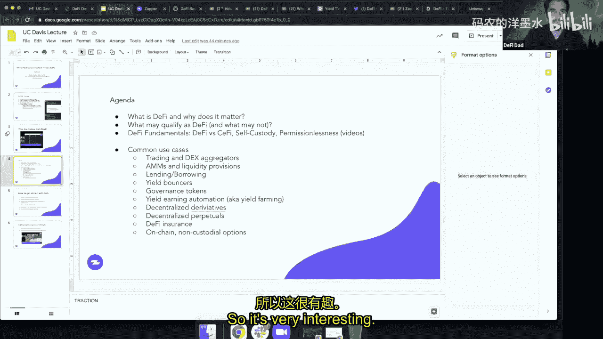

So that's one that's the number one thing so kind of our checklist to see whether this is qualified for DFfi or not a checklist so a coinbase requires some form of registration and it does have essential flavor to it so that doesn't qualify as a defi it's good but it's not def Yes yeah yeah yeah not yeah always make sure if anything we don't want to paint it as good and bad because if you are not wanting to be 100% in control of your assets。

 Dfi might not make sense for you today and starting with a crypto account with Coinbase might be a great way to start to get exposure and get acclimated to how to handle cryptocurrencies。

So not the need of having the registration and also the underlying storage model for both keeping track of the transaction and also holding the asset itself is decentralized as well kind of built on Ontario or any you know it's actually like this not yourery Andreas Anoppolis。

 super famous educator in cryptocurrencies， he's been really notable for what he's taught us all about Bitcoin and Ethereum。

 just listen to this like first 30 seconds。

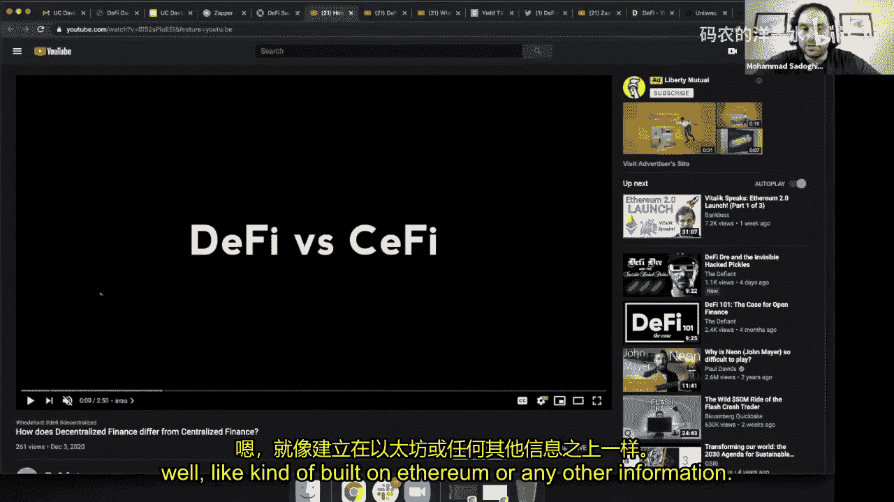

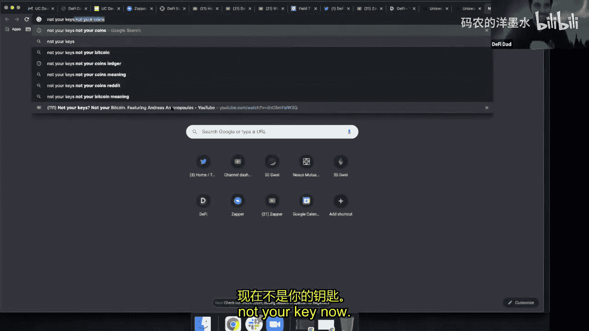

Oh hold up， let me if you don't control the keys。Simple rule if you control the keys。

 it's your Bitcoin if you don't control the keys， it's not your bit， your keys， your bit。

 not your keys， not your bit your keys， your Bitcoin， not your keys， not your Bitcoin your keys。

 your Bitcoin anyways he goes on to continue to repeat this and it's not your keys， not your Bitcoin。

 same thing with any token， not your keys， not your token， with Dfi， you know， not your keys。

 not your token in deffi smart contract。Not your assets。

 I mean it takes that ethos and it builds upon that， but you'll find as we talk about this more。

 it's definitely less crystal clear because you start to say well how do I know that no one has control of those smart contracts and what does that mean if they do have control Maybe there's a 48 hour delay before a change can be made and that's what protects us as a community so that a number of developers can continue to improve the code。

 So anyways， not your keys it not your Bitcoin it's really easy to remember and it helps to sort of define it even helps us still to this state to separate what is Dfi and Cfi。

Yeah， so I mean， definitely that other thing is another interesting characterization。

And so again not having the registration and it's your own private key and you are transacting with your public key and sure so that' that satisfies part of the equation。

 but also the maintenance of this ledger it's that I suspect is decentralized so that needs to be decentralized as well too and。

Now the question of the asset itself， does it have to be？

An asset that was created through proof of type of work， mining。

 or it could be any asset doesn't have to be necessarily limited to proof of work type of asset。

Yeah good point in this case， so I don't have to worry about differentiating only because everything's most of these tokens are currently on Ethereum。

 I would say the most the second most active blockchain that's building that's attempting to build I think real decentralized finance applications is Polka dot。

Binance smartcha has some activity as well， I guess that's fair to say they do and cosmos but yeah everything sort of centers on Ethereum so it's an ERRC 20 token and yeah luckily we don't have to worry about that but。

The best answer is actually it depends because there are certain tokens。

 there's some newer tokens that use this mechanism called a rebase。

 it's an algorithmic stableco where they actually are modifying the supply of the token and it's something we won't cover today。

 but just think about what I just said they modify the supply of the token。

 imagine like you look at your wallet and one day it could have 100 tokens and the next day because the price has gone up quote unquote too high or it's above this peg they increase the supply to bring the price down so I think what I mean to say is this is another example too of like there's all sorts of experimentation going on it also doesn't mean that it's safe to use or that one should invest all of their lifes。

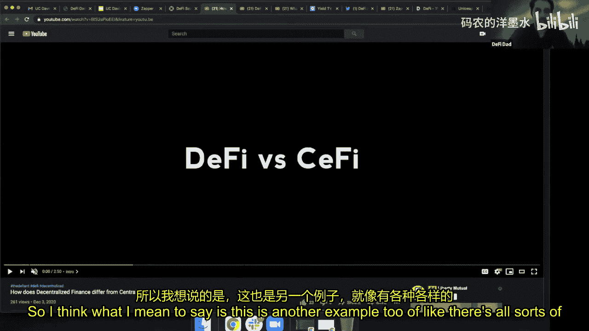

Into it。And so maybe I'll pause Steve， any of the students have any questions I have one more follow up Abutely yeah yeah。

 any questions guys。So could you go back over， You were talking about coin based not being like true defy。

 That's just because you need to identify yourself， right？ Yeah。

 that that's like one of the main prerequisites of。

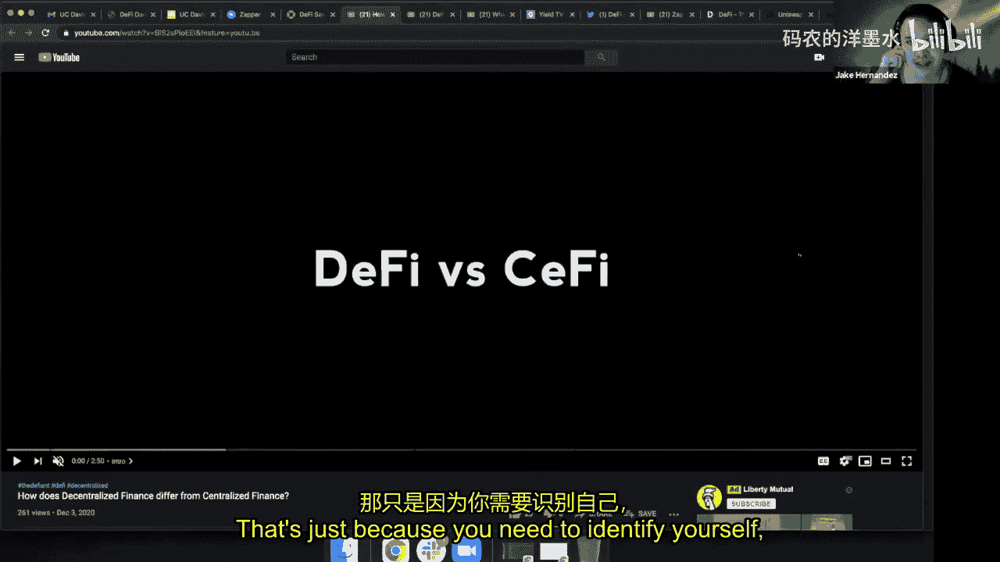

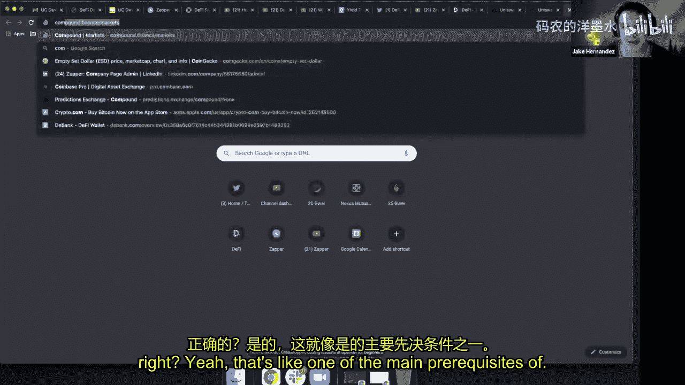

地快。Yeah， let me you know what what I haven't done so far is let let me give you one other quick example Here is one of the most popular Dfi applications compound and this is how simple it is on one side you can supply or lend assets so there are 10 of them here on the other side you can borrow those assets Now for me to borrow。

 let's say if I wanted to come here and take out a loan let's pretend that I'm holding ether ether is the equivalent for us of Bitcoin on the Ethereum blockchain。

 we see it as a store of value it serves all sorts of other utility but we generally believe it to be a store of value I deposit this thing that I find to be valuable and then I can borrow a fraction of its value in one of these other tokens and if I borrow let's say I'm lending。

Ether and I borrow die， I'm paying 4。07% annually。But I don't have a set term I can I can basically borrow。

 let's say， 100 die。I can pay it back whenever I want as long as I maintain that I have a certain amount of collateral in here to cover it。

And if I don't。The software will liquidate it， pay back my loan and basically it's my problem I might walk away with the die。

 but I've clearly lost something there and they've ind the software ensures that lenders don't lose out so supply borrow noet terms。

 these rates change according to how much dies borrowed， if people keep borrowing die。

 the rate goes up if people borrow less die the rate goes down and so we've taken one of the most like important mechanisms in a bank and we've automated that to the tune of 1。

6 billion in assets under protocol。Does that help Jake。 Yeah， yeah。

 So what happens if like you say you have a certain amount of a certain asset and then the value of that asset just goes straight down whent take it a loan。

 Yeah， that's just it。 And and so all these nuances come into play like ether is a volatile asset。

 It goes up and down in value。 it's up a lot this year， but it's。

 it's gone down a lot in previous years。What if。What if， let's say a different example would be well。

 I've got wrapped Bitcoin here， so this is a Bitcoin that is。

It is a token that represents Bitcoin on the Ethereum blockchain， so it holds to the price。

 it's pegged to the price of Bitcoin， so that's another volatile store of value I could use。

What happens though if I have die and so this is a stable coin so it's generally around a dollar now there have been times where so many people need this dollar because it's so popular and it's used in different applications and people earn interest on it。

The peg went from$ dollar to $ a dollar。10。 Suddenly， if I have $1000。Of die。 I now have 1100。

 Suddenly， this has a premium to it。 I could deposit it， and I could borrow against it。

 I could borrow USDC， which is actually at the dollar peg。 So I I only mean to call this out。

 because it sounds like a much smaller difference than us borrowing again。

 something like ether or wrapped Bitcoin。 But this is where Dfi is starting to intersect with。

Traditional finance and namely forex markets， foreign exchange markets where you have all these currencies trading against one another。

 sometimes they could move less than 1% you know in six months。

 but when you're trading incredibly large positions，There's a lot that one can do as a trader。

 you know， and that's what we see。In Ethereum in Dfi here is you know people are moving hundreds of millions of dollars in transactions。

 there's people like me that will move $100， but there's traders out there that are playing with incredibly large amounts of money and you can see in real time。

 you'll see these rates go up and down based on those movements。Jake， any other questions on that？

Or anyone else want to chime in here， does this make sense This is one of the。

Common use cases I wanted to cover。I think yeah， I think it's very it definitely makes sense so kind of follow up on the question that I was sort of building upon earlier earlier was。

So now one use case is that if I don't trust my government。

 I don't want to show my registration and also perhaps I don't even trust them that they're going to keep track of the ledger accurately or if they're not going to later on try to go back and change the history so that's again a motivation for having a defy way of doing financial transaction so now but kind of going back to the other example if the government itself I cannot be trusted so that means the government I cannot trust the government if I put。

My money in the safe in a bank。Well on the same ground wouldn't you also say that well。

 if I'm keeping my key my private key， it's in the safe at home。

 I mean the government can knock the door anytime and it's。Doesn't seem to be able to。

Do anything in that situation。So would it？Would it be robust when the government itself is not conforming？

Yeah yeah， no' you're thinking about all the same questions that that I think about， but again。

 I guess it's like I feel fortunate that like I don't have anyone banging down my door I can say that so I have a number of friends that I've met who live in Argentina who live in Argentina or have lived there and so in Argentina。

This is this is how screwed up it is there are such tight capital controls that they can only spend so much of their money and the inflation rate at one point this year was like 60% so you have money that you're being paid in locally and that money becomes less valuable every day to a point where you can see simple things in your life like buying a bottle of milk knowing that that bottle of milk cost a lot less money the week before so these are folks who have been very dependent upon die which is it's a decentralized stable coin what I'm showing you here is if I were to open up a loan with maker dow。

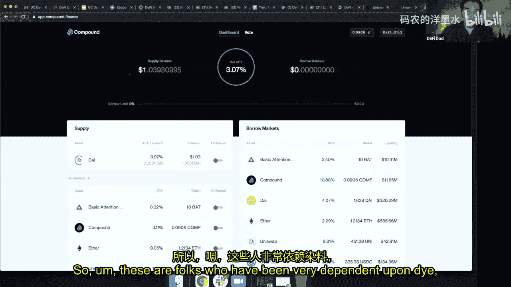

If I put in 10 ether， which is equivalent to what is that $10 times6 it's like $6000。

 Oh there it is$5518 based on the price of ether I can borrow against that collateral I can borrow 66 cents on the dollar so let's pretend that I was going to borrow $1000 die。

This is how this。Collateralized decentralized stableco is created so suddenly you have die being created because people are they find value in maker doo to the tune of was it 2。

6 billion and this has been this is really what kicked off the defi movement is that suddenly anyone could use their Ethereum wallet with a permissionless application to deposit a store of value ether and mint die and why would you do that。

 Why would you borrow a smaller amount of money against a larger amount of money because you think that this ether or Bitcoin or something like it。

 you believe that it's more valuable that it's digital gold and that it'll go up over time for now though you can take a loan against that。

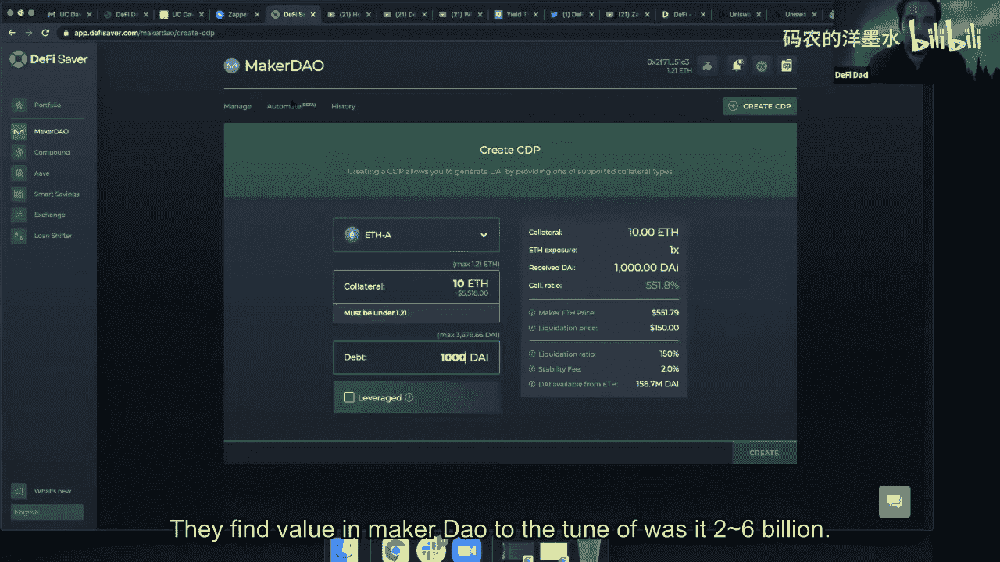

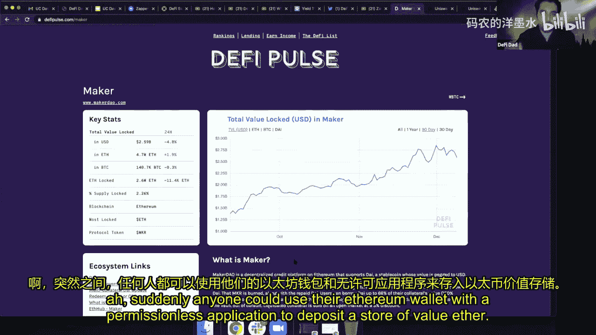

And you can keep it open。 You can keep that money for as long as you want。

 People will take out this this die and they could pay a bill， but you in many cases。

 they use that capital to earn more。 They'll lend the die because they can earn 5% on something like compound or right now。

 it's earning 3。7%。 So here I borrow my die from my ether maintain my。

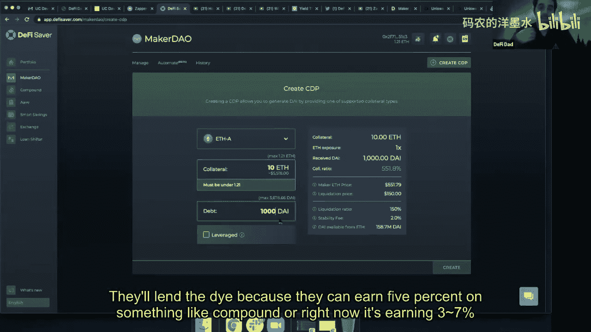

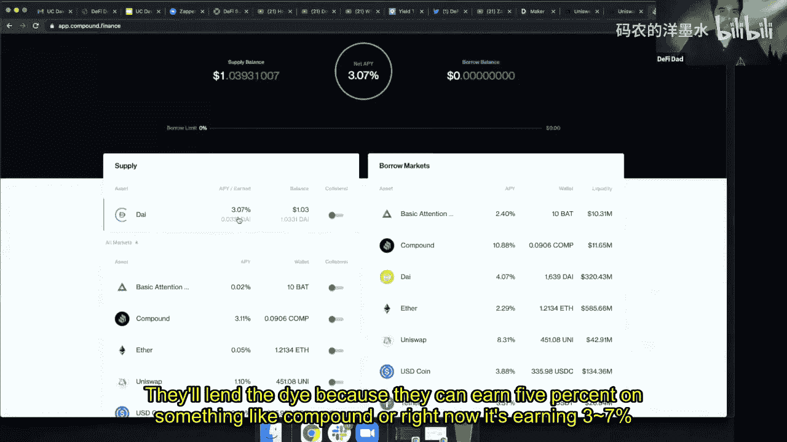

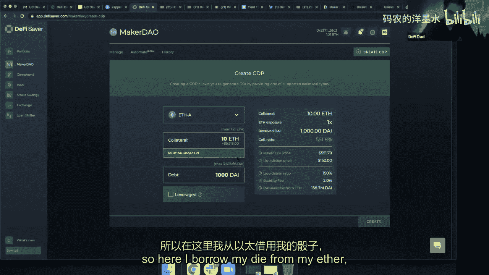

Position in my digital gold of ether and now I'm lending it and I'm earning 3% on my die。Anyways。

 does that？

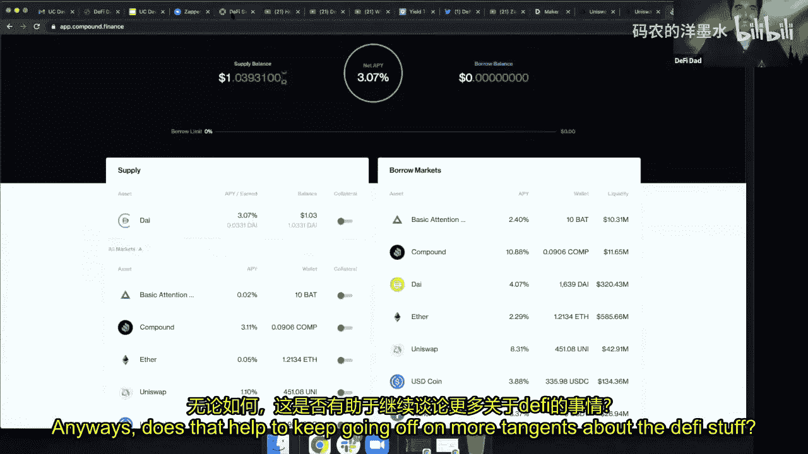

Helped keep going off on more tangents about the defi stuff， but I think your point about。

Thinking about these what it will take for those that live in a place that live under an authoritarian regime to use these tools。

 I think that to me is that has to be the longterm goal like of DFI。

 a lot of very wealthy people own Bitcoin， but I think the most remarkable stories are of people who own Bitcoin in countries where their fiat currency has become worthless and they need a digital store of value that they can put in their pocket that no one can find or that they can write down or tattoo a seed phrase to recover their money you know when they can get out of the country。

Sure， I mean I definitely think there's application there potentially so but the other thing not even coming back to like the United States for example。

 I can hide my identity in terms of registration and don't disclose the transaction or the transaction that I'm making。

 but at the end of the day at some point。

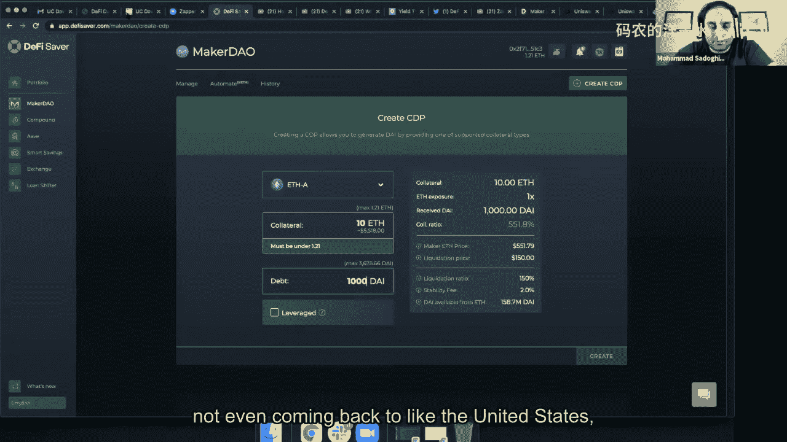

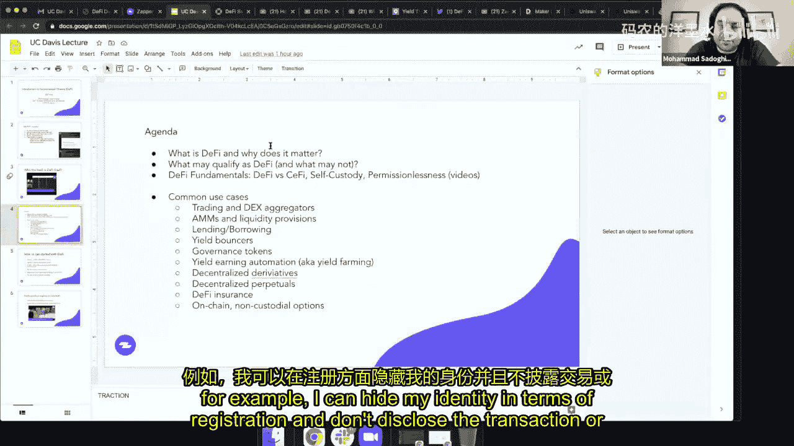

Things need to physical things will be attached， things need to be moved around an address so then what I mean how do we conceal that part because that one is completely exposed I may have didn't disclose on the face of it that I bought a book for$ five but when the book arrived and somebody can track that and they could potentially figure out that that book they may be able to start。

Make sense of what's happening in the ledger itself how do we deal with the external factor is that at the end of the day we're not just going to flip some bits from one symbol to another symbol physical goods and physical thing needs to be exchanged as well So one of the challenges right now is we need decentralized fiat on ramps and off ramps because going back to this concept that I didn't come up with but I'm in love with is this this primary versus your mirror this idea that right now a lot of people will put money into a cryptocurrency or in this case they'll participate in Defi but they still view it as like how much do I have here in US dollars and at the end of the day they're going to eventually cash that out？

And they're going to use that money for things that things in the physical world， you know。

 they're going to pay their rent in US dollars。The question becomes when does everyone start accepting stable coins。

 you know， the US government spent hundreds of millions of dollars on those paychecks in in March。

 April， May you know， throughout the summer and I know。Our you know。

 many people in our community were looking at each other like this is so insane。

 you know what what cost could have been saved and how quickly people could have received money if it were in a stableco the problem is is what does grandma do with her stableco like even if you teach her to download a mobile app and have that what happens when she goes to her favorite restaurant and they don't accept stablecos so。

There there is still this this issue， yeah， of the fact that what we're doing in DI is still a reflection of a primary system。

 the primary finance system in the physical world what I can attest to though。

 is I do believe that you know， it could be at the end of my lifetime。

 but I believe that a digital first framework will become the norm， two years ago。

 I thought of it as what is in the exchange that I own。

Like a centralized exchange like coinbase and then what cash do I have you know at home what do I have on like credit cards so so most of my wealth I thought about in that primary system。

Two years later， I'm about。85% bankless is the way we say it。

 so 85% of my wealth is all digital and I like it that way I really I like it that way now because'm I do enjoy the control I do enjoy the think of it this way I don't ever worry about whether my banks open I don't ever think about who I need to ask to move my money I don't think about the fact that I have multiple tokens that you know let's equate them to stocks for a moment no one will let me put up the value of my stocks and borrow against the value of it in another token in other words like take the aggregate value of it but I can do those sorts of money games very quickly with decentralized finance applications and so this is this is where like your money becomes more like email right now our money is very similar。

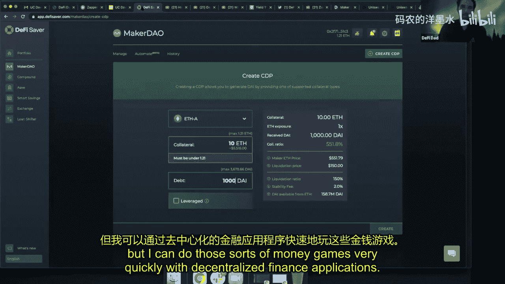

Our money and finance applications， even Robinhood as magical as Robin Ho seems at the end of the day like you've got to wait days for for your money to hit the account and for it to come back to a bank account and at the end of the day Robin Hood's in control you know if they choose to shut down your account or they think that you've done something nefarious and're even if they're wrong they're in control it's very different here when you're using DefI applications on Ethereum。

So that was that analogy says sounds very fascinating so basically thinking of as Dfi as to dissolving all the boundaries and as simple as sending an email。

 I don't need an authorization to send an email to any student for example I can send an email to Jake or Sajod or Suya or Tammi or whoever's on the call right now and I don't need to get an authorization I just send that email and with the bank there are loops and hoops that have to go through in order to for example。

 if they're from a different bank or it's not as。诶。It's not as fluid。Yeah。

 I was I was trying to look this up I can't find it here now， but there is。

There was a bill that was just proposed in Congress and it was proposed by。

A a real idiot who teaches at Stanford， which we know all the smart people to go to UC Davis。

 so screw Stanford anyways， this this professor that wrote up this bill I mean he doesn't seem to fully understand that like how stable coins work。

 how validator works on Ethereum or how nodes work with like a Bitcoin and I was，I mean。

 all of us were bantering about this because this person doesn't seem to understand how a blockchain works and we were trying to explain that。

诶。I mean what you're working with now is like what money is is doing evolving with Bitcoin Ethereum and financial applications built on Ethereum this is like the birth of the internet but it's for money right now money is in a very antiquated system you know we commonly compare it to like it's like the US Postal service and we're moving towards email when you send an email you know you don't answer like you don't answer the same questions that you answer at the post office you know you't you don't have the post office advising how email server should work。

Or how those services should be offered to end users， but for some reason were。

We're living in an interesting time where we have the US Congress。

 especially and legacy banking industries looking at cryptocurrencies。

And Dfi now because Ethereum is on pace to settle 1 trillion in transactions on Ethereum。

 which has a lot to do with Dfi。 there's 18 billion in stablecoins。

 They're looking at it and they're saying what framework can we apply from the world we're in to what this stuff is Well you know again。

 if you could go back in time like would you have seen the postmaster of the US Postal service advising how email should be handled。

 So it's this whole new construct where everything's digital first and I think it's a little bit scary for some people。

 I think it's just going to take time to realize that that it's okay that the way our money system works today is very antiquated but it's time for an upgrade and that a lot of people will be served better when they can move their money when they want wherever they want including someone who wants to buy11 millionth of a Berkshire。

Haathaway stock， they should be able to do that you could do that if you were buying a derivative of Berkshire。

 Hathaway's stock on Ethereum， you can't do that when you're using these old systems that whether it's intentional or unintentional cater to those who already have money and so that's one of the things we think a lot about is how do we sort of break your money。

 break out your money or break free your money so that you can do what you want when you want with your money and hopefully be able to grow your wealth at the end of the day you know's how that's my hope is that if people have access to lower borrowing interest rates。

 if people have access to higher earning interest rates will like suddenly that can allow someone to start to really build wealth。

Those was are really long winded answer to your question。By the way， just conscious of time here。

 I want to make sure。I'm okay to keep going if we end up running over but I don't want to keep the class over so just should we wrap in about 12 minutes or did you want to go longer than 12 minutes we typically tend to go longer as well so there's completely in ways。

We have a community of talkers in crypto unfortunately i'm the lead talker so guys any other questions at this point before we hop into some other applications you said earlier it was something like it was 85% your were bankless for your wealth I was just curious is that like mostly in stable coins or is it in like because I would be where I would be worried about volatility。

So how does that work？Yeah， yeah。 good point。 Yeah。 a few years ago， stable coins were。

 There was only a few die was still really new and to be distrusted because it was so new。

 And then USDC became available， which has some centralized risk to it， but has become。

 I think there's like 3 billion in USDC。 So。You know。

 the short answer to it is now we can be in volatile assets or we can be in stable coins。

Three years ago， I had no exposure to stable coins。

 I didn't even I had no idea that you would be able to to eventually lend them the way you do with like your US dollars when you put them into a savings account。

 technically you've lent it to the bank and they lend it out to other people and they can lend up to 90% of your money but in DeFI because the bank is automated software and there's no lights to keep on and there's no salaries to pay suddenly I as a lender can earn more on my stable coins and the people borrowing them can pay a lower rate in many cases。

 not always， but in most cases， and that ends up being like one of the most like I think magical examples of how DeI。

It outperforms what legacy finance is doing for us I was in the summertime at one point I was earning like 30% AY on my stable coins and that's amazing you know like to be able to do that also to be able to withdraw it when I want if you've ever seen one of those mailers with like chase on it that says if you deposit。

An amount of money that no college student would ever have available。

 then if you keep the money with us for 90 days， you'll earn X， if you do the math。

 they in many cases pay about 5%。不吃。They pay about 5% and it's 5% for a large sum of money kept locked up for a certain number of days。

 DeI is very different。 I can lend a dollar， I can lend a million dollars we both earned the same rate and we both can there have been times guys where I've deposited money and I've withdrawn it $24 hours later。

 something changed I learned that maybe I didn't trust the application suddenly or I needed to move the money elsewhere。

 but I'm able to do that instantly within whatever。

 you know confirmation time is required by Meam maskask。

So that's an interesting question so again you kind of I think create a new interesting next question to ask so that that being fluid would that also create a volatility that also could be problematic too。

You're saying do you think that volatility can affect that fluidity that you can just very quickly move things around Oh absolutely oh yes absolutely yes。

 it is it means that if we go back to。Let's see here。Go back to compound。

Can you all see compound again？You can see compound up here in the left hand， if I were to borrow。

Or if I were to lend， actually shoot， this is a terrible page to look at。

 let's look instead at the markets page。There we go。 Oh， there we go。 Okay， so right now， there is。1。

57 million die that's being supplied and one about almost 1。

3 million being borrowed these rates were were very affected over the summer because。

What happened was。Compound launched compound is remember， it's the protocol that powers all of this。

They wanted to decentralize control of that away from the centralized team。

 so they do that by issuing a governance token well。

 who better to have a say in future upgrades and proposals to compound than the users so they said。

We are going to reward you based on how much you lend and how much you borrow。Daily。

 and so everyone lending and borrowing started to earn a fraction of the supply of these governance tokens being issued。

 And then you use the tokens to vote。 So what happened at one point was the way that this mechanism worked。

 it was it was incentivizing people to open up leveraged positions with tether。

 and suddenly the tether markets。 Let me see if I can show you guys， there's a better chart here。

Here we go。This shows you actually how much， this is how many comp governance tokens are being issued per day。

There was about like 2600。 Basically， all of the tokens were being issued to tether Well， once。

Once others accumulated more of that comp governance token。

 then they went and voted on an upgrade to say that this mechanism doesn't make sense。

 We need to change the model so that it reflects a more。

 I want to say a fair way to distribute based on some borrowing curve， which really helped die。

 which has been one of the most valuable assets it' sought after on compound。 So I guess I mean。

 to just point out the fact that。And。I mean， these governance tokens over the summertime really caused a lot of volatility because people were moving large amounts of money。

 you can imagine here， if you knew that you could be earning。In some cases。

 I had created a tutorial at the time， and I know a number of VCs。Followed up on this。

 or they were already using the strategy。 I mean， some of them were making， you know。

 hundreds of thousands of dollars in a week。 And， and that's， that wasn't with。I mean， to me。

 it's a lot of money， but like they were opening up leverage positions with die。 And as a result。

 the rates were going up for borrowing and anyways。

 what ends up happening is that at the end of the summer。We started to see a drawdown， you know。

 prices had been going up and markets are cyclical。

 So eventually like people stop buying and you know you see a sell off。

 And when you see that sell off， because there was so much leverage tied up not just with compound。

 but with lots of different protocols， you start to see really rapid drawdowns and the price and so you know。

 yeah， one of the wonderful things about Defi is that you can move your money whenever you want。

 you know for whatever reason， the bad thing is you can move your money whenever you want。

 for whatever reason and and it'll affect the price and it'll affect some of these rates and even cause some systemic issues with things really go bonkers。

So the other interesting point you mentioned is that like the analogy of the email。

 I can just send an email to whomever I want anytime I want and I don't have to worry about the structure of banks and so forth。

And the other point that you said that really empowers this new Defi space is essentially micropayments that I can either loan or purchase very small asset at very fine granularity and perhaps there's no limits on how mini scale those purchase and selling could be but what about the transaction fee and it seems that transaction fee they tend to go higher。

 so would the transaction fee kind of in the long term prevent essentially these micro movement of funds around？

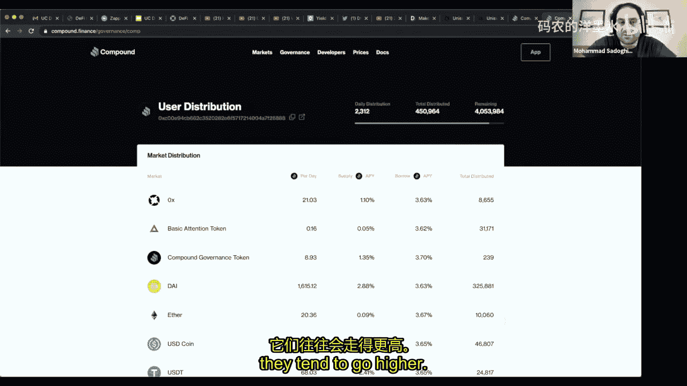

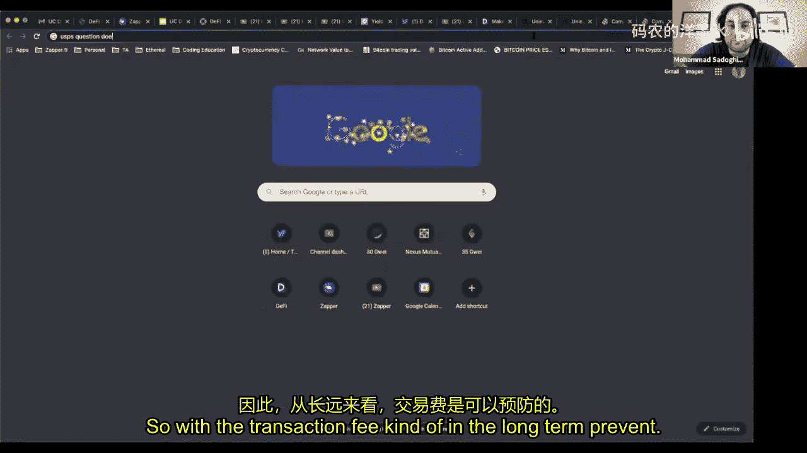

Yeah， yeah， so if anyone's not familiar with this， what we're referring to is。The gas price。

 So if I were to， let's see here。 if I were to go back to compound。

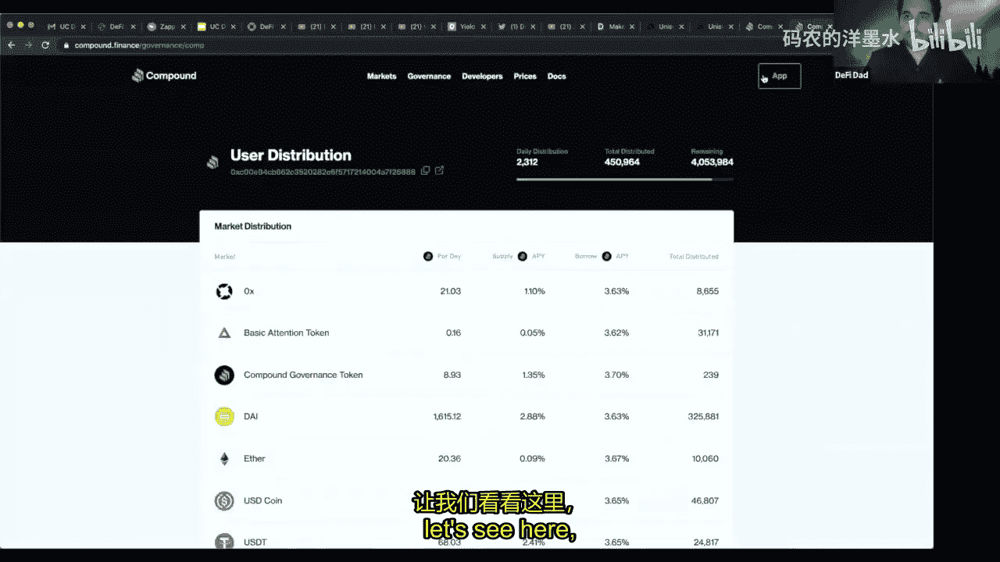

Let's pretend that I'm going to lend。I'm going to lend some some die。 So what I would do here。

 This is one of two transactions I would have to put through。 Oh shoot， actually。

 let me just see here。 I don't think I。

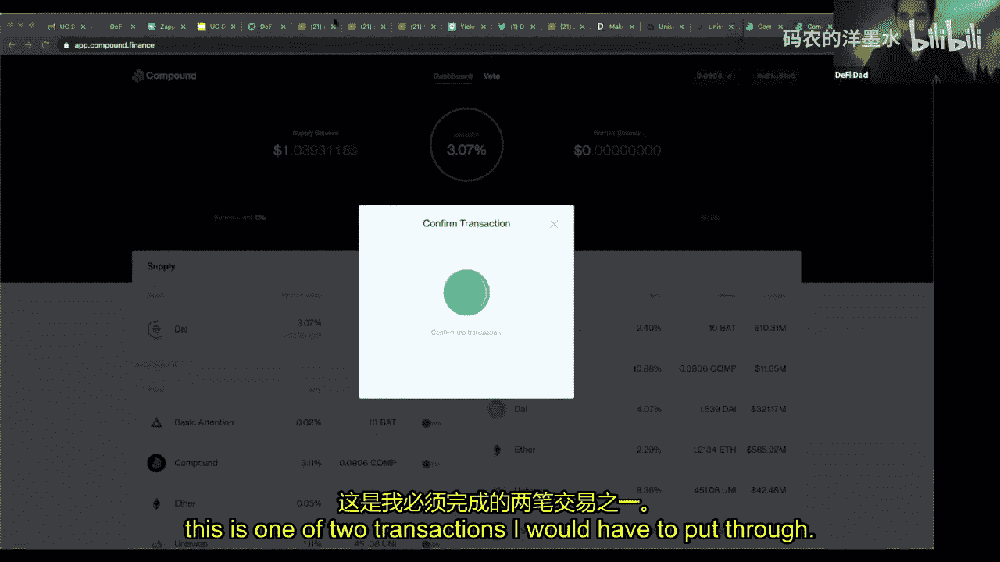

Let me make sure I'm sharing my whole desktop so you can see that。Here we go， Okay， so again。

 I have some die so I'm going to lend my digital dollars because I want to earn 3% on them so I go to approve a transaction。

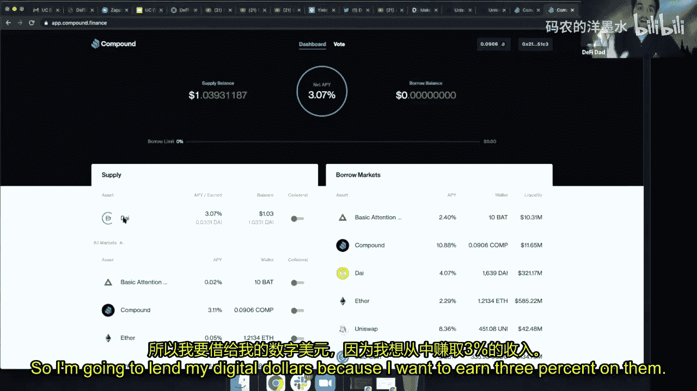

What was happening in the summertime is these fees。

 which look really small here at 68 cents these fees。

We're up here at like 500 gray and this refers to this this is the way that you compete to have your transaction confirmed。

 it's like an auction and so I'm bidding and you know if I bid too low then my transaction will sit there and I'll have to wait till others bids go lower as well。

Well， what ended up happening was。

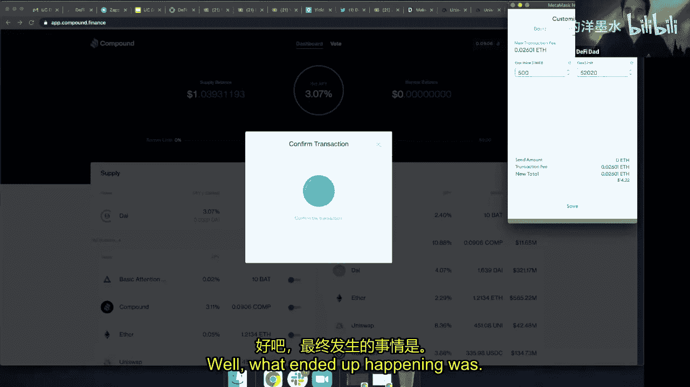

In the summertime。These prices。 so right now this is saying that if you want to get through a transaction 15 seconds。

 put the gas price at 47 Gu and this thing is fluctuating。

 you can see the little orange line it changes like every few seconds。During the summertime。

 this hit about a00 way and it's because people were moving such large amounts of money。

 which you can kind of get a sense of just if you go back to defi pulse just because it's really easy to understand。

Look at around here is where the mania starts to kick in in June we go from1 billion this goes from what July this is July。

July 1st we're around 2 billion and we are up to 10 billion by the end of August so within a two month time span and this just means that everyone's competing to move their money around and what happens is when those gas prices go up。

 suddenly that transaction that was going to cost me $68 is going to cost me $15 and that is nothing compared to the computation that's required for other transactions where you could be paying $100 or $200 or even $500。

That was a really confusing and frustrating time and it's a reminder why Ethereum is moving to what's called proof of stake。

 it's just launched phase zero of the move to proof of stake from proof of work。

 basically Ethereum is I wouldn't say it's broken but the demand for block space has become so much and DFI has a lot to do with that。

 it's not all of it， but it has a lot to do with it。

 that you we're all like really eager to get to proof of stake so that we can have higher throughput and we can get away from these goofy gas prices being so high。

So yeah， anyways， just pointing out you're 100% right that gas prices has been a hindrance to mass adoption。

 you know it's now we're in the early days， we're in such the early days still that sure like is it preventing Ethereum from growing clearly not if you look at this even if you look at check this out。

 this is ether which I think is a better way to measure this。

And you guys can see that over the past year， we see it moving upwards and then what happens here is this is people depositing into。

Proof of stake， so they're becoming validators to help bootstrap Ethereums new architecture called Ethereum 2。

0 but。Anyways， we've grown a lot and like we've got to get to a point where transactions are instant instant like basically the way you interact with like a Robin Hood app。

That's where we're going to get to it should be a few milliseconds or a few hundred milliseconds for transactions to confirm。

Guys， any other questions on the gas？Wait， can you explain how because people are locking into the Ethereum 2。

0 that the Ethereum like locked in Dfi is going down and Yeah yeah these are so just this accounts for the this chart accounts this list accounts for all the major decentralized finance applications。

 it doesn't account for let me show you a different chart here。Here we go。 So the， so yeah。

 what you're calling out there， though， is the fact that we had。Gosh。

 I can't remember the exact number， but。Wait a sec， I should be able to figure this out。

Hold on the sec Twitter。

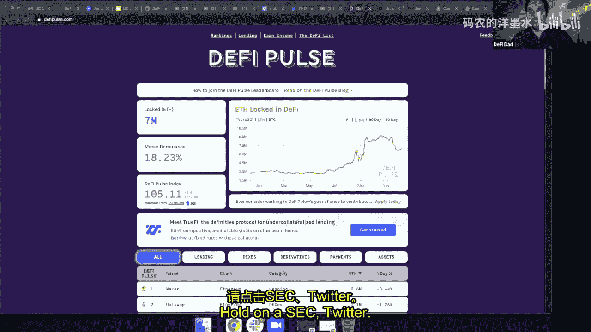

Beith to。Deposit contract。Maybe it'll show us now they're okay， so there are 27357 validators。

That's times 32 ether。 So there's 875424 E。

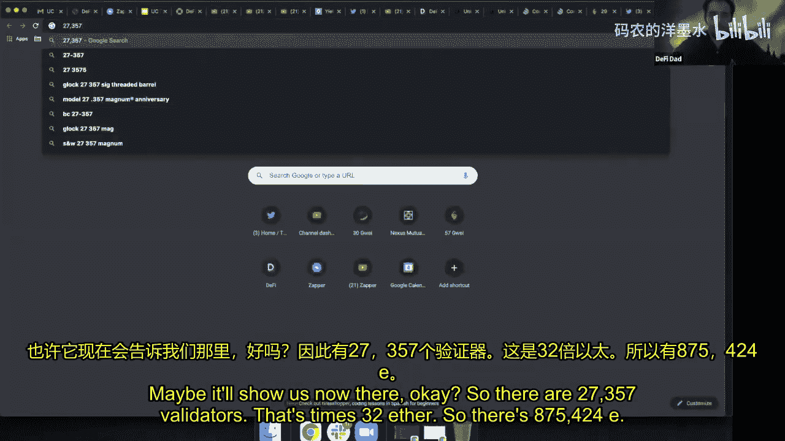

Which if we multiply that by a price of， let's say，$550 US dollars。

 what is that481 million and it was over 500 million。 so yeah， about $500 million of ether has。

Moved on， I guess I can't say all of it here。 Obviously， there's other ether here。

 Maybe people just sold their ether。 they moved it into another asset。 but yeah。

 there's been this major move， which was actually very。

This is such an important thing that Ethereum moves on to proof of stake so it's just kind of funny how obvious the trend is there。

 it's like this is everybody moving out of DI applications and into proof of stake。😊，Or Ethereum 2。

0 beacon chain， so okay， that makes sense。

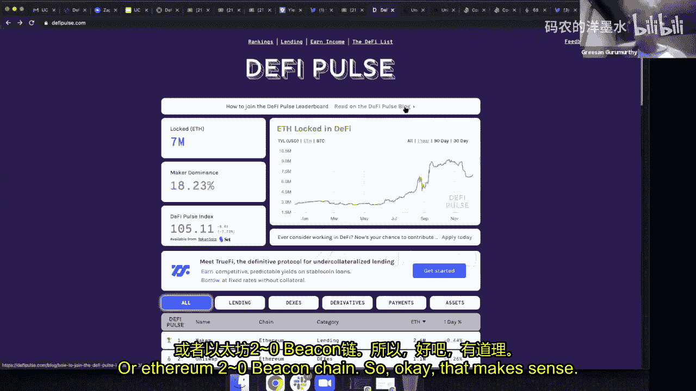

So， actually， you know， I've got a quick video here。 We could watch that I think of all the videos。

 we don't need to watch the other ones here。 I think we kind of covered。

Kind of covered all of these already。 There's one here。

 I think for everything that we've covered today， like this idea of what is the difference between D P and C P。

 So I worked on。I worked on a series of videos that are being released through the defiant。

 you should go to the defiant。substack。com Cammi Russo is a former Bloomberg journalist。

 she's been one of the leading DFI journalists， she's very good at explaining DI and she sources all sorts of great stories that keep us up to date on it。

 but anyways if you're all down for this is only two minutes and 50 seconds。

 I think you'll get a lot out of it if we watch this。

🎼That sounds good Let me know if you can end up Now there are three major differences to know between C P or centralized finance and D P or decentralized finance。

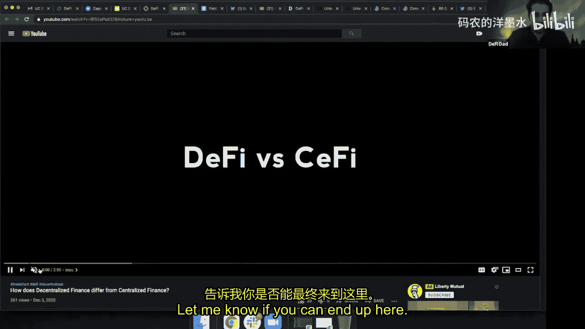

🎼First in crypto banking services， Centralized finance you know like pointbase Fin。

 probablyby the big boys you all trade to crypto one these are owned by a single entity or often a corporation CFI teams often provide valuable services but at the end of the day they're 100% in charge they can let you in and they can kick you out but in defining applications aimed to decentralize that ownership and become community owned kind of like a grocery co op everyone owns a piece of it and its code is run and maintained by the community。

🎼NowSecondly， in centralized finance you often have to go through a signup and submit to KYC or know your customer regulations and this is often to abide by regulations and prevent criminal behavior like moneyney laundering but at the end of the day this is cumbersomeman gets in the way it provides friction in Dfi as long as you have a crypto wallet like Metaask you don't have to submit to KYC or sign up to anything or ask anyone for permission just click connect and you're in and that's what we mean by Dfi being permissionless no permission required。

🎼In centralized finance we trust exchanges and other centralized apps with our assets fact we don't really have a choice if I deposit into Coinbase I am trusting them to keep the balance of my crypto assets safe while I trade but in DFI I never have to trust anyone I just custody my own assets and even if I trade them it's a peerto- peerer swap when no one else ever takes control of my assets so I depend on the smart contracts to execute transactions and trade not people so the takeaway here is that CFI and DFI provides similar services but centralized finance CFI is better for those of us who prefer to play by highly regulated rules and fill out the paperwork to get in the club。

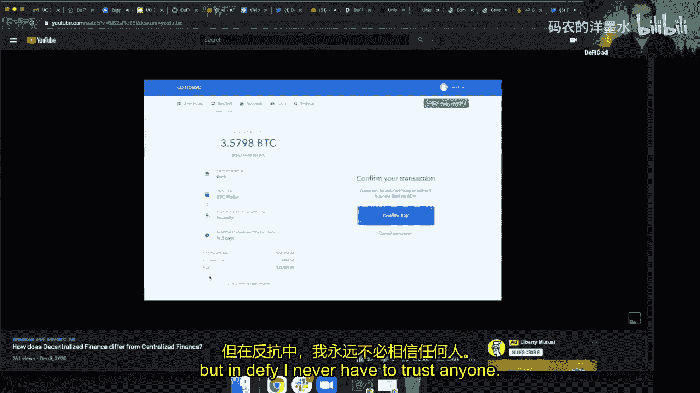

🎼Cies are crypto assets for us and in doing so gives us permission to participate in their crypto services but of course also has a helpline versus in Dfi where we're 100% in control of our assets trust in the code which requires no permission but there's nobody for us to call when something goes wrong So yes。

 there's good and bad to consider on both sides but we'll dig into that more in future Dfi 101 episodes but for now at least you know So you've been watching Dfi what there we go Anyways。

 any questions about that I feel like。

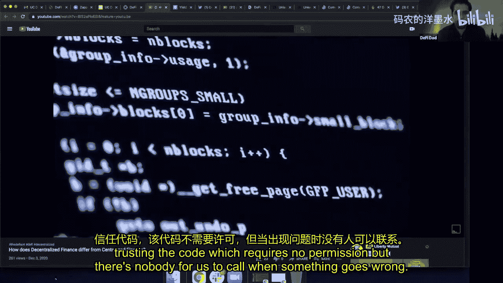

We covered a lot of it actually already today just talking more generally but Robin who's the producer here is just he's so that isn't that isn't my work there in the end I think Robin is the one that he's such a great storyteller and if you want to end up watching more of these videos just go to the defiant and subscribe here on YouTube it's the playlist is a Dfi 101 and it's actually designed it's really designed for folks who have zero background like all of you do at least wanting to explore blockchain it's meant to help them understand from like A to Z how DFfi works。

OhThat was very interesting nicely and simple explanation one more question so as you kind of mentioning as the sort of the growth of this economy of Ethereum as it kind of expands。

 one would naturally think now there's going to be more transaction is it possible now at some point Ethereum itself becomes centralized and collapse on its own weight just because of its widespread adoption。

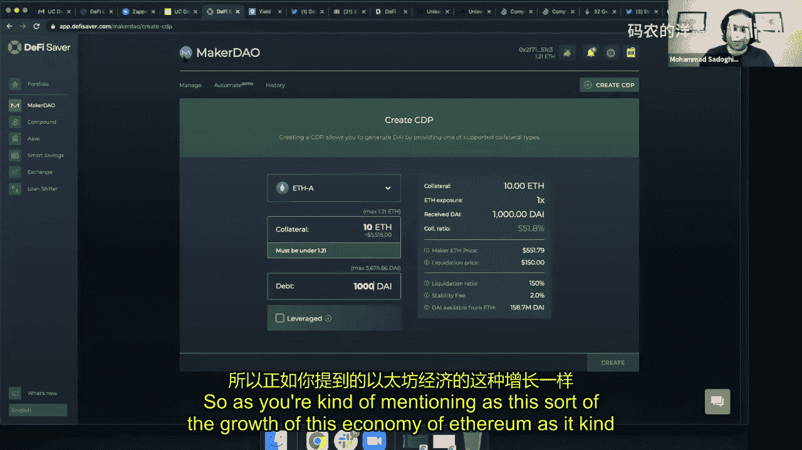

I I think I mean， like I only pause because I like always wonder if I'm the one in the bubble who doesn't like recognize how challenging this is ahead。

 I think like taking notes from Bitcoin， which has been around twice as long and in really we all can acknowledge at this point Ethereum and Bitcoin have you know they're the outliers we have a censorship store of value and transfer of value and Bitcoin and then in Ethereum。

 we have that same store of value， transfer of value but really what makes Ethereum special are these you know the applications that are being built on it and I see them both as flywheels and they're flywheels with。

I they have， I think like they they they are examples of software empowering people and it's very difficult to put the genie back in the bottle。

 it's very difficult to unseee that value you know， like I don't seek out gold。

 because of my interest in Bitcoin and and Ethereum I want to be in control of that and know that I don't have to。

Trust anyone to hold my my digital gold。 I don't buy a traditional art。

 I got some exposure to art by going to super rare and buying digital art where I'm 100% in control of it on Ethereum。

Like， this is art that I own。 but again， I'm in control of it。 And so I just， I don't see。

I don't see this， this going backwards。 I think like us moving towards。

All of this being digital first and deffi representing that like。I guess I don't see a path forward。

For someone to take control at this point， like it would be very it would be basically next to impossible to take centralized control of Bitcoin。

 you'd have to accumulate so much Bitcoin or so much hash power and with Ethereum you similarly because we're moving to proof of stake without going into it because I frankly shouldn't be trying to describe proof of stake but with proof of stake you just have to outright own so much ether and。

If you think about it this way， if you own that much ether to own that much and to destroy the value of it by somehow grasping some greater centralized control。

 it would hurt the value of ether。 So you'd be working against the value of all of the money that you actually own。

 So， yeah， I mean， they're they're， they're both， it's。

It feels like remarkable times we're living through with the two of them and I think I。

I'm open to the fact that I。I just have no idea like what？How exactly the future plays out。But。

I know very simply that the value that we've been empowered with because of decentralized finance。

 because of digital gold through Bitcoin and so on。 I know that it again。

 it's impossible to unsee this。 I always think of it like there's no way I'm closing my computer one day and saying you know what。

I would rather just use Robin Hood at this point， I would rather go back to putting my money in the bank and not being able to access it when I want I would love to earn 0。

01% on my you know savings in my credit union like I don't want to go that way because I know that the Fiat currencies that I use or in this case the US dollar I know that that US dollar is depreciating and value and so for me it's a race it's a race to beat that and to build more wealth and I think one of the best ways to do it is with decentralized finance so。

Well， again， so just kind ofll maybe a bit of a cloudification， I'm not trying to say that。

Kind of backtrack I want to kind of hit interesting problems and kind of arise if I want to look at the research problem a student wants to start a new problem。

 what are the most challenging things that it lies ahead what are the interesting problem we should focus on in the next three to five years at a technical point when it comes to the wide adoption of these platforms and with regard to centralization I guess I overload the use of divorce centralization not in terms of the trust model but in terms of this ethereum method becoming so big and now that so many transaction is happening it's simply cannot handle the load and collapse becoming central in that point not is as a centralized trust point。

Yeah， yeah， great question。I probably shouldn't answer that question。

 but who I would tell you to look to answer it， having looked at your。

The agenda of speakers you all have hosted， Preston Van Lo from Prismatic Labs would be。

 he would be one of those people who could point us in the right direction as to like what research needs to be done to further scale Ethereum。

 post this Ethereum 2。0 implementation， which is going to take at least like I think another like two years。

 also you probably all know him by now， but the Taik Boerin， the founder of Ethereum。

He's very good at communicating these really complex problems in simple terms。I yeah。

 I don't really know， but I know that like from a user standpoint。

 the one thing that sticks out to me is。I think one of the hardest things is how do you。

 how do you solve for。Fat on ramps that are not controlled by a centralized entity。 So like though。

 you know， that's we talk about all of this。 But if people have to move money in and out， I mean。

 that that breaks the model。 they have to move money out and they have to maintain a relationship with a centralized exchange。

 And then one other thing that might go with that research problem or research problems to to look into is。

I still think we have a long way to go in terms of。Storing value you know。

 being 100% in control self custody with you know wallets like Memask or there are mobile wallets like Arent that are really popular。

How do you do it so that it is impossible how do you do it so that you you enable someone to securely store their wealth and only they can access it。

 but no one else can you know it's just such a difficult problem to solve and and I would I would definitely look at。

Look too Ar as one of the leaders there， they're trying to help solve it。

 but they've got problems with their own model as well right now。So does that help at all like yeah？

Hopefully thats a difficult open the questions。 I think it's very insight as the rest of the talk。

 I think is very， very insightful。Yeah， awesome。 Well I hope you guys are enjoying my art here。

 You gotta go into this is totally going off rails， But there is。

 when we talk about that digital first world。 So there there are VR worlds that are using Ethereum NFTs。

 non fungible tokens， which， you know， is。😊，You know it allows me to own something that is unique like a piece of art or maybe something that I play in a video game。

 but anyways， if you guys go to cryptovaoxels。com， I just think this is like one of the coolest places it's loaded with digital art so like。

This is why I think of digital art first， because if this is where I love to go now granted I like still live in a home and I like have kids and I like have interactions in real life。

 but if you spend if you create art in here and everyone buys it in here and you have meetups in here and you own a piece of land in this digital world suddenly we're moving。

 we're shifting from you know the meat space that we all live in to something that's digital first and anyways I just love this if you click on any one of these too。

 you can make offers on their art if you have a meta maskask wallet or you can just see how much the art is worth things like that。

Do I get something when I pay it， do I get something tangible in my hand or I always have to look at it on the screen？

So it's just like a token if someone said to you hey， well what can you do with that Bitcoin。

 you're like， well， I know that it's mine and I just need software to of course verify that but I can spend it。

 I can trade it same thing here you can， you know for me I can go to super rare and。

I am the only one who is。The owner of these， If you look these pieces up， it says， you know。

 Deffi dad is the owner。 It's attached to my Ethereum wallet address。

 So it's probably the nearest extension to what we've talked about with tokens， but like。

It's a lot more visual and it's I think this stuff is just fun to look at。

And it's scary how much this goes very interesting， but so I mean。

 I'm working in this space and I'm still I think。I still don't have the mindset to sort of understand it yet。

I mean， I still don't understand。YeahI don't understand it and I don't。

 and I'm going to maybe say that in a controversial way。

 I'm not sure if in order for me to understand it， am I attaching to reality。

 am I becoming detached from reality？You know for what it's worth。

 I thought this stuff was stupid for many years like I said it was。But nom。

 I'm not saying I'm not thinking about。其实。But yeah this I thought this stuff was really dumb for many years and you can see guys the prices of these this isn't a good example。

 but there's there's some that have sold for hundreds of thousands of dollars I actually would also encourage。

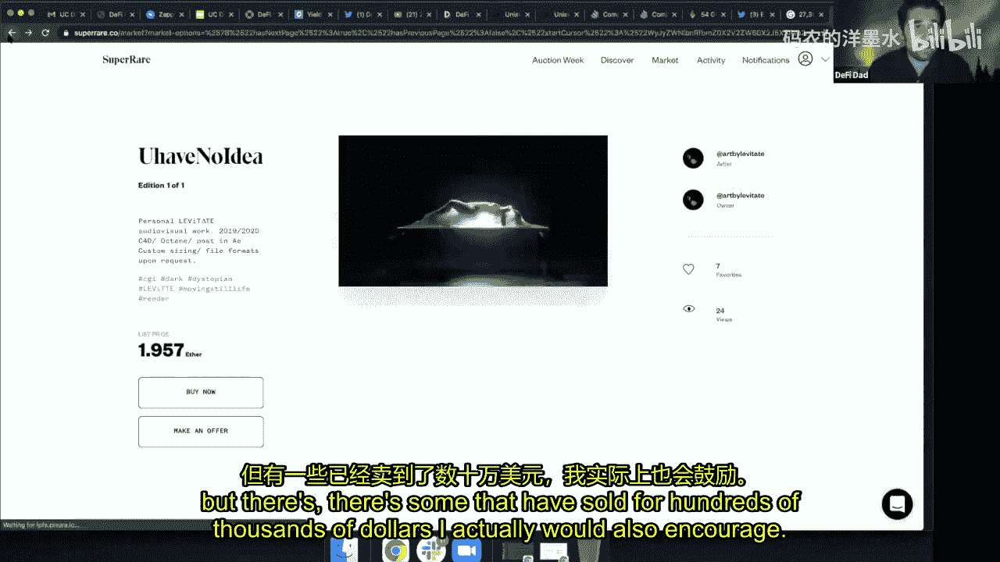

If any of you are interested to learn more about this VR like this bringing together of VR and DFI and crypto。

 look up the W meetup。So these people host。VR meetups。

 here's an example of it in that crypto voxels world and you know as I was showing you。

I don't even need a meta maskask， you can just open up cryptoboxoxels on your computer now if you want to own wearables that define your avatar。

 if you want to name your avatar， if you want to， these are homes that people have built in the background。

AndI know it all sort of looks goofy but。It's it's pretty cool like I think it's it's。

If you ever put on an Oculus headset and then you look at this as well and you say。

How is it not possible that all of this is going to come together and we're going to live in a world where？

You know， maybe some of us still work in an office。

 but I think a lot of people will live in a virtual setting， you know， they'll live in a home。

 but why would you live in a tiny apartment when maybe you spend more of your day with a headset on owning digital things because they're assured to you owning them on a blockchain like Ethereum。

Why wouldn't we go that route， it seems like it's a quicker route to a fairer world if everyone can get access to the internet。

I mean， it sounds very interesting， I think it just requires an option of thinking and and I just going to say this too owning digital thing。

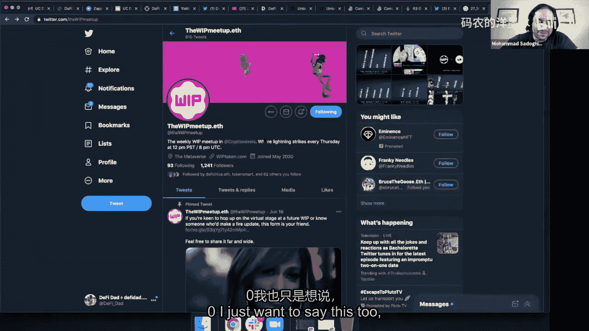

It's it's not tangible I mean at some point I mean I may all I mean live in this sort of digital thing and none of it if it's tend to be tangible。

Then one question， what is the audio？M think that you I've been there I like empathizing and reson with what you're saying I Ive it it was when during the pandemic I got anoculus headset and I started to。

I probably not spend more than an hour a day in it。

 but finding that like I enjoyed it and I had a few friends and we would meet up in there。

 these are friends that I couldn't meet outside because of the pandemic of course。

 but I have friends you know that live in other parts of the world and we would never see each other anyways and。

When you start to， you know， define your digital world is where you spend time。

 It's where you're comfortable， it's where you。Own things which what things those are depends。

 I mean it it could be some digital art， but I think in the future like you know if you look at crypto voxels and look at other VR based worlds。

Where you can transact in ether in crypto voxels， you can， you know， pay for art there。

 you start to say， well， like what else do I need here， you know。

 and and this is coming from someone who's。I would say I'm arguably very social and I have。

 you know I'm married and I have kids and I like being in this physical world。

 but it's it's a cool thing it' it's and I would I would compare it mostly to what we were talking about the very start is。

Look at the way you have ordered groceries from an Amazon during California lockdowns versus。

What you did before I don't know about everyone in the class like I would have never ordered Amazon groceries when I was in college but with kids now we would order it only for convenience we liked to going to the grocery store suddenly I didn't have the option to go anymore and the grocery store has become a secondary option of what I do on Amazon so I I think a lot of those concepts where it's digital first are going take hold over the span of our lifetime。

嗯。Fcellly。So guys I could just leave you with this then in terms of like how to get started with Dfi we kind of talk through all of this。

 but just few of the simple things that you would need storing your wealth or your tokens so you need a wallet like Memask is a free chromrome extension so it's you know it's a wallet that sits on my browser and it allows me to do what we were doing with compound where I can click and then I can transact and spend money from the wallet I can trigger smart contracts to do things for me by paying a little bit of ether tracking which goes back to what we do at Zapper so just you know look at your here's an example of a really empty wallet but oh no I'm sorry never mind has this is the E2 deposit demo no is someone has。

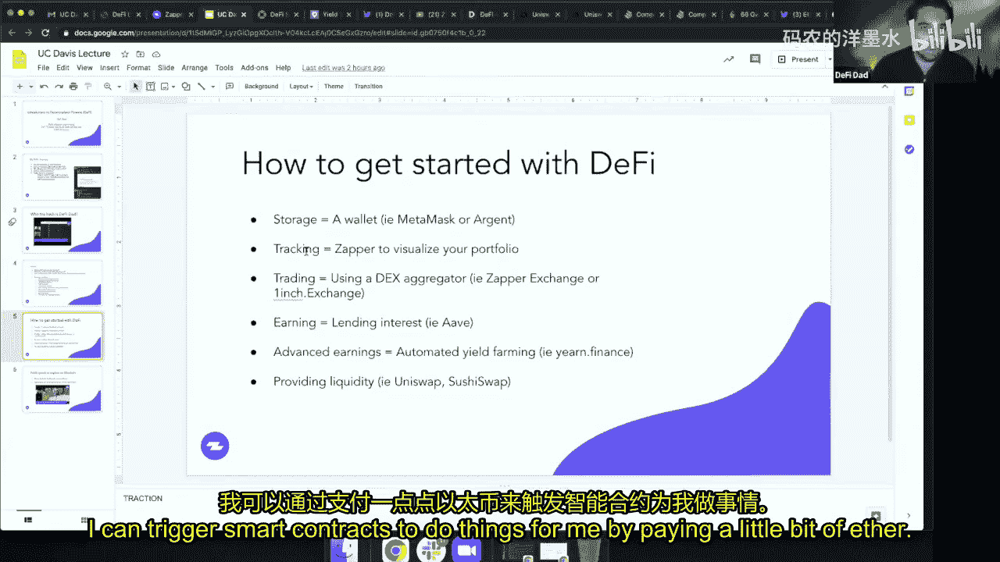

A lot of ether so this is someone with a lot of ether in their wallet so that's one way you can track your wealth on Zappper at Zapper。

 p using what I was calling like a search engine for trades a D aggregator an aggregator of all decentralized exchanges so that goes back to you can just go to Zappper exchange and you could be trading between different tokens here and it'll go and find you the best rate so says here sushi swap is it and I could exchange for that and then the last few here we kind of covered this with compound another popular one is ave lending to earn interest is like one of the most basic concepts I would encourage you to try something on compound or ave once you get a wallet set up some advanced ways to earn are refer to automated yield farming which on Zappper you can go to the invest tab and search。

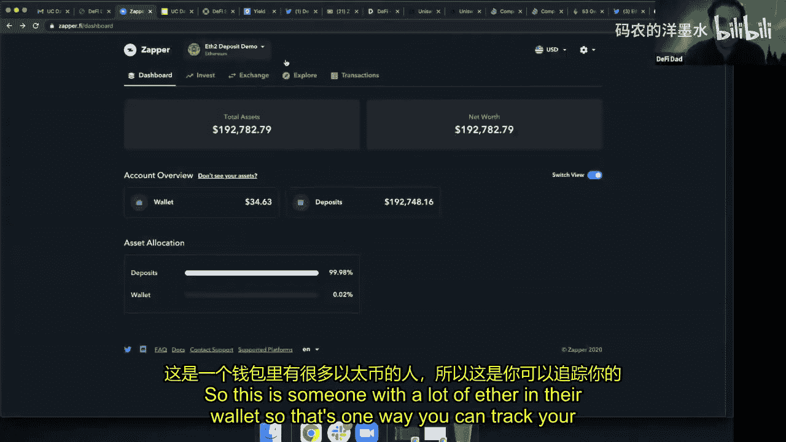

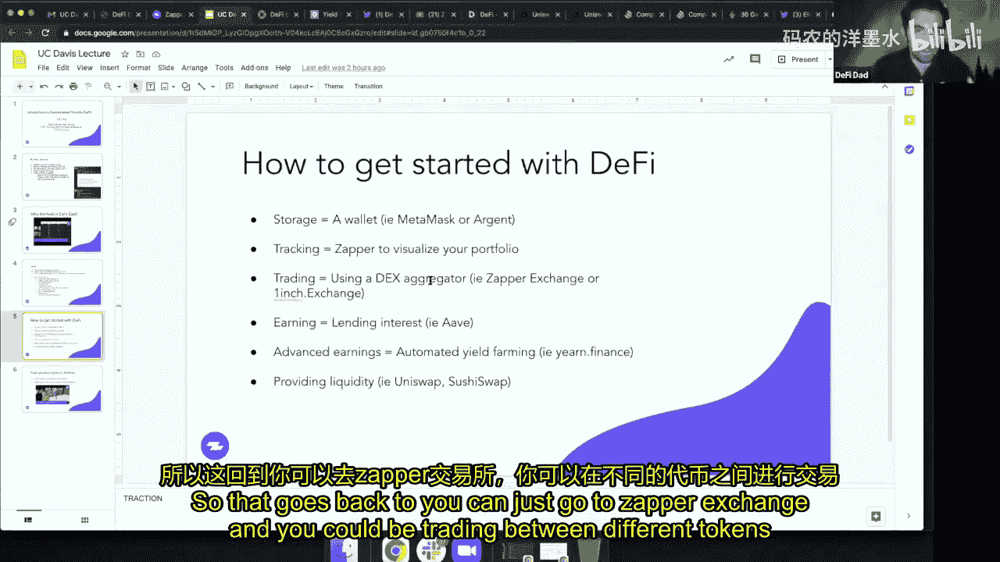

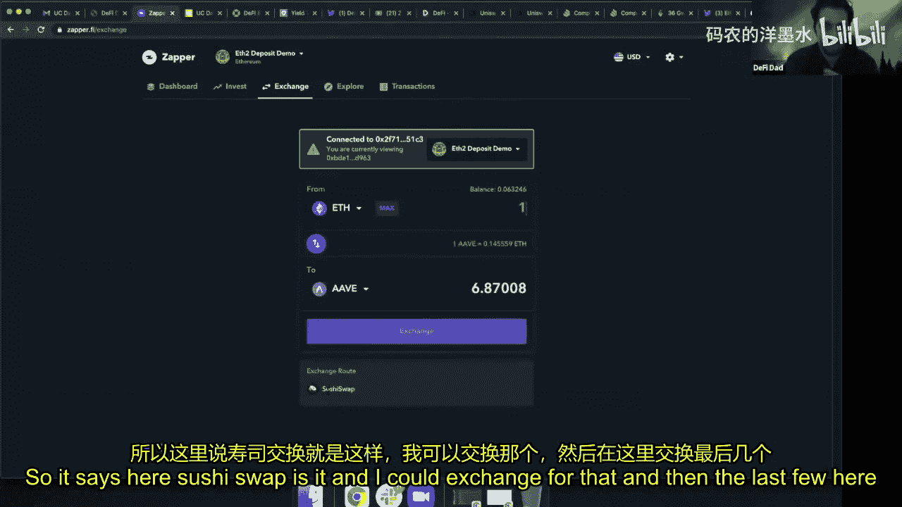

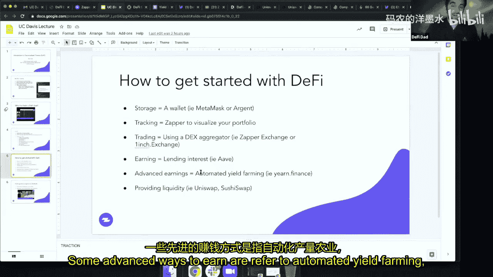

Yarn oops。These are all options where you can just deposit a single token so I could deposit。

 let's say some ether or die and。It gets put into an investing strategy is what we'll call it。

 but anyways， this is more stuff you would want to do more research on i've got tons of videos at。

Defidad。com if you go check that out， tons of Dfi tutorials here you can learn from especially the playlist Dfi for beginners。

 that's a really good one to check out。

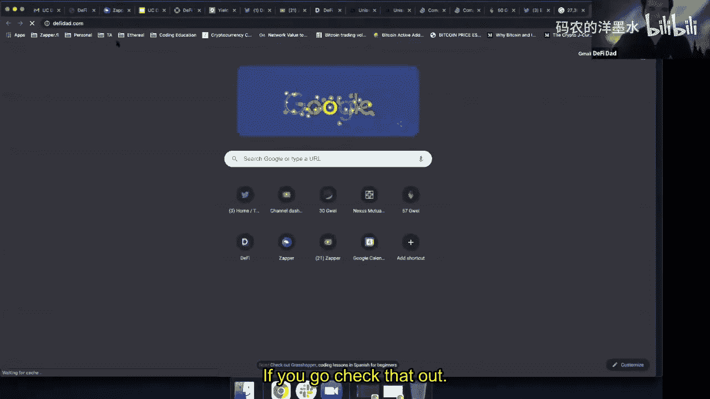

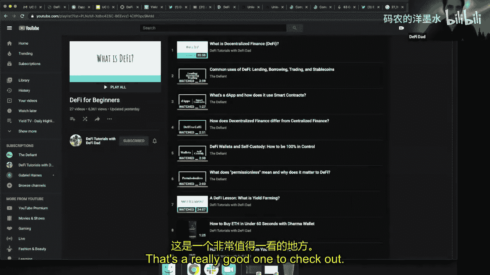

And then the last thing here is providing liquidity to these decentralized exchanges or more properly called automated market makers like unIWp。

 the only reason that I'm able to trade in a permissionless manner using my Ethereum wallet is because of what we talked about with unIWp where people are providing。

Two tokens to a pool and then i'm trading between the two tokens and if I put a little in maybe the price goes up if I take a little out maybe the price goes down and that gives someone else an opportunity to。

Add more tokens and earn more fees and so on。

Anyways， though that's like a little defI starter kit there， wallet tracking， trading， earning。

 mostly lending， maybe advanced earnings if you want to dig into that with me on some of those tutorials and then providing liquidity is another。

 it's a common way to earn because if you own ether and you own die and there is a pool and unIWP with ether and die and you can let people trade between the two and earn the fees in the middle。

 you earn a little bit of every time someone trades you earn a fraction of that fee。That's why Dfi。

Become so powerful， it's letting you put your money to work。

 money that would otherwise be sitting there idle because of automated money software doing all the work for you。

So anyways， by the way， I can stay longer if there's any more questions， but thats that's。

IFeel like I've talked way too much。Definitely look forward to interviewing people more in the future。

Oh thank you so much and thank you for walking us into this brave new world。

 and I think there's interesting to learn more， I mean， I think it's a very fascinating。

It's just really fascinating thank you so much on behalf of Expo Lab and UC Davis。

 I really want to take this opportunity again to really thank you。

Hey and but thank you so much for having me it's like such a pleasure to join you guys。

If anything I wish I could like I'd love to just hear everyone's like thoughts and join me in the future because it's I tend to enjoy more like learning from how people are perceiving all these defI applications。

 but if anything I just。I hope I hope everyone wants to learn more and if you want to learn more like there's things like if you go to tv。

zappra。5 that's the daily deffi live stream I do there's deffiadad。 co。

Which has all of the tutorials the tutorials are more in depth it's me like really holding your hand and like showing every single step and explaining every nuance of what I do。

But if anyone wants to get a hold of me， those are two really easy ways to get a hold of me。

 And then here's my email to。诶。I'm always here to help。

 I mean I remember being a college student not long ago and it's quite a year to be a college student。

 there's so many jobs in DFI。Come work in the space when you're ready whether you're graduating or for any reason you take a leave of absence would love to help people find jobs in the space So and you're very lucky you gotta you have such an awesome professor。

 So thank you great great class。 I can't believe the lineup of speakers you have there so。😊。

YouAnd bye， everyone。 Thanks so much。 Good luck with your your finals and。😊。

KeepKeep on chugin that's you're at a great school I always。

 for what it's worth I always love Davis as a as a UCSD student I always thought Davis was another great place I thought about going to school so glad to be a part of that UC system。

😊，All right， thank you so much have a wonderful life thank you take care guys bye thank you， bye。😊。

