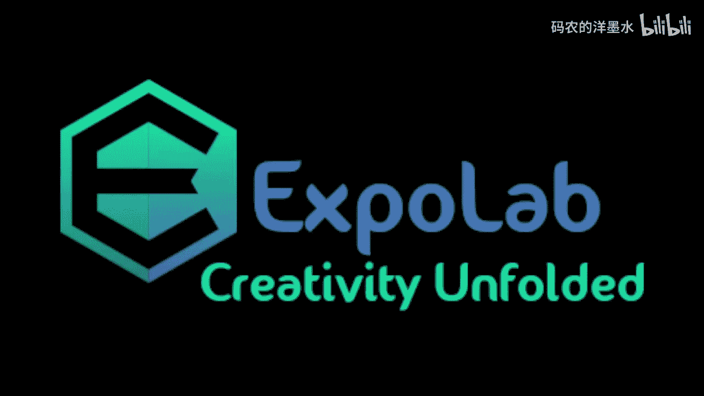
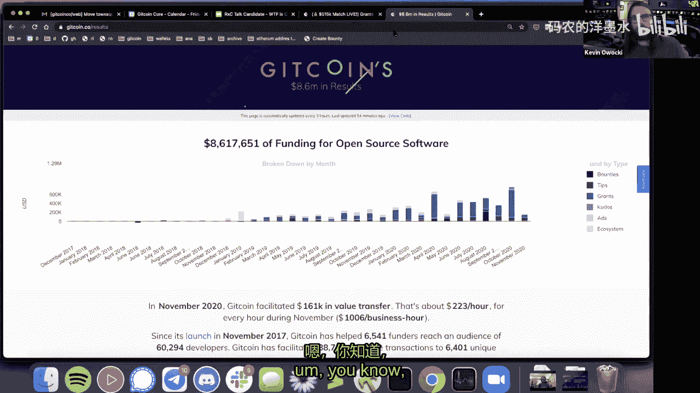
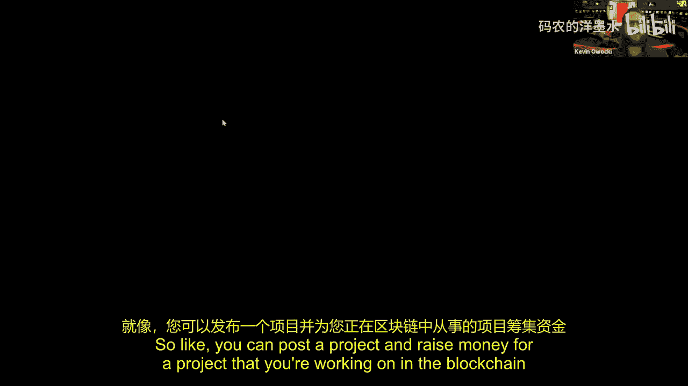
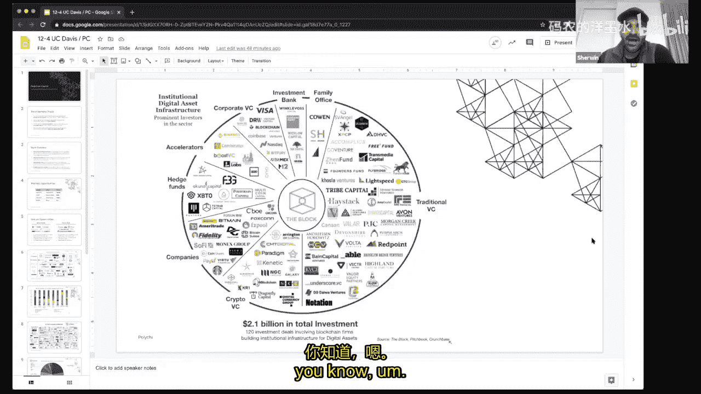
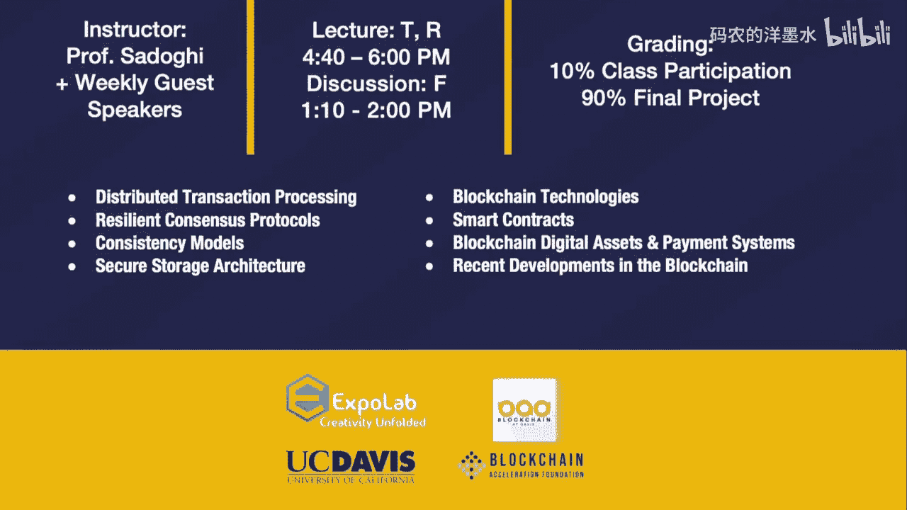

# 【全集】加州大学戴维斯分校 分布式交易与区块链架构 中英字幕 完整课程 p09 Lecture 5 - 融资、Gitcoin资助与区块链投资 -BV18YFVzME2f_p9-

哦。All right hello everyone， welcome to another session of Expo Lab B speakerker series。

 today' is my great pleasure to have Kevin from Getcoin joining us and he's going to talk about the ecosystem that he has found it to help the blockchain developer to thrive and survive in this very exciting and I guess pretty competitive field as well too so without furtherdo Kevin please take it away。

Thanks so much for having Mimo， it's great to be here。 Hi everyone， I'm Kevin Owaki。

 I am the founder of get and Bitcoin's mission is to grow。😊，There we go。

 let me just picture my son's okay。Yeah， everything's fine。 Okay， I'm the founder of Bitcoin。

 our mission is to grow and sustain open source software and basically open source software is a a foundational pillar of our digital ecosystem It creates $500 billion per year in economic value and we want to help find business models for open source software developers。

 So show of hands has anyone in the group used open source software。😊，Couple of you。

 It's really just a pulse check because if you're studying computer science。

 then you're probably using open source software。Open source software is I think in a really amazing development because when you walk into a hackathon I'm in the Ethereum space。

 but this really applies to any modern software development you have all these amazing tools out of the box that you can use to have you have these Legos that you can assemble in order to start a project and whenever I start a project I don't write a new database server I don't write a new web server I use open source software for those things and I just have this deep affinity for the fact that all of this code this $500 billion worth of economic value in code is all available for free on GitHub and source forage and Gitlab and and I think it's a really amazing thing to live in this world where all of this code is available for free as a public good it didn't have to be this way I don't know if this is an undergraduate course or not but if so y'all are probably in your early 20s。

I'm 35 and I remember back like developing on the Microsoft stack。

 I think that like you know there's a possible counterfactual version of the world where open source did not take over and we're all developing on our Windows PCs and our Windows phone and you know in terms of blockchain。

 maybe we'd all be using like our clippy coins or something like that and and so I'm just super thankful for open source software。

And when the Ethereum community was blowing up in 2017， I started Gicoin。

 which our mission is to create business models for open source software。

 which hopefully will allow anyone to work for the open internet and basically you we want to build a world in which everyone has the leverage to financial leverage to leave their job and and work on on open source software and so you know that was how we got started。

 we have delivered about $8 million worth of funding for open source software in the last 24 months basically I started the company way back here in 2017 and you can see that as we've gotten more and more momentum and we've had more and more impact on the world you there are people who work on the Gicoin network full time now which I'm super super proud to say has been a goal of ours is to。

people's lives to enable people to work for the open internet has been our mission。

And so theum you know， that's that's sort of the why of of why we created why we created Bitcoinco and in the basic insight here。

 I think is that。

Is that I was around when the internet was created and the Internet of information allowed。

Computers to send information across a network as a as a primitive like without you could send information across a network without an intermediary so like if you're the New York Times and you have this like printing press and distribution mechanism all of a sudden you're on and even footing with a blogger because now the internet allows you to send information across this network and that changed everything about our society that relies on information it changed our entertainment it changed our politics it changed the way we get our news and I think it's like really amazing to think about how the internet has changed our lives because of that core primitive ability to send information over across a computer network with TCPI and UDP and you know'm like I'm like an elder millennial I was around before the Internet like I remember having a dial up modem and so like you know I remember before the internet sort of like took over the world and one of the things that really inspires me about。

You know， the blockchain space is now that we now we can have a computer network that sends the core primitive of financial value across a network。

Without an intermediary。So basically。What in society relies on information？

Entertainment media news relies on information and all of those industries are upended by the internet what on in the world relies on financial value。

Investments， banking finance， jobs all rely on the core primitive of financial value and so you know what is the allegory we we're 30 years into the internet of information right now we're like maybe 10 years into the internet of finance。

Is the Internet of finance going upend everything that relies on financial value the same way the Internet of information upended the the Internet of of you know。

 like all of the things that rely on information And so I think that that's the opportunity ahead and you know a lot of the blockchain space right now is deffi and like financial investments。

 And I think all that stuff is cool Like I have investments I'm 35 like I have a 401 and all that kind of stuff。

 you guys will have 401k is also one day。 But。😊，The the thing that like my bet from first principles bet is that speculation in finance is just like one of the first use cases in the internet of jobs is going to be a really huge thing because jobs rely on financial value and if you want to take blockchain to the mainstream。

 most people's financial life is not investments in speculation like what Deffi in the Ethereum community is now it it's their jobs and so I want to build a jobs network and I want to know I'm a software engineer you couldn't tell my life beard in my long hair in my just general software engineering this I want to make a better world for other software engineers because A because like those are my people I've been in the trenches at four different startups together with other software engineers but also because software engineers of the tip of the sphere for the Internet of jobs we're the type of people who are gonna to figure out metaowmask and。

The key management and transaction ID broadcasts and all that kind of stuff and。

And so I think that we're going to be the first first ones to adopt the Internet of jobs and so I think that getco is kind of like the tip of the sphere for the internet of jobs in a lot of ways I mean those other amazing projects that are doing。

Community job stuff also， but Bitcoinco is sort of one of the first and one of the biggest。

And so I'll stop there to like take a breath or if there's any questions or comments and if not I'll sort of continue on into talking about our journey and I think what's interesting and Mo。

 if you want to sort of steer me towards what you think the students are learning this semester or anything like that。

 feel free to as well。No this is great again these two talk is kind of the broader scope so far we've been really focusing on a protocol in a particular Ethereum Bitcoinco and hyperlegger specific platform but now just kind of seeing how does these different system are used in the bigger picture so I think that's that's exactly the intents and perhaps maybe one thing you can also allude to is that what other application do you see becoming prominent in going beyond just the Dfi and some of the current use cases and hows the general workforce can really get into this as you mentioned So I think that example of that would be really appreciated as well for sure yeah yeah excited to go there yeah so the。

The basically like， what other use cases of blockchain are going to be big， You know。

 I'm going to go back to my， my sort of parallel with the Internet of information here and talk about。

How many people in the group use Google？Show hands， also a pulse check。

 just making sure you're paying attention。 how many people in the group use Yahoo。com。Alright， so。

 so basically， Yahoo， I， I don't know if y' all， if y' all have followed。

Basically you know I'm trying to remember that some people in this group might be Gen Z and I'm an elder millennial and I remember that your early internet because I'm an elder millennial and one of the things that Yahoo did when they were like Yahoo's mission was to classify information and make it indexable Google's Google's mission was also to classify information and make it accessible and reachable but they took two different routes to the same to the same to the same goal Yahoo took the card catalog system of a library and put it online So if you wanted to look for the Colorado Rockies。

 the baseball team， you would have had to go to Yahoo co select sports baseball Major League Colorado and then you would find Rockies right you had to navigate the taxonomy of information that existed before before the internet and what Google did is they just invented the search box just type in Colorado Rockies and will give you them。

Most relevantlevan information related to the Colorado Rockies。

 So what Google did was they reimagined how to index information。

🎼Leveraging the technology of the Internet in a way that had never。

 ever been done before and Google kind of ate Yahoo's lunch because of that。

 they created a fundamentally easier way to access information and so this is obviously is obvious with the gift ofndight hindsight is 2020 obviously be easier to search for something than navigated taxonomy And so Mo。

 when you ask me you know likes what's going be the next thing in Defi and blockchain like I can kind of take that algorithmegary forward。

 which is like of course there will be like Internet banks and there will be internet jobs but what's the fundamentally new primitive of things that you can do with tokenization with blockchain with smart contracts that just like our really great ideas but haven't been proven out because the Internet of money is so is so new and and one of the things that I always try to do when I'm trying to reason about this is reason forward from first。

Pinncciples about what is going to have value and what is going to happen So like we've got these core building blocks。

 we've got blockchain networks we've got smart contracts， we've got tokens。

 How do you assemble these core primitives in a way that provides more value than what than what existed before and so I think that like that's one of the things that I learned when when when I first started doing startups is that you can like when you're building a startup。

 you can always copy what someone has done before you but if you can learn to think for yourself if you can learn to think from first principles about how the world is changing and how to sense make then I think that you you're in a much better place like as an entrepreneur trying to figure out what to build and so I know that's not a direct answer to your question of what's next but if you're looking for a direct answer I think the internet of jobs and community jobs and the ability to invest in each other is what I'm really excited that's the design space that I'm really excited。

to learn about Bitcoinco runs an accelerator called kernel kernel is not unlike a techstar or a Y combinator and theres there's software developers and entrepreneurs that are not unlike yourselves that are going through it right now and one of the things we're exploring is hey。

 what if everyone in the kernel class had upside in everyone else's project？

So basically like what if you could take 1% of everyone else in your classes' company or project and like put it into a token and everyone could participate in the upside of everyone else you know like and so that would change the the incentives of your class and of your cohort to like support each other more you know like I'll support other people in my class and my cohort just for the good vibes like I live in Boulder Colorado for gosh shakekes you guys are in California so you know the good vibes I'm talking about but having that economic incentive I think is an example of something that that is even stronger because of the blockchain space so I don't know if that answers your question I'll pause to take another break and if not i'll kind of get into more of the stuff we're working on。

No gives a hint， which is I think that's all we need， I guess please go。Yeah， definitely。

 and I just want to do a quick time check。 I know you said about 20 minutes and I'm realizing it's half half past the hour。

 So do I have like five or 10 more minutes or or should I wrap up。So。Till 135， so another five， five。

 six minutes。Cool， sounds good Well， I'd love to talk。不。I'd love to leave some time for Q and a。

 so if people have questions or comments， feel free to unmute and and chime in and。And if not。

 then I'll kind of go into some of the stuff that Bitcoincoin's working on right now。Okay。

 so basically gets get has。A campaign going on right now called Gicoin grants and basically what it is is a crypto Patreon so like you can post a project and raise money for a project that you're working on in the blockchain open source ecosystem and basically this is Gicoin。

co/lash grants and basically what Gi grants is like a fundraising platform for blockchain projects to be able to raise money and I'm just going to look at the infrastructure category of Bitcoincoin grants right now and show you some of the Ethereum infrastructure projects that you can contribute to using Gicoin grants so basically this is D node they are infrastructure for I think staking and basically the idea here is that we host a crowdfunding contribution platform for this Ethereum ecosystem。

You can add it to your cart here and then contribute you can contribute to blockchain based projects using blockchain which is I think you an example of using the core primitive of blockchain you know dog fooding the Ethereum ecosystem and sort of like the gimmick behind Gicoin grants is the fact that we run these matching rounds every quarter so basically this grant has raised $649 die which is worth about $650 bucks and it's going to create a and right now the estimated match for this Gicoin grant is around $3000 and what's cool about Gicoin grants as a matching platform is that it leverages something called quadratic funding and using quadratic funding one die contribution to this grant could equal $90 in matching from the matching pool and。

So quadratic funding is basically the mathematically optimal way to fund projects in a democratic way and the secret behind quadratic funding is the math so basically what you do is you raise a matching fund of Bitcoincoin grants has raised a $500000 matching fund that we're distributing right now and basically you distributed according to the quadratic funding formula and what's really cool about quadratic funding is that it optimizes for the number of contributors funding a project more so than the amount that they're giving to a project so basically in this example I'm using this calculator that Gicoin created called WtfsqF。

 co and in this example Gr1 raises $10 from 10 contributors and Gr2 raises $10 from one contributor and you can see that Gr one gets way more of the matching of the $500 K matching pool and the reason。

whyhy this is powerful is that when it comes to funding infrastructure projects。

 the number of contributors matters more than the amount funded and this pushes power to the edges away from wh and other central power brokers which creates more democracy in public goods funding decisions and so you know our mission is to grow and sustain open source software open source software is a public good and I think that one of the reasons why it works is that we've got this incentive built into quadratic funding where if a grant is democratically popular a very small contribution can equal a very big matching amount and that that's cool like it's great to contribute 1 dollar and have 100 dollars worth of impact like who wouldn't want to do that and so quadratic funding is an example of something that I think like wouldn't have existed in the 90s when I'm growing up but I could see it being a core primitive of how we fund our infrastructure in the 21st century so。

You ask me like what's next like what's an example of the use case of blockchain。

 quadratic funding is one of the things that I'm really really excited about and it's one of the reasons why Bitcoin has become a success is quadratic funding。

So that's what I'm excited about right now I'm trying to put more quadratic funding in more places and we're just kind of building tools to make quadratic funding go more mainstream and get bigger in the Ethereum community we're distributing $500。

000 per quarter to Ethereum projects and the consistency of doing that is key so if you're in the Ethereum space and you're building open source software you know there will be a getcoin grants round in Q1-2021 Q22021 Q3-2021 and being able to just you know our mission is to enable you to work for the open internet every quarter there will be a getcoin grantants round and if your community enjoys what you're doing then you can raise money from getcoin grants so that consistency I think is is a really really key thing and it's something that we're trying to do to enable people to work for the open internet。

So I see that only a few minutes left would love to get into discussion and Q&A， go ahead， Mel。Yeah。

 that's pretty exciting so just since we're talking about blockchain and there's all this attacks and ident as an issue so。

K of prevent for example， I want to spend 10 but then I create 10 fake identity and I do it on behalf of 10 contributor is that could be a potential issue Yeah absolutely an issue and I think that。

I wouldn't I would never oversell what what Bitcoincoin grants is doing as having solved the identity problem decentralized identity is a huge。

 huge deal and and basically my philosophy on it is that if you look at it from a certain angle getcoin Grs is actually a red team blue team exercise for battle testing digitally native civil resistance technology So civil resistance is basically sock puppets resistance like how do you prevent people from making up identities and you know how do we do that in a digitally native way that doesn't require KyC or like government Is and stuff like that And so like vitalic chimed into my tweet here and said crypto as a whole is kind of a giant red team blue team exercise for battle testing a more peaceful and defensecentric version of cybersecurity so basically getco Grs has not solved this problem yet。

 but my goal as the administrator of Bitcoincoin grants is to solve it。

In in parallel with how much money we're raising。 So like when we first started Bitcoincoin grants。

 we had 25 matching rounds and we hadn't really solved civil resistance。

 And now we're doing 500 matching rounds。 and we have a more serious approach to civil resistance。

 And when we're doing $5 million matching rounds， we're gonna be really。

 really good at civil resistance。 And so if you go to your getcoin profile。

 which you all should sign up for getcoin you can go to your trust bonus tab and you can see that basically what we're doing is we're integrating with all of these DI providers from bright I to Po up to Twitter to there's all these other great like digital identity providers and when you integrate your getcoin grants profile with them。

 you get this thing called a trust bonus， which is basically like a bonus for verifying your identity。

 And so this is our way of kind of like。Incentivizing the blue team in that red team blue team exercise to prevent the red team from being able to attack us and and so Mo the answer to your question is that we have not solved digital identity。

 but we're just going to do it in an iterative way and get better every getco grant round great question。

Sounds good thank you so much I mean yeah of course that's one of the hardest problems so yeah。

So any other question before we kind of transition to our next speaker？

I wish you had a little bit more time， but yeah that worries。

You can find me on Twitter that's like the easiest way to get a hold of me if you have questions or you sort of a nerd out about open source or software or the future of the internet that's me I just put myself into the zoom chat but Mo thanks so much for having me it's been a really great pleasure to speak to your class and you know I wish you all luck in starting your careers in software development it feels like yesterday that I was a computer science student and learning about all this stuff I think there's a bright future for software engineers across the world and I hope see hope to see you out there building something cool。

All right thank you so much really appreciate that and i'm probably going to fill up an application we all need grants so thank you for introducing it to us and I'm pretty sure maybe some of the students especially who are building application on top of Ethereium they may start filing a grants as well too so thank you and allowed to do this thank you so much all right bye by thanks for having me。

Thank you。All right， so our next speaker is Sherman from Po Chin Capital。

 so now he's going to talk about he's a portfolio manager。

 who he's going to again continue to talk about the investment and how do they I guess find the right technology or the right application to put their money on so please take it away。

Great， thanks， and you can hear me now， is that good？Cool， so I have a deck that I made。

 let me actually share my screen one moment。I'll refer to it but it's it's quite a bit I think Mo sent out the link as well it's a lot of text it's kind of stuff I scrapped togethers it's kind of ecosystem type stuff but also about our fund。

 but at a pretty basic level。So I work at Polychain。

 we're one of quite quite a few crypto funds globally。

 Our fund itself is split into kind of like a multi strategy fund。

 So it's not just investing in liquid coins。 We have one core fund that is our hedge fund that's kind of that's that's buying and selling。

Like cryptocurrencies as you know them Bitcoin Ethereum stuff like that that trades out in the market。

 but then also we have we have a more holistic approach around it where we invest kind of across the entire the entire spectrum so we actually have everything from an incubator that incubates companies from like a founder and just kind of an idea that we help them out to develop through to venture where we actually invest in both equity and coins of companies that are again like seed stage early stage companies。

And then again those kind of mature and actually go out into the liquid markets and that's kind of where our the hedge fund takes place。

 but then also we have an internal engineering team so I think a lot of people in the space don't fall this quite as much but staking and participation in these networks I think like Kevin was kind of getting on touching that onto that。

 but governance is a pretty big topic and we we run the biggest。

Like internal capital staking operation I think pretty much of anyone that's out there so we actually state coins and take pretty activist stances within networks and changes that go on within networks and help them kind of bootstrap the governance when they come out networks like Tazos and at cosmos atoms and Polka dot and networks that are that are using staking but so let me go so that's kind of a quick overview。

So on the investment thesis kind of kind of generic stuff。

 but it's basically we believe that it's what Kevin touched on。

 which is with crypto you can do things that you can't do with others with current like incumbent technologies and things like that out there when you actually place this this equity like commodity or ownership like feature within different bits of software you can transmit value and you can do it and open up activities and incentives that you usually couldn't do before。

 the thing that we actually talk about internally because we've invested in this term called like Dfi for like a long time or a long time in crypto at least which is like two three years now。

 but being able to interact with people and move value without having to rely on a centralized source that basically opens you up to again like possibilities you couldn't have before and now we're kind of seeing them with。

Dfi kind of thriving a little bit more right， you can get credit。

 you can move around assets to have different distribution within new networks right but the gist of it is that before like the term is like software is like eating the world or whatever but now it's like markets and money with eat the world because you can open up liquidity anywhere without bounds and that's kind of what we've seen happen within DFI is like this initial stage of just like sprouting of activities where we've just never seen that and within the different companies we invest in。

 we've tried to at least plant those seeds to allow for this so we've invested in companies like compound and DYdx and maker dow and pretty early primitives of what you call Dfi but basically the idea is that with smart contracts you can do things that you otherwise couldn't and this open up opens up the possibility for investment where you otherwise couldn't we like really don't believe in permission technologies。

Or enterprise blockchains or play any anywhere where。

You're just you have an incremental step above what's out there currently enterprise blockchains are basically the whole idea。

 the whole reason this movement is happening is because you have some equity layer。

 which is the coin or the token in it that gives incentives where you can't get them otherwise we've heard this whole term you know this whole like I don't what we call it like type thing which is like oh it's all about blockchain not Bitcoin the reason Bitcoin and cryptocurrencies work is because you have this unit of account。

 which is this coin that weaves in and out and is kind of the blood of his operation if you have some network like R3 or any of these kinds。

They've all fizzled out for a reason。 and I've followed these companies。

 I've been in the space for for quite a while。 So， you know， we。

 we believe that the investment is actually at the coin level。So with a team。

 this is kind of generic stuff， but basically we combine pretty technical I guess understanding of the different technologies so like like I mentioned within our engineering team。

 a lot of these guys are security they're pretty heavy on security engineering a lot of them came from Coinbase or built out the early primitives of some of the trading engines and staking technologies that you've seen and then we get pretty deep in the deal flow so like the people like you guys that are coming out and actually coming out of cool projects we want to fund because we want this industry to move on and without like the primitives I mentioned without the early funding and Defi maker down and compound like none of the stuff could have even happened and it's just been really awesome to see it sprout so so really identifying founders with good ideas early on that are just novel that you just can't do and that we can actually see growing we want those to get off the ground and but then also at the base later too and we invest in these different。

There's some thematic elements we actually look for， so like this kind of metachain concept。

 which is rather than having your own blockchain， you actually have this kind of interoperability that kind of stems at a core layer chain。

 which is like a Polka dot and you actually run your own consensus mechanisms from that in this form of interoperability where you have all these quote unquote metachas that interact together but based on security of that base layer which is like something like Polka dot and then like programming different forms of programability and being able to execute different types of smart contracts in different languages something webassembly like wm like we've invested in definitiveinity which is an upcomingcom project in the next quarter or so that's going to be coming out。

And then like storage， right， I think Kevin had mentioned this， but。

The current forms of contribution within the community are basically altruistic right like you go on you know you want to you want to like seed out different sorts of like like bittorent right there's no actual reason for you to be giving up your risk for actually giving out this content and helping spread that to other people right？

People are incentivized by money the strongest networks will have the strongest economic incentives and like digital storage is one place we haven't seen really any sort of change in that and we think the file coin and networks like that will be kind of disruption there and then also privacy and heavy cryptography we have a network coming out called Ao but like looking at all the different forms of privacy that are out there we think that'll also be big so hitting on these kind of thematic opportunities Wait what WS again。

Wasn't Webassely。Here。K good yeah。U。And then within ventures。

 So most of the early iterations of crypto， it's， it's a lot of， I don't know Mo touched on identity。

 but like。A lot of it is speculation related it's trading but it's legitimate activity right you're moving value around there's gonna to be tons of companies that pop up that have to do with this so we've invested in a lot of those so a lot of trading infrastructure trading technology Anchorage is one that's actually pretty unique on the left side which is infrastructure which is custody I came from the equities world so I used to trade stocks and options and you don't have to worry about people like stealing your shares of Apple you're not keeping them under your bed but in this space。

Like people could take our assets， you know， they were targeted probably， you know。

 pretty often and so。Companies like Anchorage are interesting where they actually purely specialize in just custodying assets and it's funny because now we're actually seeing incumbent banks and financial services firms like Goldman Sachs and JP Morgan come out and they're like we actually need a good way for people to store their crypto and they're actually I and companies like Anchorage heavily where there's not really that many that are like Anchorage fidelity is getting into custody as well so we think this is a pretty big space just custody of assets and along with that being able to participate in this governance that I mentioned earlier which is like staking with that with that custody right because you're giving up those rights if the custoddia doesn't support it but places like Anchorage。

 places like Coinbase custody， these guys support that。

And then frontier technologies here on the right， So again， like I mentioned。

 just new products that are uniquely enabled to do new things with smart contracts。

 I think gauntlet is one that's interesting maybe I can highlight that in the middle。In Dfi。

 you have value flowing many different places and the bounds to the capital and the strengths that you have you can have tons of leverage。

 but it's all defined on chain right but we still don't have really good ways of modeling out risk so gauntlet actually models out risk across all these different open source networks and that's actually gonna be very important as you layer on these different sorts of unique risk right where you know in 2013 you could barely borrow Bitcoinco to short it now you can actually borrow you know with derivatives with you can do a bunch of different things and you can layer on derivatives on top of those derivatives and so you need some way to be able to assess on the networks how much risk there is and what the kind of chain reaction could be so places like gauntlet are just coming out with supportive tools to risk。

This is this is not our chart， but like I found it。

 I thought it's pretty cool the gist is like looking at our portfolio right what kind of sectors within crypto do we actually invest in D5 but then also custody research and development like I mentioned gauntlet some gaming although we're not as heavy on that but privacy is a big one and trading infrastructure and technologies as well as broadbased protocol there infrastructure。

 so just to give you an idea of kind of you know what are some of the sectors that we look at broadly because it's not just random coins its we think of it in different kinds of sectors。

This is like I say that you guys focus on specific sectors and not going to like like a specific sector more heavily or。

That's your good question。 I think that should we go back to this。

I think anywhere where we see a big enough market that currently you cannot do with the current technology。

 not just like， oh putting Apple shares on the block the block that doesn't mean anything but just like like flash loans right' at least in the next five years。

 you will not be able to get a block by block frequency loan in equities from interactive brokers to go and short something before it's even available that kind of arbitrage and that kind of opportunities。

 you cannot do that in central markets they just can't do that in crypto you can so like that might be something like trading technology and infrastructure within Dfi we focus a lot in that area because I find that a lot of the opportunities that you can't get in normal markets or within this new Dfi space whereas trading and exchanges like。

Yeah， those are kind of becoming saturated right maybe we'll focus a little bit less on that but I think within Dfi broadly there's the most opportunity right markets just the actual size of the markets that you have because we're only talking about like crypto trading but when you look at normal markets debt trading and currency trading trade multiples above stock trading and stock is just like what you see at the tip of the iceberg because that's like the fun stuff but then debt and the deeper types of supporting infrastructure are huge and those are the biggest places for crypto to actually get into and disrupt and within Dfi broadly I would say as a result。

 those kinds of disruptive opportunities are probably the biggest and then the opportunities to actually invest into the coins themselves in those networks。

对。嗯。Yeah， so this one's kind of breaking out you can kind of see by different firms they're not all investing in the same types of stuff right CMT digital you is a trading shop themselves from Chicago they're doing a lot of exchange investing。

 things like that are other is mostly deffi generally as well as like while it's in basically supportive infrastructure right because crypto is not that friendly for normal people to use you need to have good infrastructure to use it。

 we think that investing in a lot of the more friendly kind of frontends for people to get into crypto with are are pretty promising check this is just deffi ecosystem on Ethereum but just kind of looking at the different sectors as well prediction markets credit and lending like I mentioned stable coins right being able to put dollar stable dollars on an actual chain like Ethereum and be able to interact there that's something we didn't have like five six years ago but now we actually do。

U。I think a big one is actually this one up here， which is DoOs。So Dows are an interesting concept。

 I think， again， the previous speaker， Kevin spoke on this。

 but the biggest thing that we see is that。When you you when you change incentives in these networks based on the coin。

 you actually change the possibilities of the networks and currently when I think the analogy that we usually use is like Uber。

😡，Uber is a corporation that is completely separated from their drivers right Uber chugs along as a corporation。

 its driver gets some discretionary payment。 They have some idea of the pay they're going to get per ride。

 but it's not real time a lot of its subjective and it's not directly connected to the effort they actually put in。

 and so the actual prosperity of the entire network of Uber is not going to the drivers。

 it's going to the Uber corporation the shareholders there。

 We think that in the future shareholders and workers on the network that actually provide value。

 those are going emerge and these daOs are kind of the best early primitive of that where you have this kind of like collective group where users and contributors to the platform actually own pieces of the network in this coin that accrue value as the network grows So in my mind。

 if you were to flip Uber around and make it actually more like aligned far， far better。In real time。

 as the driver is driving， he will see the value of this Uber coin or whatever he's getting accrued to him。

Uber itself， the corporation， it's not really gonna to be a corporation is's gonna be this kind of giant Doo where it autonomously pays out holders of that coin。

 How do you get the coin， You provide work and you actually go on there。

 Then people like me that want to use Uber， actually pay the fee happily and it incentivizes more people to come in if there's some proper value accrual to the coin。

 It's very， very different in the current system we have。

 this is why you need like some sort of coin going to work。

 That's why Bitcoin miners mine Bitcoin they don't do it for fun。

 They do it because there's a dollar value attached to it。

 and then they provide security to the network right It's the same kind of concept with these dos in a way where again。

 users become owners。 It's not the other way around where they're separated。

 So I think that's a pretty big one。Segmentations， kind of the same thing as just showing you in percentage。

 but lot of it's a lot of the early most projects are within exchanges and liquidity right。

 that's just marked basic market infrastructure that we need to develop as we go on。

So deffi this is a little bit out of context I was a little bit later， but yeah。

 like January 2017 we we bought makerdll coin in kind of what was considered I think the first like ICO which was just。

Oaf who founded Pochane like messaging them and be like， hey。

 can I buy some of these coins off you yeah and so that was pretty early on and then we we seeed a couple companies Dharma D YDx which do like early early deffi trading same with compound。

And then it kind of picked up right， but planting these seeds was pretty important to get us to where we are now。

 which sorry， I have this。Currently in DFI this numbers gone up a lot but there's about。

 I think like $14 billion locked in smart contracts this is I think 7% of the Ethereum circulating supply is now locked up in these smart contracts participating in the ecosystem and the retention is pretty good when a lot of people come in the money stays in and it gets kind of recirculated rehapotheated。

 it gets lent out and the money kind of stays in there and now you have outlets like Coinbase and places like that allowing people to convert their dollar to stableco and go and lend it preferably you know they want it on their own exchange but on DFI you get pretty good yield。

And I think a lot of that's contributed to this rise in this kind of total value locked figure we've seen and overall prosperity within Dfi。

He has a blockchain investment。I don't have 2020， but the number has gone up a lot。

 but this is just in the US just dollars coming in。

 I can say that for you guys when you're graduating like there's a lot of demand for just blockchain engineers broadly。

 if you have a good idea that hasn't been done that's approached in a different way。

The amount of capital like the capital we manage， it's just hungry to go into places that haven't been looked at before in big institutions like endowment funds。

 sovereign wealth funds， a lot of family offices and individual invest individually wealthy investors are just putting in little bits of money to just get some exposure to this space because like I said。

 it's just you're doing stuff that you couldn't ever do before and the reaction that people have to this like the markets。

You know， you've seen the valuations of these different networks have gone up quite a bit。

 so the amount of money actually coming in to allocate to those new projects is pretty substantial。

 So it's it's pretty exciting for you guys that are looking to develop。😊。

Within the space blockchain ecosystem now it's shown like hedge funds and maybe this one's not as relevant。

 you see this one。Digital asset infrastructure and not as much。So that's a little bit about。

I guess I'm done with the deck but that's a little bit about kind of what we do I can dive into anything。

 I know that the investment side is a little bit different than probably the technical side but I can go into anything that you guys would like so please just if you have any questions or mo if you'd like to ask anything I can go into anything more but that's it at a high level。

right， thank you so much that's very insightful so I guess I'll start with a few questions。

In this course， we study both permission and permissionless， and you alluded to that。

From the funding perspective， especially from a policy chain the focus is really on the permission less side of things and and that's where you see the opportunity so I think kind of from a technical standpoint was help us to kind of step back and give a little bit more insight as why is that the case and to kind of set that stage is that。

At the most basic level we have a ledger and this ledger is both democratic and decentralized in both the permission and the permissionless setting。

But then there's also a notion of the crypto asset or the coin itself。

 which of course it's I mean it could be realized in both permission and permissionless setting as well。

 but more prominently in the permission less one and then finally it's a notion of identity and in the permission setting well that's kind of centralralized identity for the most part but in the permission less is a decentralized identity and now looking at the application space and sort of seeing this I guess's the revolution of new application that the blockchain allows。

Maybe if we could give us some insight， why is the permission setting cannot。

Be a player in this game。Yeah sure， I mean， I kind of mentioned a little bit on it。

 but and you guys are far more technical on on the inner workings but。

Again I've kind of been in it for a long time， I've seen a lot of these projects probably since 2013 I've seen the early iterations of enterprise type blockchains and they've all moved。

 they basically most of them have moved to coins and it's because。At the end of the day。

And I've pushed hard on a lot of these companies because I was like。

 am I dumb looking at this initially where why would I actually support this network with my resources。

 why would I support it if I'm not getting anything in return。And。There's your incentives as a human。

 if those incentives aren't aligned， which we think the best way is actually some sort of equity in the network。

There's no incentive to actually secure it and I actually still haven't seen any form of a network that's actually used i've waited since 2013 when our three came out JP Morgan's initial chain。

Ive pushed even ripple all these guys I basically pushed to see how are your incentives aligned。

 why would I actually want to participate in it because when we actually stake on these networks when we actually own the coins our incentives are aligned with the users of the network and the outcome of the network we actually think about the governance decisions that go into the networks because we own a lot of the coin we don't want to do poorly we want people to use the network。

 we want them actually pull and buy the coin to actually pay for the resources to use the contracts and to develop on it。

 but when you have some network that。Is kind of just a close group of people that don't really have monetary incentives to actually secure it。

 the whole purpose of this entire like blockchain movement is you have this ledger that you can't go back in time and just rewrite if there's a reason the Bitcoin network is so strong or robust now and it's not because there's there's you know there was no coin issue it's because there's this coin and the miners by virtue of the value that coin going up as kind of reflexively。

Given them more resources to actually secure this network more and now it costs a lot to actually go back and rewrite that ledger。

 I have not seen that on any sort of permission chain to date。

 like I would feel much more comfortable doing something on Ethereum or Bitcoin where it's hard it's genuinely expensive to go back and rewrite it rather than some chain that has no economic incentive for its participants and I think a counter argument that I've heard you know time and time again is well。

 the security on like Bitcoin or Ethereum， it's mostly Chinese miners。😡，Yeah。

 but if they go and wreck the network and do anything that's bad for the network。

 the value of the proceeds that they gain that they actually use to pay off their equipment and run the operation becomes less。

 they have no incentive to actually wreck the network。

 you don't have that same incentive with networks that don't have any economic benefit so at a very basic level it's tying economics in the proper places we've actually seen that happen in Dfi pretty nicely where new participants are rewarded in different kinds of ways that actually draw capital in where we haven't really seen that before and naturally it's actually tied together in a more natural way but now you're actually getting into governance and things like that so so that's interesting yeah so that's I mean I kind of understand where coming from now but kind of break that into let's break that in two steps one is the notion of introducing a form of a coin and so a permission setting like hyperledger or Rple or the other ones you mentioned。

Could potentially introduce a coin。And with the perception of the market that coin will have any value would have some value and this coin could eventually make this network self sufficient in terms of its monetary value and its sustainance。

 so that's a possibility， but what the other thing that you mention。

 which I think is probably more fundamental is the resiliency of this chain since the construction of the chain is。

Is inexpensive in comparison to the construction of the bit or Ethereum rewriting the history becomes much easier so then are we are we kind of now saying that that's the most important aspect so it's not just so much is the because well we could just have。

Some other form of a coin that doesn't require mining and it's cheaper， but then this is the real。

 this is the kind of the deal breaker or this is the key fundamental attributes of the permissionless setting。

Yeah， sure。Well I guess once you actually have a coin we're like experimenting with different forms of actual governance and participation and security right where Bitcoin mining the miners don't even own the coins so the actual users and the coin miners who actually provide the security are kind of separated now we have like these staking models which are experimenting a little bit differently merging the user and the actual security the network with the owner。

 but without it。I think， like。It also when I've spoken with people in the industry too because I've spoken with the JP Morgan type people who've actually been really known for pretty early iterations of this。

They're smart people， I think this is their first kind of compromising step into the space。

 I think it's kind of like an intranet it's a very early iteration and an early step into this because these corporations that have pretty critical data like banks they can't move on to Ethereum like that you know。

I think from what I've gathered， it seems to be their kind of introductory step where they're actually not so much。

 you're right。

They're not so hard on the security but other forms of being flexible with the code and things like this。

 it benefits them a lot more where they actually place more priority on that getting used to that component where they're actually taking this kind of baby step out of their centralized systems into this kind of like midway portion and people like me that are looking at the security the hardest。

 it's not it's not feasible for for these big corporations so I think I perceive that to be kind of this like intermediary step I don't think that they're dumb or looking at it the wrong way。

 I think that this is the slower necessary step they need they're not you know reckless with it so I think it's like it's like an introductory step for them where it's again like an intra versus like an actual public internet it's kind of like a closed that and step for them to get involved and become familiar with the different networks。

What we definitely have seen a share of controversy is that folks。

 as speaker said permissionless is the only way， and we had folks who said permission is the only one is the reality is the permission everything else is。

It's not。Up to the reality， so I think its I think it remains to be an interesting。

Yeah interesting space to continue to explore I mean our we kind of really focus on the permission side of things。

 but I do but more and more I do see that the resiliency that you mentioned as the fundamental property that one cannot or the difficulty can recreate in the permissionless setting maybe one last question so what's what's your feel in terms of the investment。

on the proof of stake， so I think it's easier to， I mean it doesn't have that resiliency of the the sort of the Bitcoin。

 but it will tend to be more efficient in terms of its energy usage and its performance。

I think that when you combine the actual security provider resource provider。

An actual user and a coin itself and combine them whereas again。

 like I mentioned Bitcoin doesn't it just I mean speaking as someone who actually we do participate pretty heavily in the governance on stake and networks it does change the way that we look at it I look at pretty much every vote that we propose and it's。

It's almost it's always in the best interest of the user because and the owner because we are the biggest but I think it does have its own share of problems as well because it introduces different I think different components where not maybe not technically but like economically most the supply could actually be removed from the ecosystem right so for you to actually go out and buy it it becomes a little more difficult right and like different parts like that it does have its own kind of set of drawbacks whereas within Bitcoin mining it's a little bit different when you're separated but I think it aligns the incentives a lot better from what we've seen in terms of investment we're mostly looking at just networks that introduce different。

Better ways for developers to actually come on and use the network。

 I think Teszos is an interesting one where the governance。

It was really the first staking blockchain。Fascinatingly enough though we haven't seen quite as much like development on it as you as you'd think so opening up the tools to actually have developers come on and build things that's also pretty important where even if you have the base layer governance down or at least in a little bit of a better way than we've seen before。

 it still doesn't matter you still need developers to come on have more flexible programming things like this that will actually allow the ecosystem to kind of thrive so it's not always better like in terms of the actual connection of the incentives like I mentioned in the governance but。

But yeah， I think it aligns it better than what we've seen with Bitcoin and Ethereum and Ethereum is now moving to staking we'll kind of see how that goes because you know a lot of the network is mine whole the whole network is mining right now。

 but yeah they're actually now locking up their coins with very little economic incentive to kind of signal support for this new network。

 which is called Eth2。Ethereum is the one that currently has the biggest ecosystem on it。

 so it's kind of like changing out an engine while the car is running so we'll kind of see how it goes。

 but yeah。All right， thank you so much， so I'd like to take this opportunity on behalf of Exp and UC Davis to thank you for joining us today and giving this very insightful talk。

So， thank you。

