# 【全集】加州大学戴维斯分校 分布式交易与区块链架构 中英字幕 完整课程 p10 Lecture 6 - 稳定币与支付 -BV18YFVzME2f_p10-

。All right， hello everyone welcome to another session of Expo Lab B speaker seriesius and today is my great pleasure to have Yas Cory joining us。

 he is from Clo and he is in charge of developer relations and prior to that he was at Ethereum Classic again focusing on engineer relations and so he's going to talk about the key topics of stableco and payments in the blockchain space and so excited to have you and so pleased without furtherdo take it away。

Well thank you for having me though yeah， I'm very happy to be here excited to go over this lecture yes sir。

The topic for today is stable coins and payments and basically what I want to go over is just like basically brush over stableco。

 different kind of mechanics and stuff and with that and could use to celllo as a consensus mechanism and architecture and everything related to the stability protocol and stuff。

Yeah， so Mo already gave an introduction to me， but if you like， you know， a lot more detailed。

 I do develop a relation currently at seller been with seller for the past three months before that。

 two years in Etherean classic。And before that was software engineering and my background before that in was robotic engineering and so I've been all over this stuff。

 I have a bunch of interest mostly sleep board games so if anyone wants to play Qton after this class fit me up。

So the agenda for today， I'm going to go introduction over stablecos and then we're going to talk about。

After we introduce the stable coins， we're going to introduce Cello。After that。

 I'm going to go over the stability protocol overview， and then I'm going to brush over a consensus。

Then after that， we're going to talk about the mobile first strategy at Clo and we're going to also do a little minor comparisons to other networks。

then I'm going to show a bit of case studies as well and we can do a Q&A at the end just is by no means you don't have to wait until the end to do Q&A like it's informal you hit me up whenever like you know stop me anytime you have any questions i'm more than happy to answer。

All right， so let's do an introduction on stable coins I'm kind of curious I mean。

 did anyone heard of stable coins before？哎睇 good。No， I haven't。Awesome， yeah。

 so I mean like the stableco had been you know really popular like there was to popularity recently around starting in 2017 just in terms of volume and usage and moving to 2020 and recently I don't know if anyone saw a stable act that's you know that showed how much of an impact stablecoin has been making in the market。

嗯。😊，But what is a stablecoin right so at the highest level it's a cryptocurrency from a technical point of view stablecoin is a cryptocurrency is a it's been designed to be on the blockchain and stuff like that iss a digital currency but what makes it different than other cryptocurrencies like what's the point of a stableco it's designed to minimize volatility now with Bitcoin and Ethereum one of the biggest friction in order for adoption at least with like the mainstream users is volatility users are not comfortable with like you know the price swings and stuff like that。

Other users were more concerned about the whole transition between from crypto to Fiat and back to crypto as traders or people who want to park their money but not necessarily move it to Fiat directly reasons being tax purposes just because like you know if you trade it to Fiat you got to pay in tax and you know you want to go trade back and forth so stableco provide them like a temporarily good place to park your asset before you finally you know dec liquidate other things are also there's like fees in Fiat and stuff and stableco don't necessarily have that much fees relatively speaking。

And the main point of a stableco being stable is that it to an asset like the asset could be anything but the most popular asset right now is the US dollar and。

That's the asset that because the US dollar like most recognized global you suff the most popular asset that you would want to peg a stablecoin to。

So I'm going to go over example to stable coins， the most popular stable coin today is Teer USDT。

UThere's also USDDC， which is created by Coinbase and Cir dye is the most like the most popular one initially for the as a decentralized stableco created by Nar Dow。

And a seller dollar CD， which I'm going to cover as well later on。

But let's talk about Tether before we jump more into stableco so tther initially was created in 2014 by a company called Tether Limited and the whole idea Tether is that for every USDT minted。

You would keep the Tether Foundation presumably would keep one USB in reserve。嗯。

So that would allow for one to one backing and stuff like that。When it launched in 2014。

 it had like small amount of supply that slowly kind of grew。

 but it really it wasn't been really popular until 2017。

That's around the time when Bitcoin' price went up and stuff。

 so there was more demand for a stablecoin in order to create it back and forth for Bitcoin。

There are dirt Bdo， you like tther as an issue withtether is mostly from。

Legal perspective so like the New York attorneytor General claimed like I believe back in 2018 where claiming that the Teathther Foundation or I think with Tther Limited were using some of their the asset that they're holding to pay off their losses and stuff and that kind of like it was coupled with like worrying speculation about what is how much ter really holds the foundation how much does it really holds in reserve and that didn't help when the Tether Foundation claimed that actually it's not one to one they hold 0。

74 cent for every USDT in an account so it's not even one to one so that's the problem I think as well with having centralized off shame like kind of like stableablecoin where you have to hold like USD in a reserve in order to na the USDT。

Let's see。So we talked about the volume， like just to compare volume。

 if you look at this is from Co metrics， if you want to check out the report thes stable coins。

 if you report a PDF report I highly recommend it if you want to read more。

Here you can see that since 2017， theres not been much following in like barely in the millions。

 right， but just like it grew around then。Slowly slowly around 2017 and now like you know with the other stable coin during the picture in late 2018。

After around a time Gemini， USD and USDC were coming around around then that's when they started growing and stuff along with makerD and stuff like that。

 but it should give you an idea about how big the market is for a hit $12 billion and probably even higher right now in terms of supplier volume。

What a alternative of could so when i'm talking about alternative I'm talking about。

Alternative that are trying to do one to one matching using Pat currency to back their stableco。

 other alternative or USDC， which is the C plus coinb。

 you can actually use USDC now if you if you go if you have a Cobase account and you have Gemini dollar GUSD。

 which is held in the Gemini exchange。Makerdw is really interesting maker Dow created what is essentially the first decentralized stableco asset is the native stableco represented is called die by the company maker dye is packed dollar and it uses what we call an oracle to call up and you get the latest prices and stuff like that to do matching and stuff for maker。

What's interesting about Gu when it first came out， it wasn't backed by US dollars in an account。

 it was backed by Ethereum， so users were able to deposit do Ethereum in a smart contract。

In what we call us collateralized debt position or CBP and we're able to withdraw die at a debt under debt positions and it had a really interesting mechanics and stuff where around the stabilization fee where。

If you go below a certain ratio， depending on how much you're withdrawing in debt on your PE position。

 if you go below that ratio， you can get liquidated depending how much we if you withdraw less than if you don't withdraw if you withdraw less you don't necessarily get liquidated at the same time you can you can hedge by you adding more to your debt。

 but you depositing more into the contract， I'm not going to go too much over doubtO。

 the maker doubtub， but there's a lot more better resource don' maker doubtO。

 but the point is just wanted to bring like if a decentralize stableco as a comparison to all the other stablecos that you already talked about。

Our cell dollar is another variation on decentralized stableco。

 if a native stableco asset on celllo and if also pegged go to USD now we're going talk more about celllo later on in the lecture。

 but if you wanted to brush over what it is。Before we continue， and again。

 like I highly recommend going over that report if you want to be more into depth about it。

The March 2020 effect on stableco was really， really interesting because around then you had like COVID。

 you had the oil future， like dropping negative， you a lot of uncertainty in the market and it showed in making stable coins unstable。

And the biggest ones that to be highlighted are Gemini USD。

 which is this one if like around like the March 12 drop， if you see like just in terms of the price。

 it went from a like pe to the dollars like to 0。9 for a while and that is because there was not a lot of supply and there was not a lot of liquidity I mean at the Gemini exchange and there would not a lot of demand so even with the drop and stuff there would like and March 12 it really affected Gemini USD if you look at like the total volume like the total supply it about 5 million compared to utter bigger stableco to have like over 100 million stuff so it kind of like an indicative that。

De， if you'll get die here going over 1。0 or5 it was really around Den like it became got a little bit higher and that was due to when there was a panic in the market and stuff like that。

 what happened where more people wanted to liquidate their depositions and because of that and because there was like a certain requirement to be kept maker by the governance protocol for maker it led to a shortage of dye to be issued and you know adding on top of that you know you know congestion in the network from gas fees and stuff and all that panic and。

There was a shortage of die which kind of increased the price to 1。

0 price which is higher than the dollar it would peg to and that's really interesting and stuff makerD actually talks a lot about this phenomena after in retrospect and stuff because a lot of things happened that nobody anticipated but you know to be fair 12 March 11 to 14 that period was a really interesting period in 2020 at least for outside of stapleco and stuff so nobody could anticipate these kind of behaviors。

All right， so with that said， I'd like to start， you know talking about in introduction to seller so sellers relatively new I think sorry I think there's a couple of interesting questions So Zach and so why don't let you ask your question Oh let me see I'm sorry I haven't been looking at the question that's okay here I can just ask it to you I was just thinking it seems like。

You know， cryptocurrencies and those type of things are like like replacing physical things we have in this world。

 you know， because maybe we don't trust， you know， institutions or centralized things。

And so I guess I was just wondering what。It feels a little maybe not pointless but weird to invest time into stableco when it seems like。

 you know， stableco relies on the thing it's trying to replace。

 which is like maybe physical currency maybe that's just such a far out future that it's。

Still relevant like it's still totally okay to do stable coinins。

 But I guess what do you think is the long term relevancy of a stable coin if it relies on maybe what it's kind of trying to replace。

Yeah I think that's a really good question thank you for asking this I wouldn't think that stablecoin is trying have replace US dollar I don't think that's be aim of a stablecoin。

 at least from my personal opinion on this compared to like the Bitcoin or like oh you know we really want to replace the US dollar like all the you know it's more like a libertarian kind of culture and Bitcoin stablecoin which are interesting about stableco at least in theory it allows folks to be exposed to a stable currency outside of。

The one that they might be exposed to that have higher inflation risk， for example。

 Venezuela right now you have USDC is collaborating with the US government I believe it the US government but USDC is right now being sent to Venezuelans who are like really affected by inflation and stuff so us in North America yeah I mean like from a high level stable corn we don't really like I mean I like Venmo honestly like it works really well for me into the US and Canada and you know credit cards work well。

Stableco can you know， as a promise for， you know unbanking banking the unbank。

 it shows that you know you can allow for more accessibility to stable currency in。

Global region where people not don't necessarily have an access to a bank account or don't necessarily have the requirements in order to open an account that would allow them to buy US dollars and also I mean look at Lebanon as an example there's they stop。

You if you're in Lebanon and you have you're allowed。

 I think $200 USD withdrawal per week that you can pull out of the country and stop and that's insane you know like I mean。

 if all your everything that you have saved you can't really withdraw like you know legally because there's a limit imposed by the bank。

 but yet you want to still be exposed to that stable coin price as a digital currency there are certain use cases and it's a great question I like it because it actually goes well with what I'm trying to introduce seller and like the whole mission that we want to do behind it but I hope this answers your question at least Yeah cool thanks。

Hi pleasure another had a question？Yeah， I had a small question。

 but it was kind of similar to the question that was just asked I just asked if by Stcoin un asked it's kind of at the beginning。

 if that means that the coin avoids like major increases in value and also major decreases in value because when I was first thinking about it I was thinking like one of the major selling points of a lot of cryptocurrencies is that they're going to replace standard currencies there's going to be a major increase in values。

 which is why people should adopt it I thought it was kind of funny that you mentioned Vadensuela because I remember I heard a couple of months ago they're trying to rebuild their economy。

With an Ethereum backing now， so I was just kind of wondering like how like what was what would be the incentive to adopt it if we're not going to have any major like I don't know。

 increase in value as well as decrease。Yeah， so a stableco， yeah。

 I think what I brushed over before is yeah， it's not it's not the best asset if you're hoping that if you're going to double in price。

 or that's not the point of a stableco， it's more if you want to park your money in crypto without having necessarily to use via and this is just an example for folks like us like in North America who are like who don't necessarily have to care about like like the inflation aspect of other currency with which should why we prefer like a USD stableco but for us it makes so way for us to get liquidity get a stable currency on chain without having to withdraw back to US dollar in fees having to pay taxes after that too soon like maybe you want to liquid 10 years from now。

 but you still want to go back and forth trading or like let's say。Investing in。

In another asset that is not a stablecoin but is more volatile。

 but like after a while you want to pull out of that asset you know you fifth foot time being。

 but you don't necessarily want to go directly to USD and withdraw your money you so that's where a stableco can be really valuable as well。

系， thank you。系好 thank you。So yeah with that I also want to enter the you know introduction to Cello and I want to talk about our mission and like how it came to the and stuff like that and let's go from there so what is the mission at Clo like Clo what I really like about Clo compared and I'm not saying this because you know they pay me to say this no I like I'm saying this because I truly believe in that mission having been in crypto for three years and stuff I really think that seller trying to do things really differently they want to like the mission statement to create a monetary system to create the condition for prosperity so what is the condition for prosperity。

All folks to be able， like we talked about earlier， you know。

 I mentioned about how like the inflation and stuff people can get really affected by inflation I've known so many people who got affected by inflation in other countries and stuff like that。

 losing the value of everything that they hold dear and everything they've saved and bank goes down in value overnight and stuff and they don't have necessarily or allowed to open a USD account or they can't really trade in US dollar or they can。

 but。The governments of the country that they're in don't you know they have a strict limit on where you can pull out the money out of that country in the USD and stuff and so you know there's a lot of different factors here so the whole idea of creating condition for prosperity is to allow at the basic level anyone who has access to a mobile phone。

Be able to be able to use a stablecoin。 So the whole idea of this if like in a nutshell。

 at least with our product Valora is we're creating Venmo without a bank account best' the whole like from a high level like how would like and that you know can to use globally stuff anyone can download it on the app store and stuff and we're going to talk more about the mobile stuff。

 but I just wanted to blush over the mission the mission I've never seen it I've never worked with a team that is more mission aligned than to seller team and I'm really excited talk more about this later。

Let's see。

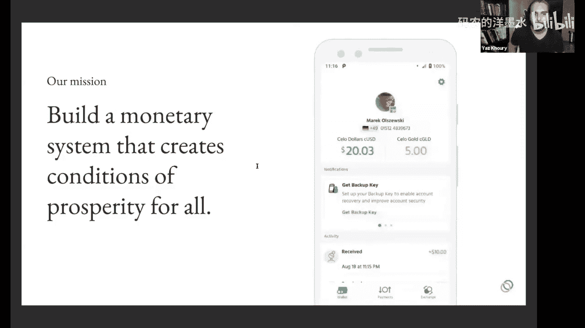

We're going to talk about the architecture overview now。

 so we like to think of sellerlo at the first mobile first blockchain。

It had a swift aim on mobile first from a consensus point of view， we proof a state network。

And we can talk more about the proof of stake protocol。Also。

 I'm not going to really rush on this bit， but like in case I'm more than happy to answer questions on it。

 but it's an EVM based network So what if an EVM EVM stands for Ethereum virtual machine and there's a lot of like you know machine there's a lot of blockchain that are following that kind of practice so an EVM allowed you to run smart contract like solidity Viper and on the network and it's currently in my opinion as EVM based network or the golden standard or smart contract there are you know attempts to improve it with different languages。

 different stuff and。I think they're like， I think there's an effort to go in the right direction。

 but I still think that the EVM is the golden standard right now。

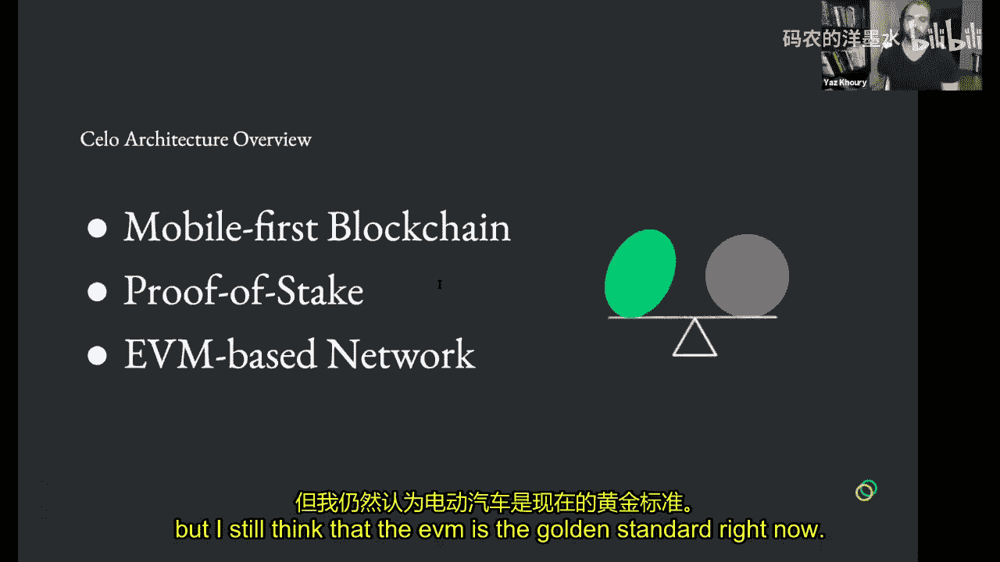

So just to brush over the architecture as well from a high level。

 and I think visual descriptions are better than like text。

At the core center we have validators you know and a proof of state network they're everyone who are validating the blog they're taking all the transaction that are between people back and forth and they're the one who are like you know staking。

 earning reward in order to validate the network you have full nodes that are able to like they keep like copies of the network and stuff like that with enabled like clients to work with full nodes in order to get you know the whole you know transaction history the like clients are at the mobile level。

At the mobile level， if you have an application you know I'm sending five bucks to somebody else and stuff after transaction on shame and that one will be moved to the like you know a validator will take that transaction along with other transaction and you know propose a block and other validators will you know approved a block as long as we reach a quo and then that block gets added to a block shame led here and everyone know updates and that all happens like you know automatically。

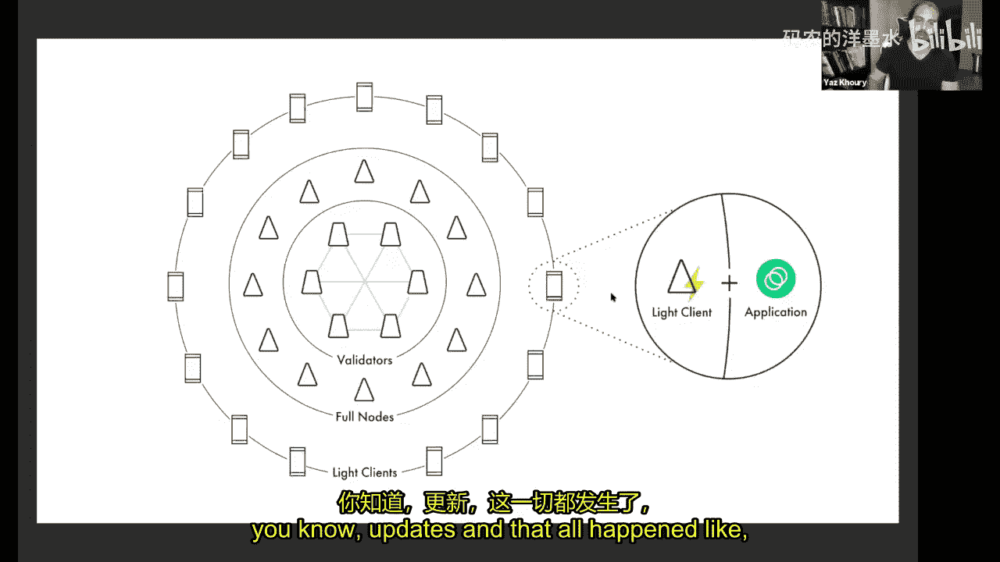

So one main， the first innovation that you know， the whole architecture system proposed something that we call adverse based encryption。

So what is adverse based encryption before we talk about adverse based encryption we should we can brush over identity based encryption so identity based encryption is like。

At a high level you know I have an email you have an an email I want to send you five bucks I don't want to like as a user experience I don't want to create a private and public key encryption so most centralized non crypto services would allow you to do that but they have an encryption layer that they add themselves and what they do is they take your email the recipient's email they encrypt it the problem with this approach is。

You're adding a third party that's doing the whole encryption。

Doing the private public encryption to connect the dots and stuff so you don't have to do it and you but the benefit of it is you as the user you get care about somebody's email like I want to email somebody by bucks and stuff。

So what we proposed， we wanted to take something where we call address based encryption。

 which is a modification on identity based encryption。

 so we still take the public private key encryption scheme。

 which is what everyone else in crypto does you generate a you know you generate the private key and you have a public key and you know if you notice somebody elses public key。

 you can transfer money back。But here， the users are still doing the same thing。

But after they create the public key， they're going to register the address of the public like they're going to like the email address to the public key in a smart contract the smart contract here is taking place on behalf of a decentralized blockchain player。

So after that， we do something that we call atest station where the attest station is how do we can like how do we。

Ensure that or attest that this is a valid address to public key and just is where the validator would have to send in a text message to the person who wanted to do the attestationation and you assign text message and and like the user would have to send another text message assigned with encrypted key to the atestationation smart contract。

 which is the one here and that would the smart contract would verify the address to public key based on the signature of the validator and the user。

Using this screen， we can also we don't have to limit it to phone number， it can work with email。

 do factor， authentication and stuff like that。I'm going to show you like an overview from like a design like you know。

 just like a diagram on this just to make sure that we're on the same page。

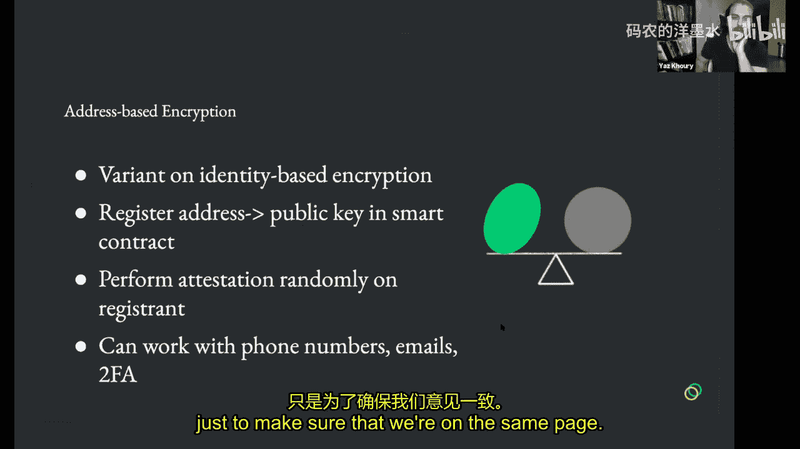

So here' where it work。In this example the user is using a mobile wallet right they download the wallet。

 they create rep and privately when they download that wallet and they you know with the tap of button they're like okay you know just is my phone number I want to request an attestationation they request an attestation from the smart contract right the smart contract will send back randomly selected validator they're going to perform the attestation service so the wallet then you know hit the attestationation service for the randomly selected validator each validator is running their own attestation service and it would reveal the phone number to you know the phone number that you know that they need to do an attestationation on and they sign and they send a sign atestationation via SMS message to the wallet。

Once the wallet received the message complete the attestation by signing its own message。

 so by there you can prove that the validator， okay。

 this number has been signed by a validator who sent that number who sent a text message to the number that's going to be registered and that number completed it by signing it and sending it to the smart contract and then we have it。

The reason we do that is like you might think like oh you know why would anyone want to do it this way the reason is if you ignore a lower layer and you just do a wallet throwing directly on a smart contract public key to like you know address to the public key mapping you can attack the system by spoofing a lot of number you making up a lot of numbers and creating a lot of public key and just mapping it out before real users are able to store that number stuff like do a real numbers and stuff so by performing the attestation we can you know we can verify that okay the validator was able to send a attestation message to the wallet and the wallet completes the atestation would assign message of his own。

 the smart contract can verify okay validator sent it and it got completed by the wallet number。

This is really interesting So maybe a few words on the relationship between the random selection of the validity and perhaps。

The stake of the validator， Is there a correlation， if the validator has a higher stake。

 since you said the。Pro of stake are being used under the hood。So。Hello， what's the relationship。

If there is。Notice a good question so there's no relation between the stake and performing an attestation service it's a requirement if you're going to be a validator to run an attestationation service there's no incentive yet but we're working on an incentive mechanism in order to run an atestation service so that if you are running it and you have high uptime because we need attestation service have high uptime then it can really improve your rewards and if you don't if it's offline all the time which means that it's impacting the network and the user experience then it might decrease your rewards and we don't do this once by the way。

 we do it three times like minimum of three attestation you completed in order to make sure everything is going well and stuff。

So these this attestation is kind of separate from the actual validation of the information being adding to the ledger。

 so those are two completely separate stuff。Exactly。

 the validator would have to run a validator node and an attestationation service。

 what we call an atestation service node that is separate from that。

 but is if we have an expectation that validator have to keep both up time especially the attestation service because that's what ensuring users have a seamless experience when you signing up and stuff and to ensure that you know people can actually do a testing and stuff because you don't want to randomly select a validator who attestation services offline that like that's kind of like impacted the system。

 but yeah， I mean like the one thing I'm excited about if the incentives because I mean part of my job because I focus on validator and node operator from a DevR is having to ping them whenever somebody attestation service is offline and I'd rather there's an incentive where if it is goes offline that they can get impacted and if they keep it online。

All the time， they can get a reward for it。Firstt， so one final question。

Being a little bit more precise， what involves in that attestation， what are the steps。

 what are the exact thing being validated？Yeah，What if at testinging is just like a sign message trying to assign a metric to make sure that it we should we a destination because in the first where you when you're requesting an at you basically let's go back here you're doing you're trying to do address to public key you want to register that and a spot contract that's all you want to do because all you're doing is you want to do a lookup table in a decentralized way for people to neural。

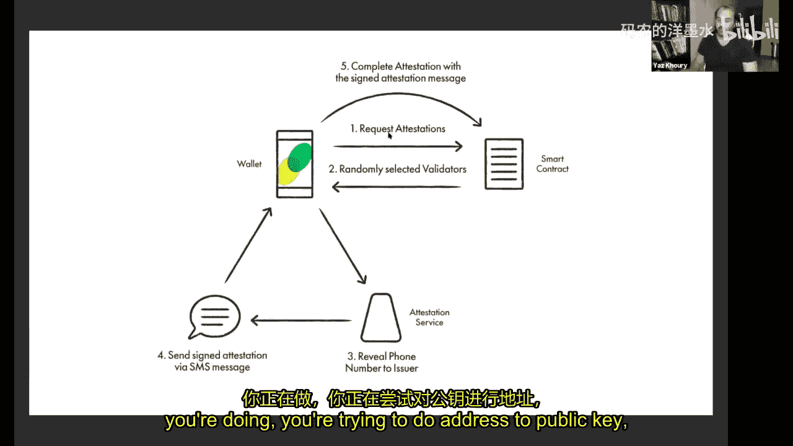

This person's phone number maps to this address and this is where we're going to send it to。

But you also want to do it in a secure way like in a way that can't be smooth so you send that the smart contract okay。

 I'm going to give this to these randomly selected validated and all they're doing is they're sending a signed message using their private key as a SMS to that wallet and the wallet takes that message and you know complete it by signing it as well back to the smart contract and the smart contract knowing the person's public key and knowing that。

 you know where the。

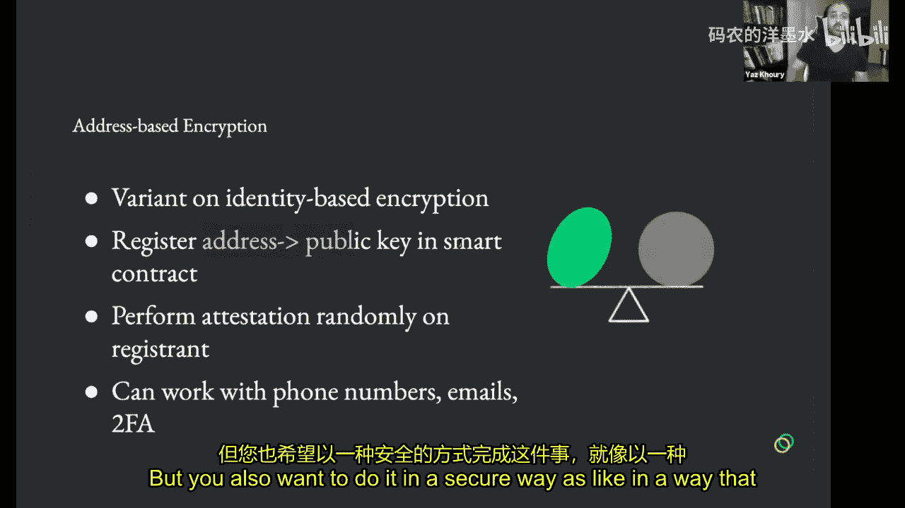

Which validated were selected， it can verify that there's you know。

 this method has been attested and if there's。And if somebody send like a spoof at the station from like separately。

 then you can know， okay， it just didn't come from a validator so we can't really accept that in the table or stuff。

Cool， is anyone else having any question？Allright。

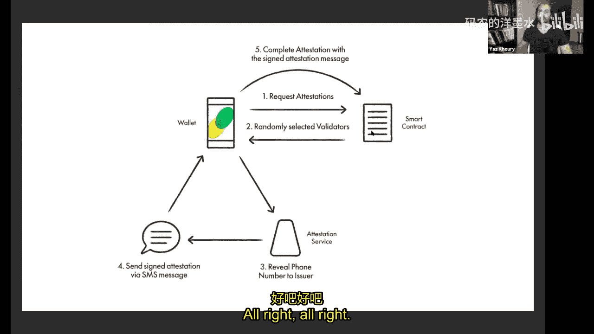

系。Going to the next step。This is I'm not going to stay too long under reputation scoring just because it's not online yet and we're still trying to scope it out in terms of grants and stuff。

 but we have more information about it under White paper which I recommend if you want to check it out more at the White paperper but basically with reputation scoring there's a theme called eigentrust with basically kind of score reputation of people based under you know social network or and in this case phone numbers so the people that I text all the time I have a trust relationship with them based on my address book and that would can be scored in an eigentrus mechanism it also privacy preserving using zero knowledge proof and the whole idea is that the more people who are doing at station you know registering their phone numbers and stuff you want to have a reputation scoring around they just to know like know what is valid what is not you know like。

In terms like from the social network layer currently is' still being scoped out we I believe we have a grant for it right now and。

It should be like the more growth we have on the mobile app。

 the more this is going to be likely going to be implemented and stuff moving forward。

 but the focus right now is on growing the user base。

 at least for the mobile app before we can think about reputation scoring so。

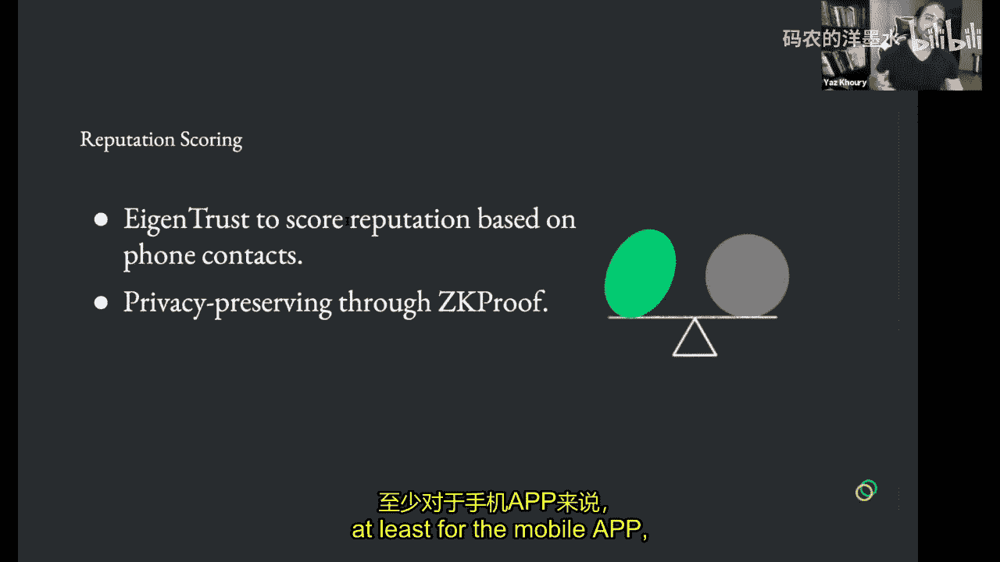

Okay， so let's talk about the stability protocol overview the stability protocol we already bused about stableableco we talked about a stableable coin before stability protocol is specifically for celllo we're going to give other examples of stableable coin designs or what we call it designs and before we talk about what seller is doing。

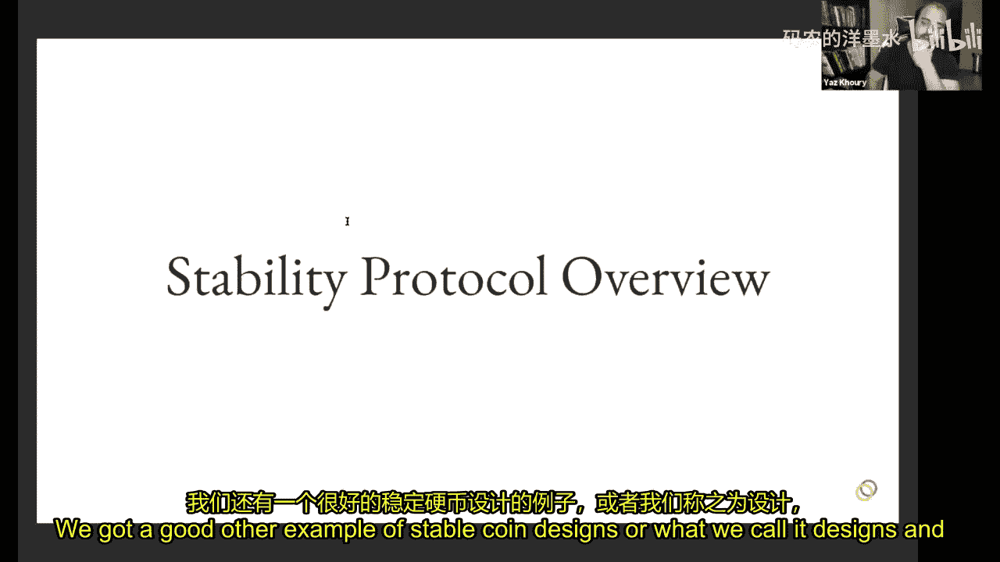

So there's several types of stableco right the first one is fiat collateralized so where we talked about tther stuff tther Gemini USD USDC through fiat collatearized there's a one to one relationship at least in theory between the stableco being issued and being minted and what is backing as a currency right it's like an IOU on a you know fiat currency back asset and stuff the good thing about this is you know。

From an a chain point of view， you know， like it's relatively very stable because you know as long as you're backing it with the US like the correct USD amount a using fiat as this one to one relationship is the most simple and straightforward mechanism。

Isued around it is because you're off shame， you can sacrifice speed and stuff like that because you know it might take a long time for you to convert your stableco to the fiat currency backing it so depending on where's being bad and stuff。

So crypto collateralized stable coins， we talked about maker do already in mechanism during an example of crypto collateralized and in the sense that they have Ethereum backing them as as collateral the issue with having a volatile asset back in a stable coin is it might not behave very stable over time。

 it might not be as stable just given the volatility swing you know affect the mechanism moving forward as stuff。

 but it's still like it can show you that you can by having a collateized to crypto you're allowing it to be。

You're designing like a more decentralized kind of approach about it。Finally。

 we have seniorurage style， they have like a specific mechanism that would contract or expand the supply of the asset of the stable coin asset only if a certain condition and that and this allows for like if you have certain conditions in the market。

 it can expand or it can contract and stuff like that， and that would make it very useful and stuff。

So celllo here so sorry another thing about cent wave if you have a cent wave kind of style behavior where you have an algorithm that can。

 what do you call it。If you have an algorithm that kind of defines like moving。

 you know like the contraction and expansion of the supply of stablecoin。

 then it would necessarily need what we call like a governance mechanism or governance token or governance asset that if not necessarily stable but it's what do you call it。

 it's in a way it can be volatile because youre the one if the asset that you're speculating on it can increase in value the more you know s age style stablecoin expands in you know in terms of volume and it can contract as well。

So at least the seller dollar mechanism， it takes inspiration from all three different models and this is what we're going to talk about next it's using those three existing examples。

S dollars， takes the best out of all the world in my opinion。

So we can't really talk about like the stability fee without talking about what do you call it the stability mechanism and the stability mechanism requires what we call d sellerello reserveer。

Clow Reserve holds a basket of cell curencies。Sello is the governor token that we have under reserve and then we have other reserves。

 other non cell reserve， we have Bitcoin， Ethereum and dye under reserves。

 so it's the basket of currencies that we have under reserve and it gets rebalanced periodically and stuff like that。

 using theanuation style depending on the condition being met。

And the whole purpose of the reserve is to expand and contract in order to stabilize that seller dollar that is being used that we're promoting this stuff and it has a stability ratio。

And the stability ratio is one。 So basically， as long as the value of the reserve is equal to or higher than the stable coin issued。

It's like that's the what call disability ratio。If it go below one。

 then we have mechanisms in place in order to increase the ratio back to one。

U that includes the transfer fee on celllo can increase in order and you know the increase in fee can go back to the reserve in order to move the value of the reserve back to you know。

 higher than the issued stableable points。Also epoC rewards， when you're doing proof stake。

 some of the epoC rewards can be allocated back to the reserve in order to stabilize the system。

And we also have a stability fee on transathne added on top of transactions。

So to talk about expansion on contraction of the reserve。

So we have what we call a decentralized one to one mechanism。

So users are like we call it doto users can create。

And this is if you remember what we talked about before like Fiac collatearized。

 this is our version of Fiac collatearized where we have an oncha decentralized exchange which allowed you to create new seller dollars by sending the seller governance token to the exchange or and getting its equivalent value back in seller dollars at the same time you can burn the seller dollar by by you know redeeming them for the value in seller governance token。

And because of the contraction expansion cycle， it gives it a clear reason to do arbitrage so if you're doing any kind of arbitrage behavior。

 it kind of keeps the system balanced， like if you look here at the user for example。

 let's say assume the price seller USD goes from $1 to 0。95 USD。Okay， so I'm a user， I go on market。

 I'll buy a CUSD， one CUSD valid to 0。95 USC。II moved that celllo USD to theceo reserve now here we're assuming cello and if you're kind of confused by CGLD that's used to be the old ticker name。

 it used to be called celllo gold but we moved the gold part we've only called celllo with a capital you know all caps。

 but let's assume the value of cell governance to by bucks so。Here we already established 0。

95 USD at the value of CD， so you buy one CD value in 0。95 USD。

 you trade it for at the seller reserve for 0。2 cell。

That's $1 and$5 then you can convert you can send it back to the market and sell it back for a dollar because the seller gold is5 bucks so that give you back $1 so what do you made a profit of 5 cents。

Obviously it's like the simplest example， but that should show you like， you know。

 if in the contraction cycle， you can arbitrage the system in order to keep it stable and stuff because there's an incentive for you to do that。

Also， let's say the other way around， right， let's say。For some reason。The price of seller USD is 1。

05。Like which is higher than the $1 peg。So you can you know， you can send the。1。05 to the market。

You can send it to the market over and you can convert it to the cell gold and stuff。0。

2 is celllu gold and then from the cell gold， you can convert it back。To one you know。

 convert it back and you can also make a profit that way5 cent profit because you're playing the geo oppositepath game that you playing the previous site。

 the contraction and the expansion cycle。So wait is the ratio between celllo gold and selllo USD constant or do you guys ever change that that's a good question。

 but no there's no ratio， but this is more like an example for if we presume that one cell gold like sell one is five dollars。

 that's why we have that ratio to five but it's not like the price is always determined by the market for the celllo governance and the more that celllo USDs being used。

 the more it's being minted， the more the value would increase for the governance open。

Just because of。The stu style that we highlighted before and stuff。

 but the way you' here is just pretty example， is's not constant or anything like that because the seller price is determined by the market。

Okay。So we have like an additional thing on top of that。

 so the way should to fixed ratio that you asked we do have that when we're doing like you know keeping stabilizing the market at least what it chains here。

 we have what we call a constant product decentralized one to one mechanism。

 which is the constant product idea is inspired by UNIWp in unIwaP when you're having a liquidity equal you let's say。

Let's say Ethereum to die it like， you know。The liquidity is like the constant product is about buy。

Like 500，500 die per one e that's like。That was sorry。

 that means that that'll be like a 500 to1 if there if Ethereum price goes up。

 the amount of you know the requirements in that poll would have to be matched just to maintain that ratio and that's what the constant product in So we took that idea just to in order to。

Secured a system that we have in the reserve and the idea being is there's several ways you can attack the reserve the character reserve needs to look up the price of celllo governance token on off chain exchanges it needs an oracle so let's say i'm an attacker I can go after the oracle control the oracle and like you know hack the oracle and modify the price of celllo。

From 5 to inherently0。 and then。I can just you know trade it for USD like let me because I modified the price to be really low I can for a small amount of USD CUSD I can get a lot of sell of gold right based on that mechanic right and then I can sell that in the market for major profit just by because I exploited the oracle price。

We we try to avoid these kind of attacks and stuff and you know the Oracle being the biggest one by using the constant product so the constant product allows you first you don't have all the entire liquidity being plated only a subset of that liquidity is being createdd so and then we try to a dynamically address like beyond chain prices by having like you know the constant product market maker like in this example you want to have。

Like if you want to have like preconction post contraction F5。

And just to adjust the price based on demand or supply at the same time you don't want it。

 you want to make sure that one part of like one part of the you know liquidity being provided if not like too abnormally high or there's too much happening on one side of the liquidity compared to the auto could not can indicate or a problem and in like the oracle example。

 like hypothetical example that I provided。Okay， with that， we can go to consensus as a mechanism。

So with consensus， we can talk about like brush over what the consensus mechanisms are and stuff like that。

And this is normally my favorite part。So we're in to proof of state network。

So for the proof of state network here， I don't know if like you ever very little brushed on proof of state before。

 but the idea is like you know you have in a certain amount add a validator or add your node that you're staking and depending on who gets picked next like you know they shuffle the validuators and whoever gets picked next willll have to propose a block include transactions and stuff like that and then。

You know， submitub it， folks， you know all the other values are accepted and。You know you know。

 that would allow you to you stake your coin or a reward on it and stuff and you're helping secure a network in an environmentally friendly way compared to proof of work where you know。

 it's more in a way， if not really randomly shuffled。

 but its like who comes up with the first solution to the problem like the proof of work who you know comes up with a first proof of work first can submit that law in a more competitive fashion and stuff。

Yeah， so we're going to go more on the proof of State Park。

W so are the gray gray validators just the ones that haven't been selected or okay that's so it's random yeah so I was going to go over that later。

 but like I can talk about that now so here what we we have another thing called validator groups。

So Valator groups is kind of like。Say like， you know， you're not you。

It's like an organization in a way， you know you have an organization on Sha that represents that you can and you can vote for that group and stuff and each validator group can allow up to five validators that you can elect into that group and that kind of thing is just for people can know that you're an entity as a brand and stuff because the reason you know you have groups is because you want to be able to advertise oh I'm a validator with this organization and stuff and you know that seller owners can nominate you and stuff or they can delegate their state to you in order for you to validate and earn rewards for them and you earn separate word as a validator and stuff like that So here we have up to five in a group elected。

We have a slot up to 100 validators not 100 validator groups。

 so you can have up to 100 validators in their system。

 we have governance ideas to increase the slots of how the validator can you know validate and stuff but currently the cap is at 100 and each one has five and the validator group doesn't exist in our network is something that we came up ourselves just because it allowed you to like like。

In other networks。If you don't want to avoid being it like over like， you know， centralized by whale。

 a whale would be able to。You know， take up all the validator slots and stuff anonymously。

 you just you know， elect the validator and you just have a publicly of the validator and does that。

By having a requirement for validator group， it kind of showed who they are right and you have a minimum of five so it's a higher cost for you as a whale to create a separate entity and elect another validator group and then from within that validator group。

 elect you know stake for you know elect more of your validators under that group of stuff it there's a higher cost there because it's kind of like's kind of similar to setting up another organization just in order to validate more and stuff like that。

Hope that answered。个。Yeah。Let's talk about the consensus mechanism itself。

It's called IBFD Istanbul Byzantine fault tolerance tolerance consensus I'm going to brush over quickly I think if the best resources on this is like the paper and EIP that proposed it which originally proposed by quorum which used to be a like a group under JP Morgan before JP Morgan sold them about to consensus but IBFD is basically this we start off here at the new round for everyone here so in the new round。

A validator gets randomly selected in around robin fashion right。

 so you have that new rep the validator gets selected， right？When they get selected。

 they do what we call our， they become what we call the proposalr。

 they're proposing a block to broadcast and when they propose a you know the block to broadcast。

 they have transaction that they want to include in that block that they're proposing， right？

They submit what we call a pre prepare message like oh you know before you prepare to hear your heads up that you have to prepare right and we get to the pre prepared safe and the pre prepared stage we have to check that。

To， you know， we have to check that everyone like， you know。Once we get to the pre prepared state。

 we have to wait for folks to send us what we call。

Like we have to sorry no that's the prepare stage and the pre prepare stage we have to like you know make sure that the proposal is valid and there's no timeout on it in case they go offline or something。

 but once you get to the pre prepare stage you can you would have to broadcast the prepare message the prepare message basically I'm telling all the valid data in the system'm like all right。

 you know。I like you know this is my proposal you know please prepare in order to approve this block and stuff and we have to wait for two f plus one messageger so what is F F stands for the faulty number of node tolerance so how many node can you like faulty node can you tolerate in your system。

Going offline， so in and in our case here， we want。

Like we have two third quo so if two third or higher we have quo so that means that F is about 33 nodes how much node can we tolerate being offline in our system 33 so we would have to wait for 33 ton to66 so 6 we're waiting for a minimum or 67 nodes a validator node to tell us that you're good to go that's hard you know we determine so once we get the prepare you know once we wait for the prepared messages from all the other validators we're ready to broadcast a commit message。

We're like， okay， you already。Let's commit this we send we broadcast a commit message and again。

 we wait for validateator to confirm， Okay， yeah， we're good to go on committing this once we get to F plus one again we can。

Then insert the block into the system。RightSo once we insert the block。

 just we make sure that the insertion fails succeed and if it succeed。

 we have finally committed a block to the led and then we jump to a new round where a new validator gets selected in round Robin fashion。

How do you check if the insertion fails？That's a good question I think like in the paper that would would go more over and stuff like that。

 but like let's say。Something can happen， I guess in between those steps where， you know。

 like a note can still go offline before inserting。And stuff。

 so that could be like one of the things that are happening and stuff like that that you know。

 you want to make sure that the insertion succeed in everyone。Okay。See， I like I think for this one。

 like you know， for more like detailed than checking out Dakota highly recommend paper。

 at least for IBFD， like we had Qrum and other folks who worked on that before and it was just something that we adopted as a consensus mechanism because of it being like you know very useful for our use case。

No reason for。Picking IBFT instead of PBFT。I think would isstanbul BF。

That's a good question I don't know if I have the answer because I think the design decision about between IBFD and PBFD happened before I joined and like I don't want to like answer you know wrongly and stuff but that's a good question I should notice。

Any， thank you。对。Any more question， I'll try my best to answer。Okay。

We're just gonna brush over node discovery right now it's not like something we want to brush over too much。

 but I just want to point out as discovery version4 is what we're using which is just based on Ethereum discovery mechanism which is basically let's say I'm starting a node what happens what happened when you run a node for the first time the node software had what we call bootnots that already written like Do inserted into the blockchain like into the blockchain client and。

They have an address you have like the e node address so we know like when the new node start in node who to hit up first boot nodes are basically think of them like the guide to the whole network they're like you know here you know I'm the boot node I have a directly with all the other node in the system here who you should be peering with or to synchronized you know in a distributeded system in order to sync and you know get blocks and stuff like that the boot nodes。

Give you all the different node in system that it stores and stuff because it just like a node that helped you you bootstrap network。

It's modified from the discoveryy4 V4 there's a modification here where we tell it to look at the network ID Now looking at the network ID is important I think it's like frankly is super important。

 I don't know why they don't do an Ethereum but network we try to make sure that the network ID we try a synct master the network ID of the boot node on the client otherwise if you don't if we don't have that check because if the discovery V4 protocol。

 we can technically look at nonce network nodes and quite appear with them and make sure that know so in theory you can technically peer with Ethereum Ethereum plastic node just because of discovery V4 so by having that check to be like okay make sure that I'm you know you know pairing with nodes that have that network ID and make sure that we're not wasting a lot of work and time peering with useless nodes that are not going to give us the right you block。

Or write Genesis and stuff like that。Validating so we already talked about this before but it's like 100 validator cap epos are one day so every 24 hours you know you get the reward and stuff we already talked about validator groups Mo already I believe I sent like presentation but if anyone's interested the webinar there's a URL is like a YouTube video and stuff everyone wants to check it out later。

Yeah， I will be posting that I received it。 Thank you so much。 Asome， thank you。

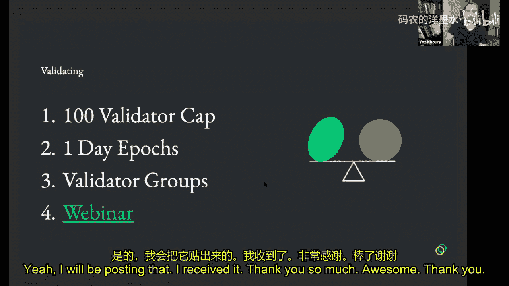

Yeah， this is Rick one last thing on like Dick consensusensors。

 one other thing that we do it' called governance whenever we have a proposal to submit dirt like what we call a governance proposal and governance proposal are voted on by the users and。

It allows you to like as a user， you can you know vote。

On a proposal like to update the system to change contracts and stuff some proposal that we're seeing like you know we're talking about it may be having an alternative stableco other than US dollar maybe you and stuff like that and you can do that by you know you're delegating your your votes which are your seller token to the bow there to the validator group of choice and you know from there they're electing。

The proposal and stuff like that at the same time， this is also how election happen if I want to nominate a validator to be a validator or at least allocate sellerlo to a validator group in order for them to get a new validator because you know for every validator you include in the system it has a cost to it and sell so governance is where we do these things。

Okay。So we're gonna talk about mobile first so like the whole point here is like why it' solo different than other trained and the most important thing is life because we're mobile first network。

 we already talk about the atestation service， something that other networks don't have and if you improve the user experience so much at least because you don't have to fully rely on using public keys anymore you can just you know text people like and send money via tax on train。

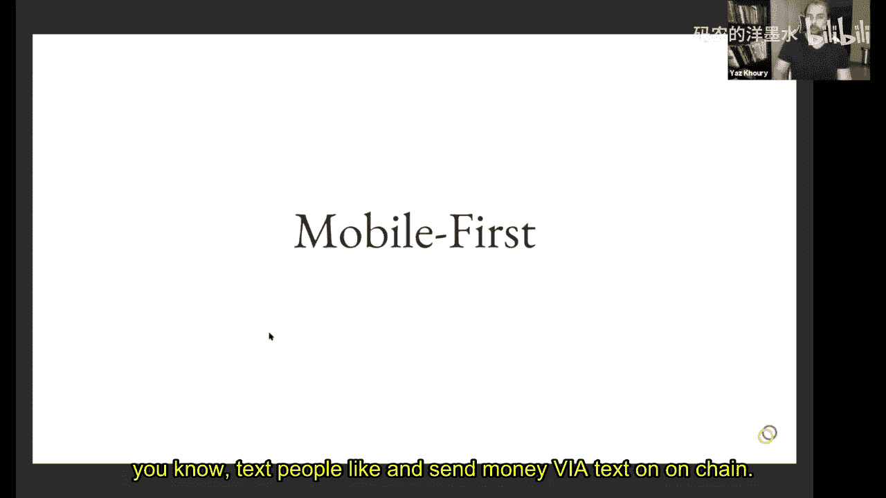

So。Why are we mobile first again is the reality is there are more mobile users globally in more developing world like you know。

 well， you know， countries that are still in development stage。

 a lot of them have gone from no computers to having a smartphone within like you know。Like you know。

 from 01 in a way and mobile smartphones are more accessible to everyone。

 a lot more people getting access to smartphones around the world and。

While they don't necessarily have to have a laptop or a computer any。

 but they would have a mobile phone， also from a UXUI perspective。

 it has more reach is more intuitive for user compared to using the command line and just being somebody with really specialized knowledge in order to participate in the blockchain with a mobile phone you know。

 if your user experience really improves。Also like you know， we talked about emerging markets。

 a lot of them are using you know mobile you know， through mobile first and stuff like that。

 through that's like， you know like a very attractive choice to focus on being mobile first as a block。

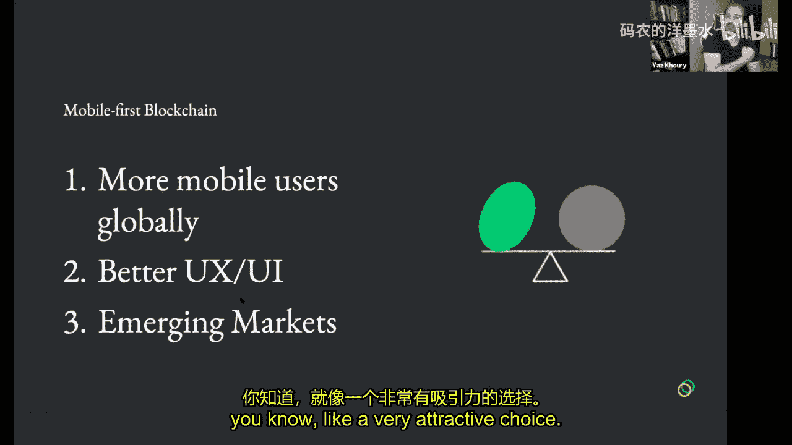

And that's where we go over Valor， I apologize for the photo is supposed to be a shift。

 but I saved it as a PDF and it doesn't really render to shift。

But it's supposed to be a really nice shift to go over but I do recommend checking out Valorra app。

com we recently redesigned it and we have we have now it's available on iOS and apps like the Google Play store so you can download it right now Volor it's kind of like you know and'd like mess around with it if you have more questions about Boor please message me after stuff like that it's kind of like Venmo I'm actually kind of curious if people are like you know if you're interested you can use it and stuff like that it's free to download。

Now let's brush over simple comparison to our network。

 I don't want to delve too much into it because there are a lot of differences rather than similarities。

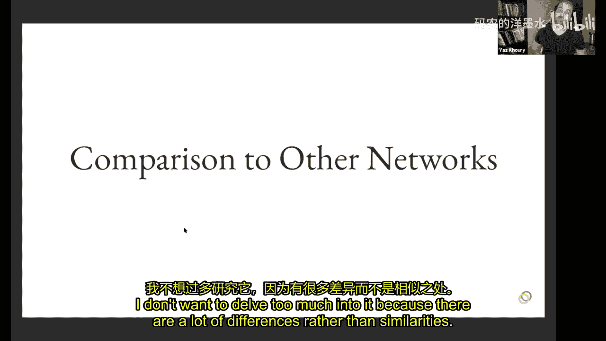

嗯。So the first difference we're we're gonna talk about Polkka dot So Polka dot like because it's like you know proofake and stuff Polka dot has a really different architecture cell is kind of like a fork of go Ethereum like at least we talked about it being EVM based we talked about the proof of sake you know smart contracts and stuff Polka dot is basically you know the pair changer like you know trying to do sharding and stuff and sharding is just a fancy word for you know side chain so the pair change or side chain but each side chain has its own consensus mechanism it's on like logic on like you know applications and stuff and then you have what we call a relay chain and Polka dot we kind of like。

Is like a global state that you know kind of in which all parain can you know interact with and stuff using the relations so the other thing about Polka dot it has pairtrainin spots so instead of validators you have you have a limited capacity how many networks you can run on Polka dot。

Um， and it has like communication between para chain where cell is just like it doesn't really do side channel。

 even though technically you can build a side channel or， you know， like a， you know， side chain。

And Polka do also has what's called Grandpa consensus。

 which is what you know governing the relay chain and allowing the relay chain to interact with all this minimal like you know。

 if like a parent chain interact and whether children trained being the parent chains I don't know enough about Polkadot to answer any question but I would recommend reading more on Polka differences what seller but this is work on a high level what we go over we actually we're fortunate had a dedicated lecture in to talk on Polkado and as well too。

Awesome， awesome。 Yeah， that's good to know。So I don't have to like answer any question。

 no' poke it up， I love it。The other one I want to talk about is cosmos cosmos like is actually。

Kind of like it had it's going after what it called like a unified API for hubs hubs are kind of like pair change in a sense in which that you know there's separate you know networks on their own and stuff。

 but using a unified API called the interIBC is trying to do what you call it like an API standard that a large communication between different hubs between different Cosmos hub but it's permission missionless hubs so there's no slots like what we have for validators here or what we have for Polkka dot it also has something called the ABC spec which allows for。

I believe it allows for like your hub communication with your adapt state in a way， but like。

From a high level， I'm probably betraychering the concept。Not the biggest expert on cosmo。

 but this is it from a high level。

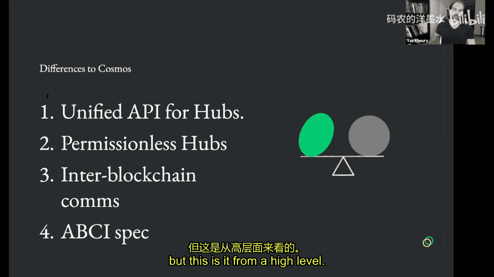

Now finally let's go to case studies case studies so our team at the CLB we've done a lot of case studies like you know we talk about you know we want to create the condition for prosperity and one of the ways we want to do that is we wanted to travel to emerging markets and product test what are your user needs like like if you're like like at the poverty line or how it like a stable coin or anything like you know really in fact do。

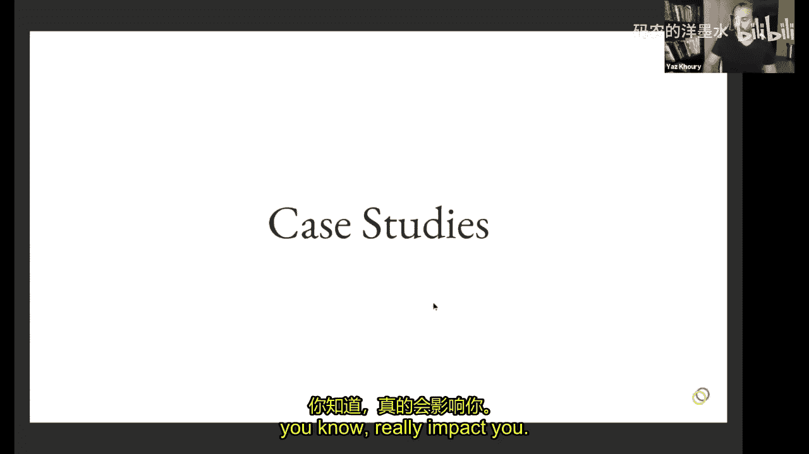

So we did what with a Philippine pilot we went to the Philippines and we did a pilot there with 23 tester they're all low incomecom fast food workers so they're all working in the same place and they all were connected to like they work close to like five store five merchants so we wanted to enable them with an app with the Volora app just as a pilot test on a test network to see how they're using it and stuff like that you know as digital payments and stuff like that we want to understand how they're using electronic payments and stuff and this is a team that you know we worked with and stuff like that theyre super friendly folks。

So the insect we got here is。Like the main instructor， like， you know。

 slow internet affects transactions like they have to wait a while for transactions is。To go through。

 just because of how slow the Internet is。 And Philippine Internet like。

Like compared to other like you know trouble regions well。

 Philippine can even have even slower internet like I heard like internet and Zimbabwe and Syria or faster than Philippines in a way so slow internet affects transaction so if you're trying to sink to know you know you're trying to sync the network on your phone and it's really slow it know really slow down your transaction and that's the main one of the main insight that we want to we got and made us want to think about。

 oh you know we really want to make sure is so lightweight and that we're able to sync to network fast。

 which is why we want to build we built the like client and we're working on a light client product would allow to sync a lot of blocks really fast。

Also other issues that we saw with outdated smartphone that wouldn't be like there like outdated software and stuff like that and that would make it kind of difficult。

To for it to work with the application just because it might be slow or like， you know。

 just like something can get broken。The main interesting thing that we saw is Filipino at least they like to conserve data within that pilot study so when they're not using their mobile data they turn it off and they only turn it off when they need it and stuff like that so that kind of gave us a lot of insight about you know how people use their phone in like emerging markets and stuff like that。

And also they have low trust so they didn't understand the whole idea like oh what what do you mean like you know。

 you can use my phone to pay and stuff and they didn't like at the beginning they didn't really trust it and they were like slowly coming to like。

tryry to use it and try to accept it and stuff and it gave us a lot of you know information and insight and like Philippines in one of the market that we try to target at least you know for the future Volore and stuff like that so it's something that we really want to continue working with at our country。

The other pilot is Kenya， So Kenya is super interesting because of Mpea if you haven't heard of Mpea andpaa kind of like。

Imagine them like you know kind of like allowed you to send money via phone between people but only within a region within a country so it's popular around Africa but only but you can't necessarily use Mpaar in Kenya to send it to MpeA in Nigeria you would have to like you withdraw the money at your local andpeA in Kenya and then you know deposit that money in Nigeria and then you can use MpeA again but Kenya has 86% adoption rate ofpea so a lot of people are open to the idea of using cell phones and to do transfer back and forth and so we decided to work with 24 Kenyan at least for interviews here middle class rural and urban tour class and just to see like you know the people who are like might needed efforts we also wanted to make a diverse age group and you know both you know。

Male and femaleMA to see get everyone's point ofs view as well。So the insight that we got here is。

Like they has to speak to the people's need right so they don't really use something because it's like oh look cool and stuff they have to speak to the need right so with M they're like you know allowed them to send money back and forth and that you know spoke because like they needed to do that stuff the way they understand things like when when we gave in this new kind of technology and stuff if they like to put those new concept in old understanding like oh just remind me of this old thing that I'm used to and stuff like that they don't like the way they' they're at。

And they prefer things they like to use things with Wal mouth so with Npea what we understood from MPpea is that they have a like you know word of mouth like you know somebody tells the oh I'm using MPpe and it slowly you know kind of like you know go exponentially from there in terms of word mouth and they trust people over organization doing more trust a community of using these different technologies like MPpe over different organization and that really inform us a lot about vora and how to like you know target it and stuff and because we're like early on in Valora stage it's like we have like a lot of planning for like you know expanding and like going to user survey especially and places that are in need of these technology。

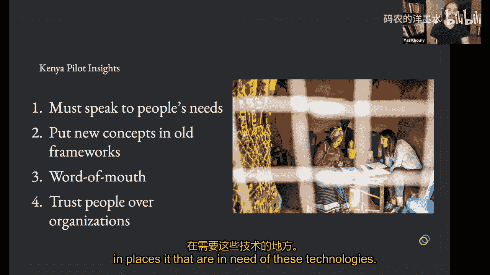

So yeah， I mean。Yeah， you know now you know， thank you so much for like。

You know taking the time to go over the lecture with me if you have any questions I can't answer in this lecture。

 hit me up on my email or this is my Twitter hand on a more than happy to answer any question。

 but yeah， I mean the floor is all yours。All right， thank you so much。

 and let me take this opportunity and on behalf of Expo Lab and UC Davis。

 to thank you for this wonderful and。😊，detailed lecture。 Thank you so much。

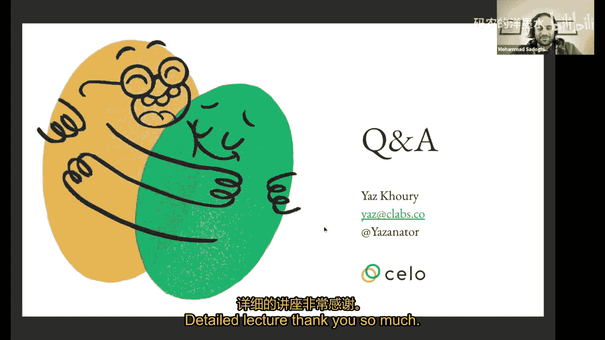

My pleasure， Thank you。

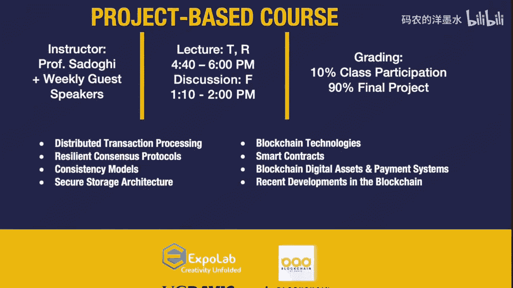