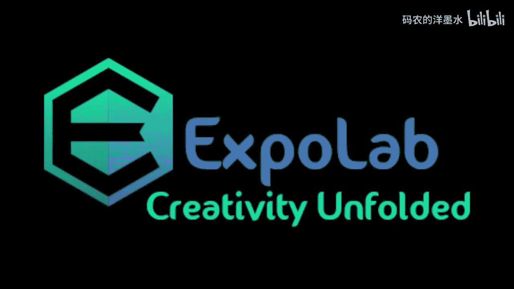
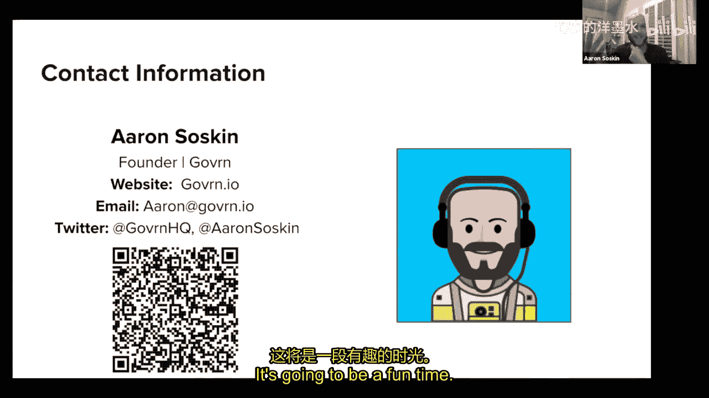
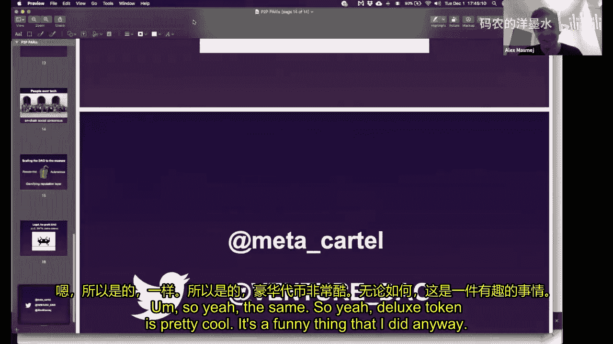
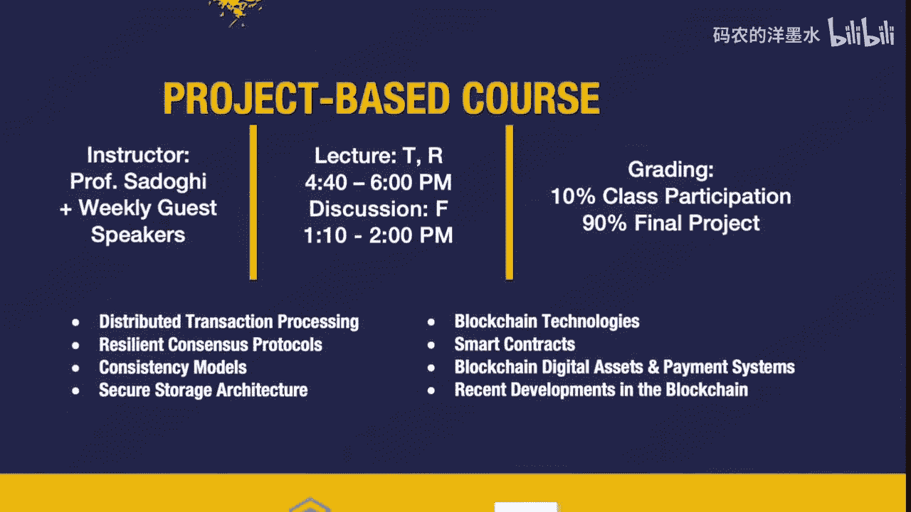

# 【全集】加州大学戴维斯分校 分布式交易与区块链架构 中英字幕 完整课程 p11 Lecture 7 - 机制设计与去中心化治理 -BV18YFVzME2f_p11-

Hi everyone welcome to another edition of Expo Lab at blockchainlockcha Spea seriesius and today is my great pleasure to introduce Aaron Saskin he is the founder and govern and his sort of inspiration has been I'm kind of going to quote Aaron himself giving people a voice and power and politics and democracy and I think that's sort of the foundation of blockchain and sort of kind of using this decententralization and democratization technology to reach that ideal and some of his I guess。

Hobbies kind of resonated me as well special reading those Federalist paper those are really interesting pieces of literature and of course Tahoe and hiking and the Tahoe I think that' that's an amazing endver as well too so without ado please take it away。

Yeah thank you Mo thanks for having me I really appreciate it i'm excited to be here and as long as we're going through I know Alex we're going to get to you at the end so let me know as we start to approach that time。

So let me go ahead and share my screen。Cool。I want you guys can see it。一。Awesome。

 ads's in presentation mode。Perfect cool so yeah like most said my name is Aaron Soskin I'm the founder of a company called governn where we aim to give people the power back in politics and I'm going to talk a little bit more about that later。

 but really what I'm focusing today's conversation on is gang theory and mechanism design which I actually think is one of the is as part of blockchain that is the least spoken about thing items so I'm really excited to speak to you guys all today。

So real fast who is Aaron like Mosed I was born in the Bay Area but I grew up not that far from Davis in Sacramento I wanted to be an astronaut when I was a kid previous jobs I was a management consultant。

 a dairy farmer and a production assistant love skiing concerts the giants I got into blockchain about three and a half years ago and my hot take is that ranch dressing is the best food pairing condient there is there is nothing I wouldn't put ranch dressing on it's incredible there's two things I believe in ranch dressing in blockchain so。

So what are we going to be talking about today we're going be talking a little bit about what game theory is。

 I'm going to give you a teaser or a little bit of icebreaker talking about the prisoners's dilemma。

And then we're going to talk about mechanism design and specifically we're going to talk a bit between those two different ideas。

 what game theory is and what mechanism design is， and as engineers and as developers。

 how you can apply that to make better applications。

Cool so a model about thinking of web3 or blockchain right there's I love memes there's a lot can be a lot of memes in this presentation I hope you're okay with that。

 but a lot of people when we talk about blockchain really only talk about web 3。

0 and what do I mean when I say that they're talking about the mutability of it they're talking about how to distribute a ledger。

😡，But they forget about what the core key idea of why Bitcoin and Ethereum was so revolutionary。

 right if you think about it。Distributed address had been have been around long before blockchain existed。

 distributed computing， cryptographic hashes， all these ideas have been around for a very long time。

What makes blockchain， what makes Bitcoin so revolutionary is it combined this idea of execution environments distributed databases with game theory components and I invented this thing called proof of work as an economic model to ensure everyone coordinated correctly right and that's what I call it the Web 3。

0+ and that's what I want to get you guys to start thinking about today as you start to learn more about blockchain。

😡，So first off， I want to give some acknowledgecgments。

 a lot of this material was taught to me by three professors that I'm very appreciative of。

 Joshua Gn， Steve Todelis and Kevin Bryan， so acknowledgeknowledgments to them for helping me out。

So the first thing is I have a quick teaser I wanted asked all to kind of learn what game theory is so I have a game it's called the it's called the P beauty contest okay and so everyone needs to pick an in an integer whole number between zero and 20 and what the I have a prize for the winner。

But the goal is everyone's going to submit a number between 0 and 20。

 we're going to take everyone's number and compute the average and the person that guesses the number that is closest to 75% of the average is going to win a prize okay so again。

 everyone is going to submit a number and you want to submit a number that you think is going to be 75% of the average of the class。

😡，So to do that click on this link here or if you scan this QR code you can also you'll be able to to go to the thing to the to the Google forms to submit it i'm actually going to put this in the chat window or in the chat for you guys all to。

To go to it， I'm going to give everyone a couple minutes。So there's the link。

 so you all have two minutes to submit a number between the0 and 20 and again you want to submit the number you think will be closest to 75%。

Of the average。Okay， so everyone's got two minutes a minute to do that now。Perfect， okay， cool。

 we're going close it now， and I'm going to show you。 Sorry， is my screen still presenting。Cool。

 perfect。So this isn what we have right now， does anyone want to take a guess on what they think the answer is like what they think it is？

12。12。You are right on my friend， so the answer is 75% the average ended up being 18 and 75% of the average ended up being 13。

5 so the person that's closest i'm going to say is we'll go with the 12 people people that guess 12 they were the closest so that is。

Oviia。h you you son sorry， isn't 14 closer though？Oh you're all right my bad my mistake Thank you I didn't see the 14 so 14 is actually the winner but wait some some people guess like 5 99 so those should be discounted because they're not from zero to 20 you think but hey。

 man that's that's not the rules they they messed up。That'll bring the number down。Cool。

 so 75% you guys the 13。5 most said you got an automatic A in this class so Cameron you got an automatic a in this class now so that's the way it works so let's walk through this right what is this what were we really testing here Okay the way that this word right if you think about it when you're trying to guess 75% of the average。

You're guessing what other based your guess is based off what you think other people are going to do and that's gaming theory gaming theory is all about making decisions based off what you think other people are going to do so let's walk through this things to consider what's the max number the average could be。

😡，15 right because if everyone gets 20， 75% of 20 is 15。

 so 15 would be the highest number that anyone should ever guess。😡。

And if I think someone's going to guess 15， then I'm going to guess 75% of 15。

And then someone else is going to guess 75% of that。And that means if everyone is a rational player。

 we're all going to be guessing 75% of what we think the other person are going to guess。

So if everyone was being rational， where does that mean we should guess？

It means if everyone was rational， we should all guess zero or one because that' what we that's 75% of 75% of 75% and it goes on and on and on and that's how game theory works。

😡，But the thing you have to remember when you're designing games is just because zero or one might be the smart answer。

 it was not the right answer right and what does that mean not everyone thinks rationally all the time but a lot of people do most of the time so what we have to do as we design applications is understand what is the right balance between the smart answer and the right answer and that gets us the idea of game theory and mechanism design。

😡，Okay， and so game theory is the tool to understand people's incentives and how they react to one another。

😡，And mechanism design is the tool on how to design an optimal algorithm for a given game theory。

 so based off of what we think the incentives are for a game。

 mechanism design is designing game or a mechanism to optimize the game for the desired outcome that you want to reach。

😡，Okay， and what I like to say is here game theory is the idea that like if someone pushes you you're going to fall down mechanism design is telling someone if you push me I'm going to hit you right I designed a mechanism to stop you from executing your incentive right and like I said this is the memified version of game theory and mechanism design to me okay。

😡，And nothing really better explains this in the prisoner's dilemma。

 have you guys all heard of the prisoner'slema before？It's this pretty famous example right。

 and essentially this prosecutor takes two or these cops。

 take two prisoners and they put one prisoner in one room and one prisoner in the other。

And the cops want the prisoners to snitch on each other。

 and the game theory is that they know each prisoner is going to operate in whichever way gets them the least amount of time in jail。

That's their goal， okay？So我第。What the and the prisoner each prisoner knows that the other person is always going to act in their own self interest okay so what we have here is that both prisoner B and prisoner A stay silent。

 they cooperate to each other， they each serve one year， okay？😡。

If one prisoner stays silent and the other prisoner betrays them。

 the prisoner that betrays goes free and the prisoner that stays silent gets three years in prison。

And the same deal， the cops offer that same deal to prisoner A。

 and so the cops have told both prisoners that the other one， if they whoever snitches first。

 goes three and the other one goes to jail。So what ends up happening most of the time。

 both of them ended up betraying the other one and they each serve two years right so the game theory in this is that each prisoner wants to reduce the amount of time they are going to spend in jail。

😡，And so the cops have designed a mechanism so that they optimally have created a mechanism where both prisoners are going to end up betraying each other and end up serving two years。

 okay？And so now the mafia or like the game like the other side of that design their own mechanism and they change the game right again we're all basing off of other own's ideas and how do they change the game。

 the first thing they did is they change the probability for each eye right the mafia would say if you snitch on each other。

 we will with 100% certainty。Then they change the payoffs。

 kidnap your family and break your knees right like if you stitch on each other。

 we're going with 100% certainty， kidnap your family and break your knees， right？

And they also change the number of times the game is played and the mafiaas for like you can never leave the mafia。

 you're going to continue to play this game over and over again。

 so essentially what the mafia did is they changed the mechanism so that the best probability and payoff ratio is not in defecting but it's actually in just staying silent and they each serve one year。

😡，Okay。And just to hyper rotate on this。The question you have to ask yourself is are you playing a single game or are you playing an iterative prisoner's dilemma and so if you mathematically like forecast out playing the prisoner's dilemma multiply the probability versus the payoff for each one of these。

If you only play a game once， it naturally occurs where everyone should defect。

But if you're playing the game multiple times people naturally end up cooperating right and the simple explanation is this fool me once shame on you。

 fool me twice shame on me， right basically like if you fool once I'm never going to cooperate with you again right the technical explanation is the current net present value of cheating doesn't outweigh all future net present values of cooperating right maybe if I cheat right now。

 we both get a unit value of $1 dollar but if we cooperate for 100 years down the line and every the year we cooperate we get a dollar。

 then I will end up getting $99 more dollars from cooperating today versus the one extra dollar I would have gotten from cheating with you tomorrow。

😡，Right。So the goal that we should talk about is how do we change games from a single prisoners' dilemma to an iterative prisoners' dilemma？

Right again， you know， prisoner broken kneecaps， keeping mouth shut， right？

So now I want to move into our well first off， let me stop。

 are there any questions on what I've talked about so far？

Cool so let me kind of keep on going so the next pieces sub next mechanism the next part of this presentation is all going to be about different mechanism designs that you can build in a blockchain world Okay and my goal is just to。

Is just to start getting the wheels turning on new ways you can design your applications。

 so the first one that I find is not really talked a lot about is the idea of called subga perfect equilibrium。

Okay。And I'm going to give you an example and I'm going to show you how it applies I love buying tickets to concerts。

 or at least when we weren't in a COVID time we could go to concerts。

 I love buying tickets to go to concerts。And the problem of buying tickets online is that you never know if you should send the money first without getting the tickets and that they'll be faked or you're trying to convince someone else to send you the tickets before you send the money right and people don't really trust each other and so you got to find a way to make them trust so buyers are worried that they're going to send money without getting tickets or that they'll get fake tickets and sellers are worried that they'll send tickets and never get a payment。

So what are the incentives behind this game， what would rational players do versus nice players versus normal players？

And so how can we apply something called subga perfect equilibrium to fixness？

The first thing you do and I'm going to give you a narrative example and then I'm going to show you the like probabilities behind it all。

 so the way that I would create a mechanism to fix this problem is the following。😡。

The seller submits a ticket to a smart contract and a buyer submits a payment to the smart contract。

Once both are submitted， the ticket goes to the buyer who has a choice。

 the buyer can either challenge that the ticket is fake or accept the ticket。

If the buyer accepts the ticket， the payment goes through and the seller receives the payment。

 the transaction has ended， but if the buyer challenges the ticket。

 they have to pay 50% additional the ticket price， the game then can go back to the seller， right？

The seller can accept or challenge the buyer's challenge and I noticed a lot of challenging and accepting so I'm going to go to the next slide because it's going to make it a lot easier。

This is the seller and this is the buyer so the seller sells a real ticket's let's go to fake ticket rightd first let's say the seller sells a fake ticket。

😡，The buyer can accept the fake ticket this is unlikely right they would never do this so the buyer would challenge the ticket ticket's legitimacy and the seller at that point can either accept the challenge。

Which means that they accept the fact that it was fake。Or they challenge the challenge。

 challenged it that it wasn't fake and it goes to an arbiter and the arbiter looks at the ticket and says。

 yep， this is a fake ticket。😡，In that case， the seller has lost money right so there's no incentive for the seller to end up trying to sell the ticket。

Let's say the seller sells a real ticket and now the buyer claims it to be a fake ticket。

To challenge the ticket， they have to spend an extra 50% of the ticket price。

And if the seller then accepts the challenge， then the person that claimed it to be a fake ticket when it was a real ticket ended up not having a ticket and losing money right if the seller sold a fake ticket and accepted the challenge。

 they also lost money because they sold a not real ticket。😡，So again。

 what we have done here is we've designed a mechanism where the only solution where people are happy in the end is if they sell a real ticket and the buyer accepts it。

😡，Okay。I'm not sure if you guys have seen probabilities like this。

 but one like these are a way to represent the payoffs based off probability and benefit of a person。

ok。So again， we have now designed a mechanism that says it only rational players will only ever sell real tickets。

And will'll only ever pay for real tickets because it doesn't make sense to do anything else right so why would anyone use this platform people would own people that really only want to buy real tickets or sell real tickets when you use this platform right that's the goal of what we're trying to do here。

😡，So another example of what this is， right is in auctions。😡。

A lot of people think that there's only one type of auction American auction or English auction that's like the most common type of price right what's the game theory behind an auction the game theory behind an auction。

It's all about it's all about trying to get the best price for out everyone to get something you want for a price that you are comfortable paying okay and so again。

 there are different types of auctions which are mechanisms designed to encourage different types of behaviors or different types of games。

😡，Okay， so the one that we are most familiar with is an English auction， for example。

 this means it's asenting open bids until no one outbids the current bid right so the winner pays the last bid so I bid $10 Alex bids $11 I bid 12 again。

 Mo bids $15 and then no one else bids so no pays $15 that's an English auction right。

A Dutch auction， which is similar， it's descending open prices until a bidder takes the price。

Right so again， the winner takes the big price， so a Dutch auction is a reverse way where people are descending until the seller decides they want to sell at that point。

 right？One that I find super interesting that I'm surprised tot use more often is actually sealed second price。

So in this model let's say we're all bidding on a certain item in this model everyone submits their bid for the item at the same time and it's all a secret so let's say me Alex and Mo all wanted the same item I bid $10 Alex bid 11 and Mo bid 15。

😡，Mo is the winner because he's bid the most， but he actually only pays the second price。

 so Mo even though he said 15 only pays $11。RightAnd it basically we're creating a mechanism that gets us the true price discovery because now we know what the price people should pay is $11。

 no was willing to pay 15， but because the second place was 11， he only pays 11。So again。

 I'm going to show you the next advanced level of that。

 which is another type of auction called Viy Clarkman Grove。

 okay which maximizes social utility by maximizing the highest combination of what bidders are willing to pay。

All right， and what's happening here is the winner pays the marginal price harm to other participants。

So I'm going to explain a BCG auction because I actually think it's super interesting it's a little complicated so let me know if there's any questions as I talk through it so this is pretty fascinating those especially the third one are they kind of studies these which one would be more beneficial to the seller which one will be beneficial to the buyer because this sealed one seems very interesting in particular especially if you get into the emotion of the buyers then there's almost no bound you I mean you really don't have any。

诶。Yeah I could go anywhere exactly and that that's the idea right it's like we like to sometimes in this world we like to believe in absolutism right that there's only one right mechanism where there's the best idea idea that we need to do and that's not the case。

Every scenario， every application， every market you build for has different game theory incentives built into it。

Our goal as application builders is to understand the incentives that exist today。

And then build mechanisms that play off those incentives to get us to the optimal role we want to live in。

 right like our desire as application builders is to take the current state。

Creates some kind of application that gets us to a better future state。

The way we get to a better future state is a combination of understanding incentives and behaviors and building a mechanism that plays off of existing incentives to get them to act a certain way that gets us to a better future behavior right and so exactly like what you're saying Mo my goal of telling about these different types of auctions is it start to challenge our thinking what is the right game like not every situation is the same one who is the stakeholder you are building for two what are their incentives three。

 will they act rationally based off those three questions let's design a mechanism that makes the most sense right？

😡，I'm going to say one more thing I think it's fascinating and this is first time'm kind of sort of brainstorming on the topic。

 especially the way explaining it， it's fascinating to design those gaming strategy to get into that ideal place in society。

 but to speak a little bit more controversial and considering that really talk about。

Building this perhaps ideal democratic society instead of gaming。

 maybe educating might be a bit route。So because you can talk about gaming it together and in gaming by definition there is exploitation involved by gaming。

 I mean just the word gaming itself， you know what I mean。

 there's a connotation in the word gaming itself， which is just sounds I mean it it's very interesting just yes。

So it's interesting， I actually disagree， let me push back and disagree a bit。

 I'm going to go back to the prisoners's dilemma right because in blockchainlockIn we love to talk about prisoner's dilemma。

We believe in a world where we want to make sure everyone cooperates like that is the future scenario how do we get different people that don't trust each other to cooperate together。

 right？We create games not to exploit people， but we create games so that we can create the right incentives so that makes more sense for people to cooperate rather than them defect。

Okay， and what I'll actually do is I'm going to skip the VCG a I'm going to talk a little bit about govern because I think it might make a little bit more sense then no no it makes perfect sense I mean I I totally understand that is you are gaming and you're trying to adjust the behavior in order to get to that ideal scenario and you're constructing a sophisticated and a very thoughtful games but I'm just saying there's also a completely different way of doing it is also educating ed to cooperate in order to get。

In a more ideal place， again it's not it's not a replacement。

 but i'm just talking about a more perhaps a philosophical aspect of this， you can game it。

 but you can also educate it。Yes and that is true so like there's two ways where we can do it right like like you said we can if you can educate everyone to be like and show mathematically why it's actually everyone's best interest to cooperate right that's like the ideal and if we like we should definitely be doing that because that's the only way that we can get to that future state and i'm just going to say one more thing and if you actually since you like I mean since you mentioned the federalist and kind of I guess go on the philosophy aspect is that。

I mean， played on Aristotle， they do talk about， can you build a just society but only making people to blindly follow？

And creating a just society by blindly making people follow， it does resemble， in a sense。

 gaining it。As a result of the game， they get into that ideal state versus creating a just society by educating the people so people knowingly taking those steps in order to get to that just society again this is nothing to do is kind of slightly bigger scope but since they' governance I think that's also governance on education governance gaming and I think that's that's an interesting I definitely agree I definitely agree and invite me back and what specifically in the governance a lot more I'd love to do that but I think it's a great example just brought up let's talk about the Federalist papers and let's talk about how it all came about so for people that aren't familiar the United States had fought the American Revolution and they broke independence from England and the first thing that we did when we broke independence is we actually created something called the Articles of Confederation which was a confated3 Con。

Nerrated agreement of 13 colonies in America。And we did that and that was actually the first four or five years of America's existence。

 these articles of confederation and it didn't work right basically we created this idea where we didn't build thating mechanisms and it was kind of a free market of governance and there was a bunch of revolutions or theres a bunch of like civil unrest a lot of states started fighting there was infighting within the states and Americas like almost going to recoapse so four or five years after the Constitution conventions happened where there's two schools of the Federalists who were in support of a strong federal government who wrote the Federalist papers and the antifeedderalists who thought that the Constitution was overreaching but if you think about it。

 all the Constitution was was a mechanism it was mechanism designed in its finest right that said hey we spent five years understanding the incentives of Americans Americans are going to do X they're going to behave like Y and they're going to behave like Z that's what's going happen what we're doing right now isn't working。

let's design a mechanism called a federal government that's actually going to force players to cooperate either by laws or by rewards and that's what the Constitution was。

 the Constitution was a mechanism design document for the incentives that came out of the American Revolution。

 so I think it's fascinating to look at how it's kind of advanced。嗯。

And so specifically on governance we could definitely dive into that at a time too if I had more time I'd love to but I want to make sure we can talk about Alex' stuff too so governance politics and voting and so I'm going to talk about two examples here one is a new kind of voting mechanism which is really exciting called quadratic voting and the other one is what we use at governance。

So quadratic voting is this new idea that's getting really popularized right now。

It takes the idea of collective decision making procedure where it allows individuals to allocate votes to express the degree of preference rather than just the direction of preference for example。

 think about it right now when you go vote for a candidate you vote yes on one and no on the other that doesn't really show you how much you agree with one person or disagree you could actually not really have any like preference where other people could have a huge preference difference。

😡，So the way it tries to account for that is by something called quadratic voting。

 and it allows you to vote multiple times。😡，But the way it makes sure that like it's not ruled by individuals that have big money is it costs incrementally。

 quadraically more to buy each incremental vote， so if you cast one vote you only have to pay $1。😡。

So for example， if you have one to cast two votes， you have to pay four， if you cast three，9，4， 16，5。

 25， and so what what it allows for is it still allows for people to represent their preference for a specific option。

😡，m but it doesn't allow for people with the biggest amount of money。

 the most money to be able to dominate the majority or to dominate all the voting right because if you do have such a strong preference for each marginal vote you take it's going to cost you exponentially more and so what we're charting to do is by using this game using designing a mechanism it flattens the difference。

😡，Between the least wealthy person， the most wealthy person。

 it flattens the difference while still allowing for preference to be considered when you vote。

Qudratic voting doesn't work in every single situation。

 but it starts to be a voting mechanism that is designed。

For a specific type of scenario that we need to account for。I highly， highly。

 highly recommend checking this link out by the proposed bi Baik。

By Vik who invented the thethereorum here where he really dives into quadratic voting。

 I'm not nearlyly good at explaining it。And so finally I'm going to talk a little bit about govern okay and the mechanism we have designed for game theory so the game theory that we believe in in govern is that for better for worst money is going to be in politics we want it out of politics really badly but it's really hard to get out of politics for a lot of different reasons and the truth is both politicians hate money in politics and constituents hate money in politics but they both do it because no one is willing to take the first step right so you're kind of stuck in this prisoner's dilemma。

😡，constituents want to give money to politicians that are fixing issues。

And politicians want to spend all their time fixing issues。

 the problem is if politicians spend all their time fixing issues and no one gives them any money。

 then they don't have any money to run for re-election right and constituents don't want to give money to politicians that end up not fixing their issues。

So what ends up happening the most of the time is we don't give money to politicians and politicians spend all their time raising money instead of fixing issues。

Right。Again， if someone gives money and the politician doesn't fix the issue。

 the constituent feels like they were left holding the bag。

If the constituent doesn't give money and the politician spends all the time fixing issues。😡。

It ends up being where they lose reelection and it's not a desirable outcome so at governn how do we use those incentives to get everyone to cooperate together okay？

😡，And so we designed a mechanism called outcomebased donations and outcome based donations are donations that are held in tech enabled escrow contracts until predefined community metrics are reached for example。

 once a politician reaches a metric they receive a donation for example like I really care about homelessness so I could donate 100 to the mayor of San Francisco only only if homelessness is reduced by 2% in four years and if that metric is achieved then they get my donation to their next political campaign so what have we done we've changed three things and move just to cooperate we've changed the probability of each option by putting money in escrow and defining clear requirements of whether they're not that money is unlocked。

Two， we're changing the payoffs for each option and three we've changed the number of times the game is played and we're changing it from a single option of only asking for money once to iterative option where people can fund multiple things that they want to get done right again we've now created a mechanism that incentivizes politicians to spend more time fixing issues than running for reelection because they know when they fix the issue they'll make the money they need to run for re-election。

So again。It's all about understanding the incentives of how the game is played and building mechanisms to design it。

And the final thing is like， why does all this matter？Okay。

 and I really wanted to hit on this idea when we for specifically engineers because I think it's passed over pretty frequently。

It's because no one really gets excited about digital ledgers or imability like you can go say to like you know trusted execution environments。

 we can go start preaching these ideas and building applications where it's where we only talk about blockchain。

 but if all you ever mentioned is blockchain， you're missing the point。😡。

Everyone gets excited to see the new world you' created everyone gets excited when they know they can cooperate with one another and that's a fascinating idea and that's what we want to be building we're not building blockchain applications we're building the next version of the web right we're building these new applications that're going to take us to new levels of cooperations where we can trust one another without ever knowing each other and that is a fundamental paradigm shift that gets glossed over way too often。

😡，Right and so again， you know developers sometimes aren't are confused why no one's playing their game because they talk about blockchain a little too much right and the goal is not to just put something on a blockchain and call it a day。

 the goal is to look at the unique properties blockchain enables and build mechanisms that are going to take us to the future a better future right and ultimately when we can start combining our engineering ideas with mechanism designed。

 we can take make some fire blockchain apps。😡，嗯。So again， that's the presentation， that's it。

 I really I hope this was informative， I hope this gave you guys a different lens into the view and world of blockchain I think sometimes too often we focus on the technical aspects and we forget the key innovation and again。

 the key innovation is how to build mechanisms。😡，To build to actually shift paradigms to a world where we cooperate with each other instead of this extractive web 2。

0 environment that we live in today。With that I saw I did so much talking I hope i'm around feel free to email me reach out to me on Twitter if you guys have questions i'm happy to talk about mechanism design i'm happy to talk about politics。

 democracy， the Federalist papers if you're interested right after this call i'm leading a discussion on the antifeist papers come on and join on it's going to be a fun time and so thank you guys I hope you appreciate it。

That was wonderful， thank you so much， very exciting， very engaging and。

Very different perspective from what we have been looking at so I think it's really inspirational in terms of the topic so any questions from from the audience。

Well I think yeah it was fascinating and yeah it's really interesting how yeah blockchain is literally the applications of game theory on the Internet。

 it's like on the internet there are many strangers they don't cooperate with you if there's no rules that define what is cheating and so blockchain pros stake they define programmatically what is cheating so that we defeat the prisoners to that together we defeat free artists per together we defeat all of those game theoretical holes that would happen because as you mentioned we are not wired to know more than like hard people face to face race we are not wired to trust billions of people so we need internet to scale that trust to the masses and yeah great talk Arab。

Yeah I think you guys can do a really good pairing with the mechanism design followed by Ds I'm like heavily heavily involved in the DOs space as well。

 which is like in my opinion， one of the most elegant and simplest like designs mechanism designs to get people to cooperate so Alex I can't wait to hear you going talk about with Ds but Dallass is like literally changing the game when it comes to how we cooperate with one another so yeah。

😊，Thank you yeah my talk will be a bit it would be it would be short and like it be less technical as well。

 but it's it's such a great setup because yeah， like that is basically enabled by what Aaron just said so yeah。

😊，So any further reading do you recommend Aaron， so I think Cameron mentioned the book which looked very interesting。

 the radical market， any other follow up for those who are interested to kind of dive into this topic。

Yeah， there's a couple books on game3 that I can I can send over to camera I don't have I forget the names off the top of my head specifically there's some more some good academic papers out there Sure about how to apply mechanisms maybe its mail it to me later and I'll share it with everybody I mean I'm interested myself to kind of because I think it's it seems very fascinating。

Definitely， yeah， yeah， we'll send that over。Thank you。All right。

 so on behalf of Expo Lab and UC Davis， so let me take this opportunity to thanks Aaron for this very exciting talk and we're kind of going to transition to Alex Massmdge。

 he is the founder of Alex crypto and he is the first human IPO on Ethereum。

 I hope he's going to talk about that as well because it sounded pretty cool and it's part of the Me Cartel of Dao and so it seems very exciting so please take it away。

Cool， thank you so much for having me Mohammad， yeah， I can maybe share my screen I have a slide。

 but it's not。😊，I don't have tons of slides but。Yeah。😊。

Yeah University like okay coolco so yeah so my name is Alexm I've gone lots of applications on Ethereem which is you know like the smart contract platform where you can do tons of things is fascinating and there's so many things that today we're just going to talk about a very narrow use case well not that narrow but we're going to try to think from first principles and see whether this new primitive that could not be made without blockchain can exist and like what why it' so interesting so。

Dao， it's talking about DaOs。So that is an acronym that means decentralized autonomous organization and it's fascinating because in the history of mankind。

 I don't think you reinvent the way organization operate very often so or originally I think there were some boats where investors would pay upfront the search of gold and all the materials a few centuries ago and they would get some percentage back of whatever was collected by adventures or people like this and there was kind of like the startup equity which we now know well and it works well in startups where entrepreneurs give up equity to investors and so the incentives are aligned and so this model works really well I'm well in California where Sil Valley like an amazing startup ecosystem but this model really did not leave。

The startup founder venture capitalist investor era at all and this is the first time where there is a new primitive that can go further than this so Dao so three letters decentralized it's a means to an end right we don't want theization for the sake of it the sake of it is defeating all the game3 holes like cheating that I explained earlier in his talk and so a great term for it is what Vitaek Bin。

 the founder of Ethereum described as credibly neutral which means like we all agree that Ethereem which is the platform for most organization the Dao like what is the balance of like the money。

 the votinging power， all of those rules they won't change on you that's the main thing this is why we want the centralization is because we want to be all sure that the data and information because the Dao is going to hold some sensitive issue I mean sensitive value right。

It's like a company online， it's an organization so you need like equity。

 you need like to have like sub votingting power voting shares like I'm going to talk about this later。

 but first of all you need to make sure that the rules won't change on you and that everyone is on the same page like there is no cheaters not cheating allowed then the second part is very exciting it's autonomous because in this startup world you might have three entrepreneurs going after a product that solves a problem in a market so this is three people。

 maybe they invest from like 10 different people and it's 13 people right and so it depends on them but the fact that this is decentralized actually enables the autonomous part meaning that we can let anyone online if we define the rules of helping out an organization we can let anyone chime in and a great organization a great example of a Doo today that doesn't work with blockchain is WikiP。

Because Wikipedia today is strangers on the internet just gathering to produce this massive encyclopedia of information。

Autonnoomously you don't need to appoint anyone The person that knows the best about Xtop will just rise to describe that and it will be approved by the community and we want to reproduce Wikipedia for many。

 many more things and the reason why blockchain is interesting is because in blockchain are things like cryptocurr which able to monetize Wikipedia is not for profit organization but one if you could create like giant organizations like Wikipedia with financial incentives that could create giants to the size of like Google or Amazon that we haven't even seen before and so yeah of course organization。

 this is the goal so that is the sort of like company that is not incorporated anywhere。

 but on the blockchain So it's it's not LLC I mean now there are some examples of Dallas the LLC I will talk about later but it's the sum of organization that lives on the Internet and it's insane personally like I never worked out a company but I worked at some doubts like my career I have been employed。

By lines of code like it's very very interesting and this is my entry in the crypto space and this has never happened before in the history like there's no company online。

 you know， like we talk about Fintech and Venmo and Paypal and all the nonblock financial applications but there's a bank behind it right Ad doubto is fully on the blockchain is fully on the internet and that's what makes it fascinating。

😊，嗯。😊，So moving on so yeah the mission of a Doo is to scale human collaboration so right now maybe Apple or Facebook have maybe 15。

000 employees 20000 employees， but there are not as many employees are as open source organizations like Amazon like Wikipedia and others where like 100000 people are even more like what if a million people were working towards the same thing online because it was easy for everyone to chime in and so this is what we want to incentivize so this is the mission of a Doo like just to remember simply it's like scaling human collaboration and instead of having equity and like something thats very strict where like founders and on the other end like users of a product。

 what if everyone was incentivize to do something because they share the same incentive and this is why in crypto we like tokens and cryptocurrency because it's one easy vehicle to transmit equity to everyone。

嗯。😊，So in 2019， so I mean blockchain industry is so young so like this is already old in blockchain terms。

 but last year there's this dialo which rises which is called malllo and basically it's an organization that lives online and the mission is to fund Ethereum development so it's kind of like Do footing right it's like the mission of that company is to improve blockchain technology itself because it makes the most sense and because like it's so complex to use because blockchain is very early that you would want to have like a use case that is literally the same industry and so again as Aaron said this solved some game theoretical holes because Ethereem is an amazing technology but it's a public good right anyone can use Ethereem but everyone would。

Benefit a ton if Ethereem2 was being developed faster and developed quicker。

 everyone would benefit all the entrepreneurs， all the investors。

 the problem is since Ethereem is a blockchain that belongs to everyone because it's decentralized no one is really incentivized and you have the free rid problem that's a gamethe problem which is well no one will act people will just sit and like wait for someone to actually improve Ethereem since there is no incentive and so what Modello did is like they said well let's this organization online where instead of like you know Ethereum foundation or like one organization saying okay we are going to fund a team of 20 people and take all the losses they all coordinated to raise money together and vote on what project should be built with that collective amount of money so this is if you think about it。

 the first principle of any organization whether it's a nonprofitfi or。

For an enterprise you have some funds that you vote and you decide on how to do so for an enterprise it's like you fund your employees and they build a product for a startup you raise a lot of money up front and then you build a product and you test and new rapid prototype and you build an entity etc and so since blockchain is so early and we have no clue really how this whole thing worked and how to build those companies of the future the Modown system was very easy and it's just sick to let's raise money together so that now we have way more funding collectively and we use all resources much more efficiently we collectively vote and we coordinate funding with that be great and again as Aaron said there are tons of game3ical holes in this because you could just vote on something that is selfish to you and basically escape that whole premise。

And so what did Mooc do that was genius and enable people to still be aligned on what to fund。

 They introduced a feature called Raquid。Which is every time a decision is being made with everyone's money in that Internet like startup。

 people have a。Like window of a week or like whatever length you want where they can get the funds back if they disagree with the decision so that means that you cannot make any selfish decision with the collective funding because if people disagree they would leave that organization straight away without their fund being spent and so this created this amazing collaboration on the prisoners dilemma where everyone is forced to cooperate so this is one application that Aaron describe like this is solving the prisoners' dilemma where now in Molo everyone is cooperating because there is no way you're gonna sheet there is no way you're gonna to spend your money selfishly on your project everyone will collaborate and better use the collective funding that's there and so what happened well the founder of Eem themselves where very excited about Molod and gave 4000 ether to fund the development of Ethereorem too and I'm actually extremely excited because for those who know E Theem2 is launchuning today after five。

This is such an amazing milestone in the industry。😊。

And so from that success of Molodao succeeding at advancing Etherum to development， Metacatetel。

 which is another Doo and A is also part of Metacatetel decided to say let's create the same concept but instead let's fund Etherm startups。

 let's fund Etherm applications， let's fund Etherm aathon project because we would all benefit as I don't know infrastructure or like enterprisepries that like surveys those companies let's do something to fund them and help them get started and like innovate more on the Etherm application ecosystem and so yeah like since it's open source it's an organization that anyone can join it kind of kept some internet culture elements like am meme so like the logo is pretty informal this doo is extremely informal and that's normal because if the internet like anyone can come to the Discord channels and telegram channels and chime in and anyone。

Can help the Doo and if they are helpful enough they will get shares and equity in that software organization so that's fascinating and so yeah Mi funded a lot of applications on etherm I'm not sure if you dived deeper into what can be done in e theem but they funded many smart applications like NF which are digital assets or an applications for like events where you could get paid if you attend an event and you lose money if you don't attend so it's like another blockchain incentive funny game where people are like paid to go to events or Dfi which is like the main use case of crypto today which is financial products built on top of Ethereem and so Mikata actually succeeded pretty well and so there's some learnings that we can understand from those extremely extremely novel way of coordinating which is。

😊，We should prioritize people over the technology so it's not because we can vote on this blockchain ledger to decide on funding that we should do it we should use technology like it should be used which is as transparently as possible people should not be aware is the blockchain people just want to get things funded in that like small use case like of the DoAO for funding so basically there is no quororum on the ModAo ecosystem meaning that only one person can say yes zero can say no even if there's thousands of people and the proposal will pass just because we have that ragequi window where people can disagree and leave if they don't want to and so the benefit of this is that basically just one person can vote no one has to click on it there's way less friction and so if people agree and are aligned on that mission they probably won't disagree and that's like the magic of it and we don't have to like go on a website and click and vote because maybe this is like for people like this is not as attractive。

Want to be part of a mission and not be like always hands on and voting on things。

 so really make the tech as invisible and light as possible。😡。

And then so how to scale the disized organization it across them to the masses well there's many different ways of doing it and I didn't update this slide but there's this project called YFfi which is extremely fascinating called Y on finance and it's a financial product that optimizes for the highest yield so the highest written on investment for financial products on ethereem and it's a robotbo advisor so like it automatically goes to like the highest yielding product and so what happened is that it's an open source do anyone can you know chime in do some work update the smart contracts and so what happened is that。

😊，People could work for it and and gain Yfifi tokens which are very expensive today so like you could get real money from this and for the first time in history people started to work fulltime four lines of code like this is not a company this is not incorporated anywhere there's one sole founder that's like kind of anonymous like don't we know who that person is but they're not particularly like entrepreneurial or anything they just like started to write some spark contracts and people started to leave their full-time job to work on this where the protocol was at the center and the humans were on the edge just working for that protocol and it's never happened before like if you know about startups and program and white Cominator。

 they always say you know you have to start you have to be in person。

 you have to be three people and focus on one thing and the Tao is the first time we are contracting a lot of Son Valley's best practices is an insane new frontier and so I said Gifying reputation layer。

you want to scale people helping you out and so if you can make it I don't know if you share a tweet you get some tokens and like equity in that Doo。

 if you know help out by coding and doing some pull request or whatever metric you could get some tokens like if you can gaify people helping you and and going through the ladder like the corporate ladder but of this online new organization type that will be really cool and that would enable thousands of people and millions of people to work at online organization with no founders which is insane and so now it actually grew pretty well so Mika tell Doo is now venture fund that has no partners that has no investors head it's a venture fund that is now an LLC the United States that's incorporated with real law and the legal documents literally say please refer to the blockchain code as the assets and it's mindblowing because。

Basically like this fund is investing in IthmM startups and it's serious and it raised millions of dollars from public companies in the United States and we can see that the Doo movement is gaining pace and like being more and more serious and I can see in the future a world where you are an entrepreneur you want to raise some funding and you will just click a button to incorporate and click another a button to immediately raise like a hard00 dollars from that doubto that voted in like an hour to decide whether to fund you or not because everyone's will do diligence on you and the collective wisdom of anyone of the internet on your startup will be enough to decide very quickly。

 whether you deserve funding or not which will basically enable so much more innovation than it is today so that's fascinating so yeah anyway that's this quick talk I can and so some questions but longs story short Doo is a new way to create company startups。

Enterprises nonprofits， anything online where equity is now a token on Ethereum or other blockchain and yeah so that was like by talk hopefully it's not too long yeah yeah Alex real quick explain Alex token and what NftTs are。

Sure， sure， so I。I am mostly known in crypto for creating my token called Alex。

 which is I was a student last year and。😊，I was basically not very wealthy and COVID happened and I didn't want to get a job and so what I created and it's kind of like a dio to a small scale' I created this token called Alex and the mission of that token was I'm a founder I want to move to San Francisco I want to start a startup and if you believe in me and you think I will do well later I will like do anything to reward the people because by buying the Alex token by earning the Alex token I can see on the public blockchain that you support me because the blockchain is transparent so right now there's around 500 holders of the Alex tokens and I can see those addresses and I can maybe give them equity in my future protocol in my future dial I can just give them some shares as a thank you or I also said I will give some income sharing agreement of the money that I'm making for the next three years so I did this as well and。

You can also use the Alex tokens for accessing my newsletter for accessing my Telegram chat and chat with me。

 so there's a lot of things that I did around my token。😊。

To basically better communicate with people who support me and make sure to reward people who support me early and I think this is the future of young entrepreneurs like me。

 it's the future of politicians that can be grassrootsled and race funding that way it can be the future of athletes who like you know one sponsorship deals that are crowdsource it can be the future of artist where if you are early in discovering an artist instead of being you know sca Brown discovering just in beav it can be the crowdsourced people just taking an artist is going do well and so all types of creators and figureheads of any movements can create the tokens and it's just me but you know if I say now it's not me anymore and it's like 20 young people that are looking to do startups now it's a doo the Alex token is just a very simplified version of a doo but the mission is solely around me but it can be about an organization so yeah the same so yeah the Alex token is pretty cool。

It's a funny thing that I did anyway。

So thank you so much Alex it's very exciting so kind of stepping back what are the interesting I think new application do you think。

Would be suitable for funding by Dw。 So if you were to。Sort of an ideal war。

 what are the top three things that hasn't been arrived kind of out of the box， maybe far fetched。

 but if you if you get those in those type of application， it would be a real game changer。

So I think Das would be amazing for public goods so and this goes back to Aaron talking about credit funding and other new ways of using blockchain blockchain is a public good decentralizing something means that you make it public pretty much and anyone can access it。

And there are a lot of things in the world， most public goods in the world that are underfunded。

 so for instance open source software is a lot of developers which are way less bad than their private counterparts and we need open source software it's present in all of our devices and it would be great if a Doo of I don't know like all the most like wealthy companies just directing like 2% of their profits directly to public goods and what has this is what this is what has happened in the crypto space this year which was fascinating like if I don't know if you all know Dfi but the art andfa applications that made like billions of volume this summer and so what they did is like as a DoO。

 they collectively voted to give some funding to open source software collectively and so you know public goods can go beyond open source and computer science stuff it can also be like public。

😊，We saw COVID like public health is a public good or the CO2 levels。

 the environment is also a public good， we all benefit if the environment goes better。

 but no one is directly incentivize to improve the environment this is why the olive of companies polluting in the world because they don't really bear the entire coast。

 the entire coast is divide it for every human being on the planet so this and then what else I mean of course politics covenants。

 this is public goods by definition and this is why it's so interesting and so that's why I would push back on some people thinking that blockchain is fully Bas I totally think that blockchain is a great collectivist like technology that can radically improve politics and the fact that a doubt can divide much can decide much faster on decisions than normal governments is extremely exciting。

So political campaign， is that something that can be funded by Dao as well， too？

I think so we see very interesting political candidates delivered to the internet for their benefits。

 so of course Donald Trump which basically used Twitter as his platform， but also Andrew Yang。

 the past election even though he didn't win he was way higher in turnouts I mean in popularity then his background allowed them to and he used social media and things like this and so with blockchain you can incentivize people much more than traditional social media。

 you can say well you know what I could give some donations of my campaign to you if you were my early backers。

 the and I token like there's tons of incentives that you can programmatically enforce that could incentivize more people to talk like oh if you call1 people for my candidacy for the United States presidential election I would give you more tokens so I will give you X I think that would be extremely cool and this is probably gonna to happen but blockchain is a very early technology。

Don't see it happening like anytime soon， but I would say in the next few years， you know。

 as pioneers like Aaron advance this space forward。

 hopefully we'll see some applications being built。😊，Yeah if I sorry go good yeah。

 Ill just quickly second what Alex said， I think we're going to see this really off really soon。

Especially the idea as political parties break down into more and more discrete units。

 we're going to see them run by das more often if you think about what a political party is it's just a coordination machine for dollars to political candidates right and it's just the highest possible grouping you have Democrats and you Republicans and we decided that we're going to trust these centralized groups called Democrats Republicans to fund candidates that should align with our values。

That models breaking right and as our like as our ecosystem becomes more robust。

 we're going to be able to build DaOs to run political parties and have political parties get started out within like localities that never could have existed before right DoOs coordinate people with an insane amount of precision and efficiency so getting political parties to adopt that next is really exciting。

Yeah， if I could just add agree。I also think that the world of nonprofits can also benefit from this and a amount of transparency and even automation on the bureaucracy。

 I think it's the closest entity that resembles a government that one can incorporate and this is what we're doing at the blockchainlockchain accelerationeration Foundation Mos and advisor the president of blockchainlockcha at UC Davis is a board member and we're sort of taking this like you very compliant approach because we are a tax exemptemp entity in slowly decentralizing the first tax exempt nonprofit so that is it's still to be determined it's a giant experiment right now but how can we actually do this legally comply in what Alex said earlier with Moow actually being a legal institution and having like the law backing it is something that has not been explored very much so if anyone once to get involved it's totally open to the public we look for builders and people who are interested in pushing the space forward and I'll tell you guys all more about this another class but nonprofit。

My point。That's really cool yeah， it's also one thing that we kind of I didn't mention when you decentralize something like a nonprofit。

 you enable composibility， meaning that you know you get program incentives to say you know if I don't know like share on Facebook that nonprofit and gain us exposure you can get X but if it's on the blockchain and it's transparent and you you build platforms where anyone can leverage it。

 then maybe like a brand would just sponsored and nonprofits without even you deciding it like someone used Alex Sugens to give out to people and this quick marketing stunts like two days ago without even telling me because on the blockchain everything is permission that you don't need permission to do anything and so you enable the entire internet to help out your mission even if you don't even if youre not even aware it's like APIs that people can call without any permission without even talking to you it's fascinating so you can program incentive。

But you can also let the public， the world， the internet strangers create new things on top of you and add value to each party。

I'm kind of stuck。upYeah what's like because i'm a little worried that you know you might not want all the people in the world you know leveraging the Alex brand there are some bad actors out there how do you prevent that。

Well， how do I prevent that？First of all I could so you know blockchain is a technology people can dig into the smart contracts and it is great to be sensitive resistance and to let anyone even the bad actors。

 but then because that's like like we have to allow bad actors that's literally the definition of you know business first like you need to have bad actors in the system should still continue to operate but then there's a second layer which is the UI you know people will not dig the blockchain and like the details and so。

On your website， on your interface on your platform， whatever， you can then， you know， maybe like。

Like blacklist or do any kind of system that restricts people from seeing like the bad actors collaboration incentivization。

 maybe you can have even like a Cs function so you know USDC which is a stable coin always worth $1 operated by coinbs is reable for $1 in coinbs they have an option in the s contract to freeze funds so if like there's some money laundering or illegal activities and you still want to get control of who's using that currency coinbs as the right to freeze the dollars and render them you know value less so that's one thing that kind of breaches some decentralization desirable like elements but if you want to anything is incredible on the blockchain including the right to censor。

教力。So any questions， audience？So I think to kind of。

Like expand on what Aaron said there's this amazing article which is called meditation on Mooc which talks about game theory and this is basically like everyone who's in the blockchain industry that I know like read it because it's so fascinating how basically almost everything in the world。

 is a gamethe problem that the blockchain could potentially solve like for instance。

 like you know every country is spending millions of dollars。

 even billions of dollars on armies weapons and military but no one is really there's not as many wars as there is spendings in military。

 everyone could decrease it and spending it in education or healthcare and areas that actually prove the world。

 but they don't because if you defect then you can be preyed to attacks from foreign countries right it's clashing incentives and it happens everywhere like the media。

 which is you know like sentism clicks versus people。wanting to read great news。

 but they're not willing to pay And so it's again catching incentives And so if we could just align incentives which is kind of like a mean crypto because everyone says like align incentives all the time like if you could actually do one party it just is great and so yeah magic some is great it's a very long article So if you don't want to spend too long reading this there is also a podcast by redemp items which is very great and it it's shorter because it's like an hour it's a podcast on like an hour long so shorter。

😊，Time to read the whole thing， but it's fascinating because this is everywhere and you know there's also the thing called Fermi paradox like I'm going a bit far here。

 but Fermi paradox says that you know civilization go extinct likely because we are alone in this universe so far and why is that and maybe one reason is that civilization auto disruptstruct themselves and perhaps it's because of crushing incentives because you know like this arms race everywhere and we building more and more powerful weapons and so maybe and that's kind of crazy。

 but if we don't coordinate and blockchain is one solution。

 Orization might go extinct long term So like blockchain can literally save the world。😊，诶 yeah。

Anyway， yeah， I'm just so fasci by crypto and I hope like you stay engaged like feel free to add me on Twitter。

 Alex messmesh， my game's all open if you want to chat to anything。😊，Yeah。

Oh very fascinating I'm going to so as a blockchain。

I guess researcher and advocate going to ask perhaps other controversial questions。

 so these are all really great application。But is it possible to realize that without a blockchain or is a blockchain is a necessity in order to。

 for example， micro payment or micro loans or go fund me I mean there's other potential alternatives or why is it that the blockchain is going to really change the。

The game plan here。Well， if it's okay for like tiny applications to be centralized and actually most blockchain applications start centralized。

 but if you want to build something extremely ambitious and like that anyone on earth can can like trustfully come and you know work on I think it's necessary to be on a blockchain and one example for instance is that if you're building you know an application there's gonna to be multiple languages。

 multiple cultures， multiple people and if it's on a blockchain。

 anyone can build a front end on top everyone can build a website that uses the same small contracts for different language and so if you have a centralized company。

 you need to hire ton of people it's just not that efficient blockchain is actually more efficient if you want to build something and let it leverage it by incentivizing those people so you you can always do you you can you can go to a place with horses right but like blockchain is just a better a better way to coordinate that。

We just cannot coordinate that scale very well。Without it。😡，Yeah。

 and just to expand on what Alex said here。Like I think we sometimes just inherently have connotations of like centralization bad decentralization good and it's not that simple right some use cases is totally like blockchain helps anywhere you need to coordinate massive amounts of people right there's like an economic benefit sometimestime and then there's like an ethical benefit we wouldn't need a blockchain if we weren't in a position we centralized organizations were abusing their power if like internet providers weren't abusing data privileges we wouldn't need a blockchain if political parties weren't abusing their power we wouldn't need a blockchain and something that metallic Bearton said a long time ago which I really liked is like a lot of technologies are all about are all about automating people like people's jobs on the outside on a fringes jobs away and blockchains about automating the like coordination people in the middle of jobs away right for example。

 applying it to Uber AI automates all the drivers away blockchain automates Uber away right。

A blockchain version of Uber is where you just have the drivers but you have no Uber and that's the really cool part it's like you get to automate the center away instead of the fringes。

All right， so I'm going to take this opportunity again and again on behalf of Expo La and UC Davis to thank you Alex and Aaron for joining us today。

 it was very exciting and thanks left us with a lot of interesting things to think about。Thanks。

 great to be here， thank you guys， thank you so much。

